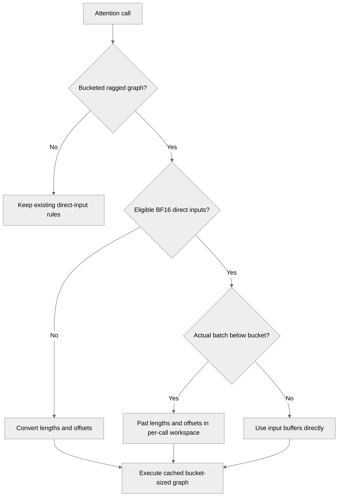

# [Common][Attention][cuDNN] Reuse plans with direct cu_seqlens

[Upstream PR](https://github.com/NVIDIA/TransformerEngine/pull/3700) · state: open · merged: False

## Original PR description

## Summary

Restore sequence-count plan reuse while retaining direct `cu_seqlens`. One kernel pads logical lengths and physical offsets with zero-length tail sequences in caller-owned workspace. Exact-bucket calls avoid the copy; backward behavior is unchanged.

Scoped to BF16 Q/O, both inputs THD, padding masks, no active dropout or bias, vanilla softmax, and no maximum-logit output. Other bucketed configurations retain the conversion fallback.

## Validation and tradeoffs

Matched GB200 comparisons used identical containers/libraries: CUDA 13.5, cuDNN 9.25, Frontend 1.29, driver 580.196.

- **Reuse:** forward builds fell from five to one in a packed replay, avoiding repeated setup stalls.
- **Warm cost:** about 6% forward / 2% forward-plus-backward overhead for the short-sequence case; below 1% forward overhead at 1K-4K one-token sequences. These are attention-only results.
- **Memory:** metadata is linear in bucket size (+576 bytes at bucket 32). Total extra forward workspace reached about 90 KB, including cuDNN plan growth. Backward workspace and saved statistics were unchanged in tested cases.
- **Existing limit:** upstream TE and this PR both passed 4,096 sequences and failed at 4,097 with `b > REMAP_MAX_BATCH` on the tested direct/UNIFIED path. This predates the fix; other paths were not assessed. The padding kernel alone passed 100K sequences with guard checks and zero sanitizer errors.

Native numerical/capture checks passed; cache-reuse regression coverage is included. Full frontend integration was not run locally. See [CI checks](https://github.com/NVIDIA/TransformerEngine/pull/3700/checks).

## Review and discussion

### reviews

- cyanguwa · DISMISSED · 2026-10-17T00:18:50Z · [source](https://github.com/NVIDIA/TransformerEngine/pull/3700#pullrequestreview-5555025174)

(No body; status only.)

### issue_comments

- greptile-apps[bot] · comment · 2026-10-16T19:23:37Z · [source](https://github.com/NVIDIA/TransformerEngine/pull/3700#issuecomment-6223025072)

<!-- greptile_summary -->

<h2><a href="https://app.greptile.com/api/retrigger?id=82450366"><picture><source media="(prefers-color-scheme: dark)" srcset="https://greptile-static-assets.s3.amazonaws.com/badges/RetriggerDark.svg?v=2"><source media="(prefers-color-scheme: light)" srcset="https://greptile-static-assets.s3.amazonaws.com/badges/Retrigger.svg?v=2"></picture></a><a href="https://app.greptile.com/nvidia-public-github/github/NVIDIA/transformerengine/-/pull/3700"><picture><source media="(prefers-color-scheme: dark)" srcset="https://greptile-static-assets.s3.amazonaws.com/badges/ViewInGreptileDark.svg?v=2"><source media="(prefers-color-scheme: light)" srcset="https://greptile-static-assets.s3.amazonaws.com/badges/ViewInGreptile.svg?v=2"></picture></a>Confidence Score: 5/5</h2>

**[High impact]** The PR appears safe to merge; no actionable new issues were found.

<h3>Summary</h3>

Restores graph and plan reuse when packed sequence counts change within one bucket.

- Packed attention runs reuse graphs when their sequence counts change.

No actionable new issues were found. This review checked the code without running GPU tests.

<h3>Diagram</h3>

<!-- greptile_confidence_score:5 -->

Reviews (3) · Last reviewed commit: ["\[Common\] Preserve direct inputs for buck..."](https://github.com/nvidia/transformerengine/commit/f9834524c9562f7be726e21cea5e3fe65ff91955) · [Reviewed by Greptile](https://www.greptile.com/?utm_source=greptile_review&utm_medium=github&utm_campaign=review_public&utm_content=nvidia/transformerengine)

- sudhakarsingh27 · comment · 2026-10-16T19:39:08Z · [source](https://github.com/NVIDIA/TransformerEngine/pull/3700#issuecomment-6223285409)

/te-ci pytorch L0

### inline_comments

- cyanguwa · comment · 2026-10-17T00:18:45Z · [source](https://github.com/NVIDIA/TransformerEngine/pull/3700#discussion_r4300448198)

File: `transformer_engine/common/fused_attn/config_and_params.cpp` · line None

This does safeguard the situation when we bucket the batch size and use cu_seqlens for the graph, but it also disables most of the THD use cases, if we are on sm90+ and not sm120. It's supposed to be an optimization for THD fwd.

I'm approving the PR, but we probably should also look into whether cuDNN can stop reading at cu_seqlens.shape[0], which is [actual_b+1] instead of [bucketed_b+1]. Maybe there's something we can do about it, without losing the optimization (use_cu_seqlens_directly) opportunity.

## Changed files and fixed code

- `tests/pytorch/attention/run_graph_cache.py` · modified · additions 44 / deletions 0
  - [head](https://github.com/sudhakarsingh27/TransformerEngine/blob/f9834524c9562f7be726e21cea5e3fe65ff91955/tests/pytorch/attention/run_graph_cache.py)
  - [base](https://github.com/NVIDIA/TransformerEngine/blob/564e8b00666fcea1c30e9ad64fbcbefd8850c117/tests/pytorch/attention/run_graph_cache.py)
- `tests/pytorch/attention/test_attention.py` · modified · additions 9 / deletions 0
  - [head](https://github.com/sudhakarsingh27/TransformerEngine/blob/f9834524c9562f7be726e21cea5e3fe65ff91955/tests/pytorch/attention/test_attention.py)
  - [base](https://github.com/NVIDIA/TransformerEngine/blob/564e8b00666fcea1c30e9ad64fbcbefd8850c117/tests/pytorch/attention/test_attention.py)
- `transformer_engine/common/fused_attn/config_and_params.cpp` · modified · additions 14 / deletions 8
  - [head](https://github.com/sudhakarsingh27/TransformerEngine/blob/f9834524c9562f7be726e21cea5e3fe65ff91955/transformer_engine/common/fused_attn/config_and_params.cpp)
  - [base](https://github.com/NVIDIA/TransformerEngine/blob/564e8b00666fcea1c30e9ad64fbcbefd8850c117/transformer_engine/common/fused_attn/config_and_params.cpp)
- `transformer_engine/common/fused_attn/fused_attn_f16_arbitrary_seqlen.cu` · modified · additions 34 / deletions 4
  - [head](https://github.com/sudhakarsingh27/TransformerEngine/blob/f9834524c9562f7be726e21cea5e3fe65ff91955/transformer_engine/common/fused_attn/fused_attn_f16_arbitrary_seqlen.cu)
  - [base](https://github.com/NVIDIA/TransformerEngine/blob/564e8b00666fcea1c30e9ad64fbcbefd8850c117/transformer_engine/common/fused_attn/fused_attn_f16_arbitrary_seqlen.cu)
- `transformer_engine/common/fused_attn/utils.cu` · modified · additions 17 / deletions 0
  - [head](https://github.com/sudhakarsingh27/TransformerEngine/blob/f9834524c9562f7be726e21cea5e3fe65ff91955/transformer_engine/common/fused_attn/utils.cu)
  - [base](https://github.com/NVIDIA/TransformerEngine/blob/564e8b00666fcea1c30e9ad64fbcbefd8850c117/transformer_engine/common/fused_attn/utils.cu)
- `transformer_engine/common/fused_attn/utils.h` · modified · additions 6 / deletions 0
  - [head](https://github.com/sudhakarsingh27/TransformerEngine/blob/f9834524c9562f7be726e21cea5e3fe65ff91955/transformer_engine/common/fused_attn/utils.h)
  - [base](https://github.com/NVIDIA/TransformerEngine/blob/564e8b00666fcea1c30e9ad64fbcbefd8850c117/transformer_engine/common/fused_attn/utils.h)

## Evidence and interpretation boundary

[Original JSON, discussions and patches](../../../../../../evidence/prs/NVIDIA--TransformerEngine/3700-f1ffea2973e1c3aa41bec8fb361807f7b9c2d77fdf2a319363485b825f13a1ff.json) · SHA-256 `f1ffea2973e1c3aa41bec8fb361807f7b9c2d77fdf2a319363485b825f13a1ff`.

Diff complete: True. Missing/binary/truncated patches require pinned source inspection. This is a source page, not an independently verified optimization case. Open, merged and released are different states; recheck the deployed dependency.
