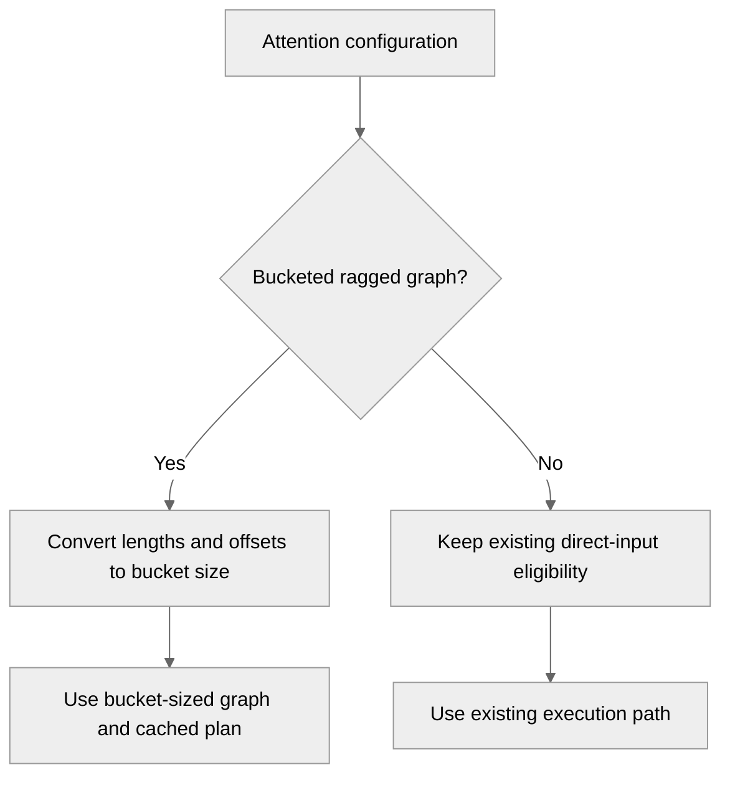

# [Common][Attention][cuDNN] Restore bucketed attention plan reuse

[Upstream PR](https://github.com/NVIDIA/TransformerEngine/pull/3700) · state: open · merged: False

## Original PR description

## Summary

Restore plan reuse when packed THD sequence counts fall within the same batch bucket. Direct cumulative-length inputs contain only `actual_batch + 1` entries, so they cannot safely describe a larger bucketed batch without preparation.

Use the existing length and offset conversions for bucketed ragged graphs. This supplies the bucket-sized metadata and lets those calls share forward plans. Dense/nonbucketed direct paths and backward behavior are unchanged.

The cache regression repacks a fixed token count into different sequence counts and checks forward/backward graph and plan reuse.

## Validation

The restored source matches the earlier revision `4705bb6b`, which passed native output/gradient reference checks on GB200 with CUDA 13.5, cuDNN 9.25 and Frontend 1.29. Scoped pre-commit hooks and whitespace checks pass for the revert. Full frontend integration suites were not run locally; see [CI checks](https://github.com/NVIDIA/TransformerEngine/pull/3700/checks).

## Review and discussion

### reviews

- cyanguwa · DISMISSED · 2026-10-17T00:18:50Z · [source](https://github.com/NVIDIA/TransformerEngine/pull/3700#pullrequestreview-5555025174)

(No body; status only.)

### issue_comments

- greptile-apps[bot] · comment · 2026-10-16T19:23:37Z · [source](https://github.com/NVIDIA/TransformerEngine/pull/3700#issuecomment-6223025072)

<!-- greptile_summary -->

<h2><a href="https://app.greptile.com/api/retrigger?id=82450366"><picture><source media="(prefers-color-scheme: dark)" srcset="https://greptile-static-assets.s3.amazonaws.com/badges/RetriggerDark.svg?v=2"><source media="(prefers-color-scheme: light)" srcset="https://greptile-static-assets.s3.amazonaws.com/badges/Retrigger.svg?v=2"></picture></a><a href="https://app.greptile.com/nvidia-public-github/github/NVIDIA/transformerengine/-/pull/3700"><picture><source media="(prefers-color-scheme: dark)" srcset="https://greptile-static-assets.s3.amazonaws.com/badges/ViewInGreptileDark.svg?v=2"><source media="(prefers-color-scheme: light)" srcset="https://greptile-static-assets.s3.amazonaws.com/badges/ViewInGreptile.svg?v=2"></picture></a>Confidence Score: 5/5</h2>

**[Medium impact]** The PR appears safe to merge; no blocking issues were found.

<h3>Summary</h3>

Restores forward plan reuse when packed sequence counts fall within the same batch bucket.
- Packed THD calls in one batch bucket can reuse attention graphs and plans.

<h3>Diagram</h3>

<!-- greptile_confidence_score:5 -->

Reviews (4) · Last reviewed commit: ["Merge branch &#39;main&#39; into sudhakars/resto..."](https://github.com/nvidia/transformerengine/commit/3db839ea3f14728948b01f85a5e9527a9f740879) · [Reviewed by Greptile](https://www.greptile.com/?utm_source=greptile_review&utm_medium=github&utm_campaign=review_public&utm_content=nvidia/transformerengine)

- sudhakarsingh27 · comment · 2026-10-16T19:39:08Z · [source](https://github.com/NVIDIA/TransformerEngine/pull/3700#issuecomment-6223285409)

/te-ci pytorch L0

- sudhakarsingh27 · comment · 2026-10-19T21:37:11Z · [source](https://github.com/NVIDIA/TransformerEngine/pull/3700#issuecomment-6277931734)

/te-ci pytorch L0 L1

### inline_comments

- cyanguwa · comment · 2026-10-17T00:18:45Z · [source](https://github.com/NVIDIA/TransformerEngine/pull/3700#discussion_r4300448198)

File: `transformer_engine/common/fused_attn/config_and_params.cpp` · line 105

This does safeguard the situation when we bucket the batch size and use cu_seqlens for the graph, but it also disables most of the THD use cases, if we are on sm90+ and not sm120. It's supposed to be an optimization for THD fwd.

I'm approving the PR, but we probably should also look into whether cuDNN can stop reading at cu_seqlens.shape[0], which is [actual_b+1] instead of [bucketed_b+1]. Maybe there's something we can do about it, without losing the optimization (use_cu_seqlens_directly) opportunity.

## Changed files and fixed code

- `tests/pytorch/attention/run_graph_cache.py` · modified · additions 44 / deletions 0
  - [head](https://github.com/sudhakarsingh27/TransformerEngine/blob/3db839ea3f14728948b01f85a5e9527a9f740879/tests/pytorch/attention/run_graph_cache.py)
  - [base](https://github.com/NVIDIA/TransformerEngine/blob/4a3a8a8e8578e96319467d0cc96b9f5db552a7d3/tests/pytorch/attention/run_graph_cache.py)
- `tests/pytorch/attention/test_attention.py` · modified · additions 9 / deletions 0
  - [head](https://github.com/sudhakarsingh27/TransformerEngine/blob/3db839ea3f14728948b01f85a5e9527a9f740879/tests/pytorch/attention/test_attention.py)
  - [base](https://github.com/NVIDIA/TransformerEngine/blob/4a3a8a8e8578e96319467d0cc96b9f5db552a7d3/tests/pytorch/attention/test_attention.py)
- `transformer_engine/common/fused_attn/config_and_params.cpp` · modified · additions 10 / deletions 7
  - [head](https://github.com/sudhakarsingh27/TransformerEngine/blob/3db839ea3f14728948b01f85a5e9527a9f740879/transformer_engine/common/fused_attn/config_and_params.cpp)
  - [base](https://github.com/NVIDIA/TransformerEngine/blob/4a3a8a8e8578e96319467d0cc96b9f5db552a7d3/transformer_engine/common/fused_attn/config_and_params.cpp)

## Evidence and interpretation boundary

[Original JSON, discussions and patches](../../../../../../evidence/prs/NVIDIA--TransformerEngine/3700-77ee3ea3df73bb18bed8cec6964a5b757da08e267bb904fdf473f95f0b25a59e.json) · SHA-256 `77ee3ea3df73bb18bed8cec6964a5b757da08e267bb904fdf473f95f0b25a59e`.

Diff complete: True. Missing/binary/truncated patches require pinned source inspection. This is a source page, not an independently verified optimization case. Open, merged and released are different states; recheck the deployed dependency.
