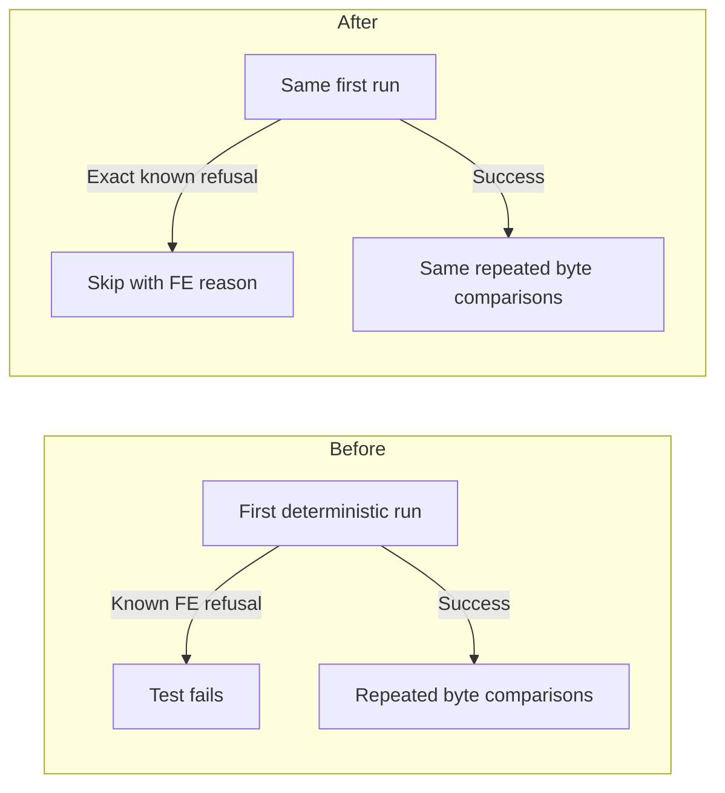

# Skip unsupported grouped MLP dprob determinism checks

[Upstream PR](https://github.com/NVIDIA/TransformerEngine/pull/3702) · state: open · merged: False

## Original PR description

# Description

## Human Reviewers

The positive grouped-MLP dprob determinism test can reach a cuDNN Frontend wrapper that accepts `deterministic=True` but explicitly refuses its configured kernel. On Rubin, its first backward raises the known `NotImplementedError` before the test reaches its byte comparisons.

Recognize that exact refusal around the first run and report the configuration as skipped. A successful first run continues through the existing fusion assertions and repeated byte comparisons. Other exception messages, exception types, and failures during later runs still fail the test.

This changes test classification for an unsupported configuration. The full SM107 grouped-MLP replay preserves every passing case and changes only the known GLU failure to a reasoned skip. Full L0 coverage remains outstanding.

## Agent Reviewers

- Target: `main`, base `eb3c860a4d3394b7eb5e21dba3021fa10782a52e`; head `04a275acb1084a476cee6d8cffcb06487ac5aeaa`.
- Scope: `tests/pytorch/test_grouped_mlp.py`, `TestGroupedMLPDeterminism.test_dprob_is_bit_exact_across_runs`.
- Match only `NotImplementedError` with the complete reason `deterministic dprob is implemented only for the SM100 kernel without dbias`. The handler surrounds the initial `_run()` assignment only. After unwrapping that handler, the complete file's AST matches the base.
- FE retains ownership of per-configuration support, consistent with #3635 and the adjacent runs-or-refuses test. This avoids adding architecture policy to TE's cached wrapper-signature query.
- Full grouped-MLP SM107 replay: **1,256 passed, 4,113 skipped, exit 0**. Baseline: 1,256 passed, 4,112 skipped, one failure. All 5,369 unique JUnit identities match; only the GLU positive case changes from failed to skipped with the exact FE reason. SReLU bytewise determinism and both runs-or-refuses cases stay passed. The new skip is a waiver of an unsupported configuration.
- The candidate Python test ran against installed TE `33f3b3561943fcd9dd2f544f67dc2dfd62efdc9e` production binaries. The affected common/PyTorch production sources match the target base. FE 1.32.0, candidate source identity, native-library identities and process exit were checked in the test environment. This Python-only change required no native rebuild.
- Candidate repeats were pinned to four. The baseline value is inferred from the unchanged default and configuration; its known refusal occurs on the first call.
- Eleven actual-test-tail CPU probes and eight independent FE-guard probes cover successful execution, exact refusal, unrelated errors, later refusal, nonfinite output and byte mismatch. These probes use CPU stand-ins. Independent code and runtime evidence reviews passed.
- Pinned pre-commit hooks, the PyTorch Python lint launcher and the license check passed. Full `L0_*` and PR CI coverage remain outstanding.

## Type of change

- [ ] Documentation change (change only to the documentation, either a fix or a new content)
- [x] Bug fix (non-breaking change which fixes an issue)
- [ ] New feature (non-breaking change which adds functionality)
- [ ] Breaking change (fix or feature that would cause existing functionality to not work as expected)
- [ ] Infra/Build change
- [ ] Code refactoring

## Changes

- Skip the first-run, exact known FE determinism refusal in the positive dprob test.
- Preserve supported-path numerical checks and unrelated failure propagation.

# Checklist

- [x] I have read and followed the [contributing guidelines](https://github.com/NVIDIA/TransformerEngine/blob/main/CONTRIBUTING.rst)
- [x] The functionality is complete
- [x] I have commented my code, particularly in hard-to-understand areas
- [ ] I have made corresponding changes to the documentation
- [ ] My changes generate no new warnings
- [x] I have added tests that prove my fix is effective or that my feature works
- [ ] New and existing unit tests pass locally with my changes

The affected full grouped-MLP suite passed as recorded above; the complete L0/PR matrix remains outstanding. This test-only correction does not change the documented product API. The PR remains draft pending human author review.

## Review and discussion

### reviews

### issue_comments

### inline_comments

## Changed files and fixed code

- `tests/pytorch/test_grouped_mlp.py` · modified · additions 10 / deletions 1
  - [head](https://github.com/yeliu-oss/TransformerEngine/blob/04a275acb1084a476cee6d8cffcb06487ac5aeaa/tests/pytorch/test_grouped_mlp.py)
  - [base](https://github.com/NVIDIA/TransformerEngine/blob/eb3c860a4d3394b7eb5e21dba3021fa10782a52e/tests/pytorch/test_grouped_mlp.py)

## Evidence and interpretation boundary

[Original JSON, discussions and patches](../../../../../../evidence/prs/NVIDIA--TransformerEngine/3702-3eb80a2daf4cb27d9b44229601ae5ca11d78a3e418c9582b783f7a6f94e67b51.json) · SHA-256 `3eb80a2daf4cb27d9b44229601ae5ca11d78a3e418c9582b783f7a6f94e67b51`.

Diff complete: True. Missing/binary/truncated patches require pinned source inspection. This is a source page, not an independently verified optimization case. Open, merged and released are different states; recheck the deployed dependency.
