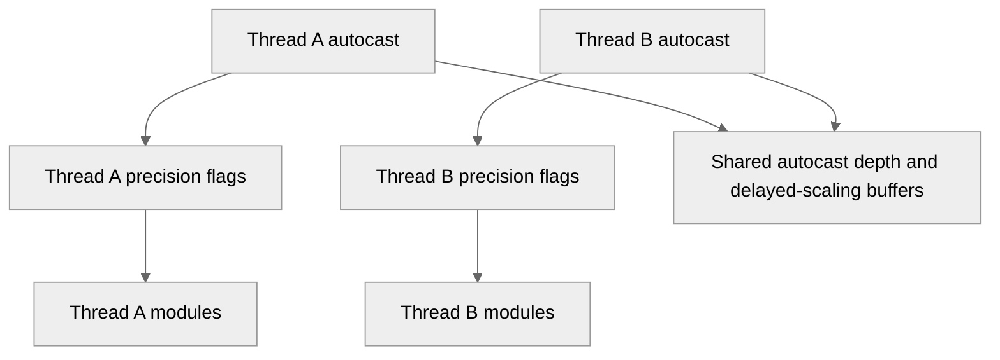

# [PyTorch] Keep autocast precision state per thread

[Upstream PR](https://github.com/NVIDIA/TransformerEngine/pull/3713) · state: open · merged: False

## Original PR description

# Description

TE keeps the autocast precision state for the whole process. Thus an `autocast` in one thread changes the precision of TE modules in all other threads. Example: a BF16 vision encoder runs in a prefetch thread, and the main thread runs an FP8 model. The encoder can then run in MXFP8, and no error occurs.

This PR keeps the autocast precision state per thread.

**Scope:** only the precision flags are per thread. This PR does not make TE thread-safe in general. The delayed-scaling state (`autocast_depth`, amax and scale buffers) stays shared and has no lock.

## Type of change

- [ ] Documentation change (change only to the documentation, either a fix or a new content)
- [x] Bug fix (non-breaking change which fixes an issue)
- [ ] New feature (non-breaking change which adds functionality)
- [ ] Breaking change (fix or feature that would cause existing functionality to not work as expected)
- [ ] Infra/Build change
- [ ] Code refactoring

## Changes

- `fp8_enabled`, `fp8_calibration`, `fp8_recipe`, `fp8_distributed_group`, and `fp8_graph_capturing` move to a thread-local object. The `FP8GlobalState` attributes stay, so the API does not change.
- Amax and scale buffers, autocast depth, and delayed-scaling updates stay process-wide. Backward runs on autograd threads, and CUDA graphs capture buffer addresses.
- `LayerNormMLP` with `checkpoint=True`: the recompute checks the recipe before it restores the caller's autocast state.
- A new thread does not inherit the autocast state of another thread. This is the same as `torch.autocast`.
- New tests in `test_recipe.py`. `test_autocast_state_is_per_thread_under_load` runs FP8 and BF16 modules in two threads at the same time. The BF16 results must match a single-thread run bitwise. Both tests fail on `main`.

| GB200 | `main` | This PR |
|---|---|---|
| `FP8GlobalStateManager.is_fp8_enabled()` per call | 38.5 ns | 64.5 ns |

# Checklist:

- [x] I have read and followed the [contributing guidelines](https://github.com/NVIDIA/TransformerEngine/blob/main/CONTRIBUTING.rst)
- [x] The functionality is complete
- [x] I have commented my code, particularly in hard-to-understand areas
- [ ] I have made corresponding changes to the documentation
- [x] My changes generate no new warnings
- [x] I have added tests that prove my fix is effective or that my feature works
- [x] New and existing unit tests pass locally with my changes

🤖 Generated with [Claude Code](https://claude.com/claude-code)


## Review and discussion

### reviews

- greptile-apps[bot] · COMMENTED · 2026-10-20T05:54:01Z · [source](https://github.com/NVIDIA/TransformerEngine/pull/3713#pullrequestreview-5581252721)

(No body; status only.)

- RobMcH · APPROVED · 2026-10-20T13:39:15Z · [source](https://github.com/NVIDIA/TransformerEngine/pull/3713#pullrequestreview-5585832952)

(No body; status only.)

- timmoon10 · COMMENTED · 2026-10-21T22:04:26Z · [source](https://github.com/NVIDIA/TransformerEngine/pull/3713#pullrequestreview-5606679297)

This PR is committing TE to guarantee thread safety, and we should make sure we can actually guarantee that. For one, we should add non-trivial tests where multiple modules are running simultaneously.

- yashaswikarnati · COMMENTED · 2026-10-22T00:00:50Z · [source](https://github.com/NVIDIA/TransformerEngine/pull/3713#pullrequestreview-5607683274)

(No body; status only.)

### issue_comments

- greptile-apps[bot] · comment · 2026-10-20T05:53:56Z · [source](https://github.com/NVIDIA/TransformerEngine/pull/3713#issuecomment-6284418493)

<!-- greptile_summary -->

<h2><a href="https://app.greptile.com/api/retrigger?id=84170489"><picture><source media="(prefers-color-scheme: dark)" srcset="https://greptile-static-assets.s3.amazonaws.com/badges/RetriggerDark.svg?v=2"><source media="(prefers-color-scheme: light)" srcset="https://greptile-static-assets.s3.amazonaws.com/badges/Retrigger.svg?v=2"></picture></a><a href="https://app.greptile.com/nvidia-public-github/github/NVIDIA/transformerengine/-/pull/3713"><picture><source media="(prefers-color-scheme: dark)" srcset="https://greptile-static-assets.s3.amazonaws.com/badges/ViewInGreptileDark.svg?v=2"><source media="(prefers-color-scheme: light)" srcset="https://greptile-static-assets.s3.amazonaws.com/badges/ViewInGreptile.svg?v=2"></picture></a>Confidence Score: 5/5</h2>

**[Medium impact]** The PR appears safe to merge; the remaining feedback is a non-blocking missing test assertion.

<h2>Findings</h2>

1. &nbsp;**Final update goes unchecked** <a href="https://github.com/NVIDIA/TransformerEngine/pull/3713#discussion_r4321886395">▶</a>

<h3>Summary</h3>

The PR keeps autocast precision choices separate for each thread.
- Each thread keeps its own FP8 autocast settings.

<h3>Diagram</h3>



<!-- greptile_confidence_score:5 -->

<sub>Reviews (3) · Last reviewed commit: ["\[PyTorch\] Test autocast state with two t..."](https://github.com/nvidia/transformerengine/commit/3908c73b21f76ee5ff0035110808439626e310bc) · [Reviewed by Greptile](https://www.greptile.com/?utm_source=greptile_review&utm_medium=github&utm_campaign=review_public&utm_content=nvidia/transformerengine)</sub>

### inline_comments

- greptile-apps[bot] · comment · 2026-10-20T05:54:00Z · [source](https://github.com/NVIDIA/TransformerEngine/pull/3713#discussion_r4321886395)

File: `tests/pytorch/test_recipe.py` · line 564

<a href="#"></a> **Final update goes unchecked**

The test checks that scale updates wait while another thread's `autocast` is open, but never checks that an update happens after that thread exits. Skipping updates entirely would pass this part of the test. After joining the worker, assert `updates == [1]` to cover both halves of the promised behavior.

```suggestion
    assert updates == [1]
    assert not module.fp8
```

Note: If this suggestion doesn't match your team's coding style, reply to this and let me know. I'll remember it for next time!

- timmoon10 · comment · 2026-10-21T21:50:18Z · [source](https://github.com/NVIDIA/TransformerEngine/pull/3713#discussion_r4342342700)

File: `transformer_engine/pytorch/quantization.py` · line 482

What is the overhead of accessing thread-local state compared to plain Python attrs? These fields are accessed frequently, so we should make sure to avoid adding non-trivial overhead (>500 ns).

- yashaswikarnati · comment · 2026-10-22T00:00:50Z · [source](https://github.com/NVIDIA/TransformerEngine/pull/3713#discussion_r4343216142)

File: `transformer_engine/pytorch/quantization.py` · line 482

This is currently 64.5ns (before 38ns), so slight increase. added some benchmark details in the PR description 

## Changed files and fixed code

- `tests/pytorch/test_recipe.py` · modified · additions 96 / deletions 0
  - [head](https://github.com/yashaswikarnati/TransformerEngine/blob/3908c73b21f76ee5ff0035110808439626e310bc/tests/pytorch/test_recipe.py)
  - [base](https://github.com/NVIDIA/TransformerEngine/blob/a7b6c0cbd27fdbf8f1a8d9ed6a9a1d9d012853ba/tests/pytorch/test_recipe.py)
- `transformer_engine/pytorch/module/layernorm_mlp.py` · modified · additions 1 / deletions 1
  - [head](https://github.com/yashaswikarnati/TransformerEngine/blob/3908c73b21f76ee5ff0035110808439626e310bc/transformer_engine/pytorch/module/layernorm_mlp.py)
  - [base](https://github.com/NVIDIA/TransformerEngine/blob/a7b6c0cbd27fdbf8f1a8d9ed6a9a1d9d012853ba/transformer_engine/pytorch/module/layernorm_mlp.py)
- `transformer_engine/pytorch/quantization.py` · modified · additions 46 / deletions 13
  - [head](https://github.com/yashaswikarnati/TransformerEngine/blob/3908c73b21f76ee5ff0035110808439626e310bc/transformer_engine/pytorch/quantization.py)
  - [base](https://github.com/NVIDIA/TransformerEngine/blob/a7b6c0cbd27fdbf8f1a8d9ed6a9a1d9d012853ba/transformer_engine/pytorch/quantization.py)

## Evidence and interpretation boundary

[Original JSON, discussions and patches](../../../../../../evidence/prs/NVIDIA--TransformerEngine/3713-6e91576acde92f00da545f78056a919ab362c734c693583d19bc39b043badee4.json) · SHA-256 `6e91576acde92f00da545f78056a919ab362c734c693583d19bc39b043badee4`.

Diff complete: True. Missing/binary/truncated patches require pinned source inspection. This is a source page, not an independently verified optimization case. Open, merged and released are different states; recheck the deployed dependency.
