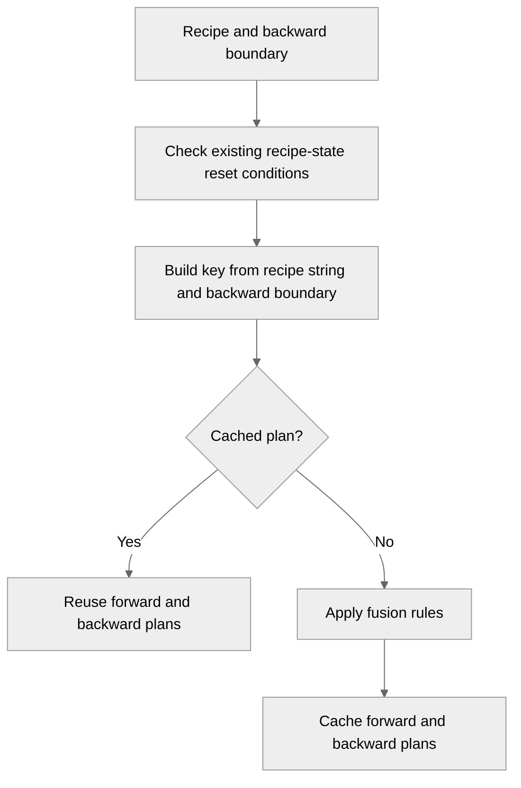

# Rely on Recipe object for fusion

[Upstream PR](https://github.com/NVIDIA/TransformerEngine/pull/3717) · state: closed · merged: True

## Original PR description

# Description

Use the recipe's string representation to select an operation-fusion plan. The previous cache key used the recipe type, backward boundary, and backward override, so a change to another setting on the same recipe type could reuse a plan chosen for the old settings. The new key uses `str(recipe)` and the backward boundary. Recipe classes describe their own settings; `OperationFuser` does not need a growing list of MXFP8, NVFP4, or grouped-MLP recipe options to decide when to re-evaluate fusion.

Recipe representations are cached and invalidated when attributes change. Unexpected public attributes are included too, so changing the dynamically attached `enable_cutedsl_fused_grouped_mlp` flag changes the fusion key. The NVFP4 representation now also includes `disable_rht`.

This follows the motivation in the [original discussion](https://github.com/NVIDIA/TransformerEngine/pull/3410#discussion_r3856621776).

## Type of change

- [x] Bug fix (non-breaking change which fixes an issue)
- [x] Code refactoring

## Changes

- Key the fusion-plan cache by `str(recipe)` and the first operation requiring backward. Keep fusion-plan selection separate from the existing recipe-state reset conditions.
- Cache the module and op-fuser grouped-tensor support checks using the recipe settings each check reads, dtype, split alignment where applicable, and CUDA device. The internal call sites pass the tensor's device, preventing a result from one GPU from being reused for another.
- Cover recipe-representation changes and dynamically attached attributes in the fusion tests.

### CPU overhead of grouped-tensor support checks

BF16 with no recipe on a dlcluster GB200, using `cuda:0` explicitly. Values are median CPU time per call over nine runs of 200,000 calls; the cached path was warm. The uncached functions came from this PR's base commit (`491d557`), and the device-key code is in `793c5ac`.

| Predicate | Before PR (uncached) | After PR (cached) |
| --- | ---: | ---: |
| Module | 1.668 µs | 0.267 µs |
| Op-fuser | 1.549 µs | 0.253 µs |

These numbers use the explicit-device path taken by the internal callers. Omitting `device` requires querying the current CUDA device on each call and has different CPU cost. No GPU kernel changes are included.

### Scope of recipe updates

The fusion-plan cache and quantizer-state reset are separate. This PR changes plan selection; it does not rebuild quantizers when a same-type recipe update changes their configuration. Dynamic recipe update handling is being addressed in [PR #3343](https://github.com/NVIDIA/TransformerEngine/pull/3343).

# Checklist

- [ ] I have read and followed the [contributing guidelines](https://github.com/NVIDIA/TransformerEngine/blob/main/CONTRIBUTING.rst)
- [ ] The functionality is complete
- [x] I have commented my code, particularly in hard-to-understand areas
- [ ] I have made corresponding changes to the documentation
- [ ] My changes generate no new warnings
- [x] I have added tests that prove my fix is effective or that my feature works
- [ ] New and existing unit tests pass locally with my changes


## Review and discussion

### reviews

- greptile-apps[bot] · COMMENTED · 2026-10-20T20:35:03Z · [source](https://github.com/NVIDIA/TransformerEngine/pull/3717#pullrequestreview-5591374779)

(No body; status only.)

- timmoon10 · COMMENTED · 2026-10-20T20:54:37Z · [source](https://github.com/NVIDIA/TransformerEngine/pull/3717#pullrequestreview-5591420595)

(No body; status only.)

- timmoon10 · COMMENTED · 2026-10-20T21:00:03Z · [source](https://github.com/NVIDIA/TransformerEngine/pull/3717#pullrequestreview-5591667065)

(No body; status only.)

- greptile-apps[bot] · COMMENTED · 2026-10-25T20:50:55Z · [source](https://github.com/NVIDIA/TransformerEngine/pull/3717#pullrequestreview-5645227810)

(No body; status only.)

- vthumbe1503 · COMMENTED · 2026-10-26T21:58:03Z · [source](https://github.com/NVIDIA/TransformerEngine/pull/3717#pullrequestreview-5659670473)

(No body; status only.)

- vthumbe1503 · COMMENTED · 2026-10-26T22:00:29Z · [source](https://github.com/NVIDIA/TransformerEngine/pull/3717#pullrequestreview-5659696055)

(No body; status only.)

- vthumbe1503 · COMMENTED · 2026-10-26T22:01:45Z · [source](https://github.com/NVIDIA/TransformerEngine/pull/3717#pullrequestreview-5659707739)

(No body; status only.)

- vthumbe1503 · COMMENTED · 2026-10-26T22:04:56Z · [source](https://github.com/NVIDIA/TransformerEngine/pull/3717#pullrequestreview-5659735328)

(No body; status only.)

- vthumbe1503 · COMMENTED · 2026-10-26T22:31:14Z · [source](https://github.com/NVIDIA/TransformerEngine/pull/3717#pullrequestreview-5659987328)

(No body; status only.)

- greptile-apps[bot] · COMMENTED · 2026-10-26T22:31:44Z · [source](https://github.com/NVIDIA/TransformerEngine/pull/3717#pullrequestreview-5659991842)

(No body; status only.)

- vthumbe1503 · COMMENTED · 2026-10-26T22:32:01Z · [source](https://github.com/NVIDIA/TransformerEngine/pull/3717#pullrequestreview-5659994400)

(No body; status only.)

- vthumbe1503 · COMMENTED · 2026-10-26T22:34:46Z · [source](https://github.com/NVIDIA/TransformerEngine/pull/3717#pullrequestreview-5660017440)

(No body; status only.)

- greptile-apps[bot] · COMMENTED · 2026-10-26T22:49:44Z · [source](https://github.com/NVIDIA/TransformerEngine/pull/3717#pullrequestreview-5660147907)

(No body; status only.)

- timmoon10 · COMMENTED · 2026-10-27T17:54:18Z · [source](https://github.com/NVIDIA/TransformerEngine/pull/3717#pullrequestreview-5671898499)

(No body; status only.)

- timmoon10 · DISMISSED · 2026-10-27T18:56:58Z · [source](https://github.com/NVIDIA/TransformerEngine/pull/3717#pullrequestreview-5672372244)

Overall LGTM, with some minor suggestions.

- timmoon10 · APPROVED · 2026-10-27T19:55:58Z · [source](https://github.com/NVIDIA/TransformerEngine/pull/3717#pullrequestreview-5673425537)

(No body; status only.)

### issue_comments

- greptile-apps[bot] · comment · 2026-10-20T20:34:58Z · [source](https://github.com/NVIDIA/TransformerEngine/pull/3717#issuecomment-6300891839)

<!-- greptile_summary -->

<h2><a href="https://app.greptile.com/api/retrigger?id=84695361"><picture><source media="(prefers-color-scheme: dark)" srcset="https://greptile-static-assets.s3.amazonaws.com/badges/RetriggerDark.svg?v=2"><source media="(prefers-color-scheme: light)" srcset="https://greptile-static-assets.s3.amazonaws.com/badges/Retrigger.svg?v=2"></picture></a><a href="https://app.greptile.com/nvidia-public-github/github/NVIDIA/transformerengine/-/pull/3717"><picture><source media="(prefers-color-scheme: dark)" srcset="https://greptile-static-assets.s3.amazonaws.com/badges/ViewInGreptileDark.svg?v=2"><source media="(prefers-color-scheme: light)" srcset="https://greptile-static-assets.s3.amazonaws.com/badges/ViewInGreptile.svg?v=2"></picture></a>Confidence Score: 5/5</h2>

**[Medium impact]** The PR appears safe to merge; no new blocking issue was found.

<h3>Summary</h3>

The PR selects fusion plans using the recipe string and the backward boundary.
- Fusion plans follow the recipe settings and backward boundary.
- Grouped-tensor routing reuses support checks for matching inputs and GPUs.

No new actionable issues were found. The previous GPU-cache, grouped-MLP flag, and repeated-settings findings are addressed. `vthumbe1503` explained that refreshing quantizers after same-type recipe changes predates this PR and is deferred to PR #3343; Greptile withdrew that finding.

Review checks were based on source inspection; tests were not run.

<h3>Diagram</h3>



<!-- greptile_confidence_score:5 -->

<sub>Reviews (9) · Last reviewed commit: ["Merge branch &#39;main&#39; into recipe\_hash"](https://github.com/nvidia/transformerengine/commit/4bbd74b2cd26e13952d47654e578ef47894a773b) · [Reviewed by Greptile](https://www.greptile.com/?utm_source=greptile_review&utm_medium=github&utm_campaign=review_public&utm_content=nvidia/transformerengine)</sub>

- vthumbe1503 · comment · 2026-10-26T22:46:46Z · [source](https://github.com/NVIDIA/TransformerEngine/pull/3717#issuecomment-6429134208)

/te-ci pytorch

- vthumbe1503 · comment · 2026-10-27T19:13:41Z · [source](https://github.com/NVIDIA/TransformerEngine/pull/3717#issuecomment-6451243948)

/te-ci pytorch

- vthumbe1503 · comment · 2026-10-27T19:40:25Z · [source](https://github.com/NVIDIA/TransformerEngine/pull/3717#issuecomment-6451798827)

Pipeline 77096236

### inline_comments

- greptile-apps[bot] · comment · 2026-10-20T20:35:01Z · [source](https://github.com/NVIDIA/TransformerEngine/pull/3717#discussion_r4330011917)

File: `transformer_engine/common/recipe/__init__.py` · line None

<a href="#"></a> **Different recipes compare equal**

`Recipe.__eq__` now compares strings that leave out meaningful settings. For example, `DelayedScaling(amax_compute_algo='max')` equals `DelayedScaling(amax_compute_algo='most_recent')`. `CustomRecipe` also leaves out `fp8_format`, `fp8_dpa`, and `fp8_mha`.

`init_fp8_metadata` uses equality to skip updates, so switching recipes can leave the module using the previous settings. Include all meaningful fields in equality and hashing, and test recipes that differ in these fields.

- greptile-apps[bot] · comment · 2026-10-20T20:35:01Z · [source](https://github.com/NVIDIA/TransformerEngine/pull/3717#discussion_r4330011932)

File: `transformer_engine/pytorch/module/grouped_linear.py` · line None

<a href="#"></a> **Cache ignores the current GPU**

If one process uses GPUs with different capabilities, this cache can return another GPU's support result. A BF16 call on Hopper can cache `True` for `(None, torch.bfloat16)`. The same call on Ampere then returns `True` without checking that GPU and selects an unsupported grouped path.

Resolve the current GPU before the cached call and include its identity or capability in the key. The same fix is needed in `is_op_fuser_grouped_tensor_path_supported`.

**Knowledge Base Used:** [PyTorch tensor and operator abstractions](https://app.greptile.com/nvidia-public-github/-/custom-context/knowledge-base/nvidia/transformerengine/-/docs/pytorch-tensors-and-ops.md)

- greptile-apps[bot] · comment · 2026-10-20T20:35:01Z · [source](https://github.com/NVIDIA/TransformerEngine/pull/3717#discussion_r4330011941)

File: `transformer_engine/pytorch/ops/fuser.py` · line None

<a href="#"></a> **Recipe changes keep old quantizers**

The new recipe-change check calls `reset_recipe_state`, but that method does not rebuild quantizers for same-type recipes other than delayed scaling. It only updates the metadata's recipe reference.

For example, switching `MXFP8BlockScaling` from E4M3 to HYBRID now changes the fusion plan, but the backward quantizer still emits E4M3 rather than E5M2. Rebuild the affected recipe state and quantizers when these settings change, and test switching recipes on a real quantizing operation.

**Knowledge Base Used:** [PyTorch FP8 and low-precision quantization](https://app.greptile.com/nvidia-public-github/-/custom-context/knowledge-base/nvidia/transformerengine/-/docs/pytorch-quantization.md)

- timmoon10 · comment · 2026-10-20T20:39:07Z · [source](https://github.com/NVIDIA/TransformerEngine/pull/3717#discussion_r4330049882)

File: `transformer_engine/pytorch/ops/basic/grouped_linear.py` · line None

Nit: We can use [`functools.cache`](https://docs.python.org/3/library/functools.html#functools.cache) since we now require Python 3.10+: 
```suggestion
@functools.cache
```

- timmoon10 · comment · 2026-10-20T20:46:39Z · [source](https://github.com/NVIDIA/TransformerEngine/pull/3717#discussion_r4330124635)

File: `transformer_engine/common/recipe/__init__.py` · line None

Can you clarify the difference between the options key and repr? I worry about spilling out op fuser logic into the recipe infra.

- timmoon10 · comment · 2026-10-20T20:47:28Z · [source](https://github.com/NVIDIA/TransformerEngine/pull/3717#discussion_r4330132540)

File: `transformer_engine/pytorch/ops/fuser.py` · line None

Why not use the repr for the cache key? It should include the recipe options as well.

- timmoon10 · comment · 2026-10-20T20:50:11Z · [source](https://github.com/NVIDIA/TransformerEngine/pull/3717#discussion_r4330158525)

File: `transformer_engine/common/recipe/__init__.py` · line None

`enable_cutedsl_fused_grouped_mlp` is a magic attr that is monkeypatched into the recipe for a specific hack, and it should not be considered a real class member. Perhaps the repr should scan for unexpected attrs and include them in the string.

- timmoon10 · comment · 2026-10-20T20:54:22Z · [source](https://github.com/NVIDIA/TransformerEngine/pull/3717#discussion_r4330197028)

File: `tests/pytorch/test_recipe.py` · line None

Do we need to expose this as a contract? It seems like an implementation detail.
```suggestion
```
This test is included in several other tests.

- timmoon10 · comment · 2026-10-20T21:00:03Z · [source](https://github.com/NVIDIA/TransformerEngine/pull/3717#discussion_r4330257002)

File: `transformer_engine/common/recipe/__init__.py` · line 1

This might conflict with https://github.com/NVIDIA/TransformerEngine/pull/3343.

- greptile-apps[bot] · comment · 2026-10-25T20:50:54Z · [source](https://github.com/NVIDIA/TransformerEngine/pull/3717#discussion_r4372363233)

File: `transformer_engine/pytorch/ops/fuser.py` · line None

<a href="#"></a> **Fusion ignores the changed flag**

`CustomRecipe` now shares one fusion-cache key regardless of `enable_cutedsl_fused_grouped_mlp`. After a grouped MLP runs with this flag enabled, turning it off still returns the cached fused plan before the flag is checked. The reverse change also keeps the unfused plan.

Include this flag in the key, as the removed `options_key()` did.

**Knowledge Base Used:** [PyTorch tensor and operator abstractions](https://app.greptile.com/nvidia-public-github/-/custom-context/knowledge-base/nvidia/transformerengine/-/docs/pytorch-tensors-and-ops.md)

- vthumbe1503 · comment · 2026-10-26T21:58:03Z · [source](https://github.com/NVIDIA/TransformerEngine/pull/3717#discussion_r4382978955)

File: `transformer_engine/pytorch/ops/basic/grouped_linear.py` · line None

Done

- vthumbe1503 · comment · 2026-10-26T22:00:29Z · [source](https://github.com/NVIDIA/TransformerEngine/pull/3717#discussion_r4383001553)

File: `transformer_engine/common/recipe/__init__.py` · line None

Yes, we are now using repr for cache key. It turns out there were missing attributes like disable_rht in nvfp4 recipe string. Because of that, fusion plan wasnt rebuilt when needed. Now it added as part of __repr__

- vthumbe1503 · comment · 2026-10-26T22:01:45Z · [source](https://github.com/NVIDIA/TransformerEngine/pull/3717#discussion_r4383011684)

File: `transformer_engine/common/recipe/__init__.py` · line None

We keep track of extra attributes in __setattr__ now. repr uses sorted(extra_attrs) on top of the existing repr, to make sure representation is consistent.

- vthumbe1503 · comment · 2026-10-26T22:04:55Z · [source](https://github.com/NVIDIA/TransformerEngine/pull/3717#discussion_r4383034163)

File: `tests/pytorch/test_recipe.py` · line None

I am no longer supporting hashing for recipe objects. It was introducing more CPU overheads rather than removing them.
grouped_tensor_path_supported function takes in the recipe members individually now, so that we can cache its results

- vthumbe1503 · comment · 2026-10-26T22:31:14Z · [source](https://github.com/NVIDIA/TransformerEngine/pull/3717#discussion_r4383227826)

File: `transformer_engine/pytorch/ops/fuser.py` · line None

This is not something PR introduces. It is pre-existing. As a matter of fact this PR makes it better by redoing the fusion. But fixing the quantizer on recipe update is going to handled in https://github.com/NVIDIA/TransformerEngine/pull/3343

- greptile-apps[bot] · comment · 2026-10-26T22:31:44Z · [source](https://github.com/NVIDIA/TransformerEngine/pull/3717#discussion_r4383231574)

File: `transformer_engine/pytorch/ops/fuser.py` · line None

You're right—this isn't a regression introduced by this PR. The quantizer-refresh gap predates it, and this change improves fusion-plan selection when the recipe changes. PR #3343 explicitly addresses rebuilding recipe state and invalidating quantized weights on recipe updates. The current diff also preserves the existing recipe-state reset conditions while using the recipe representation for the fusion cache key. I'll withdraw this finding.

- vthumbe1503 · comment · 2026-10-26T22:32:01Z · [source](https://github.com/NVIDIA/TransformerEngine/pull/3717#discussion_r4383233536)

File: `transformer_engine/common/recipe/__init__.py` · line 1

Do you mean merge conflict? or design conflict? If it is the latter could you explain how?

- vthumbe1503 · comment · 2026-10-26T22:34:46Z · [source](https://github.com/NVIDIA/TransformerEngine/pull/3717#discussion_r4383252463)

File: `transformer_engine/pytorch/module/grouped_linear.py` · line None

Fixed 

- greptile-apps[bot] · comment · 2026-10-26T22:49:43Z · [source](https://github.com/NVIDIA/TransformerEngine/pull/3717#discussion_r4383354535)

File: `transformer_engine/common/recipe/__init__.py` · line 160

<a href="#"></a> **Recipe settings print twice**

`Recipe.__repr__` appends quantization settings twice for `Float8CurrentScaling`, `Float8BlockScaling`, and `NVFP4BlockScaling`. Their `__post_init__` methods assign public attributes that are not dataclass fields, so the new code tracks them as extras. Each `_make_repr` already prints those attributes.

This repeats settings in logs and makes fusion-cache keys longer. Exclude these existing settings from the extras, or declare them as dataclass fields.

- timmoon10 · comment · 2026-10-27T17:54:18Z · [source](https://github.com/NVIDIA/TransformerEngine/pull/3717#discussion_r4392259348)

File: `transformer_engine/common/recipe/__init__.py` · line 1

That PR adds infrastructure for the recipe to create nested tuples that describe its config, which are easier to compare than the recipes themselves. This PR uses the string representation to do something similar. I like this PR's approach more.

- timmoon10 · comment · 2026-10-27T18:31:59Z · [source](https://github.com/NVIDIA/TransformerEngine/pull/3717#discussion_r4392633355)

File: `transformer_engine/pytorch/module/grouped_linear.py` · line None

On second thought, it's probably better not to let the cache grow without bound. `cache`/`lru_cache(maxsize=None)` should be reserved for functions with no arguments or restricted arguments.
```suggestion
@functools.lru_cache
```

- timmoon10 · comment · 2026-10-27T18:35:29Z · [source](https://github.com/NVIDIA/TransformerEngine/pull/3717#discussion_r4392668728)

File: `transformer_engine/pytorch/ops/basic/grouped_linear.py` · line None

Better to limit the cache size:
```suggestion
@functools.lru_cache
```

- timmoon10 · comment · 2026-10-27T18:40:52Z · [source](https://github.com/NVIDIA/TransformerEngine/pull/3717#discussion_r4392721914)

File: `transformer_engine/pytorch/ops/fuser.py` · line None

Nit: This comment is not documenting the code as it is, it's Claude showing off the debugging that it did. When we look at this in two years, will we understand what the "existing reset conditions" are?
```suggestion
        # Check for changes in recipe parameters that might have invalidated recipe state in basic ops
```

## Changed files and fixed code

- `tests/pytorch/test_fusible_ops.py` · modified · additions 51 / deletions 6
  - [head](https://github.com/vthumbe1503/TransformerEngine/blob/4bbd74b2cd26e13952d47654e578ef47894a773b/tests/pytorch/test_fusible_ops.py)
  - [base](https://github.com/NVIDIA/TransformerEngine/blob/96c0fb0e24915683acc24ca2cf31cac16c798830/tests/pytorch/test_fusible_ops.py)
- `transformer_engine/common/recipe/__init__.py` · modified · additions 37 / deletions 2
  - [head](https://github.com/vthumbe1503/TransformerEngine/blob/4bbd74b2cd26e13952d47654e578ef47894a773b/transformer_engine/common/recipe/__init__.py)
  - [base](https://github.com/NVIDIA/TransformerEngine/blob/96c0fb0e24915683acc24ca2cf31cac16c798830/transformer_engine/common/recipe/__init__.py)
- `transformer_engine/pytorch/module/grouped_linear.py` · modified · additions 42 / deletions 11
  - [head](https://github.com/vthumbe1503/TransformerEngine/blob/4bbd74b2cd26e13952d47654e578ef47894a773b/transformer_engine/pytorch/module/grouped_linear.py)
  - [base](https://github.com/NVIDIA/TransformerEngine/blob/96c0fb0e24915683acc24ca2cf31cac16c798830/transformer_engine/pytorch/module/grouped_linear.py)
- `transformer_engine/pytorch/ops/basic/grouped_linear.py` · modified · additions 41 / deletions 10
  - [head](https://github.com/vthumbe1503/TransformerEngine/blob/4bbd74b2cd26e13952d47654e578ef47894a773b/transformer_engine/pytorch/ops/basic/grouped_linear.py)
  - [base](https://github.com/NVIDIA/TransformerEngine/blob/96c0fb0e24915683acc24ca2cf31cac16c798830/transformer_engine/pytorch/ops/basic/grouped_linear.py)
- `transformer_engine/pytorch/ops/fuser.py` · modified · additions 6 / deletions 4
  - [head](https://github.com/vthumbe1503/TransformerEngine/blob/4bbd74b2cd26e13952d47654e578ef47894a773b/transformer_engine/pytorch/ops/fuser.py)
  - [base](https://github.com/NVIDIA/TransformerEngine/blob/96c0fb0e24915683acc24ca2cf31cac16c798830/transformer_engine/pytorch/ops/fuser.py)

## Evidence and interpretation boundary

[Original JSON, discussions and patches](../../../../../../evidence/prs/NVIDIA--TransformerEngine/3717-03f6a71f0a20c43615d5f0729fdaa58f718f90bccd32ed2147f5a1e8754c50c6.json) · SHA-256 `03f6a71f0a20c43615d5f0729fdaa58f718f90bccd32ed2147f5a1e8754c50c6`.

Diff complete: True. Missing/binary/truncated patches require pinned source inspection. This is a source page, not an independently verified optimization case. Open, merged and released are different states; recheck the deployed dependency.
