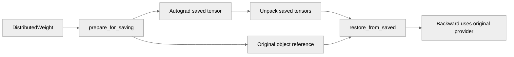

# Fix DistributedWeight handling under saved-tensor hooks

[Upstream PR](https://github.com/NVIDIA/TransformerEngine/pull/3730) · state: closed · merged: True

## Original PR description

# Description

An alternate approach to fixing the bug outlined in #3545 that tackles all modules at once. Cherry-picked parts of tests from @xrennvidia . The main advantages of this approach are tackling CPU overhead and having a central solution that covers all modules that use our `restore_from*` functions.

## Type of change

- [ ] Documentation change (change only to the documentation, either a fix or a new content)
- [x] Bug fix (non-breaking change which fixes an issue)
- [ ] New feature (non-breaking change which adds functionality)
- [ ] Breaking change (fix or feature that would cause existing functionality to not work as expected)
- [ ] Infra/Build change
- [x] Code refactoring

## Changes

- Compared to #3545 , this makes a centralized change that touches all modules by fixing the core issue once in `QuantizedTensor`
- Change B

# Checklist:

- [x] I have read and followed the [contributing guidelines](https://github.com/NVIDIA/TransformerEngine/blob/main/CONTRIBUTING.rst)
- [x] The functionality is complete
- [x] I have commented my code, particularly in hard-to-understand areas
- [x] I have made corresponding changes to the documentation
- [x] My changes generate no new warnings
- [x] I have added tests that prove my fix is effective or that my feature works
- [x] New and existing unit tests pass locally with my changes

## Review and discussion

### reviews

- greptile-apps[bot] · COMMENTED · 2026-10-22T19:26:53Z · [source](https://github.com/NVIDIA/TransformerEngine/pull/3730#pullrequestreview-5619720900)

(No body; status only.)

- xrennvidia · APPROVED · 2026-10-23T06:53:56Z · [source](https://github.com/NVIDIA/TransformerEngine/pull/3730#pullrequestreview-5624916262)

LGTM

- timmoon10 · COMMENTED · 2026-10-23T20:45:07Z · [source](https://github.com/NVIDIA/TransformerEngine/pull/3730#pullrequestreview-5634003695)

This fix is esoteric and I don't see how it addresses the bugs in https://github.com/NVIDIA/TransformerEngine/pull/3545. Can you provide more explanation?

- ksivaman · COMMENTED · 2026-10-23T21:37:31Z · [source](https://github.com/NVIDIA/TransformerEngine/pull/3730#pullrequestreview-5634710877)

(No body; status only.)

- ksivaman · COMMENTED · 2026-10-23T21:46:45Z · [source](https://github.com/NVIDIA/TransformerEngine/pull/3730#pullrequestreview-5634802687)

(No body; status only.)

- ksivaman · COMMENTED · 2026-10-23T22:01:26Z · [source](https://github.com/NVIDIA/TransformerEngine/pull/3730#pullrequestreview-5634911540)

(No body; status only.)

- timmoon10 · COMMENTED · 2026-10-23T22:15:18Z · [source](https://github.com/NVIDIA/TransformerEngine/pull/3730#pullrequestreview-5635006774)

(No body; status only.)

- timmoon10 · DISMISSED · 2026-10-23T22:23:17Z · [source](https://github.com/NVIDIA/TransformerEngine/pull/3730#pullrequestreview-5635033460)

Overall LGTM, with minor suggestions.

- timmoon10 · APPROVED · 2026-10-26T20:24:40Z · [source](https://github.com/NVIDIA/TransformerEngine/pull/3730#pullrequestreview-5658484257)

(No body; status only.)

### issue_comments

- greptile-apps[bot] · comment · 2026-10-22T19:26:48Z · [source](https://github.com/NVIDIA/TransformerEngine/pull/3730#issuecomment-6349401024)

<!-- greptile_summary -->

<h2><a href="https://app.greptile.com/api/retrigger?id=86221812"><picture><source media="(prefers-color-scheme: dark)" srcset="https://greptile-static-assets.s3.amazonaws.com/badges/RetriggerDark.svg?v=2"><source media="(prefers-color-scheme: light)" srcset="https://greptile-static-assets.s3.amazonaws.com/badges/Retrigger.svg?v=2"></picture></a><a href="https://app.greptile.com/nvidia-public-github/github/NVIDIA/transformerengine/-/pull/3730"><picture><source media="(prefers-color-scheme: dark)" srcset="https://greptile-static-assets.s3.amazonaws.com/badges/ViewInGreptileDark.svg?v=2"><source media="(prefers-color-scheme: light)" srcset="https://greptile-static-assets.s3.amazonaws.com/badges/ViewInGreptile.svg?v=2"></picture></a>Confidence Score: 5/5</h2>

**[Medium impact]** The PR appears safe to merge; no new blocking issues were found.

<h3>Summary</h3>

Keeps the original `DistributedWeight` object available to backward when saved-tensor hooks return a plain tensor.
- Distributed weights keep their backward path under saved-tensor hooks.

<h3>Diagram</h3>

<!-- greptile_confidence_score:5 -->

Reviews (4) · Last reviewed commit: ["Rename \_SavedDistributedWeight to \_Saved..."](https://github.com/nvidia/transformerengine/commit/04d18fb18c84bf8da050934cdc2695d11d29d432) · [Reviewed by Greptile](https://www.greptile.com/?utm_source=greptile_review&utm_medium=github&utm_campaign=review_public&utm_content=nvidia/transformerengine)

- ksivaman · comment · 2026-10-22T21:28:43Z · [source](https://github.com/NVIDIA/TransformerEngine/pull/3730#issuecomment-6351717756)

/te-ci pytorch L0

- ksivaman · comment · 2026-10-23T21:47:28Z · [source](https://github.com/NVIDIA/TransformerEngine/pull/3730#issuecomment-6375404658)

> This fix is esoteric and I don't see how it addresses the bugs in #3545. Can you provide more explanation?

With #3545 in its current state, this PR is orthogonal to it.

- ksivaman · comment · 2026-10-26T18:31:46Z · [source](https://github.com/NVIDIA/TransformerEngine/pull/3730#issuecomment-6424196958)

/te-ci pytorch L0

### inline_comments

- greptile-apps[bot] · comment · 2026-10-22T19:26:52Z · [source](https://github.com/NVIDIA/TransformerEngine/pull/3730#discussion_r4352604628)

File: `transformer_engine/pytorch/quantized_tensor.py` · line None

 **Weight changes go unchecked**

`prepare_for_saving` now replaces every eager `DistributedWeight` with `None`, even without saved-tensor hooks. This removes autograd's check for changes to the weight after forward.

If a caller updates a weight between forward and backward—for example, while training on two separately computed losses—backward gathers the updated weight and silently computes input gradients from it instead of raising the previous version-mismatch error. Keep the provider reference, but preserve the version check when hooks are absent.

- timmoon10 · comment · 2026-10-23T20:22:37Z · [source](https://github.com/NVIDIA/TransformerEngine/pull/3730#discussion_r4363889543)

File: `transformer_engine/pytorch/quantized_tensor.py` · line 311

Can you explain in more detail? You're saying that something (in CPU offloading or Mcore or PyTorch?) replaces the contents of `ctx.saved_tensors` with a copy of the original tensors, so that they are not identical objects?

- timmoon10 · comment · 2026-10-23T20:24:29Z · [source](https://github.com/NVIDIA/TransformerEngine/pull/3730#discussion_r4363907546)

File: `transformer_engine/pytorch/quantized_tensor.py` · line None

Does this work? If the old logic was invalid for eager exectuion, I'm skeptical that it's valid under `torch.compile`. It might be better to error out if GTP and `torch.compile` are used together.

- timmoon10 · comment · 2026-10-23T20:40:11Z · [source](https://github.com/NVIDIA/TransformerEngine/pull/3730#discussion_r4364039638)

File: `transformer_engine/pytorch/quantized_tensor.py` · line None

If I understand correctly (maybe false), the root problem is that we need the restored tensor to be identical to the saved tensor (not just identical data, but `restored is saved`) because the saved tensor might have weird monkeypatched attrs (like GTP callbacks). If that's the case, this fix is more general than `DistributedWeight` and it could apply to any class that requires identical tensor objects in the forward and backward.

- ksivaman · comment · 2026-10-23T21:37:31Z · [source](https://github.com/NVIDIA/TransformerEngine/pull/3730#discussion_r4364444517)

File: `transformer_engine/pytorch/quantized_tensor.py` · line None

This is the correct assessment

- ksivaman · comment · 2026-10-23T21:46:45Z · [source](https://github.com/NVIDIA/TransformerEngine/pull/3730#discussion_r4364507880)

File: `transformer_engine/pytorch/quantized_tensor.py` · line 311

Yes pytorch autograd is the culprit. With a hook installed, autograd wraps the return object from the hook into a fresh torch.Tensor, so any attributes set on it are lost. This method works around autograd by saving a reference outside and using that instead. @xrennvidia's #3545 implemented a similar change (now removed) at the module level (linear and groupedlinear).

- ksivaman · comment · 2026-10-23T22:01:25Z · [source](https://github.com/NVIDIA/TransformerEngine/pull/3730#discussion_r4364595995)

File: `transformer_engine/pytorch/quantized_tensor.py` · line None

I'm not sure I follow your comment about the invalid logic? The modules force eager execution for torch compile with `is_distributed_weight` anyway. Although I agree that GTP + torch.compile is untested, so I've opted to error out here.

- timmoon10 · comment · 2026-10-23T22:15:18Z · [source](https://github.com/NVIDIA/TransformerEngine/pull/3730#discussion_r4364674926)

File: `transformer_engine/pytorch/quantized_tensor.py` · line None

Maybe prematurely generalizing, but it may be clearer to rename this to something like `_SavedTensorRef`.

- timmoon10 · comment · 2026-10-23T22:19:08Z · [source](https://github.com/NVIDIA/TransformerEngine/pull/3730#discussion_r4364697950)

File: `tests/pytorch/test_distributed_weight.py` · line None

Do we need to test this? This is more of a PyTorch contract. Even if they break it, it shouldn't affect us since we unconditionally restore the original tensor object for any tensor with `is_distributed_weight=True`.

## Changed files and fixed code

- `tests/pytorch/test_distributed_weight.py` · modified · additions 335 / deletions 2
  - [head](https://github.com/ksivaman/TransformerEngine-1/blob/04d18fb18c84bf8da050934cdc2695d11d29d432/tests/pytorch/test_distributed_weight.py)
  - [base](https://github.com/NVIDIA/TransformerEngine/blob/f2be56a50a95e6401ffcb574d87daabc6fb26b61/tests/pytorch/test_distributed_weight.py)
- `transformer_engine/pytorch/quantized_tensor.py` · modified · additions 39 / deletions 5
  - [head](https://github.com/ksivaman/TransformerEngine-1/blob/04d18fb18c84bf8da050934cdc2695d11d29d432/transformer_engine/pytorch/quantized_tensor.py)
  - [base](https://github.com/NVIDIA/TransformerEngine/blob/f2be56a50a95e6401ffcb574d87daabc6fb26b61/transformer_engine/pytorch/quantized_tensor.py)

## Evidence and interpretation boundary

[Original JSON, discussions and patches](../../../../../../evidence/prs/NVIDIA--TransformerEngine/3730-724ab363f706855cb14f7c2b58a6121535781dc721ce0e3e67366b93062cf310.json) · SHA-256 `724ab363f706855cb14f7c2b58a6121535781dc721ce0e3e67366b93062cf310`.

Diff complete: True. Missing/binary/truncated patches require pinned source inspection. This is a source page, not an independently verified optimization case. Open, merged and released are different states; recheck the deployed dependency.
