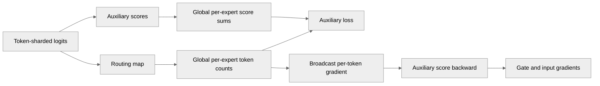

# [JAX] Use local MoE aux-loss computation

[Upstream PR](https://github.com/NVIDIA/TransformerEngine/pull/3731) · state: open · merged: False

## Original PR description

# Description

Currently, the TE MoE block has an implementation for computing the auxiliary loss via a kernel (`fused_moe_aux_loss`) that expects fully-replicated inputs. While this is correct, this implementation is not performant due to (1) the all-gather produced to fully replicate logits to pass to the kernel and (2) each GPU is computing the full work when it could be distributed.

In order to optimize this code path, this PR attempts to optimize this computation by keeping the logits distributed (thus avoiding the large all-gather) and keeping the computation distributed (reducing the flops performed per GPU). Each GPU only performs computation on its local data parallel slices and only perform reductions over small tensors (num_expert elements).

An E2E performance run with this change on DSv4 observed a 7% improvement in step time.

## Type of change

- [ ] Documentation change (change only to the documentation, either a fix or a new content)
- [x] Bug fix (non-breaking change which fixes an issue)
- [ ] New feature (non-breaking change which adds functionality)
- [ ] Breaking change (fix or feature that would cause existing functionality to not work as expected)
- [ ] Infra/Build change
- [ ] Code refactoring

## Changes

Please list the changes introduced in this PR:

- Optimize the aux-loss computation with a JAX-native implementation
- Add a test for validating the auxiliary loss and its gradients

# Checklist:

- [x] I have read and followed the [contributing guidelines](https://github.com/NVIDIA/TransformerEngine/blob/main/CONTRIBUTING.rst)
- [x] The functionality is complete
- [x] I have commented my code, particularly in hard-to-understand areas
- [x] I have made corresponding changes to the documentation
- [x] My changes generate no new warnings
- [x] I have added tests that prove my fix is effective or that my feature works
- [x] New and existing unit tests pass locally with my changes

## Review and discussion

### reviews

### issue_comments

- greptile-apps[bot] · comment · 2026-10-22T20:32:37Z · [source](https://github.com/NVIDIA/TransformerEngine/pull/3731#issuecomment-6350681408)

<!-- greptile_summary -->

<h2><a href="https://app.greptile.com/api/retrigger?id=86270810"><picture><source media="(prefers-color-scheme: dark)" srcset="https://greptile-static-assets.s3.amazonaws.com/badges/RetriggerDark.svg?v=2"><source media="(prefers-color-scheme: light)" srcset="https://greptile-static-assets.s3.amazonaws.com/badges/Retrigger.svg?v=2"></picture></a><a href="https://app.greptile.com/nvidia-public-github/github/NVIDIA/transformerengine/-/pull/3731"><picture><source media="(prefers-color-scheme: dark)" srcset="https://greptile-static-assets.s3.amazonaws.com/badges/ViewInGreptileDark.svg?v=2"><source media="(prefers-color-scheme: light)" srcset="https://greptile-static-assets.s3.amazonaws.com/badges/ViewInGreptile.svg?v=2"></picture></a>Confidence Score: 5/5</h2>

**[Medium impact]** The PR appears safe to merge; no actionable issues were found.

<h3>Summary</h3>

The PR computes the MoE auxiliary loss from token-sharded scores instead of gathering all logits onto every GPU.
- JAX MoE computes its auxiliary loss from sharded tokens.

No actionable issues were found. The review checked the code and native kernel formulas; GPU tests were not run.

<h3>Diagram</h3>

<!-- greptile_confidence_score:5 -->

Reviews (1) · Last reviewed commit: ["Adjust tolerances"](https://github.com/nvidia/transformerengine/commit/64d7e605af7393ca4749f3ab4f7f3eb5aeb1f841) · [Reviewed by Greptile](https://www.greptile.com/?utm_source=greptile_review&utm_medium=github&utm_campaign=review_public&utm_content=nvidia/transformerengine)

### inline_comments

## Changed files and fixed code

- `tests/jax/test_te_ep_moe.py` · modified · additions 88 / deletions 4
  - [head](https://github.com/dinodeep/TransformerEngine/blob/64d7e605af7393ca4749f3ab4f7f3eb5aeb1f841/tests/jax/test_te_ep_moe.py)
  - [base](https://github.com/NVIDIA/TransformerEngine/blob/9ea05cf2e8dc275d2fd3c88d39062ba20947b77d/tests/jax/test_te_ep_moe.py)
- `transformer_engine/jax/moe.py` · modified · additions 40 / deletions 48
  - [head](https://github.com/dinodeep/TransformerEngine/blob/64d7e605af7393ca4749f3ab4f7f3eb5aeb1f841/transformer_engine/jax/moe.py)
  - [base](https://github.com/NVIDIA/TransformerEngine/blob/9ea05cf2e8dc275d2fd3c88d39062ba20947b77d/transformer_engine/jax/moe.py)

## Evidence and interpretation boundary

[Original JSON, discussions and patches](../../../../../../evidence/prs/NVIDIA--TransformerEngine/3731-97896ca16ec2fc49e42bfa2f890203f5ce501f6c3ab46e896ac618db6499c319.json) · SHA-256 `97896ca16ec2fc49e42bfa2f890203f5ce501f6c3ab46e896ac618db6499c319`.

Diff complete: True. Missing/binary/truncated patches require pinned source inspection. This is a source page, not an independently verified optimization case. Open, merged and released are different states; recheck the deployed dependency.
