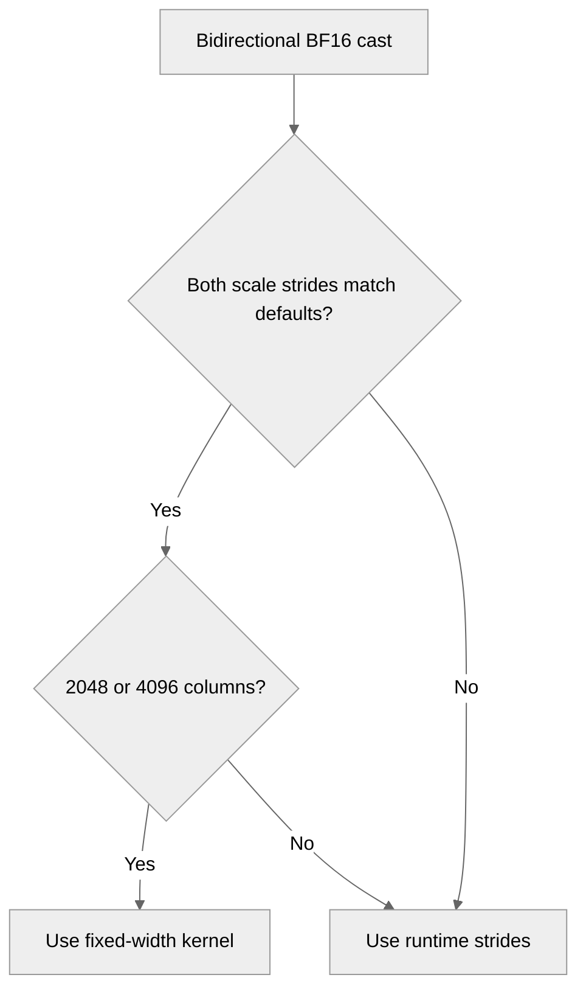

# [Common] Honor MXFP8 scale strides in specialized casts

[Upstream PR](https://github.com/NVIDIA/TransformerEngine/pull/3737) · state: open · merged: False

## Original PR description

# Description

Prevent silent scale corruption when bidirectional BF16-to-MXFP8 quantization writes to output buffers with caller-provided scale pitches. The FP8 data can be correct while misplaced scales cause downstream dequantization to use the wrong exponents.

The 2048- and 4096-column specializations bake in TE's default padded scale strides. Use them only when both supplied strides match those constants. Custom layouts use the existing runtime-stride kernel, while default layouts retain their specialized dispatch.

Related to #3710.

## Type of change

- [ ] Documentation change (change only to the documentation, either a fix or a new content)
- [x] Bug fix (non-breaking change which fixes an issue)
- [ ] New feature (non-breaking change which adds functionality)
- [ ] Breaking change (fix or feature that would cause existing functionality to not work as expected)
- [ ] Infra/Build change
- [ ] Code refactoring

## Changes

- Keep K-specialized launches for matching default scale strides and use runtime strides for custom layouts.
- Add GPU regression coverage for both FP8 formats, custom pitches in either direction, and default-layout/runtime-width controls. Compare FP8 data and scale bytes with canonical quantization output.
- Run the regression on Blackwell quantization hardware, including SM120, without requiring MXFP8 GEMM support.

## Before and after

A CUDA E4M3 reproducer on an RTX 5070 Ti used seed 1234 and BF16 input `(8 * torch.randn((64, 2048), device="cuda")).bfloat16()`. The unswizzled output scale shapes were `(64, 68)` and `(2, 2064)`, adding 4 rowwise and 16 columnwise pitch entries.

| Logical scale region compared with canonical quantization | Before | After |
| --- | --- | --- |
| Rowwise: `64 x 64` scale bytes | 842 of 4096 incorrect | 0 of 4096 incorrect |
| Columnwise: `2 x 2048` scale bytes | 348 of 4096 incorrect | 0 of 4096 incorrect |

The FP8 payload matched exactly in both runs. The fix eliminated the scale mismatches, and the scale-buffer guards remained untouched.

## Validation

The before/after comparison used CUDA 13.2 and PyTorch 2.12.1 on SM120, with the CUDA quantization backend selected. The focused regression fails before the fix and passes afterward.

Rebuilt the common library and PyTorch extension for the merged tree at `dcc0aa28`, with CuTeDSL support enabled and NCCL EP disabled. Verified that the imported libraries came from the tested checkout. The pitched-scale regression and backend-routing probes passed, including restoration after an injected failure. Direct CUDA launcher checks, Compute Sanitizer memcheck, scoped pre-commit, C++ lint, and the license check also passed.

This head (`94199c08`) was also compared with its base (`63451d6b`) on NVIDIA B200 (SM100, driver 580.95.05). Both trees were built for `100a` with CuTeDSL support enabled and NCCL EP disabled, and imports resolved to each tree. Two toolchains were used: PyTorch 2.13.0+cu130 with CUDA 13.0, cuDNN 9.20, and cuBLAS 13.4, and PyTorch 2.15.0+cu132 with CUDA 13.2, cuDNN 9.26, cuBLAS 13.4, and FlashAttention 2.8.4.

- On both toolchains, the regression fails on the base for exactly the custom-pitch 2048- and 4096-column layouts. It finds no failures on this head, with `NVTE_ENABLE_CUTEDSL_BACKEND` set to `0` and `1`.
- On both toolchains, a separate check decoded the FP8 data and E8M0 scales without TE's dequantize kernels. On the base, those same layouts had wrong scales, failed the round trip, and wrote into the pitch gaps. On this head, it found no errors, and the pitch gaps kept their fill value.
- Profiler kernel names show the `K=2048` and `K=4096` instantiations for default layouts and `K=0` for custom pitches.
- Compute Sanitizer memcheck on the 2048-column regression cases reported no errors on both toolchains.
- On the second toolchain, the L0 PyTorch, PyTorch debug, C++, and JAX suites ran on both trees, with each job in its own directory. No test failed on only one tree. The PyTorch runs set `NVIDIA_TF32_OVERRIDE=0`. The failures on both trees are `test_torch_compile.py` (#3716) and `test_dot_product_attention_score_mod` in `test_flex_attention.py`. The second one comes from `nvidia-cudnn-frontend` 1.31.0 and newer, which this run installed, and #3796 fixes it.
- This diff was also applied to current `main` (`b0219803`, which includes #3160) and rebuilt with the second toolchain. The regression and the separate decode check fail without the kernel change and find no failures with it, default layouts keep their specialized kernels, and no L0 PyTorch test failed on only one tree.
- On the second toolchain, `tests/pytorch/mxfp8` with the CuTeDSL backend enabled found no failures on either tree. That backend rejects these compact scale shapes with `Invalid mS_row.shape[0]` on both trees, which is one more reason the regression stays on CUDA.
- JAX results do not exercise this change directly. The JAX quantize binding uses swizzled scales, and JAX forces the CuTeDSL backend off, so its cross-backend test skips.

No program under `benchmarks/` covers this cast, so a one-off script measured it on one B200 with the second toolchain, the CUDA backend, and BF16 input from `8 * randn` to E4M3 with unswizzled scales. Each run used 50 warm-up calls, then 400 timed calls with `cuda.synchronize()` after each. Kernel time comes from `torch.profiler` over 40 more calls. The values are medians over four alternating runs per build.

| Rows x cols | Scale layout | Kernel on base / this PR | Kernel time on base / this PR (us) |
| --- | --- | --- | --- |
| 4096 x 2048 | Default | `K=2048` / `K=2048` | 4.9 / 4.9 |
| 16384 x 4096 | Default | `K=4096` / `K=4096` | 41.8 / 41.8 |
| 16384 x 2048 | Custom row and column pitch | `K=2048` / `K=0` | 18.6 / 19.4 |
| 16384 x 4096 | Custom row and column pitch | `K=4096` / `K=0` | 41.8 / 42.1 |

For default layouts, the median time per call differs by at most about 1%, which is less than the spread between runs. For custom pitches, the base times come from output with wrong scales, so the difference is the cost of the correct kernel and not a regression.

Rerun the focused check with:

```bash
python -m pytest tests/pytorch/test_quantized_tensor.py -k pitched_scales
```

A100 and H100 were not run for this comparison. Upstream L0 still needs a fresh run on this head.

# Checklist:

- [x] I have read and followed the [contributing guidelines](https://github.com/NVIDIA/TransformerEngine/blob/main/CONTRIBUTING.rst)
- [x] The functionality is complete
- [ ] I have commented my code, particularly in hard-to-understand areas
- [ ] I have made corresponding changes to the documentation
- [x] My changes generate no new warnings
- [x] I have added tests that prove my fix is effective or that my feature works
- [ ] New and existing unit tests pass locally with my changes


## Review and discussion

### reviews

- greptile-apps[bot] · COMMENTED · 2026-10-26T03:45:27Z · [source](https://github.com/NVIDIA/TransformerEngine/pull/3737#pullrequestreview-5647107922)

(No body; status only.)

- kainzhong · COMMENTED · 2026-10-26T20:57:02Z · [source](https://github.com/NVIDIA/TransformerEngine/pull/3737#pullrequestreview-5658879749)

(No body; status only.)

- greptile-apps[bot] · COMMENTED · 2026-10-26T20:57:47Z · [source](https://github.com/NVIDIA/TransformerEngine/pull/3737#pullrequestreview-5658890652)

(No body; status only.)

- kainzhong · APPROVED · 2026-10-27T17:14:34Z · [source](https://github.com/NVIDIA/TransformerEngine/pull/3737#pullrequestreview-5671360875)

(No body; status only.)

- bvolpato · COMMENTED · 2026-10-28T03:22:13Z · [source](https://github.com/NVIDIA/TransformerEngine/pull/3737#pullrequestreview-5677400896)

(No body; status only.)

### issue_comments

- greptile-apps[bot] · comment · 2026-10-26T03:45:23Z · [source](https://github.com/NVIDIA/TransformerEngine/pull/3737#issuecomment-6407748339)

<!-- greptile_summary -->

<h2><a href="https://app.greptile.com/api/retrigger?id=87887249"><picture><source media="(prefers-color-scheme: dark)" srcset="https://greptile-static-assets.s3.amazonaws.com/badges/RetriggerDark.svg?v=2"><source media="(prefers-color-scheme: light)" srcset="https://greptile-static-assets.s3.amazonaws.com/badges/Retrigger.svg?v=2"></picture></a><a href="https://app.greptile.com/-/switch-tenant?tenant=nvidia-public-github&amp;next=%2FNVIDIA%2Ftransformerengine%2Fpull%2F3737&amp;utm_source=greptile_review&amp;utm_medium=github&amp;utm_campaign=view_in_greptile"><picture><source media="(prefers-color-scheme: dark)" srcset="https://greptile-static-assets.s3.amazonaws.com/badges/ViewInGreptileDark.svg?v=2"><source media="(prefers-color-scheme: light)" srcset="https://greptile-static-assets.s3.amazonaws.com/badges/ViewInGreptile.svg?v=2"></picture></a>Confidence Score: 5/5</h2>

**[Medium impact]** The PR appears safe to merge; no new blocking issue was found.

<h3>Summary</h3>

The PR keeps the 2048- and 4096-column fast paths only when both scale strides match their built-in values. Other layouts use the existing kernel that reads the supplied strides.

- Bidirectional quantization follows the scale pitches supplied by the output tensors.

<h3>Diagram</h3>



<!-- greptile_confidence_score:5 -->

<sub>Reviews (5) · Last reviewed commit: ["\[CI\] Merge main to include grouped split..."](https://github.com/nvidia/transformerengine/commit/94199c082dcfd4df2a8a3919b9dd29fdcdb5c6b3) · [Reviewed by Greptile](https://www.greptile.com/?utm_source=greptile_review&utm_medium=github&utm_campaign=review_public&utm_content=nvidia/transformerengine)</sub>

- tdophung · comment · 2026-10-27T18:58:28Z · [source](https://github.com/NVIDIA/TransformerEngine/pull/3737#issuecomment-6450939891)

/te-ci L0

- bvolpato · comment · 2026-10-28T03:46:15Z · [source](https://github.com/NVIDIA/TransformerEngine/pull/3737#issuecomment-6460137507)

Merged current main (`9b7e959`) into `dcc0aa28a298afe523f0e99d29a64ff9a3a419f5` to include #3722's Hopper test-reference fix. The PR diff remains limited to the two MXFP8 stride-fix files.

Rebuilt the common library and PyTorch extension on an RTX 5070 Ti (SM120), CUDA 13.2 and PyTorch 2.12.1, with CuTeDSL support enabled and NCCL EP disabled. The CUDA pitched-scale regression passes. Backend-routing probes also confirm that the fixture restores CuTeDSL dispatch after normal completion and an injected failure. Scoped pre-commit, C++ lint, and the license check pass.

The previous runtime failures need CI-side follow-up:

- `Missing tp_richcompare_impl override` occurs during Dynamo's `FusedAttnBackend` comparison, before CUDA dispatch ([this PR](https://github.com/NVIDIA/TransformerEngine/actions/runs/40599046209), [the same error in #3722](https://github.com/NVIDIA/TransformerEngine/actions/runs/40582392152)).
- The [JAX A100 mHC failures](https://github.com/NVIDIA/TransformerEngine/actions/runs/40598993334) report `CUDA_ERROR_OUT_OF_MEMORY [executable_name='jit_fused']`. That suite is unchanged here. The uploaded logs do not identify the tested source revision or full runtime versions.

Could the four `action_required` workflows be approved and L0 rerun on `dcc0aa28a298afe523f0e99d29a64ff9a3a419f5`? If the compiler or A100 failures recur, recording the tested revision and PyTorch/CUDA/cuDNN versions would help distinguish a shared CI issue from a regression.


- greptile-apps[bot] · comment · 2026-10-28T03:47:59Z · [source](https://github.com/NVIDIA/TransformerEngine/pull/3737#issuecomment-6460159455)

Want your agent to iterate on Greptile's feedback? Try [*greploops*](https://github.com/greptileai/skills/blob/main/greploop/SKILL.md).

- kainzhong · comment · 2026-10-28T16:09:00Z · [source](https://github.com/NVIDIA/TransformerEngine/pull/3737#issuecomment-6474165270)

/te-ci

- bvolpato · comment · 2026-10-30T03:15:17Z · [source](https://github.com/NVIDIA/TransformerEngine/pull/3737#issuecomment-6514070078)

Merged current `main` in `5c8e74adffefd9244e6429b97baabf9574c741aa`, including #3770's documentation import fix. The PR diff remains limited to the CUDA stride guard and its regression in `test_quantized_tensor.py`.

Validation on the merged tree passed:

- Rebuilt the common library and PyTorch extension with CuTeDSL support enabled and NCCL EP disabled. Verified that both imported libraries came from the tested checkout.
- The pitched-scale regression passes with `NVTE_ENABLE_CUTEDSL_BACKEND=0` and `1`. The fixture keeps these cases on CUDA. Routing probes confirm backend restoration after both normal completion and an injected assertion failure.
- The full `tests/pytorch/test_quantized_tensor.py` file passes.
- `doxygen docs/Doxyfile` and `make -C docs html SPHINXOPTS="-W"` pass. The previous `te_device_type` import warnings are gone.
- Scoped pre-commit, C++ lint, and the license check pass. DCO and hosted pre-commit also pass on the new head.

The GPU checks used one RTX 5070 Ti (SM120), driver 595.71.05, PyTorch 2.12.1, CUDA 13.2, cuDNN 9.20, and NCCL 2.29.7. Full L0 and A100/H100/B200 execution have not been rerun locally.

The remaining upstream checks need CI-side follow-up. The new Documentation, License, Lint, and Minimum Supported Versions runs are `action_required` with zero jobs, including [Documentation](https://github.com/NVIDIA/TransformerEngine/actions/runs/40996109690).

The previous runtime logs identify separate dependency issues:

- The Dynamo `Missing tp_richcompare_impl override` failure is tracked in #3716, with the PyTorch fix in pytorch/pytorch#199496 still open.
- The [B200 log](https://github.com/NVIDIA/TransformerEngine/actions/runs/40752312882) reports `module 'cutlass' has no attribute 'Arch'` during CuTeDSL registration, followed by fallback assertions. It also reports missing cuDNN engine plans for GDN2/GDP/KDA. Those paths are unchanged by this PR.

Could a maintainer approve the gated workflows and rerun L0 on `5c8e74ad` with a compatible CI image? Recording the tested source revision and PyTorch/CUDA/cuDNN/CUTLASS DSL versions would help confirm the remaining failures.


- kainzhong · comment · 2026-10-30T17:24:50Z · [source](https://github.com/NVIDIA/TransformerEngine/pull/3737#issuecomment-6529003486)

/te-ci

- kainzhong · comment · 2026-10-30T17:25:53Z · [source](https://github.com/NVIDIA/TransformerEngine/pull/3737#issuecomment-6529026206)

Sorry there was a CI issue which should be fixed by now. I'm re-triggering another CI

- bvolpato · comment · 2026-10-31T21:01:48Z · [source](https://github.com/NVIDIA/TransformerEngine/pull/3737#issuecomment-6549084227)

Merged current `main` (`63451d6b`) into `94199c082dcfd4df2a8a3919b9dd29fdcdb5c6b3`, bringing in #3785's grouped-split validation fix. The PR diff still contains only the original MXFP8 stride guard and its regression.

Rebuilt the common library and PyTorch extension from the merged tree, with CuTeDSL support enabled and NCCL EP disabled. Verified that both imported libraries came from this checkout.

Validation passed:

- The pitched-scale regression with `NVTE_ENABLE_CUTEDSL_BACKEND=0` and `1`, plus the full `test_quantized_tensor.py` file.
- The BF16 grouped-linear deferred-initialization cases that previously hit the split-alignment trap.
- The full `test_ops_grouped_linear_distributed_weight.py` file, including the small unquantized splits and FP32 weight-gradient cases.
- Documentation with `SPHINXOPTS="-W"`, scoped pre-commit, C++ lint, and the license check.

The grouped checks can be rerun with:

```bash
python -m pytest tests/pytorch/test_fusible_ops.py::TestFuser::test_deferred_param_init -k grouped_linear -q
PYTORCH_JIT=0 NVTE_TORCH_COMPILE=0 python -m pytest tests/pytorch/test_ops_grouped_linear_distributed_weight.py -q
```

Local GPU validation used one RTX 5070 Ti (SM120), driver 595.71.05, PyTorch 2.12.1, CUDA 13.2, cuDNN 9.20, and NCCL 2.29.7. A100/H100/B200 L0 still needs fresh execution on this head.

The four new public workflows are `action_required`, including [Documentation](https://github.com/NVIDIA/TransformerEngine/actions/runs/41241605356). Please approve them and rerun L0 on `94199c08`. The previous B200 FlashAttention/Quack failure also occurs on #3785, so that dependency issue may still need CI-image follow-up.


### inline_comments

- greptile-apps[bot] · comment · 2026-10-26T03:45:26Z · [source](https://github.com/NVIDIA/TransformerEngine/pull/3737#discussion_r4373764194)

File: `tests/pytorch/test_quantized_tensor.py` · line 1047

<a href="#"></a> **Test can bypass CUDA**

If `NVTE_ENABLE_CUTEDSL_BACKEND=1`, both quantizations can run through CuTeDSL instead of the changed `launch_tiled` code. `optimize_for_gemm=False` selects the scale layout, not the backend. A broken CUDA dispatch could therefore pass this regression test.

Disable CuTeDSL for this test and restore the previous setting afterward.

**Knowledge Base Used:** [Verification and CI matrix](https://app.greptile.com/nvidia-public-github/-/custom-context/knowledge-base/nvidia/transformerengine/-/docs/verification-and-ci.md)

- kainzhong · comment · 2026-10-26T20:57:01Z · [source](https://github.com/NVIDIA/TransformerEngine/pull/3737#discussion_r4382383930)

File: `tests/pytorch/test_quantized_tensor.py` · line 1047

@bvolpato you can use `set_cutedsl_backend(False)` to turn off CuTeDSL at python runtime, or you can let this test use CuTeDSL backend and add a test in `tests/pytorch/mxfp8/test_mxfp8_cutedsl_backend.py` to make sure CuTeDSL and CUDA give bit-exact reslut (so this test validates CuTeDSL's result is correct, and `test_mxfp8_cutedsl_backend.py` validates CUDA gives the same result as CuTeDSL, which means CUDA's result is also correct).

Since I plan to port this kernel to CuTeDSL in #3642, I think the latter solution should work better.

- greptile-apps[bot] · comment · 2026-10-26T20:57:47Z · [source](https://github.com/NVIDIA/TransformerEngine/pull/3737#discussion_r4382391210)

File: `tests/pytorch/test_quantized_tensor.py` · line 1047

That approach works if the cross-backend test also exercises these custom-pitch layouts and explicitly compares CUDA against CuTeDSL for them. The existing `test_mxfp8_cutedsl_backend.py` cases allocate default-layout outputs, so bit-exactness there does not establish that CUDA handles the larger pitches correctly—the stride-specific bug could still pass the pitched test when both quantizations use CuTeDSL. If you add pitched cases to the backend comparison and keep its CUDA dispatch assertion, the separate runtime-backend toggle in this test is unnecessary.

- bvolpato · comment · 2026-10-28T03:22:13Z · [source](https://github.com/NVIDIA/TransformerEngine/pull/3737#discussion_r4396571529)

File: `tests/pytorch/test_quantized_tensor.py` · line 1047

The fixture now disables CuTeDSL for the pitched-scale cases and restores the configured backend in teardown, so the regression exercises the changed CUDA path. This is in b853fb9.

## Changed files and fixed code

- `tests/pytorch/test_quantized_tensor.py` · modified · additions 64 / deletions 0
  - [head](https://github.com/bvolpato/TransformerEngine/blob/94199c082dcfd4df2a8a3919b9dd29fdcdb5c6b3/tests/pytorch/test_quantized_tensor.py)
  - [base](https://github.com/NVIDIA/TransformerEngine/blob/63451d6b868af0db6dd879cf5dd6a3f9bf14e1f9/tests/pytorch/test_quantized_tensor.py)
- `transformer_engine/common/cast/mxfp8/specialized/cast_bidim.cuh` · modified · additions 4 / deletions 1
  - [head](https://github.com/bvolpato/TransformerEngine/blob/94199c082dcfd4df2a8a3919b9dd29fdcdb5c6b3/transformer_engine/common/cast/mxfp8/specialized/cast_bidim.cuh)
  - [base](https://github.com/NVIDIA/TransformerEngine/blob/63451d6b868af0db6dd879cf5dd6a3f9bf14e1f9/transformer_engine/common/cast/mxfp8/specialized/cast_bidim.cuh)

## Evidence and interpretation boundary

[Original JSON, discussions and patches](../../../../../../evidence/prs/NVIDIA--TransformerEngine/3737-eff7db37bc6f2c0b38b463e95e952dd6b9618d9901e0e64edd7bd2fcaab9cf9e.json) · SHA-256 `eff7db37bc6f2c0b38b463e95e952dd6b9618d9901e0e64edd7bd2fcaab9cf9e`.

Diff complete: True. Missing/binary/truncated patches require pinned source inspection. This is a source page, not an independently verified optimization case. Open, merged and released are different states; recheck the deployed dependency.
