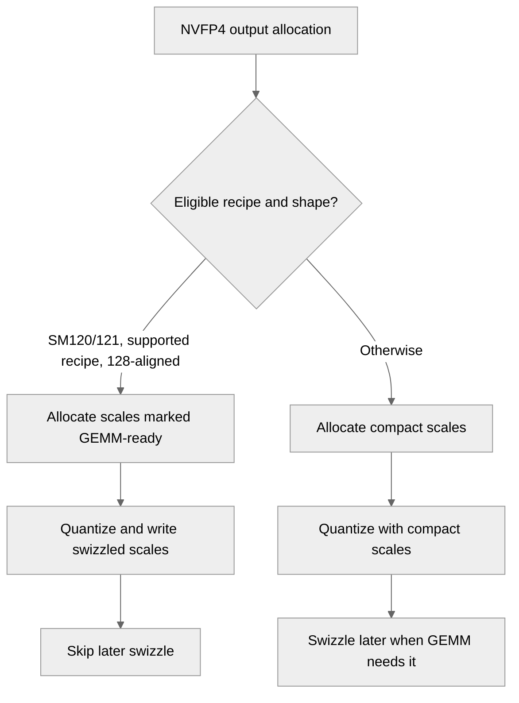

# [Common, PyTorch] Fuse NVFP4 scale swizzling on SM120 and SM121

[Upstream PR](https://github.com/NVIDIA/TransformerEngine/pull/3749) · state: open · merged: False

## Original PR description

# Description

On SM120/SM121, an NVFP4 quantizer that requests GEMM-ready scales (`optimize_for_gemm`) always gets
compact scales from the quantize kernel, followed by the standalone post-quantize swizzle pass:
`gemm_swizzled_scales_alignment` gates the existing in-kernel 2D path to SM100/110, and
`nvte_quantize_with_hadamard_transform` rejects swizzled output on the SM12x no-TMEM RHT path.

This PR writes the scales directly in the cuBLAS GEMM layout on SM120/SM121 when rows and columns are
multiples of 128: the generic 1D, columnwise-RHT 1D and tuned 1D kernels gain a swizzled store, and the
existing 2D in-kernel path is enabled there. FP4 data, scale values and amaxes are unchanged; shapes with
partial scale tiles keep compact allocation and the existing post-quantize fallback.

An eligible quantize call then launches two fewer kernels (the row-wise and column-wise swizzle passes) and
does not allocate replacement scale buffers. One consequence: the existing cached-weight tests in
`tests/pytorch/nvfp4/test_nvfp4_weight_swizzle_cache.py` fail on SM120 at `main`: the post-quantize swizzle
reallocates a cached weight's scale buffers on every update, so a captured CUDA graph would replay against
a stale address. They pass with this PR for these 128-aligned weights.

Tested on an RTX 5050 (SM 12.0) against `main` built the same way (details under Validation): no test that passes on `main` fails here, eight tests that fail on `main` pass, and with `optimize_for_gemm=True` a BF16 quantize call takes 3.4% to 28.3% less time for 1D, 2D and RHT quantization at the five measured 128-aligned shapes (1024x1024 to 8192x5120).

## Type of change

- [ ] Documentation change (change only to the documentation, either a fix or a new content)
- [ ] Bug fix (non-breaking change which fixes an issue)
- [x] New feature (non-breaking change which adds functionality)
- [ ] Breaking change (fix or feature that would cause existing functionality to not work as expected)
- [ ] Infra/Build change
- [ ] Code refactoring

## Changes

- `quantize_transpose_nvfp4.cuh`, `quantize_transpose_nvfp4_tuned_1D.cuh`: add a
  `WITH_GEMM_SWIZZLED_SCALES` instantiation of the generic 1D, columnwise-RHT 1D and tuned 1D kernels,
  selected when the output requests swizzled scales. Swizzled output is accepted on every non-row-scaled
  path (previously 2D only) and still requires rows and cols to be multiples of 128.
- `swizzle.cuh`: `store_gemm_swizzled_scales` writes each aligned group of four scales with one 32-bit
  store (same bytes at the same addresses as four byte stores) and falls back to byte stores otherwise.
  The existing 2D columnwise swizzled store uses it as well.
- `row_cast_col_hadamard_transform_cast_fusion.cu`: drop the SM12x rejection of swizzled output; that
  path dispatches to the kernels above.
- `NVFP4Quantizer::gemm_swizzled_scales_alignment`: report 128x128 alignment on SM120/SM121 for plain 1D,
  2D, and RHT with cast fusion enabled; keep row-scaled and 4over6 compact on every architecture. Eager
  allocation and the torch.compile metadata path (`dynamo/fake.py`) both use this function, so they stay
  consistent.
- Tests: new `tests/pytorch/nvfp4/test_nvfp4_sm12x_swizzle_fusion.py` compares FP4 bytes, both amaxes and
  an independent permutation of the compact scales for 1D/2D/RHT x row/column/both x stochastic rounding
  x E4M3/UE5M3 scales x BF16/FP32 input, and checks the allocation gates.
  `test_nvfp4_rht_swizzle_fusion_shape_gate` gains SM12x expectations (128-row tiles instead of the
  TMEM path's 64). In `tests/cpp/operator/test_cast_nvfp4_transpose.cu`, the SM12x RHT test that expected
  swizzled output to be rejected now checks that partial scale tiles are rejected
  (`RejectsUnalignedSwizzledScalesOnSM12x`), and a new test checks that swizzled RHT output equals a CPU
  permutation of the compact output (`SwizzledScalesMatchCompactOnSM12x`).

Behavior on SM100/110 is unchanged for PyTorch callers, except that a quantizer combining RHT with
row-scaled NVFP4 or 4over6 (which `quantize_impl` rejects) now allocates compact scales. C API callers
may now request swizzled output from the 1D kernels on any architecture; only SM120 was run.

# Validation

`main` @ fac8d4a9 and this branch were built the same way (`NVTE_FRAMEWORK=pytorch NVTE_CUDA_ARCHS=120a
NVTE_WITH_NCCL_EP=0 pip wheel . --no-build-isolation`, GCC 15.2, CUDA 13.4.92) and run on one NVIDIA GeForce
RTX 5050 (SM 12.0, 20 SMs, 8 GB, driver 615.71.10) with PyTorch 2.16.0.dev20261016+cu134 and Python 3.14.8.
The wheel was built from this branch before its last change, which touches only
`tests/cpp/operator/test_cast_nvfp4_transpose.cu`; the C++ tests were built from the final branch. The NVFP4
directory and `test_numerics.py` ran with PyTorch's caching allocator capped at 6 GiB, releasing cached
blocks between tests so that runtime-compiled kernels could still load (64 large-shape cases need more
memory and fail with OOM on both builds). The other Python modules ran with a 2 GiB cap while another job
shared the GPU. Counts come from the JUnit and gtest reports: on both builds most pytest processes, and
some runs of the C++ test binary, exit with SIGSEGV after the last test, consistent with the exit-time crash
that #3733 fixes.

| | `main` | this PR |
|---|---|---|
| `pytest tests/pytorch/nvfp4` | 8,576 passed, 754 failed, 6,855 skipped | 8,777 passed, 746 failed, 6,891 skipped |
| tests whose outcome changes | | 8 fail on `main` and pass here¹; none pass on `main` and fail here |
| failures on both builds² | 746 | 746, identical messages |
| new `test_nvfp4_sm12x_swizzle_fusion.py` | 183 failed, 10 passed, 36 skipped³ | 193 passed, 36 skipped |
| `pytest tests/pytorch/test_numerics.py -k nvfp4` | 137 passed, 106 skipped | 137 passed, 106 skipped |
| `test_weight_swizzle_in_layers.py`; `test_torch_compile.py`, `test_quantized_tensor.py`, `test_fusible_ops.py` with `-k nvfp4` | 36, 47, 63, 257 passed | same tests pass |
| C++ `test_cast_nvfp4_transpose`, `test_dequantize_nvfp4`, `test_swizzle`, `test_cast_current_scaling`, `test_cast_transpose_current_scaling` | 1,820 passed | 1,821 passed |
| the two new `CastNVFP4RHTTest` cases | both fail against `main`'s library⁴ | both pass |
| `compute-sanitizer --tool memcheck` over the new pytest file, caching allocator off | | 0 errors |
| production shapes⁵, fused output vs. compact output plus an independent permutation | | 60/60 byte-identical |

¹ `test_nvfp4_2d_swizzle_fusion_shape_gate` (128x128, 256x512) and `test_nvfp4_rht_swizzle_fusion_shape_gate`
(128x256), which expect in-kernel swizzled scales for aligned shapes, and the four cached-weight tests in
`test_nvfp4_weight_swizzle_cache.py` (`test_cached_weight_scale_pointers_stable` for Linear and LayerNormMLP,
`test_cached_weight_swizzle_scale_cuda_graph_replay` for Linear and LayerNormLinear). The eighth,
`test_nvfp4_rht_swizzle_fusion_shape_gate` at 64x128, passes because this PR adds the SM12x expectation
(128-row scale tiles; the 64-row case is specific to the TMEM kernel).
² 530 in `test_nvfp4_group_quantize_graph_safe.py`, where the graph-safe grouped RHT cast kernel fails to
launch on SM120 (`invalid argument`); 152 RHT reference comparisons in `test_nvfp4_group_quantize.py` (120,
`swizzled_sf` grouped cases) and `test_nvfp4_rht_quantize_exact.py` (32); 64 OOM in
`test_nvfp4_quantize_exact.py`.
³ On `main` the 183 failures are the allocation assertion (`make_empty` never allocates swizzled scales on
SM120); the 10 passes are the cases that expect compact scales.
⁴ Both throw "NVFP4 RHT quantization on SM120/SM121 does not support GEMM-swizzled scales".
⁵ The 128-aligned shapes of `benchmarks/benchmark_rht_cast_swizzle_fusion.py` (8192x{2560, 3584, 5120, 10240},
{2560, 3584, 5120, 10240}x8192, 4096x16384, 14336x16384), for 1D, 2D and RHT quantization with and without
stochastic rounding: FP4 data, both amaxes, and the scales compared with `swizzle_nvfp4_scale` of the
compact result. On `main` the same comparison of the post-quantize fallback matches in all 60 cases.

No new compiler warnings: the build logs show the same warnings, with the same counts, as `main`.
`libtransformer_engine.so` for sm_120a grows from 170,060,488 to 172,578,416 bytes (+1.5%) with the
swizzled kernel instantiations.

What the `Lint` and `License` workflows run passes locally on this branch: `qa/L0_pytorch_lint` and `qa/L0_jax_lint` (cpplint 1.6.0, pylint 3.3.1, Python 3.12) and `qa/L0_license`. Beyond the sm_120a build above, the 29 `libtransformer_engine` translation units that include the changed files compile for the default architecture list (`75;80;89;90;100;120` with CUDA 13.4: sm_75, sm_80, sm_89, sm_90, sm_100a, sm_103a, sm_107a, sm_120f).

### GPU work per quantize call

`torch.profiler` over one warm `q(x)` call, BF16 1024x1024 input, row-wise and column-wise output,
`optimize_for_gemm=True`:

| quantizer | `main` | this PR |
|---|---|---|
| 1D, 2D | amax zero, amax, amax copy, quantize, 2 x `swizzle_row_scaling_kernel` (6) | amax zero, amax, amax copy, quantize (4) |
| RHT | amax zero, Hadamard amax, quantize, 2 x `swizzle_row_scaling_kernel` (5) | amax zero, Hadamard amax, quantize (3) |

At 1088x1024, which is not 128-aligned, both builds launch the same 6 and 5 operations (compact scales plus
the fallback swizzle).

The amax copy in the 1D and 2D rows is the device-to-device copy that #3750 removes; the two PRs are independent.

### Time per quantize call

`torch.utils.benchmark` `blocked_autorange` median of `q(x)`, the method of `benchmarks/benchmark_rht_cast_swizzle_fusion.py` extended to the 1D and 2D quantizers: BF16 input (`torch.randn`, seed 0), row-wise and column-wise output. The three builds alternated over two rounds of three measurements per cell with nothing else on the GPU; each value is the lowest of the six medians, and a cell's two round minima differ by at most 1.6 µs (5.7%). Times are host wall-clock per call, so at 1024x1024 they include each launch's host overhead. `optimize_for_gemm=True`:

| quantizer | shape | `main` (µs) | this PR (µs) | change |
|---|---|---|---|---|
| 1D | 1024x1024 | 29.1 | 20.9 | -28.3% |
| 1D | 2048x2048 | 32.6 | 29.1 | -10.5% |
| 1D | 4096x4096 | 301.7 | 291.4 | -3.4% |
| 1D | 8192x5120 | 757.5 | 724.6 | -4.3% |
| 1D | 5120x8192 | 761.4 | 725.5 | -4.7% |
| 2D | 1024x1024 | 29.2 | 21.2 | -27.4% |
| 2D | 2048x2048 | 38.6 | 35.4 | -8.4% |
| 2D | 4096x4096 | 306.3 | 292.7 | -4.4% |
| 2D | 8192x5120 | 783.5 | 729.6 | -6.9% |
| 2D | 5120x8192 | 813.9 | 731.1 | -10.2% |
| RHT | 1024x1024 | 27.3 | 21.0 | -22.9% |
| RHT | 2048x2048 | 59.4 | 56.2 | -5.4% |
| RHT | 4096x4096 | 331.0 | 318.0 | -3.9% |
| RHT | 8192x5120 | 808.4 | 754.0 | -6.7% |
| RHT | 5120x8192 | 835.5 | 755.6 | -9.6% |

With `optimize_for_gemm=False`, where both builds run the same code, the 30 corresponding cells (`q(x)`, and `q(x)` followed by `swizzle_scales_for_gemm_`) differ by at most 0.66 µs (2.3%). On this branch, writing swizzled instead of compact scales changes the time of `q(x)` by -6.7% (2D, 5120x8192) to +1.8% (2D, 2048x2048).

<details>
<summary><code>bench_nvfp4_paths.py</code></summary>

```python
"""Per-call NVFP4 quantize time and GPU activity for the paths touched by the swizzle and amax PRs.

Timing uses the method of benchmarks/benchmark_rht_cast_swizzle_fusion.py: torch.utils.benchmark
blocked_autorange median of `q(x)` ("quant_only") and of `t = q(x); tex.swizzle_scales_for_gemm_(t)`
("quant_plus_swizzle", what te.Linear runs before the GEMM), BF16 input, rowwise+columnwise output,
extended from RHT to the 1D and 2D quantizers. Each cell is measured `--repeats` times; the JSON
keeps every median so a repeat contaminated by another process on the GPU stays visible.

`--trace` instead records, with torch.profiler, the GPU kernels and memcpys of one warm call of
each statement, so the removed swizzle kernel and amax copy can be checked directly.
"""

import argparse
import json
import time

import torch
import torch.utils.benchmark as benchmark

import transformer_engine.pytorch as te  # noqa: F401
import transformer_engine_torch as tex
from transformer_engine.pytorch.tensor.nvfp4_tensor import NVFP4Quantizer

STMTS = {
    "quant_only": "q(x)",
    "quant_plus_swizzle": "t = q(x); tex.swizzle_scales_for_gemm_(t)",
}


def make_quantizer(kind, optimize_for_gemm):
    q = NVFP4Quantizer(
        fp4_dtype=tex.DType.kFloat4E2M1,
        rowwise=True,
        columnwise=True,
        with_amax_reduction=False,
        amax_reduction_group=None,
        with_rht=kind == "rht",
        with_post_rht_amax=kind == "rht",
        with_random_sign_mask=kind == "rht",
        with_2d_quantization=kind == "2d",
    )
    q.optimize_for_gemm = optimize_for_gemm
    return q


def median_us(stmt, glb, min_run_time):
    t = benchmark.Timer(stmt=stmt, globals=glb, num_threads=1)
    return t.blocked_autorange(min_run_time=min_run_time).median * 1e6


def gpu_activity(stmt, glb):
    """Names of the GPU kernels and memcpy/memset operations of one call, in launch order."""
    code = compile(stmt, "<stmt>", "exec")
    exec(code, dict(glb))  # warm-up
    torch.cuda.synchronize()
    acts = [torch.profiler.ProfilerActivity.CUDA]
    with torch.profiler.profile(activities=acts) as prof:
        exec(code, dict(glb))
        torch.cuda.synchronize()
    events = [e for e in prof.events() if e.device_type == torch.autograd.DeviceType.CUDA]
    events.sort(key=lambda e: e.time_range.start)
    return [e.name for e in events]


def main():
    p = argparse.ArgumentParser()
    p.add_argument("--label", required=True)
    p.add_argument("--out", required=True)
    p.add_argument("--min-run-time", type=float, default=1.0)
    p.add_argument("--repeats", type=int, default=3)
    p.add_argument("--kinds", default="1d,2d,rht")
    p.add_argument("--shapes", default="1024x1024,2048x2048,4096x4096,8192x5120,5120x8192")
    p.add_argument("--trace", action="store_true")
    args = p.parse_args()
    shapes = [tuple(int(v) for v in s.split("x")) for s in args.shapes.split(",")]
    rows = []
    for kind in args.kinds.split(","):
        for shape in shapes:
            torch.manual_seed(0)
            x = torch.randn(shape, dtype=torch.bfloat16, device="cuda")
            for opt in (False, True):
                q = make_quantizer(kind, opt)
                y = q(x)  # warm-up; also records which layout the call produced
                torch.cuda.synchronize()
                base = {"kind": kind, "shape": list(shape), "optimize_for_gemm": opt,
                        "swizzled_after_call": bool(y._with_gemm_swizzled_scales),
                        "allocated_swizzled": bool(q.make_empty(shape, dtype=x.dtype)
                                                   ._with_gemm_swizzled_scales)}
                for name, stmt in STMTS.items():
                    glb = {"q": q, "x": x, "tex": tex}
                    row = dict(base, stmt=name)
                    if args.trace:
                        row["gpu_activity"] = gpu_activity(stmt, glb)
                    else:
                        meds = [median_us(stmt, glb, args.min_run_time)
                                for _ in range(args.repeats)]
                        row.update(median_us=meds, best_median_us=min(meds))
                    row["time"] = time.strftime("%H:%M:%S")
                    rows.append(row)
                    print(json.dumps(row), flush=True)
            del x, y
            torch.cuda.empty_cache()
    with open(args.out, "w") as f:
        json.dump({"label": args.label, "device": torch.cuda.get_device_name(0),
                   "torch": torch.__version__, "trace": args.trace, "rows": rows}, f, indent=1)


if __name__ == "__main__":
    main()
```

</details>

### Not covered

- No SM121 or SM100/103/110 hardware. On SM100/110 the PyTorch path is unchanged except for the RHT plus
  row-scaled/4over6 allocation noted above; the new kernel variants are compiled for every architecture but
  are requested there only by C API callers.
- JAX was not run: it allocates NVFP4 scales compactly and swizzles them itself, so it does not request the
  new kernel variants.
- No multi-GPU runs; sequence-parallel all-gather paths do not use `optimize_for_gemm`.

### How to reproduce

```bash
# SM120/SM121 GPU, TE built for it (for example NVTE_CUDA_ARCHS=120a)
python -m pytest tests/pytorch/nvfp4/test_nvfp4_sm12x_swizzle_fusion.py \
    tests/pytorch/nvfp4/test_nvfp4_2d_quantize_swizzle_fusion.py \
    tests/pytorch/nvfp4/test_nvfp4_rht_quantize_swizzle_fusion.py \
    tests/pytorch/nvfp4/test_nvfp4_weight_swizzle_cache.py
cmake -GNinja -S tests/cpp -B tests/cpp/build && cmake --build tests/cpp/build
tests/cpp/build/operator/test_operator --gtest_filter='CastNVFP4RHTTest.*'
# timing and kernel lists, once per build (script in the details block above)
python bench_nvfp4_paths.py --label pr --out pr.json
python bench_nvfp4_paths.py --label pr --out pr-trace.json --trace --shapes 1024x1024,1088x1024
```

# Checklist:

- [x] I have read and followed the [contributing guidelines](https://github.com/NVIDIA/TransformerEngine/blob/main/CONTRIBUTING.rst)
- [x] The functionality is complete
- [x] I have commented my code, particularly in hard-to-understand areas
- [ ] I have made corresponding changes to the documentation (no documented behavior changes)
- [x] My changes generate no new warnings
- [x] I have added tests that prove my fix is effective or that my feature works
- [ ] New and existing unit tests pass locally with my changes (the new tests pass; 746 existing NVFP4
  tests fail on this SM120 GPU on `main` as well, see Validation)

🤖 Generated with [Claude Code](https://claude.com/claude-code)


## Review and discussion

### reviews

### issue_comments

- greptile-apps[bot] · comment · 2026-10-27T07:48:06Z · [source](https://github.com/NVIDIA/TransformerEngine/pull/3749#issuecomment-6436526122)

<!-- greptile_summary -->

<h2><a href="https://app.greptile.com/api/retrigger?id=88749494"><picture><source media="(prefers-color-scheme: dark)" srcset="https://greptile-static-assets.s3.amazonaws.com/badges/RetriggerDark.svg?v=2"><source media="(prefers-color-scheme: light)" srcset="https://greptile-static-assets.s3.amazonaws.com/badges/Retrigger.svg?v=2"></picture></a><a href="https://app.greptile.com/nvidia-public-github/github/NVIDIA/transformerengine/-/pull/3749"><picture><source media="(prefers-color-scheme: dark)" srcset="https://greptile-static-assets.s3.amazonaws.com/badges/ViewInGreptileDark.svg?v=2"><source media="(prefers-color-scheme: light)" srcset="https://greptile-static-assets.s3.amazonaws.com/badges/ViewInGreptile.svg?v=2"></picture></a>Confidence Score: 5/5</h2>

**[Medium impact]** The PR appears safe to merge; no actionable issues were found.

<h3>Summary</h3>

This PR lets eligible NVFP4 kernels write GEMM-ready scales directly on SM120/SM121.
- Aligned NVFP4 quantization writes GEMM-ready scales directly.
- SM120 and SM121 allocate swizzled scales for supported quantizer shapes.

No actionable issues were found. This review checked the code paths; it did not run GPU tests.

<h3>Diagram</h3>



<!-- greptile_confidence_score:5 -->

<sub>Reviews (1) · Last reviewed commit: ["\[Common, PyTorch\] Fuse NVFP4 scale swizz..."](https://github.com/nvidia/transformerengine/commit/67f24008fed2f5d61225ccdcb301c3db9950e94b) · [Reviewed by Greptile](https://www.greptile.com/?utm_source=greptile_review&utm_medium=github&utm_campaign=review_public&utm_content=nvidia/transformerengine)</sub>

### inline_comments

## Changed files and fixed code

- `tests/cpp/operator/test_cast_nvfp4_transpose.cu` · modified · additions 104 / deletions 6
  - [head](https://github.com/kimchi-developer/TransformerEngine/blob/67f24008fed2f5d61225ccdcb301c3db9950e94b/tests/cpp/operator/test_cast_nvfp4_transpose.cu)
  - [base](https://github.com/NVIDIA/TransformerEngine/blob/89668d9dee82aba9b9107b37ed85227542a578d2/tests/cpp/operator/test_cast_nvfp4_transpose.cu)
- `tests/pytorch/nvfp4/test_nvfp4_rht_quantize_swizzle_fusion.py` · modified · additions 13 / deletions 7
  - [head](https://github.com/kimchi-developer/TransformerEngine/blob/67f24008fed2f5d61225ccdcb301c3db9950e94b/tests/pytorch/nvfp4/test_nvfp4_rht_quantize_swizzle_fusion.py)
  - [base](https://github.com/NVIDIA/TransformerEngine/blob/89668d9dee82aba9b9107b37ed85227542a578d2/tests/pytorch/nvfp4/test_nvfp4_rht_quantize_swizzle_fusion.py)
- `tests/pytorch/nvfp4/test_nvfp4_sm12x_swizzle_fusion.py` · added · additions 110 / deletions 0
  - [head](https://github.com/kimchi-developer/TransformerEngine/blob/67f24008fed2f5d61225ccdcb301c3db9950e94b/tests/pytorch/nvfp4/test_nvfp4_sm12x_swizzle_fusion.py)
  - [base](https://github.com/NVIDIA/TransformerEngine/blob/89668d9dee82aba9b9107b37ed85227542a578d2/tests/pytorch/nvfp4/test_nvfp4_sm12x_swizzle_fusion.py)
- `transformer_engine/common/cast/nvfp4/quantize_transpose_nvfp4.cuh` · modified · additions 59 / deletions 24
  - [head](https://github.com/kimchi-developer/TransformerEngine/blob/67f24008fed2f5d61225ccdcb301c3db9950e94b/transformer_engine/common/cast/nvfp4/quantize_transpose_nvfp4.cuh)
  - [base](https://github.com/NVIDIA/TransformerEngine/blob/89668d9dee82aba9b9107b37ed85227542a578d2/transformer_engine/common/cast/nvfp4/quantize_transpose_nvfp4.cuh)
- `transformer_engine/common/cast/nvfp4/specialized/quantize_transpose_nvfp4_tuned_1D.cuh` · modified · additions 41 / deletions 9
  - [head](https://github.com/kimchi-developer/TransformerEngine/blob/67f24008fed2f5d61225ccdcb301c3db9950e94b/transformer_engine/common/cast/nvfp4/specialized/quantize_transpose_nvfp4_tuned_1D.cuh)
  - [base](https://github.com/NVIDIA/TransformerEngine/blob/89668d9dee82aba9b9107b37ed85227542a578d2/transformer_engine/common/cast/nvfp4/specialized/quantize_transpose_nvfp4_tuned_1D.cuh)
- `transformer_engine/common/cast/nvfp4/swizzle.cuh` · modified · additions 26 / deletions 0
  - [head](https://github.com/kimchi-developer/TransformerEngine/blob/67f24008fed2f5d61225ccdcb301c3db9950e94b/transformer_engine/common/cast/nvfp4/swizzle.cuh)
  - [base](https://github.com/NVIDIA/TransformerEngine/blob/89668d9dee82aba9b9107b37ed85227542a578d2/transformer_engine/common/cast/nvfp4/swizzle.cuh)
- `transformer_engine/common/hadamard_transform/row_cast_col_hadamard_transform_cast_fusion.cu` · modified · additions 0 / deletions 3
  - [head](https://github.com/kimchi-developer/TransformerEngine/blob/67f24008fed2f5d61225ccdcb301c3db9950e94b/transformer_engine/common/hadamard_transform/row_cast_col_hadamard_transform_cast_fusion.cu)
  - [base](https://github.com/NVIDIA/TransformerEngine/blob/89668d9dee82aba9b9107b37ed85227542a578d2/transformer_engine/common/hadamard_transform/row_cast_col_hadamard_transform_cast_fusion.cu)
- `transformer_engine/pytorch/csrc/quantizer.cpp` · modified · additions 20 / deletions 6
  - [head](https://github.com/kimchi-developer/TransformerEngine/blob/67f24008fed2f5d61225ccdcb301c3db9950e94b/transformer_engine/pytorch/csrc/quantizer.cpp)
  - [base](https://github.com/NVIDIA/TransformerEngine/blob/89668d9dee82aba9b9107b37ed85227542a578d2/transformer_engine/pytorch/csrc/quantizer.cpp)

## Evidence and interpretation boundary

[Original JSON, discussions and patches](../../../../../../evidence/prs/NVIDIA--TransformerEngine/3749-94db6f0805bc370dbda3809ab151315188b36d3d125db031bcb7ca4090d28afa.json) · SHA-256 `94db6f0805bc370dbda3809ab151315188b36d3d125db031bcb7ca4090d28afa`.

Diff complete: True. Missing/binary/truncated patches require pinned source inspection. This is a source page, not an independently verified optimization case. Open, merged and released are different states; recheck the deployed dependency.
