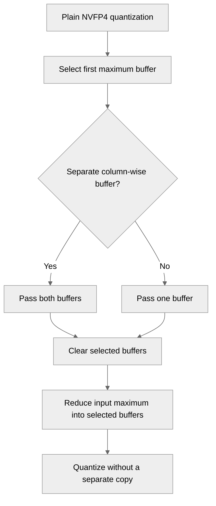

# [Common, PyTorch] Write both NVFP4 amax outputs in the reduction

[Upstream PR](https://github.com/NVIDIA/TransformerEngine/pull/3750) · state: open · merged: False

## Original PR description

# Description

For plain NVFP4 quantization with both row-wise and column-wise outputs, `NVFP4Quantizer::quantize_impl`
computes the per-tensor amax into one buffer and then copies the four-byte scalar into the other with a
separate `cudaMemcpyAsync`. This PR lets the amax reduction write the value to both buffers: the zeroing
kernel clears both, and each thread block applies its atomic max to both. The device-to-device copy
disappears, with no extra input read or kernel launch.

Tested on an RTX 5050 (SM 12.0) against `main` built the same way (details under Validation): no test changes outcome, and a 1D or 2D quantize call issues one GPU operation fewer and takes 0.3 to 1.8 µs less (8.6% at 1024x1024).

This is independent of #3749 (in-kernel NVFP4 scale swizzling on SM120/SM121); either can merge first.

## Type of change

- [ ] Documentation change (change only to the documentation, either a fix or a new content)
- [ ] Bug fix (non-breaking change which fixes an issue)
- [ ] New feature (non-breaking change which adds functionality)
- [ ] Breaking change (fix or feature that would cause existing functionality to not work as expected)
- [ ] Infra/Build change
- [x] Code refactoring

## Changes

- `current_scaling.cu`: `zero_amax_kernel` and `amax_kernel` take an optional second output.
  `compute_amax_impl` passes the column-wise amax as that output only for NVFP4 outputs whose column-wise
  amax is distinct from the buffer being reduced into; every other caller (FP8 current scaling,
  `compute_amax`, the 2D partial cast) keeps one output.
- `quantizer.cpp`: remove the row-wise/column-wise amax copies from the non-RHT, non-row-scaled path.
  RHT post-transform amax and row-scaled per-row amax are untouched.
- `recipe.h`: document that `nvte_compute_amax[_with_config]` fills both amax buffers of an NVFP4 output.
- Test: `tests/pytorch/nvfp4/test_nvfp4_dual_amax.py` reuses one output tensor across inputs whose maximum
  decreases, reaches zero and rises again, and checks both amaxes against the input maximum for
  row-only, column-only and two-direction outputs, 1D and 2D quantization, BF16 and FP32 input, and
  aligned and tail shapes.

The public API, scale computation and quantized values are unchanged. With a noop flag set, both buffers
are now left untouched; previously the row-wise value was still copied into the column-wise buffer.

# Validation

`main` @ fac8d4a9 and this branch were built the same way (`NVTE_FRAMEWORK=pytorch NVTE_CUDA_ARCHS=120a
NVTE_WITH_NCCL_EP=0 pip wheel . --no-build-isolation`, GCC 15.2, CUDA 13.4.92) and run on one NVIDIA GeForce
RTX 5050 (SM 12.0, 20 SMs, 8 GB, driver 615.71.10) with PyTorch 2.16.0.dev20261016+cu134 and Python 3.14.8.
The NVFP4 directory and `test_numerics.py` ran with PyTorch's caching allocator capped at 6 GiB, releasing
cached blocks between tests so that runtime-compiled kernels could still load (64 large-shape cases need
more memory and fail with OOM on both builds). The other Python modules ran with a 2 GiB cap while another
job shared the GPU. Counts come from the JUnit and gtest reports: on both builds most pytest processes, and
some runs of the C++ test binary, exit with SIGSEGV after the last test, consistent with the exit-time crash
that #3733 fixes.

| | `main` | this PR |
|---|---|---|
| `pytest tests/pytorch/nvfp4` | 8,576 passed, 754 failed, 6,855 skipped | 8,600 passed, 754 failed, 6,855 skipped |
| tests whose outcome changes | | none; the 24 added tests pass |
| failures on both builds¹ | 754 | 754, identical messages |
| new `test_nvfp4_dual_amax.py` | 24 passed² | 24 passed |
| `pytest tests/pytorch/test_numerics.py -k nvfp4` | 137 passed, 106 skipped | 137 passed, 106 skipped |
| `test_weight_swizzle_in_layers.py`; `test_torch_compile.py`, `test_quantized_tensor.py`, `test_fusible_ops.py` with `-k nvfp4` | 36, 47, 63, 257 passed | same tests pass |
| C++ `test_cast_nvfp4_transpose`, `test_dequantize_nvfp4`, `test_swizzle`, `test_cast_current_scaling`, `test_cast_transpose_current_scaling` | 1,820 passed | 1,820 passed |
| `compute-sanitizer --tool memcheck` over the 24 new tests, caching allocator off | | 0 errors |

¹ 530 in `test_nvfp4_group_quantize_graph_safe.py`, where the graph-safe grouped RHT cast kernel fails to
launch on SM120 (`invalid argument`); 152 RHT reference comparisons in `test_nvfp4_group_quantize.py` and
`test_nvfp4_rht_quantize_exact.py`; 64 OOM in `test_nvfp4_quantize_exact.py`; 8 SM120 swizzle-fusion
expectations that #3749 addresses.
² `main`'s copy produces the same values, so the test passes there too (run with the 2 GiB cap). It
guards the new path: the zeroing kernel must clear both buffers, or a later input with a smaller maximum
leaves a stale column-wise amax.

No new compiler warnings: the build emits the same warnings as `main`. `libtransformer_engine.so` for sm_120a
grows by 200 bytes (170,060,488 to 170,060,688).

What the `Lint` and `License` workflows run passes locally on this branch: `qa/L0_pytorch_lint` and `qa/L0_jax_lint` (cpplint 1.6.0, pylint 3.3.1, Python 3.12) and `qa/L0_license`. Beyond the sm_120a build above, `recipe/current_scaling.cu` compiles for the default architecture list (`75;80;89;90;100;120` with CUDA 13.4: sm_75, sm_80, sm_89, sm_90, sm_100, sm_120).

### GPU work per quantize call

`torch.profiler` over one warm `q(x)` call, BF16 1024x1024 input, row-wise and column-wise output:

| quantizer | `main` | this PR |
|---|---|---|
| 1D, 2D | `zero_amax_kernel`, `amax_kernel`, `Memcpy DtoD`, quantize (4) | `zero_amax_kernel`, `amax_kernel`, quantize (3) |
| RHT | `ZeroAmaxKernel`, `HadamardAmaxTmaKernel`, quantize (3) | same (3) |

With `optimize_for_gemm=True`, both builds add the two `swizzle_row_scaling_kernel` launches on SM120, so
1D and 2D go from 6 to 5 operations (#3749 removes those two launches for 128-aligned shapes). The
same holds at 1088x1024.

### Time per quantize call

`torch.utils.benchmark` `blocked_autorange` median of `q(x)`, the method of `benchmarks/benchmark_rht_cast_swizzle_fusion.py` extended to the 1D and 2D quantizers: BF16 input (`torch.randn`, seed 0), row-wise and column-wise output. The three builds alternated over two rounds of three measurements per cell with nothing else on the GPU; each value is the lowest of the six medians, and a cell's two round minima differ by at most 1.6 µs (5.7%). Times are host wall-clock per call, so at 1024x1024 they include each launch's host overhead. `optimize_for_gemm=False`:

| quantizer | shape | `main` (µs) | this PR (µs) | change |
|---|---|---|---|---|
| 1D | 1024x1024 | 21.0 | 19.2 | -8.6% |
| 1D | 2048x2048 | 28.9 | 28.6 | -1.0% |
| 1D | 4096x4096 | 291.5 | 290.6 | -0.3% |
| 1D | 8192x5120 | 725.2 | 724.3 | -0.1% |
| 1D | 5120x8192 | 729.4 | 728.5 | -0.1% |
| 2D | 1024x1024 | 20.9 | 19.1 | -8.5% |
| 2D | 2048x2048 | 34.8 | 34.1 | -2.0% |
| 2D | 4096x4096 | 295.7 | 294.8 | -0.3% |
| 2D | 8192x5120 | 753.0 | 751.8 | -0.2% |
| 2D | 5120x8192 | 783.2 | 782.4 | -0.1% |

From 4096x4096 up, the saving is 0.8 to 1.2 µs (0.1% to 0.3%). With `optimize_for_gemm=True` it is 0.6 to 2.0 µs. Every 1D and 2D cell is faster on this branch, while RHT quantization, which this PR does not change, differs from `main` by at most 0.86 µs over its 15 cells.

<details>
<summary><code>bench_nvfp4_paths.py</code></summary>

```python
"""Per-call NVFP4 quantize time and GPU activity for the paths touched by the swizzle and amax PRs.

Timing uses the method of benchmarks/benchmark_rht_cast_swizzle_fusion.py: torch.utils.benchmark
blocked_autorange median of `q(x)` ("quant_only") and of `t = q(x); tex.swizzle_scales_for_gemm_(t)`
("quant_plus_swizzle", what te.Linear runs before the GEMM), BF16 input, rowwise+columnwise output,
extended from RHT to the 1D and 2D quantizers. Each cell is measured `--repeats` times; the JSON
keeps every median so a repeat contaminated by another process on the GPU stays visible.

`--trace` instead records, with torch.profiler, the GPU kernels and memcpys of one warm call of
each statement, so the removed swizzle kernel and amax copy can be checked directly.
"""

import argparse
import json
import time

import torch
import torch.utils.benchmark as benchmark

import transformer_engine.pytorch as te  # noqa: F401
import transformer_engine_torch as tex
from transformer_engine.pytorch.tensor.nvfp4_tensor import NVFP4Quantizer

STMTS = {
    "quant_only": "q(x)",
    "quant_plus_swizzle": "t = q(x); tex.swizzle_scales_for_gemm_(t)",
}


def make_quantizer(kind, optimize_for_gemm):
    q = NVFP4Quantizer(
        fp4_dtype=tex.DType.kFloat4E2M1,
        rowwise=True,
        columnwise=True,
        with_amax_reduction=False,
        amax_reduction_group=None,
        with_rht=kind == "rht",
        with_post_rht_amax=kind == "rht",
        with_random_sign_mask=kind == "rht",
        with_2d_quantization=kind == "2d",
    )
    q.optimize_for_gemm = optimize_for_gemm
    return q


def median_us(stmt, glb, min_run_time):
    t = benchmark.Timer(stmt=stmt, globals=glb, num_threads=1)
    return t.blocked_autorange(min_run_time=min_run_time).median * 1e6


def gpu_activity(stmt, glb):
    """Names of the GPU kernels and memcpy/memset operations of one call, in launch order."""
    code = compile(stmt, "<stmt>", "exec")
    exec(code, dict(glb))  # warm-up
    torch.cuda.synchronize()
    acts = [torch.profiler.ProfilerActivity.CUDA]
    with torch.profiler.profile(activities=acts) as prof:
        exec(code, dict(glb))
        torch.cuda.synchronize()
    events = [e for e in prof.events() if e.device_type == torch.autograd.DeviceType.CUDA]
    events.sort(key=lambda e: e.time_range.start)
    return [e.name for e in events]


def main():
    p = argparse.ArgumentParser()
    p.add_argument("--label", required=True)
    p.add_argument("--out", required=True)
    p.add_argument("--min-run-time", type=float, default=1.0)
    p.add_argument("--repeats", type=int, default=3)
    p.add_argument("--kinds", default="1d,2d,rht")
    p.add_argument("--shapes", default="1024x1024,2048x2048,4096x4096,8192x5120,5120x8192")
    p.add_argument("--trace", action="store_true")
    args = p.parse_args()
    shapes = [tuple(int(v) for v in s.split("x")) for s in args.shapes.split(",")]
    rows = []
    for kind in args.kinds.split(","):
        for shape in shapes:
            torch.manual_seed(0)
            x = torch.randn(shape, dtype=torch.bfloat16, device="cuda")
            for opt in (False, True):
                q = make_quantizer(kind, opt)
                y = q(x)  # warm-up; also records which layout the call produced
                torch.cuda.synchronize()
                base = {"kind": kind, "shape": list(shape), "optimize_for_gemm": opt,
                        "swizzled_after_call": bool(y._with_gemm_swizzled_scales),
                        "allocated_swizzled": bool(q.make_empty(shape, dtype=x.dtype)
                                                   ._with_gemm_swizzled_scales)}
                for name, stmt in STMTS.items():
                    glb = {"q": q, "x": x, "tex": tex}
                    row = dict(base, stmt=name)
                    if args.trace:
                        row["gpu_activity"] = gpu_activity(stmt, glb)
                    else:
                        meds = [median_us(stmt, glb, args.min_run_time)
                                for _ in range(args.repeats)]
                        row.update(median_us=meds, best_median_us=min(meds))
                    row["time"] = time.strftime("%H:%M:%S")
                    rows.append(row)
                    print(json.dumps(row), flush=True)
            del x, y
            torch.cuda.empty_cache()
    with open(args.out, "w") as f:
        json.dump({"label": args.label, "device": torch.cuda.get_device_name(0),
                   "torch": torch.__version__, "trace": args.trace, "rows": rows}, f, indent=1)


if __name__ == "__main__":
    main()
```

</details>

### Not covered

- Only SM120 was run. The amax kernels are architecture-independent and the copy removal is in the
  common PyTorch path, so SM100/103/110 take the same code.
- JAX does not call `nvte_compute_amax`. Other callers (FP8 current scaling, the NVFP4 2D partial cast)
  pass outputs without a distinct column-wise amax and keep one reduction output; the C++ current-scaling
  suites above cover that path.
- No multi-GPU runs. With `with_amax_reduction`, the cross-rank MAX all-reduce still runs afterwards on
  both buffers, which hold the same local amax before it as they did with the copy.

### How to reproduce

```bash
python -m pytest tests/pytorch/nvfp4/test_nvfp4_dual_amax.py
# timing and kernel lists, once per build (script in the details block above)
python bench_nvfp4_paths.py --label pr --out pr.json --kinds 1d,2d
python bench_nvfp4_paths.py --label pr --out pr-trace.json --trace --shapes 1024x1024,1088x1024
```

# Checklist:

- [x] I have read and followed the [contributing guidelines](https://github.com/NVIDIA/TransformerEngine/blob/main/CONTRIBUTING.rst)
- [x] The functionality is complete
- [x] I have commented my code, particularly in hard-to-understand areas
- [x] I have made corresponding changes to the documentation
- [x] My changes generate no new warnings
- [x] I have added tests that prove my fix is effective or that my feature works
- [ ] New and existing unit tests pass locally with my changes (the new tests pass; 754 existing NVFP4
  tests fail on this SM120 GPU on `main` as well, see Validation)

🤖 Generated with [Claude Code](https://claude.com/claude-code)


## Review and discussion

### reviews

- vthumbe1503 · COMMENTED · 2026-10-27T17:17:36Z · [source](https://github.com/NVIDIA/TransformerEngine/pull/3750#pullrequestreview-5671401742)

Thanks for creating the PR! I think the better solution for this is to create a single tensor for both amax_rowwise and amax_columnwise and let amax_columnwise alias to amax_rowwise when NVFP4 has a single amax. We can make that code change in quantizer.cpp


### issue_comments

- greptile-apps[bot] · comment · 2026-10-27T07:47:41Z · [source](https://github.com/NVIDIA/TransformerEngine/pull/3750#issuecomment-6436519930)

<!-- greptile_summary -->

<h2><a href="https://app.greptile.com/api/retrigger?id=88749518"><picture><source media="(prefers-color-scheme: dark)" srcset="https://greptile-static-assets.s3.amazonaws.com/badges/RetriggerDark.svg?v=2"><source media="(prefers-color-scheme: light)" srcset="https://greptile-static-assets.s3.amazonaws.com/badges/Retrigger.svg?v=2"></picture></a><a href="https://app.greptile.com/nvidia-public-github/github/NVIDIA/transformerengine/-/pull/3750"><picture><source media="(prefers-color-scheme: dark)" srcset="https://greptile-static-assets.s3.amazonaws.com/badges/ViewInGreptileDark.svg?v=2"><source media="(prefers-color-scheme: light)" srcset="https://greptile-static-assets.s3.amazonaws.com/badges/ViewInGreptile.svg?v=2"></picture></a>Confidence Score: 5/5</h2>

**[Medium impact]** The PR appears safe to merge; no actionable issues were found.

<h3>Summary</h3>

The PR writes the input maximum directly to both NVFP4 maximum buffers, removing a separate GPU copy.
- NVFP4 quantization writes both distinct amax buffers during reduction.

<h3>Diagram</h3>



<!-- greptile_confidence_score:5 -->

<sub>Reviews (1) · Last reviewed commit: ["\[Common, PyTorch\] Write both NVFP4 amax ..."](https://github.com/nvidia/transformerengine/commit/41e075b5001185e37e1817a3ffdac9fd7fa809fa) · [Reviewed by Greptile](https://www.greptile.com/?utm_source=greptile_review&utm_medium=github&utm_campaign=review_public&utm_content=nvidia/transformerengine)</sub>

- kimchi-developer · comment · 2026-10-28T01:40:53Z · [source](https://github.com/NVIDIA/TransformerEngine/pull/3750#issuecomment-6458371603)

@vthumbe1503 Aliasing would drop the copy without touching the common amax kernel, so I tried it before changing the PR. It breaks NVFP4 under torch.compile.

The prototype is this PR's base (`fac8d4a9`) with only `quantizer.cpp` changed: `create_tensor` and `convert_and_update_tensor` set `amax_columnwise = amax_rowwise` when there is a single amax (no RHT, no row scaling), and the existing pointer check in `quantize_impl` then skips the copy (diff below). It is built the same way as `main` (`NVTE_FRAMEWORK=pytorch NVTE_CUDA_ARCHS=120a`, CUDA 13.4, PyTorch 2.16.0.dev20261016+cu134) and run on the same RTX 5050 (SM 12.0):

| | `main` | aliasing |
|---|---|---|
| `test_torch_compile.py -k nvfp4` | 47 passed | **19 failed**, 28 passed |
| `tests/pytorch/nvfp4` | 8,576 passed, 754 failed¹ | same tests, same outcomes |
| `test_numerics.py`, `test_sanity.py`, `test_quantized_tensor.py`, `test_fusible_ops.py` with `-k nvfp4`; `test_weight_swizzle_in_layers.py`; `test_nvfp4_dual_amax.py` from this PR | 137, 3,344, 63, 257, 36, 24 passed | same |

¹ The SM120 failures listed in the PR description; they fail on both builds.

All 19 failures are the aliasing check of `torch.library.custom_op` (`_c_check_aliasing_constraint`): 16 in `linear_base` (`test_te_linear_compiles`, `test_te_linear_compiles_non_2d_input`, `test_te_linear_compile_is_first_microbatch`, with and without RHT) and 3 in `bias_backward_base` (`test_te_ops_linear_bias_compile`, `test_te_ops_bias_nvfp4_layout[2d]`, `test_te_ops_linear_bias_cold_cudagraphs`):

```
RuntimeError: linear_base (...): The output of this custom operator (1) must not also be an input to this custom operator and (2) may not alias any inputs to this custom operator or other returns.
```

`_flatten_value` in `dynamo/custom_op.py` returns each inner tensor from `__tensor_flatten__` as its own entry of the op's `Tensor[]` return, so the aliased `_amax_rowwise` and `_amax_columnwise` become two returns that share storage.

A second case: `convert_and_update_tensor` keeps both amax buffers when their sizes match (one element each), so a tensor allocated with aliased amaxes and then quantized in place by an RHT quantizer gets both amaxes in one float. Compared with a fresh RHT quantization of the same input by the same quantizer:

| input (256x1024 BF16) | row-wise / column-wise amax, expected | aliasing |
|---|---|---|
| `randn` | 4.375 / 5.03125 | 5.03125 / 5.03125, row-wise data and scales differ |
| `randn` with one element set to 64 | 64 / 16.875 | 64 / 64, column-wise data and scales differ |

The amax reduction itself is fine with aliasing: with `with_amax_reduction=True` on two ranks (RTX 5080 Laptop GPU and RTX 5050, NCCL 2.32.3), passing the aliased buffer twice to `allreduce_coalesced` gave the global maximum in all 500 iterations on both ranks.

So aliasing needs more than the `quantizer.cpp` change: the compile flatten/unflatten path, and the fake layout from `inner_tensor_specs`, would have to know that `_amax_columnwise` is `_amax_rowwise` (or the op would clone it at the boundary, which brings the copy back under torch.compile), and `convert_and_update_tensor` would have to split the pair for an RHT quantizer. Given that, I'd keep this PR's approach, where the reduction writes both buffers and nothing aliases. If you still prefer aliasing, I can implement it with those changes. Which would you like?

<details>
<summary>Prototype diff (against <code>fac8d4a9</code>)</summary>

```diff
--- a/transformer_engine/pytorch/csrc/quantizer.cpp
+++ b/transformer_engine/pytorch/csrc/quantizer.cpp
@@ -2063,7 +2063,13 @@
     // nvte_compute_amax_with_config will zero out the pointer if needed
     const int64_t amax_cols = row_scaled_nvfp4 ? static_cast<int64_t>(flat_last_dim) : 1;
     if (!disable_second_level_scale) {
-      amax_columnwise = at::empty({amax_cols}, bit32_tensor_opts);
+      // PROTOTYPE (review of #3750): with a single amax (no RHT, no row scaling), the
+      // column-wise amax aliases the row-wise one, so quantize_impl skips the copy.
+      if (rowwise_usage && !this->with_rht && !row_scaled_nvfp4) {
+        amax_columnwise = amax_rowwise;
+      } else {
+        amax_columnwise = at::empty({amax_cols}, bit32_tensor_opts);
+      }
     }
   }
 
@@ -2447,10 +2453,15 @@
       amax_columnwise.reset();
       tensor.attr("_amax_columnwise") = py::none();
     } else if (!amax_columnwise || amax_columnwise->numel() != amax_cols) {
-      const auto opts = at::TensorOptions().dtype(torch::kFloat32).device(torch::kCUDA);
-      // hadamard amax kernel will zero out pointer with ZeroAmaxKernel
-      // nvte_compute_amax_with_config will zero out the pointer if needed
-      amax_columnwise = at::empty({amax_cols}, opts);
+      if (rowwise_usage && amax_rowwise && !this->with_rht && !row_scaled_nvfp4) {
+        // PROTOTYPE (review of #3750): alias, as in create_tensor.
+        amax_columnwise = *amax_rowwise;
+      } else {
+        const auto opts = at::TensorOptions().dtype(torch::kFloat32).device(torch::kCUDA);
+        // hadamard amax kernel will zero out pointer with ZeroAmaxKernel
+        // nvte_compute_amax_with_config will zero out the pointer if needed
+        amax_columnwise = at::empty({amax_cols}, opts);
+      }
       tensor.attr("_amax_columnwise") = *amax_columnwise;
     }
   } else {  // columnwise_usage == false
```

</details>


### inline_comments

## Changed files and fixed code

- `tests/pytorch/nvfp4/test_nvfp4_dual_amax.py` · added · additions 40 / deletions 0
  - [head](https://github.com/kimchi-developer/TransformerEngine/blob/41e075b5001185e37e1817a3ffdac9fd7fa809fa/tests/pytorch/nvfp4/test_nvfp4_dual_amax.py)
  - [base](https://github.com/NVIDIA/TransformerEngine/blob/89668d9dee82aba9b9107b37ed85227542a578d2/tests/pytorch/nvfp4/test_nvfp4_dual_amax.py)
- `transformer_engine/common/include/transformer_engine/recipe.h` · modified · additions 5 / deletions 2
  - [head](https://github.com/kimchi-developer/TransformerEngine/blob/41e075b5001185e37e1817a3ffdac9fd7fa809fa/transformer_engine/common/include/transformer_engine/recipe.h)
  - [base](https://github.com/NVIDIA/TransformerEngine/blob/89668d9dee82aba9b9107b37ed85227542a578d2/transformer_engine/common/include/transformer_engine/recipe.h)
- `transformer_engine/common/recipe/current_scaling.cu` · modified · additions 27 / deletions 13
  - [head](https://github.com/kimchi-developer/TransformerEngine/blob/41e075b5001185e37e1817a3ffdac9fd7fa809fa/transformer_engine/common/recipe/current_scaling.cu)
  - [base](https://github.com/NVIDIA/TransformerEngine/blob/89668d9dee82aba9b9107b37ed85227542a578d2/transformer_engine/common/recipe/current_scaling.cu)
- `transformer_engine/pytorch/csrc/quantizer.cpp` · modified · additions 3 / deletions 11
  - [head](https://github.com/kimchi-developer/TransformerEngine/blob/41e075b5001185e37e1817a3ffdac9fd7fa809fa/transformer_engine/pytorch/csrc/quantizer.cpp)
  - [base](https://github.com/NVIDIA/TransformerEngine/blob/89668d9dee82aba9b9107b37ed85227542a578d2/transformer_engine/pytorch/csrc/quantizer.cpp)

## Evidence and interpretation boundary

[Original JSON, discussions and patches](../../../../../../evidence/prs/NVIDIA--TransformerEngine/3750-b11357f8e994127e979fd48a2520748c5da9aa73130950ecead263109c7bec3d.json) · SHA-256 `b11357f8e994127e979fd48a2520748c5da9aa73130950ecead263109c7bec3d`.

Diff complete: True. Missing/binary/truncated patches require pinned source inspection. This is a source page, not an independently verified optimization case. Open, merged and released are different states; recheck the deployed dependency.
