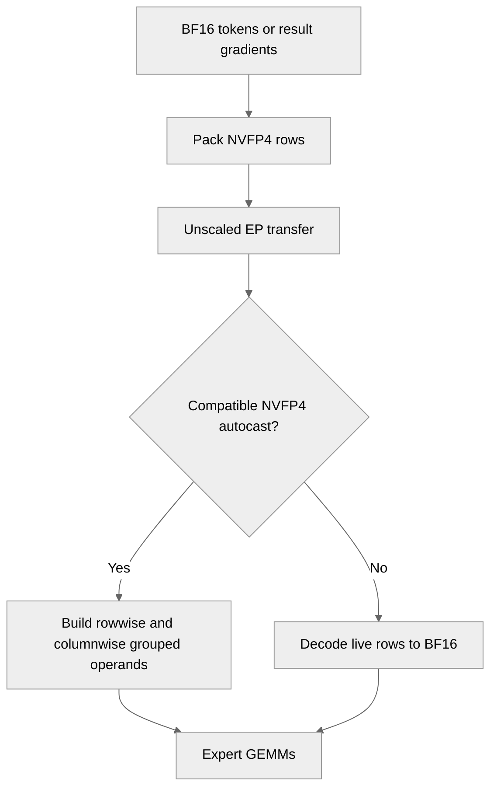

# [Common][PyTorch] Add NVFP4 EP dispatch and combine backward 

[Upstream PR](https://github.com/NVIDIA/TransformerEngine/pull/3753) · state: open · merged: False

## Original PR description

Accept NVFP4BlockScaling as the EP dispatch_fwd_quant_recipe and combine_bwd_quant_recipe. Tokens travel as packed NVFP4 rows (E2M1 codes, E4M3 block scales and a power-of-two FP32 token scale) through the unscaled dispatch / combine-backward path.

Under NVFP4 autocast in graph mode, the receiver builds the expert GEMM's NVFP4 GroupedTensor straight from the rows in one pass: the rowwise operand reuses the sender's codes and the columnwise RHT operand is quantized with a bound-derived per-expert scale, so no BF16 round trip or amax pass is needed. The combine backward uses stochastic rounding per the recipe. Otherwise the rows are decoded to BF16.

Add nvte_ep_nvfp4_pack / _unpack / _direct_receive to the common EP API, the tex bindings, single-GPU tests and multi-GPU EP harness tests.

# Description

Please include a brief summary of the changes, relevant motivation and context.

Fixes # (issue)

## Type of change

- [ ] Documentation change (change only to the documentation, either a fix or a new content)
- [ ] Bug fix (non-breaking change which fixes an issue)
- [ ] New feature (non-breaking change which adds functionality)
- [ ] Breaking change (fix or feature that would cause existing functionality to not work as expected)
- [ ] Infra/Build change
- [ ] Code refactoring

## Changes

Please list the changes introduced in this PR:

- Change A
- Change B

# Checklist:

- [ ] I have read and followed the [contributing guidelines](https://github.com/NVIDIA/TransformerEngine/blob/main/CONTRIBUTING.rst)
- [ ] The functionality is complete
- [ ] I have commented my code, particularly in hard-to-understand areas
- [ ] I have made corresponding changes to the documentation
- [ ] My changes generate no new warnings
- [ ] I have added tests that prove my fix is effective or that my feature works
- [ ] New and existing unit tests pass locally with my changes

## Review and discussion

### reviews

- greptile-apps[bot] · COMMENTED · 2026-10-27T19:11:23Z · [source](https://github.com/NVIDIA/TransformerEngine/pull/3753#pullrequestreview-5672853601)

(No body; status only.)

### issue_comments

- greptile-apps[bot] · comment · 2026-10-27T19:11:19Z · [source](https://github.com/NVIDIA/TransformerEngine/pull/3753#issuecomment-6451197665)

<!-- greptile_summary -->

<h2><a href="https://app.greptile.com/api/retrigger?id=89187688"><picture><source media="(prefers-color-scheme: dark)" srcset="https://greptile-static-assets.s3.amazonaws.com/badges/RetriggerDark.svg?v=2"><source media="(prefers-color-scheme: light)" srcset="https://greptile-static-assets.s3.amazonaws.com/badges/Retrigger.svg?v=2"></picture></a><a href="https://app.greptile.com/nvidia-public-github/github/NVIDIA/transformerengine/-/pull/3753"><picture><source media="(prefers-color-scheme: dark)" srcset="https://greptile-static-assets.s3.amazonaws.com/badges/ViewInGreptileDark.svg?v=2"><source media="(prefers-color-scheme: light)" srcset="https://greptile-static-assets.s3.amazonaws.com/badges/ViewInGreptile.svg?v=2"></picture></a>Confidence Score: 3/5</h2>

**[Medium impact]** The changes affect NVFP4 data movement in expert\-parallel workflows\.

Fix the wrong-GPU launches and zero-copy fallback capture failure before merging.

<h2>Findings</h2>

1. &nbsp;**Calls use the wrong GPU** <a href="https://github.com/NVIDIA/TransformerEngine/pull/3753#discussion_r4393018711">▶</a>
2. &nbsp;**Zero\-copy graph capture fails** <a href="https://github.com/NVIDIA/TransformerEngine/pull/3753#discussion_r4393018724">▶</a>

<h3>Summary</h3>

Adds NVFP4 transport for EP dispatch and combine backward.
- Expert-parallel dispatch can send tokens as NVFP4 rows.
- Combine backward can send expert gradients as NVFP4 rows.

Two fixes are needed: guard the input GPU in the new bindings, and avoid zero-copy scratch allocation during fallback graph capture.

<h3>Diagram</h3>

<!-- greptile_confidence_score:3 -->

Reviews (1) · Last reviewed commit: ["\[Common\]\[PyTorch\] Add NVFP4 EP dispatch ..."](https://github.com/nvidia/transformerengine/commit/f938cee374fe0e14c219f13e301eba569183ed75) · [Reviewed by Greptile](https://www.greptile.com/?utm_source=greptile_review&utm_medium=github&utm_campaign=review_public&utm_content=nvidia/transformerengine)

### inline_comments

- greptile-apps[bot] · comment · 2026-10-27T19:11:22Z · [source](https://github.com/NVIDIA/TransformerEngine/pull/3753#discussion_r4393018711)

File: `transformer_engine/pytorch/csrc/extensions/ep_nvfp4.cpp` · line 46

 **Calls use the wrong GPU**

The three new bindings launch on the current CUDA device without guarding the input device. Passing tokens on `cuda:1` while `cuda:0` is current launches the kernel on `cuda:0` against allocations on `cuda:1`. Stochastic calls also get their generator and scratch state from the wrong device. This can cause invalid memory access or break the input device's stream ordering.

Add a device guard before allocations and generator access in `ep_nvfp4_pack`, `ep_nvfp4_unpack`, and `ep_nvfp4_direct_receive`.

- greptile-apps[bot] · comment · 2026-10-27T19:11:22Z · [source](https://github.com/NVIDIA/TransformerEngine/pull/3753#discussion_r4393018724)

File: `transformer_engine/pytorch/ep.py` · line 926

 **Zero-copy graph capture fails**

The BF16 fallback cannot be captured with zero-copy enabled, even when the caller supplies persistent receive buffers. When `direct` is false, this call ignores `recv_tokens` and allocates packed scratch through `_alloc_io`, which raises during zero-copy CUDA graph capture. Combine backward does the same with `grad_out`.

Keep persistent packed scratch for both fallback paths, and cover capture outside NVFP4 autocast.

## Changed files and fixed code

- `tests/pytorch/distributed/run_ep.py` · modified · additions 373 / deletions 1
  - [head](https://github.com/sraman-rgb/TransformerEngine/blob/f938cee374fe0e14c219f13e301eba569183ed75/tests/pytorch/distributed/run_ep.py)
  - [base](https://github.com/NVIDIA/TransformerEngine/blob/96c0fb0e24915683acc24ca2cf31cac16c798830/tests/pytorch/distributed/run_ep.py)
- `tests/pytorch/nvfp4/test_nvfp4_ep_rows.py` · added · additions 561 / deletions 0
  - [head](https://github.com/sraman-rgb/TransformerEngine/blob/f938cee374fe0e14c219f13e301eba569183ed75/tests/pytorch/nvfp4/test_nvfp4_ep_rows.py)
  - [base](https://github.com/NVIDIA/TransformerEngine/blob/96c0fb0e24915683acc24ca2cf31cac16c798830/tests/pytorch/nvfp4/test_nvfp4_ep_rows.py)
- `transformer_engine/common/CMakeLists.txt` · modified · additions 1 / deletions 0
  - [head](https://github.com/sraman-rgb/TransformerEngine/blob/f938cee374fe0e14c219f13e301eba569183ed75/transformer_engine/common/CMakeLists.txt)
  - [base](https://github.com/NVIDIA/TransformerEngine/blob/96c0fb0e24915683acc24ca2cf31cac16c798830/transformer_engine/common/CMakeLists.txt)
- `transformer_engine/common/ep/nvfp4_ep_rows.cu` · added · additions 715 / deletions 0
  - [head](https://github.com/sraman-rgb/TransformerEngine/blob/f938cee374fe0e14c219f13e301eba569183ed75/transformer_engine/common/ep/nvfp4_ep_rows.cu)
  - [base](https://github.com/NVIDIA/TransformerEngine/blob/96c0fb0e24915683acc24ca2cf31cac16c798830/transformer_engine/common/ep/nvfp4_ep_rows.cu)
- `transformer_engine/common/include/transformer_engine/ep.h` · modified · additions 69 / deletions 0
  - [head](https://github.com/sraman-rgb/TransformerEngine/blob/f938cee374fe0e14c219f13e301eba569183ed75/transformer_engine/common/include/transformer_engine/ep.h)
  - [base](https://github.com/NVIDIA/TransformerEngine/blob/96c0fb0e24915683acc24ca2cf31cac16c798830/transformer_engine/common/include/transformer_engine/ep.h)
- `transformer_engine/pytorch/csrc/extensions.h` · modified · additions 11 / deletions 0
  - [head](https://github.com/sraman-rgb/TransformerEngine/blob/f938cee374fe0e14c219f13e301eba569183ed75/transformer_engine/pytorch/csrc/extensions.h)
  - [base](https://github.com/NVIDIA/TransformerEngine/blob/96c0fb0e24915683acc24ca2cf31cac16c798830/transformer_engine/pytorch/csrc/extensions.h)
- `transformer_engine/pytorch/csrc/extensions/ep_nvfp4.cpp` · added · additions 131 / deletions 0
  - [head](https://github.com/sraman-rgb/TransformerEngine/blob/f938cee374fe0e14c219f13e301eba569183ed75/transformer_engine/pytorch/csrc/extensions/ep_nvfp4.cpp)
  - [base](https://github.com/NVIDIA/TransformerEngine/blob/96c0fb0e24915683acc24ca2cf31cac16c798830/transformer_engine/pytorch/csrc/extensions/ep_nvfp4.cpp)
- `transformer_engine/pytorch/csrc/extensions/pybind.cpp` · modified · additions 9 / deletions 0
  - [head](https://github.com/sraman-rgb/TransformerEngine/blob/f938cee374fe0e14c219f13e301eba569183ed75/transformer_engine/pytorch/csrc/extensions/pybind.cpp)
  - [base](https://github.com/NVIDIA/TransformerEngine/blob/96c0fb0e24915683acc24ca2cf31cac16c798830/transformer_engine/pytorch/csrc/extensions/pybind.cpp)
- `transformer_engine/pytorch/ep.py` · modified · additions 308 / deletions 25
  - [head](https://github.com/sraman-rgb/TransformerEngine/blob/f938cee374fe0e14c219f13e301eba569183ed75/transformer_engine/pytorch/ep.py)
  - [base](https://github.com/NVIDIA/TransformerEngine/blob/96c0fb0e24915683acc24ca2cf31cac16c798830/transformer_engine/pytorch/ep.py)

## Evidence and interpretation boundary

[Original JSON, discussions and patches](../../../../../../evidence/prs/NVIDIA--TransformerEngine/3753-4aadb4e1e281dafcfdf3ed7e394f0b918af41536e9aed3ff281998c2308f3577.json) · SHA-256 `4aadb4e1e281dafcfdf3ed7e394f0b918af41536e9aed3ff281998c2308f3577`.

Diff complete: True. Missing/binary/truncated patches require pinned source inspection. This is a source page, not an independently verified optimization case. Open, merged and released are different states; recheck the deployed dependency.
