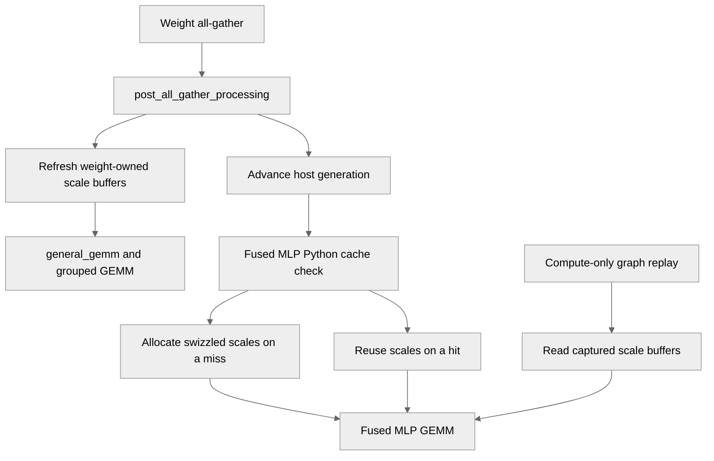

# [PyTorch] Cache GEMM-swizzled scales of all-gathered NVFP4 weights

[Upstream PR](https://github.com/NVIDIA/TransformerEngine/pull/3754) · state: open · merged: False

## Original PR description

Opt-in with NVTE_NVFP4_WEIGHT_SWIZZLE_CACHE=1. post_all_gather_processing swizzles the scales of NVFP4 weights once into persistent buffers, which general_gemm, the grouped GEMM with discrete weights and the fused grouped MLP reuse instead of swizzling once per microbatch.

# Description

Please include a brief summary of the changes, relevant motivation and context.

Fixes # (issue)

## Type of change

- [ ] Documentation change (change only to the documentation, either a fix or a new content)
- [ ] Bug fix (non-breaking change which fixes an issue)
- [ ] New feature (non-breaking change which adds functionality)
- [ ] Breaking change (fix or feature that would cause existing functionality to not work as expected)
- [ ] Infra/Build change
- [ ] Code refactoring

## Changes

Please list the changes introduced in this PR:

- Change A
- Change B

# Checklist:

- [ ] I have read and followed the [contributing guidelines](https://github.com/NVIDIA/TransformerEngine/blob/main/CONTRIBUTING.rst)
- [ ] The functionality is complete
- [ ] I have commented my code, particularly in hard-to-understand areas
- [ ] I have made corresponding changes to the documentation
- [ ] My changes generate no new warnings
- [ ] I have added tests that prove my fix is effective or that my feature works
- [ ] New and existing unit tests pass locally with my changes

## Review and discussion

### reviews

- greptile-apps[bot] · COMMENTED · 2026-10-27T19:15:25Z · [source](https://github.com/NVIDIA/TransformerEngine/pull/3754#pullrequestreview-5672899914)

(No body; status only.)

### issue_comments

- greptile-apps[bot] · comment · 2026-10-27T19:15:19Z · [source](https://github.com/NVIDIA/TransformerEngine/pull/3754#issuecomment-6451277108)

<!-- greptile_summary -->

<h2><a href="https://app.greptile.com/api/retrigger?id=89190542"><picture><source media="(prefers-color-scheme: dark)" srcset="https://greptile-static-assets.s3.amazonaws.com/badges/RetriggerDark.svg?v=2"><source media="(prefers-color-scheme: light)" srcset="https://greptile-static-assets.s3.amazonaws.com/badges/Retrigger.svg?v=2"></picture></a><a href="https://app.greptile.com/nvidia-public-github/github/NVIDIA/transformerengine/-/pull/3754"><picture><source media="(prefers-color-scheme: dark)" srcset="https://greptile-static-assets.s3.amazonaws.com/badges/ViewInGreptileDark.svg?v=2"><source media="(prefers-color-scheme: light)" srcset="https://greptile-static-assets.s3.amazonaws.com/badges/ViewInGreptile.svg?v=2"></picture></a>Confidence Score: 4/5</h2>

**[Medium impact]** The opt\-in cache affects PyTorch GEMM workflows that use discrete weights\.

Fix the fused grouped MLP's stale scales during graph replay before merging.

<h2>Findings</h2>

1. &nbsp;**Graphs read old weight scales** <a href="https://github.com/NVIDIA/TransformerEngine/pull/3754#discussion_r4393057033">▶</a>
2. &nbsp;**Unused GPU buffers stay alive** <a href="https://github.com/NVIDIA/TransformerEngine/pull/3754#discussion_r4393057042">▶</a>

<h3>Summary</h3>

Adds opt-in caching through `NVTE_NVFP4_WEIGHT_SWIZZLE_CACHE` to avoid repeatedly swizzling gathered NVFP4 weight scales.
- GEMMs reuse swizzled NVFP4 scales after each parameter gather.
- Fused grouped MLPs reuse packed pointers for discrete weights.

<h3>Diagram</h3>

<!-- greptile_confidence_score:4 -->

Reviews (1) · Last reviewed commit: ["\[PyTorch\] Cache GEMM-swizzled scales of ..."](https://github.com/nvidia/transformerengine/commit/ac475f2c982552396cd678b26cd861e195ac5cee) · [Reviewed by Greptile](https://www.greptile.com/?utm_source=greptile_review&utm_medium=github&utm_campaign=review_public&utm_content=nvidia/transformerengine)

### inline_comments

- greptile-apps[bot] · comment · 2026-10-27T19:15:23Z · [source](https://github.com/NVIDIA/TransformerEngine/pull/3754#discussion_r4393057033)

File: `transformer_engine/pytorch/ops/fused/grouped_mlp.py` · line 518

 **Graphs read old weight scales**

With `NVTE_NVFP4_WEIGHT_SWIZZLE_CACHE=1`, warming up the fused grouped MLP before capturing a compute-only CUDA graph makes this branch return cached scales without capturing a swizzle. After weights change through `post_all_gather_processing`, replay still reads the old scales, producing wrong outputs and gradients. The host-side generation check does not run during replay, and the gather hook only refreshes the separate `_gsw_view` buffers.

Refresh the buffers used by the captured MLP in place, or keep the swizzle in the graph. Add a replay test using the real fused MLP path; the mocked helper test cannot catch this.

**Knowledge Base Used:** [PyTorch tensor and operator abstractions](https://app.greptile.com/nvidia-public-github/-/custom-context/knowledge-base/nvidia/transformerengine/-/docs/pytorch-tensors-and-ops.md)

- greptile-apps[bot] · comment · 2026-10-27T19:15:23Z · [source](https://github.com/NVIDIA/TransformerEngine/pull/3754#discussion_r4393057042)

File: `transformer_engine/pytorch/ops/fused/grouped_mlp.py` · line 520

 **Unused GPU buffers stay alive**

`_DISCRETE_WEIGHT_SWIZZLE_CACHE` keeps every distinct pointer key for the life of the process. Each value owns GPU scale and pointer buffers, but no entry is removed when its weights die. The fused MLP also calls this helper for BF16 expert weights that it quantizes afresh each forward. New allocation addresses leave old GPU buffers retained, including after a model is deleted.

Tie entries to the owning weights or otherwise bound and clean up the cache without breaking captured graphs.

## Changed files and fixed code

- `docs/envvars.rst` · modified · additions 6 / deletions 0
  - [head](https://github.com/sraman-rgb/TransformerEngine/blob/ac475f2c982552396cd678b26cd861e195ac5cee/docs/envvars.rst)
  - [base](https://github.com/NVIDIA/TransformerEngine/blob/96c0fb0e24915683acc24ca2cf31cac16c798830/docs/envvars.rst)
- `tests/pytorch/nvfp4/test_nvfp4_param_gather_swizzle_cache.py` · added · additions 198 / deletions 0
  - [head](https://github.com/sraman-rgb/TransformerEngine/blob/ac475f2c982552396cd678b26cd861e195ac5cee/tests/pytorch/nvfp4/test_nvfp4_param_gather_swizzle_cache.py)
  - [base](https://github.com/NVIDIA/TransformerEngine/blob/96c0fb0e24915683acc24ca2cf31cac16c798830/tests/pytorch/nvfp4/test_nvfp4_param_gather_swizzle_cache.py)
- `transformer_engine/pytorch/cpp_extensions/gemm.py` · modified · additions 24 / deletions 2
  - [head](https://github.com/sraman-rgb/TransformerEngine/blob/ac475f2c982552396cd678b26cd861e195ac5cee/transformer_engine/pytorch/cpp_extensions/gemm.py)
  - [base](https://github.com/NVIDIA/TransformerEngine/blob/96c0fb0e24915683acc24ca2cf31cac16c798830/transformer_engine/pytorch/cpp_extensions/gemm.py)
- `transformer_engine/pytorch/ops/fused/grouped_mlp.py` · modified · additions 60 / deletions 42
  - [head](https://github.com/sraman-rgb/TransformerEngine/blob/ac475f2c982552396cd678b26cd861e195ac5cee/transformer_engine/pytorch/ops/fused/grouped_mlp.py)
  - [base](https://github.com/NVIDIA/TransformerEngine/blob/96c0fb0e24915683acc24ca2cf31cac16c798830/transformer_engine/pytorch/ops/fused/grouped_mlp.py)
- `transformer_engine/pytorch/tensor/utils.py` · modified · additions 86 / deletions 0
  - [head](https://github.com/sraman-rgb/TransformerEngine/blob/ac475f2c982552396cd678b26cd861e195ac5cee/transformer_engine/pytorch/tensor/utils.py)
  - [base](https://github.com/NVIDIA/TransformerEngine/blob/96c0fb0e24915683acc24ca2cf31cac16c798830/transformer_engine/pytorch/tensor/utils.py)

## Evidence and interpretation boundary

[Original JSON, discussions and patches](../../../../../../evidence/prs/NVIDIA--TransformerEngine/3754-d1f7b43a0c14002bddf684ea0e92ffab8b3a25c3e2e30293682148fb3f04ee91.json) · SHA-256 `d1f7b43a0c14002bddf684ea0e92ffab8b3a25c3e2e30293682148fb3f04ee91`.

Diff complete: True. Missing/binary/truncated patches require pinned source inspection. This is a source page, not an independently verified optimization case. Open, merged and released are different states; recheck the deployed dependency.
