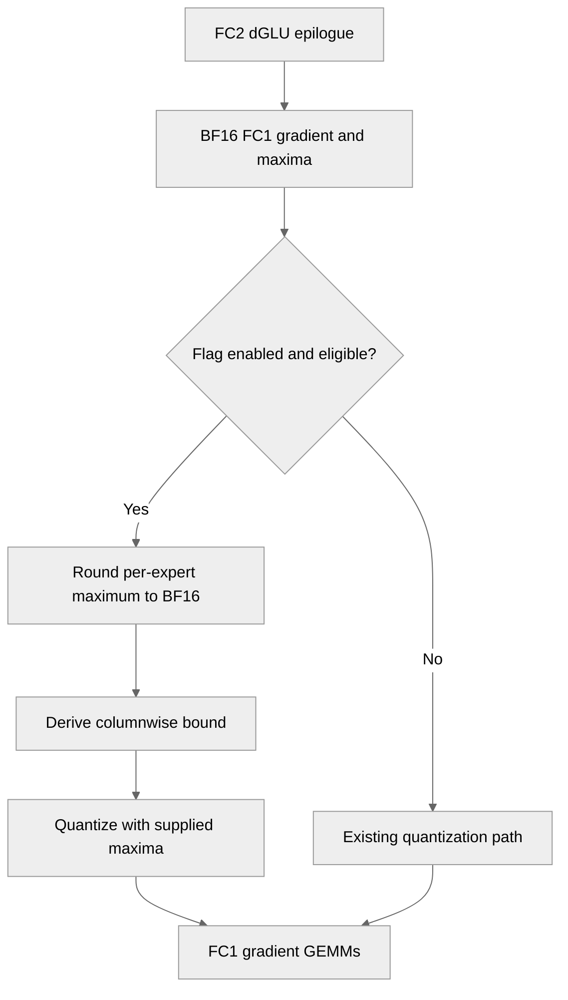

# [PyTorch] Optionally derive FC1 dy NVFP4 amaxes from the dGLU epilogue

[Upstream PR](https://github.com/NVIDIA/TransformerEngine/pull/3755) · state: open · merged: False

## Original PR description

Opt-in with NVTE_NVFP4_FC1_DY_AMAX_FROM_DGLU=1. The rowwise amax is the exact dGLU epilogue amax rounded to BF16; the post-RHT columnwise amax is bounded by 4x the rowwise amax. Skips the separate grouped amax pass.

# Description

Please include a brief summary of the changes, relevant motivation and context.

Fixes # (issue)

## Type of change

- [ ] Documentation change (change only to the documentation, either a fix or a new content)
- [ ] Bug fix (non-breaking change which fixes an issue)
- [ ] New feature (non-breaking change which adds functionality)
- [ ] Breaking change (fix or feature that would cause existing functionality to not work as expected)
- [ ] Infra/Build change
- [ ] Code refactoring

## Changes

Please list the changes introduced in this PR:

- Change A
- Change B

# Checklist:

- [ ] I have read and followed the [contributing guidelines](https://github.com/NVIDIA/TransformerEngine/blob/main/CONTRIBUTING.rst)
- [ ] The functionality is complete
- [ ] I have commented my code, particularly in hard-to-understand areas
- [ ] I have made corresponding changes to the documentation
- [ ] My changes generate no new warnings
- [ ] I have added tests that prove my fix is effective or that my feature works
- [ ] New and existing unit tests pass locally with my changes

## Review and discussion

### reviews

- greptile-apps[bot] · COMMENTED · 2026-10-27T19:14:32Z · [source](https://github.com/NVIDIA/TransformerEngine/pull/3755#pullrequestreview-5672890055)

(No body; status only.)

### issue_comments

- greptile-apps[bot] · comment · 2026-10-27T19:14:28Z · [source](https://github.com/NVIDIA/TransformerEngine/pull/3755#issuecomment-6451259776)

<!-- greptile_summary -->

<h2><a href="https://app.greptile.com/api/retrigger?id=89190721"><picture><source media="(prefers-color-scheme: dark)" srcset="https://greptile-static-assets.s3.amazonaws.com/badges/RetriggerDark.svg?v=2"><source media="(prefers-color-scheme: light)" srcset="https://greptile-static-assets.s3.amazonaws.com/badges/Retrigger.svg?v=2"></picture></a><a href="https://app.greptile.com/nvidia-public-github/github/NVIDIA/transformerengine/-/pull/3755"><picture><source media="(prefers-color-scheme: dark)" srcset="https://greptile-static-assets.s3.amazonaws.com/badges/ViewInGreptileDark.svg?v=2"><source media="(prefers-color-scheme: light)" srcset="https://greptile-static-assets.s3.amazonaws.com/badges/ViewInGreptile.svg?v=2"></picture></a>Confidence Score: 4/5</h2>

**[Medium impact]** The change affects a bounded NVFP4 grouped MLP backward workflow\.

The PR appears safe to merge, with a non-blocking gap in coverage of the enabled grouped MLP path.

<h2>Findings</h2>

1. &nbsp;**Enabled path lacks test coverage** <a href="https://github.com/NVIDIA/TransformerEngine/pull/3755#discussion_r4393048871">▶</a>

<h3>Summary</h3>

Adds an opt-in way to reuse the dGLU epilogue maximum when quantizing FC1 gradients with NVFP4.
- Grouped MLP backward can reuse dGLU amaxes for the FC1 gradient.

Tests were inspected, not executed.

<h3>Diagram</h3>

<!-- greptile_confidence_score:4 -->

Reviews (1) · Last reviewed commit: ["\[PyTorch\] Optionally derive FC1 dy NVFP4..."](https://github.com/nvidia/transformerengine/commit/ffce0ef8a3530842762407f58567f0231b719769) · [Reviewed by Greptile](https://www.greptile.com/?utm_source=greptile_review&utm_medium=github&utm_campaign=review_public&utm_content=nvidia/transformerengine)

### inline_comments

- greptile-apps[bot] · comment · 2026-10-27T19:14:31Z · [source](https://github.com/NVIDIA/TransformerEngine/pull/3755#discussion_r4393048871)

File: `tests/pytorch/nvfp4/test_nvfp4_dglu_amax.py` · line 164

 **Enabled path lacks test coverage**

The new tests never enable `NVTE_NVFP4_FC1_DY_AMAX_FROM_DGLU` or run the fused grouped MLP backward. Even `test_cuda_graph_replay` builds a stand-in maximum and calls the dense quantizer directly. The tests can therefore pass without checking the real cuDNN output or grouped quantization path.

Add an integration test that enables the flag, clears `_use_fc1_dy_amax_from_dglu` before and after, and runs multiple experts including an empty expert. Check that the new branch runs and that its rowwise maxima match the BF16 gradients.

Note: If this suggestion doesn't match your team's coding style, reply to this and let me know. I'll remember it for next time!

## Changed files and fixed code

- `docs/envvars.rst` · modified · additions 6 / deletions 0
  - [head](https://github.com/sraman-rgb/TransformerEngine/blob/ffce0ef8a3530842762407f58567f0231b719769/docs/envvars.rst)
  - [base](https://github.com/NVIDIA/TransformerEngine/blob/96c0fb0e24915683acc24ca2cf31cac16c798830/docs/envvars.rst)
- `tests/pytorch/nvfp4/test_nvfp4_dglu_amax.py` · added · additions 178 / deletions 0
  - [head](https://github.com/sraman-rgb/TransformerEngine/blob/ffce0ef8a3530842762407f58567f0231b719769/tests/pytorch/nvfp4/test_nvfp4_dglu_amax.py)
  - [base](https://github.com/NVIDIA/TransformerEngine/blob/96c0fb0e24915683acc24ca2cf31cac16c798830/tests/pytorch/nvfp4/test_nvfp4_dglu_amax.py)
- `transformer_engine/common/triton/nvfp4_dglu_amax.py` · added · additions 34 / deletions 0
  - [head](https://github.com/sraman-rgb/TransformerEngine/blob/ffce0ef8a3530842762407f58567f0231b719769/transformer_engine/common/triton/nvfp4_dglu_amax.py)
  - [base](https://github.com/NVIDIA/TransformerEngine/blob/96c0fb0e24915683acc24ca2cf31cac16c798830/transformer_engine/common/triton/nvfp4_dglu_amax.py)
- `transformer_engine/pytorch/ops/fused/grouped_mlp.py` · modified · additions 49 / deletions 8
  - [head](https://github.com/sraman-rgb/TransformerEngine/blob/ffce0ef8a3530842762407f58567f0231b719769/transformer_engine/pytorch/ops/fused/grouped_mlp.py)
  - [base](https://github.com/NVIDIA/TransformerEngine/blob/96c0fb0e24915683acc24ca2cf31cac16c798830/transformer_engine/pytorch/ops/fused/grouped_mlp.py)
- `transformer_engine/pytorch/triton/nvfp4_dglu_amax.py` · added · additions 54 / deletions 0
  - [head](https://github.com/sraman-rgb/TransformerEngine/blob/ffce0ef8a3530842762407f58567f0231b719769/transformer_engine/pytorch/triton/nvfp4_dglu_amax.py)
  - [base](https://github.com/NVIDIA/TransformerEngine/blob/96c0fb0e24915683acc24ca2cf31cac16c798830/transformer_engine/pytorch/triton/nvfp4_dglu_amax.py)

## Evidence and interpretation boundary

[Original JSON, discussions and patches](../../../../../../evidence/prs/NVIDIA--TransformerEngine/3755-e798bcf391835261c8b4743ed5b3ed0b4dcce24d0e911d2a9fd663990de264dc.json) · SHA-256 `e798bcf391835261c8b4743ed5b3ed0b4dcce24d0e911d2a9fd663990de264dc`.

Diff complete: True. Missing/binary/truncated patches require pinned source inspection. This is a source page, not an independently verified optimization case. Open, merged and released are different states; recheck the deployed dependency.
