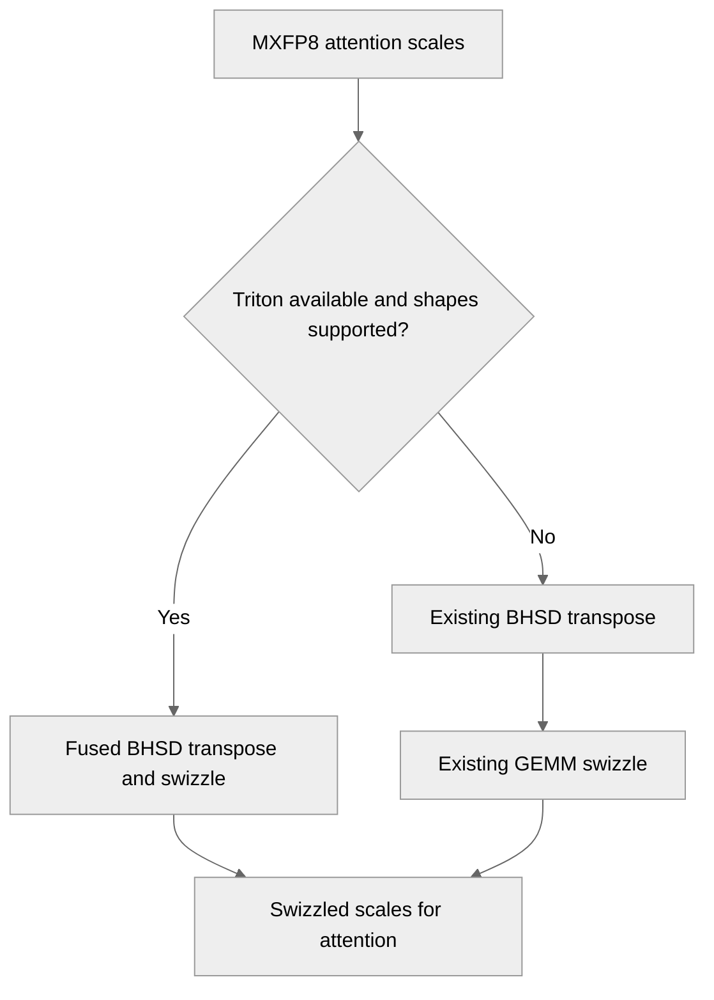

# [PyTorch] Fuse BHSD permute and GEMM swizzle of MXFP8 attention scales

[Upstream PR](https://github.com/NVIDIA/TransformerEngine/pull/3757) · state: open · merged: False

## Original PR description

mxfp8_transpose_swizzle permutes the MXFP8 scales of the attention inputs from SBHD/BSHD to BHSD with multi_tensor_transpose_to_bhsd and then swizzles them for the GEMM with multi_tensor_swizzle_scales_for_gemm_, two kernels per direction. A Triton kernel per direction now reads the source layout and writes the swizzled BHSD layout directly, for up to three tensors in one launch, with byte-identical scales.

The fused kernels are used when Triton is available, there are at most three tensors, the sequence length is a multiple of 128 and the columnwise scale rows are a multiple of 4; otherwise the existing kernels run.

# Description

Please include a brief summary of the changes, relevant motivation and context.

Fixes # (issue)

## Type of change

- [ ] Documentation change (change only to the documentation, either a fix or a new content)
- [ ] Bug fix (non-breaking change which fixes an issue)
- [ ] New feature (non-breaking change which adds functionality)
- [ ] Breaking change (fix or feature that would cause existing functionality to not work as expected)
- [ ] Infra/Build change
- [ ] Code refactoring

## Changes

Please list the changes introduced in this PR:

- Change A
- Change B

# Checklist:

- [ ] I have read and followed the [contributing guidelines](https://github.com/NVIDIA/TransformerEngine/blob/main/CONTRIBUTING.rst)
- [ ] The functionality is complete
- [ ] I have commented my code, particularly in hard-to-understand areas
- [ ] I have made corresponding changes to the documentation
- [ ] My changes generate no new warnings
- [ ] I have added tests that prove my fix is effective or that my feature works
- [ ] New and existing unit tests pass locally with my changes

## Review and discussion

### reviews

### issue_comments

- greptile-apps[bot] · comment · 2026-10-27T20:46:45Z · [source](https://github.com/NVIDIA/TransformerEngine/pull/3757#issuecomment-6453153867)

<!-- greptile_summary -->

<h2><a href="https://app.greptile.com/api/retrigger?id=89266688"><picture><source media="(prefers-color-scheme: dark)" srcset="https://greptile-static-assets.s3.amazonaws.com/badges/RetriggerDark.svg?v=2"><source media="(prefers-color-scheme: light)" srcset="https://greptile-static-assets.s3.amazonaws.com/badges/Retrigger.svg?v=2"></picture></a><a href="https://app.greptile.com/nvidia-public-github/github/NVIDIA/transformerengine/-/pull/3757"><picture><source media="(prefers-color-scheme: dark)" srcset="https://greptile-static-assets.s3.amazonaws.com/badges/ViewInGreptileDark.svg?v=2"><source media="(prefers-color-scheme: light)" srcset="https://greptile-static-assets.s3.amazonaws.com/badges/ViewInGreptile.svg?v=2"></picture></a>Confidence Score: 5/5</h2>

**[Medium impact]** The PR appears safe to merge; no actionable issues were found.

<h3>Summary</h3>

This PR combines the BHSD transpose and GEMM swizzle of MXFP8 attention scales to reduce kernel launches.
- MXFP8 attention scales reach GEMM-ready layout with fewer kernel launches.

No actionable issues were found. Tests were inspected but not run.

<h3>Diagram</h3>

<!-- greptile_confidence_score:5 -->

Reviews (1) · Last reviewed commit: ["\[PyTorch\] Fuse BHSD permute and GEMM swi..."](https://github.com/nvidia/transformerengine/commit/2a7e654368271e84726783aa620c49fc9b071cac) · [Reviewed by Greptile](https://www.greptile.com/?utm_source=greptile_review&utm_medium=github&utm_campaign=review_public&utm_content=nvidia/transformerengine)

### inline_comments

## Changed files and fixed code

- `tests/pytorch/attention/test_mxfp8_bhsd_swizzle.py` · added · additions 163 / deletions 0
  - [head](https://github.com/sraman-rgb/TransformerEngine/blob/2a7e654368271e84726783aa620c49fc9b071cac/tests/pytorch/attention/test_mxfp8_bhsd_swizzle.py)
  - [base](https://github.com/NVIDIA/TransformerEngine/blob/96c0fb0e24915683acc24ca2cf31cac16c798830/tests/pytorch/attention/test_mxfp8_bhsd_swizzle.py)
- `transformer_engine/common/triton/mxfp8_bhsd_swizzle.py` · added · additions 120 / deletions 0
  - [head](https://github.com/sraman-rgb/TransformerEngine/blob/2a7e654368271e84726783aa620c49fc9b071cac/transformer_engine/common/triton/mxfp8_bhsd_swizzle.py)
  - [base](https://github.com/NVIDIA/TransformerEngine/blob/96c0fb0e24915683acc24ca2cf31cac16c798830/transformer_engine/common/triton/mxfp8_bhsd_swizzle.py)
- `transformer_engine/pytorch/attention/dot_product_attention/utils.py` · modified · additions 20 / deletions 0
  - [head](https://github.com/sraman-rgb/TransformerEngine/blob/2a7e654368271e84726783aa620c49fc9b071cac/transformer_engine/pytorch/attention/dot_product_attention/utils.py)
  - [base](https://github.com/NVIDIA/TransformerEngine/blob/96c0fb0e24915683acc24ca2cf31cac16c798830/transformer_engine/pytorch/attention/dot_product_attention/utils.py)
- `transformer_engine/pytorch/triton/mxfp8_bhsd_swizzle.py` · added · additions 121 / deletions 0
  - [head](https://github.com/sraman-rgb/TransformerEngine/blob/2a7e654368271e84726783aa620c49fc9b071cac/transformer_engine/pytorch/triton/mxfp8_bhsd_swizzle.py)
  - [base](https://github.com/NVIDIA/TransformerEngine/blob/96c0fb0e24915683acc24ca2cf31cac16c798830/transformer_engine/pytorch/triton/mxfp8_bhsd_swizzle.py)

## Evidence and interpretation boundary

[Original JSON, discussions and patches](../../../../../../evidence/prs/NVIDIA--TransformerEngine/3757-2a03db4631fe025ce3e0752c3a80720928e886bc561d3136ba08f00c8478ae17.json) · SHA-256 `2a03db4631fe025ce3e0752c3a80720928e886bc561d3136ba08f00c8478ae17`.

Diff complete: True. Missing/binary/truncated patches require pinned source inspection. This is a source page, not an independently verified optimization case. Open, merged and released are different states; recheck the deployed dependency.
