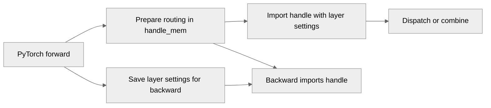

# [PyTorch] Remove EP handle cache and reconstructing handle on the fly

[Upstream PR](https://github.com/NVIDIA/TransformerEngine/pull/3760) · state: closed · merged: True

## Original PR description

# Description

Fixes issue https://github.com/NVIDIA/TransformerEngine/issues/3742

## Type of change

- [ ] Documentation change (change only to the documentation, either a fix or a new content)
- [x] Bug fix (non-breaking change which fixes an issue)
- [x] New feature (non-breaking change which adds functionality)
- [ ] Breaking change (fix or feature that would cause existing functionality to not work as expected)
- [ ] Infra/Build change
- [ ] Code refactoring

# Checklist:

- [x] I have read and followed the [contributing guidelines](https://github.com/NVIDIA/TransformerEngine/blob/main/CONTRIBUTING.rst)
- [x] The functionality is complete
- [x] I have commented my code, particularly in hard-to-understand areas
- [x] I have made corresponding changes to the documentation
- [x] My changes generate no new warnings
- [ ] I have added tests that prove my fix is effective or that my feature works
- [x] New and existing unit tests pass locally with my changes

## Review and discussion

### reviews

- ptrendx · COMMENTED · 2026-10-29T20:56:42Z · [source](https://github.com/NVIDIA/TransformerEngine/pull/3760#pullrequestreview-5704854116)

(No body; status only.)

- ptrendx · COMMENTED · 2026-10-29T20:57:41Z · [source](https://github.com/NVIDIA/TransformerEngine/pull/3760#pullrequestreview-5704866213)

(No body; status only.)

- ptrendx · COMMENTED · 2026-10-29T21:01:49Z · [source](https://github.com/NVIDIA/TransformerEngine/pull/3760#pullrequestreview-5704912481)

(No body; status only.)

- phu0ngng · COMMENTED · 2026-10-30T01:53:59Z · [source](https://github.com/NVIDIA/TransformerEngine/pull/3760#pullrequestreview-5707209709)

(No body; status only.)

- ptrendx · APPROVED · 2026-10-30T16:24:43Z · [source](https://github.com/NVIDIA/TransformerEngine/pull/3760#pullrequestreview-5715323051)

(No body; status only.)

### issue_comments

- greptile-apps[bot] · comment · 2026-10-27T21:14:33Z · [source](https://github.com/NVIDIA/TransformerEngine/pull/3760#issuecomment-6453731560)

<!-- greptile_summary -->

<h2><a href="https://app.greptile.com/api/retrigger?id=89286520"><picture><source media="(prefers-color-scheme: dark)" srcset="https://greptile-static-assets.s3.amazonaws.com/badges/RetriggerDark.svg?v=2"><source media="(prefers-color-scheme: light)" srcset="https://greptile-static-assets.s3.amazonaws.com/badges/Retrigger.svg?v=2"></picture></a><a href="https://app.greptile.com/nvidia-public-github/github/NVIDIA/transformerengine/-/pull/3760?utm_source=greptile_review&amp;utm_medium=github&amp;utm_campaign=view_in_greptile"><picture><source media="(prefers-color-scheme: dark)" srcset="https://greptile-static-assets.s3.amazonaws.com/badges/ViewInGreptileDark.svg?v=2"><source media="(prefers-color-scheme: light)" srcset="https://greptile-static-assets.s3.amazonaws.com/badges/ViewInGreptile.svg?v=2"></picture></a>Confidence Score: 5/5</h2>

**[Medium impact]** The PR appears safe to merge; no actionable defects were found.

<h3>Summary</h3>

PyTorch now rebuilds EP handles from `handle_mem` instead of looking them up by address.

- PyTorch EP steps rebuild handles from routing state.
- EP callers can run without a handle cache by default.

<h3>Diagram</h3>

<!-- greptile_confidence_score:5 -->

Reviews (4) · Last reviewed commit: ["Merge branch &#39;main&#39; into ep\_pyt\_no\_handl..."](https://github.com/nvidia/transformerengine/commit/6921b57003e2a02e1aafe8a41228bbd6a18267aa) · [Reviewed by Greptile](https://www.greptile.com/?utm_source=greptile_review&utm_medium=github&utm_campaign=review_public&utm_content=nvidia/transformerengine)

- phu0ngng · comment · 2026-10-27T23:45:46Z · [source](https://github.com/NVIDIA/TransformerEngine/pull/3760#issuecomment-6456394836)

/te-ci L1 Pytorch

- ptrendx · comment · 2026-10-27T23:56:55Z · [source](https://github.com/NVIDIA/TransformerEngine/pull/3760#issuecomment-6456628817)

@phu0ngng Should this also be tagged with 2.21?

- rapatel · comment · 2026-10-28T00:51:23Z · [source](https://github.com/NVIDIA/TransformerEngine/pull/3760#issuecomment-6457676649)

@phu0ngng Could you update the description to tag issue #3742. Thanks!

- phu0ngng · comment · 2026-10-28T21:20:19Z · [source](https://github.com/NVIDIA/TransformerEngine/pull/3760#issuecomment-6480964035)

Pipeline passed for related tests, thus safe to merge. 

- phu0ngng · comment · 2026-10-30T02:10:02Z · [source](https://github.com/NVIDIA/TransformerEngine/pull/3760#issuecomment-6513224132)

/te-ci L1

### inline_comments

- ptrendx · comment · 2026-10-29T20:56:42Z · [source](https://github.com/NVIDIA/TransformerEngine/pull/3760#discussion_r4417805238)

File: `transformer_engine/common/include/transformer_engine/ep.h` · line None

I don't like this (pyTorch extension setting the behavior via env variable) - if we do not need the cache then we should just remove it and deprecate the env variable as it would not actually do anything.

- ptrendx · comment · 2026-10-29T20:57:42Z · [source](https://github.com/NVIDIA/TransformerEngine/pull/3760#discussion_r4417815282)

File: `transformer_engine/common/include/transformer_engine/ep.h` · line 184

This suggests that the env variable does not have any meaning in v2 anyway, so why are we setting the env variable if we only use v2?

- ptrendx · comment · 2026-10-29T21:01:50Z · [source](https://github.com/NVIDIA/TransformerEngine/pull/3760#discussion_r4417852674)

File: `transformer_engine/pytorch/csrc/extensions/ep.cpp` · line None

The name of this and the following function is misleading, as it would suggest bool or void return type vs the DType. From the name it is also impossible to tell what is this function doing differently from check_topk_idx_dtype.

- phu0ngng · comment · 2026-10-30T01:53:59Z · [source](https://github.com/NVIDIA/TransformerEngine/pull/3760#discussion_r4419729166)

File: `transformer_engine/common/include/transformer_engine/ep.h` · line None

Make the cache off by default and remove all env settings from the TE extensions. 
The cache will be removed eventually when we remove v1 APIs.

## Changed files and fixed code

- `tests/cpp_distributed/test_ep.cu` · modified · additions 3 / deletions 0
  - [head](https://github.com/phu0ngng/TransformerEngine/blob/6921b57003e2a02e1aafe8a41228bbd6a18267aa/tests/cpp_distributed/test_ep.cu)
  - [base](https://github.com/NVIDIA/TransformerEngine/blob/fd2ab0cf7dde6e74cc801bd9a334b1fcf32c9fee/tests/cpp_distributed/test_ep.cu)
- `tests/jax/test_multi_process_ep.py` · modified · additions 2 / deletions 2
  - [head](https://github.com/phu0ngng/TransformerEngine/blob/6921b57003e2a02e1aafe8a41228bbd6a18267aa/tests/jax/test_multi_process_ep.py)
  - [base](https://github.com/NVIDIA/TransformerEngine/blob/fd2ab0cf7dde6e74cc801bd9a334b1fcf32c9fee/tests/jax/test_multi_process_ep.py)
- `transformer_engine/common/ep/ep_backend.cpp` · modified · additions 1 / deletions 1
  - [head](https://github.com/phu0ngng/TransformerEngine/blob/6921b57003e2a02e1aafe8a41228bbd6a18267aa/transformer_engine/common/ep/ep_backend.cpp)
  - [base](https://github.com/NVIDIA/TransformerEngine/blob/fd2ab0cf7dde6e74cc801bd9a334b1fcf32c9fee/transformer_engine/common/ep/ep_backend.cpp)
- `transformer_engine/common/ep/ep_backend.h` · modified · additions 2 / deletions 1
  - [head](https://github.com/phu0ngng/TransformerEngine/blob/6921b57003e2a02e1aafe8a41228bbd6a18267aa/transformer_engine/common/ep/ep_backend.h)
  - [base](https://github.com/NVIDIA/TransformerEngine/blob/fd2ab0cf7dde6e74cc801bd9a334b1fcf32c9fee/transformer_engine/common/ep/ep_backend.h)
- `transformer_engine/common/include/transformer_engine/ep.h` · modified · additions 16 / deletions 4
  - [head](https://github.com/phu0ngng/TransformerEngine/blob/6921b57003e2a02e1aafe8a41228bbd6a18267aa/transformer_engine/common/include/transformer_engine/ep.h)
  - [base](https://github.com/NVIDIA/TransformerEngine/blob/fd2ab0cf7dde6e74cc801bd9a334b1fcf32c9fee/transformer_engine/common/include/transformer_engine/ep.h)
- `transformer_engine/jax/csrc/extensions/ep.cpp` · modified · additions 0 / deletions 3
  - [head](https://github.com/phu0ngng/TransformerEngine/blob/6921b57003e2a02e1aafe8a41228bbd6a18267aa/transformer_engine/jax/csrc/extensions/ep.cpp)
  - [base](https://github.com/NVIDIA/TransformerEngine/blob/fd2ab0cf7dde6e74cc801bd9a334b1fcf32c9fee/transformer_engine/jax/csrc/extensions/ep.cpp)
- `transformer_engine/pytorch/csrc/extensions.h` · modified · additions 7 / deletions 2
  - [head](https://github.com/phu0ngng/TransformerEngine/blob/6921b57003e2a02e1aafe8a41228bbd6a18267aa/transformer_engine/pytorch/csrc/extensions.h)
  - [base](https://github.com/NVIDIA/TransformerEngine/blob/fd2ab0cf7dde6e74cc801bd9a334b1fcf32c9fee/transformer_engine/pytorch/csrc/extensions.h)
- `transformer_engine/pytorch/csrc/extensions/ep.cpp` · modified · additions 56 / deletions 30
  - [head](https://github.com/phu0ngng/TransformerEngine/blob/6921b57003e2a02e1aafe8a41228bbd6a18267aa/transformer_engine/pytorch/csrc/extensions/ep.cpp)
  - [base](https://github.com/NVIDIA/TransformerEngine/blob/fd2ab0cf7dde6e74cc801bd9a334b1fcf32c9fee/transformer_engine/pytorch/csrc/extensions/ep.cpp)
- `transformer_engine/pytorch/ep.py` · modified · additions 81 / deletions 12
  - [head](https://github.com/phu0ngng/TransformerEngine/blob/6921b57003e2a02e1aafe8a41228bbd6a18267aa/transformer_engine/pytorch/ep.py)
  - [base](https://github.com/NVIDIA/TransformerEngine/blob/fd2ab0cf7dde6e74cc801bd9a334b1fcf32c9fee/transformer_engine/pytorch/ep.py)

## Evidence and interpretation boundary

[Original JSON, discussions and patches](../../../../../../evidence/prs/NVIDIA--TransformerEngine/3760-6674f1363005a2ea6c4bde1ce868e938ea1f473411ab5e9e7dc49a449fcfa85d.json) · SHA-256 `6674f1363005a2ea6c4bde1ce868e938ea1f473411ab5e9e7dc49a449fcfa85d`.

Diff complete: True. Missing/binary/truncated patches require pinned source inspection. This is a source page, not an independently verified optimization case. Open, merged and released are different states; recheck the deployed dependency.
