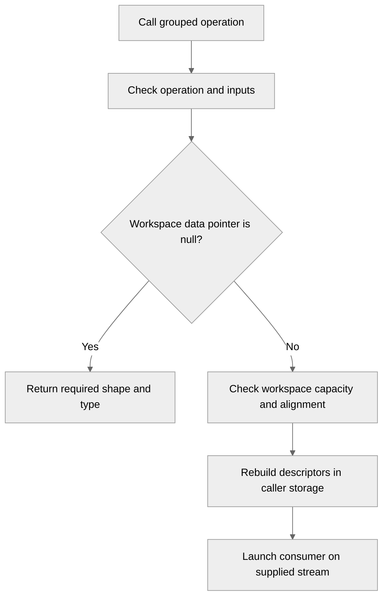

# [Common] Add caller-owned workspaces with per-stream resource isolation

[Upstream PR](https://github.com/NVIDIA/TransformerEngine/pull/3766) · state: open · merged: False

## Original PR description

# Description

Replace global mutable TMA descriptor arrays in grouped MXFP8 quantization, activation forward/backward, and dequantization with caller-owned workspace. Use ordinary `NVTETensor` handles and the existing empty-tensor size-query protocol. Reconstruct the layout from the group count and rebuild descriptors and metadata on each invocation, without persistent host state or workspace ownership attached to tensors. Remove the fixed 64-group descriptor limit.

Callers provide separate mutable allocations for independently executing CUDA streams and CUDA Graphs, order reuse of a shared buffer, and keep captured allocations alive for all graph executions that reference them.

**Compatibility change:** the original workspace-less grouped C APIs now reject MXFP8 layouts with varying last dimensions. C/C++ callers must use the corresponding `_v2` query/allocate/execute APIs for those layouts. Constant-last-dimension layouts retain support through the original entry points.

PyTorch grouped MXFP8 quantize/dequantize use the workspace-enabled APIs and framework allocations. The JAX grouped MXFP8 FFI keeps its existing call: its constant last dimension uses launch-local descriptors and does not require descriptor-array workspace.

Also fix PyTorch grouped DBias scratch lifetime and preserve supported partial-row MXFP8 dequantization. DBias retains its existing backend-specific scratch protocol.

CUDA resource lifecycle and reset changes belong to a follow-up PR #3779, which is currently based on this PR.

Workspace size queries perform the same host-side validation as execution, including non-MXFP8 forward formats and block-scaled dequantization, without launching GPU work or modifying outputs.

## Type of change

- [ ] Documentation change (change only to the documentation, either a fix or a new content)
- [x] Bug fix (non-breaking change which fixes an issue)
- [x] New feature (non-breaking change which adds functionality)
- [x] Breaking change (fix or feature that would cause existing functionality to not work as expected)
- [ ] Infra/Build change
- [x] Code refactoring

## Changes

| Area | Change |
| --- | --- |
| Grouped TMA workspace | Add a stateless layout for four tensor-map arrays and three metadata arrays, each starting on a 128-byte boundary. Query and execute through ordinary `NVTETensor` handles, including different handles for query and execution. Validate declared capacity and base alignment; centralize size-overflow checks in the layout calculation. |
| Grouped MXFP8 kernels | Pass caller-owned storage to descriptor updaters and consumers for quantize, dequantize, and all five grouped activation forward/backward families. Rebuild descriptors and metadata per invocation; remove the fixed 64-group limit. |
| Workspace reuse and concurrency | Require separate mutable storage for independently executing streams and graphs. Leave allocation ownership, reuse ordering, and graph lifetime with the caller/framework. |
| C API and compatibility | Add workspace-aware `_v2` grouped entry points. Original workspace-less APIs reject varying-last-dimension MXFP8 layouts; constant-last-dimension layouts remain supported. Document the migration. |
| PyTorch integration | Use `_v2` for grouped MXFP8 quantize/dequantize and allocate workspace through the framework, including graph-pool allocations during capture. Keep other grouped formats on their existing calls. |
| JAX compatibility | Keep the existing grouped MXFP8 FFI call unchanged: its constant-last-dimension layout uses launch-local descriptors. |
| DBias workspace lifetime fix | Keep the PyTorch grouped DBias scratch allocation alive through operation submission. Retain the existing DBias APIs and backend-specific scratch protocol. |
| Partial-row dequantization fix | Remove the inappropriate 128-row alignment check from supported grouped MXFP8 dequantization paths, preserving cases such as M=96 and M=160. |
| Tests and documentation | Cover fresh query/execution handles, capacity/alignment validation, more than 64 groups, numerical results, separate-buffer concurrency, and CUDA Graph replay. Document allocation ownership, reuse ordering, and captured-buffer lifetime. |
| Workspace query validation | Run the same host-side checks for query and execution in non-MXFP8 forward formats and block-scaled dequantization. Reject unsupported operations, configurations, dtypes, and layouts before returning the size. Preserve the one-byte requirement for supported paths without descriptor storage. |
| Tests and documentation | Cover fresh query/execution handles, capacity/alignment checks, more than 64 groups, numerical results, independent streams, and CUDA Graph replay. Add regressions for rejected queries and verify that valid queries leave buffers unchanged and capture zero graph nodes. Document query validation, ownership, reuse ordering, and graph lifetime. |

# Checklist:

- [ ] I have read and followed the [contributing guidelines](https://github.com/NVIDIA/TransformerEngine/blob/main/CONTRIBUTING.rst)
- [x] The functionality is complete
- [x] I have commented my code, particularly in hard-to-understand areas
- [x] I have made corresponding changes to the documentation
- [ ] My changes generate no new warnings
- [x] I have added tests that prove my fix is effective or that my feature works
- [ ] New and existing unit tests pass locally with my changes

## Review and discussion

### reviews

- timmoon10 · CHANGES_REQUESTED · 2026-10-30T02:46:34Z · [source](https://github.com/NVIDIA/TransformerEngine/pull/3766#pullrequestreview-5707509005)

This workspace infrastructure may be overengineered: https://github.com/NVIDIA/TransformerEngine/pull/3779#discussion_r4418062964

- greptile-apps[bot] · COMMENTED · 2026-11-03T15:45:37Z · [source](https://github.com/NVIDIA/TransformerEngine/pull/3766#pullrequestreview-5755169427)

(No body; status only.)

- Oleg-Goncharov · COMMENTED · 2026-11-03T16:58:26Z · [source](https://github.com/NVIDIA/TransformerEngine/pull/3766#pullrequestreview-5756303292)

(No body; status only.)

### issue_comments

- Oleg-Goncharov · comment · 2026-11-03T15:04:51Z · [source](https://github.com/NVIDIA/TransformerEngine/pull/3766#issuecomment-6607301664)

Thanks for the detailed review, @timmoon10! I have narrowed this PR to caller-owned TMA descriptor storage for grouped MXFP8 operations. Below are responses to your comments in #3779

1. The scope is too large, and the code needs human review.
The generic workspace catalog and framework workspace owner have been removed. This PR now covers grouped TMA storage and its callers.

2. Is there value in forcing all workspaces to share the same infrastructure?
Agreed. The generic infrastructure has been removed. `GroupedTmaWorkspaceLayout` only describes the descriptor and metadata arrays needed by grouped TMA kernels.

3. Do the scattered `size_t` overflow checks accomplish much?
The remaining checks are centralized in `reserve()`. I kept checks for multiplication, padding, and accumulated size because the allocation depends on the group count, which is no longer capped at 64. They prevent an overflowing size calculation from producing an undersized allocation.

4. Why require power-of-two alignment?
The configurable alignment interface and its power-of-two restriction have been removed. The remaining layout has one fixed alignment convention.

5. Why disallow alignments smaller than 128 bytes, especially for metadata?
The 128-byte convention is now local to the grouped TMA layout. It currently applies to both descriptor and metadata arrays for simplicity, but reducing their padding would be a possible memory-saving improvement.

6. Why require workspace elements to be trivially copyable?
That restriction was part of the generic infrastructure and has been removed.

7. Why does the rowwise setter receive special treatment?
The setter hooks have been removed. An ordinary `NVTETensor` handle carries the workspace pointer and byte capacity using its rowwise data field. This is the representation of the raw buffer, independent of whether the operation produces rowwise or columnwise output.

8. Does `shared_ptr<Workspace>` make every `Tensor` more expensive and non-POD?
The field has been removed. The common `Tensor` definition and setters now match `main`.

9. Why does supposedly general infrastructure know about MXFP8?
The helper is now explicitly specialized for grouped TMA storage. It is no longer presented as general quantization infrastructure. The diagnostic still mentions MXFP8 and gives quantize as an example.

10. Could a `Resource` allocate the buffer internally and preserve the existing APIs?
Internal allocation is a possible alternative, but it still needs rules for concurrent use and buffer lifetime. One shared mutable allocation would allow independently executing streams to overwrite each other's descriptors. A host mutex around submission would not protect overlapping GPU execution, and captured graphs also need their storage to remain valid.
The current design keeps allocation with the framework. Independent streams and graphs receive separate buffers, and the caller orders reuse. There are no persistent activation tables, singleton workspace managers, or allocation generations in this PR anymore.

Comments 11-16 concern the resource lifecycle changes in the follow-up PR #3779 which is currently based on this PR. I’ll address those comments separately in that PR.

- greptile-apps[bot] · comment · 2026-11-03T15:45:33Z · [source](https://github.com/NVIDIA/TransformerEngine/pull/3766#issuecomment-6608307557)

<!-- greptile_summary -->

<h2><a href="https://app.greptile.com/api/retrigger?id=93010869"><picture><source media="(prefers-color-scheme: dark)" srcset="https://greptile-static-assets.s3.amazonaws.com/badges/RetriggerDark.svg?v=2"><source media="(prefers-color-scheme: light)" srcset="https://greptile-static-assets.s3.amazonaws.com/badges/Retrigger.svg?v=2"></picture></a><a href="https://app.greptile.com/-/switch-tenant?tenant=nvidia-public-github&amp;next=%2FNVIDIA%2Ftransformerengine%2Fpull%2F3766&amp;utm_source=greptile_review&amp;utm_medium=github&amp;utm_campaign=view_in_greptile"><picture><source media="(prefers-color-scheme: dark)" srcset="https://greptile-static-assets.s3.amazonaws.com/badges/ViewInGreptileDark.svg?v=2"><source media="(prefers-color-scheme: light)" srcset="https://greptile-static-assets.s3.amazonaws.com/badges/ViewInGreptile.svg?v=2"></picture></a>Confidence Score: 5/5</h2>

**[Medium impact]** The PR appears safe to merge; the earlier query-check issue is fixed and no new actionable issues were found.

<h3>Summary</h3>

Adds caller-owned workspace for grouped MXFP8 operations and removes shared mutable descriptor arrays.
- Grouped MXFP8 quantization uses caller-owned workspace.
- Grouped activation calls accept caller-owned workspace.
- Workspace queries validate grouped operations without launching kernels.
- PyTorch grouped MXFP8 calls allocate workspace through the framework.
- Grouped MXFP8 dequantization uses workspace and keeps partial rows supported.

Review was based on source inspection; GPU tests were not run.

<h3>Diagram</h3>

<!-- greptile_confidence_score:5 -->

Reviews (2) · Last reviewed commit: ["Validate grouped workspace queries befor..."](https://github.com/nvidia/transformerengine/commit/90252d2bd3feb406caf5dc44fefbdeaed340073a) · [Reviewed by Greptile](https://www.greptile.com/?utm_source=greptile_review&utm_medium=github&utm_campaign=review_public&utm_content=nvidia/transformerengine)

### inline_comments

- greptile-apps[bot] · comment · 2026-11-03T15:45:36Z · [source](https://github.com/NVIDIA/TransformerEngine/pull/3766#discussion_r4456979969)

File: `transformer_engine/common/cast/dispatch/quantize.cuh` · line None

 **Queries accept unsupported operations**

Empty-workspace queries return before checking non-MXFP8 formats. For example, `nvte_group_gelu_v2` with block-scaled output reports a successful one-byte requirement, but execution rejects it with `IS_ACT is not implemented`. Callers allocate storage before discovering that the operation cannot run, contrary to the documented query contract.

Run the format and configuration checks before returning the size, without launching kernels. The block-scaled dequantization query has the same early-return pattern.

- Oleg-Goncharov · comment · 2026-11-03T16:58:26Z · [source](https://github.com/NVIDIA/TransformerEngine/pull/3766#discussion_r4457878860)

File: `transformer_engine/common/cast/dispatch/quantize.cuh` · line None

Fixed both paths. Workspace queries now run the same host-side operation, format, configuration, dtype, and layout checks as execution before returning the size. Supported paths without descriptor storage still return the one-byte requirement, without launching GPU work.

## Changed files and fixed code

- `docs/api/c/activation.rst` · modified · additions 17 / deletions 0
  - [head](https://github.com/Oleg-Goncharov/TransformerEngine/blob/90252d2bd3feb406caf5dc44fefbdeaed340073a/docs/api/c/activation.rst)
  - [base](https://github.com/NVIDIA/TransformerEngine/blob/b021980343e33fdd5b091f95fd13f82e05d581af/docs/api/c/activation.rst)
- `docs/api/c/cast.rst` · modified · additions 58 / deletions 0
  - [head](https://github.com/Oleg-Goncharov/TransformerEngine/blob/90252d2bd3feb406caf5dc44fefbdeaed340073a/docs/api/c/cast.rst)
  - [base](https://github.com/NVIDIA/TransformerEngine/blob/b021980343e33fdd5b091f95fd13f82e05d581af/docs/api/c/cast.rst)
- `docs/api/c/index.rst` · modified · additions 5 / deletions 0
  - [head](https://github.com/Oleg-Goncharov/TransformerEngine/blob/90252d2bd3feb406caf5dc44fefbdeaed340073a/docs/api/c/index.rst)
  - [base](https://github.com/NVIDIA/TransformerEngine/blob/b021980343e33fdd5b091f95fd13f82e05d581af/docs/api/c/index.rst)
- `docs/api/c/workspace.rst` · added · additions 85 / deletions 0
  - [head](https://github.com/Oleg-Goncharov/TransformerEngine/blob/90252d2bd3feb406caf5dc44fefbdeaed340073a/docs/api/c/workspace.rst)
  - [base](https://github.com/NVIDIA/TransformerEngine/blob/b021980343e33fdd5b091f95fd13f82e05d581af/docs/api/c/workspace.rst)
- `tests/cpp/operator/CMakeLists.txt` · modified · additions 1 / deletions 0
  - [head](https://github.com/Oleg-Goncharov/TransformerEngine/blob/90252d2bd3feb406caf5dc44fefbdeaed340073a/tests/cpp/operator/CMakeLists.txt)
  - [base](https://github.com/NVIDIA/TransformerEngine/blob/b021980343e33fdd5b091f95fd13f82e05d581af/tests/cpp/operator/CMakeLists.txt)
- `tests/cpp/operator/test_cast_current_scaling_grouped.cu` · modified · additions 6 / deletions 0
  - [head](https://github.com/Oleg-Goncharov/TransformerEngine/blob/90252d2bd3feb406caf5dc44fefbdeaed340073a/tests/cpp/operator/test_cast_current_scaling_grouped.cu)
  - [base](https://github.com/NVIDIA/TransformerEngine/blob/b021980343e33fdd5b091f95fd13f82e05d581af/tests/cpp/operator/test_cast_current_scaling_grouped.cu)
- `tests/cpp/operator/test_cast_float8blockwise_grouped.cu` · modified · additions 6 / deletions 0
  - [head](https://github.com/Oleg-Goncharov/TransformerEngine/blob/90252d2bd3feb406caf5dc44fefbdeaed340073a/tests/cpp/operator/test_cast_float8blockwise_grouped.cu)
  - [base](https://github.com/NVIDIA/TransformerEngine/blob/b021980343e33fdd5b091f95fd13f82e05d581af/tests/cpp/operator/test_cast_float8blockwise_grouped.cu)
- `tests/cpp/operator/test_cast_mxfp8_grouped.cu` · modified · additions 199 / deletions 16
  - [head](https://github.com/Oleg-Goncharov/TransformerEngine/blob/90252d2bd3feb406caf5dc44fefbdeaed340073a/tests/cpp/operator/test_cast_mxfp8_grouped.cu)
  - [base](https://github.com/NVIDIA/TransformerEngine/blob/b021980343e33fdd5b091f95fd13f82e05d581af/tests/cpp/operator/test_cast_mxfp8_grouped.cu)
- `tests/cpp/operator/test_dequantize_mxfp8_grouped.cu` · modified · additions 10 / deletions 1
  - [head](https://github.com/Oleg-Goncharov/TransformerEngine/blob/90252d2bd3feb406caf5dc44fefbdeaed340073a/tests/cpp/operator/test_dequantize_mxfp8_grouped.cu)
  - [base](https://github.com/NVIDIA/TransformerEngine/blob/b021980343e33fdd5b091f95fd13f82e05d581af/tests/cpp/operator/test_dequantize_mxfp8_grouped.cu)
- `tests/cpp/operator/test_grouped_workspace_concurrency.cu` · added · additions 394 / deletions 0
  - [head](https://github.com/Oleg-Goncharov/TransformerEngine/blob/90252d2bd3feb406caf5dc44fefbdeaed340073a/tests/cpp/operator/test_grouped_workspace_concurrency.cu)
  - [base](https://github.com/NVIDIA/TransformerEngine/blob/b021980343e33fdd5b091f95fd13f82e05d581af/tests/cpp/operator/test_grouped_workspace_concurrency.cu)
- `tests/cpp/util/CMakeLists.txt` · modified · additions 1 / deletions 0
  - [head](https://github.com/Oleg-Goncharov/TransformerEngine/blob/90252d2bd3feb406caf5dc44fefbdeaed340073a/tests/cpp/util/CMakeLists.txt)
  - [base](https://github.com/NVIDIA/TransformerEngine/blob/b021980343e33fdd5b091f95fd13f82e05d581af/tests/cpp/util/CMakeLists.txt)
- `tests/cpp/util/test_grouped_tma_workspace.cpp` · added · additions 67 / deletions 0
  - [head](https://github.com/Oleg-Goncharov/TransformerEngine/blob/90252d2bd3feb406caf5dc44fefbdeaed340073a/tests/cpp/util/test_grouped_tma_workspace.cpp)
  - [base](https://github.com/NVIDIA/TransformerEngine/blob/b021980343e33fdd5b091f95fd13f82e05d581af/tests/cpp/util/test_grouped_tma_workspace.cpp)
- `tests/pytorch/test_grouped_tensor.py` · modified · additions 123 / deletions 3
  - [head](https://github.com/Oleg-Goncharov/TransformerEngine/blob/90252d2bd3feb406caf5dc44fefbdeaed340073a/tests/pytorch/test_grouped_tensor.py)
  - [base](https://github.com/NVIDIA/TransformerEngine/blob/b021980343e33fdd5b091f95fd13f82e05d581af/tests/pytorch/test_grouped_tensor.py)
- `transformer_engine/common/activation/gelu_grouped.cu` · modified · additions 9 / deletions 0
  - [head](https://github.com/Oleg-Goncharov/TransformerEngine/blob/90252d2bd3feb406caf5dc44fefbdeaed340073a/transformer_engine/common/activation/gelu_grouped.cu)
  - [base](https://github.com/NVIDIA/TransformerEngine/blob/b021980343e33fdd5b091f95fd13f82e05d581af/transformer_engine/common/activation/gelu_grouped.cu)
- `transformer_engine/common/activation/gelu_grouped_bwd.cu` · modified · additions 9 / deletions 0
  - [head](https://github.com/Oleg-Goncharov/TransformerEngine/blob/90252d2bd3feb406caf5dc44fefbdeaed340073a/transformer_engine/common/activation/gelu_grouped_bwd.cu)
  - [base](https://github.com/NVIDIA/TransformerEngine/blob/b021980343e33fdd5b091f95fd13f82e05d581af/transformer_engine/common/activation/gelu_grouped_bwd.cu)
- `transformer_engine/common/activation/qgelu_grouped.cu` · modified · additions 9 / deletions 0
  - [head](https://github.com/Oleg-Goncharov/TransformerEngine/blob/90252d2bd3feb406caf5dc44fefbdeaed340073a/transformer_engine/common/activation/qgelu_grouped.cu)
  - [base](https://github.com/NVIDIA/TransformerEngine/blob/b021980343e33fdd5b091f95fd13f82e05d581af/transformer_engine/common/activation/qgelu_grouped.cu)
- `transformer_engine/common/activation/qgelu_grouped_bwd.cu` · modified · additions 9 / deletions 0
  - [head](https://github.com/Oleg-Goncharov/TransformerEngine/blob/90252d2bd3feb406caf5dc44fefbdeaed340073a/transformer_engine/common/activation/qgelu_grouped_bwd.cu)
  - [base](https://github.com/NVIDIA/TransformerEngine/blob/b021980343e33fdd5b091f95fd13f82e05d581af/transformer_engine/common/activation/qgelu_grouped_bwd.cu)
- `transformer_engine/common/activation/relu_grouped.cu` · modified · additions 9 / deletions 0
  - [head](https://github.com/Oleg-Goncharov/TransformerEngine/blob/90252d2bd3feb406caf5dc44fefbdeaed340073a/transformer_engine/common/activation/relu_grouped.cu)
  - [base](https://github.com/NVIDIA/TransformerEngine/blob/b021980343e33fdd5b091f95fd13f82e05d581af/transformer_engine/common/activation/relu_grouped.cu)
- `transformer_engine/common/activation/relu_grouped_bwd.cu` · modified · additions 9 / deletions 0
  - [head](https://github.com/Oleg-Goncharov/TransformerEngine/blob/90252d2bd3feb406caf5dc44fefbdeaed340073a/transformer_engine/common/activation/relu_grouped_bwd.cu)
  - [base](https://github.com/NVIDIA/TransformerEngine/blob/b021980343e33fdd5b091f95fd13f82e05d581af/transformer_engine/common/activation/relu_grouped_bwd.cu)
- `transformer_engine/common/activation/srelu_grouped.cu` · modified · additions 9 / deletions 0
  - [head](https://github.com/Oleg-Goncharov/TransformerEngine/blob/90252d2bd3feb406caf5dc44fefbdeaed340073a/transformer_engine/common/activation/srelu_grouped.cu)
  - [base](https://github.com/NVIDIA/TransformerEngine/blob/b021980343e33fdd5b091f95fd13f82e05d581af/transformer_engine/common/activation/srelu_grouped.cu)
- `transformer_engine/common/activation/srelu_grouped_bwd.cu` · modified · additions 9 / deletions 0
  - [head](https://github.com/Oleg-Goncharov/TransformerEngine/blob/90252d2bd3feb406caf5dc44fefbdeaed340073a/transformer_engine/common/activation/srelu_grouped_bwd.cu)
  - [base](https://github.com/NVIDIA/TransformerEngine/blob/b021980343e33fdd5b091f95fd13f82e05d581af/transformer_engine/common/activation/srelu_grouped_bwd.cu)
- `transformer_engine/common/activation/swiglu_grouped.cu` · modified · additions 9 / deletions 0
  - [head](https://github.com/Oleg-Goncharov/TransformerEngine/blob/90252d2bd3feb406caf5dc44fefbdeaed340073a/transformer_engine/common/activation/swiglu_grouped.cu)
  - [base](https://github.com/NVIDIA/TransformerEngine/blob/b021980343e33fdd5b091f95fd13f82e05d581af/transformer_engine/common/activation/swiglu_grouped.cu)
- `transformer_engine/common/activation/swiglu_grouped_bwd.cu` · modified · additions 9 / deletions 0
  - [head](https://github.com/Oleg-Goncharov/TransformerEngine/blob/90252d2bd3feb406caf5dc44fefbdeaed340073a/transformer_engine/common/activation/swiglu_grouped_bwd.cu)
  - [base](https://github.com/NVIDIA/TransformerEngine/blob/b021980343e33fdd5b091f95fd13f82e05d581af/transformer_engine/common/activation/swiglu_grouped_bwd.cu)
- `transformer_engine/common/cast/cast_grouped.cu` · modified · additions 20 / deletions 0
  - [head](https://github.com/Oleg-Goncharov/TransformerEngine/blob/90252d2bd3feb406caf5dc44fefbdeaed340073a/transformer_engine/common/cast/cast_grouped.cu)
  - [base](https://github.com/NVIDIA/TransformerEngine/blob/b021980343e33fdd5b091f95fd13f82e05d581af/transformer_engine/common/cast/cast_grouped.cu)
- `transformer_engine/common/cast/core/grouped_tma.cuh` · modified · additions 19 / deletions 23
  - [head](https://github.com/Oleg-Goncharov/TransformerEngine/blob/90252d2bd3feb406caf5dc44fefbdeaed340073a/transformer_engine/common/cast/core/grouped_tma.cuh)
  - [base](https://github.com/NVIDIA/TransformerEngine/blob/b021980343e33fdd5b091f95fd13f82e05d581af/transformer_engine/common/cast/core/grouped_tma.cuh)
- `transformer_engine/common/cast/core/grouped_tma_workspace.h` · added · additions 135 / deletions 0
  - [head](https://github.com/Oleg-Goncharov/TransformerEngine/blob/90252d2bd3feb406caf5dc44fefbdeaed340073a/transformer_engine/common/cast/core/grouped_tma_workspace.h)
  - [base](https://github.com/NVIDIA/TransformerEngine/blob/b021980343e33fdd5b091f95fd13f82e05d581af/transformer_engine/common/cast/core/grouped_tma_workspace.h)
- `transformer_engine/common/cast/dispatch/dequantize.cuh` · modified · additions 9 / deletions 3
  - [head](https://github.com/Oleg-Goncharov/TransformerEngine/blob/90252d2bd3feb406caf5dc44fefbdeaed340073a/transformer_engine/common/cast/dispatch/dequantize.cuh)
  - [base](https://github.com/NVIDIA/TransformerEngine/blob/b021980343e33fdd5b091f95fd13f82e05d581af/transformer_engine/common/cast/dispatch/dequantize.cuh)
- `transformer_engine/common/cast/dispatch/quantize.cuh` · modified · additions 70 / deletions 56
  - [head](https://github.com/Oleg-Goncharov/TransformerEngine/blob/90252d2bd3feb406caf5dc44fefbdeaed340073a/transformer_engine/common/cast/dispatch/quantize.cuh)
  - [base](https://github.com/NVIDIA/TransformerEngine/blob/b021980343e33fdd5b091f95fd13f82e05d581af/transformer_engine/common/cast/dispatch/quantize.cuh)
- `transformer_engine/common/cast/fp8/group_quantize_fp8.cuh` · modified · additions 19 / deletions 20
  - [head](https://github.com/Oleg-Goncharov/TransformerEngine/blob/90252d2bd3feb406caf5dc44fefbdeaed340073a/transformer_engine/common/cast/fp8/group_quantize_fp8.cuh)
  - [base](https://github.com/NVIDIA/TransformerEngine/blob/b021980343e33fdd5b091f95fd13f82e05d581af/transformer_engine/common/cast/fp8/group_quantize_fp8.cuh)
- `transformer_engine/common/cast/fp8_blockwise/group_dequantize_fp8_blockwise.cuh` · modified · additions 63 / deletions 56
  - [head](https://github.com/Oleg-Goncharov/TransformerEngine/blob/90252d2bd3feb406caf5dc44fefbdeaed340073a/transformer_engine/common/cast/fp8_blockwise/group_dequantize_fp8_blockwise.cuh)
  - [base](https://github.com/NVIDIA/TransformerEngine/blob/b021980343e33fdd5b091f95fd13f82e05d581af/transformer_engine/common/cast/fp8_blockwise/group_dequantize_fp8_blockwise.cuh)
- `transformer_engine/common/cast/fp8_blockwise/group_quantize_fp8_blockwise.cuh` · modified · additions 10 / deletions 7
  - [head](https://github.com/Oleg-Goncharov/TransformerEngine/blob/90252d2bd3feb406caf5dc44fefbdeaed340073a/transformer_engine/common/cast/fp8_blockwise/group_quantize_fp8_blockwise.cuh)
  - [base](https://github.com/NVIDIA/TransformerEngine/blob/b021980343e33fdd5b091f95fd13f82e05d581af/transformer_engine/common/cast/fp8_blockwise/group_quantize_fp8_blockwise.cuh)
- `transformer_engine/common/cast/mxfp8/group_dequantize_mxfp8.cuh` · modified · additions 39 / deletions 32
  - [head](https://github.com/Oleg-Goncharov/TransformerEngine/blob/90252d2bd3feb406caf5dc44fefbdeaed340073a/transformer_engine/common/cast/mxfp8/group_dequantize_mxfp8.cuh)
  - [base](https://github.com/NVIDIA/TransformerEngine/blob/b021980343e33fdd5b091f95fd13f82e05d581af/transformer_engine/common/cast/mxfp8/group_dequantize_mxfp8.cuh)
- `transformer_engine/common/cast/mxfp8/group_quantize_mxfp8.cuh` · modified · additions 44 / deletions 26
  - [head](https://github.com/Oleg-Goncharov/TransformerEngine/blob/90252d2bd3feb406caf5dc44fefbdeaed340073a/transformer_engine/common/cast/mxfp8/group_quantize_mxfp8.cuh)
  - [base](https://github.com/NVIDIA/TransformerEngine/blob/b021980343e33fdd5b091f95fd13f82e05d581af/transformer_engine/common/cast/mxfp8/group_quantize_mxfp8.cuh)
- `transformer_engine/common/cast/nvfp4/group_quantize_transpose_nvfp4.cuh` · modified · additions 10 / deletions 6
  - [head](https://github.com/Oleg-Goncharov/TransformerEngine/blob/90252d2bd3feb406caf5dc44fefbdeaed340073a/transformer_engine/common/cast/nvfp4/group_quantize_transpose_nvfp4.cuh)
  - [base](https://github.com/NVIDIA/TransformerEngine/blob/b021980343e33fdd5b091f95fd13f82e05d581af/transformer_engine/common/cast/nvfp4/group_quantize_transpose_nvfp4.cuh)
- `transformer_engine/common/include/transformer_engine/activation.h` · modified · additions 165 / deletions 0
  - [head](https://github.com/Oleg-Goncharov/TransformerEngine/blob/90252d2bd3feb406caf5dc44fefbdeaed340073a/transformer_engine/common/include/transformer_engine/activation.h)
  - [base](https://github.com/NVIDIA/TransformerEngine/blob/b021980343e33fdd5b091f95fd13f82e05d581af/transformer_engine/common/include/transformer_engine/activation.h)
- `transformer_engine/common/include/transformer_engine/cast.h` · modified · additions 47 / deletions 0
  - [head](https://github.com/Oleg-Goncharov/TransformerEngine/blob/90252d2bd3feb406caf5dc44fefbdeaed340073a/transformer_engine/common/include/transformer_engine/cast.h)
  - [base](https://github.com/NVIDIA/TransformerEngine/blob/b021980343e33fdd5b091f95fd13f82e05d581af/transformer_engine/common/include/transformer_engine/cast.h)
- `transformer_engine/pytorch/csrc/extensions/cast.cpp` · modified · additions 28 / deletions 8
  - [head](https://github.com/Oleg-Goncharov/TransformerEngine/blob/90252d2bd3feb406caf5dc44fefbdeaed340073a/transformer_engine/pytorch/csrc/extensions/cast.cpp)
  - [base](https://github.com/NVIDIA/TransformerEngine/blob/b021980343e33fdd5b091f95fd13f82e05d581af/transformer_engine/pytorch/csrc/extensions/cast.cpp)

## Evidence and interpretation boundary

[Original JSON, discussions and patches](../../../../../../evidence/prs/NVIDIA--TransformerEngine/3766-35cc79cc337fa5e2b9e4dcaf49bafcf2393d37940037c3f28db033622d918435.json) · SHA-256 `35cc79cc337fa5e2b9e4dcaf49bafcf2393d37940037c3f28db033622d918435`.

Diff complete: True. Missing/binary/truncated patches require pinned source inspection. This is a source page, not an independently verified optimization case. Open, merged and released are different states; recheck the deployed dependency.
