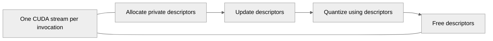

# Fix grouped MXFP8 quantization race on concurrent CUDA streams

[Upstream PR](https://github.com/NVIDIA/TransformerEngine/pull/3774) · state: closed · merged: False

## Original PR description

## Problem

Grouped MXFP8 quantization stored its per-tensor TMA descriptor storage in a **file-global** `static __device__` buffer (`g_tensor_maps` in `grouped_tma.cuh`; `g_tensor_maps_input`/`g_tensor_maps_output` in `group_dequantize_mxfp8.cuh`). That buffer is shared by every launch of the kernel across all CUDA streams. When two `group_quantize` calls run concurrently on different streams (e.g. per-microbatch in a pipelined or comm-overlap schedule), one stream's `update_tma_descriptors` overwrites tensor maps that another stream is still consuming, so the second stream reads clobbered descriptors and produces incorrect output. On Blackwell (sm100) this reproduces ~90/100 of the time with two concurrent grouped-quantize calls.

## Fix

Make the descriptor storage **per-invocation** instead of file-global. The launcher now allocates a private `TensorMapStorage` (quantize) or `CUtensorMap` arrays (dequantize) with `cudaMallocAsync` and passes them to both the descriptor-update kernel and the consumer kernel, then releases them with `cudaFreeAsync`. This keeps the storage in global memory (required for TMA to consume the descriptors) while making it disjoint across concurrent invocations. `cudaMallocAsync`/`cudaFreeAsync` are stream-ordered, so the descriptors stay alive until the kernels that use them have finished and the pool never hands the block to another stream in the meantime. This is the same idiom already used in `comm_gemm_overlap.cpp`.

The single-tensor path is unchanged — it uses static per-CTA descriptors and never touched the global buffer.

## Validation

- New regression test `tests/pytorch/mxfp8/test_mxfp8_group_quantize_multistream.py` runs grouped MXFP8 quantization on two CUDA streams concurrently and checks every result against a single-stream reference.
- On Taihua B200 (sm100, torch 2.11 / CUDA 13.1) the repro goes from ~90/100 wrong outputs to **0/200**, and the regression test passes 8/8.

## Files

- `transformer_engine/common/cast/core/grouped_tma.cuh` — `update_tma_descriptors` takes a per-call `TensorMapStorage *`; remove the file-global `g_tensor_maps`.
- `transformer_engine/common/cast/mxfp8/group_quantize_mxfp8.cuh` — allocate/pass/free a per-call `TensorMapStorage`.
- `transformer_engine/common/cast/mxfp8/group_dequantize_mxfp8.cuh` — same fix for the sibling dequantize path, which had the identical file-global buffer.
- `tests/pytorch/mxfp8/test_mxfp8_group_quantize_multistream.py` — new regression test.


## Review and discussion

### reviews

- greptile-apps[bot] · COMMENTED · 2026-10-29T08:57:40Z · [source](https://github.com/NVIDIA/TransformerEngine/pull/3774#pullrequestreview-5695114993)

(No body; status only.)

### issue_comments

- greptile-apps[bot] · comment · 2026-10-29T08:57:35Z · [source](https://github.com/NVIDIA/TransformerEngine/pull/3774#issuecomment-6492351984)

<!-- greptile_summary -->

<h2><a href="https://app.greptile.com/api/retrigger?id=90440655"><picture><source media="(prefers-color-scheme: dark)" srcset="https://greptile-static-assets.s3.amazonaws.com/badges/RetriggerDark.svg?v=2"><source media="(prefers-color-scheme: light)" srcset="https://greptile-static-assets.s3.amazonaws.com/badges/Retrigger.svg?v=2"></picture></a><a href="https://app.greptile.com/nvidia-public-github/github/NVIDIA/transformerengine/-/pull/3774?utm_source=greptile_review&amp;utm_medium=github&amp;utm_campaign=view_in_greptile"><picture><source media="(prefers-color-scheme: dark)" srcset="https://greptile-static-assets.s3.amazonaws.com/badges/ViewInGreptileDark.svg?v=2"><source media="(prefers-color-scheme: light)" srcset="https://greptile-static-assets.s3.amazonaws.com/badges/ViewInGreptile.svg?v=2"></picture></a>Confidence Score: 4/5</h2>

**[Medium impact]** The change affects the grouped MXFP8 quantization path used by callers running grouped workloads\.

The descriptor fix appears safe to merge, with non-blocking fixes needed for test ordering and cleanup after errors.

<h2>Findings</h2>

1. &nbsp;**Test reads unfinished inputs** <a href="https://github.com/NVIDIA/TransformerEngine/pull/3774#discussion_r4410382195">▶</a>
2. &nbsp;**Failed calls leak device memory** <a href="https://github.com/NVIDIA/TransformerEngine/pull/3774#discussion_r4410382204">▶</a>

<h3>Summary</h3>

Grouped MXFP8 quantization now gives each invocation its own descriptor storage instead of sharing a device-global buffer.
- Grouped quantization calls keep their descriptors separate across streams.

<h3>Diagram</h3>



<!-- greptile_confidence_score:4 -->

<sub>Reviews (1) · Last reviewed commit: ["Move dequantize fix to a separate PR (#3..."](https://github.com/nvidia/transformerengine/commit/4063ccd291465cd54699e6ddef93f29054521715) · [Reviewed by Greptile](https://www.greptile.com/?utm_source=greptile_review&utm_medium=github&utm_campaign=review_public&utm_content=nvidia/transformerengine)</sub>

- Oleg-Goncharov · comment · 2026-10-29T10:11:08Z · [source](https://github.com/NVIDIA/TransformerEngine/pull/3774#issuecomment-6493872022)

Hi @XFDG, thanks for identifying and addressing this issue.
However, we generally avoid allocating and owning memory inside the common TE code. When temporary or persistent storage is required, we expect it to be provided by the caller through a workspace mechanism (similar to what we already do for other kernels).
In addition to the ownership issue, allocating and freeing the descriptor storage on every invocation introduces unnecessary runtime overhead on a performance-critical path. We would strongly prefer caller-owned workspace that can be allocated once and reused across invocations, rather than going through the allocator on every call.
We are already aware of this race and are addressing it in [PR#3766](https://github.com/NVIDIA/TransformerEngine/pull/3766), which introduces caller-owned workspace storage and handles the grouped MXFP8 TMA descriptor lifetime without relying on file-global storage.
Since #3766 is intended to solve the same issue using the ownership and lifetime model we want to use in TE, I'm going to close this PR in favor of that approach.
Thanks again for reporting the problem and putting together the fix.

### inline_comments

- greptile-apps[bot] · comment · 2026-10-29T08:57:39Z · [source](https://github.com/NVIDIA/TransformerEngine/pull/3774#discussion_r4410382195)

File: `tests/pytorch/mxfp8/test_mxfp8_group_quantize_multistream.py` · line 62

<a href="#"></a> **Test reads unfinished inputs**

The test creates `x1` and `x2` on the current stream, then reads them on `s1` and `s2` without waiting for their writes to finish. The waits at the end only order the comparisons; they do not protect those input reads. This can cause failures unrelated to the descriptor race. Before launching either call, make both streams wait on `torch.cuda.current_stream()`.

```suggestion
    s1 = torch.cuda.Stream()
    s2 = torch.cuda.Stream()
    s1.wait_stream(torch.cuda.current_stream())
    s2.wait_stream(torch.cuda.current_stream())
```

Note: If this suggestion doesn't match your team's coding style, reply to this and let me know. I'll remember it for next time!

- greptile-apps[bot] · comment · 2026-10-29T08:57:39Z · [source](https://github.com/NVIDIA/TransformerEngine/pull/3774#discussion_r4410382204)

File: `transformer_engine/common/cast/mxfp8/group_quantize_mxfp8.cuh` · line 1373

<a href="#"></a> **Failed calls leak device memory**

The new allocation is freed only on the success path. If `cudaFuncSetAttribute` or the launch check fails, `NVTE_CHECK_CUDA` throws before `cudaFreeAsync` runs, leaving the allocation owned by nobody. Repeated failures in a process that catches the exception can keep consuming device memory. Use cleanup that also runs when an exception is thrown, while keeping the free ordered on `stream`.

## Changed files and fixed code

- `tests/pytorch/mxfp8/test_mxfp8_group_quantize_multistream.py` · added · additions 74 / deletions 0
  - [head](https://github.com/XFDG/TransformerEngine/blob/4063ccd291465cd54699e6ddef93f29054521715/tests/pytorch/mxfp8/test_mxfp8_group_quantize_multistream.py)
  - [base](https://github.com/NVIDIA/TransformerEngine/blob/dfc4158d1597f72972fe2863adac436fa3fe1d4d/tests/pytorch/mxfp8/test_mxfp8_group_quantize_multistream.py)
- `transformer_engine/common/cast/core/grouped_tma.cuh` · modified · additions 15 / deletions 10
  - [head](https://github.com/XFDG/TransformerEngine/blob/4063ccd291465cd54699e6ddef93f29054521715/transformer_engine/common/cast/core/grouped_tma.cuh)
  - [base](https://github.com/NVIDIA/TransformerEngine/blob/dfc4158d1597f72972fe2863adac436fa3fe1d4d/transformer_engine/common/cast/core/grouped_tma.cuh)
- `transformer_engine/common/cast/mxfp8/group_quantize_mxfp8.cuh` · modified · additions 27 / deletions 11
  - [head](https://github.com/XFDG/TransformerEngine/blob/4063ccd291465cd54699e6ddef93f29054521715/transformer_engine/common/cast/mxfp8/group_quantize_mxfp8.cuh)
  - [base](https://github.com/NVIDIA/TransformerEngine/blob/dfc4158d1597f72972fe2863adac436fa3fe1d4d/transformer_engine/common/cast/mxfp8/group_quantize_mxfp8.cuh)

## Evidence and interpretation boundary

[Original JSON, discussions and patches](../../../../../../evidence/prs/NVIDIA--TransformerEngine/3774-696abe9f257a92b61f19dc66d5af8f6ae8635ad9e063e796c577193de1301432.json) · SHA-256 `696abe9f257a92b61f19dc66d5af8f6ae8635ad9e063e796c577193de1301432`.

Diff complete: True. Missing/binary/truncated patches require pinned source inspection. This is a source page, not an independently verified optimization case. Open, merged and released are different states; recheck the deployed dependency.
