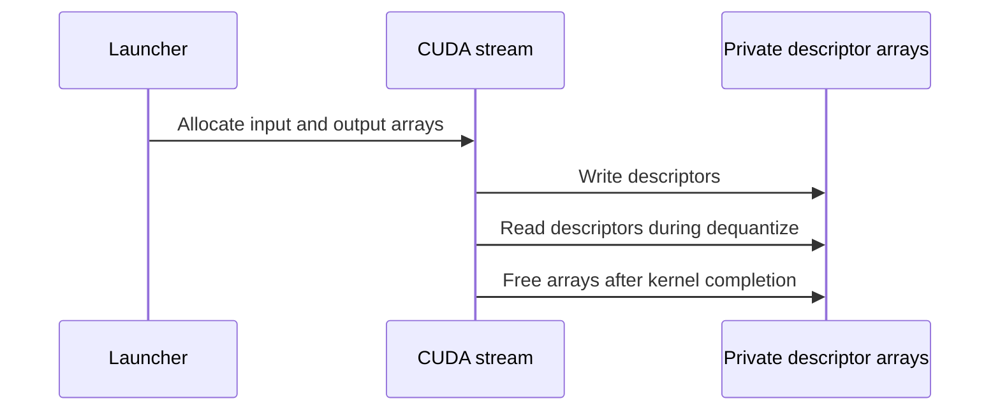

# Fix grouped MXFP8 dequantize race on concurrent CUDA streams

[Upstream PR](https://github.com/NVIDIA/TransformerEngine/pull/3775) · state: closed · merged: False

## Original PR description

Same file-global TMA-descriptor race as #3774, but in the grouped MXFP8 dequantize path. Allocate per-invocation CUtensorMap arrays with cudaMallocAsync and pass them to both the descriptor-update and consumer kernels, releasing with cudaFreeAsync. Independent of #3774 (no shared files), so the two PRs do not conflict. Grouped-quantize counterpart: #3774.

## Review and discussion

### reviews

- greptile-apps[bot] · COMMENTED · 2026-10-29T11:00:24Z · [source](https://github.com/NVIDIA/TransformerEngine/pull/3775#pullrequestreview-5696624007)

(No body; status only.)

### issue_comments

- greptile-apps[bot] · comment · 2026-10-29T11:00:19Z · [source](https://github.com/NVIDIA/TransformerEngine/pull/3775#issuecomment-6494866655)

<!-- greptile_summary -->

<h2><a href="https://app.greptile.com/api/retrigger?id=90496424"><picture><source media="(prefers-color-scheme: dark)" srcset="https://greptile-static-assets.s3.amazonaws.com/badges/RetriggerDark.svg?v=2"><source media="(prefers-color-scheme: light)" srcset="https://greptile-static-assets.s3.amazonaws.com/badges/Retrigger.svg?v=2"></picture></a><a href="https://app.greptile.com/nvidia-public-github/github/NVIDIA/transformerengine/-/pull/3775?utm_source=greptile_review&amp;utm_medium=github&amp;utm_campaign=view_in_greptile"><picture><source media="(prefers-color-scheme: dark)" srcset="https://greptile-static-assets.s3.amazonaws.com/badges/ViewInGreptileDark.svg?v=2"><source media="(prefers-color-scheme: light)" srcset="https://greptile-static-assets.s3.amazonaws.com/badges/ViewInGreptile.svg?v=2"></picture></a>Confidence Score: 4/5</h2>

**[Medium impact]** The change affects grouped MXFP8 dequantization calls that use multiple CUDA streams\.

The race fix appears safe to merge, with non-blocking cleanup and test improvements.

<h2>Findings</h2>

1. &nbsp;**Failed allocation leaks memory** <a href="https://github.com/NVIDIA/TransformerEngine/pull/3775#discussion_r4411508080">▶</a>
2. &nbsp;**Changed branch lacks regression tests** <a href="https://github.com/NVIDIA/TransformerEngine/pull/3775#discussion_r4411508093">▶</a>

<h3>Summary</h3>

Replaces shared MXFP8 dequantize descriptors with arrays owned by each call.
- Grouped MXFP8 calls keep their tensor maps separate across streams.

<h3>Diagram</h3>

<!-- greptile_confidence_score:4 -->

Reviews (1) · Last reviewed commit: ["\[pre-commit.ci\] auto fixes from pre-comm..."](https://github.com/nvidia/transformerengine/commit/9e256abc137bdcf2fde61090c24f68cacb1a9364) · [Reviewed by Greptile](https://www.greptile.com/?utm_source=greptile_review&utm_medium=github&utm_campaign=review_public&utm_content=nvidia/transformerengine)

- Oleg-Goncharov · comment · 2026-10-29T11:08:09Z · [source](https://github.com/NVIDIA/TransformerEngine/pull/3775#issuecomment-6495018972)

This has the same issue as #3774.
As mentioned there, allocating and freeing internal descriptor storage on every invocation is not an approach we want to use in TE. Common code should not own this memory. Temporary storage should be provided by the caller and reused across invocations rather than going through `cudaMallocAsync` / `cudaFreeAsync` on every call.
The dequantize path should follow the same ownership model as the quantize path. We are already addressing this class of race in #3766 using caller-owned workspace storage.
I'm closing this PR for the same reason as #3774.

### inline_comments

- greptile-apps[bot] · comment · 2026-10-29T11:00:23Z · [source](https://github.com/NVIDIA/TransformerEngine/pull/3775#discussion_r4411508080)

File: `transformer_engine/common/cast/mxfp8/group_dequantize_mxfp8.cuh` · line 488

 **Failed allocation leaks memory**

If the first `cudaMallocAsync` succeeds but the second runs out of memory, `NVTE_CHECK_CUDA` throws before either `cudaFreeAsync` runs. The raw `tensor_maps_input` pointer is then lost, leaving its device memory allocated. Use scope-based cleanup or one allocation for both arrays so a failed call releases what it already allocated.

- greptile-apps[bot] · comment · 2026-10-29T11:00:23Z · [source](https://github.com/NVIDIA/TransformerEngine/pull/3775#discussion_r4411508093)

File: `transformer_engine/common/cast/mxfp8/group_dequantize_mxfp8.cuh` · line 488

 **Changed branch lacks regression tests**

The new allocation path has no regression test in this PR. The existing `test_group_dequantize_cudagraph_capturable` uses equal shapes, which selects `is_single_tensor` and skips these allocations entirely. Add a test with different last dimensions that checks independent outputs on two concurrent CUDA streams. Also capture and replay that shape case to cover the new allocation path.

Note: If this suggestion doesn't match your team's coding style, reply to this and let me know. I'll remember it for next time!

## Changed files and fixed code

- `transformer_engine/common/cast/mxfp8/group_dequantize_mxfp8.cuh` · modified · additions 45 / deletions 21
  - [head](https://github.com/XFDG/TransformerEngine/blob/9e256abc137bdcf2fde61090c24f68cacb1a9364/transformer_engine/common/cast/mxfp8/group_dequantize_mxfp8.cuh)
  - [base](https://github.com/NVIDIA/TransformerEngine/blob/dfc4158d1597f72972fe2863adac436fa3fe1d4d/transformer_engine/common/cast/mxfp8/group_dequantize_mxfp8.cuh)

## Evidence and interpretation boundary

[Original JSON, discussions and patches](../../../../../../evidence/prs/NVIDIA--TransformerEngine/3775-1e2dc8ff5432fe4d27bcd1a99507d2550b83b41499bdd9367b8e02cd9bad9df4.json) · SHA-256 `1e2dc8ff5432fe4d27bcd1a99507d2550b83b41499bdd9367b8e02cd9bad9df4`.

Diff complete: True. Missing/binary/truncated patches require pinned source inspection. This is a source page, not an independently verified optimization case. Open, merged and released are different states; recheck the deployed dependency.
