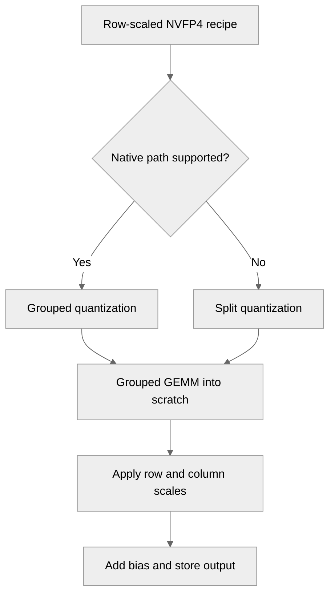

# [PyTorch][common] Support row-scaled NVFP4 in GroupedLinear

[Upstream PR](https://github.com/NVIDIA/TransformerEngine/pull/3776) · state: open · merged: False

## Original PR description

# Description
Depends on the merge of #3661. Only the last commit (aaa2f09b) belongs to this PR; the diff will shrink to that commit once #3661 is merged and this branch is rebased onto `main`. Enables row-scaled NVFP4 (`row_scaled_activation=True`) forward and backward in `GroupedLinear`, with the same RHT, stochastic rounding and 2D weight defaults (1D weight can be enabled via Env) as per-tensor NVFP4. 

### Supported configurations

Row-scaled NVFP4 is enabled with `NVFP4BlockScaling(row_scaled_activation=True)` (or `NVTE_NVFP4_ROW_SCALED_ACTIVATION=1`). Weights always keep per-tensor scaling. When backward is quantized, `grad_output` follows the forward scaling mode.

| Forward (activations) | Backward: quantized (`backward_override=None`) | Backward: `high_precision` | Backward: `dequantized` |
|---|---|---|---|
| Per-tensor NVFP4 (default) | Per-tensor NVFP4 | BF16 | BF16 |
| Row-scaled NVFP4 | **Row-scaled NVFP4 (new in this PR)** | BF16 | BF16 |

Options that can be combined with every configuration above:

| Option | Default | Applies to | Notes |
|---|---|---|---|
| RHT (`disable_rht`) | On | Column-wise input and `grad_output` (wgrad) | Incompatible with 4over6 on activations |
| Stochastic rounding (`disable_stochastic_rounding`) | On | `grad_output` | Now also supported by grouped row-scaled quantization |
| 2D weight quantization (`disable_2d_quantization`) | On (16x16) | Weights | Set `NVTE_NVFP4_DISABLE_2D_QUANTIZATION=1` for 1D |
| 4over6 (`nvfp4_4over6`) | `none` | Forward tensors only (`weights`, `activations`, `all`); never gradients | Requires RHT off when activations are included; incompatible with UE5M3 scales |

### Module support for row-scaled NVFP4

| Module / path | Supported | Notes |
|---|---|---|
| `Linear`, `LayerNormLinear` | Yes | |
| `GroupedLinear`, split-quantize path | Yes | All options above |
| `GroupedLinear`, grouped-tensor path | Yes | Requires SM100+, cuBLASLt 13.4+, E4M3 scales, and 4over6 `none`. `single_grouped_weight` requires RHT. Selected automatically when `use_grouped_tensor` is unset and the feature dimensions, token count and every `m_splits` entry are multiples of 128 |
| `te.ops.GroupedLinear` | No | Raises `NotImplementedError` |
| Sequence parallelism, Userbuffers overlap | No | |

## Testing
- Unit tests on GB200: `test_grouped_linear.py` (row-scaled and NVFP4), `test_nvfp4_group_row_scaled_quantize.py`, `test_nvfp4_sr_quantize.py`, `test_nvfp4_rht_quantize_exact.py`, `test_nvfp4_module_exact.py`, `test_nvfp4_gemm_exact.py -k row_scaled`.
- Megatron-Core MoE (64 experts, top-8, seq 4096) is tested: row-scaled loss and step time match per-tensor NVFP4. DP=4 x EP=2 matches the single-GPU curve. More evaluation needs to be done. 

# Checklist:

- [ ] I have read and followed the [contributing guidelines](https://github.com/NVIDIA/TransformerEngine/blob/main/CONTRIBUTING.rst)
- [ ] The functionality is complete
- [ ] I have commented my code, particularly in hard-to-understand areas
- [ ] I have made corresponding changes to the documentation
- [ ] My changes generate no new warnings
- [ ] I have added tests that prove my fix is effective or that my feature works
- [x] New and existing unit tests pass locally with my changes

## Review and discussion

### reviews

- greptile-apps[bot] · COMMENTED · 2026-10-29T12:50:03Z · [source](https://github.com/NVIDIA/TransformerEngine/pull/3776#pullrequestreview-5697941659)

(No body; status only.)

### issue_comments

- greptile-apps[bot] · comment · 2026-10-29T12:49:58Z · [source](https://github.com/NVIDIA/TransformerEngine/pull/3776#issuecomment-6497135088)

<!-- greptile_summary -->

<h2><a href="https://app.greptile.com/api/retrigger?id=90555775"><picture><source media="(prefers-color-scheme: dark)" srcset="https://greptile-static-assets.s3.amazonaws.com/badges/RetriggerDark.svg?v=2"><source media="(prefers-color-scheme: light)" srcset="https://greptile-static-assets.s3.amazonaws.com/badges/Retrigger.svg?v=2"></picture></a><a href="https://app.greptile.com/nvidia-public-github/github/NVIDIA/transformerengine/-/pull/3776?utm_source=greptile_review&amp;utm_medium=github&amp;utm_campaign=view_in_greptile"><picture><source media="(prefers-color-scheme: dark)" srcset="https://greptile-static-assets.s3.amazonaws.com/badges/ViewInGreptileDark.svg?v=2"><source media="(prefers-color-scheme: light)" srcset="https://greptile-static-assets.s3.amazonaws.com/badges/ViewInGreptile.svg?v=2"></picture></a>Confidence Score: 2/5</h2>

**[Medium impact]** The changes affect row\-scaled NVFP4 training through PyTorch grouped linear workflows\.

The PR is not ready to merge because small groups, weight-only backward, and spare-capacity outputs still fail in the previously reported cases.

<h2>Findings</h2>

1. &nbsp;**Small groups fail in forward** <a href="https://github.com/NVIDIA/TransformerEngine/pull/3776#discussion_r4412505698">▶</a>
2. &nbsp;**Weight\-only backward fails** <a href="https://github.com/NVIDIA/TransformerEngine/pull/3776#discussion_r4412505711">▶</a>
3. &nbsp;**Spare capacity breaks bias expansion** <a href="https://github.com/NVIDIA/TransformerEngine/pull/3776#discussion_r4412505719">▶</a>

<h3>Summary</h3>

Adds row-scaled NVFP4 forward and backward support to `GroupedLinear`.
- Row-scaled NVFP4 quantization now supports grouped data, RHT, and stochastic rounding.
- Grouped NVFP4 GEMMs now apply row-scaled inputs and restore their output scales.
- `GroupedLinear` now uses row-scaled NVFP4 across its supported forward and backward paths.

<h3>Diagram</h3>

<!-- greptile_confidence_score:2 -->

Reviews (2) · Last reviewed commit: ["Support row-scaled NVFP4 in GroupedLinea..."](https://github.com/nvidia/transformerengine/commit/aaa2f09be646862bca1eb67ce2ced1dccd5d7cea) · [Reviewed by Greptile](https://www.greptile.com/?utm_source=greptile_review&utm_medium=github&utm_campaign=review_public&utm_content=nvidia/transformerengine)

### inline_comments

- greptile-apps[bot] · comment · 2026-10-29T12:50:02Z · [source](https://github.com/NVIDIA/TransformerEngine/pull/3776#discussion_r4412505698)

File: `transformer_engine/pytorch/module/grouped_linear.py` · line None

 **Small groups fail in forward**

Automatic selection of the native path does not check its shape limits. A row-scaled `GroupedLinear` with two 32-row groups and width 128 works through the split path. With `use_grouped_tensor` unset, it now selects the native path on supported hardware, whose grouped quantizer rejects the total row count of 64. Expert boundaries must also align with its 128-row tiles.

Check these limits before selecting the native path, and keep the split fallback for other shapes.

- greptile-apps[bot] · comment · 2026-10-29T12:50:02Z · [source](https://github.com/NVIDIA/TransformerEngine/pull/3776#discussion_r4412505711)

File: `transformer_engine/pytorch/quantization.py` · line None

 **Weight-only backward fails**

Making `grad_output` row-scaled breaks native `GroupedLinear` backward when the input does not require gradients but the weights do. That backward sets the quantizer to `rowwise=False, columnwise=True`, then calls `group_quantize`. Row-scaled allocation requires `rowwise=True`, so backward raises instead of computing weight gradients.

Keep rowwise usage enabled for these quantizers even when no input gradient is needed, and add a test with `input.requires_grad=False`.

- greptile-apps[bot] · comment · 2026-10-29T12:50:02Z · [source](https://github.com/NVIDIA/TransformerEngine/pull/3776#discussion_r4412505719)

File: `transformer_engine/pytorch/cpp_extensions/gemm.py` · line None

 **Spare capacity breaks bias expansion**

`live_rows` is the output buffer capacity, not necessarily the sum of `out.first_dims`. With a 1024-row buffer and active splits `[128, 0, 512, 128]`, the bias branch passes repeats totaling 768 alongside `output_size=1024`. `repeat_interleave` requires those counts to match, so this supported spare-capacity case fails. The column-scale branch has the same problem.

Expand scales and bias using device-side offsets while leaving unused capacity rows outside the active result.

## Changed files and fixed code

- `docs/envvars.rst` · modified · additions 7 / deletions 1
  - [head](https://github.com/cael-ling/TransformerEngine/blob/a4710f5610f1b6a99359cbb5dafcc38d7c6687ee/docs/envvars.rst)
  - [base](https://github.com/NVIDIA/TransformerEngine/blob/43f61f79eb915d0d7483ca799185edd82cc12ae5/docs/envvars.rst)
- `tests/pytorch/nvfp4/test_nvfp4_gemm_exact.py` · modified · additions 495 / deletions 2
  - [head](https://github.com/cael-ling/TransformerEngine/blob/a4710f5610f1b6a99359cbb5dafcc38d7c6687ee/tests/pytorch/nvfp4/test_nvfp4_gemm_exact.py)
  - [base](https://github.com/NVIDIA/TransformerEngine/blob/43f61f79eb915d0d7483ca799185edd82cc12ae5/tests/pytorch/nvfp4/test_nvfp4_gemm_exact.py)
- `tests/pytorch/nvfp4/test_nvfp4_group_row_scaled_quantize.py` · modified · additions 87 / deletions 16
  - [head](https://github.com/cael-ling/TransformerEngine/blob/a4710f5610f1b6a99359cbb5dafcc38d7c6687ee/tests/pytorch/nvfp4/test_nvfp4_group_row_scaled_quantize.py)
  - [base](https://github.com/NVIDIA/TransformerEngine/blob/43f61f79eb915d0d7483ca799185edd82cc12ae5/tests/pytorch/nvfp4/test_nvfp4_group_row_scaled_quantize.py)
- `tests/pytorch/nvfp4/test_nvfp4_module_exact.py` · modified · additions 183 / deletions 15
  - [head](https://github.com/cael-ling/TransformerEngine/blob/a4710f5610f1b6a99359cbb5dafcc38d7c6687ee/tests/pytorch/nvfp4/test_nvfp4_module_exact.py)
  - [base](https://github.com/NVIDIA/TransformerEngine/blob/43f61f79eb915d0d7483ca799185edd82cc12ae5/tests/pytorch/nvfp4/test_nvfp4_module_exact.py)
- `tests/pytorch/nvfp4/test_nvfp4_rht_quantize_exact.py` · modified · additions 17 / deletions 3
  - [head](https://github.com/cael-ling/TransformerEngine/blob/a4710f5610f1b6a99359cbb5dafcc38d7c6687ee/tests/pytorch/nvfp4/test_nvfp4_rht_quantize_exact.py)
  - [base](https://github.com/NVIDIA/TransformerEngine/blob/43f61f79eb915d0d7483ca799185edd82cc12ae5/tests/pytorch/nvfp4/test_nvfp4_rht_quantize_exact.py)
- `tests/pytorch/nvfp4/test_nvfp4_sr_quantize.py` · modified · additions 101 / deletions 28
  - [head](https://github.com/cael-ling/TransformerEngine/blob/a4710f5610f1b6a99359cbb5dafcc38d7c6687ee/tests/pytorch/nvfp4/test_nvfp4_sr_quantize.py)
  - [base](https://github.com/NVIDIA/TransformerEngine/blob/43f61f79eb915d0d7483ca799185edd82cc12ae5/tests/pytorch/nvfp4/test_nvfp4_sr_quantize.py)
- `tests/pytorch/test_grouped_linear.py` · modified · additions 241 / deletions 16
  - [head](https://github.com/cael-ling/TransformerEngine/blob/a4710f5610f1b6a99359cbb5dafcc38d7c6687ee/tests/pytorch/test_grouped_linear.py)
  - [base](https://github.com/NVIDIA/TransformerEngine/blob/43f61f79eb915d0d7483ca799185edd82cc12ae5/tests/pytorch/test_grouped_linear.py)
- `tests/pytorch/test_recipe.py` · modified · additions 29 / deletions 1
  - [head](https://github.com/cael-ling/TransformerEngine/blob/a4710f5610f1b6a99359cbb5dafcc38d7c6687ee/tests/pytorch/test_recipe.py)
  - [base](https://github.com/NVIDIA/TransformerEngine/blob/43f61f79eb915d0d7483ca799185edd82cc12ae5/tests/pytorch/test_recipe.py)
- `transformer_engine/common/cast/dispatch/quantize.cuh` · modified · additions 0 / deletions 2
  - [head](https://github.com/cael-ling/TransformerEngine/blob/a4710f5610f1b6a99359cbb5dafcc38d7c6687ee/transformer_engine/common/cast/dispatch/quantize.cuh)
  - [base](https://github.com/NVIDIA/TransformerEngine/blob/43f61f79eb915d0d7483ca799185edd82cc12ae5/transformer_engine/common/cast/dispatch/quantize.cuh)
- `transformer_engine/common/cast/nvfp4/group_quantize_transpose_nvfp4.cuh` · modified · additions 153 / deletions 52
  - [head](https://github.com/cael-ling/TransformerEngine/blob/a4710f5610f1b6a99359cbb5dafcc38d7c6687ee/transformer_engine/common/cast/nvfp4/group_quantize_transpose_nvfp4.cuh)
  - [base](https://github.com/NVIDIA/TransformerEngine/blob/43f61f79eb915d0d7483ca799185edd82cc12ae5/transformer_engine/common/cast/nvfp4/group_quantize_transpose_nvfp4.cuh)
- `transformer_engine/common/cast/nvfp4/specialized/quantize_transpose_nvfp4_tuned_1D.cuh` · modified · additions 34 / deletions 3
  - [head](https://github.com/cael-ling/TransformerEngine/blob/a4710f5610f1b6a99359cbb5dafcc38d7c6687ee/transformer_engine/common/cast/nvfp4/specialized/quantize_transpose_nvfp4_tuned_1D.cuh)
  - [base](https://github.com/NVIDIA/TransformerEngine/blob/43f61f79eb915d0d7483ca799185edd82cc12ae5/transformer_engine/common/cast/nvfp4/specialized/quantize_transpose_nvfp4_tuned_1D.cuh)
- `transformer_engine/common/hadamard_transform/graph_safe_group_hadamard_transform.cu` · modified · additions 31 / deletions 0
  - [head](https://github.com/cael-ling/TransformerEngine/blob/a4710f5610f1b6a99359cbb5dafcc38d7c6687ee/transformer_engine/common/hadamard_transform/graph_safe_group_hadamard_transform.cu)
  - [base](https://github.com/NVIDIA/TransformerEngine/blob/43f61f79eb915d0d7483ca799185edd82cc12ae5/transformer_engine/common/hadamard_transform/graph_safe_group_hadamard_transform.cu)
- `transformer_engine/common/hadamard_transform/graph_safe_group_row_cast_col_hadamard_transform_cast_fusion.cu` · modified · additions 15 / deletions 2
  - [head](https://github.com/cael-ling/TransformerEngine/blob/a4710f5610f1b6a99359cbb5dafcc38d7c6687ee/transformer_engine/common/hadamard_transform/graph_safe_group_row_cast_col_hadamard_transform_cast_fusion.cu)
  - [base](https://github.com/NVIDIA/TransformerEngine/blob/43f61f79eb915d0d7483ca799185edd82cc12ae5/transformer_engine/common/hadamard_transform/graph_safe_group_row_cast_col_hadamard_transform_cast_fusion.cu)
- `transformer_engine/common/include/transformer_engine/hadamard_transform.h` · modified · additions 6 / deletions 0
  - [head](https://github.com/cael-ling/TransformerEngine/blob/a4710f5610f1b6a99359cbb5dafcc38d7c6687ee/transformer_engine/common/include/transformer_engine/hadamard_transform.h)
  - [base](https://github.com/NVIDIA/TransformerEngine/blob/43f61f79eb915d0d7483ca799185edd82cc12ae5/transformer_engine/common/include/transformer_engine/hadamard_transform.h)
- `transformer_engine/common/recipe/__init__.py` · modified · additions 26 / deletions 4
  - [head](https://github.com/cael-ling/TransformerEngine/blob/a4710f5610f1b6a99359cbb5dafcc38d7c6687ee/transformer_engine/common/recipe/__init__.py)
  - [base](https://github.com/NVIDIA/TransformerEngine/blob/43f61f79eb915d0d7483ca799185edd82cc12ae5/transformer_engine/common/recipe/__init__.py)
- `transformer_engine/pytorch/cpp_extensions/gemm.py` · modified · additions 336 / deletions 30
  - [head](https://github.com/cael-ling/TransformerEngine/blob/a4710f5610f1b6a99359cbb5dafcc38d7c6687ee/transformer_engine/pytorch/cpp_extensions/gemm.py)
  - [base](https://github.com/NVIDIA/TransformerEngine/blob/43f61f79eb915d0d7483ca799185edd82cc12ae5/transformer_engine/pytorch/cpp_extensions/gemm.py)
- `transformer_engine/pytorch/csrc/extensions/cast.cpp` · modified · additions 31 / deletions 4
  - [head](https://github.com/cael-ling/TransformerEngine/blob/a4710f5610f1b6a99359cbb5dafcc38d7c6687ee/transformer_engine/pytorch/csrc/extensions/cast.cpp)
  - [base](https://github.com/NVIDIA/TransformerEngine/blob/43f61f79eb915d0d7483ca799185edd82cc12ae5/transformer_engine/pytorch/csrc/extensions/cast.cpp)
- `transformer_engine/pytorch/csrc/quantizer.cpp` · modified · additions 17 / deletions 11
  - [head](https://github.com/cael-ling/TransformerEngine/blob/a4710f5610f1b6a99359cbb5dafcc38d7c6687ee/transformer_engine/pytorch/csrc/quantizer.cpp)
  - [base](https://github.com/NVIDIA/TransformerEngine/blob/43f61f79eb915d0d7483ca799185edd82cc12ae5/transformer_engine/pytorch/csrc/quantizer.cpp)
- `transformer_engine/pytorch/custom_recipes/quantizer_factory_zoo.py` · modified · additions 2 / deletions 2
  - [head](https://github.com/cael-ling/TransformerEngine/blob/a4710f5610f1b6a99359cbb5dafcc38d7c6687ee/transformer_engine/pytorch/custom_recipes/quantizer_factory_zoo.py)
  - [base](https://github.com/NVIDIA/TransformerEngine/blob/43f61f79eb915d0d7483ca799185edd82cc12ae5/transformer_engine/pytorch/custom_recipes/quantizer_factory_zoo.py)
- `transformer_engine/pytorch/custom_recipes/reference_nvfp4.py` · modified · additions 13 / deletions 16
  - [head](https://github.com/cael-ling/TransformerEngine/blob/a4710f5610f1b6a99359cbb5dafcc38d7c6687ee/transformer_engine/pytorch/custom_recipes/reference_nvfp4.py)
  - [base](https://github.com/NVIDIA/TransformerEngine/blob/43f61f79eb915d0d7483ca799185edd82cc12ae5/transformer_engine/pytorch/custom_recipes/reference_nvfp4.py)
- `transformer_engine/pytorch/module/_common.py` · modified · additions 3 / deletions 0
  - [head](https://github.com/cael-ling/TransformerEngine/blob/a4710f5610f1b6a99359cbb5dafcc38d7c6687ee/transformer_engine/pytorch/module/_common.py)
  - [base](https://github.com/NVIDIA/TransformerEngine/blob/43f61f79eb915d0d7483ca799185edd82cc12ae5/transformer_engine/pytorch/module/_common.py)
- `transformer_engine/pytorch/module/base.py` · modified · additions 5 / deletions 0
  - [head](https://github.com/cael-ling/TransformerEngine/blob/a4710f5610f1b6a99359cbb5dafcc38d7c6687ee/transformer_engine/pytorch/module/base.py)
  - [base](https://github.com/NVIDIA/TransformerEngine/blob/43f61f79eb915d0d7483ca799185edd82cc12ae5/transformer_engine/pytorch/module/base.py)
- `transformer_engine/pytorch/module/grouped_linear.py` · modified · additions 56 / deletions 8
  - [head](https://github.com/cael-ling/TransformerEngine/blob/a4710f5610f1b6a99359cbb5dafcc38d7c6687ee/transformer_engine/pytorch/module/grouped_linear.py)
  - [base](https://github.com/NVIDIA/TransformerEngine/blob/43f61f79eb915d0d7483ca799185edd82cc12ae5/transformer_engine/pytorch/module/grouped_linear.py)
- `transformer_engine/pytorch/ops/basic/grouped_linear.py` · modified · additions 10 / deletions 0
  - [head](https://github.com/cael-ling/TransformerEngine/blob/a4710f5610f1b6a99359cbb5dafcc38d7c6687ee/transformer_engine/pytorch/ops/basic/grouped_linear.py)
  - [base](https://github.com/NVIDIA/TransformerEngine/blob/43f61f79eb915d0d7483ca799185edd82cc12ae5/transformer_engine/pytorch/ops/basic/grouped_linear.py)
- `transformer_engine/pytorch/ops/fused/grouped_mlp.py` · modified · additions 5 / deletions 1
  - [head](https://github.com/cael-ling/TransformerEngine/blob/a4710f5610f1b6a99359cbb5dafcc38d7c6687ee/transformer_engine/pytorch/ops/fused/grouped_mlp.py)
  - [base](https://github.com/NVIDIA/TransformerEngine/blob/43f61f79eb915d0d7483ca799185edd82cc12ae5/transformer_engine/pytorch/ops/fused/grouped_mlp.py)
- `transformer_engine/pytorch/quantization.py` · modified · additions 6 / deletions 3
  - [head](https://github.com/cael-ling/TransformerEngine/blob/a4710f5610f1b6a99359cbb5dafcc38d7c6687ee/transformer_engine/pytorch/quantization.py)
  - [base](https://github.com/NVIDIA/TransformerEngine/blob/43f61f79eb915d0d7483ca799185edd82cc12ae5/transformer_engine/pytorch/quantization.py)
- `transformer_engine/pytorch/tensor/storage/grouped_tensor_storage.py` · modified · additions 17 / deletions 6
  - [head](https://github.com/cael-ling/TransformerEngine/blob/a4710f5610f1b6a99359cbb5dafcc38d7c6687ee/transformer_engine/pytorch/tensor/storage/grouped_tensor_storage.py)
  - [base](https://github.com/NVIDIA/TransformerEngine/blob/43f61f79eb915d0d7483ca799185edd82cc12ae5/transformer_engine/pytorch/tensor/storage/grouped_tensor_storage.py)

## Evidence and interpretation boundary

[Original JSON, discussions and patches](../../../../../../evidence/prs/NVIDIA--TransformerEngine/3776-f7d9a235d29e12d5365f2d2468dc59045ac6b6e601e9c0dd074f6e3d5b2f1c1d.json) · SHA-256 `f7d9a235d29e12d5365f2d2468dc59045ac6b6e601e9c0dd074f6e3d5b2f1c1d`.

Diff complete: True. Missing/binary/truncated patches require pinned source inspection. This is a source page, not an independently verified optimization case. Open, merged and released are different states; recheck the deployed dependency.
