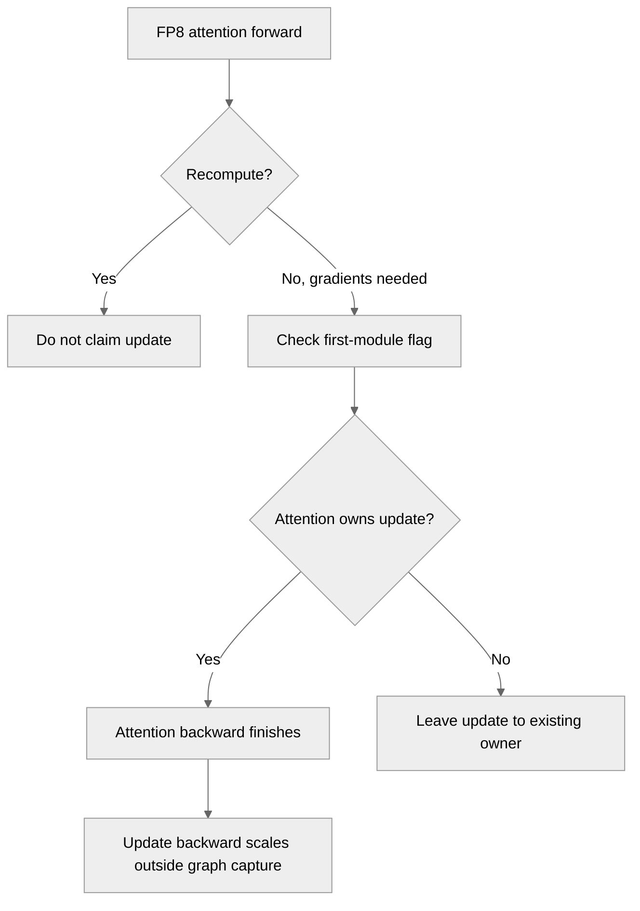

# [PyTorch] Fix FP8 DotProductAttention backward scales stuck at 1.0 without a Linear-family module

[Upstream PR](https://github.com/NVIDIA/TransformerEngine/pull/3780) · state: open · merged: False

## Original PR description

# Description

This PR makes FP8 `DotProductAttention` update its backward delayed-scaling scales when it is the only Transformer Engine module in the autocast region, as in a model whose projections are plain `torch.nn.Linear` (#3778). Today those scales stay at 1.0, so a small dO loses most of dQ and dK in FP8, with no error or warning.

The backward amax reduction and scale update of an autocast region runs in the backward of the module that claims the first-FP8-module flag in its forward, and only the Linear-family modules claim it. `FusedAttnFunc` now claims the flag the same way `Linear` does, except in an activation-recompute forward, and runs the update at the end of its backward. When a Linear-family module claims the flag first, nothing changes.

Fixes #3778

## Type of change

- [ ] Documentation change (change only to the documentation, either a fix or a new content)
- [x] Bug fix (non-breaking change which fixes an issue)
- [ ] New feature (non-breaking change which adds functionality)
- [ ] Breaking change (fix or feature that would cause existing functionality to not work as expected)
- [ ] Infra/Build change
- [ ] Code refactoring

## Changes

- `FusedAttnFunc.forward`: when the forward runs in FP8, grad is enabled, Q, K or V requires grad, and the forward is not an activation recompute, call `check_fp8_reduce_and_update()` (the helper `Linear` uses) and keep the result in `FusedAttnBwdArgs.reduce_and_update_bwd_fp8_tensors`.
- Not in a recompute: with `checkpoint_core_attention=True` the first forward runs without grad, so another module may claim the flag, and the recompute's `autocast` resets the flag; a recomputed attention that claimed it ran a second update per step (found by Greptile's review). A checkpointed attention that is the only TE module in its region therefore still gets no backward update, as on main.
- `FusedAttnFunc.backward`: after the backward kernels, call `FP8GlobalStateManager.reduce_and_update_fp8_tensors(forward=False)` when that flag is set and no CUDA graph is being captured.
- `FusedAttnFwdArgs.is_grad_enabled`: the caller's grad mode, since autograd runs `forward` with grad disabled.
- New test `test_dpa_fp8_bwd_scales_update_without_linear`: `DotProductAttention` alone under `DelayedScaling(fp8_dpa=True)`, two steps with `dO = 1e-5 * randn`; after them the backward scales must have moved from 1.0, and dQ/dK must be within 0.8–1.25× the norm of a bf16 reference.
- New test `test_dpa_fp8_bwd_scales_update_once_per_step`: FP8 attention with a `Linear` after it, or with `Linear`s before and after it, with and without `checkpoint_core_attention`; counts the backward updates (`reduce_and_update_fp8_tensors(forward=False)` calls) in each of two steps and expects one. The two tests share the backend selection in `_use_fused_attn_fp8_or_skip`.

## Testing

One H20 (sm90). TE main `dfc4158` built from source; the three columns differ only in `backends.py` (PyTorch 2.13.0+cu130, CUDA 13.0, cuDNN 9.20):

| | main | first commit 79984cf | this PR |
|---|---|---|---|
| `test_dpa_fp8_bwd_scales_update_without_linear` | fails: backward scales were not updated | passes | passes |
| `test_dpa_fp8_bwd_scales_update_once_per_step`, 4 cases | pass: 1 update per step | the 2 `checkpoint_core_attention` cases fail: 2 updates per step | pass |
| script from #3778, `DotProductAttention` alone | backward scales stay at 1.0, ‖dQ‖ 2.6e-4 against 1.34e-3 in bf16 | scales updated, ‖dQ‖ 1.32e-3 | same numbers as 79984cf |
| `test_attention.py -k fp8` (4,631 cases, 3,988 skipped here) | 516 passed, 127 failed | 515 passed, 128 failed | 517 passed, 126 failed |

With this PR, `DotProductAttention` alone gives exactly the per-iteration numbers that the manual `reduce_and_update_fp8_tensors(forward=False)` call gave before, and the script's other setups (bf16, the manual call, a `te.Linear` in the region) print the same numbers as on main. Apart from the new tests, every `-k fp8` case has the same outcome in all three columns.

The 126 failures and the build

The 126 cases fail on main as well in our environment: 124 in `test_mha_fp8_vs_f16` and `test_dpa_fp8_vs_f16` are `torch.compile` errors under PyTorch 2.13 (a Dynamo guard assertion, and `'Float8Tensor' object has no attribute '_data'`), and 2 in `test_dpa_fp8_extra_state` refuse to load pickled extra state. TE was built for sm90 only, with `NVTE_WITH_NCCL_EP=0` because the pip NCCL in our container has no `libnccl.so` to link against.

Other attention paths that can run FP8, the context-parallel functions in `context_parallel.py` and the unfused FP8 emulation, still do not claim the flag; this PR leaves them as they are.

# Checklist:

- [x] I have read and followed the [contributing guidelines](https://github.com/NVIDIA/TransformerEngine/blob/main/CONTRIBUTING.rst)
- [x] The functionality is complete
- [x] I have commented my code, particularly in hard-to-understand areas
- [ ] I have made corresponding changes to the documentation
- [x] My changes generate no new warnings
- [x] I have added tests that prove my fix is effective or that my feature works
- [ ] New and existing unit tests pass locally with my changes

## Review and discussion

### reviews

- greptile-apps[bot] · COMMENTED · 2026-10-29T16:45:04Z · [source](https://github.com/NVIDIA/TransformerEngine/pull/3780#pullrequestreview-5701529769)

(No body; status only.)

- sha7doww · COMMENTED · 2026-10-30T02:40:49Z · [source](https://github.com/NVIDIA/TransformerEngine/pull/3780#pullrequestreview-5707476624)

(No body; status only.)

### issue_comments

- greptile-apps[bot] · comment · 2026-10-29T16:44:59Z · [source](https://github.com/NVIDIA/TransformerEngine/pull/3780#issuecomment-6502762955)

<!-- greptile_summary -->

<h2><a href="https://app.greptile.com/api/retrigger?id=90711818"><picture><source media="(prefers-color-scheme: dark)" srcset="https://greptile-static-assets.s3.amazonaws.com/badges/RetriggerDark.svg?v=2"><source media="(prefers-color-scheme: light)" srcset="https://greptile-static-assets.s3.amazonaws.com/badges/Retrigger.svg?v=2"></picture></a><a href="https://app.greptile.com/nvidia-public-github/github/NVIDIA/transformerengine/-/pull/3780?utm_source=greptile_review&amp;utm_medium=github&amp;utm_campaign=view_in_greptile"><picture><source media="(prefers-color-scheme: dark)" srcset="https://greptile-static-assets.s3.amazonaws.com/badges/ViewInGreptileDark.svg?v=2"><source media="(prefers-color-scheme: light)" srcset="https://greptile-static-assets.s3.amazonaws.com/badges/ViewInGreptile.svg?v=2"></picture></a>Confidence Score: 5/5</h2>

**[Medium impact]** The changes appear safe to merge, with the previous duplicate-update issue addressed.

<h3>Summary</h3>

Allows standalone FP8 `DotProductAttention` to update backward scales.
- FP8 fused attention updates backward scales when it owns the autocast region.

<h3>Diagram</h3>

<!-- greptile_confidence_score:5 -->

Reviews (2) · Last reviewed commit: ["\[PyTorch\] Do not claim the backward scal..."](https://github.com/nvidia/transformerengine/commit/793404ed0a3cad7655fdbeb864e2238b2b257722) · [Reviewed by Greptile](https://www.greptile.com/?utm_source=greptile_review&utm_medium=github&utm_campaign=review_public&utm_content=nvidia/transformerengine)

- 0z5a · comment · 2026-10-31T19:29:32Z · [source](https://github.com/NVIDIA/TransformerEngine/pull/3780#issuecomment-6548108450)

I ran this PR on a B300 (sm_103): TE main `63451d6b` built for `103a`, with this PR's Python files (`793404ed`) on top, cuDNN 9.24, torch 2.14.1+cu130.

The script from #3778, iteration 5 (the last one):

| setup | main: bwd scales | main: ‖dQ‖ / ‖dK‖ / ‖dV‖ | this PR: bwd scales | this PR: ‖dQ‖ / ‖dK‖ / ‖dV‖ |
|---|---|---|---|---|
| bf16 reference | – | 1.337e-3 / 1.333e-3 / 1.548e-3 | – | same |
| `DotProductAttention` only | 1.0 | **0** / **0** / 1.313e-3 | max 5.55e9 | 1.296e-3 / 1.297e-3 / 1.518e-3 |
| plus the manual `reduce_and_update_fp8_tensors(forward=False)` | max 5.55e9 | 1.296e-3 / 1.297e-3 / 1.518e-3 | max 5.55e9 | same |
| `te.Linear` producing Q | max 5.47e9 | 1.087e-3 / 6.878e-4 / 1.254e-3 | max 5.47e9 | same |

With this PR, the DPA-only setup prints the same numbers as the manual-update setup in all six iterations. On main, dQ and dK range from 1.8e-4 to 4.1e-4 in iterations 0–4 and are 0 in iteration 5.

The new tests:
- main: `test_dpa_fp8_bwd_scales_update_without_linear` fails, the four `..._update_once_per_step` cases pass
- this PR: all 5 pass

A wider selection with this PR (`-k "test_dpa_fp8 or test_mha_fp8 or test_dpa_qkv_layout_fp8"`): 2247 passed, 2 failed. The 2 failures are `test_dpa_fp8_extra_state[*-large]`, which refuse to load pickled extra state for `LayerNormLinear`. They fail the same way on main.

**Context parallelism is not covered.** With a CP group set, `FusedAttention.forward` calls `attn_forward_func_with_cp`, which doesn't go through `FusedAttnFunc`. A DPA-only region therefore still never runs the backward update.

I checked this on two B300 GPUs: cp=2, bshd, `no_mask`, B=2, S=2048, 8 heads, head dim 128, `DelayedScaling(fp8_dpa=True)`, dO = `1e-5 * randn`, 3 iterations. Each rank holds a contiguous half of the sequence.

| cp_comm_type | this PR | this PR + manual update after each backward |
|---|---|---|
| p2p | bwd scales stay 1.0; dQ, dK and dV are exactly 0 on both ranks in all 3 iterations | scales move (max 4.2e10); from iteration 1, ‖dQ‖ ≈ ‖dK‖ ≈ 5.2e-4, ‖dV‖ ≈ 6.2e-4 per rank |
| a2a | same as p2p | scales move (max 4.3e10); from iteration 1, ‖dQ‖ ≈ ‖dK‖ ≈ ‖dV‖ ≈ 5.3e-4 per rank |

Main behaves the same as this PR without the manual update. Under CP even dV is 0 at scale 1.0, unlike the non-CP case.

Handling this would mean claiming the flag in the CP autograd functions (`AttnFuncWithCPAndKVP2P`, `AttnFuncWithCPAndKVAllGather`, `AttnFuncWithCPAndQKVOA2A`) the same way. If that's out of scope here, it may be worth a note in the `fp8_dpa` docs.

- sha7doww · comment · 2026-11-01T03:23:59Z · [source](https://github.com/NVIDIA/TransformerEngine/pull/3780#issuecomment-6552840622)

Thanks for the B300 run and the CP numbers.

Context parallelism is left out of this PR on purpose: as the description notes, the CP autograd functions in `context_parallel.py` don't claim the flag yet. I can add the same claim to `AttnFuncWithCPAndKVP2P`, `AttnFuncWithCPAndKVAllGather` and `AttnFuncWithCPAndQKVOA2A`, with a CP test, either here or in a follow-up PR, whichever the maintainers prefer.

### inline_comments

- greptile-apps[bot] · comment · 2026-10-29T16:45:03Z · [source](https://github.com/NVIDIA/TransformerEngine/pull/3780#discussion_r4415219812)

File: `transformer_engine/pytorch/attention/dot_product_attention/backends.py` · line None

 **Checkpointed scales update twice**

With `checkpoint_core_attention=True`, FP8 attention followed by a TE `Linear` in the same `autocast` region now updates backward scales twice. The checkpoint's first forward disables gradients, so this guard skips claiming the first-module flag and the later `Linear` claims it instead.

During backward, `Linear` updates shared scales before attention runs. The checkpoint then recomputes attention with gradients enabled and the first-module flag restored. Attention claims it too and runs another update. This changes scales midway through backward and advances the shared amax history twice per step.

Claim ownership during the checkpoint's initial forward while still excluding ordinary no-grad calls, and add a checkpoint-plus-`Linear` regression test.

**Knowledge Base Used:**
- [PyTorch FP8 and low-precision quantization](https://app.greptile.com/nvidia-public-github/-/custom-context/knowledge-base/nvidia/transformerengine/-/docs/pytorch-quantization.md)
- [PyTorch attention execution](https://app.greptile.com/nvidia-public-github/-/custom-context/knowledge-base/nvidia/transformerengine/-/docs/pytorch-attention.md)

- sha7doww · comment · 2026-10-30T02:40:49Z · [source](https://github.com/NVIDIA/TransformerEngine/pull/3780#discussion_r4419949024)

File: `transformer_engine/pytorch/attention/dot_product_attention/backends.py` · line None

Confirmed, thanks. The checkpoint's recompute enters a fresh `autocast`, which sets the first-module flag back to `True`, so the recomputed attention claimed it after another module already had. It was not limited to a `Linear` after the attention: with a `Linear` before it as well (QKV projection → attention → output projection) the backward update also ran twice per step.

793404e: a recomputed attention no longer claims the flag, so these regions keep a single update per step. The trade-off: a checkpointed attention that is the only TE module in its region still gets no backward update, as on main. Claiming in the checkpoint's no-grad forward would not cover it, since the recompute's `autocast` resets the flag anyway; that case would need the claim carried from the first forward into the recompute, which I left out of this PR.

Backward updates per step, from the new `test_dpa_fp8_bwd_scales_update_once_per_step` (one H20, two steps each, the same in both steps):

| setup | main | 79984cf | 793404e |
|---|---|---|---|
| attention → Linear | 1 | 1 | 1 |
| attention → Linear, `checkpoint_core_attention` | 1 | 2 | 1 |
| Linear → attention → Linear | 1 | 1 | 1 |
| Linear → attention → Linear, `checkpoint_core_attention` | 1 | 2 | 1 |

Unchanged by this PR: `te.Linear` under `te.checkpoint` does the same on main. Counting the same calls with Linears only, `checkpoint(l1) → l2` and `l1 → checkpoint(l2)` give 2 updates per step and `checkpoint(l1 → l2 → l3)` gives 3, since inside a recompute each Linear-family module restores the flag after claiming it.

## Changed files and fixed code

- `tests/pytorch/attention/test_attention.py` · modified · additions 110 / deletions 0
  - [head](https://github.com/sha7doww/TransformerEngine/blob/793404ed0a3cad7655fdbeb864e2238b2b257722/tests/pytorch/attention/test_attention.py)
  - [base](https://github.com/NVIDIA/TransformerEngine/blob/dfc4158d1597f72972fe2863adac436fa3fe1d4d/tests/pytorch/attention/test_attention.py)
- `transformer_engine/pytorch/attention/dot_product_attention/backends.py` · modified · additions 27 / deletions 2
  - [head](https://github.com/sha7doww/TransformerEngine/blob/793404ed0a3cad7655fdbeb864e2238b2b257722/transformer_engine/pytorch/attention/dot_product_attention/backends.py)
  - [base](https://github.com/NVIDIA/TransformerEngine/blob/dfc4158d1597f72972fe2863adac436fa3fe1d4d/transformer_engine/pytorch/attention/dot_product_attention/backends.py)

## Evidence and interpretation boundary

[Original JSON, discussions and patches](../../../../../../evidence/prs/NVIDIA--TransformerEngine/3780-90fe1a73bdcab67e5dd42549b2e79f67b62ca1bb2a9e900c67f54082d476e131.json) · SHA-256 `90fe1a73bdcab67e5dd42549b2e79f67b62ca1bb2a9e900c67f54082d476e131`.

Diff complete: True. Missing/binary/truncated patches require pinned source inspection. This is a source page, not an independently verified optimization case. Open, merged and released are different states; recheck the deployed dependency.
