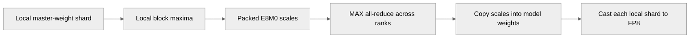

# [PyTorch] All-reduce MXFP8 E8M0 scales instead of amaxes when casting master weights

[Upstream PR](https://github.com/NVIDIA/TransformerEngine/pull/3787) · state: open · merged: False

## Original PR description

# Description

`cast_master_weights_to_fp8` / `quantize_master_weights` with MXFP8 all-reduced every block's bf16 partial amax (2 bytes) and then turned the result into an E8M0 scale. It now computes each rank's E8M0 scales from its partial amaxes and all-reduces those (1 byte) with MAX. The scales are bit-identical and the all-reduce payload halves.

Fixes # (issue)

## Type of change

- [ ] Documentation change (change only to the documentation, either a fix or a new content)
- [ ] Bug fix (non-breaking change which fixes an issue)
- [x] New feature (non-breaking change which adds functionality)
- [ ] Breaking change (fix or feature that would cause existing functionality to not work as expected)
- [ ] Infra/Build change
- [ ] Code refactoring

## Changes

Please list the changes introduced in this PR:

In `transformer_engine/pytorch/tensor/utils.py`, `_cast_master_weights_to_fp8_mxfp8_scaling`:
- A packed `uint8` buffer `packed_scale_invs` sits beside `packed_amaxes`, with per-weight rowwise and columnwise views at the same offsets.
- Step 2 runs `multi_tensor_compute_scale_inv_e8m0` on the *local* amaxes into the packed scale views, then all-reduces `packed_scale_invs` with MAX. It is still one all-reduce for all weights.
- Step 3 copies the reduced scales into each weight's `_rowwise_scale_inv` / `_columnwise_scale_inv` with one `torch._foreach_copy_`.
- Steps 1 (partial amax) and 4 (partial cast) are unchanged. Weights without columnwise data are skipped in both lists, as before.

# Checklist:

- [x] I have read and followed the [contributing guidelines](https://github.com/NVIDIA/TransformerEngine/blob/main/CONTRIBUTING.rst)
- [x] The functionality is complete
- [x] I have commented my code, particularly in hard-to-understand areas
- [ ] I have made corresponding changes to the documentation
- [x] My changes generate no new warnings
- [x] I have added tests that prove my fix is effective or that my feature works
- [x] New and existing unit tests pass locally with my changes

## Review and discussion

### reviews

### issue_comments

- greptile-apps[bot] · comment · 2026-10-30T18:57:45Z · [source](https://github.com/NVIDIA/TransformerEngine/pull/3787#issuecomment-6531101824)

<!-- greptile_summary -->

<h2><a href="https://app.greptile.com/api/retrigger?id=91560743"><picture><source media="(prefers-color-scheme: dark)" srcset="https://greptile-static-assets.s3.amazonaws.com/badges/RetriggerDark.svg?v=2"><source media="(prefers-color-scheme: light)" srcset="https://greptile-static-assets.s3.amazonaws.com/badges/Retrigger.svg?v=2"></picture></a><a href="https://app.greptile.com/nvidia-public-github/github/NVIDIA/transformerengine/-/pull/3787?utm_source=greptile_review&amp;utm_medium=github&amp;utm_campaign=view_in_greptile"><picture><source media="(prefers-color-scheme: dark)" srcset="https://greptile-static-assets.s3.amazonaws.com/badges/ViewInGreptileDark.svg?v=2"><source media="(prefers-color-scheme: light)" srcset="https://greptile-static-assets.s3.amazonaws.com/badges/ViewInGreptile.svg?v=2"></picture></a>Confidence Score: 5/5</h2>

**[Medium impact]** The PR appears safe to merge.

<h3>Summary</h3>

This PR changes MXFP8 master-weight updates to reduce one-byte E8M0 scales instead of two-byte BF16 maxima.
- MXFP8 master-weight casting reduces one-byte scales across ranks.

No actionable issues were found. GPU tests were not run.

<h3>Diagram</h3>

<!-- greptile_confidence_score:5 -->

Reviews (1) · Last reviewed commit: ["\[PyTorch\] All-reduce MXFP8 E8M0 scales i..."](https://github.com/nvidia/transformerengine/commit/f58bb5e7b1d85b9dcb6e2f88b06aa50ada215d0c) · [Reviewed by Greptile](https://www.greptile.com/?utm_source=greptile_review&utm_medium=github&utm_campaign=review_public&utm_content=nvidia/transformerengine)

### inline_comments

## Changed files and fixed code

- `tests/pytorch/distributed/test_cast_master_weights_to_fp8.py` · modified · additions 52 / deletions 4
  - [head](https://github.com/rapatel/TransformerEngine/blob/f58bb5e7b1d85b9dcb6e2f88b06aa50ada215d0c/tests/pytorch/distributed/test_cast_master_weights_to_fp8.py)
  - [base](https://github.com/NVIDIA/TransformerEngine/blob/6320b5f7bec6bdb8101a3c9939d6a39f844fc3cd/tests/pytorch/distributed/test_cast_master_weights_to_fp8.py)
- `transformer_engine/pytorch/tensor/utils.py` · modified · additions 27 / deletions 13
  - [head](https://github.com/rapatel/TransformerEngine/blob/f58bb5e7b1d85b9dcb6e2f88b06aa50ada215d0c/transformer_engine/pytorch/tensor/utils.py)
  - [base](https://github.com/NVIDIA/TransformerEngine/blob/6320b5f7bec6bdb8101a3c9939d6a39f844fc3cd/transformer_engine/pytorch/tensor/utils.py)

## Evidence and interpretation boundary

[Original JSON, discussions and patches](../../../../../../evidence/prs/NVIDIA--TransformerEngine/3787-7dd1eab06d13b30b98189c0b23422d77bcf258302a1f533da9400b42e55b2534.json) · SHA-256 `7dd1eab06d13b30b98189c0b23422d77bcf258302a1f533da9400b42e55b2534`.

Diff complete: True. Missing/binary/truncated patches require pinned source inspection. This is a source page, not an independently verified optimization case. Open, merged and released are different states; recheck the deployed dependency.
