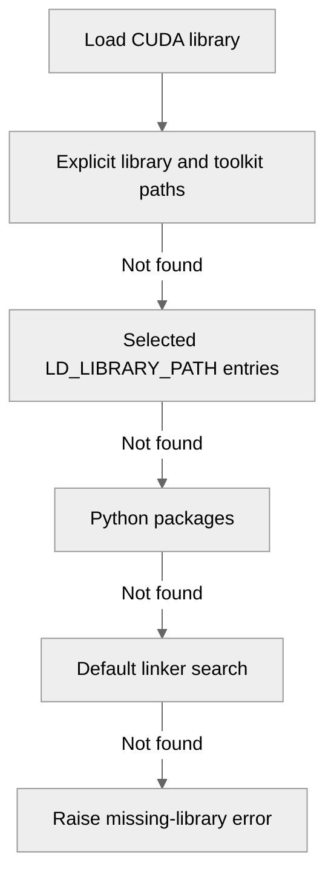

# [Common] Fix CUDA library loading for pip-installed frameworks

[Upstream PR](https://github.com/NVIDIA/TransformerEngine/pull/3795) · state: open · merged: False

## Original PR description

# Description

Fix two ways that the runtime CUDA library search breaks environments where a pip-installed framework supplies the CUDA libraries.

A host-wide cuDNN replaces the cuDNN that the framework needs. The `CDLL("libcudnn.so")` fallback is described as an `LD_LIBRARY_PATH` search, but it also searches the dynamic linker's default locations, and it runs before the Python environment. PyPI `torch` pins its own `nvidia-cudnn-cu13`, so on a host with an older system cuDNN it fails with:

```text
RuntimeError: cuDNN version incompatibility: PyTorch was compiled against (9, 26, 0) but found runtime version (9, 20, 0).
```

With JAX, the same search maps two copies of cuDNN into one process.

The import also requires `libcurand`. PyTorch 2.15 removed `curand` from its `cuda-toolkit` extras, and JAX does not install it, so on a host without the CUDA toolkit the import fails with `curand shared object not found`. Transformer Engine only uses cuRAND's device-side headers. The core library does not link `libcurand` and calls none of its host functions.

Related to #2373 and #2297, which made `LD_LIBRARY_PATH` take priority over Python packages. This PR keeps that priority.

## Type of change

- [ ] Documentation change (change only to the documentation, either a fix or a new content)
- [x] Bug fix (non-breaking change which fixes an issue)
- [ ] New feature (non-breaking change which adds functionality)
- [ ] Breaking change (fix or feature that would cause existing functionality to not work as expected)
- [ ] Infra/Build change
- [ ] Code refactoring

## Changes

- Search for each library in this order: `<LIBRARY>_HOME`, `<LIBRARY>_PATH`, `CUDA_HOME`, `CUDA_PATH`, `/usr/local/cuda`, `LD_LIBRARY_PATH`, the Python environment, and then the dynamic linker's default locations.
- Read `LD_LIBRARY_PATH` directly, so that it also finds versioned libraries such as `libcudnn.so.9`. The pip packages have no unversioned symlink, so the previous lookup could not find them there. An entry's unversioned name still takes priority when it exists. `$ORIGIN` expands to the executable's directory, and an entry with another token, such as `$LIB`, goes to `dlopen` as a path. An entry that does not have the library does not affect the search.
- Stop loading cuRAND, and decide whether the toolkit is present from NVRTC alone. When NVRTC comes from a Python package, load cuBLAS and cudart from Python packages only if they are there, and leave the rest to the dynamic linker.
- Document the search order in the troubleshooting guide.

PyTorch preloads the cuDNN from its own Python package, so when the environment selects the system cuDNN, PyTorch's copy is mapped too and PyTorch rejects the older version. That behavior is not new.

One behavior changes on purpose. If a framework uses a system cuDNN and an unrelated pip cuDNN package is also installed, Transformer Engine now loads the pip package unless the environment selects a location. `CUDNN_PATH` or `LD_LIBRARY_PATH` selects the system copy.

## Before and after

These runs used one NVIDIA B200 with system cuDNN 9.20 and PyTorch 2.15.0+cu132, which installs cuDNN 9.26.

| Environment | Before | After |
| --- | --- | --- |
| Default, importing either PyTorch or Transformer Engine first | `cuDNN version incompatibility` | Loads pip cuDNN 9.26 |
| `LD_LIBRARY_PATH` set to pip cuDNN | `cuDNN version incompatibility` | Loads pip cuDNN 9.26 |
| `CUDNN_PATH` set to pip cuDNN | Loads pip cuDNN 9.26 | Same |
| `LD_LIBRARY_PATH` or `CUDNN_PATH` set to system cuDNN | Loads system cuDNN 9.20, which PyTorch rejects | Same |
| No pip cuDNN, importing only `transformer_engine.common` | Loads system cuDNN 9.20 | Same |
| JAX 0.12, default | Maps both pip and system cuDNN | Maps only pip cuDNN |
| No CUDA toolkit and no system cuDNN | `curand shared object not found` | Imports and runs from pip libraries |
| NVRTC from pip, with cuBLAS and cudart only from the system | `curand shared object not found` | Imports with the system cuBLAS and cudart |
| `LD_LIBRARY_PATH` entry with `$ORIGIN` or `$LIB` that selects system cuDNN | Loads system cuDNN 9.20 | Same |
| `LD_LIBRARY_PATH` entry with `$ORIGIN` or `$LIB` that has no cuDNN | `cuDNN version incompatibility` | Loads pip cuDNN 9.26 |
| `LD_LIBRARY_PATH` entry whose `libcudnn.so` selects one of two versions | Follows `libcudnn.so` | Same |

## Validation

The source builds targeted `100a` with CUDA 13.2, PyTorch 2.15.0+cu132, cuDNN 9.26, FlashAttention 2.8.4, and JAX 0.12.0.1. The base was `b0219803`.

- The new tests in `test_sanity.py` fail when the search order or the cuRAND load is reverted, or when the `LD_LIBRARY_PATH` name and token handling is removed, and they pass with this change.
- The token, unversioned symlink, and pip NVRTC cases in the table ran with real libraries on B200. The pip NVRTC case has no unit test, because it depends on which libraries the host has.
- The L0 PyTorch commands and the debug launcher ran on this PR's final code alone and on an untouched tree of the same commit, with each job in its own directory. No test failed on only one tree. The failures on both trees are `test_torch_compile.py` (#3716), `test_dot_product_attention_score_mod` (#3796), and FP32 numerics cases (#3797).
- For JAX, `test_layer.py` and `test_fused_attn_score_mod.py` found no failures in the default environment, with the system cuDNN present, before the last commit. `test_fused_attn.py` found no failures before the last two commits. The last commit only changes `LD_LIBRARY_PATH` entries that contain tokens, and JAX import was rechecked after it.
- For the no-toolkit case, the toolkit and system cuDNN were moved aside in a disposable container, and the dynamic linker had no CUDA entries left. Transformer Engine took its no-toolkit path, and every loaded CUDA library came from the virtual environment. `test_sanity.py`, `test_numerics.py`, `tests/pytorch/nvfp4`, `tests/pytorch/mxfp8`, and `test_quantized_tensor.py` found no failures before the last commit, with `NVIDIA_TF32_OVERRIDE=0` set. JAX imported and ran a basic operation. The no-toolkit import and a forward pass were rechecked on the final code.

Pylint reported no issues for the changed module, and the repository hooks passed. A100, H100, aarch64, and NGC images, where the framework uses the system cuDNN, were not tested. Release wheels were not rebuilt with this change.

# Checklist:

- [x] I have read and followed the [contributing guidelines](https://github.com/NVIDIA/TransformerEngine/blob/main/CONTRIBUTING.rst)
- [x] The functionality is complete
- [x] I have commented my code, particularly in hard-to-understand areas
- [x] I have made corresponding changes to the documentation
- [x] My changes generate no new warnings
- [x] I have added tests that prove my fix is effective or that my feature works
- [ ] New and existing unit tests pass locally with my changes


## Review and discussion

### reviews

- greptile-apps[bot] · COMMENTED · 2026-11-03T02:56:32Z · [source](https://github.com/NVIDIA/TransformerEngine/pull/3795#pullrequestreview-5746707496)

(No body; status only.)

- greptile-apps[bot] · COMMENTED · 2026-11-03T19:54:26Z · [source](https://github.com/NVIDIA/TransformerEngine/pull/3795#pullrequestreview-5758615169)

(No body; status only.)

- bvolpato · COMMENTED · 2026-11-03T19:57:27Z · [source](https://github.com/NVIDIA/TransformerEngine/pull/3795#pullrequestreview-5758652949)

(No body; status only.)

- bvolpato · COMMENTED · 2026-11-03T19:57:33Z · [source](https://github.com/NVIDIA/TransformerEngine/pull/3795#pullrequestreview-5758654038)

(No body; status only.)

- bvolpato · COMMENTED · 2026-11-03T19:57:38Z · [source](https://github.com/NVIDIA/TransformerEngine/pull/3795#pullrequestreview-5758654943)

(No body; status only.)

- bvolpato · COMMENTED · 2026-11-03T20:05:16Z · [source](https://github.com/NVIDIA/TransformerEngine/pull/3795#pullrequestreview-5758746161)

(No body; status only.)

### issue_comments

- greptile-apps[bot] · comment · 2026-11-03T02:56:27Z · [source](https://github.com/NVIDIA/TransformerEngine/pull/3795#issuecomment-6594272713)

<!-- greptile_summary -->

<h2><a href="https://app.greptile.com/api/retrigger?id=93946854"><picture><source media="(prefers-color-scheme: dark)" srcset="https://greptile-static-assets.s3.amazonaws.com/badges/RetriggerDark.svg?v=2"><source media="(prefers-color-scheme: light)" srcset="https://greptile-static-assets.s3.amazonaws.com/badges/Retrigger.svg?v=2"></picture></a><a href="https://app.greptile.com/-/switch-tenant?tenant=nvidia-public-github&amp;next=%2FNVIDIA%2Ftransformerengine%2Fpull%2F3795&amp;utm_source=greptile_review&amp;utm_medium=github&amp;utm_campaign=view_in_greptile"><picture><source media="(prefers-color-scheme: dark)" srcset="https://greptile-static-assets.s3.amazonaws.com/badges/ViewInGreptileDark.svg?v=2"><source media="(prefers-color-scheme: light)" srcset="https://greptile-static-assets.s3.amazonaws.com/badges/ViewInGreptile.svg?v=2"></picture></a>Confidence Score: 5/5</h2>

**[Medium impact]** The PR appears safe to merge; the previous token-path finding is fixed.

<h3>Summary</h3>

The PR puts Python-provided CUDA libraries ahead of default system locations while keeping explicit environment choices first.
- Transformer Engine checks selected CUDA paths and Python packages before host defaults.
- Transformer Engine imports without requiring the cuRAND shared library.

<h3>Diagram</h3>



<!-- greptile_confidence_score:5 -->

<sub>Reviews (3) · Last reviewed commit: ["\[Common\] Limit LD\_LIBRARY\_PATH token han..."](https://github.com/nvidia/transformerengine/commit/acfbca92a24c1652c8afa17119754eac43c44c3a) · [Reviewed by Greptile](https://www.greptile.com/?utm_source=greptile_review&utm_medium=github&utm_campaign=review_public&utm_content=nvidia/transformerengine)</sub>

### inline_comments

- greptile-apps[bot] · comment · 2026-11-03T02:56:30Z · [source](https://github.com/NVIDIA/TransformerEngine/pull/3795#discussion_r4450458929)

File: `transformer_engine/common/__init__.py` · line None

<a href="#"></a> **Selected paths lose priority**

If `LD_LIBRARY_PATH` contains linker tokens such as `$ORIGIN` or `$LIB`, these literal globs miss the selected directory. `_load_cuda_library` then loads the Python package before reaching the linker, which understands those tokens. This reverses the promised priority and can cause framework imports or CUDA operations to fail with a different cuDNN version. Preserve linker-supported path expansion before searching Python packages.

- greptile-apps[bot] · comment · 2026-11-03T02:56:30Z · [source](https://github.com/NVIDIA/TransformerEngine/pull/3795#discussion_r4450458935)

File: `transformer_engine/common/__init__.py` · line 545

<a href="#"></a> **Mixed CUDA installs stop importing**

If NVRTC comes from pip while cuRAND, cuBLAS, cudart, and cuDNN come from the system, the old guard skipped these strict Python loads. The new guard enters them and raises `cublas shared object not found`, even though the system supplies it. Resolve the remaining libraries through the normal search instead of requiring Python copies solely because NVRTC came from Python.

**Knowledge Base Used:** [Build, extensions, and packaging](https://app.greptile.com/-/switch-tenant?tenant=nvidia-public-github&next=%2Fcustom-context%2Fknowledge-base%2Fnvidia%2Ftransformerengine%2F-%2Fdocs%2Fbuild-and-packaging.md)

- greptile-apps[bot] · comment · 2026-11-03T02:56:30Z · [source](https://github.com/NVIDIA/TransformerEngine/pull/3795#discussion_r4450458941)

File: `transformer_engine/common/__init__.py` · line None

<a href="#"></a> **Library symlink selection is ignored**

The new `LD_LIBRARY_PATH` search sorts versioned filenames ahead of the unversioned library. If a directory contains `libnvrtc.so` pointing to version 12 alongside `libnvrtc.so.12` and `libnvrtc.so.13`, this now loads version 13. The previous linker call followed `libnvrtc.so`. Prefer the exact unversioned name when present, then use versioned files as a fallback, so existing library choices do not change silently.

- greptile-apps[bot] · comment · 2026-11-03T19:54:25Z · [source](https://github.com/NVIDIA/TransformerEngine/pull/3795#discussion_r4459734510)

File: `transformer_engine/common/__init__.py` · line None

<a href="#"></a> **Tokens can select wrong cuDNN**

If `LD_LIBRARY_PATH` contains an unrelated token entry such as `$ORIGIN/lib`, this branch can load system cuDNN before the matching Python package. `_load_cuda_library_from_linker_default` searches by bare name, so it can succeed in a system directory even when the token directory contains no cuDNN. On the mixed host/pip setup described in this PR, that restores the cuDNN version mismatch and breaks framework imports.

Limit the token-aware lookup to the selected entry, and leave the bare-name lookup until after Python packages.

- bvolpato · comment · 2026-11-03T19:57:27Z · [source](https://github.com/NVIDIA/TransformerEngine/pull/3795#discussion_r4459765627)

File: `transformer_engine/common/__init__.py` · line None

Fixed in 6238e168. An `LD_LIBRARY_PATH` entry that contains `$` no longer loses to the Python packages. A follow-up commit narrows this handling to the entry itself, so an unrelated token entry cannot select another copy.

- bvolpato · comment · 2026-11-03T19:57:33Z · [source](https://github.com/NVIDIA/TransformerEngine/pull/3795#discussion_r4459766580)

File: `transformer_engine/common/__init__.py` · line 545

Fixed in 6238e168. cuBLAS and cudart now load from Python packages only if they are there, and the dynamic linker resolves the rest when the core loads. On B200, pip NVRTC with system cuBLAS and cudart now imports. The second cuDNN load is also gone, because it could map another copy.

- bvolpato · comment · 2026-11-03T19:57:37Z · [source](https://github.com/NVIDIA/TransformerEngine/pull/3795#discussion_r4459767294)

File: `transformer_engine/common/__init__.py` · line None

Fixed in 6238e168. An `LD_LIBRARY_PATH` entry now follows its unversioned name when it exists, and uses the newest versioned name only when it does not. On B200, `libcudnn.so` now selects the version it points to, and a new test covers this case.

- bvolpato · comment · 2026-11-03T20:05:16Z · [source](https://github.com/NVIDIA/TransformerEngine/pull/3795#discussion_r4459842726)

File: `transformer_engine/common/__init__.py` · line None

Fixed in acfbca92. The search no longer uses the bare-name lookup for token entries. `$ORIGIN` expands to the executable's directory, and other tokens go to `dlopen` as a path, so an entry that lacks the library cannot select a host-wide copy. On B200, unrelated `$ORIGIN` and `$LIB` entries now load the pip cuDNN, and entries that do select the system cuDNN still load it. New tests cover both cases.

## Changed files and fixed code

- `docs/troubleshooting.rst` · modified · additions 4 / deletions 0
  - [head](https://github.com/bvolpato/TransformerEngine/blob/acfbca92a24c1652c8afa17119754eac43c44c3a/docs/troubleshooting.rst)
  - [base](https://github.com/NVIDIA/TransformerEngine/blob/b021980343e33fdd5b091f95fd13f82e05d581af/docs/troubleshooting.rst)
- `tests/pytorch/test_sanity.py` · modified · additions 138 / deletions 0
  - [head](https://github.com/bvolpato/TransformerEngine/blob/acfbca92a24c1652c8afa17119754eac43c44c3a/tests/pytorch/test_sanity.py)
  - [base](https://github.com/NVIDIA/TransformerEngine/blob/b021980343e33fdd5b091f95fd13f82e05d581af/tests/pytorch/test_sanity.py)
- `transformer_engine/common/__init__.py` · modified · additions 55 / deletions 22
  - [head](https://github.com/bvolpato/TransformerEngine/blob/acfbca92a24c1652c8afa17119754eac43c44c3a/transformer_engine/common/__init__.py)
  - [base](https://github.com/NVIDIA/TransformerEngine/blob/b021980343e33fdd5b091f95fd13f82e05d581af/transformer_engine/common/__init__.py)

## Evidence and interpretation boundary

[Original JSON, discussions and patches](../../../../../../evidence/prs/NVIDIA--TransformerEngine/3795-48f3c3501e2d8d5619a7f97faef1c019090a95b0facb1128f277948417d634ca.json) · SHA-256 `48f3c3501e2d8d5619a7f97faef1c019090a95b0facb1128f277948417d634ca`.

Diff complete: True. Missing/binary/truncated patches require pinned source inspection. This is a source page, not an independently verified optimization case. Open, merged and released are different states; recheck the deployed dependency.
