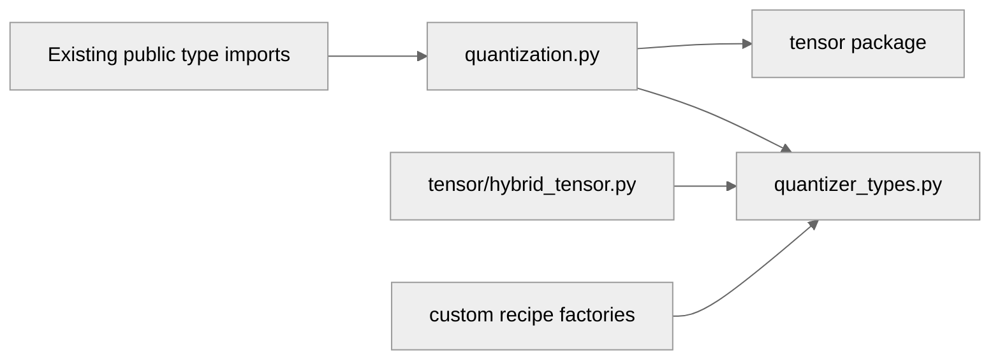

# [PyTorch] Break circular import between quantization and tensor packages

[Upstream PR](https://github.com/NVIDIA/TransformerEngine/pull/3798) · state: open · merged: False

## Original PR description

# Description

`QuantizerRole`, `QuantizerRequest`, and `DelayedScalingRequest` are plain dataclasses, but they were defined in `quantization.py`. Since `HybridQuantizer.__init__` needs `QuantizerRequest`, the `tensor` package had to import it lazily from inside a method, and `quantization.py` compensated with five deferred quantizer imports in `RecipeState.make_quantizers()` (`Float8Quantizer`, `Float8CurrentScalingQuantizer`, `MXFP8Quantizer`, `Float8BlockQuantizer`, `NVFP4Quantizer`). Three of those carry `TODO(ksivamani)` notes asking for a better design. The lazy imports date back to TE 2.0, where the `tensor` package genuinely imported `fp8`; that back-edge is long gone, and this PR removes what it left behind.

Fixes: no tracking issue — resolves the `TODO(ksivamani)` notes in `transformer_engine/pytorch/quantization.py`.

## Type of change

- [x] Code refactoring

## Changes

- Add `transformer_engine/pytorch/quantizer_types.py`, a leaf module containing `QuantizerRole`, `QuantizerRequest`, and `DelayedScalingRequest` (definitions unchanged). It imports nothing from the rest of `transformer_engine.pytorch`.
- `quantization.py`: import and re-export the three dataclasses from the new module (still listed in `__all__`), hoist the five deferred quantizer imports to module level, and drop the now-unused `import dataclasses`.
- `tensor/hybrid_tensor.py`, `custom_recipes/quantizer_factories.py`, `custom_recipes/quantizer_factory_zoo.py`: import the dataclasses from the leaf module; no more local imports of `quantization`.
- Backward compatible: `transformer_engine.pytorch.quantization.QuantizerRole` and friends still resolve, so user code, docs (autoapi), and old pickles are unaffected.
- The tensor-package imports in `quantization.py` are placed before `from .utils import ...`, with a comment: `.utils` pulls in `quantized_tensor` (via the debug tooling), which imports a helper from inside `tensor/`, so the `tensor` package must be initializing for that import to succeed. This removes the reliance on the current import order within the package.

No behavior change; pure import restructuring.

## Testing

- `black` (24.4.2, repo settings) and `pylint` (3.3.1, repo `pylintrc`) on all touched files: no new warnings.
- Static import-graph check: `transformer_engine.pytorch.tensor` no longer reaches `quantization` at module level, and no new cycles are introduced.
- `python -c "import transformer_engine.pytorch"`
- `python -c "import transformer_engine.pytorch.quantization"`
- `pytest tests/pytorch/test_custom_recipe.py`

# Checklist:

- [x] I have read and followed the [contributing guidelines](https://github.com/NVIDIA/TransformerEngine/blob/main/CONTRIBUTING.rst)
- [x] The functionality is complete
- [x] I have commented my code, particularly in hard-to-understand areas
- [ ] I have made corresponding changes to the documentation
- [x] My changes generate no new warnings
- [ ] I have added tests that prove my fix is effective or that my feature works
- [ ] New and existing unit tests pass locally with my changes

## Review and discussion

### reviews

### issue_comments

- greptile-apps[bot] · comment · 2026-11-03T02:44:03Z · [source](https://github.com/NVIDIA/TransformerEngine/pull/3798#issuecomment-6594102472)

<!-- greptile_summary -->

<h2><a href="https://app.greptile.com/api/retrigger?id=93957692"><picture><source media="(prefers-color-scheme: dark)" srcset="https://greptile-static-assets.s3.amazonaws.com/badges/RetriggerDark.svg?v=2"><source media="(prefers-color-scheme: light)" srcset="https://greptile-static-assets.s3.amazonaws.com/badges/Retrigger.svg?v=2"></picture></a><a href="https://app.greptile.com/-/switch-tenant?tenant=nvidia-public-github&amp;next=%2FNVIDIA%2Ftransformerengine%2Fpull%2F3798&amp;utm_source=greptile_review&amp;utm_medium=github&amp;utm_campaign=view_in_greptile"><picture><source media="(prefers-color-scheme: dark)" srcset="https://greptile-static-assets.s3.amazonaws.com/badges/ViewInGreptileDark.svg?v=2"><source media="(prefers-color-scheme: light)" srcset="https://greptile-static-assets.s3.amazonaws.com/badges/ViewInGreptile.svg?v=2"></picture></a>Confidence Score: 5/5</h2>

**[Low impact]** The PR appears safe to merge; no actionable issues were found.

<h3>Summary</h3>

Moves `QuantizerRole`, `QuantizerRequest`, and `DelayedScalingRequest` into `quantizer_types.py` to remove the tensor package’s dependency on `quantization.py`.

- Tensor and recipe code share quantizer types without importing them from quantization.py.

No actionable issues found. Runtime tests were not run during this review.

<h3>Diagram</h3>

<!-- greptile_confidence_score:5 -->

Reviews (1) · Last reviewed commit: ["\[PyTorch\] Break circular import between ..."](https://github.com/nvidia/transformerengine/commit/82fe5855cb8a3669a4c585f668fbd34bfc2b9577) · [Reviewed by Greptile](https://www.greptile.com/?utm_source=greptile_review&utm_medium=github&utm_campaign=review_public&utm_content=nvidia/transformerengine)

### inline_comments

## Changed files and fixed code

- `transformer_engine/pytorch/custom_recipes/quantizer_factories.py` · modified · additions 1 / deletions 2
  - [head](https://github.com/muutot/TransformerEngine/blob/82fe5855cb8a3669a4c585f668fbd34bfc2b9577/transformer_engine/pytorch/custom_recipes/quantizer_factories.py)
  - [base](https://github.com/NVIDIA/TransformerEngine/blob/b021980343e33fdd5b091f95fd13f82e05d581af/transformer_engine/pytorch/custom_recipes/quantizer_factories.py)
- `transformer_engine/pytorch/custom_recipes/quantizer_factory_zoo.py` · modified · additions 1 / deletions 2
  - [head](https://github.com/muutot/TransformerEngine/blob/82fe5855cb8a3669a4c585f668fbd34bfc2b9577/transformer_engine/pytorch/custom_recipes/quantizer_factory_zoo.py)
  - [base](https://github.com/NVIDIA/TransformerEngine/blob/b021980343e33fdd5b091f95fd13f82e05d581af/transformer_engine/pytorch/custom_recipes/quantizer_factory_zoo.py)
- `transformer_engine/pytorch/quantization.py` · modified · additions 13 / deletions 105
  - [head](https://github.com/muutot/TransformerEngine/blob/82fe5855cb8a3669a4c585f668fbd34bfc2b9577/transformer_engine/pytorch/quantization.py)
  - [base](https://github.com/NVIDIA/TransformerEngine/blob/b021980343e33fdd5b091f95fd13f82e05d581af/transformer_engine/pytorch/quantization.py)
- `transformer_engine/pytorch/quantizer_types.py` · added · additions 120 / deletions 0
  - [head](https://github.com/muutot/TransformerEngine/blob/82fe5855cb8a3669a4c585f668fbd34bfc2b9577/transformer_engine/pytorch/quantizer_types.py)
  - [base](https://github.com/NVIDIA/TransformerEngine/blob/b021980343e33fdd5b091f95fd13f82e05d581af/transformer_engine/pytorch/quantizer_types.py)
- `transformer_engine/pytorch/tensor/hybrid_tensor.py` · modified · additions 1 / deletions 1
  - [head](https://github.com/muutot/TransformerEngine/blob/82fe5855cb8a3669a4c585f668fbd34bfc2b9577/transformer_engine/pytorch/tensor/hybrid_tensor.py)
  - [base](https://github.com/NVIDIA/TransformerEngine/blob/b021980343e33fdd5b091f95fd13f82e05d581af/transformer_engine/pytorch/tensor/hybrid_tensor.py)

## Evidence and interpretation boundary

[Original JSON, discussions and patches](../../../../../../evidence/prs/NVIDIA--TransformerEngine/3798-7fecc95796af90062f763686e11c26457a1a175f18d454407a83e5aceba4f4bb.json) · SHA-256 `7fecc95796af90062f763686e11c26457a1a175f18d454407a83e5aceba4f4bb`.

Diff complete: True. Missing/binary/truncated patches require pinned source inspection. This is a source page, not an independently verified optimization case. Open, merged and released are different states; recheck the deployed dependency.
