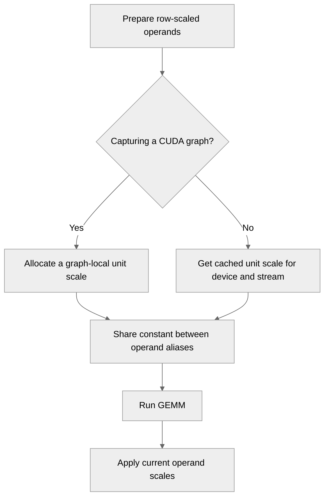

# Reduce NVFP4 GEMM scale metadata overhead

[Upstream PR](https://github.com/NVIDIA/TransformerEngine/pull/3799) · state: open · merged: False

## Original PR description

# Description

Row-scaled NVFP4 GEMM preparation currently allocates and initializes unit-scale tensors on every call. Reuse immutable unit-scale metadata to reduce allocation, initialization, and kernel-launch overhead.

Reduce per-GEMM latency by approximately 4–6% in the tested row-scaled NVFP4 microbenchmarks on B300.

## Type of change

- [x] Code refactoring

## Changes

- Extend the existing ones-tensor cache with an optional CUDA stream key and initialize tensors on that stream.
- Reuse one unit-scale tensor for both operand aliases. During CUDA graph capture, keep constants local to the graph.
- Add exact regression tests covering changing scales, GEMM layouts, output dtypes, accumulation, bilateral and hybrid operands, independent streams/devices, and graph capture/replay.

## Validation

Validation results below were recorded against base `63451d6`:

- 77 focused correctness and integration checks passed.
- Full PyTorch debug suite passed.
- Full PyTorch unit suite: 62,059 passed, with the same 38 failures reproduced on unmodified main and no additional failures or errors.
- Formatting, lint, and license checks passed.

The baseline failures concern MXFP8 signed-zero comparisons and FlexAttention/cuDNN Frontend tests.

Merge compatibility was checked against upstream main at `b021980`; the cache helper and affected GEMM functions are unchanged by the intervening commits.

# Checklist

- [x] I have read the contributing guidelines.
- [x] The functionality is complete.
- [x] I have commented the code where needed.
- [x] I have updated the affected helper documentation.
- [x] My changes generate no new warnings.
- [x] I have added tests covering the change.
- [ ] New and existing unit tests pass locally with my changes (baseline failures documented above).

## Review and discussion

### reviews

### issue_comments

- greptile-apps[bot] · comment · 2026-11-03T12:48:27Z · [source](https://github.com/NVIDIA/TransformerEngine/pull/3799#issuecomment-6604184281)

<!-- greptile_summary -->

<h2><a href="https://app.greptile.com/api/retrigger?id=94351400"><picture><source media="(prefers-color-scheme: dark)" srcset="https://greptile-static-assets.s3.amazonaws.com/badges/RetriggerDark.svg?v=2"><source media="(prefers-color-scheme: light)" srcset="https://greptile-static-assets.s3.amazonaws.com/badges/Retrigger.svg?v=2"></picture></a><a href="https://app.greptile.com/-/switch-tenant?tenant=nvidia-public-github&amp;next=%2FNVIDIA%2Ftransformerengine%2Fpull%2F3799&amp;utm_source=greptile_review&amp;utm_medium=github&amp;utm_campaign=view_in_greptile"><picture><source media="(prefers-color-scheme: dark)" srcset="https://greptile-static-assets.s3.amazonaws.com/badges/ViewInGreptileDark.svg?v=2"><source media="(prefers-color-scheme: light)" srcset="https://greptile-static-assets.s3.amazonaws.com/badges/ViewInGreptile.svg?v=2"></picture></a>Confidence Score: 5/5</h2>

**[Medium impact]** This PR appears safe to merge.

<h3>Summary</h3>

This PR reuses unit-scale metadata when preparing row-scaled NVFP4 GEMMs.
- Row-scaled NVFP4 GEMMs reuse one unit-scale tensor between operands.

No actionable issues were found. Review checks used source inspection; tests were not run.

<h3>Diagram</h3>

<!-- greptile_confidence_score:5 -->

Reviews (1) · Last reviewed commit: ["Reduce NVFP4 GEMM scale metadata overhea..."](https://github.com/nvidia/transformerengine/commit/6086819c7d1915dab661551637e7110693811b0f) · [Reviewed by Greptile](https://www.greptile.com/?utm_source=greptile_review&utm_medium=github&utm_campaign=review_public&utm_content=nvidia/transformerengine)

### inline_comments

## Changed files and fixed code

- `tests/pytorch/nvfp4/test_nvfp4_gemm_exact.py` · modified · additions 258 / deletions 0
  - [head](https://github.com/milakov/TransformerEngine/blob/6086819c7d1915dab661551637e7110693811b0f/tests/pytorch/nvfp4/test_nvfp4_gemm_exact.py)
  - [base](https://github.com/NVIDIA/TransformerEngine/blob/b021980343e33fdd5b091f95fd13f82e05d581af/tests/pytorch/nvfp4/test_nvfp4_gemm_exact.py)
- `transformer_engine/pytorch/cpp_extensions/gemm.py` · modified · additions 13 / deletions 2
  - [head](https://github.com/milakov/TransformerEngine/blob/6086819c7d1915dab661551637e7110693811b0f/transformer_engine/pytorch/cpp_extensions/gemm.py)
  - [base](https://github.com/NVIDIA/TransformerEngine/blob/b021980343e33fdd5b091f95fd13f82e05d581af/transformer_engine/pytorch/cpp_extensions/gemm.py)
- `transformer_engine/pytorch/utils.py` · modified · additions 10 / deletions 3
  - [head](https://github.com/milakov/TransformerEngine/blob/6086819c7d1915dab661551637e7110693811b0f/transformer_engine/pytorch/utils.py)
  - [base](https://github.com/NVIDIA/TransformerEngine/blob/b021980343e33fdd5b091f95fd13f82e05d581af/transformer_engine/pytorch/utils.py)

## Evidence and interpretation boundary

[Original JSON, discussions and patches](../../../../../../evidence/prs/NVIDIA--TransformerEngine/3799-b23746507ec1671ff33dcb46e985102d8e30beb3992129d9da1b0a96b8aa3d16.json) · SHA-256 `b23746507ec1671ff33dcb46e985102d8e30beb3992129d9da1b0a96b8aa3d16`.

Diff complete: True. Missing/binary/truncated patches require pinned source inspection. This is a source page, not an independently verified optimization case. Open, merged and released are different states; recheck the deployed dependency.
