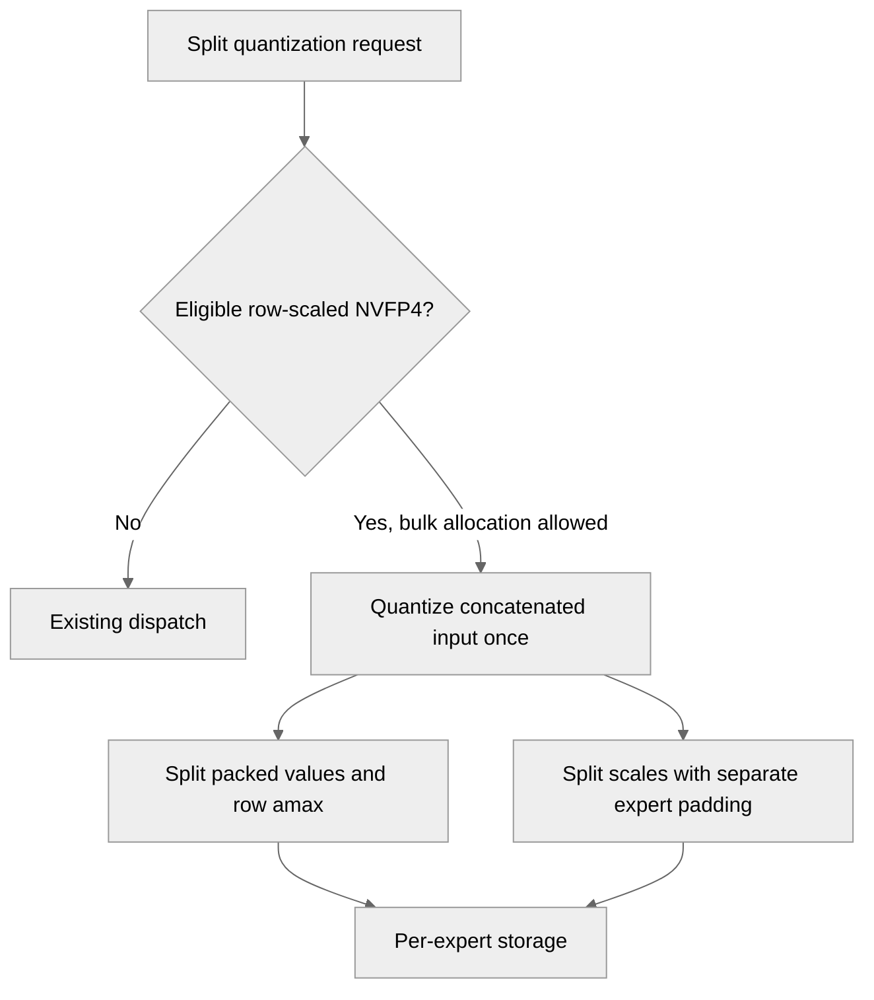

# Reduce NVFP4 activation quantization overhead

[Upstream PR](https://github.com/NVIDIA/TransformerEngine/pull/3800) · state: open · merged: False

## Original PR description

# Description

Row-scaled NVFP4 activations currently go through per-expert quantization in the split path. Quantize eligible concatenated activations once, then partition their payloads and row-scale metadata into per-expert storage to reduce repeated kernel launches and setup overhead.

In the tested B300 split-quantization microbenchmarks, median synchronized operation latency decreased by 1.3–62.3%, depending on expert count, width, and split alignment. MXFP8 controls stayed within 1% of baseline. These are operation-level measurements, not full-model iteration timings.

## Type of change

- [x] Code refactoring

## Changes

- Add a guarded fast path for contiguous BF16, rowwise-only, deterministic row-scaled NVFP4 activation quantization using existing native kernels.
- Preserve independent per-expert scale padding, including uneven and empty splits. Requantizing one expert must not modify another expert's storage.
- Retain the existing path for unsupported layouts, quantizer options, and allocation requirements.
- Add exact regression coverage for quantized payloads, scales, dequantized values, graph replay, expert requantization, hybrid quantizers, GroupedLinear outputs/gradients, CPU offload, debug dispatch, and GroupedTensor fallback.

This change is independent of #3799.

## Validation

Validation results below were recorded against base `63451d6`:

- 154 focused correctness and integration checks passed; 24 cases were skipped because UE5M3 requires compute capability 10.7.
- Full PyTorch debug suite: 18,806 passed.
- Full PyTorch unit suite: 62,118 passed, with the same 38 failures reproduced on unmodified main and no additional failures or errors.
- Formatting, lint, and license checks passed.

The baseline failures concern MXFP8 signed-zero comparisons and FlexAttention/cuDNN Frontend tests.

Merge compatibility was checked against upstream main at `b021980`; none of the five changed files has intervening upstream changes.

# Checklist

- [x] I have read the contributing guidelines.
- [x] The functionality is complete.
- [x] I have commented the code where needed.
- [x] I have documented the new private helpers and eligibility constraints in the code.
- [x] My changes generate no new warnings.
- [x] I have added tests covering the change.
- [ ] New and existing unit tests pass locally with my changes (baseline failures documented above).

## Review and discussion

### reviews

### issue_comments

- greptile-apps[bot] · comment · 2026-11-03T13:05:23Z · [source](https://github.com/NVIDIA/TransformerEngine/pull/3800#issuecomment-6604581036)

<!-- greptile_summary -->

<h2><a href="https://app.greptile.com/api/retrigger?id=94359185"><picture><source media="(prefers-color-scheme: dark)" srcset="https://greptile-static-assets.s3.amazonaws.com/badges/RetriggerDark.svg?v=2"><source media="(prefers-color-scheme: light)" srcset="https://greptile-static-assets.s3.amazonaws.com/badges/Retrigger.svg?v=2"></picture></a><a href="https://app.greptile.com/-/switch-tenant?tenant=nvidia-public-github&amp;next=%2FNVIDIA%2Ftransformerengine%2Fpull%2F3800&amp;utm_source=greptile_review&amp;utm_medium=github&amp;utm_campaign=view_in_greptile"><picture><source media="(prefers-color-scheme: dark)" srcset="https://greptile-static-assets.s3.amazonaws.com/badges/ViewInGreptileDark.svg?v=2"><source media="(prefers-color-scheme: light)" srcset="https://greptile-static-assets.s3.amazonaws.com/badges/ViewInGreptile.svg?v=2"></picture></a>Confidence Score: 5/5</h2>

**[Medium impact]** The PR appears safe to merge; no actionable defects were found.

<h3>Summary</h3>

Adds a guarded fast path that quantizes eligible row-scaled NVFP4 activations once, then splits their packed values and scale data by expert.
- GroupedLinear quantizes eligible row-scaled NVFP4 activations once.

No actionable issues were found. Tests were inspected but not run during this review.

<h3>Diagram</h3>

<!-- greptile_confidence_score:5 -->

Reviews (1) · Last reviewed commit: ["Reduce NVFP4 activation quantization ove..."](https://github.com/nvidia/transformerengine/commit/9b60c5d0af67d3e9cb719560539dda3e0533365a) · [Reviewed by Greptile](https://www.greptile.com/?utm_source=greptile_review&utm_medium=github&utm_campaign=review_public&utm_content=nvidia/transformerengine)

### inline_comments

## Changed files and fixed code

- `tests/pytorch/debug/test_sanity.py` · modified · additions 65 / deletions 0
  - [head](https://github.com/milakov/TransformerEngine/blob/9b60c5d0af67d3e9cb719560539dda3e0533365a/tests/pytorch/debug/test_sanity.py)
  - [base](https://github.com/NVIDIA/TransformerEngine/blob/b021980343e33fdd5b091f95fd13f82e05d581af/tests/pytorch/debug/test_sanity.py)
- `tests/pytorch/nvfp4/test_nvfp4_quantize_exact.py` · modified · additions 320 / deletions 0
  - [head](https://github.com/milakov/TransformerEngine/blob/9b60c5d0af67d3e9cb719560539dda3e0533365a/tests/pytorch/nvfp4/test_nvfp4_quantize_exact.py)
  - [base](https://github.com/NVIDIA/TransformerEngine/blob/b021980343e33fdd5b091f95fd13f82e05d581af/tests/pytorch/nvfp4/test_nvfp4_quantize_exact.py)
- `tests/pytorch/test_grouped_linear.py` · modified · additions 238 / deletions 0
  - [head](https://github.com/milakov/TransformerEngine/blob/9b60c5d0af67d3e9cb719560539dda3e0533365a/tests/pytorch/test_grouped_linear.py)
  - [base](https://github.com/NVIDIA/TransformerEngine/blob/b021980343e33fdd5b091f95fd13f82e05d581af/tests/pytorch/test_grouped_linear.py)
- `tests/pytorch/test_hybrid_quantization.py` · modified · additions 77 / deletions 0
  - [head](https://github.com/milakov/TransformerEngine/blob/9b60c5d0af67d3e9cb719560539dda3e0533365a/tests/pytorch/test_hybrid_quantization.py)
  - [base](https://github.com/NVIDIA/TransformerEngine/blob/b021980343e33fdd5b091f95fd13f82e05d581af/tests/pytorch/test_hybrid_quantization.py)
- `transformer_engine/pytorch/module/_split_quantization.py` · modified · additions 91 / deletions 0
  - [head](https://github.com/milakov/TransformerEngine/blob/9b60c5d0af67d3e9cb719560539dda3e0533365a/transformer_engine/pytorch/module/_split_quantization.py)
  - [base](https://github.com/NVIDIA/TransformerEngine/blob/b021980343e33fdd5b091f95fd13f82e05d581af/transformer_engine/pytorch/module/_split_quantization.py)

## Evidence and interpretation boundary

[Original JSON, discussions and patches](../../../../../../evidence/prs/NVIDIA--TransformerEngine/3800-4d60bf0c76ad5ae8beea98cf95add85f080ff15311ebc316a82a2629d23a233c.json) · SHA-256 `4d60bf0c76ad5ae8beea98cf95add85f080ff15311ebc316a82a2629d23a233c`.

Diff complete: True. Missing/binary/truncated patches require pinned source inspection. This is a source page, not an independently verified optimization case. Open, merged and released are different states; recheck the deployed dependency.
