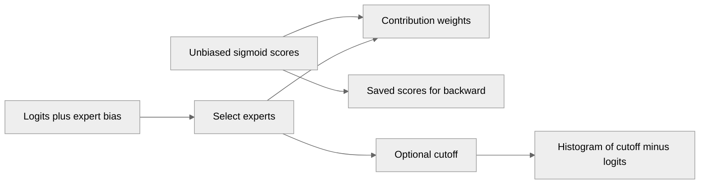

# Add logit-space bias to the fused sigmoid router

[Upstream PR](https://github.com/NVIDIA/TransformerEngine/pull/3805) · state: open · merged: False

## Original PR description

# Description

Adds `qb_bias_space="logit"` to the PyTorch fused router. This selects experts using raw logits plus an FP32 expert bias, while contribution weights and backward use the original sigmoid scores. Optional quantile-balancing histograms accumulate `cutoff - logits`, where the cutoff is the `(k+1)`-th biased logit.

This enables logit-space quantile balancing without compressing small sigmoid scores into a few histogram bins.  We've seen this provide significantly better load balancing.

## Type of change

- [ ] Documentation change (change only to the documentation, either a fix or a new content)
- [ ] Bug fix (non-breaking change which fixes an issue)
- [X] New feature (non-breaking change which adds functionality)
- [ ] Breaking change (fix or feature that would cause existing functionality to not work as expected)
- [ ] Infra/Build change
- [ ] Code refactoring

## Changes

- Add a compile-time logit-bias specialization of the simple forward kernel, plus a separate public C entry point that preserves the existing C ABI.
- Support both fused-atomic and two-kernel histograms. The latter accumulates from FP32 raw logits; saved intermediates remain unbiased sigmoid scores for the existing backward implementation.
- Reject unsupported score functions, grouped routing, and missing bias. Logit mode is currently only implemented for the simple kernel regardless of `NVTE_RADIX_TOPK_THRESHOLD`.

# Checklist:

- [X] I have read and followed the [contributing guidelines](https://github.com/NVIDIA/TransformerEngine/blob/main/CONTRIBUTING.rst)
- [X] The functionality is complete
- [X] I have commented my code, particularly in hard-to-understand areas
- [X] I have made corresponding changes to the documentation
- [ ] My changes generate no new warnings
- [X] I have added tests that prove my fix is effective or that my feature works
- [X] New and existing unit tests pass locally with my changes

## Review and discussion

### reviews

- greptile-apps[bot] · COMMENTED · 2026-11-03T22:22:49Z · [source](https://github.com/NVIDIA/TransformerEngine/pull/3805#pullrequestreview-5760328183)

(No body; status only.)

### issue_comments

- greptile-apps[bot] · comment · 2026-11-03T22:22:44Z · [source](https://github.com/NVIDIA/TransformerEngine/pull/3805#issuecomment-6616915775)

<!-- greptile_summary -->

<h2><a href="https://app.greptile.com/api/retrigger?id=94913886"><picture><source media="(prefers-color-scheme: dark)" srcset="https://greptile-static-assets.s3.amazonaws.com/badges/RetriggerDark.svg?v=2"><source media="(prefers-color-scheme: light)" srcset="https://greptile-static-assets.s3.amazonaws.com/badges/Retrigger.svg?v=2"></picture></a><a href="https://app.greptile.com/-/switch-tenant?tenant=nvidia-public-github&amp;next=%2FNVIDIA%2Ftransformerengine%2Fpull%2F3805&amp;utm_source=greptile_review&amp;utm_medium=github&amp;utm_campaign=view_in_greptile"><picture><source media="(prefers-color-scheme: dark)" srcset="https://greptile-static-assets.s3.amazonaws.com/badges/ViewInGreptileDark.svg?v=2"><source media="(prefers-color-scheme: light)" srcset="https://greptile-static-assets.s3.amazonaws.com/badges/ViewInGreptile.svg?v=2"></picture></a>Confidence Score: 5/5</h2>

**[Medium impact]** The PR appears safe to merge, with the previous coverage finding addressed and no new actionable issues found.

<h3>Summary</h3>

Adds `qb_bias_space="logit"` to select experts using logits plus bias while keeping unbiased sigmoid weights and gradients.
- The fused sigmoid router can select experts using logits plus expert bias.

<h3>Diagram</h3>

<!-- greptile_confidence_score:5 -->

Reviews (2) · Last reviewed commit: ["Test logit QB graph replay with mutable ..."](https://github.com/nvidia/transformerengine/commit/3802ec36906d65225fefe1d84923373cebb4138e) · [Reviewed by Greptile](https://www.greptile.com/?utm_source=greptile_review&utm_medium=github&utm_campaign=review_public&utm_content=nvidia/transformerengine)

### inline_comments

- greptile-apps[bot] · comment · 2026-11-03T22:22:47Z · [source](https://github.com/NVIDIA/TransformerEngine/pull/3805#discussion_r4461158894)

File: `tests/pytorch/test_fused_router.py` · line None

 **Low-precision replay lacks coverage**

`test_logit_bias_cuda_graph_mutable_bias_and_bounds` only uses FP32 logits, so it never captures the new FP16/BF16-to-FP32 copy used by `two_kernel`. Add FP16 and BF16 cases and update `logits` before replay. This would check that the captured copy refreshes the histogram inputs; a replay bug in this path currently would not fail the test.

Note: If this suggestion doesn't match your team's coding style, reply to this and let me know. I'll remember it for next time!

## Changed files and fixed code

- `tests/pytorch/test_fused_router.py` · modified · additions 158 / deletions 0
  - [head](https://github.com/philipcmonk/TransformerEngine/blob/3802ec36906d65225fefe1d84923373cebb4138e/tests/pytorch/test_fused_router.py)
  - [base](https://github.com/NVIDIA/TransformerEngine/blob/dc7302a2007e696a61e94c78570aedf393a66e99/tests/pytorch/test_fused_router.py)
- `transformer_engine/common/fused_router/fused_topk_with_score_function.cu` · modified · additions 150 / deletions 11
  - [head](https://github.com/philipcmonk/TransformerEngine/blob/3802ec36906d65225fefe1d84923373cebb4138e/transformer_engine/common/fused_router/fused_topk_with_score_function.cu)
  - [base](https://github.com/NVIDIA/TransformerEngine/blob/dc7302a2007e696a61e94c78570aedf393a66e99/transformer_engine/common/fused_router/fused_topk_with_score_function.cu)
- `transformer_engine/common/include/transformer_engine/fused_router.h` · modified · additions 22 / deletions 1
  - [head](https://github.com/philipcmonk/TransformerEngine/blob/3802ec36906d65225fefe1d84923373cebb4138e/transformer_engine/common/include/transformer_engine/fused_router.h)
  - [base](https://github.com/NVIDIA/TransformerEngine/blob/dc7302a2007e696a61e94c78570aedf393a66e99/transformer_engine/common/include/transformer_engine/fused_router.h)
- `transformer_engine/pytorch/csrc/extensions.h` · modified · additions 3 / deletions 2
  - [head](https://github.com/philipcmonk/TransformerEngine/blob/3802ec36906d65225fefe1d84923373cebb4138e/transformer_engine/pytorch/csrc/extensions.h)
  - [base](https://github.com/NVIDIA/TransformerEngine/blob/dc7302a2007e696a61e94c78570aedf393a66e99/transformer_engine/pytorch/csrc/extensions.h)
- `transformer_engine/pytorch/csrc/extensions/pybind.cpp` · modified · additions 3 / deletions 2
  - [head](https://github.com/philipcmonk/TransformerEngine/blob/3802ec36906d65225fefe1d84923373cebb4138e/transformer_engine/pytorch/csrc/extensions/pybind.cpp)
  - [base](https://github.com/NVIDIA/TransformerEngine/blob/dc7302a2007e696a61e94c78570aedf393a66e99/transformer_engine/pytorch/csrc/extensions/pybind.cpp)
- `transformer_engine/pytorch/csrc/extensions/router.cpp` · modified · additions 40 / deletions 6
  - [head](https://github.com/philipcmonk/TransformerEngine/blob/3802ec36906d65225fefe1d84923373cebb4138e/transformer_engine/pytorch/csrc/extensions/router.cpp)
  - [base](https://github.com/NVIDIA/TransformerEngine/blob/dc7302a2007e696a61e94c78570aedf393a66e99/transformer_engine/pytorch/csrc/extensions/router.cpp)
- `transformer_engine/pytorch/router.py` · modified · additions 27 / deletions 2
  - [head](https://github.com/philipcmonk/TransformerEngine/blob/3802ec36906d65225fefe1d84923373cebb4138e/transformer_engine/pytorch/router.py)
  - [base](https://github.com/NVIDIA/TransformerEngine/blob/dc7302a2007e696a61e94c78570aedf393a66e99/transformer_engine/pytorch/router.py)

## Evidence and interpretation boundary

[Original JSON, discussions and patches](../../../../../../evidence/prs/NVIDIA--TransformerEngine/3805-3f67fbd148fd5947a64e50ec911767dd8eff85cc4e6f67d0d2d09ad545d5c73f.json) · SHA-256 `3f67fbd148fd5947a64e50ec911767dd8eff85cc4e6f67d0d2d09ad545d5c73f`.

Diff complete: True. Missing/binary/truncated patches require pinned source inspection. This is a source page, not an independently verified optimization case. Open, merged and released are different states; recheck the deployed dependency.
