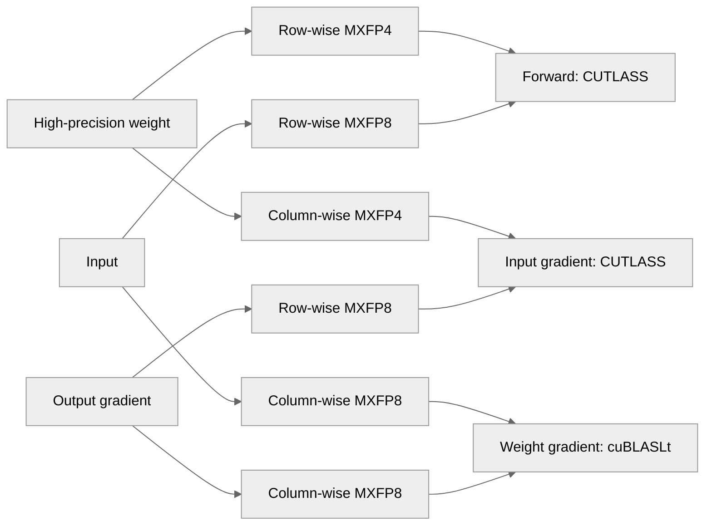

# [PyTorch] Add MXFP4 weight x MXFP8 activation (W4A8) support for Linear modules

[Upstream PR](https://github.com/NVIDIA/TransformerEngine/pull/3810) · state: open · merged: False

## Original PR description

# Description

Adds W4A8 training: MXFP4 weights with MXFP8 activations and gradients in `Linear`, `LayerNormLinear` and `GroupedLinear`, exposed as a quantizer factory for `CustomRecipe`.

Motivation: RL pipelines whose rollout engine serves MXFP4 weights. Training with the same MXFP4 weight values removes the weight-side mismatch between the policy that generates samples and the policy that is trained. The weight is quantized independently for each GEMM direction from the high-precision parameter, and the row-wise MXFP4 data used by fprop is what a rollout engine would load.

| GEMM | Weight-side operand | Activation-side operand | Backend |
|---|---|---|---|
| fprop (TN) | MXFP4 row-wise | MXFP8 input row-wise | CUTLASS SM100 |
| dgrad (NN) | MXFP4 column-wise | MXFP8 grad_output row-wise | CUTLASS SM100 |
| wgrad (NT) | MXFP8 input column-wise | MXFP8 grad_output column-wise | cuBLASLt |

Usage:
```python
from transformer_engine.common.recipe import CustomRecipe
from transformer_engine.pytorch.custom_recipes.quantizer_factory_zoo import (
    mxfp4_weight_mxfp8_activation_factory,
)
recipe = CustomRecipe(qfactory=mxfp4_weight_mxfp8_activation_factory)
with te.autocast(enabled=True, recipe=recipe):
    y = layer(x)
```
With Megatron-LM, no Megatron changes are required:
```
--fp8-format e4m3 --fp8-recipe custom \
--fp8-quantizer-factory transformer_engine.pytorch.custom_recipes.quantizer_factory_zoo.mxfp4_weight_mxfp8_activation_factory
```

## Type of change

- [ ] Documentation change (change only to the documentation, either a fix or a new content)
- [ ] Bug fix (non-breaking change which fixes an issue)
- [x] New feature (non-breaking change which adds functionality)
- [ ] Breaking change (fix or feature that would cause existing functionality to not work as expected)
- [ ] Infra/Build change
- [ ] Code refactoring

## Changes

Please list the changes introduced in this PR:

- Change A
- Change B

# Checklist:

- [ ] I have read and followed the [contributing guidelines](https://github.com/NVIDIA/TransformerEngine/blob/main/CONTRIBUTING.rst)
- [ ] The functionality is complete
- [ ] I have commented my code, particularly in hard-to-understand areas
- [ ] I have made corresponding changes to the documentation
- [ ] My changes generate no new warnings
- [ ] I have added tests that prove my fix is effective or that my feature works
- [ ] New and existing unit tests pass locally with my changes


## Review and discussion

### reviews

- greptile-apps[bot] · COMMENTED · 2026-11-04T06:23:04Z · [source](https://github.com/NVIDIA/TransformerEngine/pull/3810#pullrequestreview-5764144647)

(No body; status only.)

### issue_comments

- greptile-apps[bot] · comment · 2026-11-04T06:22:58Z · [source](https://github.com/NVIDIA/TransformerEngine/pull/3810#issuecomment-6624172378)

<!-- greptile_summary -->

<h2><a href="https://app.greptile.com/api/retrigger?id=95233448"><picture><source media="(prefers-color-scheme: dark)" srcset="https://greptile-static-assets.s3.amazonaws.com/badges/RetriggerDark.svg?v=2"><source media="(prefers-color-scheme: light)" srcset="https://greptile-static-assets.s3.amazonaws.com/badges/Retrigger.svg?v=2"></picture></a><a href="https://app.greptile.com/-/switch-tenant?tenant=nvidia-public-github&amp;next=%2FNVIDIA%2Ftransformerengine%2Fpull%2F3810&amp;utm_source=greptile_review&amp;utm_medium=github&amp;utm_campaign=view_in_greptile"><picture><source media="(prefers-color-scheme: dark)" srcset="https://greptile-static-assets.s3.amazonaws.com/badges/ViewInGreptileDark.svg?v=2"><source media="(prefers-color-scheme: light)" srcset="https://greptile-static-assets.s3.amazonaws.com/badges/ViewInGreptile.svg?v=2"></picture></a>Confidence Score: 3/5</h2>

**[Medium impact]** The changes affect PyTorch linear training workflows that opt into the new mixed\-format recipe\.

Fix the public tensor's `view()` behavior and copies between scale layouts before merging.

<h2>Findings</h2>

1. &nbsp;**Views lose the tensor** <a href="https://github.com/NVIDIA/TransformerEngine/pull/3810#discussion_r4464335110">▶</a>
2. &nbsp;**Copies scramble scale values** <a href="https://github.com/NVIDIA/TransformerEngine/pull/3810#discussion_r4464335133">▶</a>

<h3>Summary</h3>

Adds MXFP4 weights with MXFP8 activations and gradients for linear modules.
- MXFP4 weights use packed values and block scales in PyTorch tensors.
- Linear forward and input gradients can use MXFP4-by-MXFP8 GEMMs.
- A custom recipe gives linear modules MXFP4 weights and MXFP8 activations.

<h3>Diagram</h3>



<!-- greptile_confidence_score:3 -->

<sub>Reviews (1) · Last reviewed commit: ["Add MXFP4 weight x MXFP8 activation (W4A..."](https://github.com/nvidia/transformerengine/commit/be50b4461b01ad665f13d8b84c2304e6f88b1151) · [Reviewed by Greptile](https://www.greptile.com/?utm_source=greptile_review&utm_medium=github&utm_campaign=review_public&utm_content=nvidia/transformerengine)</sub>

### inline_comments

- greptile-apps[bot] · comment · 2026-11-04T06:23:02Z · [source](https://github.com/NVIDIA/TransformerEngine/pull/3810#discussion_r4464335110)

File: `transformer_engine/pytorch/tensor/mxfp4_tensor.py` · line 144

<a href="#"></a> **Views lose the tensor**

`MXFP4Tensor` inherits `MXFP4TensorStorage.view()` without overriding it. Calling `qx.view((32, 32, 128))` on a quantized `(1024, 128)` tensor returns bare storage, not a `torch.Tensor`, and drops its gradient connection. The usual `qx.view(-1, 128)` form also raises `TypeError` because the inherited method accepts only one shape argument.

Add a tensor-level `view()` that preserves the wrapper and gradients, as `MXFP8Tensor` does.

- greptile-apps[bot] · comment · 2026-11-04T06:23:02Z · [source](https://github.com/NVIDIA/TransformerEngine/pull/3810#discussion_r4464335133)

File: `transformer_engine/pytorch/tensor/mxfp4_tensor.py` · line 233

<a href="#"></a> **Copies scramble scale values**

`MXFP4Tensor.__torch_dispatch__()` sends `copy_()` to the base implementation. That path copies raw buffers when quantizer types and usages match, but does not compare `_with_gemm_swizzled_scales`. Copying between compact and GEMM-swizzled tensors therefore copies scales in the wrong order while leaving the destination's layout flag unchanged. Later dequantization and GEMMs use incorrect scales.

Check the scale layout before copying raw buffers. When layouts differ, fall back to dequantizing and requantizing, as `MXFP8Tensor` does.

## Changed files and fixed code

- `qa/L0_pytorch_unittest/test.sh` · modified · additions 1 / deletions 0
  - [head](https://github.com/cael-ling/TransformerEngine/blob/be50b4461b01ad665f13d8b84c2304e6f88b1151/qa/L0_pytorch_unittest/test.sh)
  - [base](https://github.com/NVIDIA/TransformerEngine/blob/5f1208e3770af23dc82935bea8249409e7f49e5d/qa/L0_pytorch_unittest/test.sh)
- `tests/pytorch/distributed/run_numerics_exact.py` · modified · additions 86 / deletions 6
  - [head](https://github.com/cael-ling/TransformerEngine/blob/be50b4461b01ad665f13d8b84c2304e6f88b1151/tests/pytorch/distributed/run_numerics_exact.py)
  - [base](https://github.com/NVIDIA/TransformerEngine/blob/5f1208e3770af23dc82935bea8249409e7f49e5d/tests/pytorch/distributed/run_numerics_exact.py)
- `tests/pytorch/distributed/test_numerics_exact.py` · modified · additions 17 / deletions 0
  - [head](https://github.com/cael-ling/TransformerEngine/blob/be50b4461b01ad665f13d8b84c2304e6f88b1151/tests/pytorch/distributed/test_numerics_exact.py)
  - [base](https://github.com/NVIDIA/TransformerEngine/blob/5f1208e3770af23dc82935bea8249409e7f49e5d/tests/pytorch/distributed/test_numerics_exact.py)
- `tests/pytorch/mxfp4/mxfp4_utils.py` · added · additions 96 / deletions 0
  - [head](https://github.com/cael-ling/TransformerEngine/blob/be50b4461b01ad665f13d8b84c2304e6f88b1151/tests/pytorch/mxfp4/mxfp4_utils.py)
  - [base](https://github.com/NVIDIA/TransformerEngine/blob/5f1208e3770af23dc82935bea8249409e7f49e5d/tests/pytorch/mxfp4/mxfp4_utils.py)
- `tests/pytorch/mxfp4/test_mxfp4_gemm_exact.py` · added · additions 104 / deletions 0
  - [head](https://github.com/cael-ling/TransformerEngine/blob/be50b4461b01ad665f13d8b84c2304e6f88b1151/tests/pytorch/mxfp4/test_mxfp4_gemm_exact.py)
  - [base](https://github.com/NVIDIA/TransformerEngine/blob/5f1208e3770af23dc82935bea8249409e7f49e5d/tests/pytorch/mxfp4/test_mxfp4_gemm_exact.py)
- `tests/pytorch/mxfp4/test_mxfp4_module_exact.py` · added · additions 246 / deletions 0
  - [head](https://github.com/cael-ling/TransformerEngine/blob/be50b4461b01ad665f13d8b84c2304e6f88b1151/tests/pytorch/mxfp4/test_mxfp4_module_exact.py)
  - [base](https://github.com/NVIDIA/TransformerEngine/blob/5f1208e3770af23dc82935bea8249409e7f49e5d/tests/pytorch/mxfp4/test_mxfp4_module_exact.py)
- `tests/pytorch/mxfp4/test_mxfp4_quantize_exact.py` · added · additions 112 / deletions 0
  - [head](https://github.com/cael-ling/TransformerEngine/blob/be50b4461b01ad665f13d8b84c2304e6f88b1151/tests/pytorch/mxfp4/test_mxfp4_quantize_exact.py)
  - [base](https://github.com/NVIDIA/TransformerEngine/blob/5f1208e3770af23dc82935bea8249409e7f49e5d/tests/pytorch/mxfp4/test_mxfp4_quantize_exact.py)
- `transformer_engine/common/CMakeLists.txt` · modified · additions 2 / deletions 0
  - [head](https://github.com/cael-ling/TransformerEngine/blob/be50b4461b01ad665f13d8b84c2304e6f88b1151/transformer_engine/common/CMakeLists.txt)
  - [base](https://github.com/NVIDIA/TransformerEngine/blob/5f1208e3770af23dc82935bea8249409e7f49e5d/transformer_engine/common/CMakeLists.txt)
- `transformer_engine/common/cast/dispatch/dequantize.cuh` · modified · additions 4 / deletions 1
  - [head](https://github.com/cael-ling/TransformerEngine/blob/be50b4461b01ad665f13d8b84c2304e6f88b1151/transformer_engine/common/cast/dispatch/dequantize.cuh)
  - [base](https://github.com/NVIDIA/TransformerEngine/blob/5f1208e3770af23dc82935bea8249409e7f49e5d/transformer_engine/common/cast/dispatch/dequantize.cuh)
- `transformer_engine/common/cast/dispatch/quantize.cuh` · modified · additions 8 / deletions 0
  - [head](https://github.com/cael-ling/TransformerEngine/blob/be50b4461b01ad665f13d8b84c2304e6f88b1151/transformer_engine/common/cast/dispatch/quantize.cuh)
  - [base](https://github.com/NVIDIA/TransformerEngine/blob/5f1208e3770af23dc82935bea8249409e7f49e5d/transformer_engine/common/cast/dispatch/quantize.cuh)
- `transformer_engine/common/cast/mxfp4/dequantize_mxfp4.cuh` · added · additions 124 / deletions 0
  - [head](https://github.com/cael-ling/TransformerEngine/blob/be50b4461b01ad665f13d8b84c2304e6f88b1151/transformer_engine/common/cast/mxfp4/dequantize_mxfp4.cuh)
  - [base](https://github.com/NVIDIA/TransformerEngine/blob/5f1208e3770af23dc82935bea8249409e7f49e5d/transformer_engine/common/cast/mxfp4/dequantize_mxfp4.cuh)
- `transformer_engine/common/cast/mxfp4/quantize_mxfp4.cuh` · added · additions 201 / deletions 0
  - [head](https://github.com/cael-ling/TransformerEngine/blob/be50b4461b01ad665f13d8b84c2304e6f88b1151/transformer_engine/common/cast/mxfp4/quantize_mxfp4.cuh)
  - [base](https://github.com/NVIDIA/TransformerEngine/blob/5f1208e3770af23dc82935bea8249409e7f49e5d/transformer_engine/common/cast/mxfp4/quantize_mxfp4.cuh)
- `transformer_engine/common/gemm/cublaslt_gemm.cu` · modified · additions 16 / deletions 0
  - [head](https://github.com/cael-ling/TransformerEngine/blob/be50b4461b01ad665f13d8b84c2304e6f88b1151/transformer_engine/common/gemm/cublaslt_gemm.cu)
  - [base](https://github.com/NVIDIA/TransformerEngine/blob/5f1208e3770af23dc82935bea8249409e7f49e5d/transformer_engine/common/gemm/cublaslt_gemm.cu)
- `transformer_engine/common/gemm/cutlass_mxfp4_mxfp8_gemm.cu` · added · additions 203 / deletions 0
  - [head](https://github.com/cael-ling/TransformerEngine/blob/be50b4461b01ad665f13d8b84c2304e6f88b1151/transformer_engine/common/gemm/cutlass_mxfp4_mxfp8_gemm.cu)
  - [base](https://github.com/NVIDIA/TransformerEngine/blob/5f1208e3770af23dc82935bea8249409e7f49e5d/transformer_engine/common/gemm/cutlass_mxfp4_mxfp8_gemm.cu)
- `transformer_engine/common/gemm/cutlass_mxfp4_mxfp8_gemm.h` · added · additions 32 / deletions 0
  - [head](https://github.com/cael-ling/TransformerEngine/blob/be50b4461b01ad665f13d8b84c2304e6f88b1151/transformer_engine/common/gemm/cutlass_mxfp4_mxfp8_gemm.h)
  - [base](https://github.com/NVIDIA/TransformerEngine/blob/5f1208e3770af23dc82935bea8249409e7f49e5d/transformer_engine/common/gemm/cutlass_mxfp4_mxfp8_gemm.h)
- `transformer_engine/common/swizzle/swizzle.cu` · modified · additions 10 / deletions 8
  - [head](https://github.com/cael-ling/TransformerEngine/blob/be50b4461b01ad665f13d8b84c2304e6f88b1151/transformer_engine/common/swizzle/swizzle.cu)
  - [base](https://github.com/NVIDIA/TransformerEngine/blob/5f1208e3770af23dc82935bea8249409e7f49e5d/transformer_engine/common/swizzle/swizzle.cu)
- `transformer_engine/common/transformer_engine.cpp` · modified · additions 30 / deletions 0
  - [head](https://github.com/cael-ling/TransformerEngine/blob/be50b4461b01ad665f13d8b84c2304e6f88b1151/transformer_engine/common/transformer_engine.cpp)
  - [base](https://github.com/NVIDIA/TransformerEngine/blob/5f1208e3770af23dc82935bea8249409e7f49e5d/transformer_engine/common/transformer_engine.cpp)
- `transformer_engine/pytorch/cpp_extensions/gemm.py` · modified · additions 4 / deletions 0
  - [head](https://github.com/cael-ling/TransformerEngine/blob/be50b4461b01ad665f13d8b84c2304e6f88b1151/transformer_engine/pytorch/cpp_extensions/gemm.py)
  - [base](https://github.com/NVIDIA/TransformerEngine/blob/5f1208e3770af23dc82935bea8249409e7f49e5d/transformer_engine/pytorch/cpp_extensions/gemm.py)
- `transformer_engine/pytorch/csrc/common.h` · modified · additions 32 / deletions 0
  - [head](https://github.com/cael-ling/TransformerEngine/blob/be50b4461b01ad665f13d8b84c2304e6f88b1151/transformer_engine/pytorch/csrc/common.h)
  - [base](https://github.com/NVIDIA/TransformerEngine/blob/5f1208e3770af23dc82935bea8249409e7f49e5d/transformer_engine/pytorch/csrc/common.h)
- `transformer_engine/pytorch/csrc/extensions/pybind.cpp` · modified · additions 18 / deletions 0
  - [head](https://github.com/cael-ling/TransformerEngine/blob/be50b4461b01ad665f13d8b84c2304e6f88b1151/transformer_engine/pytorch/csrc/extensions/pybind.cpp)
  - [base](https://github.com/NVIDIA/TransformerEngine/blob/5f1208e3770af23dc82935bea8249409e7f49e5d/transformer_engine/pytorch/csrc/extensions/pybind.cpp)
- `transformer_engine/pytorch/csrc/pybind.h` · modified · additions 15 / deletions 1
  - [head](https://github.com/cael-ling/TransformerEngine/blob/be50b4461b01ad665f13d8b84c2304e6f88b1151/transformer_engine/pytorch/csrc/pybind.h)
  - [base](https://github.com/NVIDIA/TransformerEngine/blob/5f1208e3770af23dc82935bea8249409e7f49e5d/transformer_engine/pytorch/csrc/pybind.h)
- `transformer_engine/pytorch/csrc/quantizer.cpp` · modified · additions 183 / deletions 0
  - [head](https://github.com/cael-ling/TransformerEngine/blob/be50b4461b01ad665f13d8b84c2304e6f88b1151/transformer_engine/pytorch/csrc/quantizer.cpp)
  - [base](https://github.com/NVIDIA/TransformerEngine/blob/5f1208e3770af23dc82935bea8249409e7f49e5d/transformer_engine/pytorch/csrc/quantizer.cpp)
- `transformer_engine/pytorch/csrc/type_converters.cpp` · modified · additions 32 / deletions 0
  - [head](https://github.com/cael-ling/TransformerEngine/blob/be50b4461b01ad665f13d8b84c2304e6f88b1151/transformer_engine/pytorch/csrc/type_converters.cpp)
  - [base](https://github.com/NVIDIA/TransformerEngine/blob/5f1208e3770af23dc82935bea8249409e7f49e5d/transformer_engine/pytorch/csrc/type_converters.cpp)
- `transformer_engine/pytorch/custom_recipes/quantizer_factory_zoo.py` · modified · additions 25 / deletions 0
  - [head](https://github.com/cael-ling/TransformerEngine/blob/be50b4461b01ad665f13d8b84c2304e6f88b1151/transformer_engine/pytorch/custom_recipes/quantizer_factory_zoo.py)
  - [base](https://github.com/NVIDIA/TransformerEngine/blob/5f1208e3770af23dc82935bea8249409e7f49e5d/transformer_engine/pytorch/custom_recipes/quantizer_factory_zoo.py)
- `transformer_engine/pytorch/module/base.py` · modified · additions 4 / deletions 2
  - [head](https://github.com/cael-ling/TransformerEngine/blob/be50b4461b01ad665f13d8b84c2304e6f88b1151/transformer_engine/pytorch/module/base.py)
  - [base](https://github.com/NVIDIA/TransformerEngine/blob/5f1208e3770af23dc82935bea8249409e7f49e5d/transformer_engine/pytorch/module/base.py)
- `transformer_engine/pytorch/tensor/__init__.py` · modified · additions 7 / deletions 0
  - [head](https://github.com/cael-ling/TransformerEngine/blob/be50b4461b01ad665f13d8b84c2304e6f88b1151/transformer_engine/pytorch/tensor/__init__.py)
  - [base](https://github.com/NVIDIA/TransformerEngine/blob/5f1208e3770af23dc82935bea8249409e7f49e5d/transformer_engine/pytorch/tensor/__init__.py)
- `transformer_engine/pytorch/tensor/mxfp4_tensor.py` · added · additions 247 / deletions 0
  - [head](https://github.com/cael-ling/TransformerEngine/blob/be50b4461b01ad665f13d8b84c2304e6f88b1151/transformer_engine/pytorch/tensor/mxfp4_tensor.py)
  - [base](https://github.com/NVIDIA/TransformerEngine/blob/5f1208e3770af23dc82935bea8249409e7f49e5d/transformer_engine/pytorch/tensor/mxfp4_tensor.py)
- `transformer_engine/pytorch/tensor/storage/__init__.py` · modified · additions 1 / deletions 0
  - [head](https://github.com/cael-ling/TransformerEngine/blob/be50b4461b01ad665f13d8b84c2304e6f88b1151/transformer_engine/pytorch/tensor/storage/__init__.py)
  - [base](https://github.com/NVIDIA/TransformerEngine/blob/5f1208e3770af23dc82935bea8249409e7f49e5d/transformer_engine/pytorch/tensor/storage/__init__.py)
- `transformer_engine/pytorch/tensor/storage/mxfp4_tensor_storage.py` · added · additions 278 / deletions 0
  - [head](https://github.com/cael-ling/TransformerEngine/blob/be50b4461b01ad665f13d8b84c2304e6f88b1151/transformer_engine/pytorch/tensor/storage/mxfp4_tensor_storage.py)
  - [base](https://github.com/NVIDIA/TransformerEngine/blob/5f1208e3770af23dc82935bea8249409e7f49e5d/transformer_engine/pytorch/tensor/storage/mxfp4_tensor_storage.py)

## Evidence and interpretation boundary

[Original JSON, discussions and patches](../../../../../../evidence/prs/NVIDIA--TransformerEngine/3810-ae9c4b04174fce9b1986550b0c2f6dee5a59f3e573e051c18bb5e4f76f19e22b.json) · SHA-256 `ae9c4b04174fce9b1986550b0c2f6dee5a59f3e573e051c18bb5e4f76f19e22b`.

Diff complete: True. Missing/binary/truncated patches require pinned source inspection. This is a source page, not an independently verified optimization case. Open, merged and released are different states; recheck the deployed dependency.
