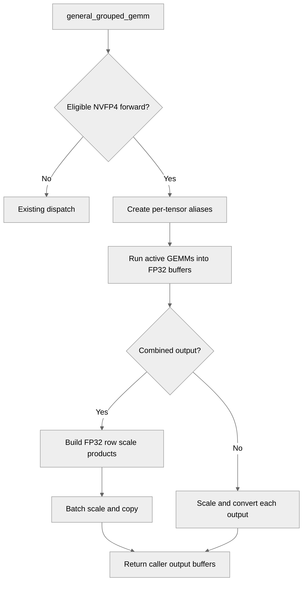

# Reduce NVFP4 grouped GEMM dispatch and output scaling overhead

[Upstream PR](https://github.com/NVIDIA/TransformerEngine/pull/3813) · state: open · merged: False

## Original PR description

# Description

Reduce dispatch and output-processing overhead for row-scaled NVFP4 grouped forward GEMMs.

Previously, this path issued separate GEMM calls and scaled and converted each expert's output individually. Eligible operations now use native grouped GEMM dispatch. For combined output buffers, the GEMMs write into a shared FP32 intermediate, followed by batched scaling and conversion into the destination.

## Type of change

- [x] Bug fix (non-breaking change which fixes an issue)
- [ ] Documentation change
- [ ] New feature
- [ ] Breaking change
- [ ] Infra/Build change
- [x] Code refactoring

## Changes

- Group eligible NVFP4 forward GEMMs while preserving existing validation and fallback behavior.
- Initialize compute streams and events per CUDA device to support device switching correctly.
- Batch output scaling and conversion for combined outputs, preserving FP32 intermediate arithmetic and scale-product rounding. Separate output buffers retain their existing scaling path.
- Add exact correctness coverage for FP16/BF16/FP32 outputs, uneven and empty expert splits, scalar and per-row scales, mixed output dtypes, compiled execution, CUDA graph replay with changing inputs and scales, non-default streams, multiple devices, and GroupedLinear outputs and gradients.

## Validation

Validated revision `c7cbe9b`, rebased onto upstream main `5f1208e`, with freshly rebuilt PyTorch/JAX native libraries and NCCL EP enabled. A subsequent merge check against main `720b252` is conflict-free.

- 111 focused tests passed with compilation disabled and another 111 with compilation enabled; no skips or failures.
- All ten L0 suites completed. Nine passed. Full PyTorch reported 62,674 passed and exactly the same 38 failures as a fresh unmodified-main control (62,566 passed), with no errors or additional failures. The known failures are 30 MXFP8 signed-zero byte comparisons and 8 FlexAttention/cuDNN Frontend 1.32.1 cases.
- Full JAX: 3,166 passed, 4,988 skipped, no failures or errors, including the launcher’s example and tutorial checks.
- Distributed JAX: 38 JUnit checks passed; EP MoE checks passed on all eight ranks (76 passed, 12 skipped per rank).
- C++: all seven CTest entries passed, including two-GPU device switching. PyTorch debug: 18,805 passed. Both lint suites, both wheel suites, source license checks, and pre-commit hooks passed.
- Upstream's new strided-batched GEMM and BatchedLinear tests also passed: 150 and 39 tests, respectively.

## Performance

On one B300, comparing the upstream Python grouped-forward path with the optimized path using the same rebuilt native libraries, NVFP4 synchronized operation latency decreased by approximately 20.4–38.5% across three tested shapes. MXFP8 controls varied from 1.4% faster to 2.2% slower. All six cases passed exact output comparisons.

Measurements use prequantized operands and BF16 outputs, with 8 or 32 experts, M=128 or 512 per expert, K=2048, and N=512. Inputs originate from normally distributed BF16 tensors (seed 812); NVFP4 uses row-scaled activations and per-tensor weight scales. Results are medians of six alternating rounds of 50 calls after 30 warmup calls, with synchronization and CUDA graphs disabled. Software: PyTorch 2.13.0+cu130, CUDA 13.0, cuBLAS 13.4.3.11. Compilation and input quantization are excluded; these are operation-level measurements.

# Checklist

- [ ] I have read and followed the contributing guidelines (DCO trailer remains to be resolved for the second commit)
- [x] The functionality is complete
- [x] I have commented my code, particularly in hard-to-understand areas
- [ ] I have made corresponding changes to the documentation (no public API changes)
- [x] My changes generate no new warnings in the completed validation
- [x] I have added tests that prove my fix is effective or that my feature works
- [ ] New and existing unit tests pass locally with my changes (38 pre-existing main failures remain; details above)

## Review and discussion

### reviews

### issue_comments

- greptile-apps[bot] · comment · 2026-11-04T13:28:39Z · [source](https://github.com/NVIDIA/TransformerEngine/pull/3813#issuecomment-6631890421)

<!-- greptile_summary -->

<h2><a href="https://app.greptile.com/api/retrigger?id=95562636"><picture><source media="(prefers-color-scheme: dark)" srcset="https://greptile-static-assets.s3.amazonaws.com/badges/RetriggerDark.svg?v=2"><source media="(prefers-color-scheme: light)" srcset="https://greptile-static-assets.s3.amazonaws.com/badges/Retrigger.svg?v=2"></picture></a><a href="https://app.greptile.com/-/switch-tenant?tenant=nvidia-public-github&amp;next=%2FNVIDIA%2Ftransformerengine%2Fpull%2F3813&amp;utm_source=greptile_review&amp;utm_medium=github&amp;utm_campaign=view_in_greptile"><picture><source media="(prefers-color-scheme: dark)" srcset="https://greptile-static-assets.s3.amazonaws.com/badges/ViewInGreptileDark.svg?v=2"><source media="(prefers-color-scheme: light)" srcset="https://greptile-static-assets.s3.amazonaws.com/badges/ViewInGreptile.svg?v=2"></picture></a>Confidence Score: 5/5</h2>

**[Medium impact]** The PR appears safe to merge; no actionable defects were found.

<h3>Summary</h3>

This PR groups eligible row-scaled NVFP4 forward GEMMs and batches scaling and conversion for combined outputs.

- Row-scaled NVFP4 forward GEMMs run as a group.
- CUDA streams and events follow the active device.

No actionable issues were found. This review inspected source code; it did not run the GPU tests.

<h3>Diagram</h3>

<!-- greptile_confidence_score:5 -->

Reviews (1) · Last reviewed commit: ["Reduce NVFP4 grouped GEMM output scaling..."](https://github.com/nvidia/transformerengine/commit/c7cbe9bca4efaedb81fee418159cfe095903faeb) · [Reviewed by Greptile](https://www.greptile.com/?utm_source=greptile_review&utm_medium=github&utm_campaign=review_public&utm_content=nvidia/transformerengine)

### inline_comments

## Changed files and fixed code

- `tests/cpp/util/CMakeLists.txt` · modified · additions 1 / deletions 0
  - [head](https://github.com/milakov/TransformerEngine/blob/c7cbe9bca4efaedb81fee418159cfe095903faeb/tests/cpp/util/CMakeLists.txt)
  - [base](https://github.com/NVIDIA/TransformerEngine/blob/720b25258be3b60f482afff8aef00d4cad88fa16/tests/cpp/util/CMakeLists.txt)
- `tests/cpp/util/test_multi_stream.cpp` · added · additions 34 / deletions 0
  - [head](https://github.com/milakov/TransformerEngine/blob/c7cbe9bca4efaedb81fee418159cfe095903faeb/tests/cpp/util/test_multi_stream.cpp)
  - [base](https://github.com/NVIDIA/TransformerEngine/blob/720b25258be3b60f482afff8aef00d4cad88fa16/tests/cpp/util/test_multi_stream.cpp)
- `tests/pytorch/nvfp4/test_nvfp4_gemm_exact.py` · modified · additions 408 / deletions 0
  - [head](https://github.com/milakov/TransformerEngine/blob/c7cbe9bca4efaedb81fee418159cfe095903faeb/tests/pytorch/nvfp4/test_nvfp4_gemm_exact.py)
  - [base](https://github.com/NVIDIA/TransformerEngine/blob/720b25258be3b60f482afff8aef00d4cad88fa16/tests/pytorch/nvfp4/test_nvfp4_gemm_exact.py)
- `tests/pytorch/test_grouped_linear.py` · modified · additions 80 / deletions 0
  - [head](https://github.com/milakov/TransformerEngine/blob/c7cbe9bca4efaedb81fee418159cfe095903faeb/tests/pytorch/test_grouped_linear.py)
  - [base](https://github.com/NVIDIA/TransformerEngine/blob/720b25258be3b60f482afff8aef00d4cad88fa16/tests/pytorch/test_grouped_linear.py)
- `transformer_engine/common/util/multi_stream.cpp` · modified · additions 14 / deletions 10
  - [head](https://github.com/milakov/TransformerEngine/blob/c7cbe9bca4efaedb81fee418159cfe095903faeb/transformer_engine/common/util/multi_stream.cpp)
  - [base](https://github.com/NVIDIA/TransformerEngine/blob/720b25258be3b60f482afff8aef00d4cad88fa16/transformer_engine/common/util/multi_stream.cpp)
- `transformer_engine/pytorch/cpp_extensions/gemm.py` · modified · additions 87 / deletions 0
  - [head](https://github.com/milakov/TransformerEngine/blob/c7cbe9bca4efaedb81fee418159cfe095903faeb/transformer_engine/pytorch/cpp_extensions/gemm.py)
  - [base](https://github.com/NVIDIA/TransformerEngine/blob/720b25258be3b60f482afff8aef00d4cad88fa16/transformer_engine/pytorch/cpp_extensions/gemm.py)

## Evidence and interpretation boundary

[Original JSON, discussions and patches](../../../../../../evidence/prs/NVIDIA--TransformerEngine/3813-9f9c6a89ab40d03163f745116dccfc5a00a92700ef1d33b71b0242b57cc610f0.json) · SHA-256 `9f9c6a89ab40d03163f745116dccfc5a00a92700ef1d33b71b0242b57cc610f0`.

Diff complete: True. Missing/binary/truncated patches require pinned source inspection. This is a source page, not an independently verified optimization case. Open, merged and released are different states; recheck the deployed dependency.
