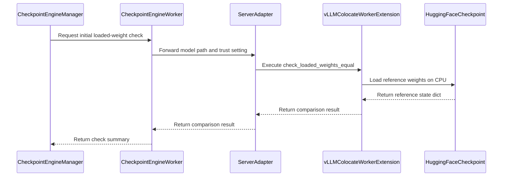

# [vllm, checkpoint] feat: add rollout weight sync debug check

[Upstream PR](https://github.com/verl-project/verl/pull/6666) · state: closed · merged: False

## Original PR description

## What does this PR do?

Addresses #6414.

Adds a checkpoint engine debug check that verifies whether vLLM loaded the same weights sent by the trainer during the initial trainer-to-rollout sync. This PR is limited to vLLM with tensor and data parallel sizes 1.

The check compares the source Hugging Face checkpoint state dict with the rollout backend's loaded state dict. It handles vLLM fused `qkv_proj` and `gate_up_proj` weights, tied `lm_head.weight`, and reports missing, unexpected, and mismatched keys. Value comparison is strict after casting the source checkpoint tensor to the loaded rollout tensor dtype/device.

This PR intentionally does not include `check_weight_sync_only` or fully async shutdown cleanup. Follow-up stacked draft PR: https://github.com/le-czs/verl/pull/1. It will be rebased and opened against `verl-project/verl` after this PR lands.

This is not duplicating an existing PR. I checked these searches before opening the PR:

- https://github.com/verl-project/verl/pulls?q=is%3Apr+is%3Aopen+6414+in%3Abody
- https://github.com/verl-project/verl/pulls?q=is%3Apr+is%3Aopen+weight+sync+check+checkpoint+engine+vllm

Related open PRs are about MTP sleep, FP8 transfer, generic remote backends, or fully async transfer queue. I did not find an open PR that adds a vLLM loaded-weight comparison for #6414.

AI assistance was used for implementation and PR preparation. I reviewed the changed lines before submission.

## Checklist Before Starting

- [x] I have searched for similar PRs to avoid duplicate work. Query links are included above.
- [x] I have formatted the PR title as `[vllm, checkpoint] feat: add rollout weight sync debug check`.

## Test

- [x] `python3 -m pytest tests/checkpoint_engine/test_weight_sync_on_cpu.py -q`
  - Result: `11 passed, 1 warning`
- [x] `scripts/generate_trainer_config.sh`
  - Result: `All good`
- [x] `git diff --check`
  - Result: passed
- [x] `pre-commit run --all-files --show-diff-on-failure --color=always`
  - Result: passed

## API and Usage Example

Example overrides:

```bash
actor_rollout_ref.rollout.name=vllm \
actor_rollout_ref.rollout.tensor_model_parallel_size=1 \
actor_rollout_ref.rollout.data_parallel_size=1 \
actor_rollout_ref.rollout.checkpoint_engine.backend=nccl \
actor_rollout_ref.rollout.checkpoint_engine.check_weight_sync=True
```

`check_weight_sync=True` runs the loaded-weight comparison after the initial trainer-to-rollout sync.

## Design & Code Changes

- Adds checkpoint engine config field `check_weight_sync`.
- Adds `verl.checkpoint_engine.weight_sync` for strict state dict comparison and vLLM fused-weight mapping.
- Adds a vLLM server RPC path that returns loaded-weight comparison results from the rollout backend.
- Restricts the current vLLM check to TP=1 and DP=1; DP>1 is rejected because the current `collective_rpc` path only covers one DP shard.
- Runs the check after the initial weight sync, because the comparison source is the original HF checkpoint.
- Adds CPU tests for manager check selection, strict mismatch reporting, vLLM fused comparison, unsupported parallelism rejection, and missing/unexpected keys.
- Adds docs in `docs/advance/checkpoint.rst` and `verl/checkpoint_engine/README.md`.

## Checklist Before Submitting

- [x] I have read the [Contribute Guide](https://github.com/verl-project/verl/blob/main/CONTRIBUTING.md) and followed the PR process.
- [x] I have run pre-commit checks: `pre-commit run --all-files --show-diff-on-failure --color=always`.
- [x] I have added or updated documentation.
- [x] I have added tests or explained why tests are not feasible.
- [ ] I have requested CI in the required channel, if needed.
- [ ] If this PR changes recipes, I have updated the recipe submodule.


## Review and discussion

### reviews

- gemini-code-assist[bot] · COMMENTED · 2026-06-09T07:33:58Z · [source](https://github.com/verl-project/verl/pull/6666#pullrequestreview-4456289714)

## Code Review

This pull request introduces a trainer-to-rollout weight synchronization check to verify that backend-loaded rollout weights match the source HuggingFace checkpoint, adding configuration options, documentation, unit tests, and early-exit support. A critical issue was identified in `verl/checkpoint_engine/base.py` where `rollout.check_loaded_weights_equal` is called without `ray.get`, which would cause verification failures on the workers to be silently ignored. Wrapping this call in `ray.get` is recommended to ensure errors are properly propagated.

> [!IMPORTANT]
> The [consumer version of Gemini Code Assist on GitHub](https://developers.google.com/gemini-code-assist/docs/review-repo-code) is being sunset. Starting **June 18, 2026**, new organization installations will be blocked, and all code review activity will officially cease on **July 17, 2026**.
> For more details on the timeline and next steps, please review the [Help Documentation](https://developers.google.com/gemini-code-assist/docs/deprecations/consumer-code-review).

- le-czs · COMMENTED · 2026-06-09T08:21:06Z · [source](https://github.com/verl-project/verl/pull/6666#pullrequestreview-4456651335)

(No body; status only.)

- Luosuu · COMMENTED · 2026-06-12T06:45:46Z · [source](https://github.com/verl-project/verl/pull/6666#pullrequestreview-4483161784)

(No body; status only.)

- le-czs · COMMENTED · 2026-06-12T07:37:19Z · [source](https://github.com/verl-project/verl/pull/6666#pullrequestreview-4483502381)

(No body; status only.)

- Luosuu · COMMENTED · 2026-06-12T07:40:22Z · [source](https://github.com/verl-project/verl/pull/6666#pullrequestreview-4483522834)

(No body; status only.)

- le-czs · COMMENTED · 2026-06-12T07:52:25Z · [source](https://github.com/verl-project/verl/pull/6666#pullrequestreview-4483603591)

(No body; status only.)

- Luosuu · COMMENTED · 2026-06-12T08:27:22Z · [source](https://github.com/verl-project/verl/pull/6666#pullrequestreview-4483804701)

Left two inline comments on correctness issues in the new debug path.

- le-czs · COMMENTED · 2026-06-12T09:06:25Z · [source](https://github.com/verl-project/verl/pull/6666#pullrequestreview-4484057935)

(No body; status only.)

- le-czs · COMMENTED · 2026-06-12T09:07:05Z · [source](https://github.com/verl-project/verl/pull/6666#pullrequestreview-4484063371)

(No body; status only.)

- Luosuu · CHANGES_REQUESTED · 2026-06-12T18:42:52Z · [source](https://github.com/verl-project/verl/pull/6666#pullrequestreview-4488297756)

I think this PR touches too much for the weight sync debug check and actually this PR can be broken down into two parts:
1. a minimal version that check weight sync for vLLM (DP/TP=1) 
2. Another PR for check_weight_sync_only and fully async clean shutdown

please try to make each PR minimal and easy to review. Thank you!

### issue_comments

- le-czs · comment · 2026-06-09T08:08:26Z · [source](https://github.com/verl-project/verl/pull/6666#issuecomment-4657628384)

Verification Result


- le-czs · comment · 2026-06-15T03:04:35Z · [source](https://github.com/verl-project/verl/pull/6666#issuecomment-4704121184)

> I think this PR touches too much for the weight sync debug check and actually this PR can be broken down into two parts:
> 
> 1. a minimal version that check weight sync for vLLM (DP/TP=1)
> 2. Another PR for check_weight_sync_only and fully async clean shutdown
> 
> please try to make each PR minimal and easy to review. Thank you!

I reduced #6666 to the minimal vLLM TP=1/DP=1 weight-sync check.
I also prepared the follow-up for `check_weight_sync_only` and fully async cleanup as a stacked draft PR: https://github.com/le-czs/verl/pull/1. Once #6666 lands, I’ll rebase it and open it against `verl-project/verl`.

- le-czs · comment · 2026-06-16T02:01:02Z · [source](https://github.com/verl-project/verl/pull/6666#issuecomment-4714155867)

> I think this PR touches too much for the weight sync debug check and actually this PR can be broken down into two parts:
> 
> 1. a minimal version that check weight sync for vLLM (DP/TP=1)
> 2. Another PR for check_weight_sync_only and fully async clean shutdown
> 
> please try to make each PR minimal and easy to review. Thank you!

 Thanks. I’ve reduced this PR to the minimal vLLM TP=1/DP=1 check and moved the follow-up scope out.

  Could you re-review when you have time? The previous change request should be addressed now.

- le-czs · comment · 2026-06-22T01:57:11Z · [source](https://github.com/verl-project/verl/pull/6666#issuecomment-4764068311)


  Hi @Luosuu, I rebased the branch and the previous inline threads are now resolved/outdated. The PR is still blocked by the old `CHANGES_REQUESTED` review.

  Could you re-review when you have time? If the scope looks OK now, I’ll request CI.

- le-czs · comment · 2026-10-21T07:45:30Z · [source](https://github.com/verl-project/verl/pull/6666#issuecomment-6310819709)

Rebased onto current `main` (`cd58f550`) and resolved the conflicts. Scope is unchanged: the vLLM loaded-weight check for `tensor_parallel_size=1` and `data_parallel_size=1`.

@Luosuu the June 12 `CHANGES_REQUESTED` review is still blocking this PR. The inline threads were already addressed, and `check_weight_sync_only` / fully async shutdown stay out of this PR. Could you re-review?

@HollowMan6 this review was reassigned to you on Sept 21. Please take a look when you have time.

I will request CI in the Feishu group.

- coderabbitai[bot] · comment · 2026-10-21T07:45:40Z · [source](https://github.com/verl-project/verl/pull/6666#issuecomment-6310822505)

<!-- coderabbit-ai-generated:v1 -->

<!-- This is an auto-generated comment: summarize by coderabbit.ai -->
<!-- review_stack_entry_start -->

<a href="https://app.coderabbit.ai/change-stack/verl-project/verl/pull/6666?scope=ghh_OusAJGA4HG8ljoOV0wJvVx8NmnZIjc2DdjmxOu0xZWA&amp;cs_source=review_comment"><picture><source media="(prefers-color-scheme: dark)" srcset="https://storage.googleapis.com/coderabbit_public_assets/review-stack-in-coderabbit-ui-dark.svg?v=3"><source media="(prefers-color-scheme: light)" srcset="https://storage.googleapis.com/coderabbit_public_assets/review-stack-in-coderabbit-ui.svg?v=3"></picture></a>

<!-- review_stack_entry_end -->
<!-- recent_review_start -->

No actionable comments were generated in the recent review. 🎉

<details>
<summary><strong>ℹ️ Recent review info</strong></summary>
<dl>
<dd>

<details>
<summary><strong>⚙️ Run configuration</strong></summary>
<dl>
<dd>

- **Configuration used**: Organization UI
- **Review profile**: CHILL
- **Plan**: Advanced
- **Run ID**: `1771ebd5-d313-49ae-afb6-9ebd4c453783`

</dd>
</dl>
</details>

<details>
<summary><strong>📥 Commits</strong></summary>
<dl>
<dd>

Reviewing files that changed from the base of the PR and between cd58f550fb1c4f5a3fe29da38e6f0002ec462fd3 and e903d5b8b9d31827c98c4cffaaa2c1bf1df451fd.

</dd>
</dl>
</details>

<details>
<summary><strong>📒 Files selected for processing: 13</strong></summary>
<dl>
<dd>

* `docs/advance/checkpoint.rst`
* `tests/checkpoint_engine/test_weight_sync_on_cpu.py`
* `verl/checkpoint_engine/README.md`
* `verl/checkpoint_engine/base.py`
* `verl/checkpoint_engine/weight_sync.py`
* `verl/trainer/config/_generated_ppo_megatron_trainer.yaml`
* `verl/trainer/config/_generated_ppo_torchtitan_trainer.yaml`
* `verl/trainer/config/_generated_ppo_trainer.yaml`
* `verl/trainer/config/_generated_ppo_veomni_trainer.yaml`
* `verl/trainer/config/rollout/rollout.yaml`
* `verl/workers/config/rollout.py`
* `verl/workers/rollout/vllm_rollout/utils.py`
* `verl/workers/rollout/vllm_rollout/vllm_rollout.py`

</dd>
</dl>
</details>

**Included review availability:** This review used your included allowance. Your plan provides up to 10 included reviews per hour; 9 remain after this review.

</dd>
</dl>
</details>


<!-- recent_review_end -->
<!-- walkthrough_start -->

<details>
<summary><strong>📝 Summary</strong></summary>
<dl>
<dd>

<!-- This is an auto-generated comment: release notes by coderabbit.ai -->

## Summary by CodeRabbit

- **New Features**
  - Added an optional checkpoint weight synchronization check to validate that rollout weights match the source model checkpoint.
  - Reports missing, unexpected, and mismatched weights.
  - Supports strict validation for vLLM with tensor and data parallelism set to 1.
  - The check runs after initial weight loading and is disabled by default.

- **Documentation**
  - Added configuration guidance, supported backend limitations, and usage examples.

- **Tests**
  - Added coverage for matching weights, mismatches, missing or unexpected keys, fused weights, and unsupported parallel configurations.

<!-- end of auto-generated comment: release notes by coderabbit.ai -->
The change adds an opt-in check that compares rollout-loaded weights with a source Hugging Face checkpoint after initial synchronization. The comparison supports vLLM with tensor and data parallel sizes of 1, and reports missing, unexpected, and mismatched weights.

**Changes: Trainer-to-rollout weight sync**

|Layer / File(s)|Summary|
|:---|:---|
|**Configure and compare weights** <br> `verl/workers/config/rollout.py`, `verl/trainer/config/rollout/rollout.yaml`, `verl/trainer/config/_generated_ppo_*_trainer.yaml`, `verl/checkpoint_engine/weight_sync.py`, `tests/checkpoint_engine/test_weight_sync_on_cpu.py`|Adds the disabled-by-default configuration option and comparison logic for direct and supported fused vLLM tensors. Tests cover supported parallelism, matching tensors, mismatches, and missing or unexpected keys.|
|**Inspect weights loaded by vLLM** <br> `verl/workers/rollout/vllm_rollout/utils.py`, `verl/workers/rollout/vllm_rollout/vllm_rollout.py`|Adds a vLLM helper that loads reference weights on CPU and compares them with loaded model weights. The server adapter forwards the checkpoint path and trust setting to that helper.|
|**Run the check after initial synchronization** <br> `verl/checkpoint_engine/base.py`, `tests/checkpoint_engine/test_weight_sync_on_cpu.py`, `verl/checkpoint_engine/README.md`, `docs/advance/checkpoint.rst`|The checkpoint manager runs the check only when enabled and the load count is `None` or `0`. Documentation describes the timing, configuration, comparison results, and supported constraints.|

### Sequence Diagram(s)



</dd>
</dl>
</details>

<!-- walkthrough_end -->
<!-- change_assessment_start -->
**Priority:** ⬇️ Low

<!-- change_assessment_commit:"e903d5b8b9d31827c98c4cffaaa2c1bf1df451fd" -->

<!-- change_assessment_end -->
<details>
<summary><strong>Merge Risk:</strong> <strong>⚪ Minimal</strong> · up to <code>e903d</code></summary>
<dl>
<dd>

<!-- final_review_risk_start -->
<!-- final_review_risk_label
**Merge Risk:** **⚪ Minimal** · up to `e903d`
-->
<!-- final_review_risk_coverage:{"sourceCommitId":"e903d5b8b9d31827c98c4cffaaa2c1bf1df451fd","coveredCommitId":"e903d5b8b9d31827c98c4cffaaa2c1bf1df451fd","kind":"reviewed"} -->

No merge-blocking issue was established for the opt-in weight-sync check; it is ready for normal merge checks.
<!-- final_review_risk_end -->

</dd>
</dl>
</details>

<details>
<summary><strong>Security architecture risk:</strong> <strong>🔵 Low</strong> · up to <code>e903d</code></summary>
<dl>
<dd>

<!-- architecture_review_start -->
<!-- architecture_review_label
### Security Architecture Review

**Security architecture risk:** **🔵 Low** · up to `e903d`
-->

The check is disabled by default and normally reuses the configured model source and remote-code trust setting. Failed validation prevents generation from resuming. No new attacker-accessible boundary was established, but control-plane exposure and complete failure recovery remain unverified.

**Retained concerns**
No architecture-level concerns identified.

<details>
<summary><strong>Security review details</strong></summary>
<dl>
<dd>

**Security Blast Radius**
- _inferred_ — The demonstrated normal execution scope is the rollout workers selected by the checkpoint manager. The added operation loads model files and may execute model code when remote-code trust is enabled. Runtime tenant isolation, network exposure, and credential scope were not established, so a wider attacker-accessible blast radius cannot be determined.

**Trust Boundaries and Controls**
- _observed_ — The normal manager call supplies no path or trust overrides: the worker uses the configured model path and trust_remote_code value. vLLM startup already consumes that trust decision. The new worker API nevertheless accepts explicit overrides, making control-plane authorization relevant to arbitrary callers.
- _observed_ — The repository wrapper forwards collective RPCs to the engine, while the HTTP application is constructed by dependency-provided build_app. The inspected repository source does not resolve whether external HTTP callers can reach the new worker method or what deployment authorization protects the Ray control plane.

**Resilience and Maintainability Implications**
- _inferred_ — The validation failure path withholds generation rather than serving weights that failed comparison. The principal trainer startup caller does not catch this failure locally. Worker termination, resource reclamation, retry serialization, and recovery after interrupted validation remain unverified; absence of automatic resumption is not itself evidence of an insecure state.

**Hardening Proposals**
- _proposed_ — Consider preflighting supported configurations and defining a bounded validation operation with explicit failed-state cleanup and retry identity. Recovery should preserve the fail-closed gate rather than unconditionally resuming generation after a mismatch.

</dd>
</dl>
</details>
<!-- architecture_review_end -->

</dd>
</dl>
</details>
<!-- pre_merge_checks_walkthrough_start -->

<details>
<summary><strong>Pre-merge checks: <sup><picture></picture></sup> 4 · <sup><picture></picture></sup> 1</strong></summary>
<dl>
<dd>

<strong><sup><picture></picture></sup> Failed checks: 1 warning</strong>

|     Check name     |                                              Status                                              | Explanation                                                                                                                                                                                               | Resolution                                                                         |
| :---------------- | :----------------------------------------------------------------------------------------------: | :-------------------------------------------------------------------------------------------------------------------------------------------------------------------------------------------------------- | :--------------------------------------------------------------------------------- |
| Docstring Coverage |  | Docstring coverage is 56.00% which is insufficient. The required threshold is 80.00%. Docstring coverage is scoped to functions touched by this diff. Analyzed 25 functions across 6 files. (7 skipped: … | Write docstrings for the functions missing them to satisfy the coverage threshold. |

<details>
<summary><strong><sup><picture></picture></sup> Passed checks: 4 passed</strong></summary>
<dl>
<dd>

|         Check name         |                                             Status                                             | Explanation                                                                                                                                 |
| :------------------------ | :--------------------------------------------------------------------------------------------: | :------------------------------------------------------------------------------------------------------------------------------------------ |
|         Title check        |  | The title clearly identifies the vLLM checkpoint weight-sync debug check, which is the main change in the pull request.                     |
|      Description check     |  | The description directly explains the vLLM weight-sync check, its scope, implementation, tests, documentation, and excluded follow-up work. |
|     Linked Issues check    |  | Check skipped because no linked issues were found for this pull request.                                                                    |
| Out of Scope Changes check |  | Check skipped because no linked issues were found for this pull request.                                                                    |

</dd>
</dl>
</details>

<details>
<summary><strong>Full details: Docstring Coverage</strong></summary>
<dl>
<dd>

**Explanation**

Docstring coverage is 56.00% which is insufficient. The required threshold is 80.00%. Docstring coverage is scoped to functions touched by this diff. Analyzed 25 functions across 6 files. (7 skipped: 7 unsupported.)

**Resolution**

Write docstrings for the functions missing them to satisfy the coverage threshold.

</dd>
</dl>
</details>

</dd>
</dl>
</details>

<!-- pre_merge_checks_walkthrough_end -->
<!-- autopilot:start -->
- [ ] <!-- {"checkboxId":"2708ad07-9f24-4260-9c11-7dc76a49f2e3"} --> <strong title="Keep fixing CodeRabbit findings and required CI, and resolving merge conflicts">Autofix</strong> · Keep fixing CodeRabbit findings and required CI, and resolving merge conflicts
<!-- autopilot:end -->
<!-- tips_start -->


<sub>Comment `@coderabbitai help` to get the list of available commands.</sub>

<!-- tips_end -->

- wuxibin89 · comment · 2026-10-21T08:28:17Z · [source](https://github.com/verl-project/verl/pull/6666#issuecomment-6311561493)

You can debug rollout weight sync with `scripts/rollout_logprob_diff.py`, please check https://verl.readthedocs.io/en/latest/low_precision/qat.html

### inline_comments

- gemini-code-assist[bot] · comment · 2026-06-09T07:33:59Z · [source](https://github.com/verl-project/verl/pull/6666#discussion_r3378712916)

File: `verl/checkpoint_engine/base.py` · line None


The `rollout` object is a `RayWorkerGroup`. Calling `rollout.check_loaded_weights_equal(...)` dispatches remote tasks to the workers and returns a list of Ray `ObjectRef`s. Because `ray.get(...)` is not called on these references, the driver process never resolves the futures. This means any `AssertionError` raised during the weight comparison on the workers will be silently ignored, and the check will always appear to pass on the driver. Wrap the call in `ray.get(...)` to block and correctly propagate any verification failures.

```suggestion
        summaries = ray.get(
            rollout.check_loaded_weights_equal(
                torch_dtype=self.config.check_weight_sync_dtype,
                rtol=self.config.check_weight_sync_rtol,
                atol=self.config.check_weight_sync_atol,
                max_mismatches=self.config.check_weight_sync_max_mismatches,
                timeout=self.config.check_weight_sync_timeout,
            )
        )
```

- le-czs · comment · 2026-06-09T08:21:06Z · [source](https://github.com/verl-project/verl/pull/6666#discussion_r3378987729)

File: `verl/checkpoint_engine/base.py` · line None

`check_loaded_weights_equal` is registered without `blocking=False`, so `register(...)` uses the default `blocking=True`. When RayWorkerGroup binds the method, `func_generator` calls `ray.get(output)` before returning. That means `rollout.check_loaded_weights_equal(...)` already returns resolved results, and worker-side AssertionError should propagate to the caller.
Adding another `ray.get(...)` here would call `ray.get` on the resolved list, not on ObjectRefs.

- Luosuu · comment · 2026-06-12T06:45:43Z · [source](https://github.com/verl-project/verl/pull/6666#discussion_r3401262044)

File: `verl/trainer/config/_generated_ppo_trainer.yaml` · line None

why weight sync has rtol/atol? should it be strictly zero?

- le-czs · comment · 2026-06-12T07:37:19Z · [source](https://github.com/verl-project/verl/pull/6666#discussion_r3401551843)

File: `verl/trainer/config/_generated_ppo_trainer.yaml` · line None

  Good point, I agree the default should be strict for the current supported
  path. I’ll change `rtol/atol` to `0.0` by default.

  The reason I added the parameters is to keep an explicit escape hatch for
  future/debug cases, e.g. mixed-dtype, quantized/FP8, or backend-specific
  conversion paths. But those should require users to opt in by overriding the
  tolerance, not be enabled by default.

- Luosuu · comment · 2026-06-12T07:40:22Z · [source](https://github.com/verl-project/verl/pull/6666#discussion_r3401568781)

File: `verl/trainer/config/_generated_ppo_trainer.yaml` · line None

even for mixed-dtype/fp8, the atol/rtol should still be zero before and after sync?

- le-czs · comment · 2026-06-12T07:52:24Z · [source](https://github.com/verl-project/verl/pull/6666#discussion_r3401636293)

File: `verl/trainer/config/_generated_ppo_trainer.yaml` · line None

  I think your point makes sense. For `check_weight_sync`, strict equality before and after sync is the cleaner semantic.

  I’ll remove the configurable tolerance knobs and keep the check strict-only

- Luosuu · comment · 2026-06-12T08:27:23Z · [source](https://github.com/verl-project/verl/pull/6666#discussion_r3401813828)

File: `verl/workers/rollout/vllm_rollout/utils.py` · line None

This also needs to reject or cover `data_parallel_size > 1`. The call path uses vLLM `collective_rpc`, and existing code notes that only reaches TP workers within one DP shard, so `TP=1, DP>1` can pass while other DP shards were never checked.

- Luosuu · comment · 2026-06-12T08:27:23Z · [source](https://github.com/verl-project/verl/pull/6666#discussion_r3401813836)

File: `verl/workers/rollout/llm_server.py` · line None

In fully async check-only mode this misses hybrid replicas: `FullyAsyncLLMServerManager` moves them into `hybrid_replicas` and clears `rollout_replicas` until activation. Please override shutdown there, or otherwise include `hybrid_replicas.values()`, so check-only exits do not leave hybrid server actors running.

- le-czs · comment · 2026-06-12T09:06:25Z · [source](https://github.com/verl-project/verl/pull/6666#discussion_r3402032862)

File: `verl/workers/rollout/vllm_rollout/utils.py` · line None

Fixed by taking the reject path: `check_weight_sync` now supports only TP=1 and DP=1, and rejects DP>1 instead of reporting a partial check as passed.

- le-czs · comment · 2026-06-12T09:07:05Z · [source](https://github.com/verl-project/verl/pull/6666#discussion_r3402037372)

File: `verl/workers/rollout/llm_server.py` · line None

  Fixed by overriding `FullyAsyncLLMServerManager.shutdown()` to include both `rollout_replicas` and `hybrid_replicas.values()`, with de-duplication.

## Changed files and fixed code

- `docs/advance/checkpoint.rst` · modified · additions 27 / deletions 0
  - [head](https://github.com/le-czs/verl/blob/e903d5b8b9d31827c98c4cffaaa2c1bf1df451fd/docs/advance/checkpoint.rst)
  - [base](https://github.com/verl-project/verl/blob/cd58f550fb1c4f5a3fe29da38e6f0002ec462fd3/docs/advance/checkpoint.rst)
- `tests/checkpoint_engine/test_weight_sync_on_cpu.py` · added · additions 150 / deletions 0
  - [head](https://github.com/le-czs/verl/blob/e903d5b8b9d31827c98c4cffaaa2c1bf1df451fd/tests/checkpoint_engine/test_weight_sync_on_cpu.py)
  - [base](https://github.com/verl-project/verl/blob/cd58f550fb1c4f5a3fe29da38e6f0002ec462fd3/tests/checkpoint_engine/test_weight_sync_on_cpu.py)
- `verl/checkpoint_engine/README.md` · modified · additions 22 / deletions 0
  - [head](https://github.com/le-czs/verl/blob/e903d5b8b9d31827c98c4cffaaa2c1bf1df451fd/verl/checkpoint_engine/README.md)
  - [base](https://github.com/verl-project/verl/blob/cd58f550fb1c4f5a3fe29da38e6f0002ec462fd3/verl/checkpoint_engine/README.md)
- `verl/checkpoint_engine/base.py` · modified · additions 43 / deletions 2
  - [head](https://github.com/le-czs/verl/blob/e903d5b8b9d31827c98c4cffaaa2c1bf1df451fd/verl/checkpoint_engine/base.py)
  - [base](https://github.com/verl-project/verl/blob/cd58f550fb1c4f5a3fe29da38e6f0002ec462fd3/verl/checkpoint_engine/base.py)
- `verl/checkpoint_engine/weight_sync.py` · added · additions 136 / deletions 0
  - [head](https://github.com/le-czs/verl/blob/e903d5b8b9d31827c98c4cffaaa2c1bf1df451fd/verl/checkpoint_engine/weight_sync.py)
  - [base](https://github.com/verl-project/verl/blob/cd58f550fb1c4f5a3fe29da38e6f0002ec462fd3/verl/checkpoint_engine/weight_sync.py)
- `verl/trainer/config/_generated_ppo_megatron_trainer.yaml` · modified · additions 1 / deletions 0
  - [head](https://github.com/le-czs/verl/blob/e903d5b8b9d31827c98c4cffaaa2c1bf1df451fd/verl/trainer/config/_generated_ppo_megatron_trainer.yaml)
  - [base](https://github.com/verl-project/verl/blob/cd58f550fb1c4f5a3fe29da38e6f0002ec462fd3/verl/trainer/config/_generated_ppo_megatron_trainer.yaml)
- `verl/trainer/config/_generated_ppo_torchtitan_trainer.yaml` · modified · additions 1 / deletions 0
  - [head](https://github.com/le-czs/verl/blob/e903d5b8b9d31827c98c4cffaaa2c1bf1df451fd/verl/trainer/config/_generated_ppo_torchtitan_trainer.yaml)
  - [base](https://github.com/verl-project/verl/blob/cd58f550fb1c4f5a3fe29da38e6f0002ec462fd3/verl/trainer/config/_generated_ppo_torchtitan_trainer.yaml)
- `verl/trainer/config/_generated_ppo_trainer.yaml` · modified · additions 1 / deletions 0
  - [head](https://github.com/le-czs/verl/blob/e903d5b8b9d31827c98c4cffaaa2c1bf1df451fd/verl/trainer/config/_generated_ppo_trainer.yaml)
  - [base](https://github.com/verl-project/verl/blob/cd58f550fb1c4f5a3fe29da38e6f0002ec462fd3/verl/trainer/config/_generated_ppo_trainer.yaml)
- `verl/trainer/config/_generated_ppo_veomni_trainer.yaml` · modified · additions 1 / deletions 0
  - [head](https://github.com/le-czs/verl/blob/e903d5b8b9d31827c98c4cffaaa2c1bf1df451fd/verl/trainer/config/_generated_ppo_veomni_trainer.yaml)
  - [base](https://github.com/verl-project/verl/blob/cd58f550fb1c4f5a3fe29da38e6f0002ec462fd3/verl/trainer/config/_generated_ppo_veomni_trainer.yaml)
- `verl/trainer/config/rollout/rollout.yaml` · modified · additions 5 / deletions 0
  - [head](https://github.com/le-czs/verl/blob/e903d5b8b9d31827c98c4cffaaa2c1bf1df451fd/verl/trainer/config/rollout/rollout.yaml)
  - [base](https://github.com/verl-project/verl/blob/cd58f550fb1c4f5a3fe29da38e6f0002ec462fd3/verl/trainer/config/rollout/rollout.yaml)
- `verl/workers/config/rollout.py` · modified · additions 2 / deletions 0
  - [head](https://github.com/le-czs/verl/blob/e903d5b8b9d31827c98c4cffaaa2c1bf1df451fd/verl/workers/config/rollout.py)
  - [base](https://github.com/verl-project/verl/blob/cd58f550fb1c4f5a3fe29da38e6f0002ec462fd3/verl/workers/config/rollout.py)
- `verl/workers/rollout/vllm_rollout/utils.py` · modified · additions 42 / deletions 0
  - [head](https://github.com/le-czs/verl/blob/e903d5b8b9d31827c98c4cffaaa2c1bf1df451fd/verl/workers/rollout/vllm_rollout/utils.py)
  - [base](https://github.com/verl-project/verl/blob/cd58f550fb1c4f5a3fe29da38e6f0002ec462fd3/verl/workers/rollout/vllm_rollout/utils.py)
- `verl/workers/rollout/vllm_rollout/vllm_rollout.py` · modified · additions 14 / deletions 0
  - [head](https://github.com/le-czs/verl/blob/e903d5b8b9d31827c98c4cffaaa2c1bf1df451fd/verl/workers/rollout/vllm_rollout/vllm_rollout.py)
  - [base](https://github.com/verl-project/verl/blob/cd58f550fb1c4f5a3fe29da38e6f0002ec462fd3/verl/workers/rollout/vllm_rollout/vllm_rollout.py)

## Evidence and interpretation boundary

[Original JSON, discussions and patches](../../../../../../evidence/prs/verl-project--verl/6666-b2c7adff8ae087e8bdc2126a092393beb161e277c3cf6ff617113ac3c0c9faab.json) · SHA-256 `b2c7adff8ae087e8bdc2126a092393beb161e277c3cf6ff617113ac3c0c9faab`.

Diff complete: True. Missing/binary/truncated patches require pinned source inspection. This is a source page, not an independently verified optimization case. Open, merged and released are different states; recheck the deployed dependency.
