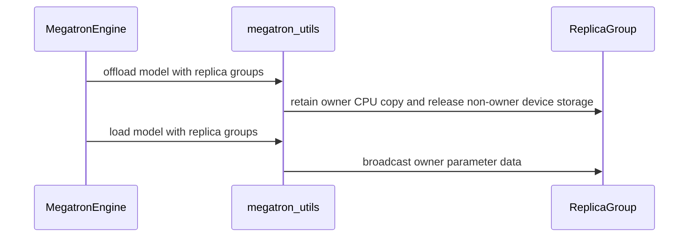

# [megatron] feat: deduplicate host parameter-offload replicas

[Upstream PR](https://github.com/verl-project/verl/pull/7685) · state: open · merged: False

## Original PR description

### What does this PR do?

Megatron parameter offload currently keeps one CPU copy of every parameter shard on every data-parallel (DP) and context-parallel (CP) replica. The parameters are identical within these replica groups, so retaining every host copy is redundant.

This PR adds an opt-in `deduplicate_param_offload` setting. For each replica group, only group rank zero retains the offloaded CPU parameter storage. On reload, that rank copies the shard to its accelerator and broadcasts it to the remaining replicas. Dense parameters use the DP x CP replica group, while expert parameters use the expert-data-parallel group. Gradient and optimizer offload are unchanged.

The option defaults to `false`, requires `param_offload=true`, and is not supported with Megatron FSDP. Existing behavior is unchanged when it is disabled.

#### Why this is needed

Host memory is increasingly a limiting resource for colocated agentic RL:

- Agentic workloads commonly use multi-turn conversations with tool calls, generating long trajectories. Their longer sequences substantially increase activation and rollout KV-cache pressure on the accelerator.
- Colocated sync/async training therefore often needs full parameter, gradient, and optimizer offload so that the rollout engine can reclaim accelerator memory between training phases.
- Long sequences also require larger CP degrees. CP partitions sequence activations, but it does not shard model weights: identical weight shards are replicated across CP ranks. Existing parameter offload moves every replica to host memory, so redundant host weight storage grows linearly with the DP x CP replica-group size.
- Actor and reference models can both be offloaded, doubling this redundant storage. Optimizer/gradient offload, rollout state, and deployments that also offload or swap KV cache compete for the same host-memory budget.

As a result, increasing CP to solve accelerator-memory pressure can move the bottleneck to host memory. This PR removes only the redundant parameter replicas; it does not change optimizer, gradient, or KV-cache storage. For a replica group of size `r`, that group's offloaded parameter storage falls from `r` copies to one, a theoretical reduction of `1 - 1/r`.

### Checklist Before Starting

- [x] Searched open PRs for [`deduplicate_param_offload`](https://github.com/verl-project/verl/pulls?q=is%3Apr+is%3Aopen+deduplicate_param_offload), [`context parallel parameter offload`](https://github.com/verl-project/verl/pulls?q=is%3Apr+is%3Aopen+%22context+parallel%22+%22parameter+offload%22), and [`parameter offload`](https://github.com/verl-project/verl/pulls?q=is%3Apr+is%3Aopen+%22parameter+offload%22).
- [x] No open PR found by those searches implements host parameter ownership per DP x CP / expert-DP replica group as of 2026-08-18.
- [x] This does not duplicate [#6193](https://github.com/verl-project/verl/pull/6193), which avoids an allocate-before-free host-memory peak, or [#5651](https://github.com/verl-project/verl/pull/5651), which offloads optimizer FP32 master weights. Neither deduplicates persistent host parameter replicas.

### Test

The accelerator measurements below were collected before rebasing this change from the v0.9.0 release branch to `main`. The rebase did not change the deduplication algorithm or measured configuration; main-branch compatibility is covered by the focused checks below.

#### Four-node controlled A/B

Environment:

- Model: Qwen3.6-35B-A3B, BF16
- Hardware: 4 nodes x 8 Ascend NPUs, 32 GiB device memory per NPU
- Parallelism: TP=2, PP=4, CP=4, EP=4, ETP=1, world size=32
- Offload: actor/ref parameter offload enabled
- Workload: four training steps, 32 prompts x 5 responses per step
- Control: identical pre-generated trajectory cache, checkpoint, seeds, topology, and rank-to-host placement
- All measured runs reported four cache injections, zero cache misses, zero cache writes, and completed 4/4 steps without OOM or fatal errors.

The dense replica group size was 4 and the expert replica group size was 2. Tracked CPU parameter tensor storage was:

| Scope | Baseline host GiB | Dedup host GiB | Saved GiB | Reduction |
| --- | ---: | ---: | ---: | ---: |
| Actor dense parameters | 21.761 | 5.440 | 16.321 | 75.0% |
| Actor expert parameters | 120.000 | 60.000 | 60.000 | 50.0% |
| Actor total | 141.761 | 65.440 | 76.321 | 53.8% |
| Reference total | 141.761 | 65.440 | 76.321 | 53.8% |
| Actor + reference | 283.523 | 130.881 | **152.642** | **53.8%** |

Accelerator peak allocated memory was unchanged at 17.785 GiB, as expected for a host-memory optimization.

End-to-end timing with identical profiling enabled in all measured arms was:

| Run | Mean step time | Difference from first baseline |
| --- | ---: | ---: |
| Baseline | 1232.59 s | - |
| Baseline repeat | 1211.60 s | -1.70% |
| Dedup | 1224.95 s | -0.62% |

Dedup was 1.10% slower than the repeated baseline and 0.62% faster than the first baseline, so its result lies inside the observed 1.70% baseline run-to-run spread. No measurable end-to-end performance regression was observed.

Transition profiling showed the expected trade-off. The ref-model reload median increased from 1.45 s to 1.98 s because reload now includes a broadcast. Parameter offload medians decreased because only owners perform D2H copies: actor offload medians decreased by about 14-16%, and ref offload decreased from 1.56 s to 1.00 s.

Training correctness was evaluated against both the first baseline and an independent baseline repeat. All runs used the same cached tokens. Token counts, policy-gradient loss, rewards, advantages, and prompt/response-length statistics matched. Full determinism was disabled, so the baseline repeat quantifies the NPU/MoE run-to-run variation:

| Metric over four steps | Max baseline vs repeat | Max baseline vs dedup |
| --- | ---: | ---: |
| Policy-gradient loss, absolute | 0 | 0 |
| Actor loss, absolute (relative) | 4.00e-7 (5.12%) | 3.70e-7 (4.74%) |
| KL loss, absolute (relative) | 4.01e-5 (5.14%) | 3.72e-5 (4.76%) |
| Entropy, absolute (relative) | 9.90e-5 (0.055%) | 7.83e-5 (0.043%) |
| Gradient norm, absolute (relative) | 9.21e-2 (47.06%) | 6.11e-2 (36.79%) |

The dedup differences did not exceed the run-to-run variation observed between the two baseline runs. In particular, the largest gradient-norm deviation was larger between the two baselines than between baseline and dedup. No training correctness regression was observed over these four controlled steps.

#### Single-node host-OOM case

A second experiment used Qwen3.6-35B-A3B on one node with 1 TB host memory and 16 x 64 GiB Ascend NPUs, using TP=2, CP=8, EP=8, ETP=1 (world size=16), with actor parameter offload enabled. KL loss was disabled, so this run did not instantiate or offload a reference model. The existing offload path exhausted host memory during the run. With `deduplicate_param_offload=true`, observed host-memory peak stayed around 900 GB and the workload fit.

The four-node profile above measured approximately 5.44 GiB of unique dense BF16 parameters and 60.00 GiB of unique expert BF16 parameters per model role. For the single-node topology, the dense replica group has size 8 and the expert-DP group has size 2. This gives the following parameter-storage estimate:

```text
baseline = 8 * 5.44 + 2 * 60.00 = 163.52 GiB
dedup    =     5.44 +     60.00 =  65.44 GiB

theoretical saving = 163.52 - 65.44 = 98.08 GiB
```

The 98.08 GiB actor-only estimate covers only redundant parameter tensor storage. The reported ~900 GB peak is whole-node memory and also includes optimizer and gradient state, pinned/staging buffers, Ray processes, allocator overhead, and rollout memory. The theoretical reduction is therefore not expected to equal the observed peak difference exactly, but it explains why removing parameter replicas changes this configuration from host OOM to fit.

### API and Usage Example

```yaml
actor_rollout_ref:
  actor:
    megatron:
      param_offload: true
      deduplicate_param_offload: true
```

The reference model inherits the actor setting by default and can be overridden independently:

```yaml
actor_rollout_ref:
  ref:
    megatron:
      param_offload: true
      deduplicate_param_offload: true
```

Enabling deduplication without parameter offload raises a configuration error.

### Design & Code Changes

- Build dense DP x CP and expert-DP replica groups after Megatron parallel-state initialization; exclude GTP/EGTP rematerialization axes when supported.
- Retain pinned DDP CPU parameter buffers only on group rank zero and broadcast flat device buffers on reload.
- Apply the same ownership/broadcast rule to frozen and forward-only non-DDP parameters.
- Preserve replica-group information across checkpoint save/load, weight export, and experimental separation snapshot/restore paths.
- Leave optimizer and gradient offload unchanged. When the feature is disabled, retain the existing offload/load path without additional collectives.
- Add focused configuration and utility tests.

### Checklist Before Submitting

- [x] Read the [Contribute Guide](https://github.com/verl-project/verl/blob/main/CONTRIBUTING.md) and repository `AGENTS.md`.
- [ ] Run `pre-commit run --all-files --show-diff-on-failure --color=always`.
- [x] Add/update configuration documentation and usage examples.
- [x] Add focused tests. Large-scale host-memory validation is hardware-only and is covered by the experiments above rather than CPU CI.
- [ ] Request CI through the verl `ci-request` channel when ready.
- [x] Recipe-submodule update is not applicable.

Codex assisted with this PR.

<!-- This is an auto-generated comment: release notes by coderabbit.ai -->

## Summary by CodeRabbit

* **New Features**
  * Added an option to deduplicate Megatron parameter offloading, keeping one host copy per dense or expert replica group and restoring replicas as needed.
  * Added CPU snapshot and restore support for deduplicated parameters.
* **Configuration**
  * The option is disabled by default and requires parameter offloading; it cannot be used with Megatron-FSDP.

<!-- end of auto-generated comment: release notes by coderabbit.ai -->

## Review and discussion

### reviews

- wucong25 · DISMISSED · 2026-09-04T07:40:07Z · [source](https://github.com/verl-project/verl/pull/7685#pullrequestreview-5110437772)

(No body; status only.)

### issue_comments

- CLAassistant · comment · 2026-09-04T09:21:54Z · [source](https://github.com/verl-project/verl/pull/7685#issuecomment-5538381857)

[](https://cla-assistant.io/verl-project/verl?pullRequest=7685) <br/>Thank you for your submission! We really appreciate it. Like many open source projects, we ask that you sign our [Contributor License Agreement](https://cla-assistant.io/verl-project/verl?pullRequest=7685) before we can accept your contribution.<br/><sub>You have signed the CLA already but the status is still pending? Let us [recheck](https://cla-assistant.io/check/verl-project/verl?pullRequest=7685) it.</sub>

- coderabbitai[bot] · comment · 2026-10-12T07:04:10Z · [source](https://github.com/verl-project/verl/pull/7685#issuecomment-6119414460)

<!-- This is an auto-generated comment: summarize by coderabbit.ai -->
<!-- review_stack_entry_start -->

<a href="https://app.coderabbit.ai/change-stack/verl-project/verl/pull/7685?scope=ghh_OusAJGA4HG8ljoOV0wJvVx8NmnZIjc2DdjmxOu0xZWA&amp;cs_source=review_comment"><picture><source media="(prefers-color-scheme: dark)" srcset="https://storage.googleapis.com/coderabbit_public_assets/review-stack-in-coderabbit-ui-dark.svg?v=3"><source media="(prefers-color-scheme: light)" srcset="https://storage.googleapis.com/coderabbit_public_assets/review-stack-in-coderabbit-ui.svg?v=3"></picture></a>

<!-- review_stack_entry_end -->
<!-- recent_review_start -->

No actionable comments were generated in the recent review. 🎉

<details>
<summary><strong>ℹ️ Recent review info</strong></summary>
<dl>
<dd>

<details>
<summary><strong>⚙️ Run configuration</strong></summary>
<dl>
<dd>

- **Configuration used**: defaults
- **Review profile**: CHILL
- **Plan**: Advanced
- **Run ID**: `9cbbfe23-2a12-4e28-9414-6bc0a367290e`

<hr>

</dd>
</dl>
</details>

<details>
<summary><strong>📥 Commits</strong></summary>
<dl>
<dd>

Reviewing files that changed from the base of the PR and between 2035f58dcb06d8cad4caee107b30f4045d724367 and 81a672a48c1e3b76041b7f07c16343799b971796.

<hr>

</dd>
</dl>
</details>

<details>
<summary><strong>📒 Files selected for processing (9)</strong></summary>
<dl>
<dd>

* `tests/utils/megatron/test_param_offload_deduplication.py`
* `tests/workers/config/test_engine_config_on_cpu.py`
* `verl/experimental/separation/engine_workers.py`
* `verl/trainer/config/_generated_ppo_megatron_trainer.yaml`
* `verl/trainer/config/engine/megatron.yaml`
* `verl/trainer/config/ref/megatron_ref.yaml`
* `verl/utils/megatron_utils.py`
* `verl/workers/config/engine.py`
* `verl/workers/engine/megatron/transformer_impl.py`

<hr>

</dd>
</dl>
</details>

**Included review availability:** This review used your included allowance. Your plan provides up to 10 included reviews per hour; 9 remain after this review.

<hr>

</dd>
</dl>
</details>

---


<!-- recent_review_end -->
<!-- walkthrough_start -->

<details>
<summary><strong>📝 Walkthrough</strong></summary>
<dl>
<dd>

## Walkthrough

Megatron parameter offload now supports optional dense and expert replica groups. When enabled, owners retain CPU copies and utilities restore parameters through broadcasts. Engine configuration validates the option, and model transfer and snapshot operations pass and use the configured groups.

### Changes

**Replica-aware parameter offload**

|Layer / File(s)|Summary|
|:---|:---|
|**Configure and build replica groups** <br> `verl/workers/config/engine.py`, `verl/trainer/config/engine/megatron.yaml`, `verl/trainer/config/ref/megatron_ref.yaml`, `verl/trainer/config/_generated_ppo_megatron_trainer.yaml`, `verl/utils/megatron_utils.py`, `tests/workers/config/test_engine_config_on_cpu.py`, `tests/utils/megatron/test_param_offload_deduplication.py`|`McoreEngineConfig` adds `deduplicate_param_offload`, defaulting to `False`, and rejects it when parameter offload is disabled or Megatron-FSDP is enabled. The trainer and reference configs expose the option. The group builder identifies dense and expert replica groups, owners, and source ranks. Tests cover config validation and group construction.|
|**Offload and reload grouped parameters** <br> `verl/utils/megatron_utils.py`, `verl/workers/engine/megatron/transformer_impl.py`, `tests/utils/megatron/test_param_offload_deduplication.py`|Model transfer utilities accept optional replica groups. Owners retain CPU copies; non-owners release device storage and receive owner data during reload. `MegatronEngine` passes configured groups through device transfers, checkpoint operations, and parameter exports. Tests cover buffer offload/reload, group selection, and error cases.|
|**Copy and restore CPU snapshots** <br> `verl/utils/megatron_utils.py`, `verl/experimental/separation/engine_workers.py`, `tests/utils/megatron/test_param_offload_deduplication.py`|CPU snapshots record whether they use deduplicated data. Restoration checks that marker against the supplied groups and restores grouped data from owners. Separation handlers bind the engine's groups to snapshot operations. Tests cover DDP and non-DDP snapshot round trips.|

<!-- change_assessment_start -->
**Priority:** ➖ Normal

**Estimated code review effort:** 4 (Complex) | ~45 minutes

<!-- change_assessment_commit:"81a672a48c1e3b76041b7f07c16343799b971796" -->
**Change:** Feature
<!-- change_assessment_end -->

### Sequence Diagram(s)



<hr>

</dd>
</dl>
</details>

<!-- walkthrough_end -->
<details>
<summary><strong>Merge Risk</strong> | ⚪ Minimal · up to <code>81a67</code></summary>
<dl>
<dd>

<!-- final_review_risk_start -->
**Merge Risk:** **⚪ Minimal** · up to `81a67`
<!-- final_review_risk_coverage:{"sourceCommitId":"81a672a48c1e3b76041b7f07c16343799b971796","coveredCommitId":"81a672a48c1e3b76041b7f07c16343799b971796","kind":"reviewed"} -->

The examined Megatron paths do not show a replica-group hang or another issue requiring correction before merge. Normal validation remains appropriate.
<!-- final_review_risk_end -->

<dl>
<dd>

<!-- architecture_review_start -->
<details>
<summary><strong>Security Architecture Review</strong></summary>
<dl>
<dd>

**Security architecture risk:** **🔵 Low** · up to `81a67`

The option is disabled by default and uses existing training replica groups without adding privileges or new external inputs. The main concern is recovery after an interrupted transfer: surviving workers may retain partially reconstructed parameters without a clearly enforced restart or safe-retry boundary.

**Retained concerns**
- **Medium · reliability · inferred:** If a worker survives a grouped transfer exception, retry is not reliably distinguished from successful completion. DDP reload allocates storage before copying and broadcasting, then later calls return solely because storage is nonempty. Replicated offload similarly sets its idempotency marker before transfer completion. This can leave incomplete state reusable or ranks following different collective sequences. The inspected callers propagate exceptions without invalidating the model or coordinating recovery; an enforced whole-group restart would contain this concern, but that guarantee was not established.

<dl>
<dd>

<details>
<summary><strong>Security review details</strong></summary>
<dl>
<dd>

**Security Blast Radius**
- _inferred_ — The independently affected scope is a dense DP×CP or expert-DP replica group: owner data is inherited by all receiving replicas, and an incomplete collective can affect their availability or parameter consistency. Source selection is constrained to existing Megatron groups; launcher-level isolation between jobs was not independently verified.

**Trust Boundaries and Controls**
- _observed_ — Owner authority derives from subgroup rank zero, with a fixed broadcast source. Engine entrypoints reuse their configured group container, and compatibility guards reject unsupported enablement and missing group metadata for deduplicated parameters.

**Resilience and Maintainability Implications**
- _inferred_ — Safe reuse after an interrupted grouped transfer depends on an outer recovery policy. The inspected transfer and engine blocks do not roll back partial mutations or mark the entire model invalid, so they alone do not establish failure containment for surviving workers.

**Hardening Proposals**
- _proposed_ — Define and enforce one recovery boundary for grouped transfers: either restart the entire affected worker group after failure, or invalidate incomplete model state and permit reuse only after coordinated reconstruction. Successful allocation alone should not establish parameter readiness.

</dd>
</dl>
</details>

</dd>
</dl>

</dd>
</dl>
</details>
<!-- architecture_review_end -->

</dd>
</dl>

<hr>

</dd>
</dl>
</details>
<!-- pre_merge_checks_walkthrough_start -->

<details>
<summary><strong>Pre-merge checks | <sup><picture></picture></sup> 4 | <sup><picture></picture></sup> 1</strong></summary>
<dl>
<dd>

### ❌ Failed checks (1 warning)

|     Check name     |                                              Status                                              | Explanation                                                                                                                                                                                               | Resolution                                                                         |
| :---------------- | :----------------------------------------------------------------------------------------------: | :-------------------------------------------------------------------------------------------------------------------------------------------------------------------------------------------------------- | :--------------------------------------------------------------------------------- |
| Docstring Coverage |  | Docstring coverage is 28.57% which is insufficient. The required threshold is 80.00%. Docstring coverage is scoped to functions touched by this diff. Analyzed 42 functions across 6 files. (3 skipped: … | Write docstrings for the functions missing them to satisfy the coverage threshold. |

<details>
<summary><strong>✅ Passed checks (4 passed)</strong></summary>
<dl>
<dd>

|         Check name         |                                             Status                                             | Explanation                                                                                                            |
| :------------------------ | :--------------------------------------------------------------------------------------------: | :--------------------------------------------------------------------------------------------------------------------- |
|      Description Check     |  | Check skipped - CodeRabbit’s high-level summary is enabled.                                                            |
|         Title check        |  | The title clearly and concisely describes the main change: deduplicating host parameter-offload replicas for Megatron. |
|     Linked Issues check    |  | Check skipped because no linked issues were found for this pull request.                                               |
| Out of Scope Changes check |  | Check skipped because no linked issues were found for this pull request.                                               |

<hr>

</dd>
</dl>
</details>

<details>
<summary><strong>Full details: Docstring Coverage</strong></summary>
<dl>
<dd>

**Explanation**

Docstring coverage is 28.57% which is insufficient. The required threshold is 80.00%. Docstring coverage is scoped to functions touched by this diff. Analyzed 42 functions across 6 files. (3 skipped: 3 unsupported.)

</dd>
</dl>
</details>

<hr>

</dd>
</dl>
</details>

<!-- pre_merge_checks_walkthrough_end -->

- [ ] <!-- {"checkboxId":"585bb3f6-faf5-4dbf-96d2-74e382adf19a"} --> Fix all pre-merge checks with AI
<!-- finishing_touch_checkbox_start -->

<details>
<summary><strong>✨ Finishing Touches</strong></summary>
<dl>
<dd>

<details open>
<summary><strong>🧪 Generate unit tests (beta)</strong></summary>
<dl>
<dd>

- [ ] <!-- {"checkboxId": "f47ac10b-58cc-4372-a567-0e02b2c3d479", "radioGroupId": "utg-output-choice-group-unknown_comment_id"} --> Create a new PR

</dd>
</dl>
</details>

<hr>

</dd>
</dl>
</details>

<!-- finishing_touch_checkbox_end -->

<!-- autopilot:start -->
- [ ] <!-- {"checkboxId":"2708ad07-9f24-4260-9c11-7dc76a49f2e3"} --> <strong title="Keep fixing CodeRabbit findings and required CI, and resolving merge conflicts">Autofix</strong> · Keep fixing CodeRabbit findings and required CI, and resolving merge conflicts
<!-- autopilot:end -->
<!-- tips_start -->

---


<sub>Comment `@coderabbitai help` to get the list of available commands.</sub>

<!-- tips_end -->

### inline_comments

## Changed files and fixed code

- `tests/utils/megatron/test_param_offload_deduplication.py` · added · additions 191 / deletions 0
  - [head](https://github.com/qiangyupei/verl-090/blob/81a672a48c1e3b76041b7f07c16343799b971796/tests/utils/megatron/test_param_offload_deduplication.py)
  - [base](https://github.com/verl-project/verl/blob/2035f58dcb06d8cad4caee107b30f4045d724367/tests/utils/megatron/test_param_offload_deduplication.py)
- `tests/workers/config/test_engine_config_on_cpu.py` · modified · additions 11 / deletions 0
  - [head](https://github.com/qiangyupei/verl-090/blob/81a672a48c1e3b76041b7f07c16343799b971796/tests/workers/config/test_engine_config_on_cpu.py)
  - [base](https://github.com/verl-project/verl/blob/2035f58dcb06d8cad4caee107b30f4045d724367/tests/workers/config/test_engine_config_on_cpu.py)
- `verl/experimental/separation/engine_workers.py` · modified · additions 6 / deletions 1
  - [head](https://github.com/qiangyupei/verl-090/blob/81a672a48c1e3b76041b7f07c16343799b971796/verl/experimental/separation/engine_workers.py)
  - [base](https://github.com/verl-project/verl/blob/2035f58dcb06d8cad4caee107b30f4045d724367/verl/experimental/separation/engine_workers.py)
- `verl/trainer/config/_generated_ppo_megatron_trainer.yaml` · modified · additions 3 / deletions 0
  - [head](https://github.com/qiangyupei/verl-090/blob/81a672a48c1e3b76041b7f07c16343799b971796/verl/trainer/config/_generated_ppo_megatron_trainer.yaml)
  - [base](https://github.com/verl-project/verl/blob/2035f58dcb06d8cad4caee107b30f4045d724367/verl/trainer/config/_generated_ppo_megatron_trainer.yaml)
- `verl/trainer/config/engine/megatron.yaml` · modified · additions 3 / deletions 0
  - [head](https://github.com/qiangyupei/verl-090/blob/81a672a48c1e3b76041b7f07c16343799b971796/verl/trainer/config/engine/megatron.yaml)
  - [base](https://github.com/verl-project/verl/blob/2035f58dcb06d8cad4caee107b30f4045d724367/verl/trainer/config/engine/megatron.yaml)
- `verl/trainer/config/ref/megatron_ref.yaml` · modified · additions 1 / deletions 0
  - [head](https://github.com/qiangyupei/verl-090/blob/81a672a48c1e3b76041b7f07c16343799b971796/verl/trainer/config/ref/megatron_ref.yaml)
  - [base](https://github.com/verl-project/verl/blob/2035f58dcb06d8cad4caee107b30f4045d724367/verl/trainer/config/ref/megatron_ref.yaml)
- `verl/utils/megatron_utils.py` · modified · additions 252 / deletions 92
  - [head](https://github.com/qiangyupei/verl-090/blob/81a672a48c1e3b76041b7f07c16343799b971796/verl/utils/megatron_utils.py)
  - [base](https://github.com/verl-project/verl/blob/2035f58dcb06d8cad4caee107b30f4045d724367/verl/utils/megatron_utils.py)
- `verl/workers/config/engine.py` · modified · additions 6 / deletions 0
  - [head](https://github.com/qiangyupei/verl-090/blob/81a672a48c1e3b76041b7f07c16343799b971796/verl/workers/config/engine.py)
  - [base](https://github.com/verl-project/verl/blob/2035f58dcb06d8cad4caee107b30f4045d724367/verl/workers/config/engine.py)
- `verl/workers/engine/megatron/transformer_impl.py` · modified · additions 21 / deletions 8
  - [head](https://github.com/qiangyupei/verl-090/blob/81a672a48c1e3b76041b7f07c16343799b971796/verl/workers/engine/megatron/transformer_impl.py)
  - [base](https://github.com/verl-project/verl/blob/2035f58dcb06d8cad4caee107b30f4045d724367/verl/workers/engine/megatron/transformer_impl.py)

## Evidence and interpretation boundary

[Original JSON, discussions and patches](../../../../../../evidence/prs/verl-project--verl/7685-a46e99113b7712c20adcbdd9909d2e820ab3665d5cd668dcf67bffb326585f66.json) · SHA-256 `a46e99113b7712c20adcbdd9909d2e820ab3665d5cd668dcf67bffb326585f66`.

Diff complete: True. Missing/binary/truncated patches require pinned source inspection. This is a source page, not an independently verified optimization case. Open, merged and released are different states; recheck the deployed dependency.
