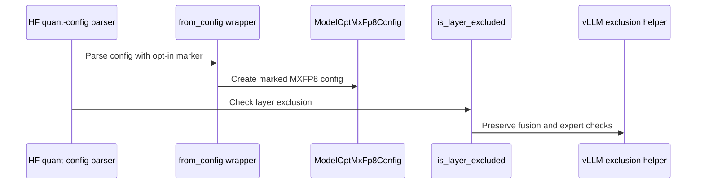

# [3/7] [rollout] fix: add opt-in exact MXFP8 exclusion matcher

[Upstream PR](https://github.com/verl-project/verl/pull/7918) · state: open · merged: False

## Original PR description

### What does this PR do?

Makes vLLM's ModelOpt MXFP8 config **exclude only the modules it names**, for configs that verl generates and marks. Today the router exclusion `model.layers.N.mlp.gate` also excludes the dense `model.layers.N.mlp.gate_up_proj`, so MXFP8 rollout serves `gate_proj` and `up_proj` in BF16 while training runs them in MXFP8. On `main` nothing marks a config yet, so behavior there is unchanged.

This is part 3 of the split of #7519 (end-to-end MXFP8 RL on Blackwell). It depends only on main; #8129 (MXFP8 vLLM rollout) is stacked on it and marks the configs it generates.

| # | PR | Depends on |
|---|---|---|
| 1 | #8127: MXFP8 training + shared TE quantizer | main |
| 2 | #8128: quantized-rollout sentinel | main |
| 3 | **this PR**: exact MXFP8 exclusion matcher | main |
| 4 | #8129: MXFP8 vLLM rollout | 1, 3 |
| 5 | #8130: MXFP8 SGLang rollout + refit loader | 1 |
| 6 | #8131: post-sync refit self-check | 4, 5 |
| 7 | #8132: quantized-layer audit | 6 |

**Why.**
- verl keeps MoE routers in high precision by putting `model.layers.N.mlp.gate` for every decoder layer into `ignored_layers`, dense models included.
- vLLM's FP8 config matches these names exactly, so FP8 rollout on `main` is not affected.
- MXFP8 rollout (#8129) goes through `ModelOptMxFp8Config`. Its `is_layer_excluded` (vLLM 0.24, unchanged in 0.29) falls back to substring matching, `exclude_module in prefix`, which vLLM keeps for checkpoints exported by ModelOpt < 0.39. `model.layers.N.mlp.gate` is a substring of `model.layers.N.mlp.gate_up_proj`, so the fused projection is built unquantized.
- On Qwen3-1.7B that is 56 of 311 synced parameters: `gate_proj` and `up_proj` in all 28 layers. Nothing in the metrics shows it: train–rollout KL stayed at 0.007–0.010, inside the healthy range. Only asking the engine for its parameter dtypes exposed it (#8132).


**What.**
- **Opt-in marker.** verl adds `_verl_exact_mxfp8_exclusions: true` to the MXFP8 quantization config it generates. A wrapper on `ModelOptMxFp8Config.from_config` copies it onto the parsed config as a plain boolean, which survives serialization to the workers.
- **Strict matching, marked configs only.** The `is_layer_excluded` wrapper matches module names exactly, plus explicit `fnmatch` globs, against the fused name and its HF shards. It then passes the matches to vLLM's own `is_layer_skipped`, so the all-or-none check for fused layers still applies. Unmarked configs (checkpoints, other formats) call the original matcher.
- **Fails closed.** A marked config that is not `quant_method: mxfp8`, is not a `ModelOptMxFp8Config`, or has malformed `exclude_modules` / `packed_modules_mapping` raises instead of silently keeping the substring rule.
- **Installation.** `build_fp8_method_patchers` returns the two wrappers with the existing FP8 refit patchers (vLLM ≥ 0.20), so they are installed wherever verl installs those: in the server before vLLM parses the config, and in each worker. The module is imported only when vLLM has `ModelOptMxFp8Config`. Otherwise CPU tests that load `vllm_fp8_utils.py` against a stubbed vLLM break: main's `test_vllm_fp8_restage_same_shape_on_cpu.py` failed 3 of 3.

**Evidence on B200** (#7519):
- **Qwen3-1.7B**, vLLM 0.24, MXFP8 rollout from #8129, 2 training steps:
  - without the matcher, the quantized-layer audit's engine re-check (#8132) reported 56 disagreements: `mlp.gate_proj` and `mlp.up_proj` in all 28 layers;
  - with it, 0 of 311 parameters disagree, and the weight sync loads the fused MXFP8 `gate_up_proj` without a shape mismatch.
- **What leaving gate/up in BF16 costs.** In one engine at fixed weights (Qwen3-8B, learning rate 0, paired prompts), train–rollout KL with an MXFP8 learner falls, against a BF16 sampler:
  - 10.6% [8.6, 12.7] when `gate_up_proj` stays in BF16, the state this bug produces;
  - 16.1% [14.1, 18.1] when every linear is MXFP8.

### Checklist Before Starting

- [x] Search for similar PRs: https://github.com/verl-project/verl/pulls?q=is%3Apr+is%3Aopen+is_layer_excluded. No other open PR changes the ModelOpt exclusion matching; this is part 3 of #7519's split.
- [x] PR title formatted as `[rollout] fix: ...`

### Test

```bash
python -m pytest tests/utils/test_mxfp8_exclusion_patch_on_cpu.py -q
# 30 passed
python -m pytest tests/utils/test_mxfp8_exclusion_patch_on_cpu.py tests/utils/test_vllm_quant_utils_moe_on_cpu.py -q
# 34 passed
# on current main + this PR; the test calls build_fp8_method_patchers against a stubbed vLLM:
python -m pytest tests/utils/test_vllm_fp8_restage_same_shape_on_cpu.py -q
# 3 passed (3 failed before the import fix)
```

`pre-commit run` passes on all changed files.

### API and Usage Example

No user-facing change. A caller that generates an MXFP8 config opts in by marking it; #8129 does this in `vLLMHttpServer._apply_quantization`:

```python
from verl.utils.vllm.mxfp8_exclusion_patch import VERL_EXACT_MXFP8_EXCLUSIONS

hf_overrides["quantization_config"] = {
    "quant_method": "mxfp8",
    "ignored_layers": all_mlp_gate_layers + ["lm_head", "model.embed_tokens"],
    VERL_EXACT_MXFP8_EXCLUSIONS: True,
}
```

Do not mark user or checkpoint configs.

### Design & Code Changes

- `verl/utils/vllm/mxfp8_exclusion_patch.py`: the marker, the strict matcher, the fail-closed checks, and `build_mxfp8_exclusion_patchers()` (two unstarted patches on `ModelOptMxFp8Config`; none on vLLM without ModelOpt MXFP8).
- `verl/utils/vllm/vllm_fp8_utils.py`: `build_fp8_method_patchers` appends them on vLLM ≥ 0.20, importing the module only when `ModelOptMxFp8Config` exists.
- `verl/utils/vllm/vllm_quant_utils.py`: docstring only: install before the config is parsed and in every model-building worker.
- `docs/low_precision/mxfp8_exclusion_patch.md`: the bug, the opt-in contract and the matching rules.
- `tests/utils/test_mxfp8_exclusion_patch_on_cpu.py`:
  - the 28-layer dense case (routers excluded, `gate_up_proj` quantized);
  - instance isolation, and unmarked checkpoint configs unchanged;
  - fused shards and globs, and no implicit parent or suffix matching;
  - the marker surviving parsing and pickling;
  - fail-closed inputs;
  - restoring the class when the patches stop;
  - the registry with and without ModelOpt MXFP8.

### AI assistance disclosure

Developed with AI assistance. I reviewed every changed line, ran the tests above, ran the B200 experiments reported in #7519, and can defend the change end to end.

### Checklist Before Submitting

- [x] Read the [Contribute Guide](https://github.com/verl-project/verl/blob/main/CONTRIBUTING.md).
- [x] Apply [pre-commit checks](https://github.com/verl-project/verl/blob/main/CONTRIBUTING.md#code-linting-and-formatting).
- [x] Add / Update [the documentation](https://github.com/verl-project/verl/tree/main/docs): `docs/low_precision/mxfp8_exclusion_patch.md`.
- [x] Add unit test(s): CPU tests above; hardware evidence in #7519.
- [ ] Once your PR is ready for CI, send a message in the `ci-request` channel.


## Review and discussion

### reviews

### issue_comments

- wuxibin89 · comment · 2026-09-20T02:14:04Z · [source](https://github.com/verl-project/verl/pull/7918#issuecomment-5746967993)

> vLLM 0.24's ModelOptQuantConfigBase.is_layer_excluded() keeps a legacy substring fallback (exclude_module in prefix), so model.layers.N.mlp.gate also matches the dense SwiGLU model.layers.N.mlp.gate_up_proj. The whole merged projection is then built as UnquantizedLinearMethod (BF16) while training runs it in fp8 — a real train/rollout precision mismatch on gate_proj/up_proj across every layer

This bug seems to be specific to dense model, while nowadays most models are sparse MoE and user almost never enable low precision training on dense model, I prefer not to fix it.

- wengeezhang · comment · 2026-09-20T03:56:36Z · [source](https://github.com/verl-project/verl/pull/7918#issuecomment-5747480653)

> > vLLM 0.24's ModelOptQuantConfigBase.is_layer_excluded() keeps a legacy substring fallback (exclude_module in prefix), so model.layers.N.mlp.gate also matches the dense SwiGLU model.layers.N.mlp.gate_up_proj. The whole merged projection is then built as UnquantizedLinearMethod (BF16) while training runs it in fp8 — a real train/rollout precision mismatch on gate_proj/up_proj across every layer
> 
> This bug seems to be specific to dense model, while nowadays most models are sparse MoE and user almost never enable low precision training on dense model, I prefer not to fix it.

dense ffn blocks still exist in some fused moe models. Small precision change in dense blocks will result in differrent moe router top-k.

```
class TransformerBlock(nn.Module):
    def __init__(self, block_id: int = 0, n_heads: int = 8, n_kv_heads: int = 8, dim: int = 512, dim_ff: int = 2048):
        super().__init__()
        self.rms_norm_attn = RMSNorm(dim, eps=1e-5)
        self.attention = Attention(n_heads, n_kv_heads, dim)
        self.rms_norm_ffn = RMSNorm(dim, eps=1e-5)
        # todo: 1. 入参传哪些；2. moe_cfg 的初始化位置放在这里是否合适。
        moe_cfg = MoEConfig(dim)
        self.ffn = FFN(dim, dim_ff) if block_id < n_dense_layers else MoEFFN(moe_cfg)
```

- wuxibin89 · comment · 2026-09-20T10:53:49Z · [source](https://github.com/verl-project/verl/pull/7918#issuecomment-5749347943)

For QAT+modelopt, the ignore_patterns is read from `qat.ignore_patterns`:
https://github.com/verl-project/verl/blob/main/verl/workers/rollout/vllm_rollout/vllm_async_server.py#L1217-L1240

https://verl.readthedocs.io/en/latest/low_precision/nvfp4_qat.html#fsdp-backend, the ignore_patterns has regex pattern `re:.*mlp.gate$` which should match `model.layers.N.mlp.gate_up_proj`
```bash
actor_rollout_ref:
  actor:
    fsdp_config:
      qat:
        enable: true
        mode: "w4a16"
        group_size: 16
        ignore_patterns:
          - "lm_head"
          - "embed_tokens"
          - "re:.*mlp.gate$"
        quantization_config_path: "recipe/qat/config/nvfp4_w4a16.json"
```

- coderabbitai[bot] · comment · 2026-10-13T08:31:38Z · [source](https://github.com/verl-project/verl/pull/7918#issuecomment-6141564270)

<!-- This is an auto-generated comment: summarize by coderabbit.ai -->
<!-- review_stack_entry_start -->

<a href="https://app.coderabbit.ai/change-stack/verl-project/verl/pull/7918?scope=ghh_OusAJGA4HG8ljoOV0wJvVx8NmnZIjc2DdjmxOu0xZWA&amp;cs_source=review_comment"><picture><source media="(prefers-color-scheme: dark)" srcset="https://storage.googleapis.com/coderabbit_public_assets/review-stack-in-coderabbit-ui-dark.svg?v=3"><source media="(prefers-color-scheme: light)" srcset="https://storage.googleapis.com/coderabbit_public_assets/review-stack-in-coderabbit-ui.svg?v=3"></picture></a>

<!-- review_stack_entry_end -->
<!-- recent_review_start -->

No actionable comments were generated in the recent review. 🎉

<details>
<summary><strong>ℹ️ Recent review info</strong></summary>
<dl>
<dd>

<details>
<summary><strong>⚙️ Run configuration</strong></summary>
<dl>
<dd>

- **Configuration used**: Organization UI
- **Review profile**: CHILL
- **Plan**: Advanced
- **Run ID**: `2c4ce658-6107-4188-ae2b-7ca221051ed1`

</dd>
</dl>
</details>

<details>
<summary><strong>📥 Commits</strong></summary>
<dl>
<dd>

Reviewing files that changed from the base of the PR and between 3f9d4c0d32cc20c7ec31c8137e91bb5673ce9e5e and c1692fff84d17d850b9bd5e3ba53815870105182.

</dd>
</dl>
</details>

<details>
<summary><strong>📒 Files selected for processing (5)</strong></summary>
<dl>
<dd>

* `docs/low_precision/mxfp8_exclusion_patch.md`
* `tests/utils/test_mxfp8_exclusion_patch_on_cpu.py`
* `verl/utils/vllm/mxfp8_exclusion_patch.py`
* `verl/utils/vllm/vllm_fp8_utils.py`
* `verl/utils/vllm/vllm_quant_utils.py`

</dd>
</dl>
</details>

**Included review availability:** This review used your included allowance. Your plan provides up to 10 included reviews per hour; 9 remain after this review.

</dd>
</dl>
</details>


<!-- recent_review_end -->
<!-- walkthrough_start -->

<details>
<summary><strong>📝 Summary</strong></summary>
<dl>
<dd>

<!-- This is an auto-generated comment: release notes by coderabbit.ai -->

## Summary by CodeRabbit

* **New Features**
  * Added opt-in MXFP8 exclusion matching for eligible vLLM configurations. Matching supports component boundaries and glob patterns across fused module names and mapped Hugging Face shards, while retaining existing fusion and expert checks. Configurations that do not opt in continue to use the original matching behavior.
* **Documentation**
  * Added guidance on enabling the patch, configuring exclusions, and validating CPU and deployment behavior.
* **Tests**
  * Added CPU-only coverage for matching, opt-in validation, configuration isolation, and patch behavior.

<!-- end of auto-generated comment: release notes by coderabbit.ai -->
Adds an opt-in matcher for verl-generated ModelOpt MXFP8 configs. Marked configs use component-boundary and glob matching against fused module names and mapped HF shards. Unmarked configs retain vLLM’s matcher. The FP8 patch registry adds the MXFP8 patchers when the config is available.

**Changes: MXFP8 Exclusion Matching**

|Layer / File(s)|Summary|
|:---|:---|
|**Opt-in config parsing and exclusion matching** <br> `verl/utils/vllm/mxfp8_exclusion_patch.py`, `tests/utils/test_mxfp8_exclusion_patch_on_cpu.py`, `docs/low_precision/mxfp8_exclusion_patch.md`|Adds marker validation and component-boundary and glob matching for marked MXFP8 configs. The matcher checks fused names and mapped HF shards while retaining vLLM fusion and expert checks. CPU tests cover matching, parser behavior, validation, instance isolation, and patch restoration.|
|**Patch registry and integration guidance** <br> `verl/utils/vllm/vllm_fp8_utils.py`, `verl/utils/vllm/vllm_quant_utils.py`, `tests/utils/test_mxfp8_exclusion_patch_on_cpu.py`, `docs/low_precision/mxfp8_exclusion_patch.md`|Adds MXFP8 patchers to the existing FP8 patcher list when the ModelOpt config is available. Updates patch installation guidance and documents integration and deployment checks.|

### Sequence Diagram(s)



</dd>
</dl>
</details>

<!-- walkthrough_end -->
<!-- change_assessment_start -->
**Priority:** ➖ Normal

<!-- change_assessment_commit:"c1692fff84d17d850b9bd5e3ba53815870105182" -->

<!-- change_assessment_end -->
<details>
<summary><strong>Merge Risk:</strong> <strong>⚪ Minimal</strong> · up to <code>c1692</code></summary>
<dl>
<dd>

<!-- final_review_risk_start -->
<!-- final_review_risk_label
**Merge Risk:** **⚪ Minimal** · up to `c1692`
-->
<!-- final_review_risk_coverage:{"sourceCommitId":"c1692fff84d17d850b9bd5e3ba53815870105182","coveredCommitId":"c1692fff84d17d850b9bd5e3ba53815870105182","kind":"reviewed"} -->

The opt-in matcher has no identified merge-blocking issue. GPU behavior and worker installation still need the documented deployment checks.
<!-- final_review_risk_end -->

</dd>
</dl>
</details>

<details>
<summary><strong>Security architecture risk:</strong> <strong>🔵 Low</strong> · up to <code>c1692</code></summary>
<dl>
<dd>

<!-- architecture_review_start -->
<!-- architecture_review_label
### Security Architecture Review

**Security architecture risk:** **🔵 Low** · up to `c1692`
-->

The change preserves existing behavior for unmarked configurations, and no introduced security issue was established. Limited uncertainty remains around installation recovery and future integration across processes.

**Retained concerns**
No architecture-level concerns identified.


<details>
<summary><strong>Security review details</strong></summary>
<dl>
<dd>

**Security Blast Radius**
- _inferred_ — The demonstrated effect is process-local precision selection for marked ModelOpt MXFP8 configurations after registry installation. The wrappers modify that subclass globally within the process, but unmarked configurations retain their original matcher. No wider tenant, credential, infrastructure, or data-store exposure is established by these paths.

**Trust Boundaries and Controls**
- _observed_ — Configuration input selects between two exclusion policies, not a privileged execution path. Explicit opt-ins are constrained by quantization method and parsed-config validation, and existing instance-specific matchers are not overwritten. Origin authentication remains outside this helper.

**Resilience and Maintainability Implications**
- _inferred_ — A patch-start failure can leave a partial registry that subsequent calls treat as installed. This is a pre-existing failure-containment limitation now inherited by the additional pair, not an established attacker-reachable security regression. The inspected startup calls do not establish concurrent installation or successful continuation after such a failure.

</dd>
</dl>
</details>

<!-- architecture_review_end -->

</dd>
</dl>
</details>
<!-- pre_merge_checks_walkthrough_start -->

<details>
<summary><strong>Pre-merge checks · <sup><picture></picture></sup> 4 · <sup><picture></picture></sup> 1</strong></summary>
<dl>
<dd>

<strong><sup><picture></picture></sup> Failed checks (1 warning)</strong>

|     Check name     |                                              Status                                              | Explanation                                                                                                                                                                                               | Resolution                                                                         |
| :---------------- | :----------------------------------------------------------------------------------------------: | :-------------------------------------------------------------------------------------------------------------------------------------------------------------------------------------------------------- | :--------------------------------------------------------------------------------- |
| Docstring Coverage |  | Docstring coverage is 15.38% which is insufficient. The required threshold is 80.00%. Docstring coverage is scoped to functions touched by this diff. Analyzed 39 functions across 4 files. (1 skipped: … | Write docstrings for the functions missing them to satisfy the coverage threshold. |

<details>
<summary><strong><sup><picture></picture></sup> Passed checks (4 passed)</strong></summary>
<dl>
<dd>

|         Check name         |                                             Status                                             | Explanation                                                                                                                     |
| :------------------------ | :--------------------------------------------------------------------------------------------: | :------------------------------------------------------------------------------------------------------------------------------ |
|      Description check     |  | The description clearly explains the opt-in MXFP8 exclusion matcher, its scope, implementation, validation, and rollout impact. |
|         Title check        |  | The title accurately and concisely identifies the rollout fix and the opt-in exact MXFP8 exclusion matcher.                     |
|     Linked Issues check    |  | Check skipped because no linked issues were found for this pull request.                                                        |
| Out of Scope Changes check |  | Check skipped because no linked issues were found for this pull request.                                                        |

</dd>
</dl>
</details>

<details>
<summary><strong>Full details: Docstring Coverage</strong></summary>
<dl>
<dd>

**Explanation**

Docstring coverage is 15.38% which is insufficient. The required threshold is 80.00%. Docstring coverage is scoped to functions touched by this diff. Analyzed 39 functions across 4 files. (1 skipped: 1 unsupported.)

</dd>
</dl>
</details>

</dd>
</dl>
</details>

<!-- pre_merge_checks_walkthrough_end -->

- [ ] <!-- {"checkboxId":"585bb3f6-faf5-4dbf-96d2-74e382adf19a"} --> Fix all pre-merge checks with AI
<!-- autopilot:start -->
- [ ] <!-- {"checkboxId":"2708ad07-9f24-4260-9c11-7dc76a49f2e3"} --> <strong title="Keep fixing CodeRabbit findings and required CI, and resolving merge conflicts">Autofix</strong> · Keep fixing CodeRabbit findings and required CI, and resolving merge conflicts
<!-- autopilot:end -->
<!-- tips_start -->


<sub>Comment `@coderabbitai help` to get the list of available commands.</sub>

<!-- tips_end -->

### inline_comments

## Changed files and fixed code

- `docs/low_precision/mxfp8_exclusion_patch.md` · added · additions 106 / deletions 0
  - [head](https://github.com/wengeezhang/verl/blob/c1692fff84d17d850b9bd5e3ba53815870105182/docs/low_precision/mxfp8_exclusion_patch.md)
  - [base](https://github.com/verl-project/verl/blob/3f9d4c0d32cc20c7ec31c8137e91bb5673ce9e5e/docs/low_precision/mxfp8_exclusion_patch.md)
- `tests/utils/test_mxfp8_exclusion_patch_on_cpu.py` · added · additions 376 / deletions 0
  - [head](https://github.com/wengeezhang/verl/blob/c1692fff84d17d850b9bd5e3ba53815870105182/tests/utils/test_mxfp8_exclusion_patch_on_cpu.py)
  - [base](https://github.com/verl-project/verl/blob/3f9d4c0d32cc20c7ec31c8137e91bb5673ce9e5e/tests/utils/test_mxfp8_exclusion_patch_on_cpu.py)
- `verl/utils/vllm/mxfp8_exclusion_patch.py` · added · additions 144 / deletions 0
  - [head](https://github.com/wengeezhang/verl/blob/c1692fff84d17d850b9bd5e3ba53815870105182/verl/utils/vllm/mxfp8_exclusion_patch.py)
  - [base](https://github.com/verl-project/verl/blob/3f9d4c0d32cc20c7ec31c8137e91bb5673ce9e5e/verl/utils/vllm/mxfp8_exclusion_patch.py)
- `verl/utils/vllm/vllm_fp8_utils.py` · modified · additions 19 / deletions 3
  - [head](https://github.com/wengeezhang/verl/blob/c1692fff84d17d850b9bd5e3ba53815870105182/verl/utils/vllm/vllm_fp8_utils.py)
  - [base](https://github.com/verl-project/verl/blob/3f9d4c0d32cc20c7ec31c8137e91bb5673ce9e5e/verl/utils/vllm/vllm_fp8_utils.py)
- `verl/utils/vllm/vllm_quant_utils.py` · modified · additions 4 / deletions 1
  - [head](https://github.com/wengeezhang/verl/blob/c1692fff84d17d850b9bd5e3ba53815870105182/verl/utils/vllm/vllm_quant_utils.py)
  - [base](https://github.com/verl-project/verl/blob/3f9d4c0d32cc20c7ec31c8137e91bb5673ce9e5e/verl/utils/vllm/vllm_quant_utils.py)

## Evidence and interpretation boundary

[Original JSON, discussions and patches](../../../../../../evidence/prs/verl-project--verl/7918-eed92a254961eb3986c6e16ed192b1576bd755a410b853faa5c49b7175da3cac.json) · SHA-256 `eed92a254961eb3986c6e16ed192b1576bd755a410b853faa5c49b7175da3cac`.

Diff complete: True. Missing/binary/truncated patches require pinned source inspection. This is a source page, not an independently verified optimization case. Open, merged and released are different states; recheck the deployed dependency.
