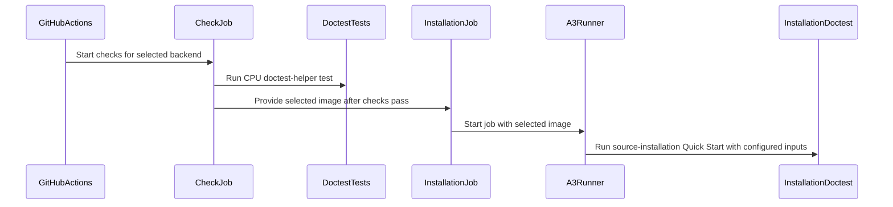

# [ci, doc] test: add Ascend documentation doctests

[Upstream PR](https://github.com/verl-project/verl/pull/8007) · state: open · merged: False

## Original PR description

### What does this PR do?
add Ascend documentation doctests
> Add **concise** overview of what this PR aims to achieve or accomplish. Reference related GitHub issues and PRs that help with the review.

### Checklist Before Starting

- [ ] Search for similar PRs. Paste at least one query link here: ...
- [ ] Format the PR title as `[{modules}] {type}: {description}` (This will be checked by the CI)
  - `{modules}` include `fsdp`, `megatron`, `veomni`, `sglang`, `vllm`, `rollout`, `trainer`, `ci`, `training_utils`, `recipe`, `hardware`, `deployment`, `ray`, `worker`, `single_controller`, `misc`, `perf`, `model`, `algo`, `env`, `tool`, `ckpt`, `doc`, `data`, `cfg`, `reward`, `fully_async`, `one_step_off`
  - If this PR involves multiple modules, separate them with `,` like `[megatron, fsdp, doc]`
  - `{type}` is in `feat`, `fix`, `refactor`, `chore`, `test`
  - If this PR breaks any API (CLI arguments, config, function signature, etc.), add `[BREAKING]` to the beginning of the title.
  - Example: `[BREAKING][fsdp, megatron] feat: dynamic batching`

### Test

> For changes that can not be tested by CI (e.g., algorithm implementation, new model support), validate by experiment(s) and show results like training curve plots, evaluation results, etc.

### API and Usage Example

> Demonstrate how the API changes if any, and provide usage example(s) if possible.

```python
# Add code snippet or script demonstrating how to use this
```

### Design & Code Changes

> Demonstrate the high-level design if this PR is complex, and list the specific changes.

### Checklist Before Submitting

> [!IMPORTANT]
> Please check all the following items before requesting a review, otherwise the reviewer might deprioritize this PR for review.

- [ ] Read the [Contribute Guide](https://github.com/verl-project/verl/blob/main/CONTRIBUTING.md).
- [ ] Apply [pre-commit checks](https://github.com/verl-project/verl/blob/main/CONTRIBUTING.md#code-linting-and-formatting): `pre-commit install && pre-commit run --all-files --show-diff-on-failure --color=always`
- [ ] Add / Update [the documentation](https://github.com/verl-project/verl/tree/main/docs).
- [ ] Add unit or end-to-end test(s) to [the CI workflow](https://github.com/verl-project/verl/tree/main/.github/workflows) to cover all the code. If not feasible, explain why: ...
- [ ] Once your PR is ready for CI, send a message in [the `ci-request` channel](https://verl-project.slack.com/archives/C091TCESWB1) in [the `verl` Slack workspace](https://join.slack.com/t/verl-project/shared_invite/zt-3855yhg8g-CTkqXu~hKojPCmo7k_yXTQ). (If not accessible, please try [the Feishu group (飞书群)](https://applink.larkoffice.com/client/chat/chatter/add_by_link?link_token=772jd4f1-cd91-441e-a820-498c6614126a).)
- [ ] If your PR is related to the `recipe` submodule, please also update the reference to the submodule commit via `git submodule update --remote` or `cd recipe && git pull origin main`.


## Review and discussion

### reviews

- ChibiQuest · COMMENTED · 2026-09-23T11:42:35Z · [source](https://github.com/verl-project/verl/pull/8007#pullrequestreview-5290357040)

(No body; status only.)

- zery00568 · COMMENTED · 2026-09-24T10:40:09Z · [source](https://github.com/verl-project/verl/pull/8007#pullrequestreview-5303143476)

(No body; status only.)

- zery00568 · COMMENTED · 2026-09-24T10:41:42Z · [source](https://github.com/verl-project/verl/pull/8007#pullrequestreview-5303281543)

(No body; status only.)

- ChibiQuest · COMMENTED · 2026-11-03T04:34:41Z · [source](https://github.com/verl-project/verl/pull/8007#pullrequestreview-5747118830)

(No body; status only.)

- ChibiQuest · COMMENTED · 2026-11-03T12:53:06Z · [source](https://github.com/verl-project/verl/pull/8007#pullrequestreview-5752368667)

(No body; status only.)

- wucong25 · APPROVED · 2026-11-04T09:07:42Z · [source](https://github.com/verl-project/verl/pull/8007#pullrequestreview-5765949236)

(No body; status only.)

### issue_comments

- CLAassistant · comment · 2026-09-23T11:20:55Z · [source](https://github.com/verl-project/verl/pull/8007#issuecomment-5793904143)

[](https://cla-assistant.io/verl-project/verl?pullRequest=8007) <br/>Thank you for your submission! We really appreciate it. Like many open source projects, we ask that you sign our [Contributor License Agreement](https://cla-assistant.io/verl-project/verl?pullRequest=8007) before we can accept your contribution.<br/><sub>You have signed the CLA already but the status is still pending? Let us [recheck](https://cla-assistant.io/check/verl-project/verl?pullRequest=8007) it.</sub>

- coderabbitai[bot] · comment · 2026-11-02T09:25:51Z · [source](https://github.com/verl-project/verl/pull/8007#issuecomment-6573604051)

<!-- coderabbit-ai-generated:v1 -->

<!-- This is an auto-generated comment: summarize by coderabbit.ai -->
<!-- review_stack_entry_start -->

<a href="https://app.coderabbit.ai/change-stack/verl-project/verl/pull/8007?scope=ghh_OusAJGA4HG8ljoOV0wJvVx8NmnZIjc2DdjmxOu0xZWA&amp;cs_source=review_comment"><picture><source media="(prefers-color-scheme: dark)" srcset="https://storage.googleapis.com/coderabbit_public_assets/review-stack-in-coderabbit-ui-dark.svg?v=3"><source media="(prefers-color-scheme: light)" srcset="https://storage.googleapis.com/coderabbit_public_assets/review-stack-in-coderabbit-ui.svg?v=3"></picture></a>

<!-- review_stack_entry_end -->
<!-- This is an auto-generated comment: review paused by coderabbit.ai -->

> [!NOTE]
> ## Reviews paused
> 
> It looks like this branch is under active development. To avoid overwhelming you with review comments due to an influx of new commits, CodeRabbit has automatically paused this review. You can configure this behavior by changing the `reviews.auto_review.auto_pause_after_reviewed_commits` setting.
> 
> - Last reviewed commit: 44bc1ccb43bbebb97b16c0bbecc5a65166b671be
> - Latest commit, not reviewed: 3f8fe2cdd8d2348c8ca0fc13d50d68d7d0a7baad
> 
> Use the following commands to manage reviews:
> - `@coderabbitai resume` to resume automatic reviews.
> - `@coderabbitai review` to trigger a single review.
> 
> Use the checkboxes below for quick actions:
> - [ ] <!-- {"checkboxId":"7f6cc2e2-2e4e-497a-8c31-c9e4573e93d1"} --> Resume reviews
> - [ ] <!-- {"checkboxId":"e9bb8d72-00e8-4f67-9cb2-caf3b22574fe"} --> Trigger review

<!-- end of auto-generated comment: review paused by coderabbit.ai -->
<!-- recent_review_status_start -->

No actionable comments were generated in the recent review.

<!-- recent_review_status_end -->
<!-- walkthrough_start -->

<details>
<summary><strong>Summary</strong></summary>
<dl>
<dd>

<!-- This is an auto-generated comment: release notes by coderabbit.ai -->

## Summary by CodeRabbit

* **New Features**
  * Added checks for documentation examples across four Ascend training configurations and vLLM/SGLang installation options.
  * Added validation-only modes and options for configuring runtime inputs and test environments.
  * Added an automated workflow to run documentation checks and installation tests on supported Ascend hardware.

* **Documentation**
  * Documented available checks, prerequisites, configuration options, and hardware requirements.

* **Tests**
  * Added CPU-only tests for documentation validation, runtime checks, and installation workflows.

<!-- end of auto-generated comment: release notes by coderabbit.ai -->
This change adds tools to extract and validate documented commands, run Quick Start and source-installation flows, and check runtime prerequisites. CPU tests cover these paths. A GitHub Actions workflow runs CPU checks and can run installation doctests on an A3 runner.

**Changes: Ascend documentation doctests**

|Layer / File(s)|Summary|
|:---|:---|
|**Doctest extraction and runtime checks** <br> `tests/e2e/doctests/scripts/*`, `tests/special_sanity/test_doctest_helper.py`|The tools extract and adapt documented RST blocks, validate required selectors, check runtime inputs and imports, and dispatch supported doctest commands. CPU tests cover extraction, adaptation, runtime checks, and dispatch.|
|**Quick Start execution** <br> `tests/e2e/doctests/001-quickstart-test.sh`, `tests/special_sanity/test_doctest_helper.py`|The runner validates a selected Quick Start block and its script, prepares environment and data inputs, checks runtime requirements, and executes the block. Tests cover dry runs, missing scripts, and training orchestration.|
|**Source installation flow** <br> `tests/e2e/doctests/002-installation-test.sh`, `tests/special_sanity/test_doctest_helper.py`|The runner checks installation documentation and supports opt-in source installation for vLLM or SGLang on Ubuntu or openEuler. It prepares isolated Conda environments, verifies backend imports, runs Quick Start, and cleans up temporary work directories. Tests cover dispatch and installation flows.|
|**Ascend workflow integration** <br> `.github/workflows/doctest_ascend.yml`, `tests/e2e/doctests/README.md`|The workflow selects and validates an A3 image, runs the CPU test, and conditionally runs source installation on an A3 runner. The README describes supported cases, commands, requirements, and workflow coverage.|

**NPU test configuration**

|Layer / File(s)|Summary|
|:---|:---|
|**NPU pytest exclusion** <br> `.github/workflows/npu_unit_tests.yml`|The NPU unit-test step sets `PYTEST_ADDOPTS` to exclude `tests/utils/test_qat_fp4_on_gpu.py`. The existing pytest command remains unchanged.|

### Sequence Diagram(s)



**Suggested reviewers:** `wuxibin89`

</dd>
</dl>
</details>

<!-- walkthrough_end -->
<!-- change_assessment_start -->
<!-- change_assessment_commit:"44bc1ccb43bbebb97b16c0bbecc5a65166b671be" -->
<!-- change_assessment_priority:{"version":1,"urgency":"p2","manual":false} -->

<!-- change_assessment_end -->
<details>
<summary><strong>Merge Risk:</strong> <strong><picture></picture> Minimal</strong> · previous review <code>44bc1</code></summary>
<dl>
<dd>

<!-- final_review_risk_start -->
<!-- final_review_risk_label
**Merge Risk:** **⚪ Minimal** · up to `44bc1`
-->
<!-- final_review_risk_coverage:{"sourceCommitId":"44bc1ccb43bbebb97b16c0bbecc5a65166b671be","coveredCommitId":"44bc1ccb43bbebb97b16c0bbecc5a65166b671be","kind":"reviewed"} -->

The scoped workflow change is mergeable with no identified correctness, security, or availability risk.
<!-- final_review_risk_end -->

</dd>
</dl>
</details>
<!-- pre_merge_checks_walkthrough_start -->

<details>
<summary><strong>Pre-merge checks: <sup><picture></picture></sup> 4 · <sup><picture></picture></sup> 1</strong></summary>
<dl>
<dd>

<strong><sup><picture></picture></sup> Failed checks: 1 warning</strong>

|     Check name     |                                              Status                                              | Explanation                                                                                                                                                                                               | Resolution                                                                         |
| :---------------- | :----------------------------------------------------------------------------------------------: | :-------------------------------------------------------------------------------------------------------------------------------------------------------------------------------------------------------- | :--------------------------------------------------------------------------------- |
| Docstring Coverage |  | Docstring coverage is 65.63% which is insufficient. The required threshold is 80.00%. Docstring coverage is scoped to functions touched by this diff with cyclomatic complexity of at least 2. Documenta… | Write docstrings for the functions missing them to satisfy the coverage threshold. |

<details>
<summary><strong><sup><picture></picture></sup> Passed checks: 4 passed</strong></summary>
<dl>
<dd>

|         Check name         |                                             Status                                             | Explanation                                                                                                                                                                                               |
| :------------------------ | :--------------------------------------------------------------------------------------------: | :-------------------------------------------------------------------------------------------------------------------------------------------------------------------------------------------------------- |
|         Title check        |  | The title "[ci, doc] test: add Ascend documentation doctests" matches the main change. The PR adds an Ascend documentation-doctest workflow, doctest scripts, a helper module, a README, and CPU tests. … |
|      Description check     |  | The description states the PR adds Ascend documentation doctests. That matches the changeset, which adds doctest scripts, a helper, a README, and a GitHub workflow for these doctests. The description … |
|     Linked Issues check    |  | Check skipped because no linked issues were found for this pull request.                                                                                                                                  |
| Out of Scope Changes check |  | Check skipped because no linked issues were found for this pull request.                                                                                                                                  |

<details>
<summary><strong>Full details: Title check</strong></summary>
<dl>
<dd>

**Explanation**

The title "[ci, doc] test: add Ascend documentation doctests" matches the main change. The PR adds an Ascend documentation-doctest workflow, doctest scripts, a helper module, a README, and CPU tests. It follows the required [modules] type: description format. The title is short and specific. It also names the modules (ci, doc) and the type (test) correctly.

</dd>
</dl>
</details>

<details>
<summary><strong>Full details: Description check</strong></summary>
<dl>
<dd>

**Explanation**

The description states the PR adds Ascend documentation doctests. That matches the changeset, which adds doctest scripts, a helper, a README, and a GitHub workflow for these doctests. The description is brief and leaves template placeholders unfilled, such as the search-for-similar-PRs link and the test section. The check is lenient, and the description is related to the changeset, so it passes.

</dd>
</dl>
</details>

</dd>
</dl>
</details>

<details>
<summary><strong>Full details: Docstring Coverage</strong></summary>
<dl>
<dd>

**Explanation**

Docstring coverage is 65.63% which is insufficient. The required threshold is 80.00%. Docstring coverage is scoped to functions touched by this diff with cyclomatic complexity of at least 2. Documentation-only edits and deletions within surviving functions are included; unchanged diff context and fully deleted functions are excluded. Analyzed 32 functions across 7 files. (1 skipped: 1 unsupported.)

**Resolution**

Write docstrings for the functions missing them to satisfy the coverage threshold.

</dd>
</dl>
</details>

</dd>
</dl>
</details>

<!-- pre_merge_checks_walkthrough_end -->
<!-- autopilot:start -->
- [ ] <!-- {"checkboxId":"2708ad07-9f24-4260-9c11-7dc76a49f2e3"} --> <strong title="Keep fixing CodeRabbit findings and required CI, and resolving merge conflicts">Autofix</strong> · Keep fixing CodeRabbit findings and required CI, and resolving merge conflicts
<!-- autopilot:end -->
<!-- announcements_start -->

> [!TIP]
> <details>
> <summary><strong>🎯 Customize your risk assessments</strong></summary>
> <dl>
> <dd>
> 
> Guide how CodeRabbit assesses merge risk and security architecture risk. Highlight sensitive changes and explain your security boundaries using **Merge Risk Instructions** and **Security Risk Instructions** in your review settings. Security architecture risk assessments require the **Advanced plan or above**.
> 
> </dd>
> </dl>
> </details>
> 
> <details>
> <summary><strong>✅ Automatic approvals, with your rules</strong></summary>
> <dl>
> <dd>
> 
> Let CodeRabbit approve pull requests once required threads are resolved, pre-merge checks pass, and your risk limits are met. Enable **Automatic approvals** in review settings, with overrides for teams or file paths.
> 
> </dd>
> </dl>
> </details>

<!-- announcements_end -->
<!-- tips_start -->


Thanks for using [CodeRabbit](https://coderabbit.ai?utm_source=oss&utm_medium=github&utm_campaign=verl-project/verl&utm_content=8007)! It's free for OSS, and your support helps us grow. If you like it, consider giving us a shout-out.

<details>
<summary><strong>Share</strong></summary>
<dl>
<dd>

- [X](https://twitter.com/intent/tweet?text=I%20just%20used%20%40coderabbitai%20for%20my%20code%20review%2C%20and%20it%27s%20fantastic%21%20It%27s%20free%20for%20OSS%20and%20offers%20a%20free%20trial%20for%20the%20proprietary%20code.%20Check%20it%20out%3A&url=https%3A//coderabbit.ai)
- [Mastodon](https://mastodon.social/share?text=I%20just%20used%20%40coderabbitai%20for%20my%20code%20review%2C%20and%20it%27s%20fantastic%21%20It%27s%20free%20for%20OSS%20and%20offers%20a%20free%20trial%20for%20the%20proprietary%20code.%20Check%20it%20out%3A%20https%3A%2F%2Fcoderabbit.ai)
- [Reddit](https://www.reddit.com/submit?title=Great%20tool%20for%20code%20review%20-%20CodeRabbit&text=I%20just%20used%20CodeRabbit%20for%20my%20code%20review%2C%20and%20it%27s%20fantastic%21%20It%27s%20free%20for%20OSS%20and%20offers%20a%20free%20trial%20for%20proprietary%20code.%20Check%20it%20out%3A%20https%3A//coderabbit.ai)
- [LinkedIn](https://www.linkedin.com/sharing/share-offsite/?url=https%3A%2F%2Fcoderabbit.ai&mini=true&title=Great%20tool%20for%20code%20review%20-%20CodeRabbit&summary=I%20just%20used%20CodeRabbit%20for%20my%20code%20review%2C%20and%20it%27s%20fantastic%21%20It%27s%20free%20for%20OSS%20and%20offers%20a%20free%20trial%20for%20proprietary%20code)

</dd>
</dl>
</details>

<!-- tips_end -->
<!-- verify_invitation_start -->
### CodeRabbit Verify

- [ ] <!-- {"checkboxId":"run-qa-agent"} --> Run CodeRabbit Verify to test the changes in this pull request.
<!-- verify_invitation_end -->
<!-- recent_review_start -->

<h6>
<details>
<summary><strong><picture></picture> Recent review info</strong></summary>
<dl>
<dd>

<!-- review_info_content -->
<details>
<summary><strong><picture><source media="(prefers-color-scheme: dark)" srcset="https://storage.googleapis.com/coderabbit_public_assets/review-comment-icons-v1/cog-dark.svg"></picture> Run configuration</strong></summary>
<dl>
<dd>

- **Source mode**: Auto
- **Repository**: Unavailable
- **Branch**: Unavailable
- **File**: No configuration file from this repository applied
- **Commit**: Unavailable
- **Layers**: Organization UI
- **Review profile**: CHILL
- **Plan**: Advanced
- **Run ID**: `8f6214d5-df37-4e4e-9baa-58e05dabb3f5`

</dd>
</dl>
</details>

<details>
<summary><strong><picture><source media="(prefers-color-scheme: dark)" srcset="https://storage.googleapis.com/coderabbit_public_assets/review-comment-icons-v1/git-commit-horizontal-dark.svg"></picture> Commits</strong></summary>
<dl>
<dd>

Reviewing files that changed from the base of the PR and between 4f7daa42e0d2b773a227dec403b83de8f11e6b61 and 44bc1ccb43bbebb97b16c0bbecc5a65166b671be.

</dd>
</dl>
</details>

<details>
<summary><strong><picture><source media="(prefers-color-scheme: dark)" srcset="https://storage.googleapis.com/coderabbit_public_assets/review-comment-icons-v1/file-plus-corner-dark.svg"></picture> Files selected for processing: 1</strong></summary>
<dl>
<dd>

* `.github/workflows/npu_unit_tests.yml`

</dd>
</dl>
</details>

**Included review availability:** This review used your included allowance. Your plan provides up to 10 included reviews per hour; 8 remain after this review.

</dd>
</dl>
</details>
</h6>

<!-- recent_review_end -->

### inline_comments

- ChibiQuest · comment · 2026-09-23T11:28:26Z · [source](https://github.com/verl-project/verl/pull/8007#discussion_r4081912973)

File: `docs/ascend_tutorial/zh/get_start/install_guidance.rst` · line None

换成source /usr/local/Ascend/ascend-toolkit/set_env.sh，这是指导文档，这样写没有指导意义

- ChibiQuest · comment · 2026-09-23T11:37:13Z · [source](https://github.com/verl-project/verl/pull/8007#discussion_r4081980297)

File: `.github/workflows/doctest_ascend.yml` · line 37

确认下是否需要CI机器

- ChibiQuest · comment · 2026-09-23T11:37:44Z · [source](https://github.com/verl-project/verl/pull/8007#discussion_r4081984070)

File: `docs/ascend_tutorial/zh/get_start/quick_start.rst` · line None

这一章节不用修改

- ChibiQuest · comment · 2026-09-23T11:42:15Z · [source](https://github.com/verl-project/verl/pull/8007#discussion_r4082019216)

File: `tests/e2e/doctests/002-installation-test.sh` · line None

确认下这些环境的校验，是否要加相关版本信息

- zery00568 · comment · 2026-09-24T10:29:28Z · [source](https://github.com/verl-project/verl/pull/8007#discussion_r4092552561)

File: `docs/ascend_tutorial/zh/get_start/quick_start.rst` · line None

这里必须要将表格命令拆开写吗？

- zery00568 · comment · 2026-09-24T10:41:38Z · [source](https://github.com/verl-project/verl/pull/8007#discussion_r4092659431)

File: `docs/ascend_tutorial/zh/get_start/install_guidance.rst` · line None

不建议这样写，可读性不好

- ChibiQuest · comment · 2026-11-03T04:02:35Z · [source](https://github.com/verl-project/verl/pull/8007#discussion_r4450791262)

File: `tests/e2e/doctests/scripts/verify_runtime.py` · line None

注释中英文混合？下面也注意下

- ChibiQuest · comment · 2026-11-03T04:20:14Z · [source](https://github.com/verl-project/verl/pull/8007#discussion_r4450882778)

File: `.github/workflows/doctest_ascend.yml` · line None

自动 PR CI 默认只验证 fsdp2_vllm。其他的方案没有验证

- ChibiQuest · comment · 2026-11-03T04:31:04Z · [source](https://github.com/verl-project/verl/pull/8007#discussion_r4450934944)

File: `.github/workflows/doctest_ascend.yml` · line None

现在 workflow 从 Dockerfile 获取镜像，但安装教程没有告诉用户应基于哪个版本的镜像操作，结果是 CI 能复现、用户却不能完 全按照文档复现。建议让安装文档成为用户可见的唯一来源，CI 再读取并验证文档中的镜像配置

- ChibiQuest · comment · 2026-11-03T12:45:54Z · [source](https://github.com/verl-project/verl/pull/8007#discussion_r4454810175)

File: `.github/workflows/doctest_ascend.yml` · line 67

对于安装校验，因为安装时间比较久，这个时间可以适当增加

- ChibiQuest · comment · 2026-11-03T12:46:51Z · [source](https://github.com/verl-project/verl/pull/8007#discussion_r4454819734)

File: `docs/ascend_tutorial/zh/get_start/container_source_install.rst` · line 7

确定下，这个语法是否能打开相关的链接

- ChibiQuest · comment · 2026-11-03T12:48:11Z · [source](https://github.com/verl-project/verl/pull/8007#discussion_r4454832841)

File: `docs/ascend_tutorial/zh/get_start/container_source_install.rst` · line 2

确定下需要校验几种安装方式

## Changed files and fixed code

- `.github/workflows/doctest_ascend.yml` · added · additions 115 / deletions 0
  - [head](https://github.com/likaizheng666-sketch/verl/blob/3f8fe2cdd8d2348c8ca0fc13d50d68d7d0a7baad/.github/workflows/doctest_ascend.yml)
  - [base](https://github.com/verl-project/verl/blob/2bcc98a9b64bdb3af5b88ac870ba0709ed709aef/.github/workflows/doctest_ascend.yml)
- `.github/workflows/npu_unit_tests.yml` · modified · additions 3 / deletions 0
  - [head](https://github.com/likaizheng666-sketch/verl/blob/3f8fe2cdd8d2348c8ca0fc13d50d68d7d0a7baad/.github/workflows/npu_unit_tests.yml)
  - [base](https://github.com/verl-project/verl/blob/2bcc98a9b64bdb3af5b88ac870ba0709ed709aef/.github/workflows/npu_unit_tests.yml)
- `docs/ascend_tutorial/zh/README.md` · modified · additions 2 / deletions 1
  - [head](https://github.com/likaizheng666-sketch/verl/blob/3f8fe2cdd8d2348c8ca0fc13d50d68d7d0a7baad/docs/ascend_tutorial/zh/README.md)
  - [base](https://github.com/verl-project/verl/blob/2bcc98a9b64bdb3af5b88ac870ba0709ed709aef/docs/ascend_tutorial/zh/README.md)
- `docs/ascend_tutorial/zh/get_start/container_source_install.rst` · added · additions 167 / deletions 0
  - [head](https://github.com/likaizheng666-sketch/verl/blob/3f8fe2cdd8d2348c8ca0fc13d50d68d7d0a7baad/docs/ascend_tutorial/zh/get_start/container_source_install.rst)
  - [base](https://github.com/verl-project/verl/blob/2bcc98a9b64bdb3af5b88ac870ba0709ed709aef/docs/ascend_tutorial/zh/get_start/container_source_install.rst)
- `docs/ascend_tutorial/zh/get_start/install_guidance.rst` · modified · additions 4 / deletions 4
  - [head](https://github.com/likaizheng666-sketch/verl/blob/3f8fe2cdd8d2348c8ca0fc13d50d68d7d0a7baad/docs/ascend_tutorial/zh/get_start/install_guidance.rst)
  - [base](https://github.com/verl-project/verl/blob/2bcc98a9b64bdb3af5b88ac870ba0709ed709aef/docs/ascend_tutorial/zh/get_start/install_guidance.rst)
- `docs/ascend_tutorial/zh/index.rst` · modified · additions 2 / deletions 1
  - [head](https://github.com/likaizheng666-sketch/verl/blob/3f8fe2cdd8d2348c8ca0fc13d50d68d7d0a7baad/docs/ascend_tutorial/zh/index.rst)
  - [base](https://github.com/verl-project/verl/blob/2bcc98a9b64bdb3af5b88ac870ba0709ed709aef/docs/ascend_tutorial/zh/index.rst)
- `requirements-npu.txt` · modified · additions 2 / deletions 2
  - [head](https://github.com/likaizheng666-sketch/verl/blob/3f8fe2cdd8d2348c8ca0fc13d50d68d7d0a7baad/requirements-npu.txt)
  - [base](https://github.com/verl-project/verl/blob/2bcc98a9b64bdb3af5b88ac870ba0709ed709aef/requirements-npu.txt)
- `scripts/install_vllm_mcore_npu.sh` · modified · additions 4 / deletions 4
  - [head](https://github.com/likaizheng666-sketch/verl/blob/3f8fe2cdd8d2348c8ca0fc13d50d68d7d0a7baad/scripts/install_vllm_mcore_npu.sh)
  - [base](https://github.com/verl-project/verl/blob/2bcc98a9b64bdb3af5b88ac870ba0709ed709aef/scripts/install_vllm_mcore_npu.sh)
- `tests/e2e/doctests/001-quickstart-test.sh` · added · additions 73 / deletions 0
  - [head](https://github.com/likaizheng666-sketch/verl/blob/3f8fe2cdd8d2348c8ca0fc13d50d68d7d0a7baad/tests/e2e/doctests/001-quickstart-test.sh)
  - [base](https://github.com/verl-project/verl/blob/2bcc98a9b64bdb3af5b88ac870ba0709ed709aef/tests/e2e/doctests/001-quickstart-test.sh)
- `tests/e2e/doctests/002-installation-test.sh` · added · additions 141 / deletions 0
  - [head](https://github.com/likaizheng666-sketch/verl/blob/3f8fe2cdd8d2348c8ca0fc13d50d68d7d0a7baad/tests/e2e/doctests/002-installation-test.sh)
  - [base](https://github.com/verl-project/verl/blob/2bcc98a9b64bdb3af5b88ac870ba0709ed709aef/tests/e2e/doctests/002-installation-test.sh)
- `tests/e2e/doctests/README.md` · added · additions 113 / deletions 0
  - [head](https://github.com/likaizheng666-sketch/verl/blob/3f8fe2cdd8d2348c8ca0fc13d50d68d7d0a7baad/tests/e2e/doctests/README.md)
  - [base](https://github.com/verl-project/verl/blob/2bcc98a9b64bdb3af5b88ac870ba0709ed709aef/tests/e2e/doctests/README.md)
- `tests/e2e/doctests/scripts/common.sh` · added · additions 23 / deletions 0
  - [head](https://github.com/likaizheng666-sketch/verl/blob/3f8fe2cdd8d2348c8ca0fc13d50d68d7d0a7baad/tests/e2e/doctests/scripts/common.sh)
  - [base](https://github.com/verl-project/verl/blob/2bcc98a9b64bdb3af5b88ac870ba0709ed709aef/tests/e2e/doctests/scripts/common.sh)
- `tests/e2e/doctests/scripts/doctest_helper.py` · added · additions 254 / deletions 0
  - [head](https://github.com/likaizheng666-sketch/verl/blob/3f8fe2cdd8d2348c8ca0fc13d50d68d7d0a7baad/tests/e2e/doctests/scripts/doctest_helper.py)
  - [base](https://github.com/verl-project/verl/blob/2bcc98a9b64bdb3af5b88ac870ba0709ed709aef/tests/e2e/doctests/scripts/doctest_helper.py)
- `tests/e2e/doctests/scripts/run_doctests.sh` · added · additions 33 / deletions 0
  - [head](https://github.com/likaizheng666-sketch/verl/blob/3f8fe2cdd8d2348c8ca0fc13d50d68d7d0a7baad/tests/e2e/doctests/scripts/run_doctests.sh)
  - [base](https://github.com/verl-project/verl/blob/2bcc98a9b64bdb3af5b88ac870ba0709ed709aef/tests/e2e/doctests/scripts/run_doctests.sh)
- `tests/e2e/doctests/scripts/verify_runtime.py` · added · additions 139 / deletions 0
  - [head](https://github.com/likaizheng666-sketch/verl/blob/3f8fe2cdd8d2348c8ca0fc13d50d68d7d0a7baad/tests/e2e/doctests/scripts/verify_runtime.py)
  - [base](https://github.com/verl-project/verl/blob/2bcc98a9b64bdb3af5b88ac870ba0709ed709aef/tests/e2e/doctests/scripts/verify_runtime.py)
- `tests/special_sanity/test_doctest_helper.py` · added · additions 474 / deletions 0
  - [head](https://github.com/likaizheng666-sketch/verl/blob/3f8fe2cdd8d2348c8ca0fc13d50d68d7d0a7baad/tests/special_sanity/test_doctest_helper.py)
  - [base](https://github.com/verl-project/verl/blob/2bcc98a9b64bdb3af5b88ac870ba0709ed709aef/tests/special_sanity/test_doctest_helper.py)

## Evidence and interpretation boundary

[Original JSON, discussions and patches](../../../../../../evidence/prs/verl-project--verl/8007-f026fa26f3dab3cbe6821054a19916cbbe596f5f3de9fca69c5eec890db04ee4.json) · SHA-256 `f026fa26f3dab3cbe6821054a19916cbbe596f5f3de9fca69c5eec890db04ee4`.

Diff complete: True. Missing/binary/truncated patches require pinned source inspection. This is a source page, not an independently verified optimization case. Open, merged and released are different states; recheck the deployed dependency.
