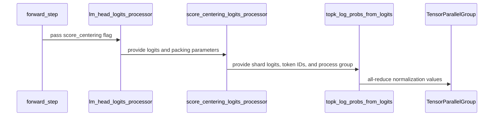

# [algo, megatron, cfg, doc, tests] feat: score centering on the Megatron actor

[Upstream PR](https://github.com/verl-project/verl/pull/8199) · state: open · merged: False

## Original PR description

### What does this PR do?

Score centering (#8010, #8196) on the Megatron actor. The sampler head log-probs are normalized over the vocab-parallel shards (row max and normalizer all-reduced over the TP group, masked local gather summed, backward local), the heads are split by context parallel like top-k distillation, and the Megatron logits processor runs the hook on the `score_centering` micro-batch flag. The cross entropy gets a copy of the logits under score centering: Megatron-Core shifts fp32 logits in place and the hook re-reads them in backward.

No open PR touches score centering on Megatron.

### Checklist Before Starting

- [x] Searched PRs for `score centering megatron`: none.
- [x] Title format.

### Test

- CPU: `pytest -q tests/trainer/ppo/test_score_centering_on_cpu.py tests/workers/test_score_centering_wiring_on_cpu.py tests/workers/test_megatron_distillation_only_on_cpu.py tests/workers/test_chunked_topk_log_probs_on_cpu.py tests/trainer/ppo/v1/test_agent_loop_tq_on_cpu.py` → 97 passed, 1 skipped. New: a gloo two-rank vocab-shard test (values equal on both ranks and to the single-shard result, concatenated shard gradients equal the full gradient), the Megatron hook gate, and the logits-copy check.
- GPU (2× RTX PRO 6000, vLLM 0.29.0 bf16 sampler, megatron-core 0.19.2, TE 2.16.1): Qwen3-0.6B on Countdown, `topk_log_probs=128`, Adam 1e-6 (Megatron-Core's distributed optimizer does not take SGD), 2 steps each, Megatron TP=2 vs FSDP:

  | sampling | step | actor | `sc_sampler_head_mass` | `sc_train_head_mass` | `sc_support_aligned` | `sc_correction` | `ppo_kl` |
  |---|---|---|---|---|---|---|---|
  | top_p=1 | 1 | Megatron TP=2 | 0.99979 | 0.99978 | 0.0 | −0.0242 | 0.0021 |
  | top_p=1 | 1 | FSDP | 0.99975 | 0.99975 | 0.0 | −0.0233 | 0.0021 |
  | top_p=1 | 2 | Megatron TP=2 | 0.99973 | 0.99973 | 0.0 | −0.0202 | 0.0004 |
  | top_p=1 | 2 | FSDP | 0.99964 | 0.99964 | 0.0 | −0.0191 | −0.0005 |
  | top_p=0.95, top_k=128 | 1 | Megatron TP=2 | 1.0 | 0.98786 | 1.0 | −0.00066 | 0.0031 |
  | top_p=0.95, top_k=128 | 1 | FSDP | 1.0 | 0.98799 | 1.0 | −0.00072 | 0.0031 |
  | top_p=0.95, top_k=128 | 2 | Megatron TP=2 | 1.0 | 0.98748 | 1.0 | −0.00056 | 0.0012 |
  | top_p=0.95, top_k=128 | 2 | FSDP | 1.0 | 0.98724 | 1.0 | −0.00041 | 0.0015 |

  Differences are rollout sampling noise; the truncated rows exercise the support receipts through the Megatron packing.

### API and Usage Example

`actor_rollout_ref.actor.strategy=megatron` with the same score-centering settings as FSDP. `use_fused_kernels`, `pad_to_length` and dynamic CP are rejected as for top-k distillation. Docs: `docs/algo/rollout_corr.md`.

### Design & Code Changes

See the diff. The support-mass shift in `score_centering_ppo_loss` is applied on the flat values: Megatron nests each hook output on its own offsets, so nested pointwise arithmetic between `log_probs` and `sc_log_support_mass` is rejected there.

AI assistance (Claude Code) was used; every changed line was reviewed and the tests above were run by the submitter.

### Checklist Before Submitting

- [x] Contribute Guide, pre-commit, docs, tests.

## Review and discussion

### reviews

### issue_comments

- coderabbitai[bot] · comment · 2026-10-24T21:24:52Z · [source](https://github.com/verl-project/verl/pull/8199#issuecomment-6389721894)

<!-- coderabbit-ai-generated:v1 -->

<!-- This is an auto-generated comment: summarize by coderabbit.ai -->
<!-- review_stack_entry_start -->

<a href="https://app.coderabbit.ai/change-stack/verl-project/verl/pull/8199?scope=ghh_OusAJGA4HG8ljoOV0wJvVx8NmnZIjc2DdjmxOu0xZWA&amp;cs_source=review_comment"><picture><source media="(prefers-color-scheme: dark)" srcset="https://storage.googleapis.com/coderabbit_public_assets/review-stack-in-coderabbit-ui-dark.svg?v=3"><source media="(prefers-color-scheme: light)" srcset="https://storage.googleapis.com/coderabbit_public_assets/review-stack-in-coderabbit-ui.svg?v=3"></picture></a>

<!-- review_stack_entry_end -->
<!-- recent_review_start -->

No actionable comments were generated in the recent review.

<strong><picture></picture> Recent review info</strong>

<dl>
<dd>

<strong><picture><source media="(prefers-color-scheme: dark)" srcset="https://storage.googleapis.com/coderabbit_public_assets/review-comment-icons-v1/cog-dark.svg"></picture> Run configuration</strong>

<dl>
<dd>

- **Source mode**: Auto
- **Repository**: Unavailable
- **Branch**: Unavailable
- **File**: No configuration file from this repository applied
- **Commit**: Unavailable
- **Layers**: Organization UI
- **Review profile**: CHILL
- **Plan**: Advanced
- **Run ID**: `7e3550e3-6610-4c60-b954-8b2dd46a93f6`

</dd>
</dl>

<strong><picture><source media="(prefers-color-scheme: dark)" srcset="https://storage.googleapis.com/coderabbit_public_assets/review-comment-icons-v1/git-commit-horizontal-dark.svg"></picture> Commits</strong>

<dl>
<dd>

Reviewing files that changed from the base of the PR and between 3c6d9b43b67c74ec343d77874cd8fa6e841523da and 61a8ac7d1b8fd1b867fe4637e09278a9ce2eaafa.

</dd>
</dl>

<strong><picture><source media="(prefers-color-scheme: dark)" srcset="https://storage.googleapis.com/coderabbit_public_assets/review-comment-icons-v1/file-plus-corner-dark.svg"></picture> Files selected for processing: 7</strong>

<dl>
<dd>

* `docs/algo/rollout_corr.md`
* `tests/trainer/ppo/test_score_centering_on_cpu.py`
* `tests/workers/test_megatron_distillation_only_on_cpu.py`
* `tests/workers/test_score_centering_wiring_on_cpu.py`
* `verl/trainer/ppo/score_centering.py`
* `verl/utils/config.py`
* `verl/workers/engine/megatron/transformer_impl.py`

</dd>
</dl>

**Included review availability:** This review used your included allowance. Your plan provides up to 10 included reviews per hour; 9 remain after this review.

</dd>
</dl>

<!-- recent_review_end -->
<!-- walkthrough_start -->

<strong>📝 Summary</strong>

<dl>
<dd>

<!-- This is an auto-generated comment: release notes by coderabbit.ai -->

## Summary by CodeRabbit

* **New Features**
  * Score centering now supports Megatron actors, including vocabulary-parallel logits and packed inputs.
  * Added support for calculating score-centering log probabilities across tensor-parallel groups.
* **Bug Fixes**
  * Preserved score-centering logits during Megatron log-probability calculations.
  * Corrected support-mass adjustments for jagged log-probability tensors.
  * Score centering now reports unsupported configurations involving dynamic context parallelism, padding to a fixed length, or fused kernels.

<!-- end of auto-generated comment: release notes by coderabbit.ai -->
Score centering now supports Megatron actors with vocabulary-parallel log-probability computation and packed-input processing. The Megatron engine wires the processor into its logits path, and PPO loss adjustment preserves nested-tensor offsets.

**Changes: Megatron Score Centering**

|Layer / File(s)|Summary|
|:---|:---|
|**Vocabulary-parallel log probabilities**   `verl/trainer/ppo/score_centering.py`, `tests/trainer/ppo/test_score_centering_on_cpu.py`|Log-probability computation now reduces normalization values across vocabulary shards and computes shard-local gradients for global token IDs. A two-process CPU test compares shard outputs and gradients with a full-vocabulary reference.|
|**Megatron score-centering integration**   `verl/utils/config.py`, `verl/trainer/ppo/score_centering.py`, `verl/workers/engine/megatron/transformer_impl.py`, `tests/trainer/ppo/test_score_centering_on_cpu.py`, `tests/workers/test_score_centering_wiring_on_cpu.py`, `tests/workers/test_megatron_distillation_only_on_cpu.py`, `docs/algo/rollout_corr.md`|Configuration accepts the Megatron strategy. The processor handles Megatron packed inputs and uses the tensor-model-parallel group. The engine invokes the processor when score centering is enabled, clones logits before log-probability calculation, and rejects score centering with dynamic context parallelism, `pad_to_length`, or fused kernels. CPU tests cover the wiring and processor behavior. Documentation describes the Megatron requirements.|
|**PPO loss and nested-tensor offsets**   `verl/trainer/ppo/score_centering.py`, `tests/trainer/ppo/test_score_centering_on_cpu.py`|The PPO loss forwards packing parameters to the logits processor. Support-mass shifts now apply to nested-tensor values while preserving offsets, with CPU test coverage.|

### Sequence Diagram(s)

</dd>
</dl>

<!-- walkthrough_end -->
<!-- change_assessment_start -->
<strong>Priority: <picture></picture> Normal</strong>

<!-- change_assessment_commit:"61a8ac7d1b8fd1b867fe4637e09278a9ce2eaafa" -->

<!-- change_assessment_end -->

<strong>Merge Risk:</strong> <strong><picture></picture> Minimal</strong> · up to <code>61a8a</code>

<dl>
<dd>

<!-- final_review_risk_start -->
<!-- final_review_risk_label
**Merge Risk:** **⚪ Minimal** · up to `61a8a`
-->
<!-- final_review_risk_coverage:{"sourceCommitId":"61a8ac7d1b8fd1b867fe4637e09278a9ce2eaafa","coveredCommitId":"61a8ac7d1b8fd1b867fe4637e09278a9ce2eaafa","kind":"reviewed"} -->

No concrete issue remains that should block merging after normal checks.
<!-- final_review_risk_end -->

</dd>
</dl>

<strong>Security architecture risk:</strong> <strong><picture></picture> Low</strong> · up to <code>61a8a</code>

<dl>
<dd>

<!-- architecture_review_start -->
<!-- architecture_review_label
### Security Architecture Review

**Security architecture risk:** **🔵 Low** · up to `61a8a`
-->

The change remains within the existing training workflow, with explicit compatibility checks and protection against unintended tensor mutation. No new privilege or cross-tenant exposure was established. Distributed interruption and recovery behavior remains only partially verified.

**Retained concerns**
No architecture-level concerns identified.

<strong>Security review details</strong>

<dl>
<dd>

**Security Blast Radius**
- _inferred_ — The reviewed path exposes sampler-head values to the configured actor loss and tensor-parallel ranks within an existing training job. No new identity transition or privilege-bearing sink was identified in this path; external tenant isolation and configuration authorization were not established by the inspected source.

**Trust Boundaries and Controls**
- _observed_ — Configuration validation retains matching actor/algorithm settings and rejects distillation combined with score centering. The engine rejects dynamic context parallelism, pad_to_length and fused-kernel combinations for this feature, while the processor requires THD input.

**Resilience and Maintainability Implications**
- _observed_ — Normal batch completion clears router-replay state, but an exception before completion can bypass that cleanup. This success-path-only cleanup pattern predates the PR. The training context clears gradients on exception; recovery of replay state and interrupted distributed execution was not demonstrated.

</dd>
</dl>

<!-- architecture_review_end -->

</dd>
</dl>

<!-- pre_merge_checks_walkthrough_start -->

<strong>Pre-merge checks: <picture></picture> 4 · <picture></picture> 1</strong>

<dl>
<dd>

<strong><picture></picture> Failed checks: 1 warning</strong>

|     Check name     |                                              Status                                              | Explanation                                                                                                                                                                                               | Resolution                                                                         |
| :---------------- | :----------------------------------------------------------------------------------------------: | :-------------------------------------------------------------------------------------------------------------------------------------------------------------------------------------------------------- | :--------------------------------------------------------------------------------- |
| Docstring Coverage |  | Docstring coverage is 30.56% which is insufficient. The required threshold is 80.00%. Docstring coverage is scoped to functions touched by this diff. Analyzed 36 functions across 6 files. (1 skipped: … | Write docstrings for the functions missing them to satisfy the coverage threshold. |

<strong><picture></picture> Passed checks: 4 passed</strong>

<dl>
<dd>

|         Check name         |                                             Status                                             | Explanation                                                                                                                                                                    |
| :------------------------ | :--------------------------------------------------------------------------------------------: | :----------------------------------------------------------------------------------------------------------------------------------------------------------------------------- |
|         Title check        |  | The title clearly identifies the main change: adding score centering support for the Megatron actor. The prefixes provide relevant scope without obscuring the primary change. |
|      Description check     |  | The description directly explains the Megatron score-centering implementation, limitations, tests, GPU validation, configuration, and documentation changes.                   |
|     Linked Issues check    |  | Check skipped because no linked issues were found for this pull request.                                                                                                       |
| Out of Scope Changes check |  | Check skipped because no linked issues were found for this pull request.                                                                                                       |

</dd>
</dl>

<strong>Full details: Docstring Coverage</strong>

<dl>
<dd>

**Explanation**

Docstring coverage is 30.56% which is insufficient. The required threshold is 80.00%. Docstring coverage is scoped to functions touched by this diff. Analyzed 36 functions across 6 files. (1 skipped: 1 unsupported.)

**Resolution**

Write docstrings for the functions missing them to satisfy the coverage threshold.

</dd>
</dl>

</dd>
</dl>

<!-- pre_merge_checks_walkthrough_end -->
<!-- autopilot:start -->
- [ ] <!-- {"checkboxId":"2708ad07-9f24-4260-9c11-7dc76a49f2e3"} --> <strong title="Keep fixing CodeRabbit findings and required CI, and resolving merge conflicts">Autofix</strong> · Keep fixing CodeRabbit findings and required CI, and resolving merge conflicts
<!-- autopilot:end -->
<!-- tips_start -->

Comment `@coderabbitai help` to get the list of available commands.

<!-- tips_end -->

### inline_comments

## Changed files and fixed code

- `docs/algo/rollout_corr.md` · modified · additions 3 / deletions 3
  - [head](https://github.com/cr-gao/verl/blob/61a8ac7d1b8fd1b867fe4637e09278a9ce2eaafa/docs/algo/rollout_corr.md)
  - [base](https://github.com/verl-project/verl/blob/3c6d9b43b67c74ec343d77874cd8fa6e841523da/docs/algo/rollout_corr.md)
- `tests/trainer/ppo/test_score_centering_on_cpu.py` · modified · additions 104 / deletions 3
  - [head](https://github.com/cr-gao/verl/blob/61a8ac7d1b8fd1b867fe4637e09278a9ce2eaafa/tests/trainer/ppo/test_score_centering_on_cpu.py)
  - [base](https://github.com/verl-project/verl/blob/3c6d9b43b67c74ec343d77874cd8fa6e841523da/tests/trainer/ppo/test_score_centering_on_cpu.py)
- `tests/workers/test_megatron_distillation_only_on_cpu.py` · modified · additions 1 / deletions 0
  - [head](https://github.com/cr-gao/verl/blob/61a8ac7d1b8fd1b867fe4637e09278a9ce2eaafa/tests/workers/test_megatron_distillation_only_on_cpu.py)
  - [base](https://github.com/verl-project/verl/blob/3c6d9b43b67c74ec343d77874cd8fa6e841523da/tests/workers/test_megatron_distillation_only_on_cpu.py)
- `tests/workers/test_score_centering_wiring_on_cpu.py` · modified · additions 77 / deletions 0
  - [head](https://github.com/cr-gao/verl/blob/61a8ac7d1b8fd1b867fe4637e09278a9ce2eaafa/tests/workers/test_score_centering_wiring_on_cpu.py)
  - [base](https://github.com/verl-project/verl/blob/3c6d9b43b67c74ec343d77874cd8fa6e841523da/tests/workers/test_score_centering_wiring_on_cpu.py)
- `verl/trainer/ppo/score_centering.py` · modified · additions 103 / deletions 31
  - [head](https://github.com/cr-gao/verl/blob/61a8ac7d1b8fd1b867fe4637e09278a9ce2eaafa/verl/trainer/ppo/score_centering.py)
  - [base](https://github.com/verl-project/verl/blob/3c6d9b43b67c74ec343d77874cd8fa6e841523da/verl/trainer/ppo/score_centering.py)
- `verl/utils/config.py` · modified · additions 2 / deletions 2
  - [head](https://github.com/cr-gao/verl/blob/61a8ac7d1b8fd1b867fe4637e09278a9ce2eaafa/verl/utils/config.py)
  - [base](https://github.com/verl-project/verl/blob/3c6d9b43b67c74ec343d77874cd8fa6e841523da/verl/utils/config.py)
- `verl/workers/engine/megatron/transformer_impl.py` · modified · additions 18 / deletions 5
  - [head](https://github.com/cr-gao/verl/blob/61a8ac7d1b8fd1b867fe4637e09278a9ce2eaafa/verl/workers/engine/megatron/transformer_impl.py)
  - [base](https://github.com/verl-project/verl/blob/3c6d9b43b67c74ec343d77874cd8fa6e841523da/verl/workers/engine/megatron/transformer_impl.py)

## Evidence and interpretation boundary

[Original JSON, discussions and patches](../../../../../../evidence/prs/verl-project--verl/8199-fadf94cc9a907dd102a8bcdf7c8371c21ff5fd38cc99001d45ea7db09a1a0b27.json) · SHA-256 `fadf94cc9a907dd102a8bcdf7c8371c21ff5fd38cc99001d45ea7db09a1a0b27`.

Diff complete: True. Missing/binary/truncated patches require pinned source inspection. This is a source page, not an independently verified optimization case. Open, merged and released are different states; recheck the deployed dependency.
