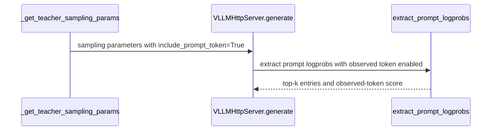

# [algo, trainer, vllm] feat: add ResOPD sparse on-policy distillation

[Upstream PR](https://github.com/verl-project/verl/pull/8228) · state: open · merged: False

## Original PR description

### What does this PR do?

Add `distillation.distillation_loss.loss_mode=resopd`, implementing [ResOPD: Tail Residualization for Sparse On-Policy Distillation](https://arxiv.org/abs/2610.04882) from the [implementation](https://github.com/InternLM/ResOPD). ResOPD integrates the teacher top-k head and aggregate tail analytically and samples only the within-tail residual, estimating the full-vocabulary reverse-KL gradient.

Use an existing synchronous OPD configuration with:

```yaml
distillation.distillation_loss.loss_mode: resopd
distillation.distillation_loss.topk: 4
distillation.distillation_loss.use_policy_gradient: false
distillation.distillation_loss.use_task_rewards: false
distillation.distillation_loss.loss_max_clamp: null
distillation.distillation_loss.log_prob_min_clamp: null
actor_rollout_ref.model.use_fused_kernels: false
actor_rollout_ref.actor.use_torch_compile: false
```

See `docs/algo/opd.md` for the complete configuration overrides.

### Duplicate-work check

Searched [ResOPD](https://github.com/verl-project/verl/pulls?q=is%3Apr+is%3Aopen+ResOPD), [distillation](https://github.com/verl-project/verl/pulls?q=is%3Apr+is%3Aopen+distillation), and tail residual; inspected the related PRs and #6676 discussion.

- #7855 adds coarse **forward** KL with a tail bucket; it does not sample the within-tail residual to estimate full reverse KL.
- #7590 / #7806 implement truncated reverse KL on the **student** top-k support. ResOPD uses teacher top-k plus the actual sampled token and does not require the fixed-token scoring extension in #7806.

### Test

Python 3.12.12, PyTorch 2.10.0, CPU only, one thread:

```bash
CUDA_VISIBLE_DEVICES= OMP_NUM_THREADS=1 MKL_NUM_THREADS=1 OPENBLAS_NUM_THREADS=1 \
  PYTEST_DISABLE_PLUGIN_AUTOLOAD=1 python -m pytest -q \
  tests/trainer/test_resopd_on_cpu.py \
  tests/trainer/test_resopd_integration_on_cpu.py \
  tests/workers/rollout/test_vllm_weight_update_utils_on_cpu.py
# 45 passed

# With the same CPU/thread environment:
python -m pytest tests/workers/test_distillation_topk_symmetry_on_cpu.py -q
# 6 passed
```

Coverage: independent per-action gradient formula and expected full reverse-KL gradient (all five actions, four support sizes, three seeds), teacher detachment, low precision, negative surrogate values, teacher requests, causal response masking, sequence-parallel slicing/padding, and unchanged legacy parser behavior. Teacher RPC and SP ranks are mocked; no model weights are loaded.

All 14 configured pre-commit hooks passed on the changed files, including generated-config verification, Ruff, mypy, license and compilation checks. `git diff --check` and the PR-title validator passed. An AST comparison confirms that `resopd_loss` has identical logic to the authors' release.

An end-to-end GPU training run of this upstream port has not been performed. CPU validation used PyTorch 2.10.0, rather than the current upstream lock's 2.13.0; the repository dependency files are unchanged.

### Checklist Before Submitting

- [x] Read CONTRIBUTING.md and AGENTS.md; checked for duplicate work.
- [x] Added documentation and CPU tests discovered by the existing `*_on_cpu.py` workflow.
- [x] Pre-commit checks on all changed files.
- [x] Reviewed by the ResOPD author; the requested documentation edit is included.
- [x] Maintainer CI authorization, if required.

AI assistance: this port and its tests were prepared with OpenAI Codex assistance at the ResOPD author's request.


## Review and discussion

### reviews

### issue_comments

- coderabbitai[bot] · comment · 2026-10-14T05:26:52Z · [source](https://github.com/verl-project/verl/pull/8228#issuecomment-6161582367)

<!-- This is an auto-generated comment: summarize by coderabbit.ai -->
<!-- review_stack_entry_start -->

<a href="https://app.coderabbit.ai/change-stack/verl-project/verl/pull/8228?scope=ghh_OusAJGA4HG8ljoOV0wJvVx8NmnZIjc2DdjmxOu0xZWA&amp;cs_source=review_comment"><picture><source media="(prefers-color-scheme: dark)" srcset="https://storage.googleapis.com/coderabbit_public_assets/review-stack-in-coderabbit-ui-dark.svg?v=3"><source media="(prefers-color-scheme: light)" srcset="https://storage.googleapis.com/coderabbit_public_assets/review-stack-in-coderabbit-ui.svg?v=3"></picture></a>

<!-- review_stack_entry_end -->
<!-- recent_review_start -->

No actionable comments were generated in the recent review. 🎉

<details>
<summary><strong>ℹ️ Recent review info</strong></summary>
<dl>
<dd>

<details>
<summary><strong>⚙️ Run configuration</strong></summary>
<dl>
<dd>

- **Configuration used**: Organization UI
- **Review profile**: CHILL
- **Plan**: Advanced
- **Run ID**: `ae75439f-cd4d-4dde-881d-212276e95885`

</dd>
</dl>
</details>

<details>
<summary><strong>📥 Commits</strong></summary>
<dl>
<dd>

Reviewing files that changed from the base of the PR and between 770fdff72acfb5c8e330f8468ac5425a542e5c9f and fef6c718d4257b97457fa069652c3d15d90f016d.

</dd>
</dl>
</details>

<details>
<summary><strong>📒 Files selected for processing: 8</strong></summary>
<dl>
<dd>

* `docs/algo/opd.md`
* `tests/workers/rollout/test_vllm_weight_update_utils_on_cpu.py`
* `verl/trainer/distillation/fsdp/losses.py`
* `verl/trainer/distillation/losses.py`
* `verl/trainer/distillation/resopd.py`
* `verl/workers/config/distillation.py`
* `verl/workers/rollout/vllm_rollout/utils.py`
* `verl/workers/rollout/vllm_rollout/vllm_async_server.py`

</dd>
</dl>
</details>

**Included review availability:** This review used your included allowance. Your plan provides up to 10 included reviews per hour; 9 remain after this review.

</dd>
</dl>
</details>


<!-- recent_review_end -->
<!-- walkthrough_start -->

<details>
<summary><strong>📝 Summary</strong></summary>
<dl>
<dd>

<!-- This is an auto-generated comment: release notes by coderabbit.ai -->

## Summary by CodeRabbit

* **New Features**
  * Added ResOPD distillation with teacher top-k and observed-token scoring for supported training backends.
  * Added optional observed prompt-token scores alongside top-k prompt log probabilities.
* **Documentation**
  * Added guidance on ResOPD behavior, numerical handling, metrics, and configuration.
* **Bug Fixes**
  * Improved validation and error reporting for unsupported ResOPD configurations and malformed teacher-score data.
* **Tests**
  * Added CPU coverage for ResOPD losses, integrations, and prompt-logprob extraction.

<!-- end of auto-generated comment: release notes by coderabbit.ai -->
This change adds ResOPD loss calculation and connects it to teacher prompt-logprob extraction and supported distillation backends. It adds configuration validation, loss collection, documentation, and CPU tests for estimator behavior and trainer integration.

**Changes: ResOPD distillation**

|Layer / File(s)|Summary|
|:---|:---|
|**ResOPD loss and configuration** <br> `verl/trainer/distillation/resopd.py`, `verl/workers/config/distillation.py`, `tests/trainer/test_resopd_on_cpu.py`, `tests/trainer/test_resopd_integration_on_cpu.py`, `tests/special_sanity/check_license.py`|Adds the ResOPD estimator and rejects unsupported configurations. CPU tests cover gradients, numerical behavior, and input validation.|
|**Observed-token score retrieval** <br> `verl/experimental/teacher_loop/teacher_manager.py`, `verl/workers/rollout/vllm_rollout/*`, `tests/workers/rollout/test_vllm_weight_update_utils_on_cpu.py`, `tests/trainer/test_resopd_integration_on_cpu.py`|For ResOPD, requests the observed prompt token’s score from vLLM and appends it after the top-k entries. Tests cover sampling parameters and prompt-logprob extraction.|
|**Trainer integration and validation** <br> `verl/trainer/distillation/losses.py`, `verl/trainer/distillation/fsdp/losses.py`, `tests/trainer/test_resopd_integration_on_cpu.py`, `docs/algo/opd.md`|Routes ResOPD through FSDP, validates teacher payloads, and collects padded losses and diagnostic metrics. Documentation describes the estimator and configuration requirements.|

### Sequence Diagram(s)



</dd>
</dl>
</details>

<!-- walkthrough_end -->
<!-- change_assessment_start -->
**Priority:** ➖ Normal

<!-- change_assessment_commit:"fef6c718d4257b97457fa069652c3d15d90f016d" -->

<!-- change_assessment_end -->
<details>
<summary><strong>Merge Risk:</strong> <strong>⚪ Minimal</strong> · up to <code>fef6c</code></summary>
<dl>
<dd>

<!-- final_review_risk_start -->
<!-- final_review_risk_label
**Merge Risk:** **⚪ Minimal** · up to `fef6c`
-->
<!-- final_review_risk_coverage:{"sourceCommitId":"fef6c718d4257b97457fa069652c3d15d90f016d","coveredCommitId":"fef6c718d4257b97457fa069652c3d15d90f016d","kind":"reviewed"} -->

This adds an opt-in ResOPD distillation loss mode. Other loss modes keep their existing behavior. CPU tests cover the estimator and the trainer integration, and no merge-blocking concern was identified.
<!-- final_review_risk_end -->

</dd>
</dl>
</details>

<details>
<summary><strong>Security architecture risk:</strong> <strong>🔵 Low</strong> · up to <code>fef6c</code></summary>
<dl>
<dd>

<!-- architecture_review_start -->
<!-- architecture_review_label
### Security Architecture Review

**Security architecture risk:** **🔵 Low** · up to `fef6c`
-->

This is an opt-in data-contract change with explicit compatibility checks. No introduced attack path was established, but deployment-level authorization and some failure behavior remain unverified.

**Retained concerns**
No architecture-level concerns identified.


<details>
<summary><strong>Security review details</strong></summary>
<dl>
<dd>

**Security Blast Radius**
- _inferred_ — The inspected effect is on teacher-score responses and the student training batches consuming them. ResOPD does not select a new service destination or grant additional teacher-selection authority. Deployment-wide tenant and network exposure cannot be established from this path.

**Trust Boundaries and Controls**
- _observed_ — Configured-key teacher routing is preserved from the base. The consumer validates payload structure but continues to trust teacher-supplied IDs and scores; it does not authenticate their semantic correspondence to the training response. That teacher trust predates this PR and is not evidence of a newly introduced attack path.

**Resilience and Maintainability Implications**
- _observed_ — Teacher requests use fresh request IDs and construct returned score tensors locally. The inspected aborted-output branch returns no prompt-score fields, while the manager requires those fields before returning tensors; this path fails rather than substituting fabricated or cached scores.

</dd>
</dl>
</details>

<!-- architecture_review_end -->

</dd>
</dl>
</details>
<!-- pre_merge_checks_walkthrough_start -->

<details>
<summary><strong>Pre-merge checks: <sup><picture></picture></sup> 4 · <sup><picture></picture></sup> 1</strong></summary>
<dl>
<dd>

<strong><sup><picture></picture></sup> Failed checks: 1 warning</strong>

|     Check name     |                                              Status                                              | Explanation                                                                                                                                                                                               | Resolution                                                                         |
| :---------------- | :----------------------------------------------------------------------------------------------: | :-------------------------------------------------------------------------------------------------------------------------------------------------------------------------------------------------------- | :--------------------------------------------------------------------------------- |
| Docstring Coverage |  | Docstring coverage is 37.93% which is insufficient. The required threshold is 80.00%. Docstring coverage is scoped to functions touched by this diff. Analyzed 29 functions across 11 files. (1 skipped:… | Write docstrings for the functions missing them to satisfy the coverage threshold. |

<details>
<summary><strong><sup><picture></picture></sup> Passed checks: 4 passed</strong></summary>
<dl>
<dd>

|         Check name         |                                             Status                                             | Explanation                                                                                                                                        |
| :------------------------ | :--------------------------------------------------------------------------------------------: | :------------------------------------------------------------------------------------------------------------------------------------------------- |
|         Title check        |  | The title clearly and concisely identifies the addition of ResOPD sparse on-policy distillation and accurately reflects the main changeset.        |
|      Description check     |  | The description directly explains the ResOPD implementation, configuration, testing, documentation, limitations, and relationship to related work. |
|     Linked Issues check    |  | Check skipped because no linked issues were found for this pull request.                                                                           |
| Out of Scope Changes check |  | Check skipped because no linked issues were found for this pull request.                                                                           |

</dd>
</dl>
</details>

<details>
<summary><strong>Full details: Docstring Coverage</strong></summary>
<dl>
<dd>

**Explanation**

Docstring coverage is 37.93% which is insufficient. The required threshold is 80.00%. Docstring coverage is scoped to functions touched by this diff. Analyzed 29 functions across 11 files. (1 skipped: 1 unsupported.)

**Resolution**

Write docstrings for the functions missing them to satisfy the coverage threshold.

</dd>
</dl>
</details>

</dd>
</dl>
</details>

<!-- pre_merge_checks_walkthrough_end -->

- [ ] <!-- {"checkboxId":"585bb3f6-faf5-4dbf-96d2-74e382adf19a"} --> Fix all pre-merge checks with AI
<!-- autopilot:start -->
- [ ] <!-- {"checkboxId":"2708ad07-9f24-4260-9c11-7dc76a49f2e3"} --> <strong title="Keep fixing CodeRabbit findings and required CI, and resolving merge conflicts">Autofix</strong> · Keep fixing CodeRabbit findings and required CI, and resolving merge conflicts
<!-- autopilot:end -->
<!-- tips_start -->


<sub>Comment `@coderabbitai help` to get the list of available commands.</sub>

<!-- tips_end -->

- JacobHelwig · comment · 2026-10-19T21:21:46Z · [source](https://github.com/verl-project/verl/pull/8228#issuecomment-6277592794)

Hi @yph22 , I think that this PR has substantial overlap with https://github.com/verl-project/verl/pull/7855 cc @wuxibin89 

- yph22 · comment · 2026-10-20T03:00:20Z · [source](https://github.com/verl-project/verl/pull/8228#issuecomment-6282308626)

Thanks for pointing this out. I’ve updated this PR against the latest `main` after #7855 was merged.
#7855 adds the coarse-grained forward-KL loss (`forward_kl_topk_tail`), while this PR implements ResOPD for the full reverse-KL gradient with a sampled within-tail residual. They share the top-k/tail decomposition but use different objectives and teacher payloads, so ResOPD remains a separate opt-in loss mode.

### inline_comments

## Changed files and fixed code

- `docs/algo/opd.md` · modified · additions 108 / deletions 4
  - [head](https://github.com/yph22/verl/blob/fef6c718d4257b97457fa069652c3d15d90f016d/docs/algo/opd.md)
  - [base](https://github.com/verl-project/verl/blob/5a8dd519ab32bfd36d2509a137f830ba79e89c54/docs/algo/opd.md)
- `tests/special_sanity/check_license.py` · modified · additions 2 / deletions 0
  - [head](https://github.com/yph22/verl/blob/fef6c718d4257b97457fa069652c3d15d90f016d/tests/special_sanity/check_license.py)
  - [base](https://github.com/verl-project/verl/blob/5a8dd519ab32bfd36d2509a137f830ba79e89c54/tests/special_sanity/check_license.py)
- `tests/trainer/test_resopd_integration_on_cpu.py` · added · additions 160 / deletions 0
  - [head](https://github.com/yph22/verl/blob/fef6c718d4257b97457fa069652c3d15d90f016d/tests/trainer/test_resopd_integration_on_cpu.py)
  - [base](https://github.com/verl-project/verl/blob/5a8dd519ab32bfd36d2509a137f830ba79e89c54/tests/trainer/test_resopd_integration_on_cpu.py)
- `tests/trainer/test_resopd_on_cpu.py` · added · additions 105 / deletions 0
  - [head](https://github.com/yph22/verl/blob/fef6c718d4257b97457fa069652c3d15d90f016d/tests/trainer/test_resopd_on_cpu.py)
  - [base](https://github.com/verl-project/verl/blob/5a8dd519ab32bfd36d2509a137f830ba79e89c54/tests/trainer/test_resopd_on_cpu.py)
- `tests/workers/rollout/test_vllm_weight_update_utils_on_cpu.py` · modified · additions 39 / deletions 0
  - [head](https://github.com/yph22/verl/blob/fef6c718d4257b97457fa069652c3d15d90f016d/tests/workers/rollout/test_vllm_weight_update_utils_on_cpu.py)
  - [base](https://github.com/verl-project/verl/blob/5a8dd519ab32bfd36d2509a137f830ba79e89c54/tests/workers/rollout/test_vllm_weight_update_utils_on_cpu.py)
- `verl/experimental/teacher_loop/teacher_manager.py` · modified · additions 8 / deletions 3
  - [head](https://github.com/yph22/verl/blob/fef6c718d4257b97457fa069652c3d15d90f016d/verl/experimental/teacher_loop/teacher_manager.py)
  - [base](https://github.com/verl-project/verl/blob/5a8dd519ab32bfd36d2509a137f830ba79e89c54/verl/experimental/teacher_loop/teacher_manager.py)
- `verl/trainer/distillation/fsdp/losses.py` · modified · additions 22 / deletions 0
  - [head](https://github.com/yph22/verl/blob/fef6c718d4257b97457fa069652c3d15d90f016d/verl/trainer/distillation/fsdp/losses.py)
  - [base](https://github.com/verl-project/verl/blob/5a8dd519ab32bfd36d2509a137f830ba79e89c54/verl/trainer/distillation/fsdp/losses.py)
- `verl/trainer/distillation/losses.py` · modified · additions 35 / deletions 0
  - [head](https://github.com/yph22/verl/blob/fef6c718d4257b97457fa069652c3d15d90f016d/verl/trainer/distillation/losses.py)
  - [base](https://github.com/verl-project/verl/blob/5a8dd519ab32bfd36d2509a137f830ba79e89c54/verl/trainer/distillation/losses.py)
- `verl/trainer/distillation/resopd.py` · added · additions 112 / deletions 0
  - [head](https://github.com/yph22/verl/blob/fef6c718d4257b97457fa069652c3d15d90f016d/verl/trainer/distillation/resopd.py)
  - [base](https://github.com/verl-project/verl/blob/5a8dd519ab32bfd36d2509a137f830ba79e89c54/verl/trainer/distillation/resopd.py)
- `verl/workers/config/distillation.py` · modified · additions 10 / deletions 0
  - [head](https://github.com/yph22/verl/blob/fef6c718d4257b97457fa069652c3d15d90f016d/verl/workers/config/distillation.py)
  - [base](https://github.com/verl-project/verl/blob/5a8dd519ab32bfd36d2509a137f830ba79e89c54/verl/workers/config/distillation.py)
- `verl/workers/rollout/vllm_rollout/utils.py` · modified · additions 20 / deletions 5
  - [head](https://github.com/yph22/verl/blob/fef6c718d4257b97457fa069652c3d15d90f016d/verl/workers/rollout/vllm_rollout/utils.py)
  - [base](https://github.com/verl-project/verl/blob/5a8dd519ab32bfd36d2509a137f830ba79e89c54/verl/workers/rollout/vllm_rollout/utils.py)
- `verl/workers/rollout/vllm_rollout/vllm_async_server.py` · modified · additions 2 / deletions 0
  - [head](https://github.com/yph22/verl/blob/fef6c718d4257b97457fa069652c3d15d90f016d/verl/workers/rollout/vllm_rollout/vllm_async_server.py)
  - [base](https://github.com/verl-project/verl/blob/5a8dd519ab32bfd36d2509a137f830ba79e89c54/verl/workers/rollout/vllm_rollout/vllm_async_server.py)

## Evidence and interpretation boundary

[Original JSON, discussions and patches](../../../../../../evidence/prs/verl-project--verl/8228-fd369cc1733c53253e1441004d31e15ac15898f923e418035d1dbcd57e70b61f.json) · SHA-256 `fd369cc1733c53253e1441004d31e15ac15898f923e418035d1dbcd57e70b61f`.

Diff complete: True. Missing/binary/truncated patches require pinned source inspection. This is a source page, not an independently verified optimization case. Open, merged and released are different states; recheck the deployed dependency.
