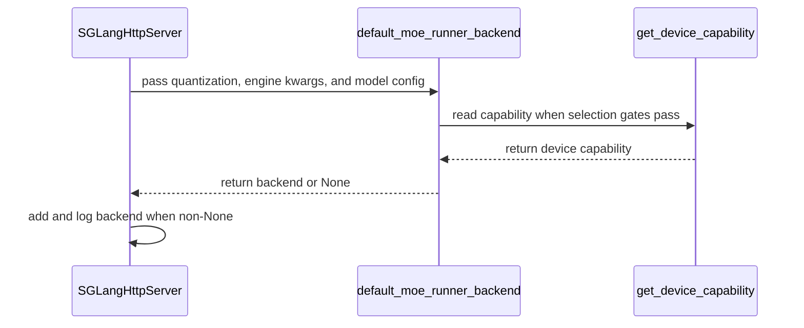

# [rollout, sglang] fix: use SGLang's Triton MoE runner for bf16 rollouts on Blackwell

[Upstream PR](https://github.com/verl-project/verl/pull/8230) · state: closed · merged: True

## Original PR description

### What does this PR do?

Fixes #8229: on Blackwell, a bf16 SGLang rollout of a Qwen3-MoE model crashes at the first weight sync.

On compute capability 10.x, SGLang resolves `moe_runner_backend=auto` to `flashinfer_trtllm` for unquantized Qwen3-MoE-family checkpoints. That runner keeps bf16 expert weights in a block layout, and `update_weights_from_tensor` restores the load-time shape only for `flashinfer_trtllm_routed`. The first sync therefore fails in `FusedMoE._load_w13` (`The size of tensor a (64) must match the size of tensor b (512)`), and the SGLang scheduler exits. Upstream: sgl-project/sglang#27787. It still reproduces on sglang 0.5.20 and 0.5.21; the fixes in sgl-project/sglang#33743 and sgl-project/sglang#44163 are not merged.

This PR has verl ask SGLang for the Triton MoE runner under the same conditions in which SGLang picks `flashinfer_trtllm` on sm100 (its Qwen3-MoE- and DeepSeek-family rules), that is when all of the following hold:
- neither the rollout nor the checkpoint is quantized: `rollout.quantization` is unset and the HF config has no `quantization_config`, which SGLang would detect on its own;
- `engine_kwargs.sglang.moe_runner_backend` is unset or `auto`;
- `engine_kwargs.sglang.moe_a2a_backend` is unset or `none`;
- the GPU is CUDA with compute capability 10.x.

Triton is the runner SGLang's unquantized MoE method falls back to everywhere else, and it takes weight updates. The following keep SGLang's own choice:
- quantized rollouts or checkpoints;
- an a2a backend;
- an explicit runner;
- Hopper and other GPUs;
- ROCm.

The architecture lists are not copied. On other architectures SGLang already lands on Triton, so the default changes nothing there.

### Checklist Before Starting

- [x] Search for similar PRs. No open issue or PR covers this:
  - [moe_runner_backend](https://github.com/verl-project/verl/pulls?q=is%3Apr+moe_runner_backend)
  - [flashinfer_trtllm bf16](https://github.com/verl-project/verl/pulls?q=is%3Apr+flashinfer_trtllm+bf16)
  - [_load_w13](https://github.com/verl-project/verl/issues?q=_load_w13)

  The closest is #7978 (closed), the same failure mode on vLLM's TRT-LLM MoE backend.
- [x] Format the PR title as `[{modules}] {type}: {description}`

### Test

- **CPU unit test, run and then removed at review:** a 16-case test of `default_moe_runner_backend` (each condition above, `engine_kwargs` as an OmegaConf `DictConfig`, ROCm, and capabilities 9.0, 10.0, 10.3, 12.0 and unknown) passed locally: 25 passed together with `test_lora_merge_mode_on_cpu.py`. A maintainer asked to drop it, and `e8080be0` removes it.
- **pre-commit on the changed files:** ruff, ruff format, mypy, license, docstring coverage, device API usage and test structure all pass. `autogen-trainer-cfg` could not run locally because hydra-core is missing there; no config file changes.
- **On 1×B200**, this PR against its base on the same pod with the same config; nothing sets `moe_runner_backend`. Environment: verl main's `uv.lock` (sglang 0.5.20, flashinfer 0.6.18, TE 2.16.1, torch 2.13.0+cu130), Megatron backend, a random 2-layer Qwen3-MoE (8 experts), GSM8K, bf16 SGLang rollout, 4 steps.

  | verl | MoE runner | Result |
  |---|---|---|
  | this PR (`8b9ca7df`) | Triton, picked by this PR. Server log: `sglang moe_runner_backend=triton: SGLang's default on Blackwell cannot take bf16 weight updates (sgl-project/sglang#27787); ...` | 4/4 steps, exit 0. rollout_corr/kl by step: 1.8e-4, 6.1e-5, 1.2e-4, 4.3e-5 |
  | base main (`2bc6ac46`) | SGLang's default `flashinfer_trtllm` (the server autotunes `flashinfer::trtllm_bf16_moe`) | Fails at the first weight sync: `RuntimeError: The size of tensor a (64) must match the size of tensor b (512) at non-singleton dimension 2` in `FusedMoE._load_w13`, then "Scheduler hit an exception" and exit 1 |

  On that GPU (compute capability 10.0), `default_moe_runner_backend` returns `"triton"` for bf16, `None` for fp8, and `None` when a runner is set explicitly.

  These runs used `8b9ca7df`, before `1d2f5ad5` narrowed the conditions above. The validated case meets every one of them, so the result carries over: a bf16 rollout of an unquantized checkpoint, no a2a backend, runner unset.

### API and Usage Example

No API change. To keep SGLang's own choice on Blackwell, set it explicitly, for example:

```
+actor_rollout_ref.rollout.engine_kwargs.sglang.moe_runner_backend=flashinfer_trtllm
```

### Design & Code Changes

- `verl/workers/rollout/sglang_rollout/utils.py`: new `default_moe_runner_backend(quantization, engine_kwargs, hf_config)`. It returns `"triton"` under the conditions listed above, and `None` otherwise, which keeps SGLang's choice.
- `verl/workers/rollout/sglang_rollout/async_sglang_server.py`: `launch_server` passes the rollout quantization, `engine_kwargs` and the model's HF config, applies the result to the server args, and logs the choice.

The default can be dropped once SGLang restores the layout for `flashinfer_trtllm` itself.

### Checklist Before Submitting

- [x] Read the [Contribute Guide](https://github.com/verl-project/verl/blob/main/CONTRIBUTING.md).
- [x] Apply pre-commit checks (see Test; `autogen-trainer-cfg` needs hydra-core, no config changes here).
- [ ] Add / Update the documentation: not needed, no user-facing option changes.
- [ ] Add unit test(s): none in the final diff; the CPU test was removed at review (see Test).
- [ ] Once your PR is ready for CI, send a message in the `ci-request` channel.

AI assistance was used for the investigation, the code change and this description.


## Review and discussion

### reviews

- wuxibin89 · DISMISSED · 2026-10-14T11:03:07Z · [source](https://github.com/verl-project/verl/pull/8230#pullrequestreview-5516897362)

(No body; status only.)

- wuxibin89 · APPROVED · 2026-10-14T11:58:07Z · [source](https://github.com/verl-project/verl/pull/8230#pullrequestreview-5517496395)

(No body; status only.)

### issue_comments

- coderabbitai[bot] · comment · 2026-10-14T06:21:23Z · [source](https://github.com/verl-project/verl/pull/8230#issuecomment-6162257032)

<!-- This is an auto-generated comment: summarize by coderabbit.ai -->
<!-- review_stack_entry_start -->

<a href="https://app.coderabbit.ai/change-stack/verl-project/verl/pull/8230?scope=ghh_OusAJGA4HG8ljoOV0wJvVx8NmnZIjc2DdjmxOu0xZWA&amp;cs_source=review_comment"><picture><source media="(prefers-color-scheme: dark)" srcset="https://storage.googleapis.com/coderabbit_public_assets/review-stack-in-coderabbit-ui-dark.svg?v=3"><source media="(prefers-color-scheme: light)" srcset="https://storage.googleapis.com/coderabbit_public_assets/review-stack-in-coderabbit-ui.svg?v=3"></picture></a>

<!-- review_stack_entry_end -->
<!-- recent_review_start -->

No actionable comments were generated in the recent review. 🎉

<details>
<summary><strong>ℹ️ Recent review info</strong></summary>
<dl>
<dd>

<details>
<summary><strong>⚙️ Run configuration</strong></summary>
<dl>
<dd>

- **Configuration used**: Organization UI
- **Review profile**: CHILL
- **Plan**: Advanced
- **Run ID**: `0f3f6b96-0397-4907-a5ba-78a98ed4f91f`

</dd>
</dl>
</details>

<details>
<summary><strong>📥 Commits</strong></summary>
<dl>
<dd>

Reviewing files that changed from the base of the PR and between 8b9ca7df1168ec9e3ccfb04dd0576c028aecd9ad and 1d2f5ad5be4ba05f46cb42be4c9fe9114572e07e.

</dd>
</dl>
</details>

<details>
<summary><strong>📒 Files selected for processing: 3</strong></summary>
<dl>
<dd>

* `tests/workers/rollout/rollout_sglang/test_moe_runner_default_on_cpu.py`
* `verl/workers/rollout/sglang_rollout/async_sglang_server.py`
* `verl/workers/rollout/sglang_rollout/utils.py`

</dd>
</dl>
</details>

**Included review availability:** This review used your included allowance. Your plan provides up to 10 included reviews per hour; 9 remain after this review.

</dd>
</dl>
</details>


<!-- recent_review_end -->
<!-- walkthrough_start -->

<details>
<summary><strong>📝 Summary</strong></summary>
<dl>
<dd>

<!-- This is an auto-generated comment: release notes by coderabbit.ai -->

## Summary by CodeRabbit

* **New Features**
  * SGLang now automatically selects the Triton MoE runner for supported BF16 workloads on compatible non-ROCm hardware when no runner or A2A backend is specified. Existing SGLang choices remain in effect for quantized workloads, explicit runner settings, and Deepep A2A configurations.
* **Tests**
  * Added coverage for runner selection across hardware capabilities, quantization settings, explicit backend choices, A2A configurations, and ROCm environments.

<!-- end of auto-generated comment: release notes by coderabbit.ai -->
The SGLang rollout server now selects `triton` for eligible unquantized configurations on compute-capability major version 10. The selection is skipped when an explicit runner or A2A backend is configured, or when the runtime uses HIP. Tests cover selection and exclusion conditions.

**Changes: SGLang MoE backend selection**

|Layer / File(s)|Summary|
|:---|:---|
|**Backend selection policy** <br> `verl/workers/rollout/sglang_rollout/utils.py`, `tests/workers/rollout/rollout_sglang/test_moe_runner_default_on_cpu.py`|Adds `default_moe_runner_backend` and tests device capabilities, quantization, runner and A2A settings, and HIP behavior.|
|**Server launch integration** <br> `verl/workers/rollout/sglang_rollout/async_sglang_server.py`|Calls the helper during server launch. The server adds and logs the backend only when the helper returns a value.|

### Sequence Diagram(s)



**Suggested reviewers:** `wuxibin89`

</dd>
</dl>
</details>

<!-- walkthrough_end -->
<!-- change_assessment_start -->
**Priority:** ➖ Normal

<!-- change_assessment_commit:"1d2f5ad5be4ba05f46cb42be4c9fe9114572e07e" -->
**Severity of issue fixed:** Medium
<!-- change_assessment_end -->
<details>
<summary><strong>Merge Risk:</strong> <strong>⚪ Minimal</strong> · up to <code>e8080</code></summary>
<dl>
<dd>

<!-- final_review_risk_start -->
**Merge Risk:** **⚪ Minimal** · up to `e8080`
<!-- final_review_risk_coverage:{"sourceCommitId":"1d2f5ad5be4ba05f46cb42be4c9fe9114572e07e","coveredCommitId":"e8080be0174addfad988b1d470648624a74af517","kind":"no_op_rewrite_carry_forward"} -->

<!-- final_review_risk_label
-->

This change defaults the Triton MoE runner on eligible Blackwell GPUs to avoid a weight-sync failure, and leaves all other configurations unchanged. No merge-blocking risk was identified.
<!-- final_review_risk_end -->

</dd>
</dl>
</details>

<details>
<summary><strong>Security architecture risk:</strong> <strong>🔵 Low</strong> · up to <code>1d2f5</code></summary>
<dl>
<dd>

<!-- architecture_review_start -->
<!-- architecture_review_label
### Security Architecture Review

**Security architecture risk:** **🔵 Low** · up to `1d2f5`
-->

The change narrowly adjusts an automatic GPU execution choice while preserving explicit non-automatic choices and existing launch permissions. No introduced security concern was identified, but hardware-level compatibility remains unverified in this review.

**Retained concerns**
No architecture-level concerns identified.


<details>
<summary><strong>Security review details</strong></summary>
<dl>
<dd>

**Security Blast Radius**
- _inferred_ — The direct effect is bounded to backend selection for existing eligible rollout servers. Configuration holders already able to select a runner gain no additional launch authority from this default.

**Trust Boundaries and Controls**
- _observed_ — The full PR comparison leaves the existing server callers, trust_remote_code handling, host handling, and engine subprocess launch path unchanged. The new configuration assignment does not add a request-driven path around those existing boundaries.

</dd>
</dl>
</details>
<!-- architecture_review_end -->

</dd>
</dl>
</details>
<!-- pre_merge_checks_walkthrough_start -->

<details>
<summary><strong>Pre-merge checks: <sup><picture></picture></sup> 4 · <sup><picture></picture></sup> 1</strong></summary>
<dl>
<dd>

<strong><sup><picture></picture></sup> Failed checks: 1 warning</strong>

|     Check name     |                                              Status                                              | Explanation                                                                                                                                                                                 | Resolution                                                                         |
| :---------------- | :----------------------------------------------------------------------------------------------: | :------------------------------------------------------------------------------------------------------------------------------------------------------------------------------------------ | :--------------------------------------------------------------------------------- |
| Docstring Coverage |  | Docstring coverage is 30.00% which is insufficient. The required threshold is 80.00%. Docstring coverage is scoped to functions touched by this diff. Analyzed 10 functions across 3 files. | Write docstrings for the functions missing them to satisfy the coverage threshold. |

<details>
<summary><strong><sup><picture></picture></sup> Passed checks: 4 passed</strong></summary>
<dl>
<dd>

|         Check name         |                                             Status                                             | Explanation                                                                                                                                                                                               |
| :------------------------ | :--------------------------------------------------------------------------------------------: | :-------------------------------------------------------------------------------------------------------------------------------------------------------------------------------------------------------- |
|     Linked Issues check    |  | Issue `#8229` requires a Triton default for unquantized SGLang rollouts on CUDA compute capability 10.x when the runner is unset, while preserving explicit runner choices and non-target platforms. `defa… |
| Out of Scope Changes check |  | The whole-PR diff adds one runner-selection helper, integrates it into SGLang server launch, adds a diagnostic log, and adds focused unit tests. Each change supports issue `#8229`. The diff does not dem… |
|         Title check        |  | The title clearly identifies the rollout and SGLang scope and summarizes the main change: using SGLang's Triton MoE runner for bf16 rollouts on Blackwell.                                                |
|      Description check     |  | The description directly explains the Blackwell weight-sync failure, the conditions for selecting the Triton MoE runner, the retained SGLang behavior, the implementation changes, and the validation re… |

</dd>
</dl>
</details>

</dd>
</dl>
</details>

<!-- pre_merge_checks_walkthrough_end -->

- [ ] <!-- {"checkboxId":"585bb3f6-faf5-4dbf-96d2-74e382adf19a"} --> Fix all pre-merge checks with AI
<!-- autopilot:start -->
- [ ] <!-- {"checkboxId":"2708ad07-9f24-4260-9c11-7dc76a49f2e3"} --> <strong title="Keep fixing CodeRabbit findings and required CI, and resolving merge conflicts">Autofix</strong> · Keep fixing CodeRabbit findings and required CI, and resolving merge conflicts
<!-- autopilot:end -->
<!-- tips_start -->


<sub>Comment `@coderabbitai help` to get the list of available commands.</sub>

<!-- tips_end -->

### inline_comments

## Changed files and fixed code

- `verl/workers/rollout/sglang_rollout/async_sglang_server.py` · modified · additions 10 / deletions 0
  - [head](https://github.com/wengeezhang/verl/blob/e8080be0174addfad988b1d470648624a74af517/verl/workers/rollout/sglang_rollout/async_sglang_server.py)
  - [base](https://github.com/verl-project/verl/blob/2bc6ac46043e31855cea194236ff7548c91817c8/verl/workers/rollout/sglang_rollout/async_sglang_server.py)
- `verl/workers/rollout/sglang_rollout/utils.py` · modified · additions 24 / deletions 1
  - [head](https://github.com/wengeezhang/verl/blob/e8080be0174addfad988b1d470648624a74af517/verl/workers/rollout/sglang_rollout/utils.py)
  - [base](https://github.com/verl-project/verl/blob/2bc6ac46043e31855cea194236ff7548c91817c8/verl/workers/rollout/sglang_rollout/utils.py)

## Evidence and interpretation boundary

[Original JSON, discussions and patches](../../../../../../evidence/prs/verl-project--verl/8230-690584f3c0458ade17281ff3c476b90952706ba55b575efec2b0779dd7cc66e7.json) · SHA-256 `690584f3c0458ade17281ff3c476b90952706ba55b575efec2b0779dd7cc66e7`.

Diff complete: True. Missing/binary/truncated patches require pinned source inspection. This is a source page, not an independently verified optimization case. Open, merged and released are different states; recheck the deployed dependency.
