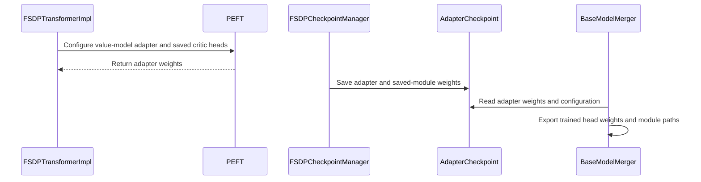

# [fsdp, ckpt] fix: plain PEFT + trainable head for value-model (critic) LoRA

[Upstream PR](https://github.com/verl-project/verl/pull/8309) · state: closed · merged: False

## Original PR description

### What does this PR do?

Fixes PPO with a LoRA critic on the engine-based FSDP backend. Building the critic crashes with:

```
AttributeError: 'Qwen2ForTokenClassification' object has no attribute 'prepare_inputs_for_generation'
```

(depending on the call path the message names `'LoraModel'` instead.)

This is a regression. #4695 (fixing #4620) set `TaskType.TOKEN_CLS` for the critic in the legacy `fsdp_workers.py`. When workers were migrated to engines (#6067), LoRA setup moved to `FSDPEngine._build_lora_module`, which wraps every model with `TaskType.CAUSAL_LM`. `PeftModelForCausalLM.__init__` unconditionally reads `base_model.prepare_inputs_for_generation`, which `*ForTokenClassification` models do not have. Upgrading does not help: it reproduces with peft 0.19.1 and 0.21.2 (latest), on transformers 4.57 and 5.12.

Restoring `TOKEN_CLS` is not enough either: PEFT then auto-adds the head to `modules_to_save`, and with `target_modules="all-linear"` the head already carries a LoRA layer, so wrapping fails with `TypeError: modules_to_save cannot be applied to modules of type <class 'peft.tuners.lora.layer.Linear'>` (also on peft 0.19.1 and 0.21.2).

This PR wraps the value model as a plain `PeftModel` and trains its head in full, and updates the checkpoint / export paths so the trained head is not lost.

### Checklist Before Starting

- [x] Search for similar PRs. Paste at least one query link here: https://github.com/verl-project/verl/pulls?q=is%3Apr+critic+lora , https://github.com/verl-project/verl/pulls?q=is%3Apr+prepare_inputs_for_generation (prior fix: #4695; related open: #7388, #7426 add `save_lora_only` to the checkpoint YAMLs)
- [x] Format the PR title as `[{modules}] {type}: {description}` (This will be checked by the CI)

### Test

**Unit tests (CPU, picked up by `cpu_unit_tests.yml`):**
- `tests/workers/test_fsdp_value_model_lora_on_cpu.py` (new, 19 tests) and `tests/checkpoint_engine/test_fsdp_lora_only_checkpoint_on_cpu.py` (16 tests): 35 passed. The new file reproduces the crash without the change.

**End-to-end (CUDA, A100 80GB; torch 2.13 + cu130, vllm 0.29, transformers 5.12.1, peft 0.19.1).** Qwen2.5-0.5B-Instruct actor and critic, gsm8k, v1 trainer, GAE, critic LoRA r=16 `all-linear`.

| Run | This PR | `main` |
|---|---|---|
| PPO, 1 GPU, 2 steps | exit 0; `critic/vf_loss` 25.6, `critic/advantages` −2.99 … 3.63 | `AttributeError: 'LoraModel' object has no attribute 'prepare_inputs_for_generation'` |
| PPO, 2 GPUs, actor + critic `fsdp2` | exit 0, 2 steps on both ranks | – |
| LoRA-only critic checkpoint, save at steps 1–2, resume to step 3, 1 GPU | critic ckpt 35 MB / 338 keys (LoRA + `score` head) vs 2.5 GB actor; resumes from step 2, `Loaded LoRA-only checkpoint (338 keys)`, no missing/unexpected keys | – |
| Same round trip, 2 GPUs, `fsdp2` | 18 MB critic shard per rank; `[Rank 0]` and `[Rank 1]` both load 338 keys; step 3 completes | – |

To reproduce:

<details>
<summary>Shared setup and base command (used by the runs below)</summary>

```bash
python3 examples/data_preprocess/gsm8k.py --local_dir $HOME/data/gsm8k
hf download Qwen/Qwen2.5-0.5B-Instruct --local-dir $HOME/models/Qwen2.5-0.5B-Instruct
hf download deepseek-ai/DeepSeek-R1-Distill-Qwen-1.5B --local-dir $HOME/models/DeepSeek-R1-Distill-Qwen-1.5B

NGPU=${NGPU:-1}
COMMON=(
  algorithm.use_kl_in_reward=False
  "data.train_files=['$HOME/data/gsm8k/train.parquet']" "data.val_files=['$HOME/data/gsm8k/test.parquet']"
  data.train_batch_size=8 data.max_prompt_length=256 data.max_response_length=256
  data.filter_overlong_prompts=True data.truncation=error
  actor_rollout_ref.model.use_remove_padding=True actor_rollout_ref.model.enable_gradient_checkpointing=True
  actor_rollout_ref.actor.optim.lr=1e-6 actor_rollout_ref.actor.ppo_mini_batch_size=4
  actor_rollout_ref.actor.use_dynamic_bsz=False actor_rollout_ref.actor.ppo_micro_batch_size_per_gpu=2
  actor_rollout_ref.actor.use_kl_loss=True actor_rollout_ref.actor.kl_loss_coef=0.001
  actor_rollout_ref.actor.kl_loss_type=low_var_kl actor_rollout_ref.actor.entropy_coeff=0
  actor_rollout_ref.rollout.name=vllm actor_rollout_ref.rollout.tensor_model_parallel_size=1
  actor_rollout_ref.rollout.gpu_memory_utilization=0.3 actor_rollout_ref.rollout.n=2
  actor_rollout_ref.rollout.log_prob_micro_batch_size_per_gpu=2 actor_rollout_ref.ref.log_prob_micro_batch_size_per_gpu=2
  trainer.balance_batch=True 'trainer.logger=["console"]' trainer.project_name=repro
  trainer.n_gpus_per_node=$NGPU trainer.nnodes=1 trainer.save_freq=-1 trainer.test_freq=-1
  trainer.val_before_train=False trainer.total_epochs=1 trainer.use_v1=True
)
```
</details>

```bash
MODEL=$HOME/models/Qwen2.5-0.5B-Instruct
CRITIC_LORA=(
  algorithm.adv_estimator=gae actor_rollout_ref.model.path=$MODEL critic.model.path=$MODEL
  critic.model.lora_rank=16 critic.model.lora_alpha=32 critic.model.target_modules=all-linear
  critic.optim.lr=1e-5 critic.ppo_micro_batch_size_per_gpu=2
)

# PPO with a LoRA critic (fails on main with the AttributeError above)
python3 -m verl.trainer.main_ppo "${COMMON[@]}" "${CRITIC_LORA[@]}" trainer.total_training_steps=2

# LoRA-only critic checkpoint round trip: save at steps 1-2, then resume and run step 3
CKPT=(trainer.default_local_dir=$HOME/ckpt/critic_lora trainer.save_freq=1 +critic.checkpoint.save_lora_only=True)
python3 -m verl.trainer.main_ppo "${COMMON[@]}" "${CRITIC_LORA[@]}" "${CKPT[@]}" trainer.total_training_steps=2
python3 -m verl.trainer.main_ppo "${COMMON[@]}" "${CRITIC_LORA[@]}" "${CKPT[@]}" trainer.total_training_steps=3 trainer.resume_mode=auto

# 2 GPUs: set NGPU=2 before building COMMON and append
#   actor_rollout_ref.actor.strategy=fsdp2 critic.strategy=fsdp2
```

`save_lora_only` is not declared in the critic checkpoint YAML yet, hence the `+` (see #7388 / #7426).

### API and Usage Example

No API change. Existing critic LoRA configs (`critic.model.lora_rank`, `lora_alpha`, `target_modules`, `exclude_modules`, `lora_adapter_path`, `critic.checkpoint.save_lora_only`) now work on the engine backend. Actor / causal-LM LoRA is unchanged.

### Design & Code Changes

For `model_type == "value_model"` the critic is wrapped as a plain `PeftModel` (`task_type=None`); its head (`score` / `classifier`) is excluded from LoRA and trained in full via `modules_to_save`. Because the head is now a trainable module outside the LoRA weights, every path that moves or saves weights is updated:

- `verl/workers/engine/fsdp/transformer_impl.py`
  - **Exclusions:** a user `exclude_modules` regex is kept intact as a top-level alternative (inline flags, whitespace and verbose comments keep working); the head is added as another alternative.
  - **Pretrained adapter (`lora_adapter_path`):** an adapter saved from a causal LM is loaded as a plain `PeftModel`; the head is excluded from LoRA before loading and wrapped as `modules_to_save` afterwards. An adapter that already has LoRA weights on the head is rejected with an error; a saved critic adapter that already declares `modules_to_save` is not re-wrapped.
- `verl/utils/checkpoint/checkpoint_manager.py`, `fsdp_checkpoint_manager.py`: LoRA-only checkpoints keep the head on save and recognise it on load (`BaseCheckpointManager.is_adapter_key`).
- `verl/model_merger/base_model_merger.py`: the offline merger writes the trained head under its plain name, drops the frozen `original_module` copy, and adds `modules_to_save` plus the head weights to the exported adapter. `lora_train_meta.json` keeps `task_type: null`.
- `verl/utils/fsdp_utils.py`: `normalize_peft_param_name` applies the same head mapping on the rollout weight-sync path.

### Checklist Before Submitting

> [!IMPORTANT]
> Please check all the following items before requesting a review, otherwise the reviewer might deprioritize this PR for review.

- [x] Read the [Contribute Guide](https://github.com/verl-project/verl/blob/main/CONTRIBUTING.md).
- [x] Apply [pre-commit checks](https://github.com/verl-project/verl/blob/main/CONTRIBUTING.md#code-linting-and-formatting): `pre-commit install && pre-commit run --all-files --show-diff-on-failure --color=always`
- [x] Add / Update [the documentation](https://github.com/verl-project/verl/tree/main/docs). Not needed: bug fix, no user-facing config or API change.
- [x] Add unit or end-to-end test(s) to [the CI workflow](https://github.com/verl-project/verl/tree/main/.github/workflows) to cover all the code. If not feasible, explain why: new `*_on_cpu.py` tests run in `cpu_unit_tests.yml`; the end-to-end PPO run above needs a GPU and is not added to CI.
- [x] Once your PR is ready for CI, send a message in [the `ci-request` channel](https://verl-project.slack.com/archives/C091TCESWB1) in [the `verl` Slack workspace](https://join.slack.com/t/verl-project/shared_invite/zt-3855yhg8g-CTkqXu~hKojPCmo7k_yXTQ). (If not accessible, please try [the Feishu group (飞书群)](https://applink.larkoffice.com/client/chat/chatter/add_by_link?link_token=772jd4f1-cd91-441e-a820-498c6614126a).)
- [x] If your PR is related to the `recipe` submodule, please also update the reference to the submodule commit via `git submodule update --remote` or `cd recipe && git pull origin main`. N/A.


## Review and discussion

### reviews

- wuxibin89 · COMMENTED · 2026-11-04T03:31:19Z · [source](https://github.com/verl-project/verl/pull/8309#pullrequestreview-5762836289)

(No body; status only.)

### issue_comments

- coderabbitai[bot] · comment · 2026-10-21T08:35:06Z · [source](https://github.com/verl-project/verl/pull/8309#issuecomment-6311690251)

<!-- coderabbit-ai-generated:v1 -->

<!-- This is an auto-generated comment: summarize by coderabbit.ai -->
<!-- review_stack_entry_start -->

<a href="https://app.coderabbit.ai/change-stack/verl-project/verl/pull/8309?scope=ghh_OusAJGA4HG8ljoOV0wJvVx8NmnZIjc2DdjmxOu0xZWA&amp;cs_source=review_comment"><picture><source media="(prefers-color-scheme: dark)" srcset="https://storage.googleapis.com/coderabbit_public_assets/review-stack-in-coderabbit-ui-dark.svg?v=3"><source media="(prefers-color-scheme: light)" srcset="https://storage.googleapis.com/coderabbit_public_assets/review-stack-in-coderabbit-ui.svg?v=3"></picture></a>

<!-- review_stack_entry_end -->
<!-- recent_review_start -->

No actionable comments were generated in the recent review. 🎉

<details>
<summary><strong>ℹ️ Recent review info</strong></summary>
<dl>
<dd>

<details>
<summary><strong>⚙️ Run configuration</strong></summary>
<dl>
<dd>

- **Configuration used**: Organization UI
- **Review profile**: CHILL
- **Plan**: Advanced
- **Run ID**: `6958c2e3-3ac1-483f-aeda-5c14a736499b`

</dd>
</dl>
</details>

<details>
<summary><strong>📥 Commits</strong></summary>
<dl>
<dd>

Reviewing files that changed from the base of the PR and between cd58f550fb1c4f5a3fe29da38e6f0002ec462fd3 and 7a5241aa8bf1de21e6ed983c9a0e82db45a3a273.

</dd>
</dl>
</details>

<details>
<summary><strong>📒 Files selected for processing: 6</strong></summary>
<dl>
<dd>

* `tests/workers/test_fsdp_value_model_lora_on_cpu.py`
* `verl/model_merger/base_model_merger.py`
* `verl/utils/checkpoint/checkpoint_manager.py`
* `verl/utils/checkpoint/fsdp_checkpoint_manager.py`
* `verl/utils/fsdp_utils.py`
* `verl/workers/engine/fsdp/transformer_impl.py`

</dd>
</dl>
</details>

**Included review availability:** This review used your included allowance. Your plan provides up to 10 included reviews per hour; 9 remain after this review.

</dd>
</dl>
</details>


<!-- recent_review_end -->
<!-- walkthrough_start -->

<details>
<summary><strong>📝 Summary</strong></summary>
<dl>
<dd>

<!-- This is an auto-generated comment: release notes by coderabbit.ai -->

## Summary by CodeRabbit

* **Bug Fixes**
  * LoRA training and checkpoint save/load now better preserve trained value-model scoring and classification heads.
  * LoRA adapters for value models no longer add LoRA weights to critic heads, and incompatible adapters targeting those heads are rejected.
  * Checkpoint exports now retain saved head weights and correctly recognize them as adapter data, improving compatibility when exporting, merging, and reloading models.

<!-- end of auto-generated comment: release notes by coderabbit.ai -->
Value-model LoRA adapters now use PEFT without a task type and save critic heads as full modules. Checkpoint handling and merger export preserve the trained head weights. Adapter loading rejects saved LoRA weights that target critic heads.

**Changes: Value-model LoRA**

|Layer / File(s)|Summary|
|:---|:---|
|**Configure value-model adapters** <br> `verl/workers/engine/fsdp/transformer_impl.py`, `tests/workers/test_fsdp_value_model_lora_on_cpu.py`|Value models use PEFT without a task type. Critic heads are excluded from LoRA targets and saved as full modules. Loading rejects adapters with critic-head LoRA weights. Tests cover adapter creation, loading, and regex exclusions.|
|**Preserve critic heads in checkpoints** <br> `verl/utils/fsdp_utils.py`, `verl/utils/checkpoint/checkpoint_manager.py`, `verl/utils/checkpoint/fsdp_checkpoint_manager.py`, `tests/workers/test_fsdp_value_model_lora_on_cpu.py`|Adapter-key detection and parameter-name normalization include trained saved-module weights in LoRA-only checkpoint handling. Tests cover task-type metadata and head preservation through checkpoint save and reload.|
|**Export saved critic heads** <br> `verl/model_merger/base_model_merger.py`, `tests/workers/test_fsdp_value_model_lora_on_cpu.py`|The merger adds trained saved-module weights to the adapter and base-model state and records their paths in the adapter configuration. Tests cover export and reload.|

### Sequence Diagram(s)



</dd>
</dl>
</details>

<!-- walkthrough_end -->
<!-- change_assessment_start -->
**Priority:** ➖ Normal

<!-- change_assessment_commit:"7a5241aa8bf1de21e6ed983c9a0e82db45a3a273" -->
**Severity of issue fixed:** Medium
<!-- change_assessment_end -->
<details>
<summary><strong>Merge Risk:</strong> <strong>⚪ Minimal</strong> · up to <code>7a524</code></summary>
<dl>
<dd>

<!-- final_review_risk_start -->
<!-- final_review_risk_label
**Merge Risk:** **⚪ Minimal** · up to `7a524`
-->
<!-- final_review_risk_coverage:{"sourceCommitId":"7a5241aa8bf1de21e6ed983c9a0e82db45a3a273","coveredCommitId":"7a5241aa8bf1de21e6ed983c9a0e82db45a3a273","kind":"reviewed"} -->

No actionable issue remains from the inspected value-model adapter, checkpoint, export, or rollout paths. The PR is mergeable after normal checks.
<!-- final_review_risk_end -->

</dd>
</dl>
</details>

<details>
<summary><strong>Security architecture risk:</strong> <strong>🔵 Low</strong> · up to <code>7a524</code></summary>
<dl>
<dd>

<!-- architecture_review_start -->
<!-- architecture_review_label
### Security Architecture Review

**Security architecture risk:** **🔵 Low** · up to `7a524`
-->

The change expands saved training files and coordinates their restoration and export. No new privilege or externally reachable access was identified in the inspected changes. Interrupted saves and recovery compatibility remain incompletely verified.

**Retained concerns**
No architecture-level concerns identified.

<details>
<summary><strong>Security review details</strong></summary>
<dl>
<dd>

**Security Blast Radius**
- _inferred_ — The inspected change affects configured training state and generated checkpoint, adapter, and base-model files. The shared exporter also has an existing optional upload path, so trained heads can accompany exports to the configured repository. The diff does not change that destination selection or upload authority.

**Trust Boundaries and Controls**
- _observed_ — Configured adapter loading retains the existing copy-and-load path. The new preflight rejects LoRA tensors targeting discovered critic heads before adapter installation. This enforces payload compatibility; it is not an authorization or sandbox control. Base-model loading continues to use the configured trust_remote_code setting.
- _observed_ — Checkpoint restoration still deserializes with torch.load(weights_only=False). The PR does not alter that existing loading policy, so checkpoint provenance remains a trust requirement rather than a newly established untrusted-file boundary.

**Resilience and Maintainability Implications**
- _inferred_ — Failure containment remains bounded by existing checkpoint behavior: files are written before final registration, and adapter-only loading checks unexpected keys but not missing keys. A dictionary containing only a subset of expected adapter or head keys can therefore pass classification without establishing completeness. The PR adds head state to this existing recovery surface but does not introduce the persistence or missing-key policy; normal round-trip assertions do not establish interrupted-save recovery.

</dd>
</dl>
</details>
<!-- architecture_review_end -->

</dd>
</dl>
</details>
<!-- pre_merge_checks_walkthrough_start -->

<details>
<summary><strong>Pre-merge checks: <sup><picture></picture></sup> 4 · <sup><picture></picture></sup> 1</strong></summary>
<dl>
<dd>

<strong><sup><picture></picture></sup> Failed checks: 1 warning</strong>

|     Check name     |                                              Status                                              | Explanation                                                                                                                                                                                 | Resolution                                                                         |
| :---------------- | :----------------------------------------------------------------------------------------------: | :------------------------------------------------------------------------------------------------------------------------------------------------------------------------------------------ | :--------------------------------------------------------------------------------- |
| Docstring Coverage |  | Docstring coverage is 26.47% which is insufficient. The required threshold is 80.00%. Docstring coverage is scoped to functions touched by this diff. Analyzed 34 functions across 6 files. | Write docstrings for the functions missing them to satisfy the coverage threshold. |

<details>
<summary><strong><sup><picture></picture></sup> Passed checks: 4 passed</strong></summary>
<dl>
<dd>

|         Check name         |                                             Status                                             | Explanation                                                                                                                                                                                               |
| :------------------------ | :--------------------------------------------------------------------------------------------: | :-------------------------------------------------------------------------------------------------------------------------------------------------------------------------------------------------------- |
|         Title check        |  | The title clearly and concisely describes the main change: fixing value-model LoRA by using plain PEFT and training the critic head.                                                                      |
|     Linked Issues check    |  | Issue `#4695` is closed and supplies historical context only. The provided objectives state that no active directly linked issue targets remain. Therefore, no linked-issue coding requirements apply to t… |
| Out of Scope Changes check |  | The changes stay within the stated PR scope. Value-model PEFT construction, critic-head handling, checkpoint save/load, model-merger export, rollout weight synchronization, and the related CPU tests a… |
|      Description check     |  | The pull request description directly explains the LoRA critic failure, the value-model wrapping changes, checkpoint and export updates, and the related tests. It matches the changeset.                 |

<details>
<summary><strong>Full details: Linked Issues check</strong></summary>
<dl>
<dd>

**Explanation**

Issue `#4695` is closed and supplies historical context only. The provided objectives state that no active directly linked issue targets remain. Therefore, no linked-issue coding requirements apply to this PR.

</dd>
</dl>
</details>

<details>
<summary><strong>Full details: Out of Scope Changes check</strong></summary>
<dl>
<dd>

**Explanation**

The changes stay within the stated PR scope. Value-model PEFT construction, critic-head handling, checkpoint save/load, model-merger export, rollout weight synchronization, and the related CPU tests all support LoRA critic operation on the engine-based FSDP backend. The summary provides no demonstrated unrelated change.

</dd>
</dl>
</details>

</dd>
</dl>
</details>

</dd>
</dl>
</details>

<!-- pre_merge_checks_walkthrough_end -->
<!-- autopilot:start -->
- [ ] <!-- {"checkboxId":"2708ad07-9f24-4260-9c11-7dc76a49f2e3"} --> <strong title="Keep fixing CodeRabbit findings and required CI, and resolving merge conflicts">Autofix</strong> · Keep fixing CodeRabbit findings and required CI, and resolving merge conflicts
<!-- autopilot:end -->
<!-- tips_start -->


<sub>Comment `@coderabbitai help` to get the list of available commands.</sub>

<!-- tips_end -->

- kahlun · comment · 2026-11-04T04:14:21Z · [source](https://github.com/verl-project/verl/pull/8309#issuecomment-6622361756)

noted and thanks for the answering. 
So while using verl/RL, we will not try this LoRA with critic model

### inline_comments

- wuxibin89 · comment · 2026-11-04T03:31:16Z · [source](https://github.com/verl-project/verl/pull/8309#discussion_r4463262273)

File: `verl/workers/engine/fsdp/transformer_impl.py` · line 395

We're not going to support LoRA with critic model, since LoRA is used in resource-constrained scenarios, it's more reasonable to do critic-free RL training.

## Changed files and fixed code

- `tests/workers/test_fsdp_value_model_lora_on_cpu.py` · added · additions 262 / deletions 0
  - [head](https://github.com/kahlun/verl/blob/7a5241aa8bf1de21e6ed983c9a0e82db45a3a273/tests/workers/test_fsdp_value_model_lora_on_cpu.py)
  - [base](https://github.com/verl-project/verl/blob/cd58f550fb1c4f5a3fe29da38e6f0002ec462fd3/tests/workers/test_fsdp_value_model_lora_on_cpu.py)
- `verl/model_merger/base_model_merger.py` · modified · additions 16 / deletions 0
  - [head](https://github.com/kahlun/verl/blob/7a5241aa8bf1de21e6ed983c9a0e82db45a3a273/verl/model_merger/base_model_merger.py)
  - [base](https://github.com/verl-project/verl/blob/cd58f550fb1c4f5a3fe29da38e6f0002ec462fd3/verl/model_merger/base_model_merger.py)
- `verl/utils/checkpoint/checkpoint_manager.py` · modified · additions 6 / deletions 1
  - [head](https://github.com/kahlun/verl/blob/7a5241aa8bf1de21e6ed983c9a0e82db45a3a273/verl/utils/checkpoint/checkpoint_manager.py)
  - [base](https://github.com/verl-project/verl/blob/cd58f550fb1c4f5a3fe29da38e6f0002ec462fd3/verl/utils/checkpoint/checkpoint_manager.py)
- `verl/utils/checkpoint/fsdp_checkpoint_manager.py` · modified · additions 4 / deletions 5
  - [head](https://github.com/kahlun/verl/blob/7a5241aa8bf1de21e6ed983c9a0e82db45a3a273/verl/utils/checkpoint/fsdp_checkpoint_manager.py)
  - [base](https://github.com/verl-project/verl/blob/cd58f550fb1c4f5a3fe29da38e6f0002ec462fd3/verl/utils/checkpoint/fsdp_checkpoint_manager.py)
- `verl/utils/fsdp_utils.py` · modified · additions 9 / deletions 3
  - [head](https://github.com/kahlun/verl/blob/7a5241aa8bf1de21e6ed983c9a0e82db45a3a273/verl/utils/fsdp_utils.py)
  - [base](https://github.com/verl-project/verl/blob/cd58f550fb1c4f5a3fe29da38e6f0002ec462fd3/verl/utils/fsdp_utils.py)
- `verl/workers/engine/fsdp/transformer_impl.py` · modified · additions 76 / deletions 3
  - [head](https://github.com/kahlun/verl/blob/7a5241aa8bf1de21e6ed983c9a0e82db45a3a273/verl/workers/engine/fsdp/transformer_impl.py)
  - [base](https://github.com/verl-project/verl/blob/cd58f550fb1c4f5a3fe29da38e6f0002ec462fd3/verl/workers/engine/fsdp/transformer_impl.py)

## Evidence and interpretation boundary

[Original JSON, discussions and patches](../../../../../../evidence/prs/verl-project--verl/8309-a19a1fe88dab1757cd70dcb79fc70307c785f9f0d98b1cdc18d00241f40a6fd7.json) · SHA-256 `a19a1fe88dab1757cd70dcb79fc70307c785f9f0d98b1cdc18d00241f40a6fd7`.

Diff complete: True. Missing/binary/truncated patches require pinned source inspection. This is a source page, not an independently verified optimization case. Open, merged and released are different states; recheck the deployed dependency.
