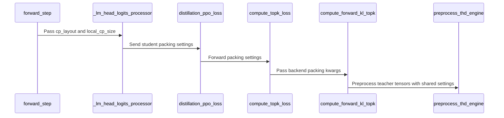

# [megatron, trainer] fix: pack the teacher's top-k tensors with the student's CP split

[Upstream PR](https://github.com/verl-project/verl/pull/8332) · state: closed · merged: True

## Original PR description

### What does this PR do?

Follow-up to #8325, from a finding in its review ([comment](https://github.com/verl-project/verl/pull/8325#discussion_r4344130772)).

`compute_forward_kl_topk` packs the teacher's top-k tensors itself. #8325 gave it the student's low-precision padding but not the student's CP split, so on THD the teacher rows could match `student_logits` in shape and still belong to other tokens:

- **CP layout**: `dsv4_hybrid` splits the student's rows contiguously, while the teacher's were split zigzag, the default. With CP=2, MXFP8 and 16 sequences of 17 tokens, rank 0 holds 256 rows on both sides, and 128 of its 136 valid student tokens get the teacher values of another token or of a padding row (all 136 on rank 1). With 32-token sequences, 248 of 256 rows differ on rank 0 and all 256 on rank 1, and that was already the case before #8325. #8325 turned the 17-token case from a failed shape assertion into the same silent misalignment.
- **Dynamic CP** (not reachable end to end today): the engine rejects dynamic CP with distillation (`Dynamic CP does not support distillation`). The micro-batch's `local_cp_size` is still passed down, so the teacher's tensors would be split over the same group as the student's if that combination is enabled; the unit tests cover the packing.

`forward_step` now passes the `cp_layout` and `local_cp_size` it gives the model forward to the logits processor, which forwards them with `quant_align_size` through `distillation_ppo_loss` and `compute_topk_loss` to the Megatron loss. The teacher tensors are packed with the same THD arguments as the student inputs. Other strategies get no extra arguments. The BSHD path is unchanged: `preprocess_bshd_engine` always splits zigzag over the static CP group, for the student and the teacher alike. `pad_to_length` is already rejected with top-k distillation.

### Checklist Before Starting

- [x] Search for similar PRs: [cp_layout distillation](https://github.com/verl-project/verl/pulls?q=is%3Apr+is%3Aopen+cp_layout+distillation), [forward_kl_topk](https://github.com/verl-project/verl/pulls?q=is%3Apr+is%3Aopen+forward_kl_topk). No open PR passes the CP split to the teacher packing. #8061 fixes the BSHD `forced_max_seqlen` mismatch; the two PRs touch neighbouring lines of `compute_forward_kl_topk` and `compute_topk_loss`, so whichever lands second needs a small rebase.
- [x] Format the PR title as `[{modules}] {type}: {description}`.

### Test

```bash
pytest -q tests/utils/test_megatron_fp8_padding_on_cpu.py tests/workers/test_megatron_distillation_only_on_cpu.py \
  tests/workers/test_megatron_value_head_cp_layout_on_cpu.py
# 49 passed
pre-commit run --files <changed files>
# passed
```

The new tests give every token its own number and compare, row by row, what the KL receives with the student's rows (CP state stubbed):

| test | cases |
|---|---|
| static CP=2 | both layouts × both CP ranks × no / 16 / 32-token alignment × 17- and 32-token sequences (24) |
| dynamic CP | a group of 2 within CP 4, both layouts × both ranks in the group (4) |
| the failure mode | student contiguous, teacher zigzag: equal shapes, 128 of 136 tokens misaligned |
| `forward_step` | a `dsv4_hybrid` model's layout and the micro-batch's `local_cp_size` reach the top-k loss |

With the teacher packing reverted to ignore the CP split, the 12 contiguous and the 4 dynamic-CP cases fail. The logits processor and `compute_topk_loss` tests check that the arguments reach the Megatron loss and no other backend. The other CPU tests of the distillation, padding, router replay and CP-layout code pass as on main. Not run on GPUs.

### API and Usage Example

No config or API change. `compute_forward_kl_topk`, `compute_topk_loss`, `distillation_ppo_loss` and `MegatronEngineWithLMHead._lm_head_logits_processor` take two more optional arguments, `cp_layout` (default `"zigzag"`) and `local_cp_size` (default `None`); the defaults keep the previous behaviour.

### Design & Code Changes

- `verl/workers/engine/megatron/transformer_impl.py`: `forward_step` hands the logits processor the `cp_layout` and `local_cp_size` of the student forward; `_lm_head_logits_processor` passes them to the top-k loss.
- `verl/trainer/distillation/losses.py`: `distillation_ppo_loss` and `compute_topk_loss` forward them to the Megatron loss only.
- `verl/trainer/distillation/megatron/losses.py`: `compute_forward_kl_topk` packs the teacher's THD tensors with `quant_align_size`, `local_cp_size` and `cp_layout`, as the model forward packs the student's.
- Tests: `tests/utils/test_megatron_fp8_padding_on_cpu.py`, `tests/workers/test_megatron_distillation_only_on_cpu.py`.

### Checklist Before Submitting

- [x] Read the [Contribute Guide](https://github.com/verl-project/verl/blob/main/CONTRIBUTING.md).
- [x] Apply [pre-commit checks](https://github.com/verl-project/verl/blob/main/CONTRIBUTING.md#code-linting-and-formatting).
- [x] Add / Update [the documentation](https://github.com/verl-project/verl/tree/main/docs). No user-facing change to document.
- [x] Add unit or end-to-end test(s) to [the CI workflow](https://github.com/verl-project/verl/tree/main/.github/workflows) to cover all the code: CPU unit tests (`*_on_cpu.py`) that CI runs.
- [ ] Once your PR is ready for CI, send a message in the [`ci-request` channel](https://verl-project.slack.com/archives/C091TCESWB1).
- [x] Not related to the `recipe` submodule.

Developed with AI assistance. I reviewed every changed line, ran the tests above, and can defend the change end to end.


## Review and discussion

### reviews

- wuxibin89 · APPROVED · 2026-10-22T08:03:21Z · [source](https://github.com/verl-project/verl/pull/8332#pullrequestreview-5611002932)

(No body; status only.)

### issue_comments

- coderabbitai[bot] · comment · 2026-10-22T06:38:10Z · [source](https://github.com/verl-project/verl/pull/8332#issuecomment-6334467370)

<!-- coderabbit-ai-generated:v1 -->

<!-- This is an auto-generated comment: summarize by coderabbit.ai -->
<!-- review_stack_entry_start -->

<a href="https://app.coderabbit.ai/change-stack/verl-project/verl/pull/8332?scope=ghh_OusAJGA4HG8ljoOV0wJvVx8NmnZIjc2DdjmxOu0xZWA&amp;cs_source=review_comment"><picture><source media="(prefers-color-scheme: dark)" srcset="https://storage.googleapis.com/coderabbit_public_assets/review-stack-in-coderabbit-ui-dark.svg?v=3"><source media="(prefers-color-scheme: light)" srcset="https://storage.googleapis.com/coderabbit_public_assets/review-stack-in-coderabbit-ui.svg?v=3"></picture></a>

<!-- review_stack_entry_end -->
<!-- recent_review_start -->

No actionable comments were generated in the recent review. 🎉

<details>
<summary><strong>ℹ️ Recent review info</strong></summary>
<dl>
<dd>

<details>
<summary><strong>⚙️ Run configuration</strong></summary>
<dl>
<dd>

- **Configuration used**: Organization UI
- **Review profile**: CHILL
- **Plan**: Advanced
- **Run ID**: `36a76506-325f-4618-9a67-6d51dd45f38e`

</dd>
</dl>
</details>

<details>
<summary><strong>📥 Commits</strong></summary>
<dl>
<dd>

Reviewing files that changed from the base of the PR and between 831c5d86e58972ef2e26f00345fde1be700611cf and dc022e3042108b529be009d4352d47e962eff587.

</dd>
</dl>
</details>

<details>
<summary><strong>📒 Files selected for processing: 5</strong></summary>
<dl>
<dd>

* `tests/utils/test_megatron_fp8_padding_on_cpu.py`
* `tests/workers/test_megatron_distillation_only_on_cpu.py`
* `verl/trainer/distillation/losses.py`
* `verl/trainer/distillation/megatron/losses.py`
* `verl/workers/engine/megatron/transformer_impl.py`

</dd>
</dl>
</details>

**Included review availability:** This review used your included allowance. Your plan provides up to 10 included reviews per hour; 9 remain after this review.

</dd>
</dl>
</details>


<!-- recent_review_end -->
<!-- walkthrough_start -->

<details>
<summary><strong>📝 Summary</strong></summary>
<dl>
<dd>

<!-- This is an auto-generated comment: release notes by coderabbit.ai -->

## Summary by CodeRabbit

* **Bug Fixes**
  * Improved top-k distillation alignment when using Megatron context parallelism, including contiguous and zigzag layouts and local context-parallel groups.
  * Teacher and student token rows now use matching packing settings, helping prevent incorrect row comparisons when their context-parallel layouts differ.
  * FSDP, VeOmni, and FSDP2 continue to operate without Megatron-specific packing arguments.

<!-- end of auto-generated comment: release notes by coderabbit.ai -->
Megatron top-k distillation now carries the student’s context-parallel layout and local group size through the logits processor and loss path. Teacher THD tensors use those settings with quantization alignment. CPU tests cover row alignment across layouts, ranks, sequence lengths, and dynamic context parallelism.

**Changes: Megatron distillation packing alignment**

|Layer / File(s)|Summary|
|:---|:---|
|**Pass packing settings through distillation losses** <br> `verl/trainer/distillation/losses.py`, `verl/trainer/distillation/megatron/losses.py`|The loss functions accept `cp_layout` and `local_cp_size` and pass them with `quant_align_size` to Megatron’s top-k loss. THD teacher tensors use these settings during preprocessing.|
|**Forward student packing settings** <br> `verl/workers/engine/megatron/transformer_impl.py`, `tests/workers/test_megatron_distillation_only_on_cpu.py`|`forward_step` passes the computed context-parallel layout and local group size to the logits processor. Tests check the values passed to the model and processor.|
|**Check teacher and student row alignment** <br> `tests/utils/test_megatron_fp8_padding_on_cpu.py`|Tests compare teacher and student token rows across sequence lengths, quantization alignments, layouts, and ranks. They also cover mismatched layouts and dynamic context-parallel groups.|

### Sequence Diagram(s)



**Suggested reviewers:** `vermouth1992`, `wuxibin89`

</dd>
</dl>
</details>

<!-- walkthrough_end -->
<!-- change_assessment_start -->
**Priority:** ➖ Normal

<!-- change_assessment_commit:"dc022e3042108b529be009d4352d47e962eff587" -->

<!-- change_assessment_end -->
<details>
<summary><strong>Merge Risk:</strong> <strong>⚪ Minimal</strong> · up to <code>dc022</code></summary>
<dl>
<dd>

<!-- final_review_risk_start -->
<!-- final_review_risk_label
**Merge Risk:** **⚪ Minimal** · up to `dc022`
-->
<!-- final_review_risk_coverage:{"sourceCommitId":"dc022e3042108b529be009d4352d47e962eff587","coveredCommitId":"dc022e3042108b529be009d4352d47e962eff587","kind":"reviewed"} -->

The reviewed change is mergeable after normal checks; no actionable packing-alignment issue was identified.
<!-- final_review_risk_end -->

</dd>
</dl>
</details>

<details>
<summary><strong>Security architecture risk:</strong> <strong>🔵 Low</strong> · up to <code>dc022</code></summary>
<dl>
<dd>

<!-- architecture_review_start -->
<!-- architecture_review_label
### Security Architecture Review

**Security architecture risk:** **🔵 Low** · up to `dc022`
-->

The change keeps teacher and student token rows aligned using existing context-parallel settings. The reviewed code does not introduce a new external entrypoint or privilege boundary. Risk is bounded to an internal distributed-processing contract; deployed integration behavior was not verified.

**Retained concerns**
No architecture-level concerns identified.

<details>
<summary><strong>Security review details</strong></summary>
<dl>
<dd>

**Security Blast Radius**
- _inferred_ — The inspected change affects top-k distillation tensor selection within an already configured training job and CP partition. It does not expand the reviewed path into another tenant, service, credential store, or privileged execution sink.

**Trust Boundaries and Controls**
- _observed_ — cp_layout is derived from model configuration. The dynamic CP scheduler produces local_cp_size, and the engine requires it when dynamic CP is enabled. The new teacher path consumes the same metadata already used for student packing; it does not derive rank authority from teacher tensor contents. The packing utility also rejects unsupported layouts.

</dd>
</dl>
</details>
<!-- architecture_review_end -->

</dd>
</dl>
</details>
<!-- pre_merge_checks_walkthrough_start -->

<details>
<summary><strong>Pre-merge checks: <sup><picture></picture></sup> 4 · <sup><picture></picture></sup> 1</strong></summary>
<dl>
<dd>

<strong><sup><picture></picture></sup> Failed checks: 1 warning</strong>

|     Check name     |                                              Status                                              | Explanation                                                                                                                                                                                 | Resolution                                                                         |
| :---------------- | :----------------------------------------------------------------------------------------------: | :------------------------------------------------------------------------------------------------------------------------------------------------------------------------------------------ | :--------------------------------------------------------------------------------- |
| Docstring Coverage |  | Docstring coverage is 45.45% which is insufficient. The required threshold is 80.00%. Docstring coverage is scoped to functions touched by this diff. Analyzed 22 functions across 5 files. | Write docstrings for the functions missing them to satisfy the coverage threshold. |

<details>
<summary><strong><sup><picture></picture></sup> Passed checks: 4 passed</strong></summary>
<dl>
<dd>

|         Check name         |                                             Status                                             | Explanation                                                                                                                                                                                               |
| :------------------------ | :--------------------------------------------------------------------------------------------: | :-------------------------------------------------------------------------------------------------------------------------------------------------------------------------------------------------------- |
|         Title check        |  | The title clearly and concisely identifies the main change: packing the teacher's top-k tensors with the student's context-parallel split.                                                                |
|     Linked Issues check    |  | Check skipped because no linked issues were found for this pull request.                                                                                                                                  |
| Out of Scope Changes check |  | Check skipped because no linked issues were found for this pull request.                                                                                                                                  |
|      Description check     |  | The pull request description clearly explains the Megatron distillation alignment fix, the CP layout and dynamic CP changes, affected code paths, tests, and validation results. It directly matches the… |

<details>
<summary><strong>Full details: Description check</strong></summary>
<dl>
<dd>

**Explanation**

The pull request description clearly explains the Megatron distillation alignment fix, the CP layout and dynamic CP changes, affected code paths, tests, and validation results. It directly matches the changeset.

</dd>
</dl>
</details>

</dd>
</dl>
</details>

</dd>
</dl>
</details>

<!-- pre_merge_checks_walkthrough_end -->
<!-- autopilot:start -->
- [ ] <!-- {"checkboxId":"2708ad07-9f24-4260-9c11-7dc76a49f2e3"} --> <strong title="Keep fixing CodeRabbit findings and required CI, and resolving merge conflicts">Autofix</strong> · Keep fixing CodeRabbit findings and required CI, and resolving merge conflicts
<!-- autopilot:end -->
<!-- tips_start -->


<sub>Comment `@coderabbitai help` to get the list of available commands.</sub>

<!-- tips_end -->

### inline_comments

## Changed files and fixed code

- `tests/utils/test_megatron_fp8_padding_on_cpu.py` · modified · additions 99 / deletions 3
  - [head](https://github.com/wengeezhang/verl/blob/6beaf0fbc15d11a90b0d1805557c300ae5f0569f/tests/utils/test_megatron_fp8_padding_on_cpu.py)
  - [base](https://github.com/verl-project/verl/blob/fb55b9288560f0c7bf380c1c1c3b45ea170538b0/tests/utils/test_megatron_fp8_padding_on_cpu.py)
- `tests/workers/test_megatron_distillation_only_on_cpu.py` · modified · additions 65 / deletions 10
  - [head](https://github.com/wengeezhang/verl/blob/6beaf0fbc15d11a90b0d1805557c300ae5f0569f/tests/workers/test_megatron_distillation_only_on_cpu.py)
  - [base](https://github.com/verl-project/verl/blob/fb55b9288560f0c7bf380c1c1c3b45ea170538b0/tests/workers/test_megatron_distillation_only_on_cpu.py)
- `verl/trainer/distillation/losses.py` · modified · additions 22 / deletions 5
  - [head](https://github.com/wengeezhang/verl/blob/6beaf0fbc15d11a90b0d1805557c300ae5f0569f/verl/trainer/distillation/losses.py)
  - [base](https://github.com/verl-project/verl/blob/fb55b9288560f0c7bf380c1c1c3b45ea170538b0/verl/trainer/distillation/losses.py)
- `verl/trainer/distillation/megatron/losses.py` · modified · additions 9 / deletions 4
  - [head](https://github.com/wengeezhang/verl/blob/6beaf0fbc15d11a90b0d1805557c300ae5f0569f/verl/trainer/distillation/megatron/losses.py)
  - [base](https://github.com/verl-project/verl/blob/fb55b9288560f0c7bf380c1c1c3b45ea170538b0/verl/trainer/distillation/megatron/losses.py)
- `verl/workers/engine/megatron/transformer_impl.py` · modified · additions 7 / deletions 1
  - [head](https://github.com/wengeezhang/verl/blob/6beaf0fbc15d11a90b0d1805557c300ae5f0569f/verl/workers/engine/megatron/transformer_impl.py)
  - [base](https://github.com/verl-project/verl/blob/fb55b9288560f0c7bf380c1c1c3b45ea170538b0/verl/workers/engine/megatron/transformer_impl.py)

## Evidence and interpretation boundary

[Original JSON, discussions and patches](../../../../../../evidence/prs/verl-project--verl/8332-f04634fecc23746e78098fb761c159a4645b2c79aac512932b425d488b070744.json) · SHA-256 `f04634fecc23746e78098fb761c159a4645b2c79aac512932b425d488b070744`.

Diff complete: True. Missing/binary/truncated patches require pinned source inspection. This is a source page, not an independently verified optimization case. Open, merged and released are different states; recheck the deployed dependency.
