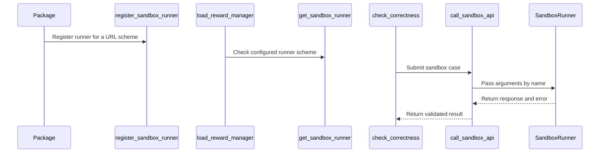

# [reward] feat: run sandbox_fusion test cases through sandboxes other packages register

[Upstream PR](https://github.com/verl-project/verl/pull/8345) · state: closed · merged: False

## Original PR description

### What does this PR do?

Lets another package provide the sandbox that `sandbox_fusion` code rewards run their test cases in. Today `reward.sandbox_fusion.url` can only name a Sandbox Fusion service over HTTP. With this PR, a URL with another scheme (`<scheme>://...`) goes to a runner that a package registers for that scheme, when verl loads it as a `verl.plugins` entry point. The runner returns the same reply as the service, so status mapping, call-based wrappers and scoring stay shared. http(s) URLs are unchanged.

Example: [`verl-hyperlight`](https://pypi.org/project/verl-hyperlight/) registers `hyperlight://`, which runs each test case in a local Hyperlight micro-VM on the training node, with no service to deploy. Without this hook it has to wrap `call_sandbox_api`.

### Checklist Before Starting

- [x] Search for similar PRs: https://github.com/verl-project/verl/pulls?q=is%3Apr+is%3Aopen+sandbox_fusion. None adds pluggable sandboxes for `sandbox_fusion`: #5376 is a registry for agent tools, not reward sandboxes, and #8022 fixes how many test cases are counted (it touches the same test file, but not the dispatch).
- [x] Format the PR title as `[{modules}] {type}: {description}`

### Test

- `pytest tests/utils/reward_score/reward_score/test_sandbox_fusion_on_cpu.py`: 19 passed, 11 skipped (the skipped ones need a live Sandbox Fusion service). The 15 new tests use stand-in runners and need no service.
- End to end: `verl-hyperlight` 0.1.0 from PyPI with this branch scores correct, wrong and call-based solutions through `compute_score` in real micro-VMs (4/4).
- `pre-commit run` on the changed files (ruff, mypy, generated configs, docs, license and the other sanity hooks), `tests/special_sanity/type_coverage_check.py` and `check_pr_title.py` pass; the rst section renders without warnings.

### API and Usage Example

```python
# mybox/verl_plugin.py
from verl.utils.reward_score.sandbox_fusion.utils import register_sandbox_runner

@register_sandbox_runner("mybox")
def run_code(sandbox_fusion_url, code, stdin, compile_timeout, run_timeout, memory_limit_mb, language, **kwargs):
    ...  # returns (response, error), as call_sandbox_api does
```

```toml
[project.entry-points."verl.plugins"]
mybox = "mybox.verl_plugin"
```

Then `reward.sandbox_fusion.url=mybox://`.

### Design & Code Changes

- `sandbox_fusion/utils.py`:
  - `register_sandbox_runner(scheme, fn)`, which also works as a decorator, and `get_sandbox_runner(scheme)`.
  - `call_sandbox_api` dispatches non-http(s) schemes to the registered runner, calling it by keyword.
  - A runner that raises, or returns neither a response nor an error, becomes that case's error, not an exception. Its traceback is logged once per scheme and failure type.
  - Two packages registering one scheme make that scheme an error that names both. Registration itself only warns, because verl logs plugin load failures at DEBUG level.
- `trainer/ppo/reward.py`: `load_reward_manager` looks the runner up once at start, so a missing package stops the run there instead of scoring every sample as an error.
- Docs: a section in `sandbox_fusion_example.rst`, and the parameter tables and config comments mention `<scheme>://`. The example's stale `reward_model.sandbox_fusion.*` keys are corrected to `reward.sandbox_fusion.*`.

### Checklist Before Submitting

- [x] Read the Contribute Guide.
- [x] Apply pre-commit checks.
- [x] Add / Update the documentation.
- [x] Add unit tests: in `test_sandbox_fusion_on_cpu.py`, which CI already runs.
- [ ] Once your PR is ready for CI, send a message in the `ci-request` channel.
- [x] Not related to the `recipe` submodule.

AI assistance was used to write this change (Claude). I reviewed every line and ran the tests above.


## Review and discussion

### reviews

### issue_comments

- coderabbitai[bot] · comment · 2026-10-23T03:03:00Z · [source](https://github.com/verl-project/verl/pull/8345#issuecomment-6356357528)

<!-- coderabbit-ai-generated:v1 -->

<!-- This is an auto-generated comment: summarize by coderabbit.ai -->
<!-- review_stack_entry_start -->

<a href="https://app.coderabbit.ai/change-stack/verl-project/verl/pull/8345?scope=ghh_OusAJGA4HG8ljoOV0wJvVx8NmnZIjc2DdjmxOu0xZWA&amp;cs_source=review_comment"><picture><source media="(prefers-color-scheme: dark)" srcset="https://storage.googleapis.com/coderabbit_public_assets/review-stack-in-coderabbit-ui-dark.svg?v=3"><source media="(prefers-color-scheme: light)" srcset="https://storage.googleapis.com/coderabbit_public_assets/review-stack-in-coderabbit-ui.svg?v=3"></picture></a>

<!-- review_stack_entry_end -->
<!-- recent_review_start -->

No actionable comments were generated in the recent review. 🎉

<details>
<summary><strong>ℹ️ Recent review info</strong></summary>
<dl>
<dd>

<details>
<summary><strong>⚙️ Run configuration</strong></summary>
<dl>
<dd>

- **Source mode**: Auto
- **Repository**: Unavailable
- **Branch**: Unavailable
- **File**: No configuration file from this repository applied
- **Commit**: Unavailable
- **Layers**: Organization UI
- **Review profile**: CHILL
- **Plan**: Advanced
- **Run ID**: `a4ff7347-81f2-4a2c-8a25-54512da87a9f`

</dd>
</dl>
</details>

<details>
<summary><strong>📥 Commits</strong></summary>
<dl>
<dd>

Reviewing files that changed from the base of the PR and between d430157d15516d89e0cc853fd10fcd21d9234c44 and 72ccdb6d242302157251a8d2e59943d9bd9ea113.

</dd>
</dl>
</details>

<details>
<summary><strong>📒 Files selected for processing: 9</strong></summary>
<dl>
<dd>

* `docs/ascend_tutorial/en/dev_guide/model_dev/parameter_and_metrics.md`
* `docs/ascend_tutorial/zh/dev_guide/model_dev/parameter_and_metrics.md`
* `docs/examples/sandbox_fusion_example.rst`
* `tests/utils/reward_score/reward_score/test_sandbox_fusion_on_cpu.py`
* `verl/trainer/config/reward/reward.yaml`
* `verl/trainer/ppo/reward.py`
* `verl/utils/reward_score/sandbox_fusion/__init__.py`
* `verl/utils/reward_score/sandbox_fusion/utils.py`
* `verl/workers/config/reward.py`

</dd>
</dl>
</details>

**Included review availability:** This review used your included allowance. Your plan provides up to 10 included reviews per hour; 9 remain after this review.

</dd>
</dl>
</details>


<!-- recent_review_end -->
<!-- walkthrough_start -->

<details>
<summary><strong>📝 Summary</strong></summary>
<dl>
<dd>

<!-- This is an auto-generated comment: release notes by coderabbit.ai -->

## Summary by CodeRabbit

* **New Features**
  * Sandbox reward scoring can now use runners provided by installed packages, selected through a scheme-based URL. Existing HTTP(S) sandbox service URLs continue to work.
  * Runner calls support configurable concurrency, and invalid runner registrations or results report errors.
* **Documentation**
  * Updated configuration guidance and examples to explain scheme-based runner URLs, package setup, and runner requirements.

<!-- end of auto-generated comment: release notes by coderabbit.ai -->
The sandbox reward API now supports package-registered runners selected by URL scheme. Reward-manager loading checks configured runner schemes. The example, configuration descriptions, and tests cover runner registration, dispatch, and results.

**Changes: Sandbox runner integration**

|Layer / File(s)|Summary|
|:---|:---|
|**Runner registration and scheme lookup** <br> `verl/utils/reward_score/sandbox_fusion/utils.py`, `tests/utils/reward_score/reward_score/test_sandbox_fusion_on_cpu.py`|Adds scheme-based runner registration and lookup, validates registrations and runner results, and tests registration, conflicts, and scheme parsing.|
|**Runner dispatch and configuration** <br> `verl/utils/reward_score/sandbox_fusion/utils.py`, `verl/trainer/ppo/reward.py`, `tests/utils/reward_score/reward_score/test_sandbox_fusion_on_cpu.py`, `docs/examples/sandbox_fusion_example.rst`, `docs/ascend_tutorial/*/dev_guide/model_dev/parameter_and_metrics.md`, `verl/trainer/config/reward/reward.yaml`, `verl/workers/config/reward.py`, `verl/utils/reward_score/sandbox_fusion/__init__.py`|Dispatches non-HTTP(S) runner URLs to registered callables and checks configured schemes during reward-manager loading. Adds dispatch tests and documents runner setup, configuration, and behavior.|

### Sequence Diagram(s)



</dd>
</dl>
</details>

<!-- walkthrough_end -->
<!-- change_assessment_start -->
**Priority:** ➖ Normal

<!-- change_assessment_commit:"72ccdb6d242302157251a8d2e59943d9bd9ea113" -->

<!-- change_assessment_end -->
<details>
<summary><strong>Merge Risk:</strong> <strong>⚪ Minimal</strong> · up to <code>72ccd</code></summary>
<dl>
<dd>

<!-- final_review_risk_start -->
<!-- final_review_risk_label
**Merge Risk:** **⚪ Minimal** · up to `72ccd`
-->
<!-- final_review_risk_coverage:{"sourceCommitId":"72ccdb6d242302157251a8d2e59943d9bd9ea113","coveredCommitId":"72ccdb6d242302157251a8d2e59943d9bd9ea113","kind":"reviewed"} -->

Runner loading follows the documented reward-worker setup. No actionable merge-blocking issue remains after normal checks.
<!-- final_review_risk_end -->

</dd>
</dl>
</details>

<details>
<summary><strong>Security architecture risk:</strong> <strong>🔵 Low</strong> · up to <code>72ccd</code></summary>
<dl>
<dd>

<!-- architecture_review_start -->
<!-- architecture_review_label
### Security Architecture Review

**Security architecture risk:** **🔵 Low** · up to `72ccd`
-->

The new path requires an installed runner and explicit configuration. Missing or conflicting runners fail rather than silently switching backends, and HTTP(S) behavior is preserved. Isolation, resource limits and cleanup nevertheless depend on the selected sandbox package, whose implementation was not reviewed here.

**Retained concerns**
No architecture-level concerns identified.

<details>
<summary><strong>Security review details</strong></summary>
<dl>
<dd>

**Security Blast Radius**
- _inferred_ — With a local provider, failure to isolate attacker-controlled generated code could expose resources and credentials reachable by the reward-worker identity on the training node. Actual filesystem, network, tenant and cross-node exposure cannot be determined without the provider implementation and deployment permissions.

**Security Findings and Attack Paths**
- _inferred_ — The inspected path establishes delivery of untrusted code to a trusted, configuration-selected provider, not a demonstrated sandbox escape. An installed plugin already executes Python during import under the preexisting loading mechanism; this PR does not newly grant that package import-time authority.

**Trust Boundaries and Controls**
- _observed_ — Core controls scheme selection, registration conflicts and outer result validation. The provider controls actual code execution and enforcement of the supplied limits. Passing timeout and memory values to a callable does not establish that it enforces isolation or those limits.

**Resilience and Maintainability Implications**
- _observed_ — Registry updates and lookup are not synchronized, while the documented plugin-discovery loop loads entry points sequentially. Concurrent runtime registration is therefore outside the demonstrated stable-startup selection guarantee; no such supported execution path was established in this review.

**Hardening Proposals**
- _proposed_ — Define provider security requirements covering guest isolation from worker credentials and files, network policy, resource-limit enforcement, and cleanup after timeout, interruption and concurrent calls. Validate those requirements for each production provider; compatible reply shapes alone do not establish equivalent sandbox guarantees.

</dd>
</dl>
</details>
<!-- architecture_review_end -->

</dd>
</dl>
</details>
<!-- pre_merge_checks_walkthrough_start -->

<details>
<summary><strong>Pre-merge checks: <sup><picture></picture></sup> 4 · <sup><picture></picture></sup> 1</strong></summary>
<dl>
<dd>

<strong><sup><picture></picture></sup> Failed checks: 1 warning</strong>

|     Check name     |                                              Status                                              | Explanation                                                                                                                                                                                               | Resolution                                                                         |
| :---------------- | :----------------------------------------------------------------------------------------------: | :-------------------------------------------------------------------------------------------------------------------------------------------------------------------------------------------------------- | :--------------------------------------------------------------------------------- |
| Docstring Coverage |  | Docstring coverage is 32.35% which is insufficient. The required threshold is 80.00%. Docstring coverage is scoped to functions touched by this diff. Analyzed 34 functions across 5 files. (4 skipped: … | Write docstrings for the functions missing them to satisfy the coverage threshold. |

<details>
<summary><strong><sup><picture></picture></sup> Passed checks: 4 passed</strong></summary>
<dl>
<dd>

|         Check name         |                                             Status                                             | Explanation                                                                                                                                             |
| :------------------------ | :--------------------------------------------------------------------------------------------: | :------------------------------------------------------------------------------------------------------------------------------------------------------ |
|         Title check        |  | The title clearly identifies the feature: allowing sandbox_fusion test cases to run through runners registered by other packages.                       |
|      Description check     |  | The description directly explains the plugin-registered sandbox runner feature, its behavior, error handling, documentation updates, and test coverage. |
|     Linked Issues check    |  | Check skipped because no linked issues were found for this pull request.                                                                                |
| Out of Scope Changes check |  | Check skipped because no linked issues were found for this pull request.                                                                                |

</dd>
</dl>
</details>

<details>
<summary><strong>Full details: Docstring Coverage</strong></summary>
<dl>
<dd>

**Explanation**

Docstring coverage is 32.35% which is insufficient. The required threshold is 80.00%. Docstring coverage is scoped to functions touched by this diff. Analyzed 34 functions across 5 files. (4 skipped: 4 unsupported.)

**Resolution**

Write docstrings for the functions missing them to satisfy the coverage threshold.

</dd>
</dl>
</details>

</dd>
</dl>
</details>

<!-- pre_merge_checks_walkthrough_end -->
<!-- autopilot:start -->
- [ ] <!-- {"checkboxId":"2708ad07-9f24-4260-9c11-7dc76a49f2e3"} --> <strong title="Keep fixing CodeRabbit findings and required CI, and resolving merge conflicts">Autofix</strong> · Keep fixing CodeRabbit findings and required CI, and resolving merge conflicts
<!-- autopilot:end -->
<!-- tips_start -->


<sub>Comment `@coderabbitai help` to get the list of available commands.</sub>

<!-- tips_end -->

- cla-assistant[bot] · comment · 2026-10-23T03:03:26Z · [source](https://github.com/verl-project/verl/pull/8345#issuecomment-6356362912)

[](https://cla-assistant.io/verl-project/verl?pullRequest=8345) <br/>All committers have signed the CLA.

### inline_comments

## Changed files and fixed code

- `docs/ascend_tutorial/en/dev_guide/model_dev/parameter_and_metrics.md` · modified · additions 1 / deletions 1
  - [head](https://github.com/danbugs/verl/blob/72ccdb6d242302157251a8d2e59943d9bd9ea113/docs/ascend_tutorial/en/dev_guide/model_dev/parameter_and_metrics.md)
  - [base](https://github.com/verl-project/verl/blob/d430157d15516d89e0cc853fd10fcd21d9234c44/docs/ascend_tutorial/en/dev_guide/model_dev/parameter_and_metrics.md)
- `docs/ascend_tutorial/zh/dev_guide/model_dev/parameter_and_metrics.md` · modified · additions 1 / deletions 1
  - [head](https://github.com/danbugs/verl/blob/72ccdb6d242302157251a8d2e59943d9bd9ea113/docs/ascend_tutorial/zh/dev_guide/model_dev/parameter_and_metrics.md)
  - [base](https://github.com/verl-project/verl/blob/d430157d15516d89e0cc853fd10fcd21d9234c44/docs/ascend_tutorial/zh/dev_guide/model_dev/parameter_and_metrics.md)
- `docs/examples/sandbox_fusion_example.rst` · modified · additions 27 / deletions 4
  - [head](https://github.com/danbugs/verl/blob/72ccdb6d242302157251a8d2e59943d9bd9ea113/docs/examples/sandbox_fusion_example.rst)
  - [base](https://github.com/verl-project/verl/blob/d430157d15516d89e0cc853fd10fcd21d9234c44/docs/examples/sandbox_fusion_example.rst)
- `tests/utils/reward_score/reward_score/test_sandbox_fusion_on_cpu.py` · modified · additions 238 / deletions 0
  - [head](https://github.com/danbugs/verl/blob/72ccdb6d242302157251a8d2e59943d9bd9ea113/tests/utils/reward_score/reward_score/test_sandbox_fusion_on_cpu.py)
  - [base](https://github.com/verl-project/verl/blob/d430157d15516d89e0cc853fd10fcd21d9234c44/tests/utils/reward_score/reward_score/test_sandbox_fusion_on_cpu.py)
- `verl/trainer/config/reward/reward.yaml` · modified · additions 2 / deletions 1
  - [head](https://github.com/danbugs/verl/blob/72ccdb6d242302157251a8d2e59943d9bd9ea113/verl/trainer/config/reward/reward.yaml)
  - [base](https://github.com/verl-project/verl/blob/d430157d15516d89e0cc853fd10fcd21d9234c44/verl/trainer/config/reward/reward.yaml)
- `verl/trainer/ppo/reward.py` · modified · additions 7 / deletions 0
  - [head](https://github.com/danbugs/verl/blob/72ccdb6d242302157251a8d2e59943d9bd9ea113/verl/trainer/ppo/reward.py)
  - [base](https://github.com/verl-project/verl/blob/d430157d15516d89e0cc853fd10fcd21d9234c44/verl/trainer/ppo/reward.py)
- `verl/utils/reward_score/sandbox_fusion/__init__.py` · modified · additions 2 / deletions 1
  - [head](https://github.com/danbugs/verl/blob/72ccdb6d242302157251a8d2e59943d9bd9ea113/verl/utils/reward_score/sandbox_fusion/__init__.py)
  - [base](https://github.com/verl-project/verl/blob/d430157d15516d89e0cc853fd10fcd21d9234c44/verl/utils/reward_score/sandbox_fusion/__init__.py)
- `verl/utils/reward_score/sandbox_fusion/utils.py` · modified · additions 195 / deletions 3
  - [head](https://github.com/danbugs/verl/blob/72ccdb6d242302157251a8d2e59943d9bd9ea113/verl/utils/reward_score/sandbox_fusion/utils.py)
  - [base](https://github.com/verl-project/verl/blob/d430157d15516d89e0cc853fd10fcd21d9234c44/verl/utils/reward_score/sandbox_fusion/utils.py)
- `verl/workers/config/reward.py` · modified · additions 3 / deletions 1
  - [head](https://github.com/danbugs/verl/blob/72ccdb6d242302157251a8d2e59943d9bd9ea113/verl/workers/config/reward.py)
  - [base](https://github.com/verl-project/verl/blob/d430157d15516d89e0cc853fd10fcd21d9234c44/verl/workers/config/reward.py)

## Evidence and interpretation boundary

[Original JSON, discussions and patches](../../../../../../evidence/prs/verl-project--verl/8345-3e08f3dbccdfa5b971b0abf3c4d8488851997fa4f6f46e5d7a143099a06c8ce9.json) · SHA-256 `3e08f3dbccdfa5b971b0abf3c4d8488851997fa4f6f46e5d7a143099a06c8ce9`.

Diff complete: True. Missing/binary/truncated patches require pinned source inspection. This is a source page, not an independently verified optimization case. Open, merged and released are different states; recheck the deployed dependency.
