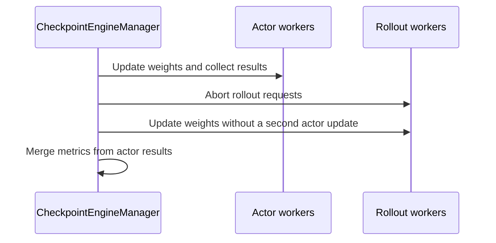

# [ckpt, fsdp] feat: add filesystem checkpoint engine

[Upstream PR](https://github.com/verl-project/verl/pull/8355) · state: open · merged: False

## Original PR description

### What does this PR do?

Add a `FileSystemCheckpointEngine` backend that synchronizes trainer weights with rollout workers through a shared filesystem.

The trainer exports HuggingFace safetensors shards to a shared mounted directory, and rollout workers load them directly. This provides a simple fallback when trainer and rollout workers cannot use direct communication transports or run on heterogeneous hardware.

Related PRs:

- #4775 introduced the Checkpoint Engine abstraction.
- #5031 introduced `CheckpointEngineManager`.
- #8171 introduced streaming HF checkpoint export through `get_per_tensor_param()`.

### Checklist Before Starting
- [x] Searched for similar PRs: https://github.com/verl-project/verl/pulls?q=is%3Apr+filesystem+checkpoint+engine
- [x] PR title follows `[ckpt, fsdp] feat: add filesystem checkpoint engine`.


### Design & Code Changes

- Add `FileSystemCheckpointEngine`.
  - Export each weight version to `<path>/global_step_<n>`.
  - Stage safetensors on local storage before sequentially copying them to the shared filesystem.
  - Load safetensors directly from the shared filesystem on rollout workers.
  - Publish `model.safetensors.index.json` only after every shard has been copied.
  - Remove exported weights after rollout workers finish loading them.

- Optimization: distributed write.
  - Shards are assigned round-robin across actor ranks.
  - Every rank consumes the same `get_per_tensor_param()` stream and computes identical shard boundaries.
  - A distributed barrier ensures all shards are available before rank 0 publishes the index.

- Adjust `CheckpointEngineManager` for the filesystem backend.
  - Complete actor export before interrupting rollout workers.
  - Rollout generation can continue while actor workers export weights.

- Extract shared HF safetensors export logic.
  - Reuse it in both `FSDPCheckpointManager` and `FileSystemCheckpointEngine`.
  - Preserve FSDP rank-0 export behavior, tied-weight filtering, dtype conversion, file naming, and index format.

- Document filesystem backend configuration.

### API and Usage Example

The filesystem path must be mounted and accessible on all trainer and rollout nodes.

```bash
actor_rollout_ref.rollout.checkpoint_engine.backend=filesystem \
+actor_rollout_ref.rollout.checkpoint_engine.engine_kwargs.filesystem.path=/mnt/shared/verl_weights
```

Distributed write is enabled by default. Actor ranks write different HF shards in parallel.

To make rank 0 write all shards:

```bash
+actor_rollout_ref.rollout.checkpoint_engine.engine_kwargs.filesystem.distributed_write=False
```

### Test

Validated on A100 GPUs with FSDP training, vLLM rollout, and HDFS mounted through FUSE for weight transfer:
- Qwen3.5-0.8B: one node with 4 trainer GPUs and 4 rollout GPUs.
- Qwen3-30B-A3B: four nodes with 16 trainer GPUs and 16 rollout GPUs.
- Used `separate_async` mode.
- Tested both `distributed_write=True` and `distributed_write=False`.
- Verified weight synchronization, training, validation generation, and exported-weight cleanup.

#### Performance results
<p align="center">
  
  
</p>
<details>
<summary>Qwen3.5-0.8B test script</summary>

```bash
#!/usr/bin/env bash
set -x
export CUDA_DEVICE_MAX_CONNECTIONS=1
export VERL_LOGGING_LEVEL=INFO
export VLLM_USE_V1=1
DATA_ROOT=${DATA_ROOT:-/mnt/hdfs/shared}
MODEL_PATH=${MODEL_PATH:-$DATA_ROOT/models/Qwen3.5-0.8B}
DISTRIBUTED_WRITE=${DISTRIBUTED_WRITE:-True}
timestamp=$(date +%Y%m%d_%H%M%S)
filesystem_path=$DATA_ROOT/tmp_ckpt/qwen3.5-0.8b-fsdp-vllm-$timestamp
gsm8k_train=$DATA_ROOT/data/gsm8k/train.parquet
gsm8k_test=$DATA_ROOT/data/gsm8k/test_10.parquet
parameter_sync_step=4
ppo_mini_batch_size=16
train_batch_size=$((parameter_sync_step * ppo_mini_batch_size))
python3 -m verl.trainer.main_ppo \
    --config-path=config \
    --config-name=ppo_trainer.yaml \
    model_engine=dp \
    actor_rollout_ref.actor.strategy=fsdp2 \
    actor_rollout_ref.actor.fsdp_config.param_offload=False \
    actor_rollout_ref.actor.fsdp_config.optimizer_offload=False \
    trainer.use_v1=True \
    trainer.v1.trainer_mode=separate_async \
    trainer.v1.separate_async.num_warmup_batches=1 \
    trainer.v1.separate_async.parameter_sync_step=$parameter_sync_step \
    trainer.v1.sampler.max_off_policy_threshold=8 \
    trainer.v1.sampler.max_off_policy_strategy=drop \
    transfer_queue.enable=True \
    transfer_queue.backend.SimpleStorage.total_storage_size=4096 \
    transfer_queue.backend.SimpleStorage.num_data_storage_units=2 \
    algorithm.adv_estimator=grpo \
    algorithm.use_kl_in_reward=False \
    algorithm.rollout_correction.bypass_mode=False \
    data.train_files="$gsm8k_train" \
    data.val_files="$gsm8k_test" \
    data.train_batch_size=$train_batch_size \
    data.gen_batch_size=1 \
    data.max_prompt_length=512 \
    data.max_response_length=512 \
    data.return_raw_chat=True \
    data.filter_overlong_prompts=True \
    data.truncation=left \
    actor_rollout_ref.model.path=$MODEL_PATH \
    actor_rollout_ref.model.trust_remote_code=True \
    actor_rollout_ref.model.enable_gradient_checkpointing=False \
    actor_rollout_ref.model.use_remove_padding=True \
    actor_rollout_ref.actor.optim.lr=1e-6 \
    actor_rollout_ref.actor.optim.lr_warmup_steps=-1 \
    actor_rollout_ref.actor.ppo_mini_batch_size=$ppo_mini_batch_size \
    actor_rollout_ref.actor.ppo_micro_batch_size_per_gpu=2 \
    actor_rollout_ref.actor.ppo_epochs=1 \
    actor_rollout_ref.actor.use_dynamic_bsz=True \
    actor_rollout_ref.actor.ppo_max_token_len_per_gpu=2048 \
    actor_rollout_ref.actor.use_kl_loss=False \
    actor_rollout_ref.actor.entropy_coeff=0 \
    actor_rollout_ref.rollout.name=vllm \
    actor_rollout_ref.rollout.mode=async \
    actor_rollout_ref.rollout.nnodes=1 \
    actor_rollout_ref.rollout.n_gpus_per_node=4 \
    actor_rollout_ref.rollout.tensor_model_parallel_size=1 \
    actor_rollout_ref.rollout.gpu_memory_utilization=0.6 \
    actor_rollout_ref.rollout.n=4 \
    actor_rollout_ref.rollout.calculate_log_probs=True \
    actor_rollout_ref.rollout.log_prob_use_dynamic_bsz=True \
    actor_rollout_ref.rollout.log_prob_max_token_len_per_gpu=2048 \
    actor_rollout_ref.rollout.enable_chunked_prefill=True \
    actor_rollout_ref.rollout.checkpoint_engine.backend=filesystem \
    actor_rollout_ref.rollout.checkpoint_engine.update_weights_bucket_megabytes=1024 \
    +actor_rollout_ref.rollout.checkpoint_engine.engine_kwargs.filesystem.path=$filesystem_path \
    +actor_rollout_ref.rollout.checkpoint_engine.engine_kwargs.filesystem.distributed_write=$DISTRIBUTED_WRITE \
    reward.reward_manager.name=dapo \
    "trainer.logger=['console','wandb']" \
    trainer.project_name=verl_filesystem_ckpt_engine \
    trainer.experiment_name=qwen3.5_0.8b_fsdp_vllm_$timestamp \
    trainer.val_before_train=False \
    trainer.test_freq=10 \
    trainer.log_val_generations=10 \
    trainer.save_freq=-1 \
    trainer.resume_mode=disable \
    trainer.nnodes=1 \
    trainer.n_gpus_per_node=4 \
    trainer.total_epochs=1 \
    trainer.total_training_steps=10
```

</details>


### Checklist Before Submitting

- [x] Read the [Contribute Guide](https://github.com/verl-project/verl/blob/main/CONTRIBUTING.md).
- [x] Applied pre-commit checks:
  `pre-commit install && pre-commit run --all-files --show-diff-on-failure --color=always`
- [ ] Add / Update [the documentation](https://github.com/verl-project/verl/tree/main/docs).
- [ ] Add unit or end-to-end test(s) to [the CI workflow](https://github.com/verl-project/verl/tree/main/.github/workflows) to cover all the code. If not feasible, explain why: ...
- [ ] Once your PR is ready for CI, send a message in [the ci-request channel](https://verl-project.slack.com/archives/C091TCESWB1) in [the verl Slack workspace](https://join.slack.com/t/verl-project/shared_invite/zt-3855yhg8g-CTkqXu~hKojPCmo7k_yXTQ). (If not accessible, please try [the Feishu group (飞书群)](https://applink.larkoffice.com/client/chat/chatter/add_by_link?link_token=772jd4f1-cd91-441e-a820-498c6614126a).)
- [x] Recipe submodule update is not applicable.

## Review and discussion

### reviews

- coderabbitai[bot] · COMMENTED · 2026-10-23T10:47:39Z · [source](https://github.com/verl-project/verl/pull/8355#pullrequestreview-5627186681)

<!-- coderabbit-ai-generated:v1 -->


<details>
<summary>🔇 Additional comments: 6</summary><blockquote>

<details>
<summary>verl/utils/checkpoint/hf_safetensors.py: 1</summary><blockquote>

`25-94`: LGTM!

<!-- cr-comment:v1:40fd9262239a8393061ed401 -->

</blockquote></details>
<details>
<summary>verl/utils/checkpoint/fsdp_checkpoint_manager.py: 1</summary><blockquote>

`39-39`: LGTM!


Also applies to: 151-165

<!-- cr-comment:v1:34b08b886a5d62c83e554aa8 -->

</blockquote></details>
<details>
<summary>verl/checkpoint_engine/base.py: 1</summary><blockquote>

`522-526`: LGTM!


Also applies to: 544-555

<!-- cr-comment:v1:e56a1bc373c54837133a2848 -->

</blockquote></details>
<details>
<summary>verl/checkpoint_engine/__init__.py: 1</summary><blockquote>

`23-23`: LGTM!


Also applies to: 32-32

<!-- cr-comment:v1:04ed51542198dd6e687ab3d7 -->

</blockquote></details>
<details>
<summary>verl/checkpoint_engine/README.md: 1</summary><blockquote>

`23-35`: LGTM!

<!-- cr-comment:v1:7e39f0062d0cdf8ef0f4f7ea -->

</blockquote></details>
<details>
<summary>verl/checkpoint_engine/filesystem_checkpoint_engine.py: 1</summary><blockquote>

`40-43`: **🗄️ Data Integrity & Integration** | **🔵 Trivial** | **⚡ Quick win**

⚠️ **Unverified finding**
Verification ran but could not confirm this finding. It is shown for review, not as a verified issue.

**Verify each copied shard before the index is published.**

`_copy_file` returns without checking the destination. FUSE mounts such as HDFS can lose or truncate data on close without raising. In that case the barrier at Line 139 passes and rank 0 publishes an index that points to a short shard. The rollout workers then fail or load a bad file.

A size comparison is a cheap check. Run it before the barrier so a failing rank raises early.

<details>
<summary>🛡️ Proposed fix</summary>

```diff
 def _copy_file(src: str, dst: str):
     """Copy with sequential IO, which is supported by HDFS fuse mounts."""
     with open(src, "rb") as src_file, open(dst, "wb") as dst_file:
         shutil.copyfileobj(src_file, dst_file, length=COPY_BUFFER_SIZE)
+    src_size, dst_size = os.path.getsize(src), os.path.getsize(dst)
+    if src_size != dst_size:
+        raise OSError(f"Copy of {src} to {dst} is incomplete: expected {src_size} bytes, found {dst_size}")
```
</details>

Based on learnings: "after saving a model checkpoint, immediately reload it from disk and verify its contents rather than assuming the save succeeded."

_Source: Learnings_

</blockquote></details>

</blockquote></details>

---

<details>
<summary>ℹ️ Review info</summary>

<details>
<summary>⚙️ Run configuration</summary>

- **Source mode**: Auto
- **Repository**: Unavailable
- **Branch**: Unavailable
- **File**: No configuration file from this repository applied
- **Commit**: Unavailable
- **Layers**: Organization UI
- **Review profile**: CHILL
- **Plan**: Advanced
- **Run ID**: `803c4348-8bd1-4a79-9e03-6894a5d111d8`

</details>

<details>
<summary>📥 Commits</summary>

Reviewing files that changed from the base of the PR and between a4b9354968705a441fb7da7367924b15b902e771 and c011f69bf4740a06c66a37be516b58f844c8a2cd.

</details>

<details>
<summary>📒 Files selected for processing: 6</summary>

* `verl/checkpoint_engine/README.md`
* `verl/checkpoint_engine/__init__.py`
* `verl/checkpoint_engine/base.py`
* `verl/checkpoint_engine/filesystem_checkpoint_engine.py`
* `verl/utils/checkpoint/fsdp_checkpoint_manager.py`
* `verl/utils/checkpoint/hf_safetensors.py`

</details>

**Included review availability:** This review used your included allowance. Your plan provides up to 10 included reviews per hour; 9 remain after this review.

</details>

<!-- This is an auto-generated comment by CodeRabbit for review status -->

<!-- coderabbit-review-publication v1 publication=0ee3d016-ab81-4831-a9f8-e3fd4ee0280a attempt=6fde29ef-ecfa-415f-b604-261e05e3dab8 batch=1/1 -->

### issue_comments

- coderabbitai[bot] · comment · 2026-10-23T10:41:25Z · [source](https://github.com/verl-project/verl/pull/8355#issuecomment-6363051446)

<!-- coderabbit-ai-generated:v1 -->

<!-- This is an auto-generated comment: summarize by coderabbit.ai -->
<!-- review_stack_entry_start -->

<a href="https://app.coderabbit.ai/change-stack/verl-project/verl/pull/8355?scope=ghh_OusAJGA4HG8ljoOV0wJvVx8NmnZIjc2DdjmxOu0xZWA&amp;cs_source=review_comment"><picture><source media="(prefers-color-scheme: dark)" srcset="https://storage.googleapis.com/coderabbit_public_assets/review-stack-in-coderabbit-ui-dark.svg?v=3"><source media="(prefers-color-scheme: light)" srcset="https://storage.googleapis.com/coderabbit_public_assets/review-stack-in-coderabbit-ui.svg?v=3"></picture></a>

<!-- review_stack_entry_end -->
<!-- walkthrough_start -->

<details>
<summary><strong>📝 Summary</strong></summary>
<dl>
<dd>

<!-- This is an auto-generated comment: release notes by coderabbit.ai -->

## Summary by CodeRabbit

* **New Features**
  * Added a filesystem-based option for transferring model weights through a shared directory, with support across hardware types.
  * Checkpoints can be written in parallel by default, with an option to use a single writer.
  * Hugging Face safetensors exports now support size-limited shards and configurable tensor dtype handling.

<!-- end of auto-generated comment: release notes by coderabbit.ai -->
The change adds a filesystem checkpoint backend, a shared function for exporting Hugging Face safetensors shards, and manager integration that updates actor and rollout workers in separate steps for the filesystem backend.

**Changes: Filesystem Checkpoint Backend**

|Layer / File(s)|Summary|
|:---|:---|
|**Shared safetensors export** <br> `verl/utils/checkpoint/hf_safetensors.py`, `verl/utils/checkpoint/fsdp_checkpoint_manager.py`|Adds streaming, size-limited Hugging Face safetensors export with optional dtype conversion and round-robin shard ownership. FSDP checkpoint export delegates to the new function.|
|**Filesystem weight transfer** <br> `verl/checkpoint_engine/filesystem_checkpoint_engine.py`|Adds a registered engine that writes shards and an index to a step-specific directory on a mounted filesystem. It loads indexed shards and removes tracked exports during finalization.|
|**Weight-update integration and exports** <br> `verl/checkpoint_engine/base.py`, `verl/checkpoint_engine/__init__.py`, `verl/checkpoint_engine/README.md`|For the filesystem backend, the manager updates actor workers before aborting rollout requests, then updates rollout workers and merges actor metrics. The package exports the engine, and the README documents setup and `distributed_write` behavior.|

### Sequence Diagram(s)



**Suggested reviewers:** `wuxibin89`, `petersh6`

</dd>
</dl>
</details>

<!-- walkthrough_end -->
<!-- change_assessment_start -->
**Priority:** ⚪ Pending latest changes

<!-- change_assessment_commit:"c011f69bf4740a06c66a37be516b58f844c8a2cd" -->

<!-- change_assessment_end -->
<details>
<summary><strong>Merge Risk:</strong> <strong>⚪ Minimal</strong> · up to <code>c011f</code></summary>
<dl>
<dd>

<!-- final_review_risk_start -->
<!-- final_review_risk_label
**Merge Risk:** **⚪ Minimal** · up to `c011f`
-->
<!-- final_review_risk_coverage:{"sourceCommitId":"c011f69bf4740a06c66a37be516b58f844c8a2cd","coveredCommitId":"c011f69bf4740a06c66a37be516b58f844c8a2cd","kind":"reviewed"} -->

No demonstrated issue currently blocks merging the filesystem checkpoint backend after normal checks.
<!-- final_review_risk_end -->

</dd>
</dl>
</details>

<details>
<summary><strong>Security architecture risk:</strong> <strong>🟡 Moderate</strong> · up to <code>c011f</code></summary>
<dl>
<dd>

<!-- architecture_review_start -->
<!-- architecture_review_label
### Security Architecture Review

**Security architecture risk:** **🟡 Moderate** · up to `c011f`
-->

Successful transfers have explicit ordering, but failed transfers can leave model files behind. Safe operation also depends on shared-directory access controls and isolation that are not established by the available deployment information.

**Retained concerns**
- **Medium · reliability · observed:** Failed transfers can leave model weights outside the cleanup lifecycle. Shared shards are created before exported_dir is recorded; an export, copy, barrier, or index-publication failure can therefore leave files that finalize cannot identify. Failures after publication also bypass manager finalization. Even removal errors clear the tracked path. Normal successful transfers clean up after consumers finish, but failure recovery does not provide equivalent ownership or retention containment. The confidentiality consequence depends on the model's sensitivity and shared-directory permissions.

<details>
<summary><strong>Security review details</strong></summary>
<dl>
<dd>

**Security Blast Radius**
- _inferred_ — A principal able to replace the selected version's index or shards can affect every rollout worker consuming that version. A principal able to read retained shards can obtain exported model weights. These outcomes require filesystem permissions; the evidence does not establish unauthorized access, cross-tenant reachability, or host-level privilege escalation.

**Security Findings and Attack Paths**
- _inferred_ — The supported failure path is an interrupted or failed transfer leaving shared model files beyond the intended lifecycle. Whether that becomes unauthorized disclosure depends on directory access and model sensitivity. Writable-mount model substitution is a conditional trust-boundary consequence, not a verified attacker-reachable vulnerability.

**Trust Boundaries and Controls**
- _observed_ — Backend selection and weight loading remain behind the checkpoint-engine manager and worker interfaces. The filesystem branch changes transport ordering, not the orchestration authority. Its barrier, index-last convention, and awaited consumer updates are meaningful controls against premature consumption and premature cleanup in the successful sequential flow; they do not authenticate storage contents.

**Resilience and Maintainability Implications**
- _observed_ — Local staging uses an automatically cleaned temporary directory, while shared-directory cleanup is success-tracked and process-local. This asymmetry means local exception cleanup does not provide equivalent containment for shared model artifacts or recovery after process loss.

**Hardening Proposals**
- _proposed_ — Define and enforce job-scoped storage ownership: intended actors receive write access, rollout workers receive only required read access, and unrelated jobs cannot share a writable checkpoint namespace. Document retention expectations for failed transfers.
- _proposed_ — Use attempt-specific ownership and recoverable cleanup tracking before shared files are created. Publish an immutable completed attempt using guarantees supported by the mounted filesystem, and retain cleanup state when deletion fails. Keep failed or partially loaded attempts unavailable to generation until recovery establishes a consistent model version.

</dd>
</dl>
</details>
<!-- architecture_review_end -->

</dd>
</dl>
</details>
<!-- pre_merge_checks_walkthrough_start -->

<details>
<summary><strong>Pre-merge checks: <sup><picture></picture></sup> 4 · <sup><picture></picture></sup> 1</strong></summary>
<dl>
<dd>

<strong><sup><picture></picture></sup> Failed checks: 1 warning</strong>

|     Check name     |                                              Status                                              | Explanation                                                                                                                                                                                               | Resolution                                                                         |
| :---------------- | :----------------------------------------------------------------------------------------------: | :-------------------------------------------------------------------------------------------------------------------------------------------------------------------------------------------------------- | :--------------------------------------------------------------------------------- |
| Docstring Coverage |  | Docstring coverage is 53.85% which is insufficient. The required threshold is 80.00%. Docstring coverage is scoped to functions touched by this diff. Analyzed 13 functions across 5 files. (1 skipped: … | Write docstrings for the functions missing them to satisfy the coverage threshold. |

<details>
<summary><strong><sup><picture></picture></sup> Passed checks: 4 passed</strong></summary>
<dl>
<dd>

|         Check name         |                                             Status                                             | Explanation                                                                                                                                                                                               |
| :------------------------ | :--------------------------------------------------------------------------------------------: | :-------------------------------------------------------------------------------------------------------------------------------------------------------------------------------------------------------- |
|         Title check        |  | The title names the change: adding a filesystem checkpoint engine under the ckpt and fsdp scope. The changeset adds FileSystemCheckpointEngine, a shared-filesystem weight sync backend, and the title f… |
|      Description check     |  | The description states that the PR adds a FileSystemCheckpointEngine backend that syncs trainer weights with rollout workers through a shared filesystem. It also covers the configuration, the distribu… |
|     Linked Issues check    |  | Check skipped because no linked issues were found for this pull request.                                                                                                                                  |
| Out of Scope Changes check |  | Check skipped because no linked issues were found for this pull request.                                                                                                                                  |

<details>
<summary><strong>Full details: Title check</strong></summary>
<dl>
<dd>

**Explanation**

The title names the change: adding a filesystem checkpoint engine under the ckpt and fsdp scope. The changeset adds FileSystemCheckpointEngine, a shared-filesystem weight sync backend, and the title follows the repository convention. It is concise and specific, so it passes.

</dd>
</dl>
</details>

<details>
<summary><strong>Full details: Description check</strong></summary>
<dl>
<dd>

**Explanation**

The description states that the PR adds a FileSystemCheckpointEngine backend that syncs trainer weights with rollout workers through a shared filesystem. It also covers the configuration, the distributed write option, the shared HF safetensors export refactor, and the test setup. This matches the changeset, so it passes.

</dd>
</dl>
</details>

</dd>
</dl>
</details>

<details>
<summary><strong>Full details: Docstring Coverage</strong></summary>
<dl>
<dd>

**Explanation**

Docstring coverage is 53.85% which is insufficient. The required threshold is 80.00%. Docstring coverage is scoped to functions touched by this diff. Analyzed 13 functions across 5 files. (1 skipped: 1 unsupported.)

**Resolution**

Write docstrings for the functions missing them to satisfy the coverage threshold.

</dd>
</dl>
</details>

</dd>
</dl>
</details>

<!-- pre_merge_checks_walkthrough_end -->
<!-- autopilot:start -->
- [ ] <!-- {"checkboxId":"2708ad07-9f24-4260-9c11-7dc76a49f2e3"} --> <strong title="Keep fixing CodeRabbit findings and required CI, and resolving merge conflicts">Autofix</strong> · Keep fixing CodeRabbit findings and required CI, and resolving merge conflicts
<!-- autopilot:end -->
<!-- tips_start -->


<sub>Comment `@coderabbitai help` to get the list of available commands.</sub>

<!-- tips_end -->

- cla-assistant[bot] · comment · 2026-10-23T10:41:36Z · [source](https://github.com/verl-project/verl/pull/8355#issuecomment-6363054470)

[](https://cla-assistant.io/verl-project/verl?pullRequest=8355) <br/>All committers have signed the CLA.

### inline_comments

## Changed files and fixed code

- `verl/checkpoint_engine/README.md` · modified · additions 13 / deletions 0
  - [head](https://github.com/wdl339/verl/blob/7d981cde954fce079d8c973379738d6e8c258ac2/verl/checkpoint_engine/README.md)
  - [base](https://github.com/verl-project/verl/blob/a4b9354968705a441fb7da7367924b15b902e771/verl/checkpoint_engine/README.md)
- `verl/checkpoint_engine/__init__.py` · modified · additions 2 / deletions 0
  - [head](https://github.com/wdl339/verl/blob/7d981cde954fce079d8c973379738d6e8c258ac2/verl/checkpoint_engine/__init__.py)
  - [base](https://github.com/verl-project/verl/blob/a4b9354968705a441fb7da7367924b15b902e771/verl/checkpoint_engine/__init__.py)
- `verl/checkpoint_engine/base.py` · modified · additions 14 / deletions 5
  - [head](https://github.com/wdl339/verl/blob/7d981cde954fce079d8c973379738d6e8c258ac2/verl/checkpoint_engine/base.py)
  - [base](https://github.com/verl-project/verl/blob/a4b9354968705a441fb7da7367924b15b902e771/verl/checkpoint_engine/base.py)
- `verl/checkpoint_engine/filesystem_checkpoint_engine.py` · added · additions 174 / deletions 0
  - [head](https://github.com/wdl339/verl/blob/7d981cde954fce079d8c973379738d6e8c258ac2/verl/checkpoint_engine/filesystem_checkpoint_engine.py)
  - [base](https://github.com/verl-project/verl/blob/a4b9354968705a441fb7da7367924b15b902e771/verl/checkpoint_engine/filesystem_checkpoint_engine.py)
- `verl/utils/checkpoint/fsdp_checkpoint_manager.py` · modified · additions 14 / deletions 37
  - [head](https://github.com/wdl339/verl/blob/7d981cde954fce079d8c973379738d6e8c258ac2/verl/utils/checkpoint/fsdp_checkpoint_manager.py)
  - [base](https://github.com/verl-project/verl/blob/a4b9354968705a441fb7da7367924b15b902e771/verl/utils/checkpoint/fsdp_checkpoint_manager.py)
- `verl/utils/checkpoint/hf_safetensors.py` · added · additions 94 / deletions 0
  - [head](https://github.com/wdl339/verl/blob/7d981cde954fce079d8c973379738d6e8c258ac2/verl/utils/checkpoint/hf_safetensors.py)
  - [base](https://github.com/verl-project/verl/blob/a4b9354968705a441fb7da7367924b15b902e771/verl/utils/checkpoint/hf_safetensors.py)

## Evidence and interpretation boundary

[Original JSON, discussions and patches](../../../../../../evidence/prs/verl-project--verl/8355-7a7c837f99472b1502e3dfaeacf79a61893bd9eed9f5ad912f0e3becf91eb186.json) · SHA-256 `7a7c837f99472b1502e3dfaeacf79a61893bd9eed9f5ad912f0e3becf91eb186`.

Diff complete: True. Missing/binary/truncated patches require pinned source inspection. This is a source page, not an independently verified optimization case. Open, merged and released are different states; recheck the deployed dependency.
