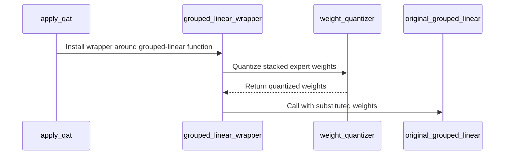

# [megatron, perf] fix: fake-quantize all MXFP4 expert weights of a grouped linear in one call

[Upstream PR](https://github.com/verl-project/verl/pull/8425) · state: closed · merged: False

## Original PR description

### What does this PR do?

Makes Megatron MXFP4 QAT on MoE models about 9× cheaper per forward on the routed experts, with bit-identical results.

ModelOpt's `_QuantTEGroupedLinear` calls the weight quantizer once per expert at every forward. With verl's MXFP4 backend (the compressed-tensors QDQ that keeps QAT and the exported rollout weights bit-identical), each call launches about fifty small kernels from Python. QAT on the grouped experts is therefore launch-bound. On Qwen3-30B-A3B at TP2 × EP2 (64 local experts per rank):

- In one GRPO step on 4×B300 with `qat.mode=mxfp4` (the example from #8186), `old_log_prob` took 1015 s, against 105 s for `ref`, the same model's forward without QAT. `update_actor` took 2423 s.
- One layer on one GPU at the same per-rank shapes (20,480 tokens) took 147 ms per QAT forward, against 7 ms without QAT. The GPU was busy for 25 ms of it.

The MXFP4 QDQ forms each 32-element group within one row of one weight, so quantizing the stacked expert weights gives the same values bit for bit. Under QAT, the grouped linear functional now stacks the expert weights and quantizes them in one call. It then hands the results to ModelOpt's own functional, which still quantizes the input and calls TE. Weight quantizers on other backends (FP8 block, NVFP4, ModelOpt's own formats) keep ModelOpt's per-expert loop.

The change replaces `_quantized_linear_fn` on ModelOpt's private `_QuantTEGroupedLinear` class at QAT setup, with a warning if that attribute is missing. The long-term home for batching grouped weights is ModelOpt itself; I can open an issue there if that's preferred.

### Checklist Before Starting

- [x] Search for similar PRs: none touches ModelOpt's grouped linear quantization or QAT speed (searched `QAT slow`, `grouped linear quant`, `_QuantTEGroupedLinear`, `weight_quantizer expert`).
- [x] Format the PR title as `[{modules}] {type}: {description}`.

### Test

`tests/utils/test_modelopt_grouped_weight_qdq_on_cpu.py` (new, CPU), 5 tests:

- Stacked and per-expert QDQ agree bit for bit, straight-through gradients included. The weights span 1e-3 to 30 and include an all-zero row and a group at the largest E2M1 value.
- The order of stacked and per-expert calls doesn't matter.
- The grouped functional calls the weight quantizer once on `[num_gemms, out, in]`, passes the biases through and quantizes the input once.
- Other weight backends keep the per-expert loop.
- The patch is applied once.

```bash
python -m pytest -q tests/utils/test_modelopt_grouped_weight_qdq_on_cpu.py tests/utils/test_mxfp8_ignored_layers_on_cpu.py \
  tests/utils/test_vllm_mxfp4_restage_on_cpu.py tests/utils/test_vllm_unquant_utils_on_cpu.py \
  tests/workers/test_engine_*_on_cpu.py tests/workers/test_megatron_*_on_cpu.py
# 83 passed
pre-commit run --files <changed files>   # all hooks pass
bash scripts/generate_trainer_config.sh  # All good
```

GPU, one B300, one Qwen3-30B-A3B layer on the Transformer Engine spec. Per-rank shapes at TP2 × EP2: 64 experts, expert FFN 384, hidden 2048. 20,480 tokens, warm iterations. Same layer instance before and after the change:

| | Per expert (before) | Batched (this PR) |
|---|---|---|
| weight-quantizer calls per forward | 128 | 2 |
| forward (ms) | 139.0 | 15.4 |
| forward + backward (ms) | 168.2 | 33.7 |
| peak memory, forward / forward + backward (GB) | 4.8 / 7.0 | 5.8 / 7.6 |
| without QAT, forward / forward + backward (ms) | 7.0 / 26.3 | |

Bit-identity on the GPU:

- QDQ of the layer's real expert weights and of random weights (1e-4 to 50) is equal stacked and per expert.
- The layer's forward is not deterministic by default: two runs before the change already differ. With Megatron `deterministic_mode`, `CUBLAS_WORKSPACE_CONFIG=:4096:8` and `NVTE_ALLOW_NONDETERMINISTIC_ALGO=0`, two runs before the change are identical. Against them, this PR gives bit-identical no-grad outputs, grad-mode outputs, input gradients and all parameter gradients.

End to end, the MXFP4 recipe in #8426 (Qwen3-30B-A3B GRPO, 4×B300, TP2 × EP2, `qat.mode=mxfp4`):

- First step on the same four GPUs: 3743 s on main 174888fc, 1056 s on main 2ab35292 with this change (the commits in between change the rollout's request gate, DeepSeek-V4 and ROCm guards and tracing, not the training path). By phase: `old_log_prob` 1015 → 179 s, `update_actor` 2423 → 569 s, `ref` 105 s in both; `rollout_corr/kl` 0.0030 in both.
- Ten steps per arm with this change: 1031 s per step with QAT, against 890 s for the MXFP4 rollout without QAT and 829 s in BF16; `rollout_corr/kl` 0.0031, 0.0142 and 0.0017.

### Design & Code Changes

- `verl/utils/qat/modelopt.py`: `_batch_grouped_expert_weight_qdq()`, called from `apply_qat`, wraps `_QuantTEGroupedLinear._quantized_linear_fn`. When the weight quantizer is enabled on verl's MXFP4 backend and the expert weights share shape, dtype and device, it quantizes `torch.stack(weights)` once. It then calls ModelOpt's original functional through a view of the module whose `weight_quantizer` is the identity. Every other case calls the original unchanged.
- `tests/utils/test_modelopt_grouped_weight_qdq_on_cpu.py`: new CPU test.

### Checklist Before Submitting

- [x] Read the [Contribute Guide](https://github.com/verl-project/verl/blob/main/CONTRIBUTING.md).
- [x] Apply pre-commit checks.
- [ ] Add / Update the documentation: no user-facing change.
- [x] Add unit tests (CPU).

AI assistance was used for this change. I reviewed every changed line and ran the tests above.


## Review and discussion

### reviews

### issue_comments

- coderabbitai[bot] · comment · 2026-10-28T17:15:39Z · [source](https://github.com/verl-project/verl/pull/8425#issuecomment-6475682201)

<!-- coderabbit-ai-generated:v1 -->

<!-- This is an auto-generated comment: summarize by coderabbit.ai -->
<!-- review_stack_entry_start -->

<a href="https://app.coderabbit.ai/change-stack/verl-project/verl/pull/8425?scope=ghh_OusAJGA4HG8ljoOV0wJvVx8NmnZIjc2DdjmxOu0xZWA&amp;cs_source=review_comment"><picture><source media="(prefers-color-scheme: dark)" srcset="https://storage.googleapis.com/coderabbit_public_assets/review-stack-in-coderabbit-ui-dark.svg?v=3"><source media="(prefers-color-scheme: light)" srcset="https://storage.googleapis.com/coderabbit_public_assets/review-stack-in-coderabbit-ui.svg?v=3"></picture></a>

<!-- review_stack_entry_end -->
<!-- recent_review_start -->

No actionable comments were generated in the recent review.

<details>
<summary><strong><picture></picture> Recent review info</strong></summary>
<dl>
<dd>

<!-- review_info_content -->
<details>
<summary><strong><picture><source media="(prefers-color-scheme: dark)" srcset="https://storage.googleapis.com/coderabbit_public_assets/review-comment-icons-v1/cog-dark.svg"></picture> Run configuration</strong></summary>
<dl>
<dd>

- **Source mode**: Auto
- **Repository**: Unavailable
- **Branch**: Unavailable
- **File**: No configuration file from this repository applied
- **Commit**: Unavailable
- **Layers**: Organization UI
- **Review profile**: CHILL
- **Plan**: Advanced
- **Run ID**: `10620396-bdf2-4430-9d5f-815fa5064000`

</dd>
</dl>
</details>

<details>
<summary><strong><picture><source media="(prefers-color-scheme: dark)" srcset="https://storage.googleapis.com/coderabbit_public_assets/review-comment-icons-v1/git-commit-horizontal-dark.svg"></picture> Commits</strong></summary>
<dl>
<dd>

Reviewing files that changed from the base of the PR and between 2ab35292039a51175a4b3d3b3b2d76e951a0d3e4 and 4d516117d6f91b4756a1d5a0cdbf1e01264ff039.

</dd>
</dl>
</details>

<details>
<summary><strong><picture><source media="(prefers-color-scheme: dark)" srcset="https://storage.googleapis.com/coderabbit_public_assets/review-comment-icons-v1/file-plus-corner-dark.svg"></picture> Files selected for processing: 2</strong></summary>
<dl>
<dd>

* `tests/utils/test_modelopt_grouped_weight_qdq_on_cpu.py`
* `verl/utils/qat/modelopt.py`

</dd>
</dl>
</details>

**Included review availability:** This review used your included allowance. Your plan provides up to 10 included reviews per hour; 9 remain after this review.

</dd>
</dl>
</details>


<!-- recent_review_end -->
<!-- walkthrough_start -->

<details>
<summary><strong>📝 Summary</strong></summary>
<dl>
<dd>

<!-- This is an auto-generated comment: release notes by coderabbit.ai -->

## Summary by CodeRabbit

* **Performance**
  * Compatible grouped MXFP4 expert weights are now quantized together, reducing repeated quantization work. Existing per-expert processing remains in place for other backends and when weights are not compatible for grouping.
* **Reliability**
  * Added automated checks for quantization results, gradients, input and bias handling, backend behavior, and repeatable patch installation. These checks help ensure grouped quantization preserves expected behavior.

<!-- end of auto-generated comment: release notes by coderabbit.ai -->
The grouped-linear path now batches compatible expert weights into one MXFP4 quantization call. CPU tests cover quantization results, gradients, quantizer calls, fallback behavior, and repeated patch installation.

**Changes: Grouped Expert Weight Quantization**

|Layer / File(s)|Summary|
|:---|:---|
|**Install grouped-weight batching** <br> `verl/utils/qat/modelopt.py`|`apply_qat` installs a wrapper for Transformer Engine’s grouped-linear function. When the MXFP4 backend is enabled and the expert weights meet the shape, dtype, and device conditions, the wrapper quantizes stacked weights in one call. Otherwise, it uses the original function path.|
|**Validate grouped-weight behavior** <br> `tests/utils/test_modelopt_grouped_weight_qdq_on_cpu.py`|CPU tests compare stacked and per-expert results and gradients. They also check quantizer calls, bias pass-through, backend-specific behavior, and repeated patch installation.|

### Sequence Diagram(s)



**Suggested reviewers:** `wuxibin89`

</dd>
</dl>
</details>

<!-- walkthrough_end -->
<!-- change_assessment_start -->
<strong>Priority: <picture></picture> Normal</strong>

<!-- change_assessment_commit:"4d516117d6f91b4756a1d5a0cdbf1e01264ff039" -->

<!-- change_assessment_end -->
<details>
<summary><strong>Merge Risk:</strong> <strong><picture></picture> Minimal</strong> · up to <code>4d516</code></summary>
<dl>
<dd>

<!-- final_review_risk_start -->
<!-- final_review_risk_label
**Merge Risk:** **⚪ Minimal** · up to `4d516`
-->
<!-- final_review_risk_coverage:{"sourceCommitId":"4d516117d6f91b4756a1d5a0cdbf1e01264ff039","coveredCommitId":"4d516117d6f91b4756a1d5a0cdbf1e01264ff039","kind":"reviewed"} -->

MXFP4 expert weights are batched for quantization; no concrete merge-blocking risk remains.
<!-- final_review_risk_end -->

</dd>
</dl>
</details>
<!-- pre_merge_checks_walkthrough_start -->

<details>
<summary><strong>Pre-merge checks: <sup><picture></picture></sup> 4 · <sup><picture></picture></sup> 1</strong></summary>
<dl>
<dd>

<strong><sup><picture></picture></sup> Failed checks: 1 warning</strong>

|     Check name     |                                              Status                                              | Explanation                                                                                                                                                                                               | Resolution                                                                         |
| :---------------- | :----------------------------------------------------------------------------------------------: | :-------------------------------------------------------------------------------------------------------------------------------------------------------------------------------------------------------- | :--------------------------------------------------------------------------------- |
| Docstring Coverage |  | Docstring coverage is 28.57% which is insufficient. The required threshold is 80.00%. Docstring coverage is scoped to functions touched by this diff with cyclomatic complexity of at least 2. Documenta… | Write docstrings for the functions missing them to satisfy the coverage threshold. |

<details>
<summary><strong><sup><picture></picture></sup> Passed checks: 4 passed</strong></summary>
<dl>
<dd>

|         Check name         |                                             Status                                             | Explanation                                                                                                                                                                                            |
| :------------------------ | :--------------------------------------------------------------------------------------------: | :----------------------------------------------------------------------------------------------------------------------------------------------------------------------------------------------------- |
|         Title check        |  | The title clearly and concisely describes the main change: batching MXFP4 expert-weight fake quantization for grouped linear operations to improve performance.                                        |
|     Linked Issues check    |  | Check skipped because no linked issues were found for this pull request.                                                                                                                               |
| Out of Scope Changes check |  | Check skipped because no linked issues were found for this pull request.                                                                                                                               |
|      Description check     |  | The pull request description directly explains the MXFP4 grouped-expert quantization optimization, implementation, tests, benchmarks, and intended performance improvement described in the changeset. |

</dd>
</dl>
</details>

<details>
<summary><strong>Full details: Docstring Coverage</strong></summary>
<dl>
<dd>

**Explanation**

Docstring coverage is 28.57% which is insufficient. The required threshold is 80.00%. Docstring coverage is scoped to functions touched by this diff with cyclomatic complexity of at least 2. Documentation-only edits and deletions within surviving functions are included; unchanged diff context and fully deleted functions are excluded. Analyzed 7 functions across 2 files.

**Resolution**

Write docstrings for the functions missing them to satisfy the coverage threshold.

</dd>
</dl>
</details>

</dd>
</dl>
</details>

<!-- pre_merge_checks_walkthrough_end -->
<!-- autopilot:start -->
- [ ] <!-- {"checkboxId":"2708ad07-9f24-4260-9c11-7dc76a49f2e3"} --> <strong title="Keep fixing CodeRabbit findings and required CI, and resolving merge conflicts">Autofix</strong> · Keep fixing CodeRabbit findings and required CI, and resolving merge conflicts
<!-- autopilot:end -->
<!-- tips_start -->


Thanks for using [CodeRabbit](https://coderabbit.ai?utm_source=oss&utm_medium=github&utm_campaign=verl-project/verl&utm_content=8425)! It's free for OSS, and your support helps us grow. If you like it, consider giving us a shout-out.

<details>
<summary><strong>❤️ Share</strong></summary>
<dl>
<dd>

- [X](https://twitter.com/intent/tweet?text=I%20just%20used%20%40coderabbitai%20for%20my%20code%20review%2C%20and%20it%27s%20fantastic%21%20It%27s%20free%20for%20OSS%20and%20offers%20a%20free%20trial%20for%20the%20proprietary%20code.%20Check%20it%20out%3A&url=https%3A//coderabbit.ai)
- [Mastodon](https://mastodon.social/share?text=I%20just%20used%20%40coderabbitai%20for%20my%20code%20review%2C%20and%20it%27s%20fantastic%21%20It%27s%20free%20for%20OSS%20and%20offers%20a%20free%20trial%20for%20the%20proprietary%20code.%20Check%20it%20out%3A%20https%3A%2F%2Fcoderabbit.ai)
- [Reddit](https://www.reddit.com/submit?title=Great%20tool%20for%20code%20review%20-%20CodeRabbit&text=I%20just%20used%20CodeRabbit%20for%20my%20code%20review%2C%20and%20it%27s%20fantastic%21%20It%27s%20free%20for%20OSS%20and%20offers%20a%20free%20trial%20for%20proprietary%20code.%20Check%20it%20out%3A%20https%3A//coderabbit.ai)
- [LinkedIn](https://www.linkedin.com/sharing/share-offsite/?url=https%3A%2F%2Fcoderabbit.ai&mini=true&title=Great%20tool%20for%20code%20review%20-%20CodeRabbit&summary=I%20just%20used%20CodeRabbit%20for%20my%20code%20review%2C%20and%20it%27s%20fantastic%21%20It%27s%20free%20for%20OSS%20and%20offers%20a%20free%20trial%20for%20proprietary%20code)

</dd>
</dl>
</details>


<sub>Comment `@coderabbitai help` to get the list of available commands.</sub>

<!-- tips_end -->

### inline_comments

## Changed files and fixed code

- `tests/utils/test_modelopt_grouped_weight_qdq_on_cpu.py` · added · additions 153 / deletions 0
  - [head](https://github.com/0z5a/verl/blob/4d516117d6f91b4756a1d5a0cdbf1e01264ff039/tests/utils/test_modelopt_grouped_weight_qdq_on_cpu.py)
  - [base](https://github.com/verl-project/verl/blob/2ab35292039a51175a4b3d3b3b2d76e951a0d3e4/tests/utils/test_modelopt_grouped_weight_qdq_on_cpu.py)
- `verl/utils/qat/modelopt.py` · modified · additions 63 / deletions 0
  - [head](https://github.com/0z5a/verl/blob/4d516117d6f91b4756a1d5a0cdbf1e01264ff039/verl/utils/qat/modelopt.py)
  - [base](https://github.com/verl-project/verl/blob/2ab35292039a51175a4b3d3b3b2d76e951a0d3e4/verl/utils/qat/modelopt.py)

## Evidence and interpretation boundary

[Original JSON, discussions and patches](../../../../../../evidence/prs/verl-project--verl/8425-e447fab64b1df98c61668799d9ad5080ef7336eba542b8658f318eaf57c9d30d.json) · SHA-256 `e447fab64b1df98c61668799d9ad5080ef7336eba542b8658f318eaf57c9d30d`.

Diff complete: True. Missing/binary/truncated patches require pinned source inspection. This is a source page, not an independently verified optimization case. Open, merged and released are different states; recheck the deployed dependency.
