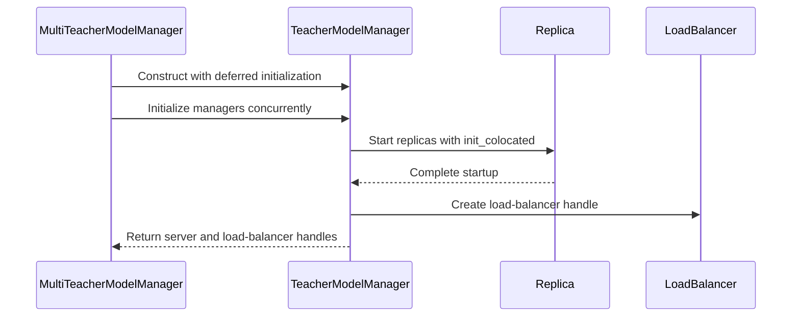

# [distillation] perf: initialize teachers concurrently to cut startup time

[Upstream PR](https://github.com/verl-project/verl/pull/8459) · state: open · merged: False

## Original PR description

### What does this PR do?

Starts all distillation teachers at once instead of one after another, which is what dominates startup when the recipe has many teachers.

`MultiTeacherModelManager` used to build one `TeacherModelManager` per teacher in a plain `for` loop, and each constructor blocked until that teacher's vLLM servers were fully up. With N teachers the wall clock was N x (engine init + CUDA graph capture). Teachers run on disjoint devices and share nothing, so this serialization was pure latency.

Measured with 8 teachers x TP=2 on 16 Ascend 910B (Qwen3-VL-30B-A3B student, vLLM rollout):

| metric | before | after |
| --- | --- | --- |
| teacher stage (first launch -> last ready) | 18m24s | 1m51s |
| student engine ready -> first step finished | 21m45s | 8m20s |

Same run, 8 teacher actors created within 1.35s and all 8 EngineCore processes up within 2.73s.

### Checklist Before Starting

- [x] Search for similar PRs: https://github.com/verl-project/verl/pulls?q=is%3Apr+MultiTeacherModelManager — no results
- [x] Format the PR title as `[{modules}] {type}: {description}`
  - `[distillation] perf: initialize teachers concurrently to cut startup time`
  - No `[BREAKING]`: `TeacherModelManager` still initializes in its constructor by default.

### Test

No unit test: the change only reorders asynchronous startup and needs real Ray + vLLM workers. Validated end-to-end on 2 nodes x 16 Ascend 910B with
`examples/on_policy_distillation_trainer/run_qwen3_vl_30b_mopd_fsdp.sh` (8 teachers, `num_replicas=1`, TP=2 each):

- **Concurrency**: teacher actors created at `11:43:37.603 / .704 / .838 / 38.255 / .304 / .421 / .495 / .645`; EngineCore started at `11:44:15.224 / .656 / .747 / 16.001 / .317 / 17.248 / .286 / 17.956`; `api_router` ready at `11:45:42`-`11:45:48`.
- **Teacher stage**: `11:43:57.477` -> `11:45:48` = 1m51s (was 18m24s, one teacher every ~2m20s).
- **End to end**: `actor and ref model engine initialized` `11:43:23` -> first step finished 8m20s later (was 21m45s).
- **Health**: zero `Traceback` / `RuntimeError` / `OOM` / `Killed` / `TCPStore timeout` / c10d retries; job reported `succeeded`. Each teacher still uses its own 2 devices with `gpu_memory_utilization=0.57`; no memory pressure observed.

The two runs are otherwise identical (same script, same config, same hardware), so the delta is attributable to the change.

### API and Usage Example

`TeacherModelManager` gains one keyword-optional argument; existing construction is unchanged.

```python
# before
TeacherModelManager(distillation_config=..., teacher_model_config=..., resource_pool=...)

# after (default keeps the old blocking behaviour)
TeacherModelManager(..., defer_init=False)

# parallel path used by MultiTeacherModelManager
managers = [TeacherModelManager(..., defer_init=True) for ...]
await asyncio.gather(*[m.initialize() for m in managers])
```

### Design & Code Changes

1. `verl/experimental/teacher_loop/teacher_model.py`
   - `TeacherModelManager.__init__` gains `defer_init: bool = False`. When it is `False` the constructor still runs `_run_all([self.initialize()])`, i.e. identical behaviour for any direct caller.
   - New `async def initialize()`: awaits `_initialize_llm_servers()` and then builds the load balancer handle.
   - `_initialize_llm_servers()` becomes `async def` and awaits `asyncio.gather(...)` over its replicas (same semantics as the previous `_run_all`).
   - `MultiTeacherModelManager._initialize_teacher_model_managers` constructs every manager with `defer_init=True`, then runs `_run_all([self._initialize_managers(managers)])`, which `asyncio.gather`s all teachers, and only then collects addresses/handles.

2. Concurrency entry point stays a plain `async def` on purpose. Calling the coroutine while building the argument list would let `auto_await` execute it immediately in the calling (sync) context and reintroduce the serialization.

No changes to the reward loop, student rollout startup, or the fully-async rollouter path (which still constructs this class inside an executor thread).

### Checklist Before Submitting

- [x] Read the contributing guidelines
- [x] Tested the change locally (end-to-end on Ascend NPU, results above)
- [x] Self-reviewed the code
- [x] Verified the change does not break other flows: `defer_init` defaults to the previous behaviour, and the fully-async rollouter path is untouched

## Review and discussion

### reviews

- ZihaoW123 · COMMENTED · 2026-11-03T09:51:09Z · [source](https://github.com/verl-project/verl/pull/8459#pullrequestreview-5750069397)

(No body; status only.)

### issue_comments

- coderabbitai[bot] · comment · 2026-10-30T06:49:39Z · [source](https://github.com/verl-project/verl/pull/8459#issuecomment-6516793947)

<!-- coderabbit-ai-generated:v1 -->

<!-- This is an auto-generated comment: summarize by coderabbit.ai -->
<!-- review_stack_entry_start -->

<a href="https://app.coderabbit.ai/change-stack/verl-project/verl/pull/8459?scope=ghh_OusAJGA4HG8ljoOV0wJvVx8NmnZIjc2DdjmxOu0xZWA&amp;cs_source=review_comment"><picture><source media="(prefers-color-scheme: dark)" srcset="https://storage.googleapis.com/coderabbit_public_assets/review-stack-in-coderabbit-ui-dark.svg?v=3"><source media="(prefers-color-scheme: light)" srcset="https://storage.googleapis.com/coderabbit_public_assets/review-stack-in-coderabbit-ui.svg?v=3"></picture></a>

<!-- review_stack_entry_end -->
<!-- recent_review_start -->

No actionable comments were generated in the recent review.

<details>
<summary><strong><picture></picture> Recent review info</strong></summary>
<dl>
<dd>

<!-- review_info_content -->
<details>
<summary><strong><picture><source media="(prefers-color-scheme: dark)" srcset="https://storage.googleapis.com/coderabbit_public_assets/review-comment-icons-v1/cog-dark.svg"></picture> Run configuration</strong></summary>
<dl>
<dd>

- **Source mode**: Auto
- **Repository**: Unavailable
- **Branch**: Unavailable
- **File**: No configuration file from this repository applied
- **Commit**: Unavailable
- **Layers**: Organization UI
- **Review profile**: CHILL
- **Plan**: Advanced
- **Run ID**: `14cd4f23-d2be-4b36-920c-91c6ca03278d`

</dd>
</dl>
</details>

<details>
<summary><strong><picture><source media="(prefers-color-scheme: dark)" srcset="https://storage.googleapis.com/coderabbit_public_assets/review-comment-icons-v1/git-commit-horizontal-dark.svg"></picture> Commits</strong></summary>
<dl>
<dd>

Reviewing files that changed from the base of the PR and between eafee25507cd54bfe62c5282e02705187d871e6e and b8223c6158e6fdb0ff07ae8b620a179623024977.

</dd>
</dl>
</details>

<details>
<summary><strong><picture><source media="(prefers-color-scheme: dark)" srcset="https://storage.googleapis.com/coderabbit_public_assets/review-comment-icons-v1/file-plus-corner-dark.svg"></picture> Files selected for processing: 1</strong></summary>
<dl>
<dd>

* `verl/experimental/teacher_loop/teacher_model.py`

</dd>
</dl>
</details>

**Included review availability:** This review used your included allowance. Your plan provides up to 10 included reviews per hour; 9 remain after this review.

</dd>
</dl>
</details>


<!-- recent_review_end -->
<!-- walkthrough_start -->

<details>
<summary><strong>Summary</strong></summary>
<dl>
<dd>

<!-- This is an auto-generated comment: release notes by coderabbit.ai -->

## Summary by CodeRabbit

* **Performance**
  * Teacher model services now start concurrently, which may reduce initialization time when configuring multiple models. When multiple teacher models are configured, their initialization also proceeds concurrently, and each model’s service and load-balancer handle are set up as part of initialization.

<!-- end of auto-generated comment: release notes by coderabbit.ai -->
TeacherModelManager now supports deferred asynchronous initialization. MultiTeacherModelManager initializes its teacher managers concurrently and records their server and load-balancer handles after startup.

**Changes: Teacher startup**

|Layer / File(s)|Summary|
|:---|:---|
|**Deferred manager initialization** <br> `verl/experimental/teacher_loop/teacher_model.py`|`TeacherModelManager` accepts `defer_init`, exposes async initialization, awaits replica startup with `asyncio.gather`, and creates the load-balancer handle after server startup.|
|**Concurrent manager startup** <br> `verl/experimental/teacher_loop/teacher_model.py`|`MultiTeacherModelManager` creates deferred managers, initializes them concurrently, and then stores their server and load-balancer handles.|

### Sequence Diagram(s)



**Suggested reviewers:** `jacobhelwig`

</dd>
</dl>
</details>

<!-- walkthrough_end -->
<!-- change_assessment_start -->
<!-- change_assessment_commit:"b8223c6158e6fdb0ff07ae8b620a179623024977" -->
<!-- change_assessment_priority:{"version":1,"urgency":"p2","manual":false} -->

<!-- change_assessment_end -->
<details>
<summary><strong>Merge Risk:</strong> <strong><picture></picture> Minimal</strong> · up to <code>b8223</code></summary>
<dl>
<dd>

<!-- final_review_risk_start -->
<!-- final_review_risk_label
**Merge Risk:** **⚪ Minimal** · up to `b8223`
-->
<!-- final_review_risk_coverage:{"sourceCommitId":"b8223c6158e6fdb0ff07ae8b620a179623024977","coveredCommitId":"b8223c6158e6fdb0ff07ae8b620a179623024977","kind":"reviewed"} -->

This change starts multiple teacher managers concurrently to cut startup time, and the default blocking behavior is unchanged for existing callers. No concrete merge-blocking risk was identified. Real Ray and vLLM validation is still required, as the author noted.
<!-- final_review_risk_end -->

</dd>
</dl>
</details>
<!-- pre_merge_checks_walkthrough_start -->

<details>
<summary><strong>Pre-merge checks: <sup><picture></picture></sup> 4 · <sup><picture></picture></sup> 1</strong></summary>
<dl>
<dd>

<strong><sup><picture></picture></sup> Failed checks: 1 warning</strong>

|     Check name     |                                              Status                                              | Explanation                                                                                                                                                                                               | Resolution                                                                         |
| :---------------- | :----------------------------------------------------------------------------------------------: | :-------------------------------------------------------------------------------------------------------------------------------------------------------------------------------------------------------- | :--------------------------------------------------------------------------------- |
| Docstring Coverage |  | Docstring coverage is 25.00% which is insufficient. The required threshold is 80.00%. Docstring coverage is scoped to functions touched by this diff with cyclomatic complexity of at least 2. Documenta… | Write docstrings for the functions missing them to satisfy the coverage threshold. |

<details>
<summary><strong><sup><picture></picture></sup> Passed checks: 4 passed</strong></summary>
<dl>
<dd>

|         Check name         |                                             Status                                             | Explanation                                                                                                                                                             |
| :------------------------ | :--------------------------------------------------------------------------------------------: | :---------------------------------------------------------------------------------------------------------------------------------------------------------------------- |
|         Title check        |  | The title clearly and concisely describes the main change: concurrent teacher initialization to reduce distillation startup time.                                       |
|      Description check     |  | The description directly explains the concurrent initialization changes, performance objective, implementation details, compatibility behavior, and validation results. |
|     Linked Issues check    |  | Check skipped because no linked issues were found for this pull request.                                                                                                |
| Out of Scope Changes check |  | Check skipped because no linked issues were found for this pull request.                                                                                                |

</dd>
</dl>
</details>

<details>
<summary><strong>Full details: Docstring Coverage</strong></summary>
<dl>
<dd>

**Explanation**

Docstring coverage is 25.00% which is insufficient. The required threshold is 80.00%. Docstring coverage is scoped to functions touched by this diff with cyclomatic complexity of at least 2. Documentation-only edits and deletions within surviving functions are included; unchanged diff context and fully deleted functions are excluded. Analyzed 4 functions across 1 files.

**Resolution**

Write docstrings for the functions missing them to satisfy the coverage threshold.

</dd>
</dl>
</details>

</dd>
</dl>
</details>

<!-- pre_merge_checks_walkthrough_end -->
<!-- autopilot:start -->
- [ ] <!-- {"checkboxId":"2708ad07-9f24-4260-9c11-7dc76a49f2e3"} --> <strong title="Keep fixing CodeRabbit findings and required CI, and resolving merge conflicts">Autofix</strong> · Keep fixing CodeRabbit findings and required CI, and resolving merge conflicts
<!-- autopilot:end -->
<!-- tips_start -->


Thanks for using [CodeRabbit](https://coderabbit.ai?utm_source=oss&utm_medium=github&utm_campaign=verl-project/verl&utm_content=8459)! It's free for OSS, and your support helps us grow. If you like it, consider giving us a shout-out.

<details>
<summary><strong>Share</strong></summary>
<dl>
<dd>

- [X](https://twitter.com/intent/tweet?text=I%20just%20used%20%40coderabbitai%20for%20my%20code%20review%2C%20and%20it%27s%20fantastic%21%20It%27s%20free%20for%20OSS%20and%20offers%20a%20free%20trial%20for%20the%20proprietary%20code.%20Check%20it%20out%3A&url=https%3A//coderabbit.ai)
- [Mastodon](https://mastodon.social/share?text=I%20just%20used%20%40coderabbitai%20for%20my%20code%20review%2C%20and%20it%27s%20fantastic%21%20It%27s%20free%20for%20OSS%20and%20offers%20a%20free%20trial%20for%20the%20proprietary%20code.%20Check%20it%20out%3A%20https%3A%2F%2Fcoderabbit.ai)
- [Reddit](https://www.reddit.com/submit?title=Great%20tool%20for%20code%20review%20-%20CodeRabbit&text=I%20just%20used%20CodeRabbit%20for%20my%20code%20review%2C%20and%20it%27s%20fantastic%21%20It%27s%20free%20for%20OSS%20and%20offers%20a%20free%20trial%20for%20proprietary%20code.%20Check%20it%20out%3A%20https%3A//coderabbit.ai)
- [LinkedIn](https://www.linkedin.com/sharing/share-offsite/?url=https%3A%2F%2Fcoderabbit.ai&mini=true&title=Great%20tool%20for%20code%20review%20-%20CodeRabbit&summary=I%20just%20used%20CodeRabbit%20for%20my%20code%20review%2C%20and%20it%27s%20fantastic%21%20It%27s%20free%20for%20OSS%20and%20offers%20a%20free%20trial%20for%20proprietary%20code)

</dd>
</dl>
</details>

<!-- tips_end -->

### inline_comments

- ZihaoW123 · comment · 2026-11-03T09:51:09Z · [source](https://github.com/verl-project/verl/pull/8459#discussion_r4453101559)

File: `verl/experimental/teacher_loop/teacher_model.py` · line 240

Please add a deterministic CPU concurrency test: have two fake managers wait until both `initialize()` calls have started. This needs no Ray/vLLM or model weights and would catch a regression back to sequential startup.

## Changed files and fixed code

- `verl/experimental/teacher_loop/teacher_model.py` · modified · additions 28 / deletions 6
  - [head](https://github.com/zgh-99/verl/blob/b8223c6158e6fdb0ff07ae8b620a179623024977/verl/experimental/teacher_loop/teacher_model.py)
  - [base](https://github.com/verl-project/verl/blob/0938fcb3190bc8eca3091f77aead3cd44c4d8869/verl/experimental/teacher_loop/teacher_model.py)

## Evidence and interpretation boundary

[Original JSON, discussions and patches](../../../../../../evidence/prs/verl-project--verl/8459-d8bbebaea923846397bc60614c0ee29f6798c613cf46f4eb2cdf79fb663e33ad.json) · SHA-256 `d8bbebaea923846397bc60614c0ee29f6798c613cf46f4eb2cdf79fb663e33ad`.

Diff complete: True. Missing/binary/truncated patches require pinned source inspection. This is a source page, not an independently verified optimization case. Open, merged and released are different states; recheck the deployed dependency.
