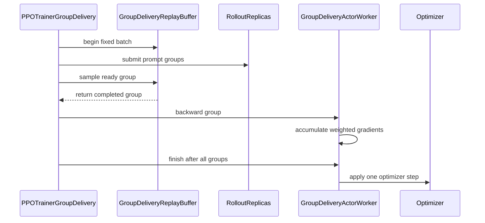

# [megatron, trainer, worker, env] feat: zero-staleness async group delivery for disaggregated GRPO

[Upstream PR](https://github.com/verl-project/verl/pull/8465) · state: closed · merged: False

## Original PR description

### What does this PR do?

`trainer.v1.trainer_mode=group_delivery` runs rollout and Megatron training on **disaggregated** GPU pools (`actor_rollout_ref.hybrid_engine=False`), which is where the long tail of agentic rollouts otherwise leaves the training pool idle. This PR turns that topology into an overlap: a complete GRPO group is forwarded and backwarded as soon as its own responses and rewards arrive, while the remaining prompts of the fixed batch are still generating. Execution is therefore asynchronous; the policy update is not. Actor parameters stay unchanged until every group in the original batch has contributed gradients; then there is one optimizer step, one scheduler step and one weight sync before the next batch is submitted, so the update is exactly batch-synchronous (zero staleness).

Unlike `separate_async`, the actor is never updated per mini-batch and no trajectory is consumed under an older policy version; unlike a fully asynchronous trainer, there is a fixed batch boundary. The schedule is asynchronous in execution, synchronous in policy updates.

This is the same observation that motivates gradient streaming in [ThunderSyncRL](https://arxiv.org/abs/2610.05935): once a trajectory's inputs (here a complete GRPO group) are fixed, its backward can be released early without changing the update. Prior asynchronous trainers ([PipelineRL](https://arxiv.org/abs/2509.19128), [StreamRL](https://arxiv.org/abs/2504.15930), [AReaL](https://arxiv.org/abs/2505.24298)) recover utilization by allowing policy lag; this PR keeps zero lag and instead removes the idle time inside one batch.

The effect is higher training-pool utilization and lower end-to-end time, and the gain grows with the spread of group completion times. On a long-CoT workload (AReaL-boba math, Qwen3-1.7B, 8192-token responses, 100 steps) with the same disaggregated 2 training + 1 rollout GPU allocation, data order and seed, the median step time is 18.2% lower and wall time 11.2% lower than the full-batch barrier (`wait_for_full_batch=True`). The benefit comes from long-tailed rollouts: as the tail shrinks, the schedule converges to the barrier.

Related PRs: #8203 streams the dataloader for the V1 sync PPO trainer (complementary; this PR keeps a fixed batch and streams per-group gradient work). #6868 adds a streaming-rollouter mode to the V1 trainer and does not overlap with the per-group gradient path.

### Checklist Before Starting

- [x] Search for similar PRs. Query links:
  - https://github.com/verl-project/verl/pulls?q=is%3Apr+is%3Aopen+%22group+delivery%22
  - https://github.com/verl-project/verl/pulls?q=is%3Apr+is%3Aopen+per-group+backward
  - https://github.com/verl-project/verl/issues?q=is%3Aissue+is%3Aopen+long-tail+rollout
- [x] Format the PR title as `[{modules}] {type}: {description}`

### Test

Unit and lint (CPU):

```bash
python -m pytest tests/workers/test_group_gradient_accumulator_on_cpu.py \
  tests/workers/test_group_delivery_worker_on_cpu.py -q
# 33 passed

pre-commit run --files <the 8 changed files>
# all hooks passed
```

End-to-end (single node, 3×A6000 48 GB). Both arms use the same disaggregated allocation (2 training GPUs, 1 rollout GPU), the same data order and seed, and 100 steps; warmup steps 1–2 are excluded.

**Table 1 — end-to-end.**

| workload | mode | wall (h) | step median (s) | step P95 (s) | throughput (tok/s/GPU) |
|---|---|---:|---:|---:|---:|
| Qwen3-1.7B, AReaL-boba math, 8192-token CoT | `group_delivery` | **1.621** | **44.9** | **118.5** | **121.6** |
| same | `wait_for_full_batch=True` | 1.826 | 54.9 | 130.5 | 99.8 |

**Table 2 — scheduling and utilization.**

| metric | `group_delivery` | `wait_for_full_batch=True` |
|---|---:|---:|
| group latency P50 / P95 / P99 (s) | 16.4 / 72.9 / 104.0 | 39.2 / 96.0 / 123.2 |
| overlapped groups per batch | 2.43 | 0 |
| training GPU mean utilization | 36.8% / 36.9% | 30.7% / 31.0% |
| rollout GPU mean utilization | 66.4% | 57.9% |
| allocated / active GPU-hours | 4.861 / 2.636 | 5.476 / 2.535 |
| actor update mean (s) | 19.75 | 18.80 |
| weight sync mean (s) | 1.63 | 1.62 |

The tail is real generation-length variance, not injected delay: per-group latency P50 16.4 s / P95 72.9 s (P95/P50 4.5) in the trainer, and P95/P50 6.9 over 128 raw samples from the same engine. Rewards stay flat because AReaL-boba is hard for a 1.7B model; the tables measure scheduling, not learning. The ~1 s higher actor update is the per-group schedule overhead plus the host-resident accumulator (see Design).

### API and Usage Example

No public API change; it is a new trainer mode plus one measurement control that already exists in `docs/advance/group_delivery.md`.

```bash
python -m verl.trainer.main_ppo \
  trainer.v1.trainer_mode=group_delivery \
  actor_rollout_ref.hybrid_engine=False \
  actor_rollout_ref.rollout.n_gpus_per_node=1 \
  trainer.n_gpus_per_node=2 \
  trainer.v1.group_delivery.wait_for_full_batch=False   # True = full-batch barrier
```

### Design & Code Changes

- Per-group delivery and gradient accumulation: the controller forwards one complete GRPO group to all actor ranks while the rollout pool keeps generating. Padding uses synthetic sequences with zero response masks, so one group can be delivered even when its response count is smaller than the DP size, and all ranks execute the same collective sequence. Each group's backward finalizes into a running FP32 sum outside Megatron's schedule buffers; after the last group, one optimizer step restores the exact batch mean, making the update identical to a full-batch synchronous update.
- `group_gradient_accumulator.py`: the FP32 running sum may live in host memory, copied per group through one persistent pinned staging buffer in chunks. At 4B/TP2 the sums would otherwise be 8 GiB of GPU that the backward needs for activations; the sum stays exactly FP32.
- `engine_workers_group_delivery.py`: device-agnostic cache release around the group backward and the weight sync; the checkpoint engine bucket shrinks to 512 MiB so the two broadcast buffers do not consume the last gigabytes.
- `engine_workers_tinker.py`: return `grad_norm` as a Python float — Ray was re-materializing the CUDA tensor on the driver.
- `trainer_group_delivery.py`: initial weight sync in `on_init_end` (standalone replicas start with `load_format=dummy`); log the original exception before cleanup and bound each abort RPC with a timeout so a peer stuck in a collective cannot wedge the driver.
- `utils/metric/utils.py`: aggregate a DP all-gathered `list[Metric]` before reducing.
- `examples/group_delivery/`: the example tool environment serializes environment access process-wide (the shared text-world parser is not thread-safe), emits episode records on stdout, and exposes optional deterministic slow-task knobs for tail experiments.

### Checklist Before Submitting

- [x] Read the Contribute Guide.
- [x] Run pre-commit on the changed files.
- [ ] Add / update documentation. `docs/advance/group_delivery.md` already describes the mode and the `wait_for_full_batch` control; this PR does not change the user-facing contract, and the experiment notes live in `artifacts/group_delivery/NOTES.md` (not part of this branch).
- [x] Add unit tests: `test_host_resident_sums_match_device_resident_sums` covers the host-resident accumulator path; the existing group-delivery worker tests cover delivery, padding and the optimizer barrier.
- [ ] CI request in Slack (`ci-request`): pending.
- [ ] `recipe` submodule: not applicable.

### References

- ThunderSyncRL: *Lossless Acceleration of Agentic Reinforcement Learning*, arXiv [2610.05935](https://arxiv.org/abs/2610.05935) — gradient streaming once an objective source's inputs are fixed, zero staleness; up to 1.9× on long-tailed SWE runs.
- PipelineRL, arXiv [2509.19128](https://arxiv.org/abs/2509.19128); StreamRL, arXiv [2504.15930](https://arxiv.org/abs/2504.15930); AReaL, arXiv [2505.24298](https://arxiv.org/abs/2505.24298) — asynchronous trainers that trade policy lag for utilization.
- verl docs: [`docs/advance/group_delivery.md`](https://github.com/verl-project/verl/blob/main/docs/advance/group_delivery.md) (mode and ablation control), [`docs/advance/delta_weight_sync.md`](https://github.com/verl-project/verl/blob/main/docs/advance/delta_weight_sync.md) (disaggregated weight sync).

This change was developed with AI assistance (Claude Code); the submitter reviewed every changed line and ran the tests above.


## Review and discussion

### reviews

### issue_comments

- cla-assistant[bot] · comment · 2026-10-30T15:58:02Z · [source](https://github.com/verl-project/verl/pull/8465#issuecomment-6527179445)

[](https://cla-assistant.io/verl-project/verl?pullRequest=8465) <br/>All committers have signed the CLA.

- cla-assistant[bot] · comment · 2026-10-30T15:58:02Z · [source](https://github.com/verl-project/verl/pull/8465#issuecomment-6527179586)

[](https://cla-assistant.io/verl-project/verl?pullRequest=8465) <br/>Thank you for your submission! We really appreciate it. Like many open source projects, we ask that you all sign our [Contributor License Agreement](https://cla-assistant.io/verl-project/verl?pullRequest=8465) before we can accept your contribution.<br/>**1** out of **2** committers have signed the CLA.<br/><br/>:white_check_mark: PengyuLi7<br/>:x: root<br/><hr/>**root** seems not to be a GitHub user. You need a GitHub account to be able to sign the CLA. If you have already a GitHub account, please [add the email address used for this commit to your account](https://help.github.com/articles/why-are-my-commits-linked-to-the-wrong-user/#commits-are-not-linked-to-any-user).<br/><sub>You have signed the CLA already but the status is still pending? Let us [recheck](https://cla-assistant.io/check/verl-project/verl?pullRequest=8465) it.</sub>

- coderabbitai[bot] · comment · 2026-10-30T15:58:13Z · [source](https://github.com/verl-project/verl/pull/8465#issuecomment-6527183645)

<!-- coderabbit-ai-generated:v1 -->

<!-- This is an auto-generated comment: summarize by coderabbit.ai -->
<!-- review_stack_entry_start -->

<a href="https://app.coderabbit.ai/change-stack/verl-project/verl/pull/8465?scope=ghh_OusAJGA4HG8ljoOV0wJvVx8NmnZIjc2DdjmxOu0xZWA&amp;cs_source=review_comment"><picture><source media="(prefers-color-scheme: dark)" srcset="https://storage.googleapis.com/coderabbit_public_assets/review-stack-in-coderabbit-ui-dark.svg?v=3"><source media="(prefers-color-scheme: light)" srcset="https://storage.googleapis.com/coderabbit_public_assets/review-stack-in-coderabbit-ui.svg?v=3"></picture></a>

<!-- review_stack_entry_end -->
<!-- This is an auto-generated comment: failure by coderabbit.ai -->

> [!CAUTION]
> ## Review failed
> 
> The pull request is closed.

<!-- end of auto-generated comment: failure by coderabbit.ai -->

<!-- walkthrough_start -->

<details>
<summary><strong>📝 Summary</strong></summary>
<dl>
<dd>

<!-- This is an auto-generated comment: release notes by coderabbit.ai -->

## Summary by CodeRabbit

* **New Features**
  * Added a group-delivery training mode that processes completed prompt groups as they become ready while keeping actor parameters fixed. Gradients accumulate across the full batch, followed by a single optimizer update.
  * Added an ALFWorld example workflow for preparing datasets, running environment sessions, and launching training.
* **Documentation**
  * Added guides covering configuration, supported setups, validation, and an ALFWorld handoff workflow. Notes clarify that CUDA, real Megatron communication, and ALFWorld integration have not yet been tested.

<!-- end of auto-generated comment: release notes by coderabbit.ai -->
Adds a fixed-batch group-delivery PPO trainer that processes ready prompt groups and applies one optimizer update after all groups contribute gradients. Adds gradient accumulation support, configuration and validation coverage, and an ALFWorld service and workload tools.

**Changes: Group delivery training**

|Layer / File(s)|Summary|
|:---|:---|
|**Configuration and group replay** <br> `verl/trainer/config/ppo_trainer.yaml`, `verl/trainer/config/_generated_ppo_*_trainer.yaml`, `verl/trainer/ppo/v1/...`, `verl/trainer/ppo/v1/__init__.py`, `docs/index.rst`, `docs/advance/group_delivery.md`|Adds `group_delivery` settings with a 0.05-second polling interval and `wait_for_full_batch` disabled by default. The replay buffer tracks the fixed batch and validates delivered groups, trajectories, and versions. The trainer is exported from the V1 package.|
|**Group gradient accumulation** <br> `verl/workers/utils/group_gradient_accumulator.py`, `verl/workers/engine_workers_group_delivery.py`, `verl/workers/engine_workers_tinker.py`, `verl/utils/torch_functional.py`, `verl/workers/engine/megatron/transformer_impl.py`, `tests/workers/*`, `tests/models/test_group_delivery_megatron.py`, `docs/advance/group_delivery_handoff.md`|Adds weighted FP32 accumulation and actor-worker operations to accumulate groups before one optimizer and scheduler update. Context-parallel token counts now distribute remainders across ranks. Tests cover accumulation, failure paths, and comparisons with fixed-batch results across Megatron topologies.|
|**Trainer orchestration and validation** <br> `verl/trainer/ppo/v1/trainer_group_delivery.py`, `verl/utils/metric/utils.py`, `tests/trainer/ppo/v1/test_group_delivery_on_cpu.py`, `docs/advance/group_delivery.md`, `docs/advance/group_delivery_handoff.md`|Adds fixed-batch prompt submission, ready-group processing, weighted metrics, cleanup on failure, and one final optimizer update. Adds configuration and CPU behavior tests, plus documentation of supported settings and validation procedures.|
|**ALFWorld example and workload checks** <br> `examples/group_delivery/*`, `tests/special_standalone/test_group_delivery_alfworld_on_cpu.py`, `tests/special_e2e/run_v1_group_delivery.sh`, `docs/advance/group_delivery_handoff.md`|Adds an HTTP-backed ALFWorld tool agent and session service, dataset and measured-tail selection scripts, CPU integration tests, and a group-delivery training launcher. The handoff guide describes setup and acceptance checks.|

### Sequence Diagram(s)



</dd>
</dl>
</details>

<!-- walkthrough_end -->
<!-- change_assessment_start -->
<strong>Priority: <picture></picture> Not assessed</strong>

<!-- change_assessment_commit:"6221db3dbdb6f5e3c7ea4c321c258445f9a097b1" -->

<!-- change_assessment_end -->
<details>
<summary><strong>Merge Risk:</strong> <strong><picture></picture> Moderate</strong> · up to <code>6221d</code></summary>
<dl>
<dd>

<!-- final_review_risk_start -->
<!-- final_review_risk_label
**Merge Risk:** **🟡 Moderate** · up to `6221d`
-->
<!-- final_review_risk_coverage:{"sourceCommitId":"6221db3dbdb6f5e3c7ea4c321c258445f9a097b1","coveredCommitId":"6221db3dbdb6f5e3c7ea4c321c258445f9a097b1","kind":"reviewed"} -->

Resolve the CPU-only worker failure risk before merging. The ALFWorld example also needs its session lifecycle and validation sample corrected for reliable evaluation.
<!-- final_review_risk_end -->

</dd>
</dl>
</details>
<!-- autopilot:start -->
- [ ] <!-- {"checkboxId":"2708ad07-9f24-4260-9c11-7dc76a49f2e3"} --> <strong title="Keep fixing CodeRabbit findings and required CI, and resolving merge conflicts">Autofix</strong> · Keep fixing CodeRabbit findings and required CI, and resolving merge conflicts
<!-- autopilot:end -->
<!-- tips_start -->


Thanks for using [CodeRabbit](https://coderabbit.ai?utm_source=oss&utm_medium=github&utm_campaign=verl-project/verl&utm_content=8465)! It's free for OSS, and your support helps us grow. If you like it, consider giving us a shout-out.

<details>
<summary><strong>❤️ Share</strong></summary>
<dl>
<dd>

- [X](https://twitter.com/intent/tweet?text=I%20just%20used%20%40coderabbitai%20for%20my%20code%20review%2C%20and%20it%27s%20fantastic%21%20It%27s%20free%20for%20OSS%20and%20offers%20a%20free%20trial%20for%20the%20proprietary%20code.%20Check%20it%20out%3A&url=https%3A//coderabbit.ai)
- [Mastodon](https://mastodon.social/share?text=I%20just%20used%20%40coderabbitai%20for%20my%20code%20review%2C%20and%20it%27s%20fantastic%21%20It%27s%20free%20for%20OSS%20and%20offers%20a%20free%20trial%20for%20the%20proprietary%20code.%20Check%20it%20out%3A%20https%3A%2F%2Fcoderabbit.ai)
- [Reddit](https://www.reddit.com/submit?title=Great%20tool%20for%20code%20review%20-%20CodeRabbit&text=I%20just%20used%20CodeRabbit%20for%20my%20code%20review%2C%20and%20it%27s%20fantastic%21%20It%27s%20free%20for%20OSS%20and%20offers%20a%20free%20trial%20for%20proprietary%20code.%20Check%20it%20out%3A%20https%3A//coderabbit.ai)
- [LinkedIn](https://www.linkedin.com/sharing/share-offsite/?url=https%3A%2F%2Fcoderabbit.ai&mini=true&title=Great%20tool%20for%20code%20review%20-%20CodeRabbit&summary=I%20just%20used%20CodeRabbit%20for%20my%20code%20review%2C%20and%20it%27s%20fantastic%21%20It%27s%20free%20for%20OSS%20and%20offers%20a%20free%20trial%20for%20proprietary%20code)

</dd>
</dl>
</details>


<sub>Comment `@coderabbitai help` to get the list of available commands.</sub>

<!-- tips_end -->

### inline_comments

## Changed files and fixed code

- `docs/advance/group_delivery.md` · added · additions 150 / deletions 0
  - [head](https://github.com/PengyuLi7/verl/blob/6221db3dbdb6f5e3c7ea4c321c258445f9a097b1/docs/advance/group_delivery.md)
  - [base](https://github.com/verl-project/verl/blob/8e48d72de4766228c36623c90f9f5c49ee5b45f3/docs/advance/group_delivery.md)
- `docs/advance/group_delivery_handoff.md` · added · additions 294 / deletions 0
  - [head](https://github.com/PengyuLi7/verl/blob/6221db3dbdb6f5e3c7ea4c321c258445f9a097b1/docs/advance/group_delivery_handoff.md)
  - [base](https://github.com/verl-project/verl/blob/8e48d72de4766228c36623c90f9f5c49ee5b45f3/docs/advance/group_delivery_handoff.md)
- `docs/index.rst` · modified · additions 1 / deletions 0
  - [head](https://github.com/PengyuLi7/verl/blob/6221db3dbdb6f5e3c7ea4c321c258445f9a097b1/docs/index.rst)
  - [base](https://github.com/verl-project/verl/blob/8e48d72de4766228c36623c90f9f5c49ee5b45f3/docs/index.rst)
- `examples/group_delivery/agents.yaml` · added · additions 2 / deletions 0
  - [head](https://github.com/PengyuLi7/verl/blob/6221db3dbdb6f5e3c7ea4c321c258445f9a097b1/examples/group_delivery/agents.yaml)
  - [base](https://github.com/verl-project/verl/blob/8e48d72de4766228c36623c90f9f5c49ee5b45f3/examples/group_delivery/agents.yaml)
- `examples/group_delivery/alfworld_agent.py` · added · additions 148 / deletions 0
  - [head](https://github.com/PengyuLi7/verl/blob/6221db3dbdb6f5e3c7ea4c321c258445f9a097b1/examples/group_delivery/alfworld_agent.py)
  - [base](https://github.com/verl-project/verl/blob/8e48d72de4766228c36623c90f9f5c49ee5b45f3/examples/group_delivery/alfworld_agent.py)
- `examples/group_delivery/alfworld_server.py` · added · additions 190 / deletions 0
  - [head](https://github.com/PengyuLi7/verl/blob/6221db3dbdb6f5e3c7ea4c321c258445f9a097b1/examples/group_delivery/alfworld_server.py)
  - [base](https://github.com/verl-project/verl/blob/8e48d72de4766228c36623c90f9f5c49ee5b45f3/examples/group_delivery/alfworld_server.py)
- `examples/group_delivery/prepare_alfworld.py` · added · additions 175 / deletions 0
  - [head](https://github.com/PengyuLi7/verl/blob/6221db3dbdb6f5e3c7ea4c321c258445f9a097b1/examples/group_delivery/prepare_alfworld.py)
  - [base](https://github.com/verl-project/verl/blob/8e48d72de4766228c36623c90f9f5c49ee5b45f3/examples/group_delivery/prepare_alfworld.py)
- `tests/models/test_group_delivery_megatron.py` · added · additions 219 / deletions 0
  - [head](https://github.com/PengyuLi7/verl/blob/6221db3dbdb6f5e3c7ea4c321c258445f9a097b1/tests/models/test_group_delivery_megatron.py)
  - [base](https://github.com/verl-project/verl/blob/8e48d72de4766228c36623c90f9f5c49ee5b45f3/tests/models/test_group_delivery_megatron.py)
- `tests/special_e2e/run_v1_group_delivery.sh` · added · additions 79 / deletions 0
  - [head](https://github.com/PengyuLi7/verl/blob/6221db3dbdb6f5e3c7ea4c321c258445f9a097b1/tests/special_e2e/run_v1_group_delivery.sh)
  - [base](https://github.com/verl-project/verl/blob/8e48d72de4766228c36623c90f9f5c49ee5b45f3/tests/special_e2e/run_v1_group_delivery.sh)
- `tests/special_standalone/test_group_delivery_alfworld_on_cpu.py` · added · additions 133 / deletions 0
  - [head](https://github.com/PengyuLi7/verl/blob/6221db3dbdb6f5e3c7ea4c321c258445f9a097b1/tests/special_standalone/test_group_delivery_alfworld_on_cpu.py)
  - [base](https://github.com/verl-project/verl/blob/8e48d72de4766228c36623c90f9f5c49ee5b45f3/tests/special_standalone/test_group_delivery_alfworld_on_cpu.py)
- `tests/trainer/ppo/v1/test_group_delivery_on_cpu.py` · added · additions 308 / deletions 0
  - [head](https://github.com/PengyuLi7/verl/blob/6221db3dbdb6f5e3c7ea4c321c258445f9a097b1/tests/trainer/ppo/v1/test_group_delivery_on_cpu.py)
  - [base](https://github.com/verl-project/verl/blob/8e48d72de4766228c36623c90f9f5c49ee5b45f3/tests/trainer/ppo/v1/test_group_delivery_on_cpu.py)
- `tests/workers/test_group_delivery_worker_on_cpu.py` · added · additions 181 / deletions 0
  - [head](https://github.com/PengyuLi7/verl/blob/6221db3dbdb6f5e3c7ea4c321c258445f9a097b1/tests/workers/test_group_delivery_worker_on_cpu.py)
  - [base](https://github.com/verl-project/verl/blob/8e48d72de4766228c36623c90f9f5c49ee5b45f3/tests/workers/test_group_delivery_worker_on_cpu.py)
- `tests/workers/test_group_gradient_accumulator_on_cpu.py` · added · additions 172 / deletions 0
  - [head](https://github.com/PengyuLi7/verl/blob/6221db3dbdb6f5e3c7ea4c321c258445f9a097b1/tests/workers/test_group_gradient_accumulator_on_cpu.py)
  - [base](https://github.com/verl-project/verl/blob/8e48d72de4766228c36623c90f9f5c49ee5b45f3/tests/workers/test_group_gradient_accumulator_on_cpu.py)
- `verl/trainer/config/_generated_ppo_megatron_trainer.yaml` · modified · additions 3 / deletions 0
  - [head](https://github.com/PengyuLi7/verl/blob/6221db3dbdb6f5e3c7ea4c321c258445f9a097b1/verl/trainer/config/_generated_ppo_megatron_trainer.yaml)
  - [base](https://github.com/verl-project/verl/blob/8e48d72de4766228c36623c90f9f5c49ee5b45f3/verl/trainer/config/_generated_ppo_megatron_trainer.yaml)
- `verl/trainer/config/_generated_ppo_torchtitan_trainer.yaml` · modified · additions 3 / deletions 0
  - [head](https://github.com/PengyuLi7/verl/blob/6221db3dbdb6f5e3c7ea4c321c258445f9a097b1/verl/trainer/config/_generated_ppo_torchtitan_trainer.yaml)
  - [base](https://github.com/verl-project/verl/blob/8e48d72de4766228c36623c90f9f5c49ee5b45f3/verl/trainer/config/_generated_ppo_torchtitan_trainer.yaml)
- `verl/trainer/config/_generated_ppo_trainer.yaml` · modified · additions 3 / deletions 0
  - [head](https://github.com/PengyuLi7/verl/blob/6221db3dbdb6f5e3c7ea4c321c258445f9a097b1/verl/trainer/config/_generated_ppo_trainer.yaml)
  - [base](https://github.com/verl-project/verl/blob/8e48d72de4766228c36623c90f9f5c49ee5b45f3/verl/trainer/config/_generated_ppo_trainer.yaml)
- `verl/trainer/config/_generated_ppo_veomni_trainer.yaml` · modified · additions 3 / deletions 0
  - [head](https://github.com/PengyuLi7/verl/blob/6221db3dbdb6f5e3c7ea4c321c258445f9a097b1/verl/trainer/config/_generated_ppo_veomni_trainer.yaml)
  - [base](https://github.com/verl-project/verl/blob/8e48d72de4766228c36623c90f9f5c49ee5b45f3/verl/trainer/config/_generated_ppo_veomni_trainer.yaml)
- `verl/trainer/config/ppo_trainer.yaml` · modified · additions 10 / deletions 2
  - [head](https://github.com/PengyuLi7/verl/blob/6221db3dbdb6f5e3c7ea4c321c258445f9a097b1/verl/trainer/config/ppo_trainer.yaml)
  - [base](https://github.com/verl-project/verl/blob/8e48d72de4766228c36623c90f9f5c49ee5b45f3/verl/trainer/config/ppo_trainer.yaml)
- `verl/trainer/ppo/v1/__init__.py` · modified · additions 2 / deletions 0
  - [head](https://github.com/PengyuLi7/verl/blob/6221db3dbdb6f5e3c7ea4c321c258445f9a097b1/verl/trainer/ppo/v1/__init__.py)
  - [base](https://github.com/verl-project/verl/blob/8e48d72de4766228c36623c90f9f5c49ee5b45f3/verl/trainer/ppo/v1/__init__.py)
- `verl/trainer/ppo/v1/group_delivery.py` · added · additions 75 / deletions 0
  - [head](https://github.com/PengyuLi7/verl/blob/6221db3dbdb6f5e3c7ea4c321c258445f9a097b1/verl/trainer/ppo/v1/group_delivery.py)
  - [base](https://github.com/verl-project/verl/blob/8e48d72de4766228c36623c90f9f5c49ee5b45f3/verl/trainer/ppo/v1/group_delivery.py)
- `verl/trainer/ppo/v1/trainer_group_delivery.py` · added · additions 280 / deletions 0
  - [head](https://github.com/PengyuLi7/verl/blob/6221db3dbdb6f5e3c7ea4c321c258445f9a097b1/verl/trainer/ppo/v1/trainer_group_delivery.py)
  - [base](https://github.com/verl-project/verl/blob/8e48d72de4766228c36623c90f9f5c49ee5b45f3/verl/trainer/ppo/v1/trainer_group_delivery.py)
- `verl/utils/metric/utils.py` · modified · additions 3 / deletions 0
  - [head](https://github.com/PengyuLi7/verl/blob/6221db3dbdb6f5e3c7ea4c321c258445f9a097b1/verl/utils/metric/utils.py)
  - [base](https://github.com/verl-project/verl/blob/8e48d72de4766228c36623c90f9f5c49ee5b45f3/verl/utils/metric/utils.py)
- `verl/utils/torch_functional.py` · modified · additions 10 / deletions 0
  - [head](https://github.com/PengyuLi7/verl/blob/6221db3dbdb6f5e3c7ea4c321c258445f9a097b1/verl/utils/torch_functional.py)
  - [base](https://github.com/verl-project/verl/blob/8e48d72de4766228c36623c90f9f5c49ee5b45f3/verl/utils/torch_functional.py)
- `verl/workers/engine/megatron/transformer_impl.py` · modified · additions 9 / deletions 3
  - [head](https://github.com/PengyuLi7/verl/blob/6221db3dbdb6f5e3c7ea4c321c258445f9a097b1/verl/workers/engine/megatron/transformer_impl.py)
  - [base](https://github.com/verl-project/verl/blob/8e48d72de4766228c36623c90f9f5c49ee5b45f3/verl/workers/engine/megatron/transformer_impl.py)
- `verl/workers/engine_workers_group_delivery.py` · added · additions 172 / deletions 0
  - [head](https://github.com/PengyuLi7/verl/blob/6221db3dbdb6f5e3c7ea4c321c258445f9a097b1/verl/workers/engine_workers_group_delivery.py)
  - [base](https://github.com/verl-project/verl/blob/8e48d72de4766228c36623c90f9f5c49ee5b45f3/verl/workers/engine_workers_group_delivery.py)
- `verl/workers/engine_workers_tinker.py` · modified · additions 8 / deletions 3
  - [head](https://github.com/PengyuLi7/verl/blob/6221db3dbdb6f5e3c7ea4c321c258445f9a097b1/verl/workers/engine_workers_tinker.py)
  - [base](https://github.com/verl-project/verl/blob/8e48d72de4766228c36623c90f9f5c49ee5b45f3/verl/workers/engine_workers_tinker.py)
- `verl/workers/utils/group_gradient_accumulator.py` · added · additions 166 / deletions 0
  - [head](https://github.com/PengyuLi7/verl/blob/6221db3dbdb6f5e3c7ea4c321c258445f9a097b1/verl/workers/utils/group_gradient_accumulator.py)
  - [base](https://github.com/verl-project/verl/blob/8e48d72de4766228c36623c90f9f5c49ee5b45f3/verl/workers/utils/group_gradient_accumulator.py)

## Evidence and interpretation boundary

[Original JSON, discussions and patches](../../../../../../evidence/prs/verl-project--verl/8465-0ccc7f00d127359af9f1d4ef5f52e3da13e0b5db2932e09c1f50e94875c8ebd8.json) · SHA-256 `0ccc7f00d127359af9f1d4ef5f52e3da13e0b5db2932e09c1f50e94875c8ebd8`.

Diff complete: True. Missing/binary/truncated patches require pinned source inspection. This is a source page, not an independently verified optimization case. Open, merged and released are different states; recheck the deployed dependency.
