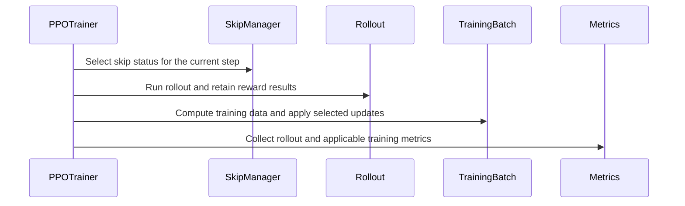

# [trainer, fully_async, cfg] feat: add configurable training skip for …

[Upstream PR](https://github.com/verl-project/verl/pull/8491) · state: closed · merged: False

## Original PR description

### What does this PR do?

Add configurable training skips for inference debugging while retaining real rollout and reward evaluation. `skip.train` is disabled by default and supports V0, all three V1 trainer modes (`sync`, `colocate_async`, `separate_async`), and fully asynchronous training.

- `scope=updates` skips actor/critic update calls, including their forward/backward passes, optimizer steps, and scheduler steps.
- `scope=train_compute` also skips training batch balancing, old/reference log probabilities, critic values, advantages/returns, reward shaping, and rollout correction.

Rollout, reward evaluation, queue handling, synchronization, validation, checkpointing, and the surrounding trainer lifecycle remain outside the skipped stages. Models and workers are still initialized normally.

### Checklist Before Starting

- [x] Search for similar PRs: [`skip.train`](https://github.com/verl-project/verl/pulls?q=is%3Apr+is%3Aopen+%22skip.train%22+in%3Atitle%2Cbody) and [training skip](https://github.com/verl-project/verl/pulls?q=is%3Apr+is%3Aopen+%22training+skip%22+in%3Atitle%2Cbody). No other open PR found implements this configurable debugging mode. Related PR #5838 optimizes training by filtering zero-advantage responses; this PR selects whole trainer steps to bypass training work for inference debugging.
- [x] Format the PR title as `[{modules}] {type}: {description}`.

### Test

CPU validation on PR head `db923fb9`: **227 tests passed**. The suite covers step/scope selection, disabled behavior, validation exemption, optimizer/scheduler state preservation and resumption, missing training metrics, failure propagation, and fully async snapshot, resume, and partial-cycle handling. Trainer tests exercise production control flow with CPU optimizers and mocked distributed/model calls.

Reproduce the validated suite with:

```bash
python -m pytest -q \
  tests/utils/test_train_skip_on_cpu.py \
  tests/trainer/ppo/test_v0_train_skip_on_cpu.py \
  tests/trainer/ppo/v1/test_v1_train_skip_on_cpu.py \
  tests/experimental/fully_async_policy/test_train_skip_on_cpu.py \
  tests/trainer/ppo/test_metric_utils_on_cpu.py \
  tests/trainer/ppo/v1/test_metrics_aggregator_on_cpu.py \
  tests/trainer/ppo/v1/test_trainer_base_on_cpu.py
```

Additional checks passed: `ruff check` and `ruff format --check` on all 15 changed Python files, `bash scripts/generate_trainer_config.sh`, and `git diff --cached --check` during preparation.

Full pre-commit validation could not complete because hook-environment dependency installation was blocked by network access. GPU/NPU end-to-end training was not run for this PR revision.

### API and Usage Example

Append these overrides to an existing training command to skip training computation on steps 2 and 3 while keeping real generation:

```bash
skip.train.enable=True \
skip.train.scope=train_compute \
'skip.train.steps=[2,3]' \
skip.rollout.enable=False \
skip.rollout_tq.enable=False \
skip.async_rollout.enable=False
```

Steps 1 and 4 train normally. Use `scope=updates` to retain training input computation. `steps=null` selects all training steps; `steps=[]` selects none. `action=empty` is the only supported action and passes through the original batch without caching.

Step selection uses positive trainer global steps, including after checkpoint resume. V1 applies the selection to all mini-batches within a trainer step; fully async applies it to individual training micro-steps rather than parameter versions.

### Design & Code Changes

- Register `TrainSkip` with `SkipManager`, validate its configuration, and reuse nested decorators to separate training input computation from model updates.
- Keep rollout, reward evaluation, and lifecycle hooks outside the skipped regions across V0, V1, and fully async.
- Collect rollout metrics without requesting absent training fields. When enabled, report `training/skip_train` and `training/skip_train_compute` through the existing logger without fabricating loss/gradient metrics.
- Initialize fully async old-policy snapshots on the first real forward in each cycle, align checkpoint-resume step numbering, and include the final micro-step in cycle aggregation. Log terminal partial cycles at a separate step without an extra parameter-version increment or synchronization.
- Document configuration and execution semantics, update the four generated trainer configurations, and add CPU regression tests.

### Checklist Before Submitting

- [x] Read the [Contribute Guide](https://github.com/verl-project/verl/blob/main/CONTRIBUTING.md).
- [ ] Apply all [pre-commit checks](https://github.com/verl-project/verl/blob/main/CONTRIBUTING.md#code-linting-and-formatting): incomplete because hook dependency installation was blocked; individual checks are listed above.
- [x] Add / Update [the documentation](https://github.com/verl-project/verl/tree/main/docs): `docs/advance/skip_manager.rst`.
- [x] Add unit or end-to-end tests to [the CI workflow](https://github.com/verl-project/verl/tree/main/.github/workflows): the four new `*_on_cpu.py` test files are discovered by the existing `cpu_unit_tests.yml` workflow; no workflow changes are needed.
- [ ] Once ready for CI, send a message in the [`ci-request` channel](https://verl-project.slack.com/archives/C091TCESWB1) in the [verl Slack workspace](https://join.slack.com/t/verl-project/shared_invite/zt-3855yhg8g-CTkqXu~hKojPCmo7k_yXTQ), or the [Feishu group](https://applink.larkoffice.com/client/chat/chatter/add_by_link?link_token=772jd4f1-cd91-441e-a820-498c6614126a).
- [ ] If related to the `recipe` submodule, update its commit reference. Not applicable: this PR does not modify `recipe`.

AI assistance was used for preparation, migration, validation, and editing this PR description.


## Review and discussion

### reviews

### issue_comments

- cla-assistant[bot] · comment · 2026-11-02T06:45:59Z · [source](https://github.com/verl-project/verl/pull/8491#issuecomment-6570928853)

[](https://cla-assistant.io/verl-project/verl?pullRequest=8491) <br/>Thank you for your submission! We really appreciate it. Like many open source projects, we ask that you sign our [Contributor License Agreement](https://cla-assistant.io/verl-project/verl?pullRequest=8491) before we can accept your contribution.<br/><sub>You have signed the CLA already but the status is still pending? Let us [recheck](https://cla-assistant.io/check/verl-project/verl?pullRequest=8491) it.</sub>

- coderabbitai[bot] · comment · 2026-11-02T06:46:11Z · [source](https://github.com/verl-project/verl/pull/8491#issuecomment-6570931914)

<!-- coderabbit-ai-generated:v1 -->

<!-- This is an auto-generated comment: summarize by coderabbit.ai -->
<!-- review_stack_entry_start -->

<a href="https://app.coderabbit.ai/change-stack/verl-project/verl/pull/8491?scope=ghh_OusAJGA4HG8ljoOV0wJvVx8NmnZIjc2DdjmxOu0xZWA&amp;cs_source=review_comment"><picture><source media="(prefers-color-scheme: dark)" srcset="https://storage.googleapis.com/coderabbit_public_assets/review-stack-in-coderabbit-ui-dark.svg?v=3"><source media="(prefers-color-scheme: light)" srcset="https://storage.googleapis.com/coderabbit_public_assets/review-stack-in-coderabbit-ui.svg?v=3"></picture></a>

<!-- review_stack_entry_end -->
<!-- recent_review_start -->

No actionable comments were generated in the recent review.

<details>
<summary><strong><picture></picture> Recent review info</strong></summary>
<dl>
<dd>

<!-- review_info_content -->
<details>
<summary><strong><picture><source media="(prefers-color-scheme: dark)" srcset="https://storage.googleapis.com/coderabbit_public_assets/review-comment-icons-v1/cog-dark.svg"></picture> Run configuration</strong></summary>
<dl>
<dd>

- **Source mode**: Auto
- **Repository**: Unavailable
- **Branch**: Unavailable
- **File**: No configuration file from this repository applied
- **Commit**: Unavailable
- **Layers**: Organization UI
- **Review profile**: CHILL
- **Plan**: Advanced
- **Run ID**: `0e8aec0b-dcda-4f8b-add6-82da318737fc`

</dd>
</dl>
</details>

<details>
<summary><strong><picture><source media="(prefers-color-scheme: dark)" srcset="https://storage.googleapis.com/coderabbit_public_assets/review-comment-icons-v1/git-commit-horizontal-dark.svg"></picture> Commits</strong></summary>
<dl>
<dd>

Reviewing files that changed from the base of the PR and between 0938fcb3190bc8eca3091f77aead3cd44c4d8869 and db923fb9d2bbacb64f4a39e3a31664782b44b810.

</dd>
</dl>
</details>

<details>
<summary><strong><picture><source media="(prefers-color-scheme: dark)" srcset="https://storage.googleapis.com/coderabbit_public_assets/review-comment-icons-v1/file-plus-corner-dark.svg"></picture> Files selected for processing: 21</strong></summary>
<dl>
<dd>

* `docs/advance/skip_manager.rst`
* `tests/experimental/fully_async_policy/test_train_skip_on_cpu.py`
* `tests/trainer/ppo/test_v0_train_skip_on_cpu.py`
* `tests/trainer/ppo/v1/test_v1_train_skip_on_cpu.py`
* `tests/utils/test_train_skip_on_cpu.py`
* `verl/experimental/fully_async_policy/detach_utils.py`
* `verl/experimental/fully_async_policy/fully_async_trainer.py`
* `verl/trainer/config/_generated_ppo_megatron_trainer.yaml`
* `verl/trainer/config/_generated_ppo_torchtitan_trainer.yaml`
* `verl/trainer/config/_generated_ppo_trainer.yaml`
* `verl/trainer/config/_generated_ppo_veomni_trainer.yaml`
* `verl/trainer/config/ppo_trainer.yaml`
* `verl/trainer/ppo/metric_utils.py`
* `verl/trainer/ppo/ray_trainer.py`
* `verl/trainer/ppo/v1/trainer_base.py`
* `verl/utils/config.py`
* `verl/utils/skip/__init__.py`
* `verl/utils/skip/base_skip.py`
* `verl/utils/skip/config.py`
* `verl/utils/skip/skip_manager.py`
* `verl/utils/skip/train_skip.py`

</dd>
</dl>
</details>

**Included review availability:** This review used your included allowance. Your plan provides up to 10 included reviews per hour; 9 remain after this review.

</dd>
</dl>
</details>


<!-- recent_review_end -->
<!-- walkthrough_start -->

<details>
<summary><strong>Summary</strong></summary>
<dl>
<dd>

<!-- This is an auto-generated comment: release notes by coderabbit.ai -->

## Summary by CodeRabbit

* **New Features**
  * Added configurable training skips for supported V0, V1, and fully asynchronous training modes. Skips can target selected steps and either omit optimizer updates or also omit training computations; real rollouts and surrounding training lifecycle operations continue.
  * Training skips are disabled by default. Metrics continue to report rollout data when training computations are skipped.
* **Documentation**
  * Documented training-skip configuration, supported modes, step selection, scopes, and behavior.

<!-- end of auto-generated comment: release notes by coderabbit.ai -->
The change adds configurable training skips to V0, V1, and fully asynchronous PPO trainers. It separates training computation from updates, adjusts metrics and asynchronous cycle handling, and adds CPU tests and documentation.

**Changes: Training Skip Support**

|Layer / File(s)|Summary|
|:---|:---|
|**Skip configuration and selection** <br> `verl/utils/skip/*`, `verl/utils/config.py`, `verl/trainer/config/ppo_trainer.yaml`, `verl/trainer/config/_generated_ppo_*_trainer.yaml`, `tests/utils/test_train_skip_on_cpu.py`, `docs/advance/skip_manager.rst`|Adds `skip.train` configuration, validation, registration, scope and step selection, and package exports. Generated configurations and utility tests cover the feature. The guide describes supported entry points, scope behavior, and metrics.|
|**V0 and V1 training and metrics** <br> `verl/trainer/ppo/ray_trainer.py`, `verl/trainer/ppo/v1/trainer_base.py`, `verl/trainer/ppo/metric_utils.py`, `tests/trainer/ppo/test_v0_train_skip_on_cpu.py`, `tests/trainer/ppo/v1/test_v1_train_skip_on_cpu.py`|Separates training computation from updates and applies skip scopes in V0 and V1. Metric collection can omit training fields when training computation is skipped. CPU tests cover skip selection, lifecycle behavior, failures, and metrics.|
|**Fully asynchronous training cycles** <br> `verl/experimental/fully_async_policy/fully_async_trainer.py`, `verl/experimental/fully_async_policy/detach_utils.py`, `tests/experimental/fully_async_policy/test_train_skip_on_cpu.py`, `docs/advance/skip_manager.rst`|Adds skip-aware training, cycle model snapshots, partial-cycle metric logging, and resume-step handling. CPU tests cover synchronization cycles, snapshots, failures, and cleanup. The documentation describes asynchronous cycle metrics.|

### Sequence Diagram(s)



**Suggested reviewers:** `wuxibin89`, `tongyx361`, `eric-haibin-lin`

</dd>
</dl>
</details>

<!-- walkthrough_end -->
<!-- change_assessment_start -->
<!-- change_assessment_commit:"db923fb9d2bbacb64f4a39e3a31664782b44b810" -->
<!-- change_assessment_priority:{"version":1,"urgency":"p2","manual":false} -->

<!-- change_assessment_end -->
<details>
<summary><strong>Merge Risk:</strong> <strong><picture></picture> Minimal</strong> · up to <code>db923</code></summary>
<dl>
<dd>

<!-- final_review_risk_start -->
<!-- final_review_risk_label
**Merge Risk:** **⚪ Minimal** · up to `db923`
-->
<!-- final_review_risk_coverage:{"sourceCommitId":"db923fb9d2bbacb64f4a39e3a31664782b44b810","coveredCommitId":"db923fb9d2bbacb64f4a39e3a31664782b44b810","kind":"reviewed"} -->

No concrete issue currently blocks merging; complete the normal validation for supported hardware before release.
<!-- final_review_risk_end -->

</dd>
</dl>
</details>
<!-- pre_merge_checks_walkthrough_start -->

<details>
<summary><strong>Pre-merge checks: <sup><picture></picture></sup> 4 · <sup><picture></picture></sup> 1</strong></summary>
<dl>
<dd>

<strong><sup><picture></picture></sup> Failed checks: 1 warning</strong>

|     Check name     |                                              Status                                              | Explanation                                                                                                                                                                                               | Resolution                                                                         |
| :---------------- | :----------------------------------------------------------------------------------------------: | :-------------------------------------------------------------------------------------------------------------------------------------------------------------------------------------------------------- | :--------------------------------------------------------------------------------- |
| Docstring Coverage |  | Docstring coverage is 31.43% which is insufficient. The required threshold is 80.00%. Docstring coverage is scoped to functions touched by this diff with cyclomatic complexity of at least 2. Documenta… | Write docstrings for the functions missing them to satisfy the coverage threshold. |

<details>
<summary><strong><sup><picture></picture></sup> Passed checks: 4 passed</strong></summary>
<dl>
<dd>

|         Check name         |                                             Status                                             | Explanation                                                                                                                                                                                              |
| :------------------------ | :--------------------------------------------------------------------------------------------: | :------------------------------------------------------------------------------------------------------------------------------------------------------------------------------------------------------- |
|         Title check        |  | The title clearly identifies the main change: configurable training skip support. It is concise and aligned with the changeset, although the trailing ellipsis omits the purpose of inference debugging. |
|     Linked Issues check    |  | Check skipped because no linked issues were found for this pull request.                                                                                                                                 |
| Out of Scope Changes check |  | Check skipped because no linked issues were found for this pull request.                                                                                                                                 |
|      Description check     |  | The pull request description directly explains the configurable training-skip changes, supported trainers, configuration, tests, documentation, and validation results.                                  |

</dd>
</dl>
</details>

<details>
<summary><strong>Full details: Docstring Coverage</strong></summary>
<dl>
<dd>

**Explanation**

Docstring coverage is 31.43% which is insufficient. The required threshold is 80.00%. Docstring coverage is scoped to functions touched by this diff with cyclomatic complexity of at least 2. Documentation-only edits and deletions within surviving functions are included; unchanged diff context and fully deleted functions are excluded. Analyzed 70 functions across 15 files. (6 skipped: 6 unsupported.)

**Resolution**

Write docstrings for the functions missing them to satisfy the coverage threshold.

</dd>
</dl>
</details>

</dd>
</dl>
</details>

<!-- pre_merge_checks_walkthrough_end -->
<!-- autopilot:start -->
- [ ] <!-- {"checkboxId":"2708ad07-9f24-4260-9c11-7dc76a49f2e3"} --> <strong title="Keep fixing CodeRabbit findings and required CI, and resolving merge conflicts">Autofix</strong> · Keep fixing CodeRabbit findings and required CI, and resolving merge conflicts
<!-- autopilot:end -->
<!-- tips_start -->


Thanks for using [CodeRabbit](https://coderabbit.ai?utm_source=oss&utm_medium=github&utm_campaign=verl-project/verl&utm_content=8491)! It's free for OSS, and your support helps us grow. If you like it, consider giving us a shout-out.

<details>
<summary><strong>Share</strong></summary>
<dl>
<dd>

- [X](https://twitter.com/intent/tweet?text=I%20just%20used%20%40coderabbitai%20for%20my%20code%20review%2C%20and%20it%27s%20fantastic%21%20It%27s%20free%20for%20OSS%20and%20offers%20a%20free%20trial%20for%20the%20proprietary%20code.%20Check%20it%20out%3A&url=https%3A//coderabbit.ai)
- [Mastodon](https://mastodon.social/share?text=I%20just%20used%20%40coderabbitai%20for%20my%20code%20review%2C%20and%20it%27s%20fantastic%21%20It%27s%20free%20for%20OSS%20and%20offers%20a%20free%20trial%20for%20the%20proprietary%20code.%20Check%20it%20out%3A%20https%3A%2F%2Fcoderabbit.ai)
- [Reddit](https://www.reddit.com/submit?title=Great%20tool%20for%20code%20review%20-%20CodeRabbit&text=I%20just%20used%20CodeRabbit%20for%20my%20code%20review%2C%20and%20it%27s%20fantastic%21%20It%27s%20free%20for%20OSS%20and%20offers%20a%20free%20trial%20for%20proprietary%20code.%20Check%20it%20out%3A%20https%3A//coderabbit.ai)
- [LinkedIn](https://www.linkedin.com/sharing/share-offsite/?url=https%3A%2F%2Fcoderabbit.ai&mini=true&title=Great%20tool%20for%20code%20review%20-%20CodeRabbit&summary=I%20just%20used%20CodeRabbit%20for%20my%20code%20review%2C%20and%20it%27s%20fantastic%21%20It%27s%20free%20for%20OSS%20and%20offers%20a%20free%20trial%20for%20proprietary%20code)

</dd>
</dl>
</details>

<!-- tips_end -->

- wuxibin89 · comment · 2026-11-03T03:47:46Z · [source](https://github.com/verl-project/verl/pull/8491#issuecomment-6594941172)

The `verl/experimental/fully_async_policy` is deprecated, no more PR received.

### inline_comments

## Changed files and fixed code

- `docs/advance/skip_manager.rst` · modified · additions 66 / deletions 8
  - [head](https://github.com/dengwenjun1/verl/blob/db923fb9d2bbacb64f4a39e3a31664782b44b810/docs/advance/skip_manager.rst)
  - [base](https://github.com/verl-project/verl/blob/0938fcb3190bc8eca3091f77aead3cd44c4d8869/docs/advance/skip_manager.rst)
- `tests/experimental/fully_async_policy/test_train_skip_on_cpu.py` · added · additions 538 / deletions 0
  - [head](https://github.com/dengwenjun1/verl/blob/db923fb9d2bbacb64f4a39e3a31664782b44b810/tests/experimental/fully_async_policy/test_train_skip_on_cpu.py)
  - [base](https://github.com/verl-project/verl/blob/0938fcb3190bc8eca3091f77aead3cd44c4d8869/tests/experimental/fully_async_policy/test_train_skip_on_cpu.py)
- `tests/trainer/ppo/test_v0_train_skip_on_cpu.py` · added · additions 407 / deletions 0
  - [head](https://github.com/dengwenjun1/verl/blob/db923fb9d2bbacb64f4a39e3a31664782b44b810/tests/trainer/ppo/test_v0_train_skip_on_cpu.py)
  - [base](https://github.com/verl-project/verl/blob/0938fcb3190bc8eca3091f77aead3cd44c4d8869/tests/trainer/ppo/test_v0_train_skip_on_cpu.py)
- `tests/trainer/ppo/v1/test_v1_train_skip_on_cpu.py` · added · additions 389 / deletions 0
  - [head](https://github.com/dengwenjun1/verl/blob/db923fb9d2bbacb64f4a39e3a31664782b44b810/tests/trainer/ppo/v1/test_v1_train_skip_on_cpu.py)
  - [base](https://github.com/verl-project/verl/blob/0938fcb3190bc8eca3091f77aead3cd44c4d8869/tests/trainer/ppo/v1/test_v1_train_skip_on_cpu.py)
- `tests/utils/test_train_skip_on_cpu.py` · added · additions 239 / deletions 0
  - [head](https://github.com/dengwenjun1/verl/blob/db923fb9d2bbacb64f4a39e3a31664782b44b810/tests/utils/test_train_skip_on_cpu.py)
  - [base](https://github.com/verl-project/verl/blob/0938fcb3190bc8eca3091f77aead3cd44c4d8869/tests/utils/test_train_skip_on_cpu.py)
- `verl/experimental/fully_async_policy/detach_utils.py` · modified · additions 2 / deletions 3
  - [head](https://github.com/dengwenjun1/verl/blob/db923fb9d2bbacb64f4a39e3a31664782b44b810/verl/experimental/fully_async_policy/detach_utils.py)
  - [base](https://github.com/verl-project/verl/blob/0938fcb3190bc8eca3091f77aead3cd44c4d8869/verl/experimental/fully_async_policy/detach_utils.py)
- `verl/experimental/fully_async_policy/fully_async_trainer.py` · modified · additions 92 / deletions 18
  - [head](https://github.com/dengwenjun1/verl/blob/db923fb9d2bbacb64f4a39e3a31664782b44b810/verl/experimental/fully_async_policy/fully_async_trainer.py)
  - [base](https://github.com/verl-project/verl/blob/0938fcb3190bc8eca3091f77aead3cd44c4d8869/verl/experimental/fully_async_policy/fully_async_trainer.py)
- `verl/trainer/config/_generated_ppo_megatron_trainer.yaml` · modified · additions 5 / deletions 0
  - [head](https://github.com/dengwenjun1/verl/blob/db923fb9d2bbacb64f4a39e3a31664782b44b810/verl/trainer/config/_generated_ppo_megatron_trainer.yaml)
  - [base](https://github.com/verl-project/verl/blob/0938fcb3190bc8eca3091f77aead3cd44c4d8869/verl/trainer/config/_generated_ppo_megatron_trainer.yaml)
- `verl/trainer/config/_generated_ppo_torchtitan_trainer.yaml` · modified · additions 5 / deletions 0
  - [head](https://github.com/dengwenjun1/verl/blob/db923fb9d2bbacb64f4a39e3a31664782b44b810/verl/trainer/config/_generated_ppo_torchtitan_trainer.yaml)
  - [base](https://github.com/verl-project/verl/blob/0938fcb3190bc8eca3091f77aead3cd44c4d8869/verl/trainer/config/_generated_ppo_torchtitan_trainer.yaml)
- `verl/trainer/config/_generated_ppo_trainer.yaml` · modified · additions 5 / deletions 0
  - [head](https://github.com/dengwenjun1/verl/blob/db923fb9d2bbacb64f4a39e3a31664782b44b810/verl/trainer/config/_generated_ppo_trainer.yaml)
  - [base](https://github.com/verl-project/verl/blob/0938fcb3190bc8eca3091f77aead3cd44c4d8869/verl/trainer/config/_generated_ppo_trainer.yaml)
- `verl/trainer/config/_generated_ppo_veomni_trainer.yaml` · modified · additions 5 / deletions 0
  - [head](https://github.com/dengwenjun1/verl/blob/db923fb9d2bbacb64f4a39e3a31664782b44b810/verl/trainer/config/_generated_ppo_veomni_trainer.yaml)
  - [base](https://github.com/verl-project/verl/blob/0938fcb3190bc8eca3091f77aead3cd44c4d8869/verl/trainer/config/_generated_ppo_veomni_trainer.yaml)
- `verl/trainer/config/ppo_trainer.yaml` · modified · additions 15 / deletions 0
  - [head](https://github.com/dengwenjun1/verl/blob/db923fb9d2bbacb64f4a39e3a31664782b44b810/verl/trainer/config/ppo_trainer.yaml)
  - [base](https://github.com/verl-project/verl/blob/0938fcb3190bc8eca3091f77aead3cd44c4d8869/verl/trainer/config/ppo_trainer.yaml)
- `verl/trainer/ppo/metric_utils.py` · modified · additions 46 / deletions 44
  - [head](https://github.com/dengwenjun1/verl/blob/db923fb9d2bbacb64f4a39e3a31664782b44b810/verl/trainer/ppo/metric_utils.py)
  - [base](https://github.com/verl-project/verl/blob/0938fcb3190bc8eca3091f77aead3cd44c4d8869/verl/trainer/ppo/metric_utils.py)
- `verl/trainer/ppo/ray_trainer.py` · modified · additions 139 / deletions 121
  - [head](https://github.com/dengwenjun1/verl/blob/db923fb9d2bbacb64f4a39e3a31664782b44b810/verl/trainer/ppo/ray_trainer.py)
  - [base](https://github.com/verl-project/verl/blob/0938fcb3190bc8eca3091f77aead3cd44c4d8869/verl/trainer/ppo/ray_trainer.py)
- `verl/trainer/ppo/v1/trainer_base.py` · modified · additions 27 / deletions 6
  - [head](https://github.com/dengwenjun1/verl/blob/db923fb9d2bbacb64f4a39e3a31664782b44b810/verl/trainer/ppo/v1/trainer_base.py)
  - [base](https://github.com/verl-project/verl/blob/0938fcb3190bc8eca3091f77aead3cd44c4d8869/verl/trainer/ppo/v1/trainer_base.py)
- `verl/utils/config.py` · modified · additions 5 / deletions 0
  - [head](https://github.com/dengwenjun1/verl/blob/db923fb9d2bbacb64f4a39e3a31664782b44b810/verl/utils/config.py)
  - [base](https://github.com/verl-project/verl/blob/0938fcb3190bc8eca3091f77aead3cd44c4d8869/verl/utils/config.py)
- `verl/utils/skip/__init__.py` · modified · additions 2 / deletions 0
  - [head](https://github.com/dengwenjun1/verl/blob/db923fb9d2bbacb64f4a39e3a31664782b44b810/verl/utils/skip/__init__.py)
  - [base](https://github.com/verl-project/verl/blob/0938fcb3190bc8eca3091f77aead3cd44c4d8869/verl/utils/skip/__init__.py)
- `verl/utils/skip/base_skip.py` · modified · additions 5 / deletions 1
  - [head](https://github.com/dengwenjun1/verl/blob/db923fb9d2bbacb64f4a39e3a31664782b44b810/verl/utils/skip/base_skip.py)
  - [base](https://github.com/verl-project/verl/blob/0938fcb3190bc8eca3091f77aead3cd44c4d8869/verl/utils/skip/base_skip.py)
- `verl/utils/skip/config.py` · modified · additions 23 / deletions 0
  - [head](https://github.com/dengwenjun1/verl/blob/db923fb9d2bbacb64f4a39e3a31664782b44b810/verl/utils/skip/config.py)
  - [base](https://github.com/verl-project/verl/blob/0938fcb3190bc8eca3091f77aead3cd44c4d8869/verl/utils/skip/config.py)
- `verl/utils/skip/skip_manager.py` · modified · additions 15 / deletions 3
  - [head](https://github.com/dengwenjun1/verl/blob/db923fb9d2bbacb64f4a39e3a31664782b44b810/verl/utils/skip/skip_manager.py)
  - [base](https://github.com/verl-project/verl/blob/0938fcb3190bc8eca3091f77aead3cd44c4d8869/verl/utils/skip/skip_manager.py)
- `verl/utils/skip/train_skip.py` · added · additions 48 / deletions 0
  - [head](https://github.com/dengwenjun1/verl/blob/db923fb9d2bbacb64f4a39e3a31664782b44b810/verl/utils/skip/train_skip.py)
  - [base](https://github.com/verl-project/verl/blob/0938fcb3190bc8eca3091f77aead3cd44c4d8869/verl/utils/skip/train_skip.py)

## Evidence and interpretation boundary

[Original JSON, discussions and patches](../../../../../../evidence/prs/verl-project--verl/8491-c0aea1ab9ebdf3b09a9194ac38ca9f6bb9bbadbeabc3ceb3a2f2c4d33dba7b54.json) · SHA-256 `c0aea1ab9ebdf3b09a9194ac38ca9f6bb9bbadbeabc3ceb3a2f2c4d33dba7b54`.

Diff complete: True. Missing/binary/truncated patches require pinned source inspection. This is a source page, not an independently verified optimization case. Open, merged and released are different states; recheck the deployed dependency.
