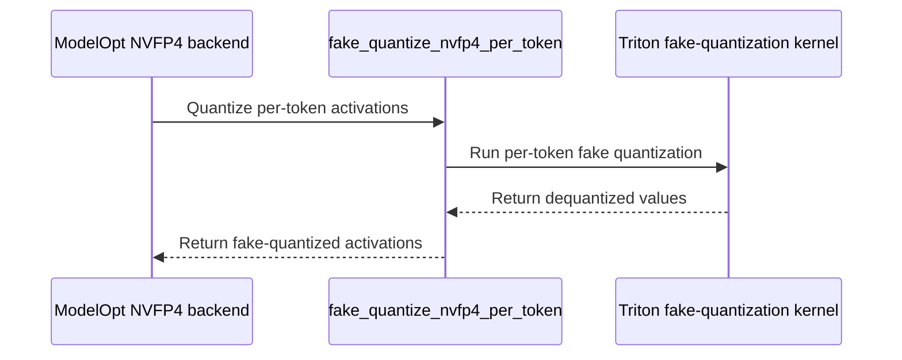

# [BREAKING][megatron, vllm] feat: per-token activations for NVFP4 QAT

[Upstream PR](https://github.com/verl-project/verl/pull/8494) · state: closed · merged: True

## Original PR description

### What does this PR do?

NVFP4 QAT now uses per-token activations, the same scheme as the NVFP4 rollout from #7971. The static per-tensor activation scale is removed.

Why per-token:
- Each token is quantized with a scale from its own amax, independent of the other tokens in the batch and of earlier training steps. The static scale was a running max of the observed amax, so tokens much smaller than the largest activation seen so far lost block-scale range, and it was 1.0 until the first training step.
- Much lower training-inference mismatch in RL training: mean `rollout_corr/k3_kl` over 100 steps 0.060 → 0.0033, the same as native NVFP4 training (see Test).

Changes:
- `rollout.quantization.moe: NVFP4` always uses per-token activations; `moe_activation` now defaults to `nvfp4_per_token`.
- Fake quantization matches FlashInfer's per-token activation quantization and the trainer-side weight export bitwise.
- **Breaking:** removes the static NVFP4 refit for SGLang. verl does not support per-token NVFP4 with SGLang yet.
- **Breaking:** removes FSDP QAT (`QATLinear`, `QATQuantizer`, `actor.qat` and the FSDP engine's `qat` config). It has been unreachable since #8287: its `w4a16`/`w4a4` modes match no rollout preset, and the FSDP engine has no trainer-side rollout quantizer. QAT requires the Megatron engine.
- Merges `nvfp4_qat.md` into `qat.md`.

### Test

RL training, Qwen3-30B-A3B-Base on DAPO-Math-17k, 8x4 GB200, 100 steps. Routed experts in NVFP4 in training and rollout, layers 0-1 and 44-47 in BF16.


Mean over 100 steps:

| Training | Rollout activation | `rollout_logprobs_diff_mean` | `k3_kl` | `rollout_is_mean` |
|---|---|---|---|---|
| NVFP4 QAT, before this PR | static per-tensor | 0.124 | 0.060 | 0.979 |
| NVFP4 QAT | per-token | 0.021 | 0.0033 | 0.9996 |
| Native NVFP4 training (#7971) | per-token | 0.021 | 0.0033 | 0.9996 |

`scripts/rollout_logprob_diff.py` on Qwen3.5-35B-A3B, Transformer Engine 2.20.2, ModelOpt 0.47.

`qat.md` mismatch table setting (EP=8, vLLM TP=2), median of 3 runs:

| Rollout | Training | k3_kl |
|---|---|---|
| NVFP4 MoE | BF16 | 0.00966 |
| NVFP4 MoE | NVFP4 QAT | 0.00766 |

Unit tests:
- new `tests/utils/test_nvfp4_qat_fake_quant_on_gpu.py`: bitwise checks against vLLM / FlashInfer;
- updated `tests/utils/test_modelopt_mxfp8_on_gpu.py`: NVFP4 per-token backends;
- updated `tests/utils/real_nvfp4/test_nvfp4_per_token_on_cpu.py`.

### API and Usage Example

```yaml
actor_rollout_ref:
  actor:
    megatron:
      qat:
        enable: true
        mode: nvfp4
  rollout:
    quantization:
      moe: NVFP4
```

### Checklist Before Submitting

- [x] Read the [Contribute Guide](https://github.com/verl-project/verl/blob/main/CONTRIBUTING.md).
- [x] Apply [pre-commit checks](https://github.com/verl-project/verl/blob/main/CONTRIBUTING.md#code-linting-and-formatting).
- [x] Add / Update [the documentation](https://github.com/verl-project/verl/tree/main/docs).
- [x] Add unit or end-to-end test(s) to [the CI workflow](https://github.com/verl-project/verl/tree/main/.github/workflows) to cover all the code. If not feasible, explain why: the GPU tests need Blackwell.


## Review and discussion

### reviews

- wuxibin89 · APPROVED · 2026-11-03T06:38:01Z · [source](https://github.com/verl-project/verl/pull/8494#pullrequestreview-5748102245)

(No body; status only.)

### issue_comments

- coderabbitai[bot] · comment · 2026-11-02T08:30:07Z · [source](https://github.com/verl-project/verl/pull/8494#issuecomment-6572597827)

<!-- coderabbit-ai-generated:v1 -->

<!-- This is an auto-generated comment: summarize by coderabbit.ai -->
<!-- review_stack_entry_start -->

<a href="https://app.coderabbit.ai/change-stack/verl-project/verl/pull/8494?scope=ghh_OusAJGA4HG8ljoOV0wJvVx8NmnZIjc2DdjmxOu0xZWA&amp;cs_source=review_comment"><picture><source media="(prefers-color-scheme: dark)" srcset="https://storage.googleapis.com/coderabbit_public_assets/review-stack-in-coderabbit-ui-dark.svg?v=3"><source media="(prefers-color-scheme: light)" srcset="https://storage.googleapis.com/coderabbit_public_assets/review-stack-in-coderabbit-ui.svg?v=3"></picture></a>

<!-- review_stack_entry_end -->
<!-- This is an auto-generated comment: failure by coderabbit.ai -->

> [!CAUTION]
> ## Review failed
> 
> The pull request is closed.

<!-- end of auto-generated comment: failure by coderabbit.ai -->

<!-- recent_review_status_start -->

No actionable comments were generated in the recent review.

<!-- recent_review_status_end -->
<!-- walkthrough_start -->

<details>
<summary><strong>Summary</strong></summary>
<dl>
<dd>

<!-- This is an auto-generated comment: release notes by coderabbit.ai -->

## Summary by CodeRabbit

* **New Features**
  * NVFP4 rollout now defaults to per-token activations when NVFP4 MoE quantization is selected. NVFP4 QAT documentation now describes the vLLM path and its supported configuration.
  * FSDP training now supports fp16 gradient scaling and deferred gradient synchronization during accumulation.

* **Changes**
  * NVFP4 rollout support is limited to vLLM; SGLang NVFP4 refit support is no longer available.
  * Removed legacy QAT configuration options from trainer and engine settings.
  * Updated NVFP4 and model-configuration guides to reflect current settings and support details.

<!-- end of auto-generated comment: release notes by coderabbit.ai -->
The change updates NVFP4 QAT to use per-token activations and adds fake-quantization support through ModelOpt. It narrows NVFP4 rollout and refit support, removes legacy QAT utilities and configuration, and updates related documentation and tests.

**Changes: NVFP4 QAT and rollout**

|Layer / File(s)|Summary|
|:---|:---|
|**Set NVFP4 configuration requirements** <br> `verl/utils/qat/compressed_tensors.py`, `tests/utils/real_nvfp4/*`, `verl/workers/config/rollout.py`, `docs/low_precision/*`, `examples/real_nvfp4/*`|NVFP4 presets default to per-token activations, and configuration loading rejects unsupported activation settings. Tests and examples now use the default.|
|**Implement NVFP4 fake quantization** <br> `verl/utils/qat/nvfp4.py`, `verl/utils/qat/modelopt.py`, `verl/utils/qat/compressed_tensors.py`, `tests/utils/test_modelopt_mxfp8_on_gpu.py`, `tests/utils/test_nvfp4_qat_fake_quant_on_gpu.py`, `docs/low_precision/qat.md`|ModelOpt NVFP4 QAT uses rollout quantizers for weight and per-token activation fake quantization. GPU tests compare the fake-quantized outputs with rollout quantization results.|
|**Narrow NVFP4 rollout and refit support** <br> `verl/utils/vllm/*`, `verl/utils/sglang/*`, `verl/workers/rollout/sglang_rollout/sglang_rollout.py`, `scripts/rollout_logprob_diff.py`, `docs/low_precision/*`|vLLM staging accepts per-token NVFP4 methods and rejects other methods. SGLang NVFP4 refit handling and the vLLM CUTLASS patch are removed.|
|**Remove legacy QAT integration** <br> `verl/utils/qat/*`, `verl/workers/config/*`, `verl/trainer/config/*`, `verl/workers/engine/*`, `docs/ascend_tutorial/*`|Legacy QAT utilities, exports, configuration, and engine hooks are removed. The MTP documentation no longer includes the QAT parameter table.|

### Sequence Diagram(s)



</dd>
</dl>
</details>

<!-- walkthrough_end -->
<!-- change_assessment_start -->
<!-- change_assessment_commit:"41e44faad9d71d893e0babd33d0e6d8aa1c696ab" -->
<!-- change_assessment_priority:{"version":1,"urgency":"p2","manual":false} -->

<!-- change_assessment_end -->
<details>
<summary><strong>Merge Risk:</strong> <strong><picture></picture> Minimal</strong> · previous review <code>41e44</code></summary>
<dl>
<dd>

<!-- final_review_risk_start -->
<!-- final_review_risk_label
**Merge Risk:** **⚪ Minimal** · up to `41e44`
-->
<!-- final_review_risk_coverage:{"sourceCommitId":"41e44faad9d71d893e0babd33d0e6d8aa1c696ab","coveredCommitId":"41e44faad9d71d893e0babd33d0e6d8aa1c696ab","kind":"reviewed"} -->

No actionable merge-blocking issue was established; the change is mergeable after normal checks, including the hardware-dependent GPU tests.
<!-- final_review_risk_end -->

</dd>
</dl>
</details>
<!-- pre_merge_checks_walkthrough_start -->

<details>
<summary><strong>Pre-merge checks: <sup><picture></picture></sup> 4 · <sup><picture></picture></sup> 1</strong></summary>
<dl>
<dd>

<strong><sup><picture></picture></sup> Failed checks: 1 warning</strong>

|     Check name     |                                              Status                                              | Explanation                                                                                                                                                                                               | Resolution                                                                         |
| :---------------- | :----------------------------------------------------------------------------------------------: | :-------------------------------------------------------------------------------------------------------------------------------------------------------------------------------------------------------- | :--------------------------------------------------------------------------------- |
| Docstring Coverage |  | Docstring coverage is 43.75% which is insufficient. The required threshold is 80.00%. Docstring coverage is scoped to functions touched by this diff with cyclomatic complexity of at least 2. Documenta… | Write docstrings for the functions missing them to satisfy the coverage threshold. |

<details>
<summary><strong><sup><picture></picture></sup> Passed checks: 4 passed</strong></summary>
<dl>
<dd>

|         Check name         |                                             Status                                             | Explanation                                                                                                                                      |
| :------------------------ | :--------------------------------------------------------------------------------------------: | :----------------------------------------------------------------------------------------------------------------------------------------------- |
|         Title check        |  | The title clearly identifies the main change: per-token activations for NVFP4 QAT. It also indicates the breaking scope and affected components. |
|      Description check     |  | The description directly explains the NVFP4 QAT changes, breaking changes, test coverage, documentation updates, and reported results.           |
|     Linked Issues check    |  | Check skipped because no linked issues were found for this pull request.                                                                         |
| Out of Scope Changes check |  | Check skipped because no linked issues were found for this pull request.                                                                         |

</dd>
</dl>
</details>

<details>
<summary><strong>Full details: Docstring Coverage</strong></summary>
<dl>
<dd>

**Explanation**

Docstring coverage is 43.75% which is insufficient. The required threshold is 80.00%. Docstring coverage is scoped to functions touched by this diff with cyclomatic complexity of at least 2. Documentation-only edits and deletions within surviving functions are included; unchanged diff context and fully deleted functions are excluded. Analyzed 32 functions across 13 files. (6 skipped: 6 unsupported.)

**Resolution**

Write docstrings for the functions missing them to satisfy the coverage threshold.

</dd>
</dl>
</details>

</dd>
</dl>
</details>

<!-- pre_merge_checks_walkthrough_end -->
<!-- autopilot:start -->
- [ ] <!-- {"checkboxId":"2708ad07-9f24-4260-9c11-7dc76a49f2e3"} --> <strong title="Keep fixing CodeRabbit findings and required CI, and resolving merge conflicts">Autofix</strong> · Keep fixing CodeRabbit findings and required CI, and resolving merge conflicts
<!-- autopilot:end -->
<!-- announcements_start -->

> [!TIP]
> <details>
> <summary><strong>🎯 Customize your risk assessments</strong></summary>
> <dl>
> <dd>
> 
> Guide how CodeRabbit assesses merge risk and security architecture risk. Highlight sensitive changes and explain your security boundaries using **Merge Risk Instructions** and **Security Risk Instructions** in your review settings. Security architecture risk assessments require the **Advanced plan or above**.
> 
> </dd>
> </dl>
> </details>
> 
> <details>
> <summary><strong>✅ Automatic approvals, with your rules</strong></summary>
> <dl>
> <dd>
> 
> Let CodeRabbit approve pull requests once required threads are resolved, pre-merge checks pass, and your risk limits are met. Enable **Automatic approvals** in review settings, with overrides for teams or file paths.
> 
> </dd>
> </dl>
> </details>

<!-- announcements_end -->
<!-- tips_start -->


Thanks for using [CodeRabbit](https://coderabbit.ai?utm_source=oss&utm_medium=github&utm_campaign=verl-project/verl&utm_content=8494)! It's free for OSS, and your support helps us grow. If you like it, consider giving us a shout-out.

<details>
<summary><strong>Share</strong></summary>
<dl>
<dd>

- [X](https://twitter.com/intent/tweet?text=I%20just%20used%20%40coderabbitai%20for%20my%20code%20review%2C%20and%20it%27s%20fantastic%21%20It%27s%20free%20for%20OSS%20and%20offers%20a%20free%20trial%20for%20the%20proprietary%20code.%20Check%20it%20out%3A&url=https%3A//coderabbit.ai)
- [Mastodon](https://mastodon.social/share?text=I%20just%20used%20%40coderabbitai%20for%20my%20code%20review%2C%20and%20it%27s%20fantastic%21%20It%27s%20free%20for%20OSS%20and%20offers%20a%20free%20trial%20for%20the%20proprietary%20code.%20Check%20it%20out%3A%20https%3A%2F%2Fcoderabbit.ai)
- [Reddit](https://www.reddit.com/submit?title=Great%20tool%20for%20code%20review%20-%20CodeRabbit&text=I%20just%20used%20CodeRabbit%20for%20my%20code%20review%2C%20and%20it%27s%20fantastic%21%20It%27s%20free%20for%20OSS%20and%20offers%20a%20free%20trial%20for%20proprietary%20code.%20Check%20it%20out%3A%20https%3A//coderabbit.ai)
- [LinkedIn](https://www.linkedin.com/sharing/share-offsite/?url=https%3A%2F%2Fcoderabbit.ai&mini=true&title=Great%20tool%20for%20code%20review%20-%20CodeRabbit&summary=I%20just%20used%20CodeRabbit%20for%20my%20code%20review%2C%20and%20it%27s%20fantastic%21%20It%27s%20free%20for%20OSS%20and%20offers%20a%20free%20trial%20for%20proprietary%20code)

</dd>
</dl>
</details>

<!-- tips_end -->
<!-- verify_invitation_start -->
### CodeRabbit Verify

- [ ] <!-- {"checkboxId":"run-qa-agent"} --> Run CodeRabbit Verify to test the changes in this pull request.
<!-- verify_invitation_end -->
<!-- recent_review_start -->

<h6>
<details>
<summary><strong><picture></picture> Recent review info</strong></summary>
<dl>
<dd>

<!-- review_info_content -->
<details>
<summary><strong><picture><source media="(prefers-color-scheme: dark)" srcset="https://storage.googleapis.com/coderabbit_public_assets/review-comment-icons-v1/cog-dark.svg"></picture> Run configuration</strong></summary>
<dl>
<dd>

- **Source mode**: Auto
- **Repository**: Unavailable
- **Branch**: Unavailable
- **File**: No configuration file from this repository applied
- **Commit**: Unavailable
- **Layers**: Organization UI
- **Review profile**: CHILL
- **Plan**: Advanced
- **Run ID**: `d4369a07-7f6f-41a7-a068-c1a1bab92d3d`

</dd>
</dl>
</details>

<details>
<summary><strong><picture><source media="(prefers-color-scheme: dark)" srcset="https://storage.googleapis.com/coderabbit_public_assets/review-comment-icons-v1/git-commit-horizontal-dark.svg"></picture> Commits</strong></summary>
<dl>
<dd>

Reviewing files that changed from the base of the PR and between 1186e32f6ec81da21bd827f1178d39227f6b5441 and 41e44faad9d71d893e0babd33d0e6d8aa1c696ab.

</dd>
</dl>
</details>

<details>
<summary><strong><picture><source media="(prefers-color-scheme: dark)" srcset="https://storage.googleapis.com/coderabbit_public_assets/review-comment-icons-v1/file-plus-corner-dark.svg"></picture> Files selected for processing: 38</strong></summary>
<dl>
<dd>

* `docs/ascend_tutorial/en/dev_guide/model_dev/parameter_and_metrics.md`
* `docs/ascend_tutorial/zh/dev_guide/model_dev/parameter_and_metrics.md`
* `docs/index.rst`
* `docs/low_precision/nvfp4.md`
* `docs/low_precision/nvfp4_qat.md`
* `docs/low_precision/qat.md`
* `examples/real_nvfp4/README.md`
* `examples/real_nvfp4/run_qwen3_30b_megatron.sh`
* `scripts/rollout_logprob_diff.py`
* `tests/utils/real_nvfp4/test_nvfp4_per_token_on_cpu.py`
* `tests/utils/test_modelopt_mxfp8_on_gpu.py`
* `tests/utils/test_nvfp4_qat_fake_quant_on_gpu.py`
* `verl/trainer/config/_generated_ppo_megatron_trainer.yaml`
* `verl/trainer/config/_generated_ppo_torchtitan_trainer.yaml`
* `verl/trainer/config/_generated_ppo_trainer.yaml`
* `verl/trainer/config/_generated_ppo_veomni_trainer.yaml`
* `verl/trainer/config/actor/actor.yaml`
* `verl/trainer/config/engine/fsdp.yaml`
* `verl/trainer/config/engine/megatron.yaml`
* `verl/trainer/config/rollout/rollout.yaml`
* `verl/utils/qat/__init__.py`
* `verl/utils/qat/compressed_tensors.py`
* `verl/utils/qat/core.py`
* `verl/utils/qat/linear.py`
* `verl/utils/qat/modelopt.py`
* `verl/utils/qat/nvfp4.py`
* `verl/utils/qat/quantizer.py`
* `verl/utils/sglang/sglang_fp4_utils.py`
* `verl/utils/sglang/sglang_quant_utils.py`
* `verl/utils/vllm/vllm_fp4_utils.py`
* `verl/utils/vllm/vllm_quant_utils.py`
* `verl/workers/config/actor.py`
* `verl/workers/config/engine.py`
* `verl/workers/config/rollout.py`
* `verl/workers/engine/fsdp/fsdp_turbo_impl.py`
* `verl/workers/engine/fsdp/transformer_impl.py`
* `verl/workers/engine/megatron/transformer_impl.py`
* `verl/workers/rollout/sglang_rollout/sglang_rollout.py`

</dd>
</dl>
</details>

<details>
<summary><strong><picture><source media="(prefers-color-scheme: dark)" srcset="https://storage.googleapis.com/coderabbit_public_assets/review-comment-icons-v1/file-no-changes-dark.svg"></picture> Files with no reviewable changes: 19</strong></summary>
<dl>
<dd>

* docs/index.rst
* verl/trainer/config/actor/actor.yaml
* verl/workers/engine/megatron/transformer_impl.py
* verl/trainer/config/_generated_ppo_torchtitan_trainer.yaml
* verl/utils/qat/linear.py
* verl/workers/engine/fsdp/fsdp_turbo_impl.py
* verl/trainer/config/_generated_ppo_megatron_trainer.yaml
* verl/trainer/config/engine/megatron.yaml
* verl/workers/config/actor.py
* verl/trainer/config/_generated_ppo_trainer.yaml
* docs/low_precision/nvfp4_qat.md
* verl/trainer/config/engine/fsdp.yaml
* verl/utils/vllm/vllm_quant_utils.py
* verl/utils/qat/quantizer.py
* verl/workers/config/engine.py
* verl/trainer/config/_generated_ppo_veomni_trainer.yaml
* examples/real_nvfp4/run_qwen3_30b_megatron.sh
* verl/workers/engine/fsdp/transformer_impl.py
* verl/utils/qat/core.py

</dd>
</dl>
</details>

**Included review availability:** This review used your included allowance. Your plan provides up to 10 included reviews per hour; 9 remain after this review.

</dd>
</dl>
</details>
</h6>

<!-- recent_review_end -->

- wuxibin89 · comment · 2026-11-02T11:36:55Z · [source](https://github.com/verl-project/verl/pull/8494#issuecomment-6576158408)

I think these files can be also cleaned up:
- verl/utils/qat/linear.py
- verl/utils/qat/quantizer.py

### inline_comments

## Changed files and fixed code

- `.github/workflows/npu_unit_tests.yml` · modified · additions 2 / deletions 1
  - [head](https://github.com/zhangyimi/verl/blob/e6e5d54d517ad8a12392dfe8744662ef97e5badd/.github/workflows/npu_unit_tests.yml)
  - [base](https://github.com/verl-project/verl/blob/1186e32f6ec81da21bd827f1178d39227f6b5441/.github/workflows/npu_unit_tests.yml)
- `docs/ascend_tutorial/en/dev_guide/model_dev/parameter_and_metrics.md` · modified · additions 2 / deletions 13
  - [head](https://github.com/zhangyimi/verl/blob/e6e5d54d517ad8a12392dfe8744662ef97e5badd/docs/ascend_tutorial/en/dev_guide/model_dev/parameter_and_metrics.md)
  - [base](https://github.com/verl-project/verl/blob/1186e32f6ec81da21bd827f1178d39227f6b5441/docs/ascend_tutorial/en/dev_guide/model_dev/parameter_and_metrics.md)
- `docs/ascend_tutorial/zh/dev_guide/model_dev/parameter_and_metrics.md` · modified · additions 2 / deletions 13
  - [head](https://github.com/zhangyimi/verl/blob/e6e5d54d517ad8a12392dfe8744662ef97e5badd/docs/ascend_tutorial/zh/dev_guide/model_dev/parameter_and_metrics.md)
  - [base](https://github.com/verl-project/verl/blob/1186e32f6ec81da21bd827f1178d39227f6b5441/docs/ascend_tutorial/zh/dev_guide/model_dev/parameter_and_metrics.md)
- `docs/index.rst` · modified · additions 0 / deletions 1
  - [head](https://github.com/zhangyimi/verl/blob/e6e5d54d517ad8a12392dfe8744662ef97e5badd/docs/index.rst)
  - [base](https://github.com/verl-project/verl/blob/1186e32f6ec81da21bd827f1178d39227f6b5441/docs/index.rst)
- `docs/low_precision/nvfp4.md` · modified · additions 7 / deletions 8
  - [head](https://github.com/zhangyimi/verl/blob/e6e5d54d517ad8a12392dfe8744662ef97e5badd/docs/low_precision/nvfp4.md)
  - [base](https://github.com/verl-project/verl/blob/1186e32f6ec81da21bd827f1178d39227f6b5441/docs/low_precision/nvfp4.md)
- `docs/low_precision/nvfp4_qat.md` · removed · additions 0 / deletions 58
  - [head](https://github.com/zhangyimi/verl/blob/e6e5d54d517ad8a12392dfe8744662ef97e5badd/docs/low_precision/nvfp4_qat.md)
  - [base](https://github.com/verl-project/verl/blob/1186e32f6ec81da21bd827f1178d39227f6b5441/docs/low_precision/nvfp4_qat.md)
- `docs/low_precision/qat.md` · modified · additions 25 / deletions 14
  - [head](https://github.com/zhangyimi/verl/blob/e6e5d54d517ad8a12392dfe8744662ef97e5badd/docs/low_precision/qat.md)
  - [base](https://github.com/verl-project/verl/blob/1186e32f6ec81da21bd827f1178d39227f6b5441/docs/low_precision/qat.md)
- `examples/real_nvfp4/README.md` · modified · additions 2 / deletions 2
  - [head](https://github.com/zhangyimi/verl/blob/e6e5d54d517ad8a12392dfe8744662ef97e5badd/examples/real_nvfp4/README.md)
  - [base](https://github.com/verl-project/verl/blob/1186e32f6ec81da21bd827f1178d39227f6b5441/examples/real_nvfp4/README.md)
- `examples/real_nvfp4/run_qwen3_30b_megatron.sh` · modified · additions 0 / deletions 1
  - [head](https://github.com/zhangyimi/verl/blob/e6e5d54d517ad8a12392dfe8744662ef97e5badd/examples/real_nvfp4/run_qwen3_30b_megatron.sh)
  - [base](https://github.com/verl-project/verl/blob/1186e32f6ec81da21bd827f1178d39227f6b5441/examples/real_nvfp4/run_qwen3_30b_megatron.sh)
- `scripts/rollout_logprob_diff.py` · modified · additions 1 / deletions 1
  - [head](https://github.com/zhangyimi/verl/blob/e6e5d54d517ad8a12392dfe8744662ef97e5badd/scripts/rollout_logprob_diff.py)
  - [base](https://github.com/verl-project/verl/blob/1186e32f6ec81da21bd827f1178d39227f6b5441/scripts/rollout_logprob_diff.py)
- `tests/utils/qat/test_modelopt_mxfp8_on_gpu.py` · renamed · additions 67 / deletions 0
  - [head](https://github.com/zhangyimi/verl/blob/e6e5d54d517ad8a12392dfe8744662ef97e5badd/tests/utils/qat/test_modelopt_mxfp8_on_gpu.py)
  - [base](https://github.com/verl-project/verl/blob/1186e32f6ec81da21bd827f1178d39227f6b5441/tests/utils/test_modelopt_mxfp8_on_gpu.py)
- `tests/utils/qat/test_nvfp4_qat_fake_quant_on_gpu.py` · added · additions 93 / deletions 0
  - [head](https://github.com/zhangyimi/verl/blob/e6e5d54d517ad8a12392dfe8744662ef97e5badd/tests/utils/qat/test_nvfp4_qat_fake_quant_on_gpu.py)
  - [base](https://github.com/verl-project/verl/blob/1186e32f6ec81da21bd827f1178d39227f6b5441/tests/utils/qat/test_nvfp4_qat_fake_quant_on_gpu.py)
- `tests/utils/qat/test_qat_export_kernels_on_gpu.py` · renamed · additions 0 / deletions 0
  - [head](https://github.com/zhangyimi/verl/blob/e6e5d54d517ad8a12392dfe8744662ef97e5badd/tests/utils/qat/test_qat_export_kernels_on_gpu.py)
  - [base](https://github.com/verl-project/verl/blob/1186e32f6ec81da21bd827f1178d39227f6b5441/tests/utils/test_qat_export_kernels_on_gpu.py)
- `tests/utils/qat/test_qat_fp4_on_gpu.py` · renamed · additions 0 / deletions 0
  - [head](https://github.com/zhangyimi/verl/blob/e6e5d54d517ad8a12392dfe8744662ef97e5badd/tests/utils/qat/test_qat_fp4_on_gpu.py)
  - [base](https://github.com/verl-project/verl/blob/1186e32f6ec81da21bd827f1178d39227f6b5441/tests/utils/test_qat_fp4_on_gpu.py)
- `tests/utils/qat/test_qat_fp8_on_gpu.py` · renamed · additions 0 / deletions 0
  - [head](https://github.com/zhangyimi/verl/blob/e6e5d54d517ad8a12392dfe8744662ef97e5badd/tests/utils/qat/test_qat_fp8_on_gpu.py)
  - [base](https://github.com/verl-project/verl/blob/1186e32f6ec81da21bd827f1178d39227f6b5441/tests/utils/test_qat_fp8_on_gpu.py)
- `tests/utils/real_nvfp4/test_nvfp4_per_token_on_cpu.py` · modified · additions 37 / deletions 7
  - [head](https://github.com/zhangyimi/verl/blob/e6e5d54d517ad8a12392dfe8744662ef97e5badd/tests/utils/real_nvfp4/test_nvfp4_per_token_on_cpu.py)
  - [base](https://github.com/verl-project/verl/blob/1186e32f6ec81da21bd827f1178d39227f6b5441/tests/utils/real_nvfp4/test_nvfp4_per_token_on_cpu.py)
- `verl/trainer/config/_generated_ppo_megatron_trainer.yaml` · modified · additions 0 / deletions 16
  - [head](https://github.com/zhangyimi/verl/blob/e6e5d54d517ad8a12392dfe8744662ef97e5badd/verl/trainer/config/_generated_ppo_megatron_trainer.yaml)
  - [base](https://github.com/verl-project/verl/blob/1186e32f6ec81da21bd827f1178d39227f6b5441/verl/trainer/config/_generated_ppo_megatron_trainer.yaml)
- `verl/trainer/config/_generated_ppo_torchtitan_trainer.yaml` · modified · additions 0 / deletions 10
  - [head](https://github.com/zhangyimi/verl/blob/e6e5d54d517ad8a12392dfe8744662ef97e5badd/verl/trainer/config/_generated_ppo_torchtitan_trainer.yaml)
  - [base](https://github.com/verl-project/verl/blob/1186e32f6ec81da21bd827f1178d39227f6b5441/verl/trainer/config/_generated_ppo_torchtitan_trainer.yaml)
- `verl/trainer/config/_generated_ppo_trainer.yaml` · modified · additions 0 / deletions 43
  - [head](https://github.com/zhangyimi/verl/blob/e6e5d54d517ad8a12392dfe8744662ef97e5badd/verl/trainer/config/_generated_ppo_trainer.yaml)
  - [base](https://github.com/verl-project/verl/blob/1186e32f6ec81da21bd827f1178d39227f6b5441/verl/trainer/config/_generated_ppo_trainer.yaml)
- `verl/trainer/config/_generated_ppo_veomni_trainer.yaml` · modified · additions 0 / deletions 10
  - [head](https://github.com/zhangyimi/verl/blob/e6e5d54d517ad8a12392dfe8744662ef97e5badd/verl/trainer/config/_generated_ppo_veomni_trainer.yaml)
  - [base](https://github.com/verl-project/verl/blob/1186e32f6ec81da21bd827f1178d39227f6b5441/verl/trainer/config/_generated_ppo_veomni_trainer.yaml)
- `verl/trainer/config/actor/actor.yaml` · modified · additions 0 / deletions 32
  - [head](https://github.com/zhangyimi/verl/blob/e6e5d54d517ad8a12392dfe8744662ef97e5badd/verl/trainer/config/actor/actor.yaml)
  - [base](https://github.com/verl-project/verl/blob/1186e32f6ec81da21bd827f1178d39227f6b5441/verl/trainer/config/actor/actor.yaml)
- `verl/trainer/config/engine/fsdp.yaml` · modified · additions 0 / deletions 28
  - [head](https://github.com/zhangyimi/verl/blob/e6e5d54d517ad8a12392dfe8744662ef97e5badd/verl/trainer/config/engine/fsdp.yaml)
  - [base](https://github.com/verl-project/verl/blob/1186e32f6ec81da21bd827f1178d39227f6b5441/verl/trainer/config/engine/fsdp.yaml)
- `verl/trainer/config/engine/megatron.yaml` · modified · additions 0 / deletions 4
  - [head](https://github.com/zhangyimi/verl/blob/e6e5d54d517ad8a12392dfe8744662ef97e5badd/verl/trainer/config/engine/megatron.yaml)
  - [base](https://github.com/verl-project/verl/blob/1186e32f6ec81da21bd827f1178d39227f6b5441/verl/trainer/config/engine/megatron.yaml)
- `verl/trainer/config/rollout/rollout.yaml` · modified · additions 1 / deletions 1
  - [head](https://github.com/zhangyimi/verl/blob/e6e5d54d517ad8a12392dfe8744662ef97e5badd/verl/trainer/config/rollout/rollout.yaml)
  - [base](https://github.com/verl-project/verl/blob/1186e32f6ec81da21bd827f1178d39227f6b5441/verl/trainer/config/rollout/rollout.yaml)
- `verl/utils/qat/__init__.py` · modified · additions 3 / deletions 22
  - [head](https://github.com/zhangyimi/verl/blob/e6e5d54d517ad8a12392dfe8744662ef97e5badd/verl/utils/qat/__init__.py)
  - [base](https://github.com/verl-project/verl/blob/1186e32f6ec81da21bd827f1178d39227f6b5441/verl/utils/qat/__init__.py)
- `verl/utils/qat/compressed_tensors.py` · modified · additions 32 / deletions 70
  - [head](https://github.com/zhangyimi/verl/blob/e6e5d54d517ad8a12392dfe8744662ef97e5badd/verl/utils/qat/compressed_tensors.py)
  - [base](https://github.com/verl-project/verl/blob/1186e32f6ec81da21bd827f1178d39227f6b5441/verl/utils/qat/compressed_tensors.py)
- `verl/utils/qat/core.py` · removed · additions 0 / deletions 196
  - [head](https://github.com/zhangyimi/verl/blob/e6e5d54d517ad8a12392dfe8744662ef97e5badd/verl/utils/qat/core.py)
  - [base](https://github.com/verl-project/verl/blob/1186e32f6ec81da21bd827f1178d39227f6b5441/verl/utils/qat/core.py)
- `verl/utils/qat/linear.py` · removed · additions 0 / deletions 385
  - [head](https://github.com/zhangyimi/verl/blob/e6e5d54d517ad8a12392dfe8744662ef97e5badd/verl/utils/qat/linear.py)
  - [base](https://github.com/verl-project/verl/blob/1186e32f6ec81da21bd827f1178d39227f6b5441/verl/utils/qat/linear.py)
- `verl/utils/qat/modelopt.py` · modified · additions 21 / deletions 76
  - [head](https://github.com/zhangyimi/verl/blob/e6e5d54d517ad8a12392dfe8744662ef97e5badd/verl/utils/qat/modelopt.py)
  - [base](https://github.com/verl-project/verl/blob/1186e32f6ec81da21bd827f1178d39227f6b5441/verl/utils/qat/modelopt.py)
- `verl/utils/qat/nvfp4.py` · modified · additions 158 / deletions 10
  - [head](https://github.com/zhangyimi/verl/blob/e6e5d54d517ad8a12392dfe8744662ef97e5badd/verl/utils/qat/nvfp4.py)
  - [base](https://github.com/verl-project/verl/blob/1186e32f6ec81da21bd827f1178d39227f6b5441/verl/utils/qat/nvfp4.py)
- `verl/utils/qat/quantizer.py` · removed · additions 0 / deletions 308
  - [head](https://github.com/zhangyimi/verl/blob/e6e5d54d517ad8a12392dfe8744662ef97e5badd/verl/utils/qat/quantizer.py)
  - [base](https://github.com/verl-project/verl/blob/1186e32f6ec81da21bd827f1178d39227f6b5441/verl/utils/qat/quantizer.py)
- `verl/utils/sglang/sglang_fp4_utils.py` · modified · additions 1 / deletions 103
  - [head](https://github.com/zhangyimi/verl/blob/e6e5d54d517ad8a12392dfe8744662ef97e5badd/verl/utils/sglang/sglang_fp4_utils.py)
  - [base](https://github.com/verl-project/verl/blob/1186e32f6ec81da21bd827f1178d39227f6b5441/verl/utils/sglang/sglang_fp4_utils.py)
- `verl/utils/sglang/sglang_quant_utils.py` · modified · additions 6 / deletions 18
  - [head](https://github.com/zhangyimi/verl/blob/e6e5d54d517ad8a12392dfe8744662ef97e5badd/verl/utils/sglang/sglang_quant_utils.py)
  - [base](https://github.com/verl-project/verl/blob/1186e32f6ec81da21bd827f1178d39227f6b5441/verl/utils/sglang/sglang_quant_utils.py)
- `verl/utils/vllm/vllm_fp4_utils.py` · modified · additions 4 / deletions 38
  - [head](https://github.com/zhangyimi/verl/blob/e6e5d54d517ad8a12392dfe8744662ef97e5badd/verl/utils/vllm/vllm_fp4_utils.py)
  - [base](https://github.com/verl-project/verl/blob/1186e32f6ec81da21bd827f1178d39227f6b5441/verl/utils/vllm/vllm_fp4_utils.py)
- `verl/utils/vllm/vllm_quant_utils.py` · modified · additions 0 / deletions 2
  - [head](https://github.com/zhangyimi/verl/blob/e6e5d54d517ad8a12392dfe8744662ef97e5badd/verl/utils/vllm/vllm_quant_utils.py)
  - [base](https://github.com/verl-project/verl/blob/1186e32f6ec81da21bd827f1178d39227f6b5441/verl/utils/vllm/vllm_quant_utils.py)
- `verl/workers/config/actor.py` · modified · additions 0 / deletions 3
  - [head](https://github.com/zhangyimi/verl/blob/e6e5d54d517ad8a12392dfe8744662ef97e5badd/verl/workers/config/actor.py)
  - [base](https://github.com/verl-project/verl/blob/1186e32f6ec81da21bd827f1178d39227f6b5441/verl/workers/config/actor.py)
- `verl/workers/config/engine.py` · modified · additions 0 / deletions 6
  - [head](https://github.com/zhangyimi/verl/blob/e6e5d54d517ad8a12392dfe8744662ef97e5badd/verl/workers/config/engine.py)
  - [base](https://github.com/verl-project/verl/blob/1186e32f6ec81da21bd827f1178d39227f6b5441/verl/workers/config/engine.py)
- `verl/workers/config/rollout.py` · modified · additions 2 / deletions 2
  - [head](https://github.com/zhangyimi/verl/blob/e6e5d54d517ad8a12392dfe8744662ef97e5badd/verl/workers/config/rollout.py)
  - [base](https://github.com/verl-project/verl/blob/1186e32f6ec81da21bd827f1178d39227f6b5441/verl/workers/config/rollout.py)
- `verl/workers/engine/fsdp/fsdp_turbo_impl.py` · modified · additions 0 / deletions 5
  - [head](https://github.com/zhangyimi/verl/blob/e6e5d54d517ad8a12392dfe8744662ef97e5badd/verl/workers/engine/fsdp/fsdp_turbo_impl.py)
  - [base](https://github.com/verl-project/verl/blob/1186e32f6ec81da21bd827f1178d39227f6b5441/verl/workers/engine/fsdp/fsdp_turbo_impl.py)
- `verl/workers/engine/fsdp/transformer_impl.py` · modified · additions 0 / deletions 91
  - [head](https://github.com/zhangyimi/verl/blob/e6e5d54d517ad8a12392dfe8744662ef97e5badd/verl/workers/engine/fsdp/transformer_impl.py)
  - [base](https://github.com/verl-project/verl/blob/1186e32f6ec81da21bd827f1178d39227f6b5441/verl/workers/engine/fsdp/transformer_impl.py)
- `verl/workers/engine/megatron/transformer_impl.py` · modified · additions 0 / deletions 3
  - [head](https://github.com/zhangyimi/verl/blob/e6e5d54d517ad8a12392dfe8744662ef97e5badd/verl/workers/engine/megatron/transformer_impl.py)
  - [base](https://github.com/verl-project/verl/blob/1186e32f6ec81da21bd827f1178d39227f6b5441/verl/workers/engine/megatron/transformer_impl.py)
- `verl/workers/rollout/sglang_rollout/sglang_rollout.py` · modified · additions 1 / deletions 1
  - [head](https://github.com/zhangyimi/verl/blob/e6e5d54d517ad8a12392dfe8744662ef97e5badd/verl/workers/rollout/sglang_rollout/sglang_rollout.py)
  - [base](https://github.com/verl-project/verl/blob/1186e32f6ec81da21bd827f1178d39227f6b5441/verl/workers/rollout/sglang_rollout/sglang_rollout.py)

## Evidence and interpretation boundary

[Original JSON, discussions and patches](../../../../../../evidence/prs/verl-project--verl/8494-7f17ace4d5a268d249b0f6dbb84bfb7e7cb18ecca5b24860f709541ee64e7f7e.json) · SHA-256 `7f17ace4d5a268d249b0f6dbb84bfb7e7cb18ecca5b24860f709541ee64e7f7e`.

Diff complete: False. Missing/binary/truncated patches require pinned source inspection. This is a source page, not an independently verified optimization case. Open, merged and released are different states; recheck the deployed dependency.
