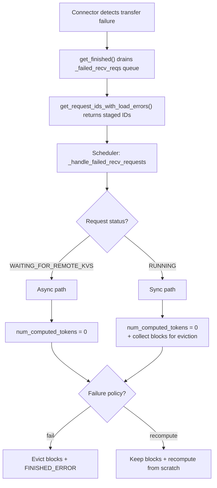

# Remove per-block KV transfer error handling

[Upstream PR](https://github.com/vllm-project/vllm/pull/42461) · state: open · merged: False

## Original PR description

RFC: https://github.com/vllm-project/vllm/issues/35780

### Motivation

Per-block error handling (`invalid_block_ids`) is complex and hard to maintain. The scheduler had to scan all blocks of all running/waiting requests to find which ones were affected, handle shared-block edge cases, track `marked_invalid_block_ids`, and maintain separate code paths for sync vs async loading.

The use cases for block-level handling are limited, but the code is hard to maintain and debug. In practice, many connectors detect failures at the request/transfer level, not at individual block granularity. Forcing them to report per-block errors required artificial mapping (e.g., `set(meta.local_block_ids[0])` in NIXL's `_handle_failed_transfer`). This mismatch made both the connector interface and the scheduler harder to reason about and extend.

### Old vs new

| | Old (per-block) | New (per-request) |
|---|---|---|
| **Error signal** | `invalid_block_ids: set[int]` | `failed_recv_request_ids: set[str]` |
| **Detection** | Scan all blocks of all requests | Direct lookup by request ID |
| **Recovery** | Truncate to first invalid block | Reset to 0 (full recompute) |
| **Shared blocks** | Complex `marked_invalid_block_ids` tracking | Not needed |

### New failure handling flow



### Changes

**Interface:** `get_block_ids_with_load_errors() -> set[int]` becomes `get_request_ids_with_load_errors() -> set[str]`

**Scheduler:** `_handle_invalid_blocks` + `_update_requests_with_invalid_blocks` replaced by `_handle_failed_recv_requests`. Block eviction:
- **fail policy**: evict all blocks of sync-loaded requests to prevent cache pollution. Async blocks are never hashed, so no eviction needed.
- **recompute policy**: blocks kept — recompute overwrites them with correct data.

**NIXL worker:** `_handle_failed_transfer` records request ID only (removed per-block `_invalid_block_ids` queue). Failed IDs flow through a two-step staging pattern: `get_finished()` drains the thread-safe `_failed_recv_reqs` queue and copies the IDs into `_last_failed_recv_reqs`, then `get_request_ids_with_load_errors()` returns and clears that staged set. Assertions enforce this call ordering (guaranteed by `post_forward` / `_get_kv_connector_output`).

**Other connectors:** Removed `get_block_ids_with_load_errors` from FlexKV, LMCache, LMCache-MP. Updated MultiConnector to aggregate the new method.

**Tests:** Replaced 4 per-block test files with `test_kv_load_failure_handling.py` covering {sync, async} x {fail, recompute} + partial failure.

### Note for reviewers

The NIXL worker now requires `get_finished()` and `get_request_ids_with_load_errors()` to be called in order. The old `get_block_ids_with_load_errors()` independently drained its own queue and could be called at any time. The new flow is:

```python
# Step 1: get_finished() drains _failed_recv_reqs queue
#         and copies the IDs into _last_failed_recv_reqs
finished_sending, finished_recving = connector.get_finished(...)

# Step 2: get_request_ids_with_load_errors() returns
#         _last_failed_recv_reqs and clears it
failed_reqs = connector.get_request_ids_with_load_errors()
```

Two assertions enforce this ordering:
- `get_finished()`: `assert not self._last_failed_recv_reqs` — fails if step 2 was skipped after the previous step 1
- `get_request_ids_with_load_errors()`: `assert self._failed_recv_reqs.empty()` — fails if step 1 was skipped

All current call sites (`post_forward`, `_get_kv_connector_output`) follow this order. A future refactor that calls only `get_finished()` without the follow-up would crash on the next `get_finished()` call. Worth considering whether to soften these to log-and-clear for production safety.

## Review and discussion

### reviews

- gemini-code-assist[bot] · COMMENTED · 2026-05-12T21:37:18Z · [source](https://github.com/vllm-project/vllm/pull/42461#pullrequestreview-4276429639)

## Code Review

This pull request introduces request-level error reporting for KV load failures, adding `failed_recv_request_ids` to the KV connector interface and its NIXL implementation. The scheduler is updated to handle these failures via a new `_handle_failed_recv_requests` method, which manages request rescheduling and block eviction. A critical review comment identifies a logic error in the scheduler where block eviction is incorrectly skipped when the recompute policy is enabled, which could lead to cache pollution; the reviewer recommends evicting blocks for all sync-loading failures regardless of the failure policy.

- NickLucche · COMMENTED · 2026-06-05T15:36:07Z · [source](https://github.com/vllm-project/vllm/pull/42461#pullrequestreview-4437525910)

Nice work @ZhanqiuHu , things look much cleaner now !
I want to set aside a bit more time to review in depth, but this is looking really good already.


### issue_comments

- mergify[bot] · comment · 2026-05-14T21:13:05Z · [source](https://github.com/vllm-project/vllm/pull/42461#issuecomment-4454787140)

Documentation preview: https://vllm--42461.org.readthedocs.build/en/42461/

- mergify[bot] · comment · 2026-06-12T11:19:03Z · [source](https://github.com/vllm-project/vllm/pull/42461#issuecomment-4690721805)

This pull request has merge conflicts that must be resolved before it can be
merged. Please rebase the PR, @ZhanqiuHu.

https://docs.github.com/en/pull-requests/collaborating-with-pull-requests/working-with-forks/syncing-a-fork

- Dao007forever · comment · 2026-07-20T21:30:10Z · [source](https://github.com/vllm-project/vllm/pull/42461#issuecomment-5027475844)

For production, I think recomputing from scratch might not be a good choice. There are complexity in block level failures because of multiple groups, but can we simplify that instead?

- github-actions[bot] · comment · 2026-10-31T01:37:34Z · [source](https://github.com/vllm-project/vllm/pull/42461#issuecomment-6537272429)

This pull request has been automatically marked as stale because it has not had any activity within 90 days. It will be automatically closed if no further activity occurs within 30 days. Leave a comment if you feel this pull request should remain open. Thank you!

### inline_comments

- gemini-code-assist[bot] · comment · 2026-05-12T21:37:18Z · [source](https://github.com/vllm-project/vllm/pull/42461#discussion_r3230001122)

File: `vllm/v1/core/sched/scheduler.py` · line 2691


The condition `if blocks_to_evict and should_fail:` appears to contradict the function's docstring, which states: "We evict *all* blocks of such requests to prevent cache pollution." If `recompute_kv_load_failures` is true, `should_fail` will be false, and this condition prevents eviction. This could lead to other requests using corrupted data from the prefix cache if they match the prefix of the failed request.

To prevent cache pollution, eviction should happen whenever `blocks_to_evict` is not empty, regardless of the failure policy. The policy should only determine if the request is failed or rescheduled.

```suggestion
        if blocks_to_evict:
```

## Changed files and fixed code

- `docs/features/nixl_connector_usage.md` · modified · additions 3 / deletions 3
  - [head](https://github.com/ZhanqiuHu/vllm/blob/0d32b8f84c5f40aba42945d292869a4fe07389ee/docs/features/nixl_connector_usage.md)
  - [base](https://github.com/vllm-project/vllm/blob/9dd62d80abad5d2ebeb0a4a60ad005a23c23d0e9/docs/features/nixl_connector_usage.md)
- `examples/disaggregated/kv_load_failure_recovery_offline/README.md` · modified · additions 2 / deletions 2
  - [head](https://github.com/ZhanqiuHu/vllm/blob/0d32b8f84c5f40aba42945d292869a4fe07389ee/examples/disaggregated/kv_load_failure_recovery_offline/README.md)
  - [base](https://github.com/vllm-project/vllm/blob/9dd62d80abad5d2ebeb0a4a60ad005a23c23d0e9/examples/disaggregated/kv_load_failure_recovery_offline/README.md)
- `examples/disaggregated/kv_load_failure_recovery_offline/load_recovery_example_connector.py` · modified · additions 11 / deletions 11
  - [head](https://github.com/ZhanqiuHu/vllm/blob/0d32b8f84c5f40aba42945d292869a4fe07389ee/examples/disaggregated/kv_load_failure_recovery_offline/load_recovery_example_connector.py)
  - [base](https://github.com/vllm-project/vllm/blob/9dd62d80abad5d2ebeb0a4a60ad005a23c23d0e9/examples/disaggregated/kv_load_failure_recovery_offline/load_recovery_example_connector.py)
- `tests/v1/kv_connector/unit/test_cache_pollution_prevention.py` · removed · additions 0 / deletions 163
  - [head](https://github.com/ZhanqiuHu/vllm/blob/0d32b8f84c5f40aba42945d292869a4fe07389ee/tests/v1/kv_connector/unit/test_cache_pollution_prevention.py)
  - [base](https://github.com/vllm-project/vllm/blob/9dd62d80abad5d2ebeb0a4a60ad005a23c23d0e9/tests/v1/kv_connector/unit/test_cache_pollution_prevention.py)
- `tests/v1/kv_connector/unit/test_error_propagation.py` · removed · additions 0 / deletions 148
  - [head](https://github.com/ZhanqiuHu/vllm/blob/0d32b8f84c5f40aba42945d292869a4fe07389ee/tests/v1/kv_connector/unit/test_error_propagation.py)
  - [base](https://github.com/vllm-project/vllm/blob/9dd62d80abad5d2ebeb0a4a60ad005a23c23d0e9/tests/v1/kv_connector/unit/test_error_propagation.py)
- `tests/v1/kv_connector/unit/test_flexkv_connector.py` · modified · additions 0 / deletions 6
  - [head](https://github.com/ZhanqiuHu/vllm/blob/0d32b8f84c5f40aba42945d292869a4fe07389ee/tests/v1/kv_connector/unit/test_flexkv_connector.py)
  - [base](https://github.com/vllm-project/vllm/blob/9dd62d80abad5d2ebeb0a4a60ad005a23c23d0e9/tests/v1/kv_connector/unit/test_flexkv_connector.py)
- `tests/v1/kv_connector/unit/test_invalid_blocks_correctness.py` · removed · additions 0 / deletions 480
  - [head](https://github.com/ZhanqiuHu/vllm/blob/0d32b8f84c5f40aba42945d292869a4fe07389ee/tests/v1/kv_connector/unit/test_invalid_blocks_correctness.py)
  - [base](https://github.com/vllm-project/vllm/blob/9dd62d80abad5d2ebeb0a4a60ad005a23c23d0e9/tests/v1/kv_connector/unit/test_invalid_blocks_correctness.py)
- `tests/v1/kv_connector/unit/test_kv_load_failure_handling.py` · added · additions 325 / deletions 0
  - [head](https://github.com/ZhanqiuHu/vllm/blob/0d32b8f84c5f40aba42945d292869a4fe07389ee/tests/v1/kv_connector/unit/test_kv_load_failure_handling.py)
  - [base](https://github.com/vllm-project/vllm/blob/9dd62d80abad5d2ebeb0a4a60ad005a23c23d0e9/tests/v1/kv_connector/unit/test_kv_load_failure_handling.py)
- `tests/v1/kv_connector/unit/test_kv_load_failure_recovery.py` · removed · additions 0 / deletions 339
  - [head](https://github.com/ZhanqiuHu/vllm/blob/0d32b8f84c5f40aba42945d292869a4fe07389ee/tests/v1/kv_connector/unit/test_kv_load_failure_recovery.py)
  - [base](https://github.com/vllm-project/vllm/blob/9dd62d80abad5d2ebeb0a4a60ad005a23c23d0e9/tests/v1/kv_connector/unit/test_kv_load_failure_recovery.py)
- `tests/v1/kv_connector/unit/test_nixl_connector.py` · modified · additions 11 / deletions 13
  - [head](https://github.com/ZhanqiuHu/vllm/blob/0d32b8f84c5f40aba42945d292869a4fe07389ee/tests/v1/kv_connector/unit/test_nixl_connector.py)
  - [base](https://github.com/vllm-project/vllm/blob/9dd62d80abad5d2ebeb0a4a60ad005a23c23d0e9/tests/v1/kv_connector/unit/test_nixl_connector.py)
- `tests/v1/kv_connector/unit/test_nixl_heartbeat.py` · modified · additions 0 / deletions 1
  - [head](https://github.com/ZhanqiuHu/vllm/blob/0d32b8f84c5f40aba42945d292869a4fe07389ee/tests/v1/kv_connector/unit/test_nixl_heartbeat.py)
  - [base](https://github.com/vllm-project/vllm/blob/9dd62d80abad5d2ebeb0a4a60ad005a23c23d0e9/tests/v1/kv_connector/unit/test_nixl_heartbeat.py)
- `tests/v1/kv_connector/unit/test_output_aggregator.py` · modified · additions 13 / deletions 12
  - [head](https://github.com/ZhanqiuHu/vllm/blob/0d32b8f84c5f40aba42945d292869a4fe07389ee/tests/v1/kv_connector/unit/test_output_aggregator.py)
  - [base](https://github.com/vllm-project/vllm/blob/9dd62d80abad5d2ebeb0a4a60ad005a23c23d0e9/tests/v1/kv_connector/unit/test_output_aggregator.py)
- `tests/v1/kv_connector/unit/utils.py` · modified · additions 3 / deletions 3
  - [head](https://github.com/ZhanqiuHu/vllm/blob/0d32b8f84c5f40aba42945d292869a4fe07389ee/tests/v1/kv_connector/unit/utils.py)
  - [base](https://github.com/vllm-project/vllm/blob/9dd62d80abad5d2ebeb0a4a60ad005a23c23d0e9/tests/v1/kv_connector/unit/utils.py)
- `vllm/distributed/kv_transfer/kv_connector/utils.py` · modified · additions 3 / deletions 3
  - [head](https://github.com/ZhanqiuHu/vllm/blob/0d32b8f84c5f40aba42945d292869a4fe07389ee/vllm/distributed/kv_transfer/kv_connector/utils.py)
  - [base](https://github.com/vllm-project/vllm/blob/9dd62d80abad5d2ebeb0a4a60ad005a23c23d0e9/vllm/distributed/kv_transfer/kv_connector/utils.py)
- `vllm/distributed/kv_transfer/kv_connector/v1/base.py` · modified · additions 8 / deletions 10
  - [head](https://github.com/ZhanqiuHu/vllm/blob/0d32b8f84c5f40aba42945d292869a4fe07389ee/vllm/distributed/kv_transfer/kv_connector/v1/base.py)
  - [base](https://github.com/vllm-project/vllm/blob/9dd62d80abad5d2ebeb0a4a60ad005a23c23d0e9/vllm/distributed/kv_transfer/kv_connector/v1/base.py)
- `vllm/distributed/kv_transfer/kv_connector/v1/flexkv_connector.py` · modified · additions 0 / deletions 4
  - [head](https://github.com/ZhanqiuHu/vllm/blob/0d32b8f84c5f40aba42945d292869a4fe07389ee/vllm/distributed/kv_transfer/kv_connector/v1/flexkv_connector.py)
  - [base](https://github.com/vllm-project/vllm/blob/9dd62d80abad5d2ebeb0a4a60ad005a23c23d0e9/vllm/distributed/kv_transfer/kv_connector/v1/flexkv_connector.py)
- `vllm/distributed/kv_transfer/kv_connector/v1/lmcache_connector.py` · modified · additions 0 / deletions 15
  - [head](https://github.com/ZhanqiuHu/vllm/blob/0d32b8f84c5f40aba42945d292869a4fe07389ee/vllm/distributed/kv_transfer/kv_connector/v1/lmcache_connector.py)
  - [base](https://github.com/vllm-project/vllm/blob/9dd62d80abad5d2ebeb0a4a60ad005a23c23d0e9/vllm/distributed/kv_transfer/kv_connector/v1/lmcache_connector.py)
- `vllm/distributed/kv_transfer/kv_connector/v1/lmcache_mp_connector.py` · modified · additions 0 / deletions 20
  - [head](https://github.com/ZhanqiuHu/vllm/blob/0d32b8f84c5f40aba42945d292869a4fe07389ee/vllm/distributed/kv_transfer/kv_connector/v1/lmcache_mp_connector.py)
  - [base](https://github.com/vllm-project/vllm/blob/9dd62d80abad5d2ebeb0a4a60ad005a23c23d0e9/vllm/distributed/kv_transfer/kv_connector/v1/lmcache_mp_connector.py)
- `vllm/distributed/kv_transfer/kv_connector/v1/multi_connector.py` · modified · additions 4 / deletions 4
  - [head](https://github.com/ZhanqiuHu/vllm/blob/0d32b8f84c5f40aba42945d292869a4fe07389ee/vllm/distributed/kv_transfer/kv_connector/v1/multi_connector.py)
  - [base](https://github.com/vllm-project/vllm/blob/9dd62d80abad5d2ebeb0a4a60ad005a23c23d0e9/vllm/distributed/kv_transfer/kv_connector/v1/multi_connector.py)
- `vllm/distributed/kv_transfer/kv_connector/v1/nixl/base_worker.py` · modified · additions 22 / deletions 20
  - [head](https://github.com/ZhanqiuHu/vllm/blob/0d32b8f84c5f40aba42945d292869a4fe07389ee/vllm/distributed/kv_transfer/kv_connector/v1/nixl/base_worker.py)
  - [base](https://github.com/vllm-project/vllm/blob/9dd62d80abad5d2ebeb0a4a60ad005a23c23d0e9/vllm/distributed/kv_transfer/kv_connector/v1/nixl/base_worker.py)
- `vllm/distributed/kv_transfer/kv_connector/v1/nixl/connector.py` · modified · additions 3 / deletions 3
  - [head](https://github.com/ZhanqiuHu/vllm/blob/0d32b8f84c5f40aba42945d292869a4fe07389ee/vllm/distributed/kv_transfer/kv_connector/v1/nixl/connector.py)
  - [base](https://github.com/vllm-project/vllm/blob/9dd62d80abad5d2ebeb0a4a60ad005a23c23d0e9/vllm/distributed/kv_transfer/kv_connector/v1/nixl/connector.py)
- `vllm/v1/core/sched/scheduler.py` · modified · additions 66 / deletions 163
  - [head](https://github.com/ZhanqiuHu/vllm/blob/0d32b8f84c5f40aba42945d292869a4fe07389ee/vllm/v1/core/sched/scheduler.py)
  - [base](https://github.com/vllm-project/vllm/blob/9dd62d80abad5d2ebeb0a4a60ad005a23c23d0e9/vllm/v1/core/sched/scheduler.py)
- `vllm/v1/outputs.py` · modified · additions 3 / deletions 4
  - [head](https://github.com/ZhanqiuHu/vllm/blob/0d32b8f84c5f40aba42945d292869a4fe07389ee/vllm/v1/outputs.py)
  - [base](https://github.com/vllm-project/vllm/blob/9dd62d80abad5d2ebeb0a4a60ad005a23c23d0e9/vllm/v1/outputs.py)
- `vllm/v1/worker/gpu/kv_connector.py` · modified · additions 3 / deletions 1
  - [head](https://github.com/ZhanqiuHu/vllm/blob/0d32b8f84c5f40aba42945d292869a4fe07389ee/vllm/v1/worker/gpu/kv_connector.py)
  - [base](https://github.com/vllm-project/vllm/blob/9dd62d80abad5d2ebeb0a4a60ad005a23c23d0e9/vllm/v1/worker/gpu/kv_connector.py)
- `vllm/v1/worker/kv_connector_model_runner_mixin.py` · modified · additions 3 / deletions 1
  - [head](https://github.com/ZhanqiuHu/vllm/blob/0d32b8f84c5f40aba42945d292869a4fe07389ee/vllm/v1/worker/kv_connector_model_runner_mixin.py)
  - [base](https://github.com/vllm-project/vllm/blob/9dd62d80abad5d2ebeb0a4a60ad005a23c23d0e9/vllm/v1/worker/kv_connector_model_runner_mixin.py)

## Evidence and interpretation boundary

[Original JSON, discussions and patches](../../../../../../evidence/prs/vllm-project--vllm/42461-b8b38a8a4c28f1909e9417dc6a480a4a20d11b85dba58d2223ff7f13056c3007.json) · SHA-256 `b8b38a8a4c28f1909e9417dc6a480a4a20d11b85dba58d2223ff7f13056c3007`.

Diff complete: True. Missing/binary/truncated patches require pinned source inspection. This is a source page, not an independently verified optimization case. Open, merged and released are different states; recheck the deployed dependency.
