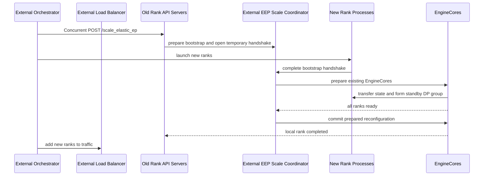
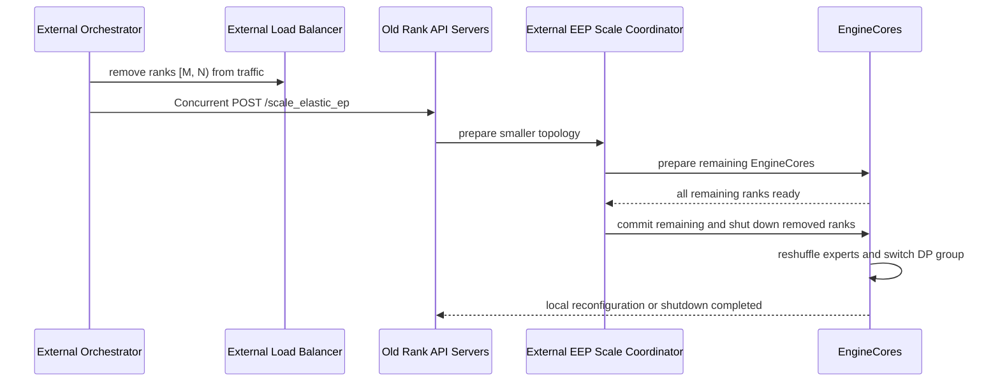

# [Feature] Add External LB Mode Support for Elastic EP Scaling

[Upstream PR](https://github.com/vllm-project/vllm/pull/43202) · state: open · merged: False

## Original PR description

The code was primarily implemented by **@lqh-hh**.
We would like to thank **@zWaNg3**  for the suggestions and review feedback.
## Purpose

### Summary

This PR implements external Elastic Expert Parallelism (EEP) scaling orchestration, following the design proposed in RFC #42515.

The existing EEP implementation provides the worker-side mechanism for changing EP/DP topology without restarting all workers. However, some online serving deployments use an external load balancer and externally managed DP rank lifecycle. In that mode, vLLM should not create or remove Ray actors for new ranks. Instead, externally launched ranks need a control path to join the existing EEP scale-up / scale-down transition.

This PR adds that external control path while reusing the existing EEP worker-side state machine and worker operations.

The newly introduced external EEP scale coordinator is a temporary per-scaling-operation control object. It is created only while an external scale-up or scale-down request is being processed, and is released after the transition completes. It is not a long-running coordinator in the serving data path.

### Supported Functionality

* Support external EEP scale-up for `data_parallel_external_lb`.
  * Existing ranks receive `/scale_elastic_ep`.
  * Rank 0 publishes bootstrap metadata for the new topology.
  * Externally launched new ranks join through the temporary scale-up handshake path.
  * Existing EEP logic transfers expert state, syncs KV cache capacity, switches groups, and runs EPLB reshuffle.

* Support external EEP scale-down for `data_parallel_external_lb`.
  * The external orchestrator removes target ranks from the external load balancer first.
  * Remaining and removing ranks enter the EEP reconfiguration flow.
  * Removing ranks report shutdown completion after reconfiguration.

* Add per-rank external scale completion reporting.
  * In external LB mode, each old rank reports its own `RECONFIGURE_FINISHED`.
  * This allows each `/scale_elastic_ep` request to return once its local rank has completed reconfiguration, instead of depending on rank 0 only.

* Preserve the existing Ray-managed EEP path.
  * This PR only adds an alternate orchestration path for externally managed DP ranks.

### Usage

External orchestrators trigger scaling by calling the serving API on old ranks:

```bash
POST /scale_elastic_ep
{
  "new_data_parallel_size": 3,
  "drain_timeout": 120
}
```

For scale-up:

1. Call `/scale_elastic_ep` on all old ranks.
2. Launch the new ranks externally.
3. After reconfiguration succeeds, add the new ranks to the external load balancer.

For scale-down:

1. Remove target ranks from the external load balancer.
2. Call `/scale_elastic_ep` on all old ranks.
3. Removed ranks shut down after the EEP transition completes.

## Architecture


The coordinator temporarily runs inside each DP rank's API Server process during the scaling and manages cross-rank orchestration for elastic EP scaling via two mechanisms:

1.**TCPStore (state synchronization)** — Rank 0 hosts a `TCPStore`; all other ranks' coordinators connect as clients. Rank 0 publishes scaling bootstrap metadata (new DP topology, master address/ports, store port), and other ranks poll it to drive their local `ElasticEPScalingState` state machine transitions. Progress and errors are also exchanged through the store.

2.**HandshakeServer (scale-up only)** — During scale-up, rank 0 temporarily starts a ZMQ-based handshake server. New ranks connect to receive the ZMQ addresses and DP configuration they need to join the cluster, then signal readiness. The server shuts down once all new ranks are ready.

## Scale-Up Flow



## Scale-Down Flow



## Implementation Notes

The main change is concentrated in the API server / client / EngineCore control path.

* `vllm/distributed/elastic_ep/external_elastic_ep.py`
  * Adds the temporary external EEP scale coordinator.
  * Coordinates bootstrap metadata, scale-up handshake, rank notifications, and local rank completion.
  * The coordinator exists only for the duration of one scale operation and is removed after scale-up / scale-down finishes.

* `vllm/v1/engine/core_client.py`
  * Extends `DPAsyncMPClient` to drive external EEP scaling.

* `vllm/v1/engine/core.py`
  * Handles distributed reinitialization requests.
  * Preserves rank-0 notification routing for externally launched scale-up ranks.

* `vllm/v1/engine/utils.py`
  * Creates and retains the Elastic EP coordination TCPStore during startup.
  * Sends runtime coordination metadata through startup handshakes.

* `vllm/distributed/elastic_ep/elastic_state.py`
  * Reuses the existing EEP state machine.
  * Reports per-rank reconfiguration completion in external LB mode.

* `vllm/config/parallel.py`
  * Adds / carries the runtime coordination metadata required by external EEP scaling.

## Compatibility

External EEP scaling requires:

* `enable_elastic_ep=True`
* `data_parallel_external_lb=True`
* `data_parallel_size > 1`

This PR does not change the existing Ray-managed EEP scaling path.

## Test Plan

### Models tested

* Qwen3-30B-A3B

### Test environment

* External load balancer mode
* Multiple DP ranks
* `--enable-expert-parallel`
* `--enable-eplb`
* `--enable-elastic-ep`

### Workflow

1. Start old-rank vLLM online serving instances with external DP LB enabled:

```bash
python -m vllm.entrypoints.openai.api_server \
    --model <model path> \
    --enable-expert-parallel \
    --enable-eplb \
    --enable-elastic-ep \
    --data-parallel-size <old dp size> \
    --data-parallel-rank <rank> \
    --data-parallel-master-ip <master ip> \
    --data-parallel-rpc-port <rpc port> \
    --host 0.0.0.0 \
    --port <api port>
```

2. Trigger external scaling on every old rank. The existing scale helper can be used for external LB as long as it is invoked for each old-rank API server endpoint, preferably concurrently:

```bash
python examples/online_serving/elastic_ep/scale.py \
    --host <old-rank-0-host> \
    --port <old-rank-0-port> \
    --new-dp-size <new dp size>

python examples/online_serving/elastic_ep/scale.py \
    --host <old-rank-1-host> \
    --port <old-rank-1-port> \
    --new-dp-size <new dp size>
```

3. For scale-up, launch the new rank processes externally while the old ranks are waiting for the scale operation to complete.

4. Send requests through the external load balancer after scaling and verify that inference succeeds.

## Test Result

### Test scenarios

| Scenario | Result |
| --- | --- |
| DP 8 -> DP 4 -> DP 3 -> DP 2 | Scale down succeeds and serving requests continue successfully after each topology change. |
| DP 2 -> DP 4 -> DP 8 | Scale up succeeds and serving requests continue successfully after each topology change. |
| DP 4 -> DP 8 -> DP 3 -> DP 8 | Repeated scale-up / scale-down succeeds and serving requests continue successfully after each topology change. |


## Review and discussion

### reviews

- gemini-code-assist[bot] · COMMENTED · 2026-05-20T09:54:26Z · [source](https://github.com/vllm-project/vllm/pull/43202#pullrequestreview-4327278577)

## Code Review

This pull request adds support for scaling Elastic EP when using an external load balancer. It introduces a new ExternalElasticEPScaleCoordinator and a temporary handshake server to distribute coordination metadata, such as TCPStore ports and ZMQ addresses, to new ranks. The engine core and client are updated to handle scaling notifications and manage the coordination store lifecycle. Review feedback highlights opportunities to improve the handshake server's resilience by ignoring unexpected ranks and to optimize performance by reusing ZMQ contexts for notifications.

- lqh-hh · COMMENTED · 2026-05-26T11:56:00Z · [source](https://github.com/vllm-project/vllm/pull/43202#pullrequestreview-4363389891)

(No body; status only.)

- lqh-hh · COMMENTED · 2026-05-29T03:22:04Z · [source](https://github.com/vllm-project/vllm/pull/43202#pullrequestreview-4386357848)

(No body; status only.)

- tlrmchlsmth · COMMENTED · 2026-06-10T15:43:05Z · [source](https://github.com/vllm-project/vllm/pull/43202#pullrequestreview-4469310387)

(No body; status only.)

- lqh-hh · COMMENTED · 2026-06-11T03:23:20Z · [source](https://github.com/vllm-project/vllm/pull/43202#pullrequestreview-4473444361)

(No body; status only.)

- lqh-hh · COMMENTED · 2026-06-17T02:56:58Z · [source](https://github.com/vllm-project/vllm/pull/43202#pullrequestreview-4511907943)

(No body; status only.)

- lqh-hh · COMMENTED · 2026-06-17T02:57:04Z · [source](https://github.com/vllm-project/vllm/pull/43202#pullrequestreview-4511908238)

(No body; status only.)

- lqh-hh · COMMENTED · 2026-06-17T02:57:09Z · [source](https://github.com/vllm-project/vllm/pull/43202#pullrequestreview-4511908475)

(No body; status only.)

- lqh-hh · COMMENTED · 2026-06-17T02:57:15Z · [source](https://github.com/vllm-project/vllm/pull/43202#pullrequestreview-4511908979)

(No body; status only.)

- lqh-hh · COMMENTED · 2026-06-17T02:57:23Z · [source](https://github.com/vllm-project/vllm/pull/43202#pullrequestreview-4511909393)

(No body; status only.)

- lqh-hh · COMMENTED · 2026-06-17T02:57:28Z · [source](https://github.com/vllm-project/vllm/pull/43202#pullrequestreview-4511909616)

(No body; status only.)

- lqh-hh · COMMENTED · 2026-06-17T02:57:33Z · [source](https://github.com/vllm-project/vllm/pull/43202#pullrequestreview-4511909847)

(No body; status only.)

- tlrmchlsmth · COMMENTED · 2026-06-26T21:05:00Z · [source](https://github.com/vllm-project/vllm/pull/43202#pullrequestreview-4580865083)

(No body; status only.)

- lqh-hh · COMMENTED · 2026-07-02T09:22:38Z · [source](https://github.com/vllm-project/vllm/pull/43202#pullrequestreview-4616151012)

(No body; status only.)

- lqh-hh · COMMENTED · 2026-07-02T09:22:42Z · [source](https://github.com/vllm-project/vllm/pull/43202#pullrequestreview-4616151491)

(No body; status only.)

- lqh-hh · COMMENTED · 2026-07-02T09:28:09Z · [source](https://github.com/vllm-project/vllm/pull/43202#pullrequestreview-4616192689)

(No body; status only.)

- lqh-hh · COMMENTED · 2026-07-02T09:28:17Z · [source](https://github.com/vllm-project/vllm/pull/43202#pullrequestreview-4616193695)

(No body; status only.)

- depthfirst-app[bot] · COMMENTED · 2026-07-14T13:56:02Z · [source](https://github.com/vllm-project/vllm/pull/43202#pullrequestreview-4695008952)

(No body; status only.)

- tlrmchlsmth · COMMENTED · 2026-07-20T18:02:42Z · [source](https://github.com/vllm-project/vllm/pull/43202#pullrequestreview-4737615334)

(No body; status only.)

- tlrmchlsmth · APPROVED · 2026-07-20T18:03:23Z · [source](https://github.com/vllm-project/vllm/pull/43202#pullrequestreview-4737621012)

(No body; status only.)

- tlrmchlsmth · COMMENTED · 2026-08-03T13:42:54Z · [source](https://github.com/vllm-project/vllm/pull/43202#pullrequestreview-4844613599)

(No body; status only.)

- tlrmchlsmth · CHANGES_REQUESTED · 2026-08-03T13:43:19Z · [source](https://github.com/vllm-project/vllm/pull/43202#pullrequestreview-4844682304)

requesting changes since I've approved previously

- lqh-hh · COMMENTED · 2026-08-05T03:44:07Z · [source](https://github.com/vllm-project/vllm/pull/43202#pullrequestreview-4860783356)

(No body; status only.)

- lqh-hh · COMMENTED · 2026-08-05T03:44:16Z · [source](https://github.com/vllm-project/vllm/pull/43202#pullrequestreview-4860783854)

(No body; status only.)

- lqh-hh · COMMENTED · 2026-08-05T03:44:23Z · [source](https://github.com/vllm-project/vllm/pull/43202#pullrequestreview-4860784211)

(No body; status only.)

- lqh-hh · COMMENTED · 2026-08-05T03:44:59Z · [source](https://github.com/vllm-project/vllm/pull/43202#pullrequestreview-4860786105)

(No body; status only.)

- lqh-hh · COMMENTED · 2026-08-05T03:45:20Z · [source](https://github.com/vllm-project/vllm/pull/43202#pullrequestreview-4860787612)

(No body; status only.)

- tlrmchlsmth · COMMENTED · 2026-10-05T17:14:34Z · [source](https://github.com/vllm-project/vllm/pull/43202#pullrequestreview-5417851481)

(No body; status only.)

- tlrmchlsmth · COMMENTED · 2026-10-05T17:16:47Z · [source](https://github.com/vllm-project/vllm/pull/43202#pullrequestreview-5418176023)

(No body; status only.)

- tlrmchlsmth · COMMENTED · 2026-10-05T18:33:11Z · [source](https://github.com/vllm-project/vllm/pull/43202#pullrequestreview-5418976396)

Left a couple of comments, and also tried it out. I hit a hang during a scale up, it appears due to a lack of request draining. I think my comments will address the hang

- itayalroy · COMMENTED · 2026-10-06T21:36:19Z · [source](https://github.com/vllm-project/vllm/pull/43202#pullrequestreview-5434241638)

Sorry for jumping into this late, left a few additional comments on top of Tyler’s review.

- itayalroy · COMMENTED · 2026-10-06T21:40:02Z · [source](https://github.com/vllm-project/vllm/pull/43202#pullrequestreview-5434870298)

(No body; status only.)

- lqh-hh · COMMENTED · 2026-10-10T08:25:27Z · [source](https://github.com/vllm-project/vllm/pull/43202#pullrequestreview-5478310232)

(No body; status only.)

- lqh-hh · COMMENTED · 2026-10-10T08:27:26Z · [source](https://github.com/vllm-project/vllm/pull/43202#pullrequestreview-5478314820)

(No body; status only.)

- lqh-hh · COMMENTED · 2026-10-10T08:29:22Z · [source](https://github.com/vllm-project/vllm/pull/43202#pullrequestreview-5478319608)

(No body; status only.)

- lqh-hh · COMMENTED · 2026-10-10T08:29:41Z · [source](https://github.com/vllm-project/vllm/pull/43202#pullrequestreview-5478320397)

(No body; status only.)

- lqh-hh · COMMENTED · 2026-10-10T08:30:15Z · [source](https://github.com/vllm-project/vllm/pull/43202#pullrequestreview-5478321665)

(No body; status only.)

- lqh-hh · COMMENTED · 2026-10-10T08:33:25Z · [source](https://github.com/vllm-project/vllm/pull/43202#pullrequestreview-5478329144)

(No body; status only.)

- lqh-hh · COMMENTED · 2026-10-10T08:36:47Z · [source](https://github.com/vllm-project/vllm/pull/43202#pullrequestreview-5478336945)

(No body; status only.)

- lqh-hh · COMMENTED · 2026-10-10T08:37:22Z · [source](https://github.com/vllm-project/vllm/pull/43202#pullrequestreview-5478338710)

(No body; status only.)

- lqh-hh · COMMENTED · 2026-10-10T08:38:37Z · [source](https://github.com/vllm-project/vllm/pull/43202#pullrequestreview-5478343961)

(No body; status only.)

- lqh-hh · COMMENTED · 2026-10-10T08:39:08Z · [source](https://github.com/vllm-project/vllm/pull/43202#pullrequestreview-5478345243)

(No body; status only.)

- lqh-hh · COMMENTED · 2026-10-10T08:39:21Z · [source](https://github.com/vllm-project/vllm/pull/43202#pullrequestreview-5478345720)

(No body; status only.)

### issue_comments

- mergify[bot] · comment · 2026-06-11T09:11:00Z · [source](https://github.com/vllm-project/vllm/pull/43202#issuecomment-4678984660)

This pull request has merge conflicts that must be resolved before it can be
merged. Please rebase the PR, @fangyuchu.

https://docs.github.com/en/pull-requests/collaborating-with-pull-requests/working-with-forks/syncing-a-fork

- mergify[bot] · comment · 2026-07-25T16:19:02Z · [source](https://github.com/vllm-project/vllm/pull/43202#issuecomment-5079229719)

This pull request has merge conflicts that must be resolved before it can be
merged. Please rebase the PR, @fangyuchu.

https://docs.github.com/en/pull-requests/collaborating-with-pull-requests/working-with-forks/syncing-a-fork


- mergify[bot] · comment · 2026-07-27T11:06:03Z · [source](https://github.com/vllm-project/vllm/pull/43202#issuecomment-5090539110)

Hi @fangyuchu, the pre-commit checks have failed. Please run:

```bash 
uv pip install pre-commit>=4.5.1
pre-commit install
pre-commit run --all-files
```

Then, commit the changes and push to your branch.

For future commits, `pre-commit` will run automatically on changed files before each commit.


- mergify[bot] · comment · 2026-07-28T21:17:11Z · [source](https://github.com/vllm-project/vllm/pull/43202#issuecomment-5109771625)

This pull request has merge conflicts that must be resolved before it can be
merged. Please rebase the PR, @fangyuchu.

https://docs.github.com/en/pull-requests/collaborating-with-pull-requests/working-with-forks/syncing-a-fork


- mergify[bot] · comment · 2026-08-03T03:17:17Z · [source](https://github.com/vllm-project/vllm/pull/43202#issuecomment-5161936124)

Hi @fangyuchu, the pre-commit checks have failed. Please run:

```bash 
uv pip install pre-commit>=4.5.1
pre-commit install
pre-commit run --all-files
```

Then, commit the changes and push to your branch.

For future commits, `pre-commit` will run automatically on changed files before each commit.


- mergify[bot] · comment · 2026-08-03T06:20:36Z · [source](https://github.com/vllm-project/vllm/pull/43202#issuecomment-5162996104)

Hi @fangyuchu, the pre-commit checks have failed. Please run:

```bash 
uv pip install pre-commit>=4.5.1
pre-commit install
pre-commit run --all-files
```

Then, commit the changes and push to your branch.

For future commits, `pre-commit` will run automatically on changed files before each commit.


- mergify[bot] · comment · 2026-08-17T21:15:04Z · [source](https://github.com/vllm-project/vllm/pull/43202#issuecomment-5320327994)

This pull request has merge conflicts that must be resolved before it can be
merged. Please rebase the PR, @fangyuchu.

https://docs.github.com/en/pull-requests/collaborating-with-pull-requests/working-with-forks/syncing-a-fork


- mergify[bot] · comment · 2026-08-18T08:00:13Z · [source](https://github.com/vllm-project/vllm/pull/43202#issuecomment-5325315932)

Hi @fangyuchu, the pre-commit checks have failed. Please run:

```bash 
uv pip install pre-commit>=4.5.1
pre-commit install
pre-commit run --all-files
```

Then, commit the changes and push to your branch.

For future commits, `pre-commit` will run automatically on changed files before each commit.


- julienmancuso · comment · 2026-08-18T19:52:32Z · [source](https://github.com/vllm-project/vllm/pull/43202#issuecomment-5333287284)

Following up from the Dynamo/Kubernetes orchestration perspective. I posted the contract-level requirements on the RFC here:

https://github.com/vllm-project/vllm/issues/42515#issuecomment-5333283509

At the current PR head, a few concrete implementation details appear important for that contract:

1. `set_scaling_elastic_ep(True)` is called only after `prepare_elastic_ep()` completes. During the potentially long bootstrap/join/readiness phase, `/is_scaling_elastic_ep` can therefore report `false` even though a resize is active.
2. `/is_scaling_elastic_ep` exposes only a process-local Boolean. The external coordinator already records an epoch, target bootstrap, prepared/completed/error state, per-rank completion, and `shutdown_complete`; exposing that state would provide the requested operation/status API without inventing a second state machine.
3. `ScalingMiddleware` returns `503` for HTTP requests while the scaling flag is set and does not appear to exempt health or operation-status routes. Those routes need to remain observable during commit.
4. The scaling flag is cleared after successful commit, but not from a general `finally` path. A commit exception appears able to leave the API permanently marked as scaling. The terminal error should remain queryable while serving/status behavior is restored or explicitly marked `NeedsRecovery`.
5. For scale-down, please expose which ranks reached `shutdown_complete` so an external orchestrator can safely delete the corresponding processes. An HTTP timeout must not require inferring deletion safety from process or pod state.

Useful reconciliation tests would cover:

- polling status during prepare and commit;
- retrying the same absolute target while preparing and after commit;
- rejecting or reporting a competing target;
- losing the initiating HTTP connection and reconnecting to the same operation;
- commit failure resetting or terminally reporting scaling state;
- per-rank safe-to-delete reporting after scale-down;
- partial fan-out where only some old-rank API servers receive the request.

The existing epoch-scoped store keys, error propagation, local lock, same-target no-op, and per-rank completion signals are good foundations. The remaining request is primarily to make them a supported, queryable orchestration surface.


- lqh-hh · comment · 2026-08-20T08:08:35Z · [source](https://github.com/vllm-project/vllm/pull/43202#issuecomment-5353180658)

> Following up from the Dynamo/Kubernetes orchestration perspective. I posted the contract-level requirements on the RFC here:
> 
> [#42515 (comment)](https://github.com/vllm-project/vllm/issues/42515#issuecomment-5333283509)
> 
> At the current PR head, a few concrete implementation details appear important for that contract:
> 
> 1. `set_scaling_elastic_ep(True)` is called only after `prepare_elastic_ep()` completes. During the potentially long bootstrap/join/readiness phase, `/is_scaling_elastic_ep` can therefore report `false` even though a resize is active.
> 2. `/is_scaling_elastic_ep` exposes only a process-local Boolean. The external coordinator already records an epoch, target bootstrap, prepared/completed/error state, per-rank completion, and `shutdown_complete`; exposing that state would provide the requested operation/status API without inventing a second state machine.
> 3. `ScalingMiddleware` returns `503` for HTTP requests while the scaling flag is set and does not appear to exempt health or operation-status routes. Those routes need to remain observable during commit.
> 4. The scaling flag is cleared after successful commit, but not from a general `finally` path. A commit exception appears able to leave the API permanently marked as scaling. The terminal error should remain queryable while serving/status behavior is restored or explicitly marked `NeedsRecovery`.
> 5. For scale-down, please expose which ranks reached `shutdown_complete` so an external orchestrator can safely delete the corresponding processes. An HTTP timeout must not require inferring deletion safety from process or pod state.
> 
> Useful reconciliation tests would cover:
> 
> * polling status during prepare and commit;
> * retrying the same absolute target while preparing and after commit;
> * rejecting or reporting a competing target;
> * losing the initiating HTTP connection and reconnecting to the same operation;
> * commit failure resetting or terminally reporting scaling state;
> * per-rank safe-to-delete reporting after scale-down;
> * partial fan-out where only some old-rank API servers receive the request.
> 
> The existing epoch-scoped store keys, error propagation, local lock, same-target no-op, and per-rank completion signals are good foundations. The remaining request is primarily to make them a supported, queryable orchestration surface.

Thanks for the detailed feedback. The points in 1–3 have been addressed in this revision:

- `/is_scaling_elastic_ep` now reads the epoch-scoped phase from the shared store, so `preparing`, `committing`, `failed`, and `completed` states are observable during the whole operation.
- `/health` and `/is_scaling_elastic_ep` remain accessible while serving traffic is paused.
- The process-local scaling flag is cleared in a `finally` block.

For 4, a failed scaling operation cannot be recovered in the current implementation yet. We will look into recovery semantics as future work. 

For 5, I think it may be cleaner for the vLLM process to exit itself once it has completed its part of the scale-down. The surviving engines can report that the scaling operation has completed, and the orchestrator can then safely remove the corresponding tail engine(s).

This would avoid keeping a stale API process around just for the orchestrator to determine whether it is safe to delete the pod. If this lifecycle makes sense from the Dynamo/Kubernetes orchestration perspective, we can use this as the expected behavior for scale-down.


- julienmancuso · comment · 2026-08-20T14:38:14Z · [source](https://github.com/vllm-project/vllm/pull/43202#issuecomment-5357407626)

Thanks—points 1–3 address the observability issues we raised.

Dynamo can own request fan-out, traffic membership, rank-to-pod mapping, and Kubernetes lifecycle. The remaining requirement from vLLM is a supported, queryable native operation state.

Could the status expose the operation epoch, requested DP size, effective DP size, phase, and terminal error? For scale-down, `completed` could guarantee that all removed tail ranks crossed their shutdown barrier. Dynamo could then safely derive which pods may be removed without requiring every internal store key to be exposed.

In-place failure recovery is not required for an MVP. A durable `failed` state is sufficient if it reports the effective topology—or explicitly says that it is unknown—so Dynamo can fail closed and recreate the group.

We would prefer departing ranks to become quiesced rather than exit themselves. Under Kubernetes, process exit can cause the container to restart before the Operator removes the pod. Dynamo can observe completion and let the Operator perform the authoritative deletion.

Dynamo can handle fan-out to every old-rank API, provided that retrying the same absolute target is idempotent and competing targets are reported clearly.

- mergify[bot] · comment · 2026-08-26T01:03:27Z · [source](https://github.com/vllm-project/vllm/pull/43202#issuecomment-5419128392)

Hi @fangyuchu, the pre-commit checks have failed. Please run:

```bash 
uv pip install pre-commit>=4.5.1
pre-commit install
pre-commit run --all-files
```

Then, commit the changes and push to your branch.

For future commits, `pre-commit` will run automatically on changed files before each commit.


- lqh-hh · comment · 2026-08-26T09:02:25Z · [source](https://github.com/vllm-project/vllm/pull/43202#issuecomment-5423016728)

> Thanks—points 1–3 address the observability issues we raised.
> 
> Dynamo can own request fan-out, traffic membership, rank-to-pod mapping, and Kubernetes lifecycle. The remaining requirement from vLLM is a supported, queryable native operation state.
> 
> Could the status expose the operation epoch, requested DP size, effective DP size, phase, and terminal error? For scale-down, `completed` could guarantee that all removed tail ranks crossed their shutdown barrier. Dynamo could then safely derive which pods may be removed without requiring every internal store key to be exposed.
> 
> In-place failure recovery is not required for an MVP. A durable `failed` state is sufficient if it reports the effective topology—or explicitly says that it is unknown—so Dynamo can fail closed and recreate the group.
> 
> We would prefer departing ranks to become quiesced rather than exit themselves. Under Kubernetes, process exit can cause the container to restart before the Operator removes the pod. Dynamo can observe completion and let the Operator perform the authoritative deletion.
> 
> Dynamo can handle fan-out to every old-rank API, provided that retrying the same absolute target is idempotent and competing targets are reported clearly.

Thanks. Departing ranks now become quiesced after scale-down: their EngineCore and workers exit, while the API remains available for health and status queries until the Operator deletes the pod.

The completed phase is published only after all removed ranks report shutdown_complete, so Dynamo can safely use it as the deletion barrier.


- julienmancuso · comment · 2026-09-10T17:01:51Z · [source](https://github.com/vllm-project/vllm/pull/43202#issuecomment-5622420021)

Thanks — keeping retired ranks quiesced and publishing `completed` only after every removed tail rank reports `shutdown_complete` gives Dynamo the deletion barrier it needs for planned suffix shrink. Dynamo can then map those ranks to pod UIDs and authorize their exact removal.

The remaining reconciliation gap is operation correlation. The public status currently exposes the phase, but after an HTTP timeout or controller restart Dynamo also needs to know that it is observing the same operation and its authoritative result. Could status additionally expose the operation epoch, requested DP size, effective/committed DP size, and terminal error or unknown outcome?

Retrying the same absolute target should return or resume that operation; a different target while it is active should report the conflict. With that addition, the planned resize path would map cleanly to the Dynamo Engine Group operation model.


- mergify[bot] · comment · 2026-09-16T11:04:09Z · [source](https://github.com/vllm-project/vllm/pull/43202#issuecomment-5696425133)

This pull request has merge conflicts that must be resolved before it can be
merged. Please rebase the PR, @fangyuchu.

https://docs.github.com/en/pull-requests/collaborating-with-pull-requests/working-with-forks/syncing-a-fork


- julienmancuso · comment · 2026-09-16T18:44:29Z · [source](https://github.com/vllm-project/vllm/pull/43202#issuecomment-5702743058)

I’d be happy to contribute the remaining Dynamo/Kubernetes reconciliation pieces on top of this work. Would you prefer that I contribute commits directly to this PR’s branch, or prepare a small companion PR targeting this branch?

The proposed scope would be limited to operation correlation and the public status contract: accept an optional caller-supplied operation ID (and runtime-instance precondition), make same-operation/same-target retries return or resume the existing operation while rejecting conflicting reuse, and expose the operation ID/epoch, requested DP size, effective or committed DP size, phase, terminal error, and an explicit unknown-topology outcome. This would reuse the epoch-scoped store and completion signals already implemented here rather than introduce another state machine.

If that scope is welcome in this PR, I can help implement it and add the controller-retry/status tests. If you would rather keep the current PR focused, I can hold it as a dependent follow-up once this lands.

- lqh-hh · comment · 2026-09-17T03:40:33Z · [source](https://github.com/vllm-project/vllm/pull/43202#issuecomment-5708109203)

> I’d be happy to contribute the remaining Dynamo/Kubernetes reconciliation pieces on top of this work. Would you prefer that I contribute commits directly to this PR’s branch, or prepare a small companion PR targeting this branch?
> 
> The proposed scope would be limited to operation correlation and the public status contract: accept an optional caller-supplied operation ID (and runtime-instance precondition), make same-operation/same-target retries return or resume the existing operation while rejecting conflicting reuse, and expose the operation ID/epoch, requested DP size, effective or committed DP size, phase, terminal error, and an explicit unknown-topology outcome. This would reuse the epoch-scoped store and completion signals already implemented here rather than introduce another state machine.
> 
> If that scope is welcome in this PR, I can help implement it and add the controller-retry/status tests. If you would rather keep the current PR focused, I can hold it as a dependent follow-up once this lands.

We’d be happy to support this. If the changes remain small, please feel free to contribute commits directly to this branch.

- julienmancuso · comment · 2026-09-17T15:01:38Z · [source](https://github.com/vllm-project/vllm/pull/43202#issuecomment-5716554593)

Thanks @lqh-hh — I prepared the invited companion contribution here: https://github.com/fangyuchu/vllm/pull/292

It targets `feature/external-lb-ElasticEP` and adds the caller-supplied operation ID/runtime-instance precondition, idempotent same-operation retries and conflict handling, authoritative requested/effective/topology/error status, fail-closed unknown-topology behavior, and completion publication ordering. The focused tests and applicable pre-commit hooks pass, and the commit is GitHub-verified.

- mergify[bot] · comment · 2026-10-08T02:46:17Z · [source](https://github.com/vllm-project/vllm/pull/43202#issuecomment-6051123926)

This pull request has merge conflicts that must be resolved before it can be
merged. Please rebase the PR, @fangyuchu.

https://docs.github.com/en/pull-requests/collaborating-with-pull-requests/working-with-forks/syncing-a-fork


### inline_comments

- gemini-code-assist[bot] · comment · 2026-05-20T09:54:26Z · [source](https://github.com/vllm-project/vllm/pull/43202#discussion_r3272935207)

File: `vllm/distributed/elastic_ep/external_elastic_ep.py` · line 150


Raising a `RuntimeError` here will terminate the handshake server thread and cause the entire scaling operation to fail. In a distributed environment, it's possible for rogue processes or delayed connections from previous runs to attempt a handshake. It would be more robust to log a warning and ignore unexpected ranks rather than crashing the coordinator.

- gemini-code-assist[bot] · comment · 2026-05-20T09:54:26Z · [source](https://github.com/vllm-project/vllm/pull/43202#discussion_r3272935210)

File: `vllm/v1/engine/core.py` · line None


Creating a new `zmq.Context` for every notification is inefficient as it involves starting and stopping I/O threads. While this is a control path, it's an anti-pattern in ZMQ usage. Consider using `zmq.Context.instance()` to reuse a global context.

- lqh-hh · comment · 2026-05-26T11:56:00Z · [source](https://github.com/vllm-project/vllm/pull/43202#discussion_r3303487885)

File: `vllm/distributed/elastic_ep/external_elastic_ep.py` · line 150

In this phase, an unexpected rank means the scale-up topology is inconsistent and cannot be safely recovered in-place. We prefer to fail fast so the external orchestrator can stop the attempt and clean up/relaunch the processes, rather than waiting until timeout.

- lqh-hh · comment · 2026-05-29T03:22:04Z · [source](https://github.com/vllm-project/vllm/pull/43202#discussion_r3321941867)

File: `vllm/v1/engine/core.py` · line None

modified

- tlrmchlsmth · comment · 2026-06-10T15:33:13Z · [source](https://github.com/vllm-project/vllm/pull/43202#discussion_r3389569814)

File: `vllm/distributed/elastic_ep/external_elastic_ep.py` · line 299

I think this should call `self.client._setup_elastic_ep_reconfig_bootstrap()` (and then add a bit on top) to reduce code duplication. The code duplication is a correctness issue in case the implementations drift in the future

- tlrmchlsmth · comment · 2026-06-10T15:34:44Z · [source](https://github.com/vllm-project/vllm/pull/43202#discussion_r3389578474)

File: `vllm/v1/engine/core.py` · line None

The `hasattr` here seems fragile - replace with an instance attribute that is set during __init__?

- tlrmchlsmth · comment · 2026-06-10T15:35:11Z · [source](https://github.com/vllm-project/vllm/pull/43202#discussion_r3389580966)

File: `vllm/v1/engine/core.py` · line None

ditto - replace with an instance attribute that is set during __init__?

- tlrmchlsmth · comment · 2026-06-10T15:35:52Z · [source](https://github.com/vllm-project/vllm/pull/43202#discussion_r3389585283)

File: `vllm/distributed/elastic_ep/external_elastic_ep.py` · line 370

should we add a backoff here (and in other methods that do busy-polling)?

- tlrmchlsmth · comment · 2026-06-10T15:38:35Z · [source](https://github.com/vllm-project/vllm/pull/43202#discussion_r3389601320)

File: `vllm/v1/engine/core.py` · line 2499

this creates a new socket every time, and the socket will stick around for 4 seconds? Should we create it once and re-use the same socket every time?

- tlrmchlsmth · comment · 2026-06-10T15:40:44Z · [source](https://github.com/vllm-project/vllm/pull/43202#discussion_r3389613127)

File: `vllm/v1/engine/core_client.py` · line None

let's only create this when EEP is enabled

- tlrmchlsmth · comment · 2026-06-10T15:43:02Z · [source](https://github.com/vllm-project/vllm/pull/43202#discussion_r3389625806)

File: `vllm/distributed/elastic_ep/external_elastic_ep.py` · line None

What is the `_coord_store`? 

Also, it looks like it is set on several different objects - it would be better if there were one clear owner of `coord_store`

- lqh-hh · comment · 2026-06-11T03:23:20Z · [source](https://github.com/vllm-project/vllm/pull/43202#discussion_r3393052614)

File: `vllm/distributed/elastic_ep/external_elastic_ep.py` · line 370

Do you mean we should use an incremental sleep interval for these TCPStore polling loops, e.g. start at 0.1s and gradually back off up to a small cap like 1s?

- lqh-hh · comment · 2026-06-17T02:56:58Z · [source](https://github.com/vllm-project/vllm/pull/43202#discussion_r3425270753)

File: `vllm/distributed/elastic_ep/external_elastic_ep.py` · line 299

Resolved.

- lqh-hh · comment · 2026-06-17T02:57:03Z · [source](https://github.com/vllm-project/vllm/pull/43202#discussion_r3425270987)

File: `vllm/v1/engine/core.py` · line None

Resolved.

- lqh-hh · comment · 2026-06-17T02:57:09Z · [source](https://github.com/vllm-project/vllm/pull/43202#discussion_r3425271210)

File: `vllm/v1/engine/core.py` · line None

Resolved.

- lqh-hh · comment · 2026-06-17T02:57:15Z · [source](https://github.com/vllm-project/vllm/pull/43202#discussion_r3425271488)

File: `vllm/distributed/elastic_ep/external_elastic_ep.py` · line 370

Resolved.

- lqh-hh · comment · 2026-06-17T02:57:23Z · [source](https://github.com/vllm-project/vllm/pull/43202#discussion_r3425271841)

File: `vllm/v1/engine/core.py` · line 2499

Resolved.

- lqh-hh · comment · 2026-06-17T02:57:28Z · [source](https://github.com/vllm-project/vllm/pull/43202#discussion_r3425272091)

File: `vllm/v1/engine/core_client.py` · line None

Resolved.

- lqh-hh · comment · 2026-06-17T02:57:33Z · [source](https://github.com/vllm-project/vllm/pull/43202#discussion_r3425272375)

File: `vllm/distributed/elastic_ep/external_elastic_ep.py` · line None

Resolved.

- tlrmchlsmth · comment · 2026-06-26T15:59:36Z · [source](https://github.com/vllm-project/vllm/pull/43202#discussion_r3482606053)

File: `vllm/distributed/elastic_ep/external_elastic_ep.py` · line None

Looks like this `suppress` is here to ensure clean shutdown. Ideally we shouldn't need this - what exception are are we seeing here that need to be suppressed?

- tlrmchlsmth · comment · 2026-06-26T20:08:37Z · [source](https://github.com/vllm-project/vllm/pull/43202#discussion_r3483862766)

File: `vllm/distributed/elastic_ep/external_elastic_ep.py` · line 1

Seems there is an issue where, if the handshake server hits an error in some way, the main thread has no way of knowing and will need to wait 300s for a timeout. Needs some way to propagate the failure

Claude suggests this:
https://github.com/fangyuchu/vllm/compare/feature/external-lb-ElasticEP...tlrmchlsmth:vllm:external-eep-faststop?expand=1

- tlrmchlsmth · comment · 2026-06-26T20:58:45Z · [source](https://github.com/vllm-project/vllm/pull/43202#discussion_r3484100274)

File: `vllm/distributed/elastic_ep/external_elastic_ep.py` · line None

It might be possible to read a stale key from a previous scale iteration. This shows up specifically after a failure since the failure path reuses the same store, so a retry can read the previous attempt's error key. Let's scope the keys to the current generation to prevent reading stale errors (which should also let `_cleanup_reconfig_keys` mostly go away).

- tlrmchlsmth · comment · 2026-06-26T21:04:02Z · [source](https://github.com/vllm-project/vllm/pull/43202#discussion_r3484124137)

File: `vllm/distributed/elastic_ep/external_elastic_ep.py` · line 499

since we know `error is not None`:
```suggestion
                raise RuntimeError(
                    f"External Elastic EP scaling failed while waiting for "
                    f"{notification_type.value}: {error}"
                )
```

- lqh-hh · comment · 2026-07-02T09:22:37Z · [source](https://github.com/vllm-project/vllm/pull/43202#discussion_r3511901554)

File: `vllm/distributed/elastic_ep/external_elastic_ep.py` · line None

Resolved.

- lqh-hh · comment · 2026-07-02T09:22:42Z · [source](https://github.com/vllm-project/vllm/pull/43202#discussion_r3511901982)

File: `vllm/distributed/elastic_ep/external_elastic_ep.py` · line 1

Resolved.

- lqh-hh · comment · 2026-07-02T09:28:08Z · [source](https://github.com/vllm-project/vllm/pull/43202#discussion_r3511940875)

File: `vllm/distributed/elastic_ep/external_elastic_ep.py` · line None

Resolved. Addressed by scoping per-attempt keys under an epoch. Retries now use their own bootstrap/error/prepared/completed keys, so stale errors from a previous failed attempt are not reused. This also removes the need for broad cleanup.

- lqh-hh · comment · 2026-07-02T09:28:17Z · [source](https://github.com/vllm-project/vllm/pull/43202#discussion_r3511941807)

File: `vllm/distributed/elastic_ep/external_elastic_ep.py` · line 499

Resolved.

- depthfirst-app[bot] · comment · 2026-07-14T13:56:02Z · [source](https://github.com/vllm-project/vllm/pull/43202#discussion_r3579592461)

File: `vllm/distributed/elastic_ep/external_elastic_ep.py` · line 145

⚪ **Severity: LOW**

The ZMQ ROUTER identity is fully controlled by the connecting client. Any network-reachable process can set its ZMQ socket identity to an expected rank number and receive the full internal cluster topology (ZMQ addresses, coordination store port, master IP/ports) without any authentication.
Helpful? Add 👍 / 👎

<details>
<summary>💡 Fix Suggestion</summary>

**Suggestion:** Adding proper authentication to the ZMQ handshake would require generating a shared secret (e.g., a random token) in the scale coordinator, distributing it to new ranks through a secure channel (e.g., the TCPStore or as a launch argument), and validating it in the HELLO message payload before responding with cluster metadata. Specifically:

1. In `ExternalElasticEPScaleUpHandshakeServer.__init__`, generate a random token (e.g., `secrets.token_hex(32)`) and store it as `self._auth_token`.
2. Pass this token to new ranks via a secure out-of-band mechanism (e.g., environment variable or launch parameter).
3. In the `_run` method, when processing a `HELLO` message (around line 149), verify that `message.get('auth_token')` matches `self._auth_token` before sending back the `EngineHandshakeMetadata`. Reject connections with mismatched or missing tokens.
4. On the client side (new rank), include the token in the HELLO payload.

This prevents unauthorized processes from receiving internal cluster topology even if they guess a valid rank number.

</details>

- tlrmchlsmth · comment · 2026-07-20T18:02:42Z · [source](https://github.com/vllm-project/vllm/pull/43202#discussion_r3616460360)

File: `vllm/distributed/elastic_ep/external_elastic_ep.py` · line 145

this is true but OK given vLLM's security model https://github.com/vllm-project/vllm/blob/main/docs/usage/security.md#inter-node-communication

- tlrmchlsmth · comment · 2026-08-03T13:36:48Z · [source](https://github.com/vllm-project/vllm/pull/43202#discussion_r3704370480)

File: `vllm/distributed/elastic_ep/external_elastic_ep.py` · line 255

Should this raise an exception if the return value would be negative?

- tlrmchlsmth · comment · 2026-08-03T13:39:53Z · [source](https://github.com/vllm-project/vllm/pull/43202#discussion_r3704396194)

File: `vllm/distributed/elastic_ep/external_elastic_ep.py` · line None

Can this be simply `if reconfig_store.check(ready_keys):` for simplicity and in order to batch the checks?


- tlrmchlsmth · comment · 2026-08-03T13:40:02Z · [source](https://github.com/vllm-project/vllm/pull/43202#discussion_r3704397906)

File: `vllm/distributed/elastic_ep/external_elastic_ep.py` · line None

ditto, this can be batched

- tlrmchlsmth · comment · 2026-08-03T13:41:02Z · [source](https://github.com/vllm-project/vllm/pull/43202#discussion_r3704407248)

File: `tests/v1/distributed/test_external_lb_dp.py` · line None

We should restore the polling loop instead of just sleeping here

- tlrmchlsmth · comment · 2026-08-03T13:42:50Z · [source](https://github.com/vllm-project/vllm/pull/43202#discussion_r3704425313)

File: `vllm/v1/engine/utils.py` · line None

Let's keep this EEP-specific field out of `EngineHandshakeMetadata`, which is general purpose.

IIUC, we should be able to use the existing control store (`key(epoch, "num_redundant_experts")`) for old ranks and `ExternalElasticEPScaleUpHandshakeServer` for new ranks

- lqh-hh · comment · 2026-08-05T03:44:07Z · [source](https://github.com/vllm-project/vllm/pull/43202#discussion_r3717764069)

File: `vllm/distributed/elastic_ep/external_elastic_ep.py` · line 255

Resolved. It now raises a `ValueError` when the target topology cannot retain all experts.

- lqh-hh · comment · 2026-08-05T03:44:16Z · [source](https://github.com/vllm-project/vllm/pull/43202#discussion_r3717764584)

File: `vllm/distributed/elastic_ep/external_elastic_ep.py` · line None

Resolved.

- lqh-hh · comment · 2026-08-05T03:44:22Z · [source](https://github.com/vllm-project/vllm/pull/43202#discussion_r3717764943)

File: `vllm/distributed/elastic_ep/external_elastic_ep.py` · line None

Resolved.

- lqh-hh · comment · 2026-08-05T03:44:59Z · [source](https://github.com/vllm-project/vllm/pull/43202#discussion_r3717766670)

File: `tests/v1/distributed/test_external_lb_dp.py` · line None

Done. Restored polling until the server is ready instead of using a fixed sleep.

- lqh-hh · comment · 2026-08-05T03:45:20Z · [source](https://github.com/vllm-project/vllm/pull/43202#discussion_r3717768170)

File: `vllm/v1/engine/utils.py` · line None

Done. Removed the EEP-specific field from `EngineHandshakeMetadata`; old ranks use the control store, while new ranks receive it through the scale-up handshake.

- tlrmchlsmth · comment · 2026-10-05T16:46:08Z · [source](https://github.com/vllm-project/vllm/pull/43202#discussion_r4186472331)

File: `tests/v1/distributed/test_external_lb_dp.py` · line 359

We need to add `--elastic-ep-max-dp-size 3` to the argument list here to allow scale up. (I think this might have changed from when the pr was originally posted)

- tlrmchlsmth · comment · 2026-10-05T16:48:20Z · [source](https://github.com/vllm-project/vllm/pull/43202#discussion_r4186493829)

File: `vllm/v1/engine/core.py` · line 1328

We need to handle `elastic_ep_max_dp_size` here as well
```suggestion
                ready_msg["coord_store_port"] = (
                    vllm_config.parallel_config._coord_store_port
                )
                ready_msg["elastic_ep_max_dp_size"] = (
                    vllm_config.parallel_config.elastic_ep_max_dp_size
                )
                ready_msg["num_redundant_experts"] = (
                    vllm_config.parallel_config.eplb_config.num_redundant_experts
```

- tlrmchlsmth · comment · 2026-10-05T16:54:25Z · [source](https://github.com/vllm-project/vllm/pull/43202#discussion_r4186547488)

File: `vllm/v1/engine/core_client.py` · line None

I think we need to guard against this forwarding for the external lb case
```suggestion
                            assert not parallel_config.data_parallel_hybrid_lb
                            # Notify external topology: external clients retain
                            # only their local ranks when forwarding the resize.
                            if not parallel_config.data_parallel_external_lb:
                                self.engine_ranks_managed = list(range(dp_size))
                                if len(self.lb_engines) < new_engine_count:
                                    self.lb_engines += [
                                        [0, 0, 0.0]
                                        for _ in range(
                                            new_engine_count - len(self.lb_engines)
                                        )
                                    ]
                                else:
                                    self.lb_engines = self.lb_engines[:new_engine_count]
```

- tlrmchlsmth · comment · 2026-10-05T17:01:32Z · [source](https://github.com/vllm-project/vllm/pull/43202#discussion_r4186609727)

File: `vllm/v1/engine/utils.py` · line 1560

```suggestion
           # Sync inferred DP ceiling before validating the local frontend hash.
            elastic_ep_max_dp_size = msg.get("elastic_ep_max_dp_size")
            if elastic_ep_max_dp_size is not None and local:
                parallel_config.elastic_ep_max_dp_size = elastic_ep_max_dp_size
```

- tlrmchlsmth · comment · 2026-10-05T17:14:27Z · [source](https://github.com/vllm-project/vllm/pull/43202#discussion_r4186720704)

File: `vllm/distributed/elastic_ep/external_elastic_ep.py` · line 800

A couple of suggestions here
* We need to update the coord store,  so that subsequent scales don't use the old stale TCPStore server
* We also need to tell the DP coordinator to resize its engine list. Otherwise the coordinator ignores new ranks scheduler statistics after scale-up and retains removed ranks after scale-down

```suggestion
                self._update_parallel_config(bootstrap, prepared.num_redundant_experts)
                if prepared.dp_rank == 0:
                    self.client._coord_store = self.reconfig_store_ref
                    
                    # Notify external topology before workers publish new-rank stats.
                    self.client._ensure_stats_update_task()
                    await self.client.first_req_send_socket.send(
                        msgspec.msgpack.encode(
                            ("SCALE_ELASTIC_EP", bootstrap.new_data_parallel_size)
                        )
                    )
                await self.client.resume_scheduler_async()
```

- tlrmchlsmth · comment · 2026-10-05T17:16:47Z · [source](https://github.com/vllm-project/vllm/pull/43202#discussion_r4186744677)

File: `vllm/distributed/elastic_ep/external_elastic_ep.py` · line None

```suggestion
                # Drain MRV2 requests before recapture clears their runner state.
                mode=self.client._eep_commit_pause_mode() if remaining else "abort",
                clear_cache=False,
```

- itayalroy · comment · 2026-10-06T20:47:34Z · [source](https://github.com/vllm-project/vllm/pull/43202#discussion_r4200283988)

File: `vllm/distributed/elastic_ep/external_elastic_ep.py` · line None

```suggestion
                reconfig_request = msgspec.structs.replace(
                    bootstrap,
                    new_data_parallel_rank=ReconfigureRankType.SHUTDOWN_CURRENT_RANK,
                )
                await self.client.call_utility_async(
                    "reinitialize_distributed", reconfig_request
                )
```

- itayalroy · comment · 2026-10-06T20:51:50Z · [source](https://github.com/vllm-project/vllm/pull/43202#discussion_r4200319873)

File: `vllm/distributed/elastic_ep/external_elastic_ep.py` · line None

should probably move `_eep_commit_pause_mode` to DPAsyncMPClient for that

- itayalroy · comment · 2026-10-06T21:07:11Z · [source](https://github.com/vllm-project/vllm/pull/43202#discussion_r4200447898)

File: `vllm/v1/engine/async_llm.py` · line None

A failure during commit can leave the engine partially reconfigured and most likely still paused. I think we should keep the existing behavior and leave traffic blocked on failure until we have proper rollback logic 

- itayalroy · comment · 2026-10-06T21:11:58Z · [source](https://github.com/vllm-project/vllm/pull/43202#discussion_r4200485646)

File: `vllm/v1/engine/core_client.py` · line None

```suggestion

```
Seems like you moved this entire function to the parent class but forgot to remove it from here

- itayalroy · comment · 2026-10-06T21:34:40Z · [source](https://github.com/vllm-project/vllm/pull/43202#discussion_r4200662712)

File: `tests/v1/distributed/test_external_lb_dp.py` · line 345

We should probably enhance testing. External LB will be the go-to mode for Dynamo and llm-d, but this test only verifies eager mode with ag_rs, without traffic during scaling or accuracy checks before/after scaling. We can do this in a separate PR, but we should probably run a test similar to the internal-LB Elastic EP test. If we want to save CI time, perhaps we can cover only CUDA graph mode under heavy traffic, and let internal LB cover the rest

- itayalroy · comment · 2026-10-06T21:40:02Z · [source](https://github.com/vllm-project/vllm/pull/43202#discussion_r4200703552)

File: `vllm/distributed/elastic_ep/external_elastic_ep.py` · line None

```suggestion
                await self.client.call_utility_async(
                    "reinitialize_distributed", bootstrap
                )
```

- lqh-hh · comment · 2026-10-10T08:25:26Z · [source](https://github.com/vllm-project/vllm/pull/43202#discussion_r4237026722)

File: `tests/v1/distributed/test_external_lb_dp.py` · line 345

Agreed. I manually tested 2 → 3 → 2 scaling with MRV2, CUDA graphs, and continuous traffic. We can add automated heavy-traffic coverage and before/after accuracy checks in a follow-up PR, leaving broader coverage to internal LB.


- lqh-hh · comment · 2026-10-10T08:27:26Z · [source](https://github.com/vllm-project/vllm/pull/43202#discussion_r4237031042)

File: `tests/v1/distributed/test_external_lb_dp.py` · line 359

Resolved.

- lqh-hh · comment · 2026-10-10T08:29:22Z · [source](https://github.com/vllm-project/vllm/pull/43202#discussion_r4237035515)

File: `vllm/distributed/elastic_ep/external_elastic_ep.py` · line 800

Thanks! The coord store is already updated in _setup_elastic_ep_reconfig_bootstrap(). I’ve also added the scale notification to the DP coordinator and enabled forwarding for external LB, so its engine list is updated after scaling.

- lqh-hh · comment · 2026-10-10T08:29:41Z · [source](https://github.com/vllm-project/vllm/pull/43202#discussion_r4237036338)

File: `vllm/v1/engine/core.py` · line 1328

Resolved.

- lqh-hh · comment · 2026-10-10T08:30:15Z · [source](https://github.com/vllm-project/vllm/pull/43202#discussion_r4237037642)

File: `vllm/v1/engine/utils.py` · line 1560

Resolved.

- lqh-hh · comment · 2026-10-10T08:33:25Z · [source](https://github.com/vllm-project/vllm/pull/43202#discussion_r4237044973)

File: `vllm/v1/engine/core_client.py` · line None

Resolved.

- lqh-hh · comment · 2026-10-10T08:36:47Z · [source](https://github.com/vllm-project/vllm/pull/43202#discussion_r4237052868)

File: `vllm/distributed/elastic_ep/external_elastic_ep.py` · line None

Resolved.

- lqh-hh · comment · 2026-10-10T08:37:22Z · [source](https://github.com/vllm-project/vllm/pull/43202#discussion_r4237054405)

File: `vllm/distributed/elastic_ep/external_elastic_ep.py` · line None

Resolved.

- lqh-hh · comment · 2026-10-10T08:38:36Z · [source](https://github.com/vllm-project/vllm/pull/43202#discussion_r4237058425)

File: `vllm/v1/engine/async_llm.py` · line None

Resolved.

- lqh-hh · comment · 2026-10-10T08:39:08Z · [source](https://github.com/vllm-project/vllm/pull/43202#discussion_r4237059707)

File: `vllm/v1/engine/core_client.py` · line None

Resolved.

- lqh-hh · comment · 2026-10-10T08:39:21Z · [source](https://github.com/vllm-project/vllm/pull/43202#discussion_r4237060160)

File: `vllm/distributed/elastic_ep/external_elastic_ep.py` · line None

Resolved.

## Changed files and fixed code

- `tests/v1/distributed/test_external_lb_dp.py` · modified · additions 256 / deletions 46
  - [head](https://github.com/fangyuchu/vllm/blob/bd80018511c239476ae614d2191de935bfb9b3ca/tests/v1/distributed/test_external_lb_dp.py)
  - [base](https://github.com/vllm-project/vllm/blob/193922d6ff5f7e213eacadd3cb7dd96612b30ed3/tests/v1/distributed/test_external_lb_dp.py)
- `tests/v1/engine/test_engine_core_client.py` · modified · additions 15 / deletions 1
  - [head](https://github.com/fangyuchu/vllm/blob/bd80018511c239476ae614d2191de935bfb9b3ca/tests/v1/engine/test_engine_core_client.py)
  - [base](https://github.com/vllm-project/vllm/blob/193922d6ff5f7e213eacadd3cb7dd96612b30ed3/tests/v1/engine/test_engine_core_client.py)
- `vllm/config/parallel.py` · modified · additions 4 / deletions 4
  - [head](https://github.com/fangyuchu/vllm/blob/bd80018511c239476ae614d2191de935bfb9b3ca/vllm/config/parallel.py)
  - [base](https://github.com/vllm-project/vllm/blob/193922d6ff5f7e213eacadd3cb7dd96612b30ed3/vllm/config/parallel.py)
- `vllm/distributed/elastic_ep/elastic_state.py` · modified · additions 4 / deletions 1
  - [head](https://github.com/fangyuchu/vllm/blob/bd80018511c239476ae614d2191de935bfb9b3ca/vllm/distributed/elastic_ep/elastic_state.py)
  - [base](https://github.com/vllm-project/vllm/blob/193922d6ff5f7e213eacadd3cb7dd96612b30ed3/vllm/distributed/elastic_ep/elastic_state.py)
- `vllm/distributed/elastic_ep/external_elastic_ep.py` · added · additions 851 / deletions 0
  - [head](https://github.com/fangyuchu/vllm/blob/bd80018511c239476ae614d2191de935bfb9b3ca/vllm/distributed/elastic_ep/external_elastic_ep.py)
  - [base](https://github.com/vllm-project/vllm/blob/193922d6ff5f7e213eacadd3cb7dd96612b30ed3/vllm/distributed/elastic_ep/external_elastic_ep.py)
- `vllm/engine/protocol.py` · modified · additions 10 / deletions 0
  - [head](https://github.com/fangyuchu/vllm/blob/bd80018511c239476ae614d2191de935bfb9b3ca/vllm/engine/protocol.py)
  - [base](https://github.com/vllm-project/vllm/blob/193922d6ff5f7e213eacadd3cb7dd96612b30ed3/vllm/engine/protocol.py)
- `vllm/entrypoints/launchers/launcher.py` · modified · additions 4 / deletions 1
  - [head](https://github.com/fangyuchu/vllm/blob/bd80018511c239476ae614d2191de935bfb9b3ca/vllm/entrypoints/launchers/launcher.py)
  - [base](https://github.com/vllm-project/vllm/blob/193922d6ff5f7e213eacadd3cb7dd96612b30ed3/vllm/entrypoints/launchers/launcher.py)
- `vllm/entrypoints/serve/elastic_ep/api_router.py` · modified · additions 30 / deletions 1
  - [head](https://github.com/fangyuchu/vllm/blob/bd80018511c239476ae614d2191de935bfb9b3ca/vllm/entrypoints/serve/elastic_ep/api_router.py)
  - [base](https://github.com/vllm-project/vllm/blob/193922d6ff5f7e213eacadd3cb7dd96612b30ed3/vllm/entrypoints/serve/elastic_ep/api_router.py)
- `vllm/entrypoints/serve/elastic_ep/middleware.py` · modified · additions 28 / deletions 11
  - [head](https://github.com/fangyuchu/vllm/blob/bd80018511c239476ae614d2191de935bfb9b3ca/vllm/entrypoints/serve/elastic_ep/middleware.py)
  - [base](https://github.com/vllm-project/vllm/blob/193922d6ff5f7e213eacadd3cb7dd96612b30ed3/vllm/entrypoints/serve/elastic_ep/middleware.py)
- `vllm/v1/engine/__init__.py` · modified · additions 3 / deletions 0
  - [head](https://github.com/fangyuchu/vllm/blob/bd80018511c239476ae614d2191de935bfb9b3ca/vllm/v1/engine/__init__.py)
  - [base](https://github.com/vllm-project/vllm/blob/193922d6ff5f7e213eacadd3cb7dd96612b30ed3/vllm/v1/engine/__init__.py)
- `vllm/v1/engine/async_llm.py` · modified · additions 49 / deletions 5
  - [head](https://github.com/fangyuchu/vllm/blob/bd80018511c239476ae614d2191de935bfb9b3ca/vllm/v1/engine/async_llm.py)
  - [base](https://github.com/vllm-project/vllm/blob/193922d6ff5f7e213eacadd3cb7dd96612b30ed3/vllm/v1/engine/async_llm.py)
- `vllm/v1/engine/coordinator.py` · modified · additions 1 / deletions 0
  - [head](https://github.com/fangyuchu/vllm/blob/bd80018511c239476ae614d2191de935bfb9b3ca/vllm/v1/engine/coordinator.py)
  - [base](https://github.com/vllm-project/vllm/blob/193922d6ff5f7e213eacadd3cb7dd96612b30ed3/vllm/v1/engine/coordinator.py)
- `vllm/v1/engine/core.py` · modified · additions 50 / deletions 9
  - [head](https://github.com/fangyuchu/vllm/blob/bd80018511c239476ae614d2191de935bfb9b3ca/vllm/v1/engine/core.py)
  - [base](https://github.com/vllm-project/vllm/blob/193922d6ff5f7e213eacadd3cb7dd96612b30ed3/vllm/v1/engine/core.py)
- `vllm/v1/engine/core_client.py` · modified · additions 136 / deletions 54
  - [head](https://github.com/fangyuchu/vllm/blob/bd80018511c239476ae614d2191de935bfb9b3ca/vllm/v1/engine/core_client.py)
  - [base](https://github.com/vllm-project/vllm/blob/193922d6ff5f7e213eacadd3cb7dd96612b30ed3/vllm/v1/engine/core_client.py)
- `vllm/v1/engine/utils.py` · modified · additions 75 / deletions 13
  - [head](https://github.com/fangyuchu/vllm/blob/bd80018511c239476ae614d2191de935bfb9b3ca/vllm/v1/engine/utils.py)
  - [base](https://github.com/vllm-project/vllm/blob/193922d6ff5f7e213eacadd3cb7dd96612b30ed3/vllm/v1/engine/utils.py)

## Evidence and interpretation boundary

[Original JSON, discussions and patches](../../../../../../evidence/prs/vllm-project--vllm/43202-39917bc5961de04ad5aa945545d987f64b3599e00450f408d6c49f2295f5dd2f.json) · SHA-256 `39917bc5961de04ad5aa945545d987f64b3599e00450f408d6c49f2295f5dd2f`.

Diff complete: True. Missing/binary/truncated patches require pinned source inspection. This is a source page, not an independently verified optimization case. Open, merged and released are different states; recheck the deployed dependency.
