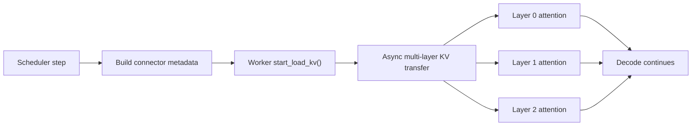
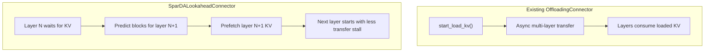

# Add SparDA lookahead KV connector

[Upstream PR](https://github.com/vllm-project/vllm/pull/49123) · state: open · merged: False

## Original PR description

## Purpose

This PR starts an experimental path for SparDA-style layer-ahead KV prefetch in vLLM.

The goal is to reduce KV offload stalls during long-context decoding by letting a connector begin loading likely-needed KV blocks for a future layer before that layer is invoked. If the prefetch decision is accurate, the attention layer can spend less time waiting on CPU-to-GPU KV movement.

The implementation is intentionally added as a dedicated connector instead of modifying `OffloadingConnector`, following the discussion in #48445. The existing offloading connector is built around asynchronous multi-layer transfers, while SparDA-style prefetch needs conditional decisions at per-layer boundaries.

## Summary

Adding an experimental `SparDALookaheadConnector` as a dedicated KV connector for layer-ahead KV prefetch experiments.

## Advantages

- Creates a narrow testbed for SparDA-style Forecast projection without disrupting existing KV offloading behavior.
- Uses the existing `wait_for_layer_load()` per-layer connector hook, which matches the timing needed for layer-ahead prefetch.
- Provides a metadata surface for passing predicted block ids into future prefetch work.
- Makes it easier to benchmark prefetch hit rate, latency impact, and correctness before integrating model-driven prediction.

## Existing Offloading Flow

##Proposed Flow 

## Why a Dedicated Connector?

## Changes

- Register `SparDALookaheadConnector`
- Add metadata for deterministic layer-ahead prefetch planning
- Add per-layer scheduling through `start_load_kv()` and `wait_for_layer_load()`
- Add unit coverage for registration, prefetch distance, layer scheduling, and planned block propagation

## Notes

This PR does not add the Forecast projection model implementation yet. It establishes the dedicated connector path and metadata surface for validating layer-ahead prefetch behavior before wiring in model-driven block prediction.

## Review and discussion

### reviews

- claude[bot] · COMMENTED · 2026-07-19T19:32:03Z · [source](https://github.com/vllm-project/vllm/pull/49123#pullrequestreview-4731353996)

## Claude Code Review

This pull request is from a fork — automated review is disabled. A repository maintainer can comment `@claude review` to run a one-time review.

### issue_comments

- github-actions[bot] · comment · 2026-10-18T01:43:20Z · [source](https://github.com/vllm-project/vllm/pull/49123#issuecomment-6244366639)

This pull request has been automatically marked as stale because it has not had any activity within 90 days. It will be automatically closed if no further activity occurs within 30 days. Leave a comment if you feel this pull request should remain open. Thank you!

### inline_comments

## Changed files and fixed code

- `tests/v1/kv_connector/unit/test_sparda_lookahead_connector.py` · added · additions 115 / deletions 0
  - [head](https://github.com/Srinivasoo7/vllm/blob/09b917d011cfb499f29a855c6180652f9c93a794/tests/v1/kv_connector/unit/test_sparda_lookahead_connector.py)
  - [base](https://github.com/vllm-project/vllm/blob/ace9fda495bc9a132584e054cc909d504164141f/tests/v1/kv_connector/unit/test_sparda_lookahead_connector.py)
- `vllm/distributed/kv_transfer/kv_connector/factory.py` · modified · additions 6 / deletions 0
  - [head](https://github.com/Srinivasoo7/vllm/blob/09b917d011cfb499f29a855c6180652f9c93a794/vllm/distributed/kv_transfer/kv_connector/factory.py)
  - [base](https://github.com/vllm-project/vllm/blob/ace9fda495bc9a132584e054cc909d504164141f/vllm/distributed/kv_transfer/kv_connector/factory.py)
- `vllm/distributed/kv_transfer/kv_connector/v1/sparda_lookahead_connector.py` · added · additions 185 / deletions 0
  - [head](https://github.com/Srinivasoo7/vllm/blob/09b917d011cfb499f29a855c6180652f9c93a794/vllm/distributed/kv_transfer/kv_connector/v1/sparda_lookahead_connector.py)
  - [base](https://github.com/vllm-project/vllm/blob/ace9fda495bc9a132584e054cc909d504164141f/vllm/distributed/kv_transfer/kv_connector/v1/sparda_lookahead_connector.py)

## Evidence and interpretation boundary

[Original JSON, discussions and patches](../../../../../../evidence/prs/vllm-project--vllm/49123-957198f09cf3d85c5c6a255bf24311f7763e80513c02336f04345148840bd948.json) · SHA-256 `957198f09cf3d85c5c6a255bf24311f7763e80513c02336f04345148840bd948`.

Diff complete: True. Missing/binary/truncated patches require pinned source inspection. This is a source page, not an independently verified optimization case. Open, merged and released are different states; recheck the deployed dependency.
