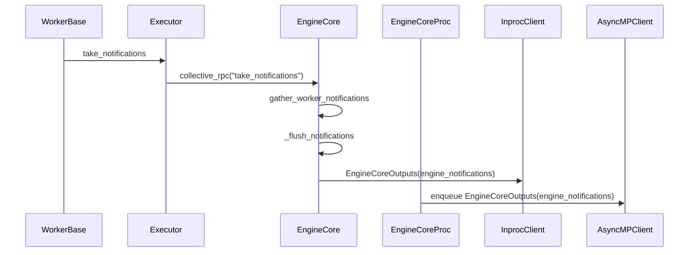

# [Engine Core][LoRA] Report loaded LoRA adapters to frontends and Prometheus

[Upstream PR](https://github.com/vllm-project/vllm/pull/51433) · state: open · merged: False

## Original PR description

Reports which LoRA adapters each engine has loaded, and how long loads take, to the frontends, and exposes it in Prometheus. LoRA-aware routers (llm-d, llm-d/llm-d-router#2792) use this to send a request to a replica that already holds its adapter instead of loading it somewhere else.

Workers snapshot their adapter caches as a `LoRALoadEvent` (GPU, CPU and pinned adapters, ranks, and the load/activate times since the last snapshot). The engine core forwards it on a new `EngineCoreOutputs.lora_load_event` field and sends it to one API server, as with scheduler stats. API servers share a multiprocess Prometheus registry, so a broadcast would count every load once per API server.

A worker's LoRA state changes only inside an engine step, a dummy batch, or an adapter RPC the engine core issued. The snapshot rides on the reply the engine core already waits for at each of those points, so no RPC is added:

- **Step:** the output rank sets `ModelRunnerOutput.lora_load_event`. Every rank sees the same requests, adapter RPCs reach all of them, and the first commit makes adapters activate in id order, so every rank holds the same snapshot and the existing single-rank reply is enough. There is nothing to aggregate.
- **Adapter RPCs:** `add_lora`, `remove_lora` and `pin_lora` already collect a reply from every rank. Each rank returns its snapshot with the result (`WorkerBase.run_lora_rpc`, which wraps the existing worker methods, so out-of-tree workers keep working) and the executor keeps the output rank's, the same rank the step path reads. An idle engine therefore reports adapter changes without waiting for a step, including adapters a frontend loads at startup with `--lora-modules`. A `collective_rpc` that drops adapters, such as a weight update, is reported with the next step.
- **Dummy batch:** idle data parallel ranks of an MoE model run `execute_dummy_batch` between steps. The workers return the snapshot in that call's existing reply, which already comes from the output rank only, so the lockstep loop gets no extra RPC.

Metrics (Python frontend; the Rust frontend decodes the field, and its consumer is #54833):

- `vllm:lora_adapter_loaded{adapter_name, level="gpu"|"cpu", pinned, rank}`: one series per resident adapter, removed on eviction
- `vllm:num_gpu_loaded_lora_adapters`, `vllm:num_cpu_loaded_lora_adapters`
- `vllm:max_gpu_lora_adapters`, `vllm:max_cpu_lora_adapters`
- `vllm:lora_adapter_load_seconds{transition="load"|"activate"}`

`vllm:lora_requests_info` is marked deprecated in favor of these.

The first commit is a standalone fix: adapters used to be activated in the iteration order of a `set[LoRARequest]`, which depends on the per-process string hash seed and on insertion order, so the ranks of one engine could cache different adapters and reload at different times (measurements below).

This replaces the earlier generic worker-notification channel in this PR (gather RPC, `CustomNotification`, poll interval env var) with the LoRA-only version suggested in review, and absorbs #54830.

## Stack

1. #51433 LoRA residency on `EngineCoreOutputs` + Prometheus metrics (this PR)
2. #54833 Rust frontend consumer for the same metrics

## Test

- `pytest tests/lora/test_lora_manager.py` (CPU): 41 passed, including id-order activation, the snapshot not refreshing LRU recency, bounded timings, and warmup dummy LoRAs not being reported
- `pytest tests/v1/engine/test_lora_load_event.py tests/v1/metrics/test_lora_metrics.py`: 9 passed. The metrics test pins the exact `/metrics` text, generated from the previous revision of this PR, so the output the router reads cannot drift.
- `pytest tests/lora/test_lora_metrics.py` (H200): 5 passed, covering adapter RPCs on an idle engine (in-process and multiprocess), steps, dummy batches on V1 and V2, and `vllm serve --api-server-count 2` counting each load once. Against the old broadcast that last test fails with 6 loads for 3 adapters.
- `cargo test -p vllm-engine-core-client --lib`: 144 passed; `cargo test -p vllm-metrics --lib`: 10 passed
- A real `vllm serve` on H200 at TP=1, TP=2 and PP=2 loads, uses, evicts and unloads adapters through the HTTP API. After every step, `/metrics` matches the caches, and each load and activation is counted exactly once. At PP=2 the output rank is not rank 0, so taking any other rank's reply would count the step's activations twice.

The tables below were measured on the previous revision, which took the same output-rank snapshot with a separate RPC after adapter calls.

**Rank agreement.** The setup is 8x H200 running Qwen3-32B with 128 adapters of rank 8 to 64 (`--max-loras 8 --max-cpu-loras 16`). Traffic goes through llm-d-router#2792's `lora-load-state-scorer` at 12 req/s for 300 s: 80% base model, 20% Zipf(1) over the adapters. A test-only worker method read every rank's GPU and CPU LRU order and timed load counts through `/collective_rpc` once a second.

| config | code | samples | LRU order differs | different adapters resident | different load counts |
|---|---|---:|---:|---:|---:|
| TP=2, spawn | before | 664 | 52 | 0 | 0 |
| TP=2, spawn | this PR | 647 | 0 | 0 | 0 |
| TP=2 x PP=2, fork (default) | before | 334 | 174 | 16 | 143 |
| TP=2 x PP=2, fork (default) | this PR | 328 | 0 | 0 | 0 |
| TP=2 x PP=2, spawn | this PR | 311 | 0 | 0 | 0 |

**Reported metrics.** At idle after each run, the `load` histogram count equals the output rank's own count on every pod. The `activate` count is lower by exactly the 40 warmup dummy-LoRA activations, which are not reported. GPU and resident adapter counts match the output rank's caches. An earlier revision that read the idle-path snapshot from rank 0 over-counted loads by 47 to 50% at TP=2 x PP=2, because it reported pipeline stage 0's accumulated timings on top of what the output rank had already sent.

**Routing** (TP=1, 8 replicas, same workload), against the earlier gather-based implementation:

| | stock router | scorer, gather-based | scorer, this PR |
|---|---:|---:|---:|
| base p50 TTFT | 130 ms | 121 ms | 124 ms |
| base p99 TTFT | 219 ms | 199 ms | 235 ms |
| adapter p90 TTFT | 456 ms | 307 ms | 305 ms |
| adapter p99 TTFT | 869 ms | 682 ms | 614 ms |
| adapter loads (5 s residency samples) | 542 | 228 | 228 |

**Dummy batches.** Today the idle dummy batch registers dummy LoRAs and ends in `remove_all_adapters()`, which empties that engine's LoRA caches. That is a pre-existing bug for MoE + DP + LoRA, fixed separately in #63526 (one commit, cherry-picks cleanly onto this PR or main). This PR does not depend on it: the dummy-batch snapshot keeps the metrics equal to the worker's caches whether or not that fix is in. `tests/lora/test_lora_metrics.py -k dummy_batches` covers it on V1 and V2. On one H200 it passes with and without #63526. Without the dummy-batch commit it times out on both runners, because the frontend never hears that the dummy batch dropped the adapters.

## AI assistance disclosure

Developed with AI assistance (Claude Code). I reviewed every change line by line, ran the tests, and checked their output.


## Review and discussion

### reviews

- claude[bot] · COMMENTED · 2026-08-07T18:56:43Z · [source](https://github.com/vllm-project/vllm/pull/51433#pullrequestreview-4885752512)

## Claude Code Review

This pull request is from a fork — automated review is disabled. A repository maintainer can comment `@claude review` to run a one-time review.

- claude[bot] · COMMENTED · 2026-08-10T20:33:23Z · [source](https://github.com/vllm-project/vllm/pull/51433#pullrequestreview-4900731361)

## Claude Code Review

This pull request is from a fork — automated review is disabled. A repository maintainer can comment `@claude review` to run a one-time review.

- yewentao256 · COMMENTED · 2026-09-01T20:26:33Z · [source](https://github.com/vllm-project/vllm/pull/51433#pullrequestreview-5082724858)

Generally LGTM, thanks for the work!

Also want an approval from @njhill  or @BugenZhao 

- wseaton · COMMENTED · 2026-09-02T21:08:59Z · [source](https://github.com/vllm-project/vllm/pull/51433#pullrequestreview-5095116006)

(No body; status only.)

- njhill · COMMENTED · 2026-10-13T23:26:11Z · [source](https://github.com/vllm-project/vllm/pull/51433#pullrequestreview-5511260483)

@wseaton really sorry for taking so long to get to this!!

My high level thoughts:

> Why gather instead of piggybacking on ModelRunnerOutput: the executor only reads one rank's reply, so anything the other ranks published would just get dropped, and some paths (non-last PP rank via with_kv_conn_output_only) return early without a full output.

I'm not sure that's solid justification. We already disable the single-rank optimization when needed (e.g. for kv connector stats which are aggregated from workers via a kv output aggregator). I think it would be preferred to follow this path if possible.

Also I'm wondering whether we should first just add the required lora notifications for now, rather than introducing a generic abstraction. We can always refactor to the generic abstraction later if/when warranted.

- LinzeShi · COMMENTED · 2026-11-03T00:21:40Z · [source](https://github.com/vllm-project/vllm/pull/51433#pullrequestreview-5745324593)

(No body; status only.)

### issue_comments

- wseaton · comment · 2026-08-07T19:57:28Z · [source](https://github.com/vllm-project/vllm/pull/51433#issuecomment-5221447721)

Something non-obvious here is that certain consumer use-cases for this channel (Like if you wanted `nixl` transfer metrics from different TP ranks to fold back to the frontend, eg. when using `modelexpress` as a weight loader plugin) require that rank output from ranks other than rank=0 are not discarded. Marking as draft until I settle on a design that works for both cases.

Edit: The stated use case (weight transfer metrics) is moot until vllm can serve metrics before/during engine initialization.

- mergify[bot] · comment · 2026-08-13T20:13:35Z · [source](https://github.com/vllm-project/vllm/pull/51433#issuecomment-5285869480)

This pull request has merge conflicts that must be resolved before it can be
merged. Please rebase the PR, @wseaton.

https://docs.github.com/en/pull-requests/collaborating-with-pull-requests/working-with-forks/syncing-a-fork


- mergify[bot] · comment · 2026-08-21T01:41:42Z · [source](https://github.com/vllm-project/vllm/pull/51433#issuecomment-5364161357)

This pull request has merge conflicts that must be resolved before it can be
merged. Please rebase the PR, @wseaton.

https://docs.github.com/en/pull-requests/collaborating-with-pull-requests/working-with-forks/syncing-a-fork


- github-actions[bot] · comment · 2026-09-01T20:28:49Z · [source](https://github.com/vllm-project/vllm/pull/51433#issuecomment-5499992045)

✅ @wseaton, CI is now available for this PR.

- `/ci run` starts upstream CI; `/amd-ci run` starts AMD CI only.
- `/ci retry` retries failed jobs in the CI build for the current PR head. If the current head has no CI build, it starts a new CI build for the current head containing only jobs that failed in the latest earlier CI build for this PR.
- `/amd-ci retry` retries failed jobs in AMD CI for the current PR head. Use `/amd-ci run` when the current head has no AMD CI build.
- `/ci cancel` cancels scheduled or running CI builds for this PR branch; `/amd-ci cancel` does the same for AMD CI only.

<!-- vllm-ci-authorized -->

- coderabbitai[bot] · comment · 2026-09-02T21:11:01Z · [source](https://github.com/vllm-project/vllm/pull/51433#issuecomment-5516461179)

<!-- coderabbit-ai-generated:v1 -->

<!-- This is an auto-generated comment: summarize by coderabbit.ai -->
<!-- review_stack_entry_start -->

[](https://app.coderabbit.ai/change-stack/vllm-project/vllm/pull/51433)

<!-- review_stack_entry_end -->
<!-- recent_review_status_start -->

No actionable comments were generated in the recent review.

<!-- recent_review_status_end -->
<!-- walkthrough_start -->

### Walkthrough

Adds tagged custom notification types to the Rust and Python protocols, a bounded worker queue, rank gathering, polling, and frontend delivery. Engine outputs carry optional notifications through in-process and multiprocessing clients. Tests cover serialization, buffering, concurrency, polling, fan-out, and end-to-end delivery.

### Changes

**Engine notification pipeline**

|Layer / File(s)|Summary|
|:---|:---|
|**Notification protocol and wire contract** <br> `rust/src/engine-core-client/src/protocol/*`, `rust/src/engine-core-client/src/tests/*`, `vllm/v1/engine/__init__.py`|Defines tagged custom notifications and adds optional notification fields to Rust and Python engine output messages.|
|**Worker notification buffering** <br> `vllm/v1/notifications.py`, `vllm/v1/worker/worker_base.py`, `tests/v1/engine/test_notifications.py`|Adds a bounded, thread-safe queue with ordered draining, overflow handling, and worker drain coverage.|
|**Engine gathering and frontend delivery** <br> `vllm/v1/engine/core.py`, `vllm/v1/engine/core_client.py`, `vllm/envs.py`, `tests/v1/engine/test_notifications.py`|Gathers notifications across ranks, polls workers using the configured interval, flushes in-process outputs, broadcasts process outputs, and validates polling and end-to-end delivery.|

**Estimated code review effort:** 4 (Complex) | ~45 minutes


### Sequence Diagram(s)



<!-- walkthrough_end -->
<details>
<summary><strong>Merge Risk:</strong> <strong><picture></picture> Minimal</strong> · up to <code>90fd7</code></summary>
<dl>
<dd>

<!-- final_review_risk_start -->
<!-- final_review_risk_label
**Merge Risk:** _⚪ Minimal_ · up to `90fd7`
-->
<!-- final_review_risk_coverage:{"sourceCommitId":"90fd7ec99e6a8b0f5bf6a02f3a9dc05367ba1627","coveredCommitId":"90fd7ec99e6a8b0f5bf6a02f3a9dc05367ba1627","kind":"reviewed"} -->

This change adds a worker-to-frontend notification channel with optional polling disabled by default. No concrete merge-blocking risk is established for the current implementation.
<!-- final_review_risk_end -->

</dd>
</dl>
</details>
<!-- pre_merge_checks_walkthrough_start -->

<details>
<summary><strong>Pre-merge checks: <sup><picture></picture></sup> 3 · <sup><picture></picture></sup> 1</strong></summary>
<dl>
<dd>

<strong><sup><picture></picture></sup> Failed checks: 1 warning</strong>

|  Check name |                                              Status                                              | Explanation                                                                                                                                                                                               | Resolution                                                                                                                                                                                                                                        |
| :--------- | :----------------------------------------------------------------------------------------------: | :-------------------------------------------------------------------------------------------------------------------------------------------------------------------------------------------------------- | :------------------------------------------------------------------------------------------------------------------------------------------------------------------------------------------------------------------------------------------------ |
| Title check |  | The title names the LoRA residency reporting change, but the raw summary describes a generic engine notification channel (CustomNotification, notification gather, poll interval env var) and no LoRA-sp… | Rewrite the title to describe the changes in the diff, such as a worker-to-frontend engine notification channel with a custom notification type, or update the PR so the code matches the LoRA title. The pr_description mentions a LoRA-only ve… |

<details>
<summary><strong><sup><picture></picture></sup> Passed checks: 3 passed</strong></summary>
<dl>
<dd>

|         Check name         |                                             Status                                             | Explanation                                                                                                                                                                                               |
| :------------------------ | :--------------------------------------------------------------------------------------------: | :-------------------------------------------------------------------------------------------------------------------------------------------------------------------------------------------------------- |
|     Linked Issues check    |  | Check skipped because no linked issues were found for this pull request.                                                                                                                                  |
| Out of Scope Changes check |  | Check skipped because no linked issues were found for this pull request.                                                                                                                                  |
|      Description check     |  | The pull request description describes a LoRA load-event channel that reports adapter residency and load timings from workers to frontends and exposes them as Prometheus metrics. It names the affected… |

<details>
<summary><strong>Full details: Description check</strong></summary>
<dl>
<dd>

**Explanation**

The pull request description describes a LoRA load-event channel that reports adapter residency and load timings from workers to frontends and exposes them as Prometheus metrics. It names the affected components (LoRALoadEvent, EngineCoreOutputs.lora_load_event, WorkerBase.run_lora_rpc, ModelRunnerOutput.lora_load_event) and the test plan. The raw summary describes a different change: a generic worker-notification channel (CustomNotification, EngineNotification, gather RPC, VLLM_WORKER_NOTIFICATION_POLL_INTERVAL). The description mentions this mismatch by stating that the generic channel was replaced by a LoRA-only version. The description is related to the changeset in a general sense, so the lenient check passes.

</dd>
</dl>
</details>

</dd>
</dl>
</details>

<details>
<summary><strong>Full details: Title check</strong></summary>
<dl>
<dd>

**Explanation**

The title names the LoRA residency reporting change, but the raw summary describes a generic engine notification channel (CustomNotification, notification gather, poll interval env var) and no LoRA-specific code. The PR objectives also describe a generic notification channel. The title refers to LoRA adapter reporting, which is not in the changeset summaries, so the title is misleading relative to the code shown.

**Resolution**

Rewrite the title to describe the changes in the diff, such as a worker-to-frontend engine notification channel with a custom notification type, or update the PR so the code matches the LoRA title. The pr_description mentions a LoRA-only version that replaces the generic channel; the provided diff summaries do not reflect that version, so confirm which version is under review and align the title with it.

</dd>
</dl>
</details>

</dd>
</dl>
</details>

<!-- pre_merge_checks_walkthrough_end -->
<!-- tips_start -->


Thanks for using [CodeRabbit](https://coderabbit.ai?utm_source=oss&utm_medium=github&utm_campaign=vllm-project/vllm&utm_content=51433)! It's free for OSS, and your support helps us grow. If you like it, consider giving us a shout-out.

<details>
<summary><strong>Share</strong></summary>
<dl>
<dd>

- [X](https://twitter.com/intent/tweet?text=I%20just%20used%20%40coderabbitai%20for%20my%20code%20review%2C%20and%20it%27s%20fantastic%21%20It%27s%20free%20for%20OSS%20and%20offers%20a%20free%20trial%20for%20the%20proprietary%20code.%20Check%20it%20out%3A&url=https%3A//coderabbit.ai)
- [Mastodon](https://mastodon.social/share?text=I%20just%20used%20%40coderabbitai%20for%20my%20code%20review%2C%20and%20it%27s%20fantastic%21%20It%27s%20free%20for%20OSS%20and%20offers%20a%20free%20trial%20for%20the%20proprietary%20code.%20Check%20it%20out%3A%20https%3A%2F%2Fcoderabbit.ai)
- [Reddit](https://www.reddit.com/submit?title=Great%20tool%20for%20code%20review%20-%20CodeRabbit&text=I%20just%20used%20CodeRabbit%20for%20my%20code%20review%2C%20and%20it%27s%20fantastic%21%20It%27s%20free%20for%20OSS%20and%20offers%20a%20free%20trial%20for%20proprietary%20code.%20Check%20it%20out%3A%20https%3A//coderabbit.ai)
- [LinkedIn](https://www.linkedin.com/sharing/share-offsite/?url=https%3A%2F%2Fcoderabbit.ai&mini=true&title=Great%20tool%20for%20code%20review%20-%20CodeRabbit&summary=I%20just%20used%20CodeRabbit%20for%20my%20code%20review%2C%20and%20it%27s%20fantastic%21%20It%27s%20free%20for%20OSS%20and%20offers%20a%20free%20trial%20for%20proprietary%20code)

</dd>
</dl>
</details>

<!-- tips_end -->
<!-- recent_review_start -->

<h6>
<details>
<summary><strong>ℹ️ Recent review info</strong></summary>
<dl>
<dd>

<details>
<summary><strong>⚙️ Run configuration</strong></summary>
<dl>
<dd>

**Configuration used**: Repository UI

**Review profile**: CHILL

**Plan**: Team

**Run ID**: `82cbd4bf-82c3-4d1b-9460-b13713dc0518`

</dd>
</dl>
</details>

<details>
<summary><strong>📥 Commits</strong></summary>
<dl>
<dd>

Reviewing files that changed from the base of the PR and between f2e2936f91a794513af74d009286c69e3fb2592b and 90fd7ec99e6a8b0f5bf6a02f3a9dc05367ba1627.

</dd>
</dl>
</details>

<details>
<summary><strong>📒 Files selected for processing (12)</strong></summary>
<dl>
<dd>

* `rust/src/engine-core-client/src/protocol/mod.rs`
* `rust/src/engine-core-client/src/protocol/notifications.rs`
* `rust/src/engine-core-client/src/protocol/output.rs`
* `rust/src/engine-core-client/src/tests/client.rs`
* `rust/src/engine-core-client/src/tests/python_compat.py`
* `tests/v1/engine/test_notifications.py`
* `vllm/envs.py`
* `vllm/v1/engine/__init__.py`
* `vllm/v1/engine/core.py`
* `vllm/v1/engine/core_client.py`
* `vllm/v1/notifications.py`
* `vllm/v1/worker/worker_base.py`

</dd>
</dl>
</details>

<details>
<summary><strong>🚧 Files skipped from review as they are similar to previous changes (12)</strong></summary>
<dl>
<dd>

* vllm/v1/worker/worker_base.py
* rust/src/engine-core-client/src/protocol/mod.rs
* vllm/envs.py
* vllm/v1/engine/__init__.py
* rust/src/engine-core-client/src/protocol/output.rs
* rust/src/engine-core-client/src/tests/client.rs
* vllm/v1/engine/core_client.py
* vllm/v1/engine/core.py
* rust/src/engine-core-client/src/protocol/notifications.rs
* tests/v1/engine/test_notifications.py
* vllm/v1/notifications.py
* rust/src/engine-core-client/src/tests/python_compat.py

</dd>
</dl>
</details>

**Included review availability:** Your plan provides up to 10 included reviews per hour; 9 remain after this review.

</dd>
</dl>
</details>
</h6>

<!-- recent_review_end -->

- coderabbitai[bot] · comment · 2026-09-03T20:59:17Z · [source](https://github.com/vllm-project/vllm/pull/51433#issuecomment-5532058526)

<!-- This is an auto-generated comment by CodeRabbit -->
> [!NOTE]
> GitHub couldn't provide a complete incremental comparison for this pull request, so CodeRabbit is performing a full review instead. This review may take a little longer.

- coderabbitai[bot] · comment · 2026-09-06T03:49:42Z · [source](https://github.com/vllm-project/vllm/pull/51433#issuecomment-5556721757)

<!-- This is an auto-generated comment by CodeRabbit -->
<!-- coderabbit-full-review-fallback-pr-51433-head-90fd7ec99e6a8b0f5bf6a02f3a9dc05367ba1627 -->
> [!NOTE]
> GitHub couldn't provide a complete incremental comparison for this pull request, so CodeRabbit is performing a full review instead. This review may take a little longer.

- wseaton · comment · 2026-09-09T17:46:27Z · [source](https://github.com/vllm-project/vllm/pull/51433#issuecomment-5606256520)

@njhill @BugenZhao bumping this one, trying to optimistically get it and https://github.com/vllm-project/vllm/pull/54830 in before the dev cut so we can ship some llm-d routing optimizations for LoRA

- mergify[bot] · comment · 2026-09-17T04:54:11Z · [source](https://github.com/vllm-project/vllm/pull/51433#issuecomment-5708835696)

This pull request has merge conflicts that must be resolved before it can be
merged. Please rebase the PR, @wseaton.

https://docs.github.com/en/pull-requests/collaborating-with-pull-requests/working-with-forks/syncing-a-fork


- mergify[bot] · comment · 2026-09-24T11:51:46Z · [source](https://github.com/vllm-project/vllm/pull/51433#issuecomment-5813527351)

This pull request has merge conflicts that must be resolved before it can be
merged. Please rebase the PR, @wseaton.

https://docs.github.com/en/pull-requests/collaborating-with-pull-requests/working-with-forks/syncing-a-fork


- mergify[bot] · comment · 2026-10-13T23:26:43Z · [source](https://github.com/vllm-project/vllm/pull/51433#issuecomment-6157351652)

This pull request has merge conflicts that must be resolved before it can be
merged. Please rebase the PR, @wseaton.

https://docs.github.com/en/pull-requests/collaborating-with-pull-requests/working-with-forks/syncing-a-fork


- mergify[bot] · comment · 2026-10-23T20:37:36Z · [source](https://github.com/vllm-project/vllm/pull/51433#issuecomment-6374253471)

Documentation preview: https://vllm--51433.org.readthedocs.build/en/51433/

- mergify[bot] · comment · 2026-10-31T00:32:21Z · [source](https://github.com/vllm-project/vllm/pull/51433#issuecomment-6536548385)

This pull request has merge conflicts that must be resolved before it can be
merged. Please rebase the PR, @wseaton.

https://docs.github.com/en/pull-requests/collaborating-with-pull-requests/working-with-forks/syncing-a-fork


- wseaton · comment · 2026-11-02T15:48:25Z · [source](https://github.com/vllm-project/vllm/pull/51433#issuecomment-6581485030)

@njhill reworked this per your review, it's LoRA-only now with no new RPC. mind taking another look when you get a sec?

### inline_comments

- yewentao256 · comment · 2026-09-01T20:24:45Z · [source](https://github.com/vllm-project/vllm/pull/51433#discussion_r3908111857)

File: `tests/v1/engine/test_notifications.py` · line None

```suggestion
```

Seems redundant

- yewentao256 · comment · 2026-09-01T20:25:00Z · [source](https://github.com/vllm-project/vllm/pull/51433#discussion_r3908113822)

File: `tests/v1/engine/test_notifications.py` · line None

```suggestion
```

- wseaton · comment · 2026-09-02T21:08:59Z · [source](https://github.com/vllm-project/vllm/pull/51433#discussion_r3918679631)

File: `tests/v1/engine/test_notifications.py` · line None

agree, let's drop

- LinzeShi · comment · 2026-11-03T00:21:36Z · [source](https://github.com/vllm-project/vllm/pull/51433#discussion_r4449376410)

File: `vllm/v1/metrics/loggers.py` · line 1196

With `--api-server-count 2`, both frontends record the same load, so Prometheus reports twice the load count and total recorded time.

## Changed files and fixed code

- `docs/design/metrics.md` · modified · additions 28 / deletions 4
  - [head](https://github.com/wseaton/vllm/blob/176418ddcc857e383238f915dfb4191f54afab79/docs/design/metrics.md)
  - [base](https://github.com/vllm-project/vllm/blob/101cfd10011bc104849622709b8f59d7ea9d1ff9/docs/design/metrics.md)
- `rust/src/engine-core-client/src/protocol/lora.rs` · modified · additions 85 / deletions 0
  - [head](https://github.com/wseaton/vllm/blob/176418ddcc857e383238f915dfb4191f54afab79/rust/src/engine-core-client/src/protocol/lora.rs)
  - [base](https://github.com/vllm-project/vllm/blob/101cfd10011bc104849622709b8f59d7ea9d1ff9/rust/src/engine-core-client/src/protocol/lora.rs)
- `rust/src/engine-core-client/src/protocol/output.rs` · modified · additions 34 / deletions 1
  - [head](https://github.com/wseaton/vllm/blob/176418ddcc857e383238f915dfb4191f54afab79/rust/src/engine-core-client/src/protocol/output.rs)
  - [base](https://github.com/vllm-project/vllm/blob/101cfd10011bc104849622709b8f59d7ea9d1ff9/rust/src/engine-core-client/src/protocol/output.rs)
- `rust/src/engine-core-client/src/tests/client.rs` · modified · additions 22 / deletions 0
  - [head](https://github.com/wseaton/vllm/blob/176418ddcc857e383238f915dfb4191f54afab79/rust/src/engine-core-client/src/tests/client.rs)
  - [base](https://github.com/vllm-project/vllm/blob/101cfd10011bc104849622709b8f59d7ea9d1ff9/rust/src/engine-core-client/src/tests/client.rs)
- `rust/src/engine-core-client/src/tests/python_compat.py` · modified · additions 22 / deletions 0
  - [head](https://github.com/wseaton/vllm/blob/176418ddcc857e383238f915dfb4191f54afab79/rust/src/engine-core-client/src/tests/python_compat.py)
  - [base](https://github.com/vllm-project/vllm/blob/101cfd10011bc104849622709b8f59d7ea9d1ff9/rust/src/engine-core-client/src/tests/python_compat.py)
- `rust/src/metrics/src/scheduler.rs` · modified · additions 5 / deletions 1
  - [head](https://github.com/wseaton/vllm/blob/176418ddcc857e383238f915dfb4191f54afab79/rust/src/metrics/src/scheduler.rs)
  - [base](https://github.com/vllm-project/vllm/blob/101cfd10011bc104849622709b8f59d7ea9d1ff9/rust/src/metrics/src/scheduler.rs)
- `tests/lora/test_lora_manager.py` · modified · additions 303 / deletions 1
  - [head](https://github.com/wseaton/vllm/blob/176418ddcc857e383238f915dfb4191f54afab79/tests/lora/test_lora_manager.py)
  - [base](https://github.com/vllm-project/vllm/blob/101cfd10011bc104849622709b8f59d7ea9d1ff9/tests/lora/test_lora_manager.py)
- `tests/lora/test_lora_metrics.py` · added · additions 194 / deletions 0
  - [head](https://github.com/wseaton/vllm/blob/176418ddcc857e383238f915dfb4191f54afab79/tests/lora/test_lora_metrics.py)
  - [base](https://github.com/vllm-project/vllm/blob/101cfd10011bc104849622709b8f59d7ea9d1ff9/tests/lora/test_lora_metrics.py)
- `tests/v1/engine/test_lora_load_event.py` · added · additions 86 / deletions 0
  - [head](https://github.com/wseaton/vllm/blob/176418ddcc857e383238f915dfb4191f54afab79/tests/v1/engine/test_lora_load_event.py)
  - [base](https://github.com/vllm-project/vllm/blob/101cfd10011bc104849622709b8f59d7ea9d1ff9/tests/v1/engine/test_lora_load_event.py)
- `tests/v1/metrics/test_lora_metrics.py` · added · additions 243 / deletions 0
  - [head](https://github.com/wseaton/vllm/blob/176418ddcc857e383238f915dfb4191f54afab79/tests/v1/metrics/test_lora_metrics.py)
  - [base](https://github.com/vllm-project/vllm/blob/101cfd10011bc104849622709b8f59d7ea9d1ff9/tests/v1/metrics/test_lora_metrics.py)
- `vllm/lora/load_event.py` · added · additions 47 / deletions 0
  - [head](https://github.com/wseaton/vllm/blob/176418ddcc857e383238f915dfb4191f54afab79/vllm/lora/load_event.py)
  - [base](https://github.com/vllm-project/vllm/blob/101cfd10011bc104849622709b8f59d7ea9d1ff9/vllm/lora/load_event.py)
- `vllm/lora/model_manager.py` · modified · additions 22 / deletions 0
  - [head](https://github.com/wseaton/vllm/blob/176418ddcc857e383238f915dfb4191f54afab79/vllm/lora/model_manager.py)
  - [base](https://github.com/vllm-project/vllm/blob/101cfd10011bc104849622709b8f59d7ea9d1ff9/vllm/lora/model_manager.py)
- `vllm/lora/worker_manager.py` · modified · additions 74 / deletions 6
  - [head](https://github.com/wseaton/vllm/blob/176418ddcc857e383238f915dfb4191f54afab79/vllm/lora/worker_manager.py)
  - [base](https://github.com/vllm-project/vllm/blob/101cfd10011bc104849622709b8f59d7ea9d1ff9/vllm/lora/worker_manager.py)
- `vllm/v1/engine/__init__.py` · modified · additions 4 / deletions 0
  - [head](https://github.com/wseaton/vllm/blob/176418ddcc857e383238f915dfb4191f54afab79/vllm/v1/engine/__init__.py)
  - [base](https://github.com/vllm-project/vllm/blob/101cfd10011bc104849622709b8f59d7ea9d1ff9/vllm/v1/engine/__init__.py)
- `vllm/v1/engine/async_llm.py` · modified · additions 5 / deletions 0
  - [head](https://github.com/wseaton/vllm/blob/176418ddcc857e383238f915dfb4191f54afab79/vllm/v1/engine/async_llm.py)
  - [base](https://github.com/vllm-project/vllm/blob/101cfd10011bc104849622709b8f59d7ea9d1ff9/vllm/v1/engine/async_llm.py)
- `vllm/v1/engine/core.py` · modified · additions 34 / deletions 4
  - [head](https://github.com/wseaton/vllm/blob/176418ddcc857e383238f915dfb4191f54afab79/vllm/v1/engine/core.py)
  - [base](https://github.com/vllm-project/vllm/blob/101cfd10011bc104849622709b8f59d7ea9d1ff9/vllm/v1/engine/core.py)
- `vllm/v1/engine/core_client.py` · modified · additions 8 / deletions 2
  - [head](https://github.com/wseaton/vllm/blob/176418ddcc857e383238f915dfb4191f54afab79/vllm/v1/engine/core_client.py)
  - [base](https://github.com/vllm-project/vllm/blob/101cfd10011bc104849622709b8f59d7ea9d1ff9/vllm/v1/engine/core_client.py)
- `vllm/v1/engine/llm_engine.py` · modified · additions 2 / deletions 0
  - [head](https://github.com/wseaton/vllm/blob/176418ddcc857e383238f915dfb4191f54afab79/vllm/v1/engine/llm_engine.py)
  - [base](https://github.com/vllm-project/vllm/blob/101cfd10011bc104849622709b8f59d7ea9d1ff9/vllm/v1/engine/llm_engine.py)
- `vllm/v1/executor/abstract.py` · modified · additions 23 / deletions 6
  - [head](https://github.com/wseaton/vllm/blob/176418ddcc857e383238f915dfb4191f54afab79/vllm/v1/executor/abstract.py)
  - [base](https://github.com/vllm-project/vllm/blob/101cfd10011bc104849622709b8f59d7ea9d1ff9/vllm/v1/executor/abstract.py)
- `vllm/v1/executor/multiproc_executor.py` · modified · additions 3 / deletions 2
  - [head](https://github.com/wseaton/vllm/blob/176418ddcc857e383238f915dfb4191f54afab79/vllm/v1/executor/multiproc_executor.py)
  - [base](https://github.com/vllm-project/vllm/blob/101cfd10011bc104849622709b8f59d7ea9d1ff9/vllm/v1/executor/multiproc_executor.py)
- `vllm/v1/metrics/loggers.py` · modified · additions 118 / deletions 4
  - [head](https://github.com/wseaton/vllm/blob/176418ddcc857e383238f915dfb4191f54afab79/vllm/v1/metrics/loggers.py)
  - [base](https://github.com/vllm-project/vllm/blob/101cfd10011bc104849622709b8f59d7ea9d1ff9/vllm/v1/metrics/loggers.py)
- `vllm/v1/metrics/ray_wrappers.py` · modified · additions 3 / deletions 0
  - [head](https://github.com/wseaton/vllm/blob/176418ddcc857e383238f915dfb4191f54afab79/vllm/v1/metrics/ray_wrappers.py)
  - [base](https://github.com/vllm-project/vllm/blob/101cfd10011bc104849622709b8f59d7ea9d1ff9/vllm/v1/metrics/ray_wrappers.py)
- `vllm/v1/outputs.py` · modified · additions 4 / deletions 0
  - [head](https://github.com/wseaton/vllm/blob/176418ddcc857e383238f915dfb4191f54afab79/vllm/v1/outputs.py)
  - [base](https://github.com/vllm-project/vllm/blob/101cfd10011bc104849622709b8f59d7ea9d1ff9/vllm/v1/outputs.py)
- `vllm/v1/worker/gpu/model_runner.py` · modified · additions 2 / deletions 0
  - [head](https://github.com/wseaton/vllm/blob/176418ddcc857e383238f915dfb4191f54afab79/vllm/v1/worker/gpu/model_runner.py)
  - [base](https://github.com/vllm-project/vllm/blob/101cfd10011bc104849622709b8f59d7ea9d1ff9/vllm/v1/worker/gpu/model_runner.py)
- `vllm/v1/worker/gpu_model_runner.py` · modified · additions 2 / deletions 0
  - [head](https://github.com/wseaton/vllm/blob/176418ddcc857e383238f915dfb4191f54afab79/vllm/v1/worker/gpu_model_runner.py)
  - [base](https://github.com/vllm-project/vllm/blob/101cfd10011bc104849622709b8f59d7ea9d1ff9/vllm/v1/worker/gpu_model_runner.py)
- `vllm/v1/worker/gpu_worker.py` · modified · additions 6 / deletions 1
  - [head](https://github.com/wseaton/vllm/blob/176418ddcc857e383238f915dfb4191f54afab79/vllm/v1/worker/gpu_worker.py)
  - [base](https://github.com/vllm-project/vllm/blob/101cfd10011bc104849622709b8f59d7ea9d1ff9/vllm/v1/worker/gpu_worker.py)
- `vllm/v1/worker/lora_model_runner_mixin.py` · modified · additions 5 / deletions 0
  - [head](https://github.com/wseaton/vllm/blob/176418ddcc857e383238f915dfb4191f54afab79/vllm/v1/worker/lora_model_runner_mixin.py)
  - [base](https://github.com/vllm-project/vllm/blob/101cfd10011bc104849622709b8f59d7ea9d1ff9/vllm/v1/worker/lora_model_runner_mixin.py)
- `vllm/v1/worker/worker_base.py` · modified · additions 13 / deletions 1
  - [head](https://github.com/wseaton/vllm/blob/176418ddcc857e383238f915dfb4191f54afab79/vllm/v1/worker/worker_base.py)
  - [base](https://github.com/vllm-project/vllm/blob/101cfd10011bc104849622709b8f59d7ea9d1ff9/vllm/v1/worker/worker_base.py)

## Evidence and interpretation boundary

[Original JSON, discussions and patches](../../../../../../evidence/prs/vllm-project--vllm/51433-22b4612194d8d4f77c2ef9b7b1f801d5c85b18b401491ec7818c87efc5ad84d6.json) · SHA-256 `22b4612194d8d4f77c2ef9b7b1f801d5c85b18b401491ec7818c87efc5ad84d6`.

Diff complete: True. Missing/binary/truncated patches require pinned source inspection. This is a source page, not an independently verified optimization case. Open, merged and released are different states; recheck the deployed dependency.
