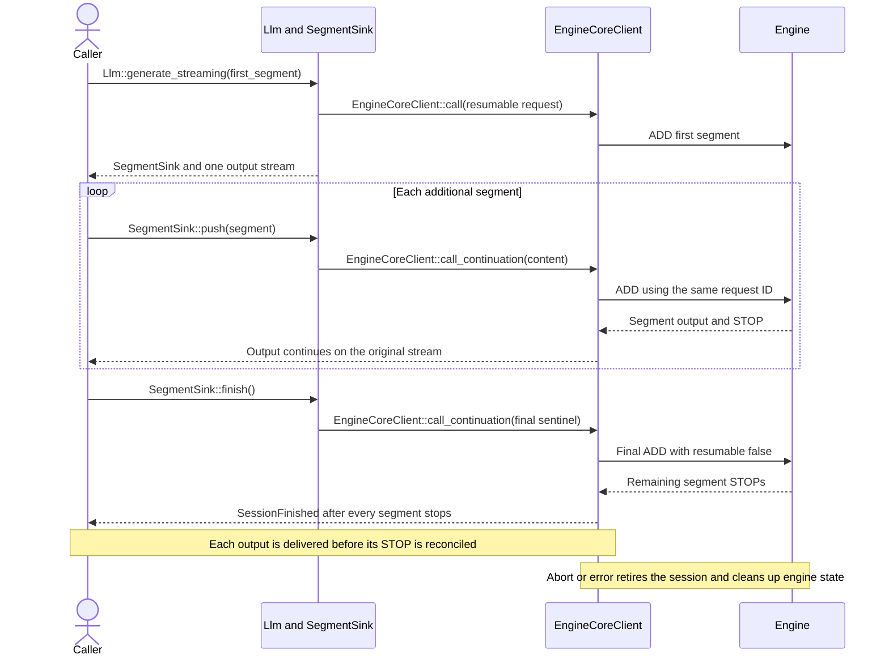
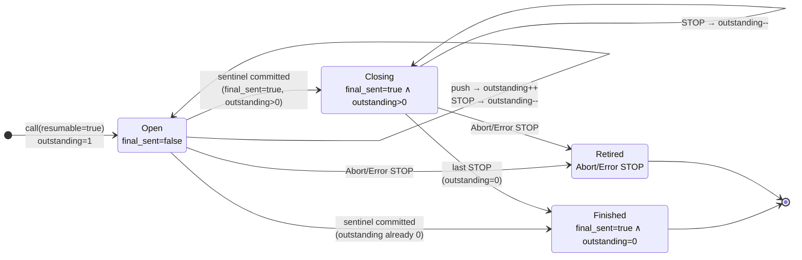

# [Rust Frontend] Resumable streaming sessions in engine-core-client and Llm facade

[Upstream PR](https://github.com/vllm-project/vllm/pull/53454) · state: open · merged: False

## Original PR description

## Summary

Part of #53452.

Adds Rust client-side support for EngineCore **streaming-input** sessions in two
layers:

1. **`vllm-engine-core-client`** — resumable session lifecycle (state machine,
   `call_continuation`, client-side segment accounting mirroring Python
   `input_chunk_queue`).
2. **`vllm-llm`** — public facade: `Llm::generate_streaming`, `SegmentSink`,
   `GenerateRequest::resumable` / `sentinel()`.

A resumable session stays open across segment `STOP`s and closes only after:

1. the final continuation ADD (`resumable: false`) is committed, and
2. every submitted segment has been reconciled with its engine stop.

This PR does not expose `/v1/realtime`, WebSocket transport, or audio
preprocessing.

Relates to #44280.

## Session flow



A failed continuation send rolls back its in-flight accounting. If the session
is retired after an ADD reaches the wire but before commit, commit reports the
race and dispatches a detached ABORT so the engine cannot retain orphaned
resumable state.

## Resumable session state machine



Diagram states map to `ResumableSession` fields `final_sent` and `outstanding`.
`Open` accepts more segments (`final_sent == false`). `Closing` means the sentinel
ADD is committed (`final_sent == true`) while `outstanding > 0`. `Finished` is
`final_sent && outstanding == 0`. The client enqueues each STOP output before
reconciling it, and `Retired` covers abort or error stops.

### Key changes — engine-core-client

- Add `call_continuation()` so one resumable `request_id` can receive multiple ADDs; close with `resumable: false`.
- Keep the session registered across segment `STOP`s; close only after the final ADD is committed and every segment has stopped (client-side counting, mirroring Python `input_chunk_queue`).
- Signal completion explicitly via `StreamEvent::SessionFinished` instead of relying on channel close.
- Defer segment-stop reconciliation until after the output is enqueued, so a concurrent final commit cannot close the stream ahead of an already-routed output.
- Abort leftover engine state whenever a continuation commit races with session retirement. The ADD is already on the wire; landing after the abort would have the engine admit it as a fresh resumable request that nothing would ever continue or free, leaving it parked in `WAITING_FOR_STREAMING_REQ` holding its KV blocks and a request slot.
- Dispatch that cleanup abort from a detached task. `run_output_dispatcher_loop` is the single task fanning outputs out to every request stream, so it must not await a wire send.

### Key changes — llm facade

- Thread `GenerateRequest::resumable` through `prepare()` to the wire.
- Add `Llm::generate_streaming()` returning `(SegmentSink, GenerateOutputStream)`.
- Add `SegmentSink::{push, finish}` wrapping `call_continuation`. `push` rejects a segment with `resumable: false`: engine-core reads that flag as the closing ADD, so it would end the session and discard the segment's own prompt.
- Add `GenerateRequest::sentinel()` for the closing ADD (Python `final_req`).
- `vllm-text` lowers every text request with `resumable: false`, leaving one-shot requests unchanged. This is the only change outside the two crates above and is required because `GenerateRequest` gained a field.

## Why this is not a duplicate

Checked with:

```bash
gh pr list --repo vllm-project/vllm --state open --search "53452 in:body"
gh pr list --repo vllm-project/vllm --state open --search "resumable streaming input"
gh pr list --repo vllm-project/vllm --state open --search "engine-core-client"
```

No other open PR references #53452. The open PRs in the streaming-input area —
including #53861, #53321, #52765, #52717 and #55162 — all work on the Python
engine and scheduler (`vllm/v1/core/sched/`, `vllm/v1/engine/`) and touch no
files under `rust/`. This PR is entirely client-side in Rust and changes no
engine behaviour.

Other open PRs do touch `vllm-engine-core-client` (for example #54144 pooling
support, #56533 output-field compatibility), but none of them covers resumable
session lifecycle or segment accounting, so there is no overlapping change.

## Test plan

Run from `rust/`:

```bash
cargo check --workspace --all-targets
cargo nextest run -p vllm-engine-core-client -p vllm-llm -p vllm-text
cargo clippy --workspace --all-targets -- -D warnings
cargo fmt --all -- --check
```

Results:

| Command | Result |
| --- | --- |
| `cargo check --workspace --all-targets` | clean |
| `cargo nextest run -p vllm-engine-core-client` | 139 passed |
| `cargo nextest run -p vllm-llm` | 26 passed |
| `cargo nextest run -p vllm-text` | 92 passed, 1 skipped |
| `cargo clippy --workspace --all-targets -- -D warnings` | clean |
| `cargo fmt --all -- --check` | clean |
| `pre-commit run --files <changed files>` | all hooks passed |

The commands are workspace-scoped on purpose: `GenerateRequest` gains a field,
which is a breaking change for every crate that builds one, so a crate-scoped
run would not prove the tree still compiles.

New tests covering the behaviour this PR adds:

- `resumable_session_closes_on_the_last_stop_after_the_final_segment` and
  `resumable_session_closes_when_the_final_segment_follows_the_last_stop` — the
  two orderings of "final ADD" against "last segment STOP".
- `resumable_session_aborts_leftover_engine_state_on_an_unresumable_stop` — a
  stop the session cannot resume from retires it client-side, so the engine has
  to be told to drop the request.
- `resumable_session_abort_races_with_continuation` and
  `commit_reports_a_session_retired_by_abort` — commit racing with retirement.
- `completion_does_not_overtake_an_already_routed_output` — the deferred
  reconciliation ordering guarantee.
- `push_rejects_a_segment_that_would_close_the_session` — the `SegmentSink`
  guard, which must hold in release builds.
- A state-machine transition suite over the `ResumableSession` phases.

## Model evaluation

Not applicable: no model-output path changes. This PR is confined to the Rust
frontend client. The only edit outside the two new-feature crates sets
`resumable: false` on the existing text lowering path, which preserves current
behaviour exactly, and no engine, scheduler, or sampling code is touched.

## Follow-ups (out of scope)

- Sample-native audio preprocessing
- WebSocket upgrade lifecycle
- Qwen3-ASR `/v1/realtime` route

## AI assistance

AI assistance was used for implementation exploration, code review, test
scaffolding, and PR description drafting. The commands listed above were run
locally on this branch. All changes were reviewed by the human submitter, who
takes responsibility for them.


## Review and discussion

### reviews

- claude[bot] · COMMENTED · 2026-08-23T10:34:21Z · [source](https://github.com/vllm-project/vllm/pull/53454#pullrequestreview-5002186276)

## Claude Code Review

This pull request is from a fork — automated review is disabled. A repository maintainer can comment `@claude review` to run a one-time review.

### issue_comments

- mergify[bot] · comment · 2026-09-15T14:39:07Z · [source](https://github.com/vllm-project/vllm/pull/53454#issuecomment-5682168775)

This pull request has merge conflicts that must be resolved before it can be
merged. Please rebase the PR, @TanNgocDo.

https://docs.github.com/en/pull-requests/collaborating-with-pull-requests/working-with-forks/syncing-a-fork


- mergify[bot] · comment · 2026-09-29T11:02:43Z · [source](https://github.com/vllm-project/vllm/pull/53454#issuecomment-5888929449)

This pull request has merge conflicts that must be resolved before it can be
merged. Please rebase the PR, @TanNgocDo.

https://docs.github.com/en/pull-requests/collaborating-with-pull-requests/working-with-forks/syncing-a-fork


- TanNgocDo · comment · 2026-09-30T11:13:28Z · [source](https://github.com/vllm-project/vllm/pull/53454#issuecomment-5910020164)

This PR is part of #53452: resumable session lifecycle in engine-core-client plus Llm::generate_streaming / SegmentSink; no engine or scheduler changes. @BugenZhao @njhill, a review when you have time would be much appreciated — happy to address feedback or split if helpful. 
Thanks

- mergify[bot] · comment · 2026-10-13T02:52:51Z · [source](https://github.com/vllm-project/vllm/pull/53454#issuecomment-6137149022)

This pull request has merge conflicts that must be resolved before it can be
merged. Please rebase the PR, @TanNgocDo.

https://docs.github.com/en/pull-requests/collaborating-with-pull-requests/working-with-forks/syncing-a-fork


### inline_comments

## Changed files and fixed code

- `rust/src/engine-core-client/src/client.rs` · modified · additions 74 / deletions 26
  - [head](https://github.com/TanNgocDo/vllm/blob/5536e4bdd9269750bfc2596f5e42c581d3a2aeee/rust/src/engine-core-client/src/client.rs)
  - [base](https://github.com/vllm-project/vllm/blob/4056c8ac1f8a7e8fb50cf1c56ff96649fcadccc6/rust/src/engine-core-client/src/client.rs)
- `rust/src/engine-core-client/src/client/imp.rs` · modified · additions 120 / deletions 11
  - [head](https://github.com/TanNgocDo/vllm/blob/5536e4bdd9269750bfc2596f5e42c581d3a2aeee/rust/src/engine-core-client/src/client/imp.rs)
  - [base](https://github.com/vllm-project/vllm/blob/4056c8ac1f8a7e8fb50cf1c56ff96649fcadccc6/rust/src/engine-core-client/src/client/imp.rs)
- `rust/src/engine-core-client/src/client/state.rs` · modified · additions 632 / deletions 62
  - [head](https://github.com/TanNgocDo/vllm/blob/5536e4bdd9269750bfc2596f5e42c581d3a2aeee/rust/src/engine-core-client/src/client/state.rs)
  - [base](https://github.com/vllm-project/vllm/blob/4056c8ac1f8a7e8fb50cf1c56ff96649fcadccc6/rust/src/engine-core-client/src/client/state.rs)
- `rust/src/engine-core-client/src/client/stream.rs` · modified · additions 114 / deletions 29
  - [head](https://github.com/TanNgocDo/vllm/blob/5536e4bdd9269750bfc2596f5e42c581d3a2aeee/rust/src/engine-core-client/src/client/stream.rs)
  - [base](https://github.com/vllm-project/vllm/blob/4056c8ac1f8a7e8fb50cf1c56ff96649fcadccc6/rust/src/engine-core-client/src/client/stream.rs)
- `rust/src/engine-core-client/src/error.rs` · modified · additions 4 / deletions 0
  - [head](https://github.com/TanNgocDo/vllm/blob/5536e4bdd9269750bfc2596f5e42c581d3a2aeee/rust/src/engine-core-client/src/error.rs)
  - [base](https://github.com/vllm-project/vllm/blob/4056c8ac1f8a7e8fb50cf1c56ff96649fcadccc6/rust/src/engine-core-client/src/error.rs)
- `rust/src/engine-core-client/src/tests/client.rs` · modified · additions 395 / deletions 3
  - [head](https://github.com/TanNgocDo/vllm/blob/5536e4bdd9269750bfc2596f5e42c581d3a2aeee/rust/src/engine-core-client/src/tests/client.rs)
  - [base](https://github.com/vllm-project/vllm/blob/4056c8ac1f8a7e8fb50cf1c56ff96649fcadccc6/rust/src/engine-core-client/src/tests/client.rs)
- `rust/src/llm/examples/external_engine_smoke.rs` · modified · additions 1 / deletions 0
  - [head](https://github.com/TanNgocDo/vllm/blob/5536e4bdd9269750bfc2596f5e42c581d3a2aeee/rust/src/llm/examples/external_engine_smoke.rs)
  - [base](https://github.com/vllm-project/vllm/blob/4056c8ac1f8a7e8fb50cf1c56ff96649fcadccc6/rust/src/llm/examples/external_engine_smoke.rs)
- `rust/src/llm/src/error.rs` · modified · additions 6 / deletions 0
  - [head](https://github.com/TanNgocDo/vllm/blob/5536e4bdd9269750bfc2596f5e42c581d3a2aeee/rust/src/llm/src/error.rs)
  - [base](https://github.com/vllm-project/vllm/blob/4056c8ac1f8a7e8fb50cf1c56ff96649fcadccc6/rust/src/llm/src/error.rs)
- `rust/src/llm/src/lib.rs` · modified · additions 125 / deletions 0
  - [head](https://github.com/TanNgocDo/vllm/blob/5536e4bdd9269750bfc2596f5e42c581d3a2aeee/rust/src/llm/src/lib.rs)
  - [base](https://github.com/vllm-project/vllm/blob/4056c8ac1f8a7e8fb50cf1c56ff96649fcadccc6/rust/src/llm/src/lib.rs)
- `rust/src/llm/src/output.rs` · modified · additions 59 / deletions 6
  - [head](https://github.com/TanNgocDo/vllm/blob/5536e4bdd9269750bfc2596f5e42c581d3a2aeee/rust/src/llm/src/output.rs)
  - [base](https://github.com/vllm-project/vllm/blob/4056c8ac1f8a7e8fb50cf1c56ff96649fcadccc6/rust/src/llm/src/output.rs)
- `rust/src/llm/src/request.rs` · modified · additions 35 / deletions 1
  - [head](https://github.com/TanNgocDo/vllm/blob/5536e4bdd9269750bfc2596f5e42c581d3a2aeee/rust/src/llm/src/request.rs)
  - [base](https://github.com/vllm-project/vllm/blob/4056c8ac1f8a7e8fb50cf1c56ff96649fcadccc6/rust/src/llm/src/request.rs)
- `rust/src/llm/tests/generate.rs` · modified · additions 198 / deletions 0
  - [head](https://github.com/TanNgocDo/vllm/blob/5536e4bdd9269750bfc2596f5e42c581d3a2aeee/rust/src/llm/tests/generate.rs)
  - [base](https://github.com/vllm-project/vllm/blob/4056c8ac1f8a7e8fb50cf1c56ff96649fcadccc6/rust/src/llm/tests/generate.rs)
- `rust/src/text/src/lower.rs` · modified · additions 1 / deletions 0
  - [head](https://github.com/TanNgocDo/vllm/blob/5536e4bdd9269750bfc2596f5e42c581d3a2aeee/rust/src/text/src/lower.rs)
  - [base](https://github.com/vllm-project/vllm/blob/4056c8ac1f8a7e8fb50cf1c56ff96649fcadccc6/rust/src/text/src/lower.rs)

## Evidence and interpretation boundary

[Original JSON, discussions and patches](../../../../../../evidence/prs/vllm-project--vllm/53454-e017eee2d6c698359f1ffe62b40033a94711af631e7df2ec3c0c4ff353bccca3.json) · SHA-256 `e017eee2d6c698359f1ffe62b40033a94711af631e7df2ec3c0c4ff353bccca3`.

Diff complete: True. Missing/binary/truncated patches require pinned source inspection. This is a source page, not an independently verified optimization case. Open, merged and released are different states; recheck the deployed dependency.
