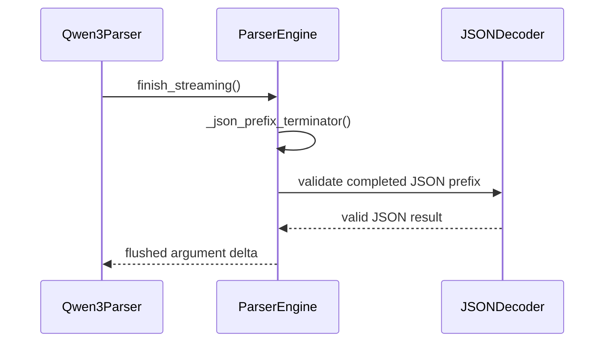

# [Bugfix][Parser] Terminate streamed tool arguments the flush cannot extend

[Upstream PR](https://github.com/vllm-project/vllm/pull/53739) · state: open · merged: False

## Original PR description

<!-- markdownlint-disable -->

## Overview

When a streamed tool call's final converter output cannot extend the arguments already streamed (generation stops inside a value, or the model reopens a tool call mid-parameter), the shared parser engine's flush sends nothing and the client is left holding unparsable JSON. This closes the streamed prefix in that case, and keeps schema coercion from rewriting bytes that already streamed.

## Claims

- A streamed `arguments` string the flush cannot extend is closed into valid JSON: the fallback keeps completed values, drops a dangling key, separator, literal or partial `\uXXXX` escape, and does not invent missing keys.
- Schema coercion at flush time rewrites only coerced top-level values, so it never contradicts the prefix the client already has (ported from #48706, credited in the commits).
- Applies to every parser on the shared engine (`qwen3`, `inkling`, `granite` and the rest), with no per-parser code.

## Validation

Head `825d547aca56f15020fed4d05b1afc604c6ba19e`, rebased onto main `c1d8fade8d` (2026-11-03), CPU tests run on an x86_64 host with that commit's precompiled wheel:

| | main `c1d8fade8d` | this PR |
|---|---|---|
| `test_inkling.py`, `test_parser_engine.py`, `test_qwen3.py` (this PR's versions) | 61 failed, 307 passed | 368 passed |
| all of `tests/parser/` | 6,920 passed | 6,977 passed |

```
pytest tests/parser/engine/test_inkling.py tests/parser/engine/test_parser_engine.py tests/parser/engine/test_qwen3.py
pytest tests/parser/
```

The rebase onto `c1d8fade8d` needed one test change, `825d547aca`. Main now streams the reopened `<tool_call>` in `test_unclosed_parameter_still_streams_valid_json` as a second tool call with arguments `{}`, and the test's helper concatenated every call's arguments, so it read `{"path": ...}{}`. The test now checks each call's arguments. On main without this PR the first call is still an unterminated string, so the test still fails there. `pre-commit run` on the four changed files passes, mypy included.

Real server, from the [November 1 run](https://github.com/vllm-project/vllm/pull/53739#issuecomment-6388204640) at the previous head (RTX 5090, Qwen3.8-27B-MTP-NVFP4, `--tool-call-parser granite`, the generated arguments constrained with `structured_outputs.choice`, five requests per arm):

| generated arguments suffix | before the last repair | this PR |
|---|---|---|
| complete `{"s": "hello"}` | valid JSON | valid JSON |
| open string `{"s": "hello` | valid JSON | valid JSON |
| trailing comma `{"s": "hello", ` | `TypeError` inside the SSE stream | `{"s": "hello"}` |
| number then comma `{"n": 42, ` | `TypeError` inside the SSE stream | `{"n": 42}` |
| partial literal `{"s": "hello", "n": tr` | `TypeError` inside the SSE stream | `{"s": "hello"}` |

That run checks serving integration through the shared engine; it does not measure natural tool-call accuracy or how often real generations truncate.

Live A/B from September, at an earlier head, on a GB10 (Qwen3.8-27B-NVFP4, `--tool-call-parser qwen3_xml`, one `write_file` tool), arms switched by applying and reverting the `parser_engine.py` diff on one install, 40 requests per arm:

| run | unpatched malformed `arguments` | patched |
|---|---|---|
| A: temperature 1.0, `max_tokens` 3000 | 4 of 40 | 0 of 40 |
| B: same, `max_tokens` 400 and thinking off, so every request truncates inside the call | 40 of 40 | 0 of 40 |

Every unpatched failure was `Unterminated string starting at: line 1 column 34`, and the last SSE frame carried `finish_reason: "tool_calls"` with no closing delta. Run A's patched arm never hit the cap, so run B is the one that exercises the trigger on both arms.

No model evaluation applies: the change runs after generation, in the end-of-stream flush and in schema coercion. When this PR was opened, the streamed `arguments` of well-formed calls were byte-identical with and without the change across 794 stream splits of six Qwen3 tool calls.

<details>
<summary>Earlier evidence</summary>

- Field capture that motivated the PR: Qwen3.8-27B-NVFP4 at temperature 1.0, `max_tokens` 3000, 7 of 25 `write_file` calls ended with unparsable `arguments`, all `Unterminated string`, 5 of the 7 with no stray markup (a length stop).
- `tests/parser` at earlier heads: 4,778 passed at `9c69f476174d`; 5,194 merged with main `8a2364605c0b`; 5,211 merged with main plus #57707, #58349, #58418 and #58437.
- [October 24 and November 1](https://github.com/vllm-project/vllm/pull/53739#issuecomment-6388204640): the one-line tuple repair (`cut, _ = self._safe_arg_prefix(final_json)`), 18 failed / 11 passed Inkling truncation cases before it and 29 passed after, and the real-server run above.

</details>

Hosted pre-commit and CI have not run on this PR yet; `pre-run-check` stops them for contributors with fewer than four merged PRs.

## Details

**Root cause.** `_flush_arg_converter` re-derives the arguments from the converter at the end of the call. When that output is not an extension of what already streamed (the converter drops an unclosed trailing parameter, or truncation leaves a partial value), it returned no suffix, so the streamed `arguments` stayed unparsable. `finish_reason` is still `tool_calls` in that case, which is why clients rarely notice before the tool runs.

**The fix** (`vllm/parser/engine/parser_engine.py`): `_safe_arg_prefix` stops the streamed prefix after the last complete value when the trailing one cannot stream, and never ends it inside an escape. When the flush cannot extend the prefix, `_close_streamed_json` closes it with `_json_prefix_terminator`. Coercion rewrites only the coerced top-level values in place.

**Limits.** A cutoff before any argument streams can still leave empty arguments. Truncated arguments can parse and still fail the tool's schema. Truncated non-streaming Inkling and Granite arguments are not repaired here.

**Overlap.** #57707, #59882, #58349, #58418 and #58437 (all open) keep the trailing parameter in individual converters; they recover more data per parser, while this is the engine-level guarantee for every parser. #63385 (open, draft) overlaps the in-place coercion and extends it to untyped and union schemas; whichever lands second reconciles. #48706 (open) is the origin of the coercion-safe prefix ported here.

**Not a duplicate.** Searched `_safe_arg_prefix`, `_flush_arg_converter`, `53739 in:body`, Inkling truncation and streamed arguments; the PRs above are the overlaps found.

AI assistance was used for this PR. I reviewed every changed line and ran the tests above.

---

<details>
<summary> Pull Request Checklist </summary>

- [x] I used vLLM's `/pr-checklist` skill. (Mandatory for agents, optional for humans).
- [x] AI assistance was used during the creation of this PR.

- [x] **Design Fit:** Minimizes impact on core components, reuses existing functionality, and justifies added complexity.
- [x] **Testing and Validation:** Validates the change and ensures any added tests are meaningful and reliable, with CI coverage or documented CI resource constraints and validation performed outside CI.
- [x] **Code Quality and Style:** Keeps code and comments clear and concise, and updates relevant documentation and examples.
- [x] **Pull Request Contents:** Includes a brief summary and relevant links, supports claims with evidence, explains root causes and implementation trade-offs, and follows the contributing guide.
</details>


## Review and discussion

### reviews

- claude[bot] · COMMENTED · 2026-08-25T14:21:03Z · [source](https://github.com/vllm-project/vllm/pull/53739#pullrequestreview-5020055425)

## Claude Code Review

This pull request is from a fork — automated review is disabled. A repository maintainer can comment `@claude review` to run a one-time review.

- chatgpt-codex-connector[bot] · COMMENTED · 2026-08-25T14:28:30Z · [source](https://github.com/vllm-project/vllm/pull/53739#pullrequestreview-5020141145)


### 💡 Codex Review

Here are some automated review suggestions for this pull request.

**Reviewed commit:** `eb7cdb959c`
    

<details> <summary>ℹ️ About Codex in GitHub</summary>
<br/>

[Your team has set up Codex to review pull requests in this repo](https://chatgpt.com/codex/cloud/settings/general). Reviews are triggered when you
- Open a pull request for review
- Mark a draft as ready
- Comment "@codex review".

If Codex has suggestions, it will comment; otherwise it will react with 👍.


Codex can also answer questions or update the PR. Try commenting "@codex address that feedback".
            
</details>

- copilot-pull-request-reviewer[bot] · COMMENTED · 2026-09-04T06:43:42Z · [source](https://github.com/vllm-project/vllm/pull/53739#pullrequestreview-5110005228)

### 🟢 Approval recommended

The fix is well-scoped, includes deterministic regression coverage, and the remaining feedback is limited to a documentation clarification.

<details>
<summary>Pull request overview</summary>

Fixes a ParserEngine streaming edge case where tool-call `arguments` can be left as an unterminated JSON prefix when generation ends mid-parameter, by terminating the already-streamed prefix during the end-of-stream flush so clients can successfully `json.loads` the accumulated arguments.

**Changes:**
- Update `_safe_arg_prefix` to avoid streaming a trailing non-streamable key’s dangling separator (so the flush can safely drop an unfinished parameter).
- Extend `_flush_arg_converter` with `_close_streamed_json` + `_json_prefix_terminator` to append the shortest suffix that makes the streamed prefix parseable.
- Add targeted regression tests for Qwen3 streaming truncation/unclosed-parameter cases and unit tests for the new prefix-termination logic.
</details>

<details>
<summary>File summaries</summary>

| File | Description |
| ---- | ----------- |
| `vllm/parser/engine/parser_engine.py` | Ensures streamed tool-call argument prefixes are terminated into parseable JSON when the flush cannot extend them. |
| `tests/parser/engine/test_qwen3.py` | Adds streaming regression tests for truncated/unclosed Qwen3 tool parameters (including typed-schema behavior). |
| `tests/parser/engine/test_parser_engine.py` | Updates `_safe_arg_prefix` expectations and adds unit tests for `_json_prefix_terminator`. |
</details>

<details>
<summary>Review details</summary>

- **Files reviewed:** 3/3 changed files
- **Comments generated:** 1
- **Review effort level:** Lite
</details>

---

💡 <a href="/vllm-project/vllm/new/main?filename=.github/skills/code-review/SKILL.md" class="Link--inTextBlock" target="_blank" rel="noopener noreferrer">Add a `code-review` agent skill</a> or configure MCP servers for context-aware, tailored reviews. <a href="https://docs.github.com/copilot/how-tos/use-copilot-agents/request-a-code-review/use-code-review?tool=webui#mcp-servers-and-agent-skills" class="Link--inTextBlock" target="_blank" rel="noopener noreferrer">Learn more in the docs.</a>

- amittell · COMMENTED · 2026-09-04T09:23:22Z · [source](https://github.com/vllm-project/vllm/pull/53739#pullrequestreview-5111250014)

(No body; status only.)

- amittell · COMMENTED · 2026-09-04T09:23:24Z · [source](https://github.com/vllm-project/vllm/pull/53739#pullrequestreview-5111250312)

(No body; status only.)

- amittell · COMMENTED · 2026-09-04T09:23:27Z · [source](https://github.com/vllm-project/vllm/pull/53739#pullrequestreview-5111250626)

(No body; status only.)

- amittell · COMMENTED · 2026-09-04T09:23:29Z · [source](https://github.com/vllm-project/vllm/pull/53739#pullrequestreview-5111250934)

(No body; status only.)

### issue_comments

- coderabbitai[bot] · comment · 2026-09-04T06:34:27Z · [source](https://github.com/vllm-project/vllm/pull/53739#issuecomment-5536681375)

<!-- coderabbit-ai-generated:v1 -->

<!-- This is an auto-generated comment: summarize by coderabbit.ai -->
<!-- review_stack_entry_start -->

[](https://app.coderabbit.ai/change-stack/vllm-project/vllm/pull/53739)

<!-- review_stack_entry_end -->
<!-- recent_review_status_start -->

No actionable comments were generated in the recent review.

<!-- recent_review_status_end -->
<!-- walkthrough_start -->

### Walkthrough

ParserEngine now withholds incomplete trailing JSON values, avoids partial escapes, and completes safe prefixes during flushes. Parser tests cover prefix handling and terminators. Qwen3 tests cover unclosed and truncated string and typed parameters.

### Changes

**Streaming JSON argument handling**

|Layer / File(s)|Summary|
|:---|:---|
|**Safe argument prefix selection** <br> `vllm/parser/engine/parser_engine.py`, `tests/parser/engine/test_parser_engine.py`|ParserEngine retains complete top-level values, withholds incomplete non-string values, and avoids partial escape sequences. Tests cover separators, containers, arrays, escapes, and schema-typed strings.|
|**JSON prefix flush completion** <br> `vllm/parser/engine/parser_engine.py`, `tests/parser/engine/test_parser_engine.py`|Flush handling generates validated suffixes for unterminated strings, containers, and supported dangling values.|
|**Qwen3 truncated parameter validation** <br> `tests/parser/engine/test_qwen3.py`|Qwen3 tests verify valid JSON after unclosed, truncated, and schema-typed parameter streams.|

**Estimated code review effort:** 4 (Complex) | ~45 minutes


### Sequence Diagram(s)



<!-- walkthrough_end -->
<details>
<summary><strong>Merge Risk:</strong> <strong><picture></picture> Minimal</strong> · up to <code>a1fe2</code></summary>
<dl>
<dd>

<!-- final_review_risk_start -->
<!-- final_review_risk_label
**Merge Risk:** _⚪ Minimal_ · up to `a1fe2`
-->
<!-- final_review_risk_coverage:{"sourceCommitId":"a1fe257474af168fdfa9d9e132e89ac2ab22f2c0","coveredCommitId":"a1fe257474af168fdfa9d9e132e89ac2ab22f2c0","kind":"reviewed"} -->

The change completes truncated streamed tool-call JSON arguments and includes reported parser and Qwen3 regression coverage. No concrete merge-blocking risk remains.
<!-- final_review_risk_end -->

</dd>
</dl>
</details>
<!-- pre_merge_checks_walkthrough_start -->

<details>
<summary><strong>Pre-merge checks: <sup><picture></picture></sup> 4</strong></summary>
<dl>
<dd>

|         Check name         |                                             Status                                             | Explanation                                                                                                                                                                                               |
| :------------------------ | :--------------------------------------------------------------------------------------------: | :-------------------------------------------------------------------------------------------------------------------------------------------------------------------------------------------------------- |
|     Linked Issues check    |  | Check skipped because no linked issues were found for this pull request.                                                                                                                                  |
| Out of Scope Changes check |  | Check skipped because no linked issues were found for this pull request.                                                                                                                                  |
|         Title check        |  | The title "[Bugfix][Parser] Terminate streamed tool arguments the flush cannot extend" names the main change. The PR closes a streamed tool-argument prefix with a valid JSON suffix when the flush cann… |
|      Description check     |  | The description is closely related to the changeset. It explains the root cause in `_flush_arg_converter` where an unclosed or truncated trailing parameter leaves invalid streamed JSON. It names the c… |

<details>
<summary><strong>Full details: Title check</strong></summary>
<dl>
<dd>

**Explanation**

The title "[Bugfix][Parser] Terminate streamed tool arguments the flush cannot extend" names the main change. The PR closes a streamed tool-argument prefix with a valid JSON suffix when the flush cannot extend it, and the objectives describe the same `_json_prefix_terminator` fix with regression tests for reopened tool calls and plain truncation. The title is specific and accurate. It is somewhat technical, but a teammate scanning history would understand the primary change.

</dd>
</dl>
</details>

<details>
<summary><strong>Full details: Description check</strong></summary>
<dl>
<dd>

**Explanation**

The description is closely related to the changeset. It explains the root cause in `_flush_arg_converter` where an unclosed or truncated trailing parameter leaves invalid streamed JSON. It names the changed file `vllm/parser/engine/parser_engine.py` and describes the new `_safe_arg_prefix` and `_close_streamed_json` handling, the `_json_prefix_terminator` closure, and the coercion change. It also lists the test files and validation results, which match the raw summary. The description is specific and detailed, so it does not fall under the vague or off-topic cases.

</dd>
</dl>
</details>

</dd>
</dl>
</details>

<!-- pre_merge_checks_walkthrough_end -->
<!-- finishing_touch_checkbox_start -->

<details>
<summary><strong>Finishing Touches</strong></summary>
<dl>
<dd>

<!-- finishing_touch_suggestion:fix_ci -->
<details open>
<summary><strong>Fix failing CI checks</strong></summary>
<dl>
<dd>

- [ ] <!-- {"checkboxId": "6d21cfe8-ec3f-40e2-9222-b8318b64d3b0", "radioGroupId": "fix-ci-output-choice-group-unknown_comment_id"} -->   Create stacked PR
- [ ] <!-- {"checkboxId": "9f0d24fb-b419-4f01-baf0-8b26b6424f34", "radioGroupId": "fix-ci-output-choice-group-unknown_comment_id"} -->   Commit on current branch

</dd>
</dl>
</details>

</dd>
</dl>
</details>

<!-- finishing_touch_checkbox_end -->
<!-- announcements_start -->

> [!TIP]
> <details>
> <summary><strong>🎯 Customize your risk assessments</strong></summary>
> <dl>
> <dd>
> 
> Guide how CodeRabbit assesses merge risk and security architecture risk. Highlight sensitive changes and explain your security boundaries using **Merge Risk Instructions** and **Security Risk Instructions** in your review settings. Security architecture risk assessments require the **Advanced plan or above**.
> 
> </dd>
> </dl>
> </details>
> 
> <details>
> <summary><strong>✅ Automatic approvals, with your rules</strong></summary>
> <dl>
> <dd>
> 
> Let CodeRabbit approve pull requests once required threads are resolved, pre-merge checks pass, and your risk limits are met. Enable **Automatic approvals** in review settings, with overrides for teams or file paths.
> 
> </dd>
> </dl>
> </details>

<!-- announcements_end -->
<!-- tips_start -->


Thanks for using [CodeRabbit](https://coderabbit.ai?utm_source=oss&utm_medium=github&utm_campaign=vllm-project/vllm&utm_content=53739)! It's free for OSS, and your support helps us grow. If you like it, consider giving us a shout-out.

<details>
<summary><strong>Share</strong></summary>
<dl>
<dd>

- [X](https://twitter.com/intent/tweet?text=I%20just%20used%20%40coderabbitai%20for%20my%20code%20review%2C%20and%20it%27s%20fantastic%21%20It%27s%20free%20for%20OSS%20and%20offers%20a%20free%20trial%20for%20the%20proprietary%20code.%20Check%20it%20out%3A&url=https%3A//coderabbit.ai)
- [Mastodon](https://mastodon.social/share?text=I%20just%20used%20%40coderabbitai%20for%20my%20code%20review%2C%20and%20it%27s%20fantastic%21%20It%27s%20free%20for%20OSS%20and%20offers%20a%20free%20trial%20for%20the%20proprietary%20code.%20Check%20it%20out%3A%20https%3A%2F%2Fcoderabbit.ai)
- [Reddit](https://www.reddit.com/submit?title=Great%20tool%20for%20code%20review%20-%20CodeRabbit&text=I%20just%20used%20CodeRabbit%20for%20my%20code%20review%2C%20and%20it%27s%20fantastic%21%20It%27s%20free%20for%20OSS%20and%20offers%20a%20free%20trial%20for%20proprietary%20code.%20Check%20it%20out%3A%20https%3A//coderabbit.ai)
- [LinkedIn](https://www.linkedin.com/sharing/share-offsite/?url=https%3A%2F%2Fcoderabbit.ai&mini=true&title=Great%20tool%20for%20code%20review%20-%20CodeRabbit&summary=I%20just%20used%20CodeRabbit%20for%20my%20code%20review%2C%20and%20it%27s%20fantastic%21%20It%27s%20free%20for%20OSS%20and%20offers%20a%20free%20trial%20for%20proprietary%20code)

</dd>
</dl>
</details>

<!-- tips_end -->
<!-- verify_invitation_start -->
### CodeRabbit Verify

- [ ] <!-- {"checkboxId":"run-qa-agent"} --> Run CodeRabbit Verify to test the changes in this pull request.
<!-- verify_invitation_end -->
<!-- recent_review_start -->

<h6>
<details>
<summary><strong>ℹ️ Recent review info</strong></summary>
<dl>
<dd>

<details>
<summary><strong>⚙️ Run configuration</strong></summary>
<dl>
<dd>

**Configuration used**: Repository UI

**Review profile**: CHILL

**Plan**: Team

**Run ID**: `61b77342-4d7b-4f45-b708-768d8755917c`

</dd>
</dl>
</details>

<details>
<summary><strong>📥 Commits</strong></summary>
<dl>
<dd>

Reviewing files that changed from the base of the PR and between 6b2324d7b7d087711486692181b8730cb24522e8 and a1fe257474af168fdfa9d9e132e89ac2ab22f2c0.

</dd>
</dl>
</details>

<details>
<summary><strong>📒 Files selected for processing (1)</strong></summary>
<dl>
<dd>

* `vllm/parser/engine/parser_engine.py`

</dd>
</dl>
</details>

<details>
<summary><strong>🚧 Files skipped from review as they are similar to previous changes (1)</strong></summary>
<dl>
<dd>

* vllm/parser/engine/parser_engine.py

</dd>
</dl>
</details>

**Included review availability:** Your plan provides up to 10 included reviews per hour; 8 remain after this review.

</dd>
</dl>
</details>
</h6>

<!-- recent_review_end -->

- amittell · comment · 2026-09-04T09:26:08Z · [source](https://github.com/vllm-project/vllm/pull/53739#issuecomment-5538429507)

Follow-up at 5448bf23a, 6b2324d7b and a1fe2574 for the four review findings.

The two substantive ones were real and are fixed at the source. `_safe_arg_prefix` was streaming a non-streamable trailing value as its separator alone, so a truncation inside a schema-typed number, bool, object or array left the client holding `{"path": "README.md", "count": ` with no valid completion; it now stops after the last complete top-level value. It could also end a streamed string inside a `\uXXXX` escape, which no suffix can complete; it now tracks escapes and never ends inside one. `_json_prefix_terminator` completes a dangling `:` or an array `,` with `null` as defense in depth.

Red/green on kebab-spark-3 (GB10, vllm 0.26.1rc1.dev1193+gc2294420c): with the source change reverted, 17 of the 37 cases in `TestSafeArgPrefix` and `TestJsonPrefixTerminator` fail; with it, `tests/parser/engine` is 3,814 passed and `tests/parser` excluding `test_harmony.py` is 4,035 passed. That one file needs a vocab download the test host cannot reach and fails identically on the base commit.

Test docstrings shortened as asked, and the `null` comment corrected: it no longer claims schema validity, only that the prefix parses.


- amittell · comment · 2026-09-22T19:26:13Z · [source](https://github.com/vllm-project/vllm/pull/53739#issuecomment-5782620350)

Rebased onto current main (`f944491db9`, 2026-09-22) and re-verified. `git range-diff` reports all five commits unchanged, so the diff under review is the same one.

The defect is still on main. `_flush_arg_converter` still returns `None` when the re-derived arguments are no longer a prefix of what was streamed (`parser_engine.py:1069-1070`), and `_safe_arg_prefix` still ends a non-streamable trailing value on its `"key": ` separator (`parser_engine.py:346` and `:348`).

Re-run at `af6a082bdf` on x86_64, CPU only (Python 3.12.14, torch 2.13.0+cpu, `VLLM_TARGET_DEVICE=cpu`):

```
pytest tests/parser/    this PR  4744 passed
                        main     4721 passed
```

Compared per test id: the 30 ids that only exist in this PR's run are its new cases, and all pass. 0 shared ids change outcome. 7 ids exist only on main, and they are the existing `TestSafeArgPrefix` cases whose expected value this PR changes on purpose, e.g. `{"a": 1}` now yields `""` instead of `{"a": `. That is the withheld separator from 5448bf23a.

Negative controls on `test_qwen3.py` + `test_parser_engine.py` (198 tests), a fresh copy of the tree per arm, with the named function swapped for main's version:

| `parser_engine.py` | failed |
|---|---|
| this PR | 0 |
| whole file from main | 28 |
| `_flush_arg_converter` from main only | 3, the three streaming regressions |
| `_safe_arg_prefix` from main only | 13 |

Each of the two changes fails its own tests when reverted alone.

ruff 0.14.0 check and format, typos 1.43.5, and the mypy 1.20.2 hook at `--python-version 3.10` are clean on the three changed files.


- amittell · comment · 2026-09-24T14:59:03Z · [source](https://github.com/vllm-project/vllm/pull/53739#issuecomment-5816598204)

Pushed `f589694c80` and `b3fbaf77d4`, both caught in review: the flush's extend branch, which this PR never touched, can also leave `arguments` unparsable.

**Case.** Inkling, tool schema `{s: string, n: integer}`, generation stops after `"s": "hello", "n": 4` (EOS, or `<|end_message|>` arriving while the args object is still open). Through the real `InklingParser`, one token per delta, at 462f6636ff:

```
streamed before the end: {"s": "hello"
flush appends:           , "n": 4
client holds:            {"s": "hello", "n": 4
json.loads:              Expecting ',' delimiter: line 1 column 22 (char 21)
```

**Cause.** `_inkling_arg_converter` returns the args span verbatim, even with `partial=False`, so when EOS cuts the object off, the non-partial result is itself unterminated. It is longer than what was streamed and starts with it, so `_flush_arg_converter` takes the extend branch, which sends `final_json[len(prev):]` without checking that `final_json` parses. The other converters (qwen3 and seed_oss, minimax_m2, glm47, dsml, gemma4) build their result with `json.dumps`. Called with `partial=False` at every EOS cut point of a well-formed call, none of them returned unparsable JSON; inkling did at 47 of 69.

**Fix.**

- `f589694c80`: in the extend branch, when `final_json` does not parse, append `_json_prefix_terminator(final_json)` to the diff. The reported case now ends `{"s": "hello", "n": 4}`.
- `b3fbaf77d4`: some spans have no completion: EOS inside or just after a key, right after a comma, inside a literal such as `tr` or a bare `-`, or inside a `\u` escape. For those the terminator returns `""`. Instead of sending the span, drop it and close the prefix already streamed with `_close_streamed_json`, the same as the branch above it does. `{"s": "hello", ` becomes `{"s": "hello"}`.

A `final_json` that parses is sent exactly as before.

**EOS at every character** inside six well-formed Inkling args objects, 209 cut points, streamed one token per delta:

| | unparsable `arguments` |
|---|---|
| 462f6636ff | 159 |
| f589694c80 | 74 |
| b3fbaf77d4 | 0 |

At b3fbaf77d4, 191 are valid JSON. The other 18 stop inside the first key (`{"`, `{"s`, `{"s"`), before any argument text was streamed. The call now carries its name with empty `arguments` rather than a fragment such as `{"s`. A strict `json.loads("")` still fails there, so for a call that never streamed an argument this trades a fragment for an empty string rather than making it parse.

**Tests.** `TestTruncatedArgsFlush` in `tests/parser/engine/test_inkling.py` covers nine truncation shapes, each ending at EOS and at `<|end_message|>`. All are fed through `InklingParser` one token per delta.

```
462f6636ff:  first 6 cases fail (Expecting ',' delimiter / Expecting value)
f589694c80:  those 6 pass; the 12 cases added in b3fbaf77d4 fail
b3fbaf77d4:  18 passed
pytest tests/parser/: 4744 / 4750 / 4762 passed, no errors (macOS arm64, CPU only)
```

**Well-formed output is unchanged.** I ran 2,730 feed variants: whole, one token or character per delta, and one split at every boundary. That is 826 Qwen3 variants across six shapes, and 1,904 Inkling variants in token and text-only mode, with and without a schema. The streamed `arguments` are byte-identical between 462f6636ff and b3fbaf77d4 in all 2,730, and all 1,904 Inkling variants go through the changed branch. As in the description's run, only 84 of the Qwen3 variants produce non-empty arguments, in both arms alike.


- amittell · comment · 2026-09-24T18:30:31Z · [source](https://github.com/vllm-project/vllm/pull/53739#issuecomment-5819872638)

Pushed `4aacd85b9a`, `90105e1762` and `9b25b6123c` on top of `b3fbaf77d4`. Together they bring #48706's coercion fix into this PR through ZhengDeL's port in amittell/vllm#2, and fix two things the port broke on this branch.

- `4aacd85b9a` is ZhengDeL's commit, cherry-picked with his authorship and the co-author credit for mahadrehmann and muhammadfawaz1 from #48706. It withholds a non-string middle value until the flush, so `_fix_arg_types` cannot rewrite bytes the client already holds. Through `InklingParser`, a complete call with a quoted integer (`"n": "42", "s": "hi"`) ended `{"n": "42", "s": "hi"}` at `b3fbaf77d4` and now ends `{"n": 42, "s": "hi"}`. Its `last_comma` condition is what lets it sit beside this PR: without it, 5 tests fail here (the `literal` and `sign` cases of `TestTruncatedArgsFlush`, at EOS and at `<|end_message|>`, plus `test_schema_typed_trailing_string_is_withheld_with_its_key`).
- `90105e1762`: withholding the middle value let the streamed prefix end on `"n": `, and when EOS left no completion, the `b3fbaf77d4` fallback closed that prefix with `null`. So `{"n": 42, ` ended `{"n": null}`. When it extends what was streamed, the span is now closed after its last complete value instead. EOS at every character of two Inkling args objects, 90 cut points: 27 replaced a finished value with `null` after the cherry-pick, 0 now, and 0 at `b3fbaf77d4`.
- `9b25b6123c`: the withholding only matters when the tick's JSON does not parse. Qwen3 and the other converters that build with `json.dumps` already coerce middle values while streaming, but under the clip they stopped streaming at the first non-string field. For an integer, then a 27-chunk string, that was 1 delta before `</parameter>` instead of 28, and it is 28 again. This commit also replaces `test_qwen3_partial_xml_close_tag_not_included_in_value`, which fed a partial close tag straight into an `ARG_VALUE_CHUNK`. The Qwen3 scanner does not emit one: `test_streaming_long_string_arg_before_parameter_end` splits the tag the same way and streams no tag text. The replacement goes through the Qwen3 grammar.

Well-formed calls through the Qwen3 and Inkling parsers, 549 feed variants: arguments are identical to `b3fbaf77d4` in 539. The other 10 are the quoted-integer input, now `{"n": 42, "content": "x"}`. `pytest tests/parser/engine`: 4371 passed. `pytest tests/parser`: 4748 passed, with the same 401 GPU-fixture setup errors as `b3fbaf77d4` (CPU-only Linux). `pre-commit run --files` on the four changed files passes, and so does the manual-stage `mypy-3.12` hook.

The #48706 section of the description is updated to match.


- amittell · comment · 2026-09-26T02:13:25Z · [source](https://github.com/vllm-project/vllm/pull/53739#issuecomment-5842279260)

Pushed `9c69f476174d`. It fixes a silent data loss this branch had on compact JSON, and the description is updated to match.

`_fix_arg_types` re-serialized the whole args object with `json.dumps` whenever it coerced a value. Inkling (and Granite on main) pass the model's JSON through verbatim, so with compact separators the streamed prefix stopped being a prefix of the flush result, and the flush closed what it had instead. Through `InklingParser`, one token per delta, with `n: integer`, at `9b25b6123c`:

- `{"s":"a","n":"42","t":"b"}` ended `{"s":"a","n":null}`: `t` dropped, `n` nulled, no error
- `{"s":"a","t":"b","n":"42"}` ended `{"s":"a","t":"b"}`
- spaced JSON did the same when an earlier string carried a `\u00e9` escape, or with newline indentation

The coercion now rewrites only the coerced top-level values, in place. 11 inputs: 5 ended wrong at `9b25b6123c`, 0 now, and the streamed arguments match the non-streaming result byte for byte. For the `json.dumps` converters (qwen3, minimax_m2, glm47, dsml, gemma4) the output is byte-identical to before, 60,000 randomized inputs and 0 differences. The new tests fail 5 of 6 on `9b25b6123c`; the sixth, `compact_first`, passes there because the prefix stops at `{"n":`.

Description changes:

- #46303 merged as `b33c8a657d48`, so a `max_tokens` cutoff now reports `length` on main. The finish_reason section says that, and that a stop string still reports `tool_calls`.
- #57707 (#57699) and #58349, #58418, #58437 (#57827) are in the relationship section. With all four on main and none of this PR, qwen3, minimax_m2, glm47_moe and deepseek_v4 end parseable at every EOS cut, and for a truncated integer or deepseek_v4's open string they keep more than this PR does. They also fix the non-streaming result, which this PR does not touch. Inkling and Granite stay at 73 of 73 cuts unparsable, and 32 of this PR's tests still fail there. One gap none of these close: a truncated Inkling or Granite call still returns the unterminated span as its non-streaming `arguments`. I left that out of this PR; the description lists it under known limits. All five together: `pytest tests/parser` 5211 passed.
- Blast radius recounted at `8a2364605c0b`: 13 engine parsers set an `arg_converter` through 7 converters, and 12 of them use an affected one. ling3 and nemotron_v3 use the glm47 and qwen3 converters, both on main and at this branch's base, so the old "no arg_converter" line was wrong.

`pytest tests/parser`: 4778 passed on the branch, 5194 merged with main `8a2364605c0b` (Linux x86_64, CPU only). Granite is only on main, so its regression test is not on this branch; merged with main, a 6-case Granite test passes, and fails 2 of 6 without this commit. Happy to add it if a maintainer wants main merged in.


- amittell · comment · 2026-10-05T20:08:53Z · [source](https://github.com/vllm-project/vllm/pull/53739#issuecomment-6002083340)

Scope, now that the per-parser PRs are up: #57707, #59882 and #58349/#58418/#58437 fix the qwen3, minimax_m2, glm47 and deepseek_v4 parsers one at a time. This PR covers what they don't: converters that pass the model's JSON through verbatim (Inkling, Granite), and keeping the streamed argument prefix consistent with the final arguments. It merges cleanly after #57707 or #59882.

@chaunceyjiang @sfeng33 could one of you take a look?


- mergify[bot] · comment · 2026-10-12T22:00:41Z · [source](https://github.com/vllm-project/vllm/pull/53739#issuecomment-6133407879)

This pull request has merge conflicts that must be resolved before it can be
merged. Please rebase the PR, @amittell.

https://docs.github.com/en/pull-requests/collaborating-with-pull-requests/working-with-forks/syncing-a-fork


- amittell · comment · 2026-10-24T18:54:50Z · [source](https://github.com/vllm-project/vllm/pull/53739#issuecomment-6388204640)

### November 1 real-server validation

The tuple failure reproduced through the real chat-completions server at `9f921e85398e518c87d621b6ea4582e11966da51` and disappeared at `e6d7f2d7ab92bc6bb9aa23cd1450c67115244f8f`. The full Python source exports differ by the one tuple-unpacking line. Both arms used the same cached Qwen3.8-27B-MTP-NVFP4 weights, tokenizer, runtime and request bytes on an RTX 5090.

| Generated arguments suffix | Before | After |
|---|---|---|
| Complete `{"s": "hello"}` call | Valid JSON | Valid JSON |
| Open string `{"s": "hello` | Valid JSON | Valid JSON |
| Trailing comma `{"s": "hello", ` | SSE tuple `TypeError` | `{"s": "hello"}` |
| Number then comma `{"n": 42, ` | SSE tuple `TypeError` | `{"n": 42}` |
| Partial literal `{"s": "hello", "n": tr` | SSE tuple `TypeError` | `{"s": "hello"}` |

Each arm received five sequential `POST /v1/chat/completions` requests. All ten HTTP responses were 200. The three baseline failures were **errors inside SSE**, with no terminal finish reason; `[DONE]` alone did not mean success. Every fixed response contained one `f` tool call with the expected JSON, `finish_reason: "tool_calls"`, `[DONE]`, and no error. The two controls passed on both revisions. The baseline server recorded three tracebacks through `chat_completion_stream_generator -> parse_delta -> _flush_arg_converter -> _json_prefix_terminator`, ending with `TypeError: 'in <string>' requires string as left operand, not bool`. The fixed server recorded no traceback.

This uses the public `structured_outputs.choice` API to constrain actual model generation to a Granite tool-call prefix followed by each suffix. It tests deterministic serving integration through the shared parser engine. It does not measure natural tool-call accuracy, an unconstrained truncation rate, client-disconnect handling, or model quality.

Python 3.12.13; torch 2.14.0+cu130; Transformers 5.19.0; FlashInfer 0.7.2; Xgrammar 0.2.8. Exact PR Python source reused the existing `0.32.0rc1.dev326+g7b6310c10` wheel's compiled extensions and packaged support files. This was **not a rebuild of the PR** and does not certify its pinned torch 2.13.0 / FlashInfer 0.7.0.post1 environment. Both arms used `--linear-backend cutlass --attention-backend TRITON_ATTN --enforce-eager`, with `FLASHINFER_DISABLE_JIT=1` and offline Hub loading. No model/dependency download or install was performed.

The completed A/B ran from 15:44:27 to 15:46:03 UTC in 95.4 seconds. Peak sampled GPU memory was 26,328 MiB, temperature 53C, and aggregate owned RSS 19,489,865,728 bytes. Both server exits were 0. Three earlier startup attempts are retained: missing packaged wheel support, an unexpected FlashInfer JIT build stopped at the 48 GiB sampled RSS limit (52,242,972,672 bytes observed), and a rejected CLI spelling. These are not passing runs. The completed experiment used the native JIT-disable setting; the resource limits were not relaxed.

Post-run checks matched 7,717 archived source files in each arm, 2,146 runtime/support files and all 16 cached model files to their recorded hashes. All five request hashes matched across arms, and every saved SSE hash matched its receipt. Cleanup confirmed no GPU compute processes or remaining test listener.

The original full parser run is still **6,208 passed / 19 failed / 297 errors**, exit 1. The later **23 local + 293 remote** assertion passes remain separate; all four remote guard exits **86** remain recorded. This server experiment changes none of those outcomes.

The head is still mergeable. All four inline review threads remain resolved. Hosted contributor eligibility, human submitter review and an upstream `LLM`/`RemoteOpenAIServer` regression selected by CI remain open gates. This experiment invokes the real CLI and HTTP endpoint directly; it is not a claim that such a CI regression has been added or run. No re-review ping or CI-gate change accompanies this evidence update.

<details>
<summary>November 1 artifact identities</summary>

```text
server_probe.py b51f6b3762db264cb8db6bf80d1ab6fdc3fc46242b856a4643073b1e694800dc
run_server_validation.py ef2d205471f2531f2575c5ca75c58ca1a37da96c30ad0f7edc1f36771c8ced6e
runtime-manifest.json 4f3cdef57e3ff81c2de8f3623a9b4361947112be7182b23c3692384308e154b2
wheel-support-manifest.json ac73cbbcf90b65f0c5fce001fb0659c6e50c32b27f96419406a4a2dc4139012b
run-result.json 4b7c346da4b07dc2365e002514a56db74be89630d3efa848ae474e7a0c013a3b
before-server.log 39ee218c587fb2dc00a67ef717e95188f703881b0dda56413ff7eaa5ea4a122c
after-server.log 4c4587f0205eaaa763f3fd2399b7c728c3e359f2b87919d5ff36d87159f2c846
evidence.tar.gz 48c2ff890d9c1d0f03cbdc05f1bec13094ae3bc7f31c5b9745433f34b7c9fd8e
model.safetensors 0e1597fc7835a5a7578243809420f88ae06732733a716e49629392e571a62f76
model-mtp-bf16.safetensors 90fa0e3eed5a647c035c6df9ecabc416c0f8d573ff84ac12485b085f00a7cdf2
tokenizer.json 06b9509352d2af50381ab2247e083b80d32d5c0aba91c272ca9ff729b6a0e523
config.json 783a7999e813d3388e93bbe9ac865a62ed729196b40b07fa2b3c32258f8aaea1
```

The model name is the cached artifact label, not a newly verified Hugging Face snapshot revision. These content hashes pin the actual local files. Full source/runtime manifests and failed-startup logs are retained with the execution bundle; hashes alone do not replace the outcomes. The executed probe is in the PR description above.

</details>

<details>
<summary>All ten raw SSE responses from November 1</summary>

**before: complete**. Request SHA256 `a9c0a175a5f72ca81171db655fc2d5ed994aedd2df7d71f633fa9a2585020beb`; response SHA256 `0a51f4397b31abd22102361e5772da011d84945caf788b8f3cae67486cc0de42`.

```text
data: {"id":"chatcmpl-b865a7d65747275b","object":"chat.completion.chunk","created":1793547907,"model":"pr53739-validation","choices":[{"index":0,"delta":{"role":"assistant","content":""},"logprobs":null,"finish_reason":null}],"prompt_token_ids":null,"prompt_text":null}

data: {"id":"chatcmpl-b865a7d65747275b","object":"chat.completion.chunk","created":1793547907,"model":"pr53739-validation","choices":[{"index":0,"delta":{"tool_calls":[{"id":"chatcmpl-tool-bbcb4946e74b6032","type":"function","index":0,"function":{"name":"f"}}]},"logprobs":null,"finish_reason":null,"token_ids":null}]}

data: {"id":"chatcmpl-b865a7d65747275b","object":"chat.completion.chunk","created":1793547907,"model":"pr53739-validation","choices":[{"index":0,"delta":{"tool_calls":[{"index":0,"function":{"arguments":"{\"s\": \""}}]},"logprobs":null,"finish_reason":null,"token_ids":null}]}

data: {"id":"chatcmpl-b865a7d65747275b","object":"chat.completion.chunk","created":1793547907,"model":"pr53739-validation","choices":[{"index":0,"delta":{"tool_calls":[{"index":0,"function":{"arguments":"hello"}}]},"logprobs":null,"finish_reason":null,"token_ids":null}]}

data: {"id":"chatcmpl-b865a7d65747275b","object":"chat.completion.chunk","created":1793547907,"model":"pr53739-validation","choices":[{"index":0,"delta":{"tool_calls":[{"index":0,"function":{"arguments":"\"}"}}]},"logprobs":null,"finish_reason":null,"token_ids":null}]}

data: {"id":"chatcmpl-b865a7d65747275b","object":"chat.completion.chunk","created":1793547907,"model":"pr53739-validation","choices":[{"index":0,"delta":{},"logprobs":null,"finish_reason":"tool_calls","stop_reason":null,"token_ids":null}]}

data: {"id":"chatcmpl-b865a7d65747275b","object":"chat.completion.chunk","created":1793547907,"model":"pr53739-validation","choices":[],"usage":{"prompt_tokens":273,"total_tokens":293,"completion_tokens":20},"system_fingerprint":"vllm-0.32.0rc1.dev326+g7b6310c10-4f8b949c"}

data: [DONE]


```

**before: open_string**. Request SHA256 `4edadca77fc565c0c64f560dca59002cad1049bde6a64c1588759600835af90c`; response SHA256 `c87ae6f46ce3370a42e3c728e3173181d4fd71569245197b0a52fe4e778f573a`.

```text
data: {"id":"chatcmpl-be189f37461c1b6b","object":"chat.completion.chunk","created":1793547910,"model":"pr53739-validation","choices":[{"index":0,"delta":{"role":"assistant","content":""},"logprobs":null,"finish_reason":null}],"prompt_token_ids":null,"prompt_text":null}

data: {"id":"chatcmpl-be189f37461c1b6b","object":"chat.completion.chunk","created":1793547910,"model":"pr53739-validation","choices":[{"index":0,"delta":{"tool_calls":[{"id":"chatcmpl-tool-990094e985b0874a","type":"function","index":0,"function":{"name":"f"}}]},"logprobs":null,"finish_reason":null,"token_ids":null}]}

data: {"id":"chatcmpl-be189f37461c1b6b","object":"chat.completion.chunk","created":1793547910,"model":"pr53739-validation","choices":[{"index":0,"delta":{"tool_calls":[{"index":0,"function":{"arguments":"{\"s\": \""}}]},"logprobs":null,"finish_reason":null,"token_ids":null}]}

data: {"id":"chatcmpl-be189f37461c1b6b","object":"chat.completion.chunk","created":1793547910,"model":"pr53739-validation","choices":[{"index":0,"delta":{"tool_calls":[{"index":0,"function":{"arguments":"hello"}}]},"logprobs":null,"finish_reason":null,"token_ids":null}]}

data: {"id":"chatcmpl-be189f37461c1b6b","object":"chat.completion.chunk","created":1793547910,"model":"pr53739-validation","choices":[{"index":0,"delta":{"tool_calls":[{"index":0,"function":{"arguments":"\"}"}}]},"logprobs":null,"finish_reason":"tool_calls","stop_reason":null,"token_ids":null}]}

data: {"id":"chatcmpl-be189f37461c1b6b","object":"chat.completion.chunk","created":1793547910,"model":"pr53739-validation","choices":[],"usage":{"prompt_tokens":273,"total_tokens":291,"completion_tokens":18},"system_fingerprint":"vllm-0.32.0rc1.dev326+g7b6310c10-4f8b949c"}

data: [DONE]


```

**before: comma**. Request SHA256 `5a0b6fba38b38969347ce44854bb25c6ba87896746b60342a484956ab091e608`; response SHA256 `89047723f107e0fb7dfd45b0311b7d1320fbd655a6c370e041e786fc18ac9cc3`.

```text
data: {"id":"chatcmpl-bdc950408e1bb680","object":"chat.completion.chunk","created":1793547911,"model":"pr53739-validation","choices":[{"index":0,"delta":{"role":"assistant","content":""},"logprobs":null,"finish_reason":null}],"prompt_token_ids":null,"prompt_text":null}

data: {"id":"chatcmpl-bdc950408e1bb680","object":"chat.completion.chunk","created":1793547911,"model":"pr53739-validation","choices":[{"index":0,"delta":{"tool_calls":[{"id":"chatcmpl-tool-b76828e745864a24","type":"function","index":0,"function":{"name":"f"}}]},"logprobs":null,"finish_reason":null,"token_ids":null}]}

data: {"id":"chatcmpl-bdc950408e1bb680","object":"chat.completion.chunk","created":1793547911,"model":"pr53739-validation","choices":[{"index":0,"delta":{"tool_calls":[{"index":0,"function":{"arguments":"{\"s\": \""}}]},"logprobs":null,"finish_reason":null,"token_ids":null}]}

data: {"id":"chatcmpl-bdc950408e1bb680","object":"chat.completion.chunk","created":1793547911,"model":"pr53739-validation","choices":[{"index":0,"delta":{"tool_calls":[{"index":0,"function":{"arguments":"hello"}}]},"logprobs":null,"finish_reason":null,"token_ids":null}]}

data: {"error": {"message": "'in <string>' requires string as left operand, not bool", "type": "BadRequestError", "param": null, "code": 400}}

data: [DONE]


```

**before: comma_after_number**. Request SHA256 `b5d9d174e75ddfbf21fbd98f9ec5849101c913b88d1ab2140dc6c1ab16a6cfef`; response SHA256 `11dc7afb145a1349409ca75e3436aea3703b54509dc6a0fc641bbc97ce4ecdc5`.

```text
data: {"id":"chatcmpl-84a6b8d11b15284e","object":"chat.completion.chunk","created":1793547912,"model":"pr53739-validation","choices":[{"index":0,"delta":{"role":"assistant","content":""},"logprobs":null,"finish_reason":null}],"prompt_token_ids":null,"prompt_text":null}

data: {"id":"chatcmpl-84a6b8d11b15284e","object":"chat.completion.chunk","created":1793547912,"model":"pr53739-validation","choices":[{"index":0,"delta":{"tool_calls":[{"id":"chatcmpl-tool-ad47bed9b387c654","type":"function","index":0,"function":{"name":"f"}}]},"logprobs":null,"finish_reason":null,"token_ids":null}]}

data: {"id":"chatcmpl-84a6b8d11b15284e","object":"chat.completion.chunk","created":1793547912,"model":"pr53739-validation","choices":[{"index":0,"delta":{"tool_calls":[{"index":0,"function":{"arguments":"{\"n\": "}}]},"logprobs":null,"finish_reason":null,"token_ids":null}]}

data: {"error": {"message": "'in <string>' requires string as left operand, not bool", "type": "BadRequestError", "param": null, "code": 400}}

data: [DONE]


```

**before: literal**. Request SHA256 `b0f2d903897e85dbbe2d3ad46de5541f5f5f19a96403d923551f6ac75b24039f`; response SHA256 `9f80dc8b6088538e69c16bafa5bb6d635af0646001311619e9c083a70ee3ef5f`.

```text
data: {"id":"chatcmpl-a2fd6fb6f91c8a03","object":"chat.completion.chunk","created":1793547912,"model":"pr53739-validation","choices":[{"index":0,"delta":{"role":"assistant","content":""},"logprobs":null,"finish_reason":null}],"prompt_token_ids":null,"prompt_text":null}

data: {"id":"chatcmpl-a2fd6fb6f91c8a03","object":"chat.completion.chunk","created":1793547912,"model":"pr53739-validation","choices":[{"index":0,"delta":{"tool_calls":[{"id":"chatcmpl-tool-a0c3bfaffd9ae5b6","type":"function","index":0,"function":{"name":"f"}}]},"logprobs":null,"finish_reason":null,"token_ids":null}]}

data: {"id":"chatcmpl-a2fd6fb6f91c8a03","object":"chat.completion.chunk","created":1793547912,"model":"pr53739-validation","choices":[{"index":0,"delta":{"tool_calls":[{"index":0,"function":{"arguments":"{\"s\": \""}}]},"logprobs":null,"finish_reason":null,"token_ids":null}]}

data: {"id":"chatcmpl-a2fd6fb6f91c8a03","object":"chat.completion.chunk","created":1793547912,"model":"pr53739-validation","choices":[{"index":0,"delta":{"tool_calls":[{"index":0,"function":{"arguments":"hello"}}]},"logprobs":null,"finish_reason":null,"token_ids":null}]}

data: {"id":"chatcmpl-a2fd6fb6f91c8a03","object":"chat.completion.chunk","created":1793547912,"model":"pr53739-validation","choices":[{"index":0,"delta":{"tool_calls":[{"index":0,"function":{"arguments":"\""}}]},"logprobs":null,"finish_reason":null,"token_ids":null}]}

data: {"error": {"message": "'in <string>' requires string as left operand, not bool", "type": "BadRequestError", "param": null, "code": 400}}

data: [DONE]


```

**after: complete**. Request SHA256 `a9c0a175a5f72ca81171db655fc2d5ed994aedd2df7d71f633fa9a2585020beb`; response SHA256 `13bd204ca78dfdb18f77f954d70228a9c054bbb404e92c6c0b44ce842ba86e35`.

```text
data: {"id":"chatcmpl-9df6e1a1d71d0481","object":"chat.completion.chunk","created":1793547958,"model":"pr53739-validation","choices":[{"index":0,"delta":{"role":"assistant","content":""},"logprobs":null,"finish_reason":null}],"prompt_token_ids":null,"prompt_text":null}

data: {"id":"chatcmpl-9df6e1a1d71d0481","object":"chat.completion.chunk","created":1793547958,"model":"pr53739-validation","choices":[{"index":0,"delta":{"tool_calls":[{"id":"chatcmpl-tool-93c163a4e1b34d62","type":"function","index":0,"function":{"name":"f"}}]},"logprobs":null,"finish_reason":null,"token_ids":null}]}

data: {"id":"chatcmpl-9df6e1a1d71d0481","object":"chat.completion.chunk","created":1793547958,"model":"pr53739-validation","choices":[{"index":0,"delta":{"tool_calls":[{"index":0,"function":{"arguments":"{\"s\": \""}}]},"logprobs":null,"finish_reason":null,"token_ids":null}]}

data: {"id":"chatcmpl-9df6e1a1d71d0481","object":"chat.completion.chunk","created":1793547958,"model":"pr53739-validation","choices":[{"index":0,"delta":{"tool_calls":[{"index":0,"function":{"arguments":"hello"}}]},"logprobs":null,"finish_reason":null,"token_ids":null}]}

data: {"id":"chatcmpl-9df6e1a1d71d0481","object":"chat.completion.chunk","created":1793547958,"model":"pr53739-validation","choices":[{"index":0,"delta":{"tool_calls":[{"index":0,"function":{"arguments":"\"}"}}]},"logprobs":null,"finish_reason":null,"token_ids":null}]}

data: {"id":"chatcmpl-9df6e1a1d71d0481","object":"chat.completion.chunk","created":1793547958,"model":"pr53739-validation","choices":[{"index":0,"delta":{},"logprobs":null,"finish_reason":"tool_calls","stop_reason":null,"token_ids":null}]}

data: {"id":"chatcmpl-9df6e1a1d71d0481","object":"chat.completion.chunk","created":1793547958,"model":"pr53739-validation","choices":[],"usage":{"prompt_tokens":273,"total_tokens":293,"completion_tokens":20},"system_fingerprint":"vllm-0.32.0rc1.dev326+g7b6310c10-4f8b949c"}

data: [DONE]


```

**after: open_string**. Request SHA256 `4edadca77fc565c0c64f560dca59002cad1049bde6a64c1588759600835af90c`; response SHA256 `20cc4f89e34f0d5641ea4a32fc79f81387c85418e5c26980e07a9836f4f3ed62`.

```text
data: {"id":"chatcmpl-b90cc88aa3c96e72","object":"chat.completion.chunk","created":1793547959,"model":"pr53739-validation","choices":[{"index":0,"delta":{"role":"assistant","content":""},"logprobs":null,"finish_reason":null}],"prompt_token_ids":null,"prompt_text":null}

data: {"id":"chatcmpl-b90cc88aa3c96e72","object":"chat.completion.chunk","created":1793547959,"model":"pr53739-validation","choices":[{"index":0,"delta":{"tool_calls":[{"id":"chatcmpl-tool-921348693996f46a","type":"function","index":0,"function":{"name":"f"}}]},"logprobs":null,"finish_reason":null,"token_ids":null}]}

data: {"id":"chatcmpl-b90cc88aa3c96e72","object":"chat.completion.chunk","created":1793547959,"model":"pr53739-validation","choices":[{"index":0,"delta":{"tool_calls":[{"index":0,"function":{"arguments":"{\"s\": \""}}]},"logprobs":null,"finish_reason":null,"token_ids":null}]}

data: {"id":"chatcmpl-b90cc88aa3c96e72","object":"chat.completion.chunk","created":1793547959,"model":"pr53739-validation","choices":[{"index":0,"delta":{"tool_calls":[{"index":0,"function":{"arguments":"hello"}}]},"logprobs":null,"finish_reason":null,"token_ids":null}]}

data: {"id":"chatcmpl-b90cc88aa3c96e72","object":"chat.completion.chunk","created":1793547959,"model":"pr53739-validation","choices":[{"index":0,"delta":{"tool_calls":[{"index":0,"function":{"arguments":"\"}"}}]},"logprobs":null,"finish_reason":"tool_calls","stop_reason":null,"token_ids":null}]}

data: {"id":"chatcmpl-b90cc88aa3c96e72","object":"chat.completion.chunk","created":1793547959,"model":"pr53739-validation","choices":[],"usage":{"prompt_tokens":273,"total_tokens":291,"completion_tokens":18},"system_fingerprint":"vllm-0.32.0rc1.dev326+g7b6310c10-4f8b949c"}

data: [DONE]


```

**after: comma**. Request SHA256 `5a0b6fba38b38969347ce44854bb25c6ba87896746b60342a484956ab091e608`; response SHA256 `4c5b5ed5f8792a4f820fbb711f4e6d5d48e11ddf55bd429cbb294f6bd3278649`.

```text
data: {"id":"chatcmpl-a26009e6c8b51513","object":"chat.completion.chunk","created":1793547960,"model":"pr53739-validation","choices":[{"index":0,"delta":{"role":"assistant","content":""},"logprobs":null,"finish_reason":null}],"prompt_token_ids":null,"prompt_text":null}

data: {"id":"chatcmpl-a26009e6c8b51513","object":"chat.completion.chunk","created":1793547960,"model":"pr53739-validation","choices":[{"index":0,"delta":{"tool_calls":[{"id":"chatcmpl-tool-98317c06a1c4eee5","type":"function","index":0,"function":{"name":"f"}}]},"logprobs":null,"finish_reason":null,"token_ids":null}]}

data: {"id":"chatcmpl-a26009e6c8b51513","object":"chat.completion.chunk","created":1793547960,"model":"pr53739-validation","choices":[{"index":0,"delta":{"tool_calls":[{"index":0,"function":{"arguments":"{\"s\": \""}}]},"logprobs":null,"finish_reason":null,"token_ids":null}]}

data: {"id":"chatcmpl-a26009e6c8b51513","object":"chat.completion.chunk","created":1793547960,"model":"pr53739-validation","choices":[{"index":0,"delta":{"tool_calls":[{"index":0,"function":{"arguments":"hello"}}]},"logprobs":null,"finish_reason":null,"token_ids":null}]}

data: {"id":"chatcmpl-a26009e6c8b51513","object":"chat.completion.chunk","created":1793547960,"model":"pr53739-validation","choices":[{"index":0,"delta":{"tool_calls":[{"index":0,"function":{"arguments":"\"}"}}]},"logprobs":null,"finish_reason":"tool_calls","stop_reason":null,"token_ids":null}]}

data: {"id":"chatcmpl-a26009e6c8b51513","object":"chat.completion.chunk","created":1793547960,"model":"pr53739-validation","choices":[],"usage":{"prompt_tokens":273,"total_tokens":293,"completion_tokens":20},"system_fingerprint":"vllm-0.32.0rc1.dev326+g7b6310c10-4f8b949c"}

data: [DONE]


```

**after: comma_after_number**. Request SHA256 `b5d9d174e75ddfbf21fbd98f9ec5849101c913b88d1ab2140dc6c1ab16a6cfef`; response SHA256 `a020f49ed6911a3df5d0c7c81d8ea272fef25f8e345398380cf4cea978c294f2`.

```text
data: {"id":"chatcmpl-b8b6d2bb8c8080ca","object":"chat.completion.chunk","created":1793547960,"model":"pr53739-validation","choices":[{"index":0,"delta":{"role":"assistant","content":""},"logprobs":null,"finish_reason":null}],"prompt_token_ids":null,"prompt_text":null}

data: {"id":"chatcmpl-b8b6d2bb8c8080ca","object":"chat.completion.chunk","created":1793547960,"model":"pr53739-validation","choices":[{"index":0,"delta":{"tool_calls":[{"id":"chatcmpl-tool-927e1943b59db397","type":"function","index":0,"function":{"name":"f"}}]},"logprobs":null,"finish_reason":null,"token_ids":null}]}

data: {"id":"chatcmpl-b8b6d2bb8c8080ca","object":"chat.completion.chunk","created":1793547960,"model":"pr53739-validation","choices":[{"index":0,"delta":{"tool_calls":[{"index":0,"function":{"arguments":"{\"n\": "}}]},"logprobs":null,"finish_reason":null,"token_ids":null}]}

data: {"id":"chatcmpl-b8b6d2bb8c8080ca","object":"chat.completion.chunk","created":1793547960,"model":"pr53739-validation","choices":[{"index":0,"delta":{"tool_calls":[{"index":0,"function":{"arguments":"42}"}}]},"logprobs":null,"finish_reason":"tool_calls","stop_reason":null,"token_ids":null}]}

data: {"id":"chatcmpl-b8b6d2bb8c8080ca","object":"chat.completion.chunk","created":1793547960,"model":"pr53739-validation","choices":[],"usage":{"prompt_tokens":273,"total_tokens":294,"completion_tokens":21},"system_fingerprint":"vllm-0.32.0rc1.dev326+g7b6310c10-4f8b949c"}

data: [DONE]


```

**after: literal**. Request SHA256 `b0f2d903897e85dbbe2d3ad46de5541f5f5f19a96403d923551f6ac75b24039f`; response SHA256 `e457f79c86a64c29e615b9f93dfa9943d1634d44bd2e7cccc23d906f8e739979`.

```text
data: {"id":"chatcmpl-9491abfa512c2b47","object":"chat.completion.chunk","created":1793547961,"model":"pr53739-validation","choices":[{"index":0,"delta":{"role":"assistant","content":""},"logprobs":null,"finish_reason":null}],"prompt_token_ids":null,"prompt_text":null}

data: {"id":"chatcmpl-9491abfa512c2b47","object":"chat.completion.chunk","created":1793547961,"model":"pr53739-validation","choices":[{"index":0,"delta":{"tool_calls":[{"id":"chatcmpl-tool-827a06fbbb5bf0bb","type":"function","index":0,"function":{"name":"f"}}]},"logprobs":null,"finish_reason":null,"token_ids":null}]}

data: {"id":"chatcmpl-9491abfa512c2b47","object":"chat.completion.chunk","created":1793547961,"model":"pr53739-validation","choices":[{"index":0,"delta":{"tool_calls":[{"index":0,"function":{"arguments":"{\"s\": \""}}]},"logprobs":null,"finish_reason":null,"token_ids":null}]}

data: {"id":"chatcmpl-9491abfa512c2b47","object":"chat.completion.chunk","created":1793547961,"model":"pr53739-validation","choices":[{"index":0,"delta":{"tool_calls":[{"index":0,"function":{"arguments":"hello"}}]},"logprobs":null,"finish_reason":null,"token_ids":null}]}

data: {"id":"chatcmpl-9491abfa512c2b47","object":"chat.completion.chunk","created":1793547961,"model":"pr53739-validation","choices":[{"index":0,"delta":{"tool_calls":[{"index":0,"function":{"arguments":"\""}}]},"logprobs":null,"finish_reason":null,"token_ids":null}]}

data: {"id":"chatcmpl-9491abfa512c2b47","object":"chat.completion.chunk","created":1793547961,"model":"pr53739-validation","choices":[{"index":0,"delta":{"tool_calls":[{"index":0,"function":{"arguments":"}"}}]},"logprobs":null,"finish_reason":"tool_calls","stop_reason":null,"token_ids":null}]}

data: {"id":"chatcmpl-9491abfa512c2b47","object":"chat.completion.chunk","created":1793547961,"model":"pr53739-validation","choices":[],"usage":{"prompt_tokens":273,"total_tokens":298,"completion_tokens":25},"system_fingerprint":"vllm-0.32.0rc1.dev326+g7b6310c10-4f8b949c"}

data: [DONE]


```

</details>

### Retained October 24-27 parser evidence

The following is the earlier evidence record. Its then-pending server experiment is superseded by the November 1 result above; its counts, guard outcomes and selectors are unchanged.

Updated evidence for `e6d7f2d7ab92bc6bb9aa23cd1450c67115244f8f` (tree `c4d7a3d97b335c7710f416670ac439f47e44afea`). This edits the existing evidence comment; no source change or new test run was made for reconciliation.

The one-line repair remains `cut, _ = self._safe_arg_prefix(final_json)`. Existing Inkling regressions produced **18 failed / 11 passed before**, then **29 passed after**, including a separate normal-root-fixture pass.

The original full parser run remains **6,208 passed, 19 failed, 297 errors, 384 passing subtests, exit 1**. All **5,926 engine cases passed** within it. The 316 non-passing cases originally lacked offline tokenizer/config assets.

| Later separate shard | Passing assertions | Process outcome |
|---|---:|---|
| Magistral-Small-2506 v11, macOS | 2 | exit 0 |
| Magistral-Small-2509 v13, macOS | 21 | exit 0 |
| Qwen3-32B, Linux | 60 | guard **86**, supervisor **1** |
| Mistral-7B-Instruct-v0.3, Linux | 75 | guard **86**, supervisor **1** |
| Mistral-Small-3.2-24B-Instruct-2506, Linux | 86 | guard **86**, supervisor **1** |
| GPT-OSS-20B / Harmony, Linux | 72 | guard **86**, supervisor **1** |

**The 23 + 293 selectors exactly cover the original 316, with no duplicates or overlap. This is not a new full-suite pass or a clean guard pass.** All later JUnit cases passed without failures, errors or skips. Earlier repeated Qwen diagnostic runs are not additional distinct coverage.

All four Linux runs retained exactly three capability-probe denials: urllib3's import-time IPv6 socket check, plus `file -b` and `uname -p` reached through CPython platform/py-cpuinfo. Captured call-site prefixes matched across shards, with three retained records and no dropped records/logging failures. Source catches those denials and uses fallback capability information; those fallback values were source-derived, not separately measured. Guard exit 86 is deliberately retained. Python audit hooks do not provide OS isolation or comprehensive native/syscall mediation. This is passing parser assertions under enforced Python-level denials, not a clean overall guarded result.

Both platforms used CPython 3.12.14 and the same source. macOS torch was 2.14.1; Linux torch was 2.14.1+cpu, with Triton 3.8.0 and bootstrap pip 25.0.1 added by Linux resolution. The other 125 pins matched. Transformers 5.19.0, tokenizers 0.23.3, mistral_common 1.12.0, oss-harmony 0.0.11 and Xgrammar 0.2.8 were real packages. No stubs, remote code, model weights or vLLM build were used. Tokenizer/config files were public, ungated data pinned to the revisions below.

Local footprints peaked at 547.95 and 589.20 MiB. Remote observed aggregate RSS peaks were 792.56, 642.84, 724.98 and 981.32 MiB. No resource stop occurred. Remote RSS enforcement was sampled (maximum observed sample gap 1.781284 seconds), alongside per-process address-space and time limits; it was not a kernel aggregate RSS hard cap. Final cleanup confirmed all eight recorded remote test/supervisor PIDs absent; four unrelated cwd reads were inaccessible, so the host census is not claimed exhaustive.

The saved source/cache receipts checked 7,725 source entries and 42 handoff/cache entries before and after every remote shard. Independent reconciliation matched source modes/blob IDs to the Git tree, verified the staged cache identities and 136 artifact hashes, and matched JUnit/stdout node sets. Full receipts retain the original nonzero statuses.

October 27 read-only recheck: the head is still `e6d7f2d7ab92bc6bb9aa23cd1450c67115244f8f`, all four inline threads remain resolved, and no parser tests were repeated. [Read the Docs build 35381889](https://app.readthedocs.org/api/v2/build/35381889.txt) stopped at `docs/pre_run_check.sh` with exit 1 because the contributor pre-check failed. Dependency installation and MkDocs never ran. GitHub still shows one merged PR for the author and none of the accepted labels, so hosted pre-commit and docs remain blocked by the same eligibility gate.

CodeRabbit's exact-head status says reviews were skipped because automatic reviews are disabled. Its displayed 40%/80% docstring warning names an older review commit. Current source inspection finds docstrings on 23 of 25 functions containing added lines in the four-file GitHub diff; that is a separate AST inventory, not CodeRabbit's metric or a cleared warning.

Fresh `LLM`/`RemoteOpenAIServer` regression coverage and human submitter review remain pending. The permitted offline runner denies sockets and subprocess creation and has no model weights, so it cannot supply that server regression under the current restrictions. The nearby function-calling server fixture selects `hermes`, which would not establish this shared-engine path. The current overlap check retains #63385's coercion overlap; #62259 and #63992 change DSML converters and the separate FunctionGemma parser respectively. No source, label, hook or guard was changed; no new tests, model assets, comments or re-review pings were added.

The PR description retains material overlap with #63385 and the converter PRs, prior contributor attribution, and historical evidence separated by SHA.

<details>
<summary>Pinned model revisions and receipt identities</summary>

| Repository | Immutable revision |
|---|---|
| mistralai/Magistral-Small-2506 | `ad2fce5b4113139e1877dcadfd826c9262ad8e8c` |
| mistralai/Magistral-Small-2509 | `a31cc96ab10cf19bc42c628fedf1e359e0853c49` |
| Qwen/Qwen3-32B | `9216db5781bf21249d130ec9da846c4624c16137` |
| mistralai/Mistral-7B-Instruct-v0.3 | `c170c708c41dac9275d15a8fff4eca08d52bab71` |
| mistralai/Mistral-Small-3.2-24B-Instruct-2506 | `95a6d26c4bfb886c58daf9d3f7332c857cb27b43` |
| openai/gpt-oss-20b | `6cee5e81ee83917806bbde320786a8fb61efebee` |

Verified local Tekken versions: v11, v13 and v11 for the three native Mistral loads respectively.

SHA256 identities:

```text
remote aggregate     1294e620a0fdf3bd0377a6ef57b5df0fd77c29d5f1a67f7006789036b33a9ceb
source manifest      55a1e1f55d54da64e3699dbb7b3e859663f04c51df9978478f94e1930e0ba893
cache manifest       285d2230ba5e9db2167a3d545c5e58e5a424080eeafaddc80a8d7c5016a41d36
Linux package lock   b5f5dbb3f406b558491618c69e8e2876b6a3ab468d6006b9433e8ba365172e0b
Linux environment    b407b59693242a4b171fd0846907695f00240e5a1f4c8b131d3bfd71de6dcf3c
Linux package freeze ea848c40024e1abca7aced630163062ad6170b4f465e84b9116cb7137fd5dcae
retained audit guard 05b8d2f8221b79aaf450abb74b19c682c0c13e6202d2c86c92d74e36e4eea24b
logging controls     c640df8801097ff71da36f25a7490ff052d89da639e107c3d3189aa12cb5bdc2
final cleanup        e5e4dc0e94cf628b716b3896f52dfaad73ee86a9952363fdfb8b9c1245d409a3
```

These identify saved execution receipts; hashes alone are not substitutes for the recorded outcomes and limitations above.

</details>

<details>
<summary>Exact pytest selectors and invocation details</summary>

All invocations retain `--confcutdir=tests/parser`. The two local commands selected `test_reasoning_v11_plain_text_think[nonstream]` / `[stream]`, then the 21 v13 cases listed below. Linux launched the retained audit wrapper in the same Python process, which installed the audit hook and delegated to pytest. Its pytest arguments were:

```text
-p pytest_asyncio.plugin -p anyio.pytest_plugin -p platformdirs.pytest_plugin
--confcutdir=tests/parser -vv --maxfail=1 --junitxml=<shard>.xml @<shard>.nodes.txt
```

Environment flags included `VLLM_TARGET_DEVICE=cpu`, `HF_HUB_OFFLINE=1`, `TRANSFORMERS_OFFLINE=1`, `HF_HUB_DISABLE_IMPLICIT_TOKEN=1`, `HF_HUB_DISABLE_TELEMETRY=1`, `HF_HUB_DISABLE_XET=1`, `TOKENIZERS_PARALLELISM=false`, `OMP_NUM_THREADS=1`, `MKL_NUM_THREADS=1`, `PYTHONNOUSERSITE=1`, and `PYTEST_DISABLE_PLUGIN_AUTOLOAD=1`, with an isolated staged cache. Commands ran one shard at a time. A plain pytest invocation without that wrapper is not the recorded guarded execution.

mistralai/Magistral-Small-2506

```text
tests/parser/mistral/test_reasoning.py::test_reasoning_v11_plain_text_think[nonstream]
tests/parser/mistral/test_reasoning.py::test_reasoning_v11_plain_text_think[stream]
```

mistralai/Magistral-Small-2509

```text
tests/parser/mistral/test_reasoning.py::test_mistral_reasoning_v13[v13_basic]
tests/parser/mistral/test_reasoning.py::test_mistral_reasoning_v13[v13_basic_streaming]
tests/parser/mistral/test_reasoning.py::test_mistral_reasoning_v13[v13_no_trailing_content]
tests/parser/mistral/test_reasoning.py::test_mistral_reasoning_v13[v13_no_trailing_content_streaming]
tests/parser/mistral/test_reasoning.py::test_mistral_reasoning_v13[v13_multiline]
tests/parser/mistral/test_reasoning.py::test_mistral_reasoning_v13[v13_multiline_streaming]
tests/parser/mistral/test_reasoning.py::test_mistral_reasoning_v13[v13_no_reasoning]
tests/parser/mistral/test_reasoning.py::test_mistral_reasoning_v13[v13_no_reasoning_streaming]
tests/parser/mistral/test_reasoning.py::test_mistral_reasoning_v13[v13_think_no_end]
tests/parser/mistral/test_reasoning.py::test_mistral_reasoning_v13[v13_think_no_end_streaming]
tests/parser/mistral/test_reasoning.py::test_mistral_reasoning_v13[v13_stray_think_end]
tests/parser/mistral/test_reasoning.py::test_mistral_reasoning_v13[v13_stray_think_end_streaming]
tests/parser/mistral/test_reasoning.py::test_mistral_reasoning_v13[v13_leading_content]
tests/parser/mistral/test_reasoning.py::test_mistral_reasoning_v13[v13_leading_content_streaming]
tests/parser/mistral/test_reasoning.py::test_mistral_reasoning_v13[v13_empty]
tests/parser/mistral/test_reasoning.py::test_mistral_reasoning_v13[v13_empty_streaming]
tests/parser/mistral/test_reasoning.py::test_system_prompt_think_ignored
tests/parser/mistral/test_reasoning.py::test_reasoning_with_tool_calls
tests/parser/mistral/test_reasoning.py::test_is_reasoning_end
tests/parser/mistral/test_reasoning.py::test_parse_delta_keeps_reasoning_open_after_closed_think_prompt
tests/parser/mistral/test_reasoning.py::test_parse_delta_multi_turn_reason_and_tool
```

qwen3.nodes.txt

```text
tests/parser/test_include_reasoning.py::TestNonStreamingIncludeReasoning::test_include_reasoning_true_has_reasoning_item
tests/parser/test_include_reasoning.py::TestNonStreamingIncludeReasoning::test_include_reasoning_false_no_reasoning_item
tests/parser/test_include_reasoning.py::TestNonStreamingIncludeReasoning::test_include_reasoning_false_content_preserved
tests/parser/test_include_reasoning.py::TestNonStreamingIncludeReasoning::test_include_reasoning_false_tool_calls_preserved
tests/parser/test_include_reasoning.py::TestNonStreamingIncludeReasoning::test_no_reasoning_parser_include_false_is_noop
tests/parser/test_include_reasoning.py::TestNonStreamingIncludeReasoning::test_default_include_reasoning_is_true
tests/parser/test_include_reasoning.py::TestNonStreamingIncludeReasoning::test_include_reasoning_false_suppresses_all_reasoning
tests/parser/test_include_reasoning.py::TestParseDeltaIncludeReasoning::test_streaming_include_true_emits_reasoning
tests/parser/test_include_reasoning.py::TestParseDeltaIncludeReasoning::test_streaming_include_false_suppresses_reasoning
tests/parser/test_include_reasoning.py::TestParseDeltaIncludeReasoning::test_streaming_include_false_content_still_works
tests/parser/test_include_reasoning.py::TestParseDeltaIncludeReasoning::test_streaming_include_false_tool_calls_preserved
tests/parser/test_include_reasoning.py::TestParseDeltaIncludeReasoning::test_streaming_no_reasoning_parser_include_false
tests/parser/test_include_reasoning.py::TestParseDeltaIncludeReasoning::test_streaming_chat_completion_include_false
tests/parser/test_include_reasoning.py::TestParseDeltaIncludeReasoning::test_streaming_reasoning_only_deltas_become_none
tests/parser/test_include_reasoning.py::TestParsableContextIncludeReasoning::test_process_include_false_suppresses_reasoning
tests/parser/test_include_reasoning.py::TestParsableContextIncludeReasoning::test_process_include_true_has_reasoning
tests/parser/test_parse.py::test_parse_plain_text_no_reasoning_parser[neither]
tests/parser/test_parse.py::test_parse_plain_text_no_reasoning_parser[tool-only]
tests/parser/test_parse.py::test_parse_plain_text_with_reasoning_parser[reasoning-only]
tests/parser/test_parse.py::test_parse_plain_text_with_reasoning_parser[both]
tests/parser/test_parse.py::test_parse_both_parsers
tests/parser/test_parse.py::test_parse_reasoning_only
tests/parser/test_parse.py::test_parse_tool_only
tests/parser/test_parse.py::test_parse_named_tool_choice
tests/parser/test_parse.py::test_parse_named_tool_choice_with_reasoning
tests/parser/test_parse.py::test_parse_required_tool_choice
tests/parser/test_parse.py::test_parse_required_tool_choice_kimi_k2_ids
tests/parser/test_parse.py::test_parse_required_tool_choice_kimi_k2_ids_after_history
tests/parser/test_parse.py::test_parse_required_tool_choice_random_ids_deferred
tests/parser/test_parse.py::test_parse_named_tool_choice_kimi_k2_id
tests/parser/test_parse.py::test_parse_named_tool_choice_content_none
tests/parser/test_parse.py::test_parse_required_tool_choice_content_none
tests/parser/test_parse.py::test_parse_auto_tools_no_parser
tests/parser/test_parse.py::test_parse_auto_tools_no_calls_returns_none
tests/parser/test_streaming.py::test_parse_delta_neither_parser
tests/parser/test_streaming.py::test_parse_delta_tool_parser_only
tests/parser/test_streaming.py::test_parse_delta_reasoning_parser_only
tests/parser/test_streaming.py::test_parse_delta_both_parsers
tests/parser/test_streaming.py::test_parse_delta_reasoning_not_dropped_on_boundary
tests/parser/test_streaming.py::test_parse_delta_reasoning_boundary_no_tool_parser
tests/parser/test_streaming.py::test_parse_delta_reasoning_only_no_think_leak
tests/parser/test_streaming.py::test_parse_delta_reasoning_only_thinking_disabled
tests/parser/test_streaming.py::test_parse_delta_finished_no_flush_without_tool_call_delta
tests/parser/test_streaming.py::test_parse_delta_finished_no_extra_args_when_fully_streamed
tests/parser/test_streaming.py::test_parse_delta_finished_appends_remaining_args
tests/parser/test_streaming.py::test_parse_delta_tool_choice_none
tests/parser/test_streaming.py::test_parse_delta_tool_choice_none_with_reasoning
tests/parser/test_streaming.py::test_parse_delta_required_tool_choice_kimi_k2_ids
tests/parser/test_streaming.py::test_parse_delta_required_tool_choice_kimi_k2_ids_after_history
tests/parser/test_streaming.py::test_engine_reasoning_hermes_tool_token_by_token
tests/parser/test_streaming.py::test_engine_reasoning_hermes_tool_boundary
tests/parser/test_streaming.py::test_engine_reasoning_hermes_tool_text_holdback
tests/parser/test_streaming.py::test_engine_reasoning_no_tool_batched_content_passthrough
tests/parser/test_streaming.py::test_engine_reasoning_no_tool_batched_holdback_not_dropped[text_chunks0]
tests/parser/test_streaming.py::test_engine_reasoning_no_tool_batched_holdback_not_dropped[text_chunks1]
tests/parser/test_streaming.py::test_engine_reasoning_no_tool_batched_holdback_not_dropped[text_chunks2]
tests/parser/test_streaming.py::test_engine_reasoning_no_tool_holdback_finished_and_hidden_reasoning[text_chunks0-True-a <]
tests/parser/test_streaming.py::test_engine_reasoning_no_tool_holdback_finished_and_hidden_reasoning[text_chunks1-True-\n\n]
tests/parser/test_streaming.py::test_engine_reasoning_no_tool_holdback_finished_and_hidden_reasoning[text_chunks2-False-\n\n<b>bold</b>]
tests/parser/test_streaming.py::test_engine_reasoning_hermes_tool_multibyte_holdback
```

mistral7b.nodes.txt

```text
tests/parser/mistral/test_tool_calls.py::test_extract_tool_calls_no_tools[pre_v11]
tests/parser/mistral/test_tool_calls.py::test_extract_tool_calls_pre_v11_tokenizer[single_tool_add]
tests/parser/mistral/test_tool_calls.py::test_extract_tool_calls_pre_v11_tokenizer[single_tool_weather]
tests/parser/mistral/test_tool_calls.py::test_extract_tool_calls_pre_v11_tokenizer[argument_before_name]
tests/parser/mistral/test_tool_calls.py::test_extract_tool_calls_pre_v11_tokenizer[argument_before_name_and_name_in_argument]
tests/parser/mistral/test_tool_calls.py::test_extract_tool_calls_pre_v11_tokenizer[multiple_tools]
tests/parser/mistral/test_tool_calls.py::test_extract_tool_calls_pre_v11_tokenizer[content_before_tool]
tests/parser/mistral/test_tool_calls.py::test_extract_tool_calls_pre_v11_tokenizer[trailing_data_after_json]
tests/parser/mistral/test_tool_calls.py::test_extract_tool_calls_pre_v11_multiple_bot_tokens
tests/parser/mistral/test_tool_calls.py::test_extract_tool_calls_pre_v11_regex_fallback
tests/parser/mistral/test_tool_calls.py::test_extract_tool_calls_pre_v11_no_tool_call_returns_content[invalid_json]
tests/parser/mistral/test_tool_calls.py::test_extract_tool_calls_pre_v11_no_tool_call_returns_content[scalar]
tests/parser/mistral/test_tool_calls.py::test_extract_tool_calls_pre_v11_no_tool_call_returns_content[list_of_str]
tests/parser/mistral/test_tool_calls.py::test_extract_tool_calls_pre_v11_no_tool_call_returns_content[not_a_call]
tests/parser/mistral/test_tool_calls.py::test_extract_tool_calls_pre_v11_unusual_calls[bare_object]
tests/parser/mistral/test_tool_calls.py::test_extract_tool_calls_pre_v11_unusual_calls[bare_object_then_text]
tests/parser/mistral/test_tool_calls.py::test_extract_tool_calls_pre_v11_unusual_calls[bare_object_name_last_then_text]
tests/parser/mistral/test_tool_calls.py::test_extract_tool_calls_pre_v11_unusual_calls[bare_object_string_arguments_then_text]
tests/parser/mistral/test_tool_calls.py::test_extract_tool_calls_pre_v11_unusual_calls[missing_name]
tests/parser/mistral/test_tool_calls.py::test_extract_tool_calls_pre_v11_unusual_calls[string_arguments]
tests/parser/mistral/test_tool_calls.py::test_extract_tool_calls_pre_v11_unusual_calls[entry_not_a_call]
tests/parser/mistral/test_tool_calls.py::test_extract_tool_calls_pre_v11_unusual_calls[consecutive_bot_tokens]
tests/parser/mistral/test_tool_calls.py::test_extract_tool_calls_pre_v11_unusual_calls[consecutive_bot_tokens_bare_object]
tests/parser/mistral/test_tool_calls.py::test_extract_tool_calls_streaming_pre_v11_unusual_calls[bare_object]
tests/parser/mistral/test_tool_calls.py::test_extract_tool_calls_streaming_pre_v11_unusual_calls[bare_object_then_text]
tests/parser/mistral/test_tool_calls.py::test_extract_tool_calls_streaming_pre_v11_unusual_calls[bare_object_name_last_then_text]
tests/parser/mistral/test_tool_calls.py::test_extract_tool_calls_streaming_pre_v11_unusual_calls[bare_object_string_arguments_then_text]
tests/parser/mistral/test_tool_calls.py::test_extract_tool_calls_streaming_pre_v11_unusual_calls[missing_name]
tests/parser/mistral/test_tool_calls.py::test_extract_tool_calls_streaming_pre_v11_unusual_calls[string_arguments]
tests/parser/mistral/test_tool_calls.py::test_extract_tool_calls_streaming_pre_v11_unusual_calls[entry_not_a_call]
tests/parser/mistral/test_tool_calls.py::test_extract_tool_calls_streaming_pre_v11_unusual_calls[consecutive_bot_tokens]
tests/parser/mistral/test_tool_calls.py::test_extract_tool_calls_streaming_pre_v11_unusual_calls[consecutive_bot_tokens_bare_object]
tests/parser/mistral/test_tool_calls.py::test_extract_tool_calls_streaming_pre_v11_tokenizer[no_tools-legacy]
tests/parser/mistral/test_tool_calls.py::test_extract_tool_calls_streaming_pre_v11_tokenizer[no_tools-engine]
tests/parser/mistral/test_tool_calls.py::test_extract_tool_calls_streaming_pre_v11_tokenizer[single_tool_add-legacy]
tests/parser/mistral/test_tool_calls.py::test_extract_tool_calls_streaming_pre_v11_tokenizer[single_tool_add-engine]
tests/parser/mistral/test_tool_calls.py::test_extract_tool_calls_streaming_pre_v11_tokenizer[single_tool_add_strings-legacy]
tests/parser/mistral/test_tool_calls.py::test_extract_tool_calls_streaming_pre_v11_tokenizer[single_tool_add_strings-engine]
tests/parser/mistral/test_tool_calls.py::test_extract_tool_calls_streaming_pre_v11_tokenizer[single_tool_weather-legacy]
tests/parser/mistral/test_tool_calls.py::test_extract_tool_calls_streaming_pre_v11_tokenizer[single_tool_weather-engine]
tests/parser/mistral/test_tool_calls.py::test_extract_tool_calls_streaming_pre_v11_tokenizer[argument_before_name-legacy]
tests/parser/mistral/test_tool_calls.py::test_extract_tool_calls_streaming_pre_v11_tokenizer[argument_before_name-engine]
tests/parser/mistral/test_tool_calls.py::test_extract_tool_calls_streaming_pre_v11_tokenizer[argument_before_name_and_name_in_argument-legacy]
tests/parser/mistral/test_tool_calls.py::test_extract_tool_calls_streaming_pre_v11_tokenizer[argument_before_name_and_name_in_argument-engine]
tests/parser/mistral/test_tool_calls.py::test_extract_tool_calls_streaming_pre_v11_tokenizer[multiple_tools-legacy]
tests/parser/mistral/test_tool_calls.py::test_extract_tool_calls_streaming_pre_v11_tokenizer[multiple_tools-engine]
tests/parser/mistral/test_tool_calls.py::test_extract_tool_calls_streaming_pre_v11_tokenizer[trailing_data_after_json-legacy]
tests/parser/mistral/test_tool_calls.py::test_extract_tool_calls_streaming_pre_v11_tokenizer[trailing_data_after_json-engine]
tests/parser/mistral/test_tool_calls.py::test_extract_tool_calls_streaming_one_chunk[pre_v11-no_tools]
tests/parser/mistral/test_tool_calls.py::test_extract_tool_calls_streaming_one_chunk[pre_v11-single_tool_add]
tests/parser/mistral/test_tool_calls.py::test_extract_tool_calls_streaming_one_chunk[pre_v11-single_tool_add_strings]
tests/parser/mistral/test_tool_calls.py::test_extract_tool_calls_streaming_one_chunk[pre_v11-single_tool_weather]
tests/parser/mistral/test_tool_calls.py::test_extract_tool_calls_streaming_one_chunk[pre_v11-argument_before_name]
tests/parser/mistral/test_tool_calls.py::test_extract_tool_calls_streaming_one_chunk[pre_v11-argument_before_name_and_name_in_argument]
tests/parser/mistral/test_tool_calls.py::test_extract_tool_calls_streaming_one_chunk[pre_v11-multiple_tools]
tests/parser/mistral/test_tool_calls.py::test_extract_tool_calls_streaming_one_chunk[pre_v11-content_before_tool]
tests/parser/mistral/test_tool_calls.py::test_fast_detokenization_text_detection[pre_v11]
tests/parser/mistral/test_tool_calls.py::test_extract_tool_calls_streaming_exception_returns_none
tests/parser/mistral/test_tool_calls.py::test_streaming_pre_v11_parallel_calls_batched_deltas[2-legacy]
tests/parser/mistral/test_tool_calls.py::test_streaming_pre_v11_parallel_calls_batched_deltas[2-engine]
tests/parser/mistral/test_tool_calls.py::test_streaming_pre_v11_parallel_calls_batched_deltas[3-legacy]
tests/parser/mistral/test_tool_calls.py::test_streaming_pre_v11_parallel_calls_batched_deltas[3-engine]
tests/parser/mistral/test_tool_calls.py::test_streaming_pre_v11_parallel_calls_batched_deltas[4-legacy]
tests/parser/mistral/test_tool_calls.py::test_streaming_pre_v11_parallel_calls_batched_deltas[4-engine]
tests/parser/mistral/test_tool_calls.py::test_streaming_pre_v11_parallel_calls_batched_deltas[5-legacy]
tests/parser/mistral/test_tool_calls.py::test_streaming_pre_v11_parallel_calls_batched_deltas[5-engine]
tests/parser/mistral/test_tool_calls.py::test_adjust_request_pre_v11_guided_schema_injected[required]
tests/parser/mistral/test_tool_calls.py::test_adjust_request_pre_v11_guided_schema_injected[named]
tests/parser/mistral/test_tool_calls.py::test_adjust_request_pre_v11_required_clears_response_format[json_object]
tests/parser/mistral/test_tool_calls.py::test_adjust_request_pre_v11_required_clears_response_format[json_schema]
tests/parser/mistral/test_tool_calls.py::test_adjust_request_pre_v11_no_injection_for_auto_none[auto]
tests/parser/mistral/test_tool_calls.py::test_adjust_request_pre_v11_no_injection_for_auto_none[none]
tests/parser/mistral/test_tool_calls.py::test_legacy_extract_tool_calls_guided_bare_array_required
tests/parser/mistral/test_tool_calls.py::test_legacy_extract_tool_calls_none_with_tools
tests/parser/mistral/test_tool_calls.py::test_guided_streaming_required_pre_v11
```

mistral-small32.nodes.txt

```text
tests/parser/mistral/test_tool_calls.py::test_extract_tool_calls_no_tools[v11]
tests/parser/mistral/test_tool_calls.py::test_extract_tool_calls[single_tool_add]
tests/parser/mistral/test_tool_calls.py::test_extract_tool_calls[single_tool_weather]
tests/parser/mistral/test_tool_calls.py::test_extract_tool_calls[multiple_tool_calls]
tests/parser/mistral/test_tool_calls.py::test_extract_tool_calls[single_tool_add_args]
tests/parser/mistral/test_tool_calls.py::test_extract_tool_calls[single_tool_weather_args]
tests/parser/mistral/test_tool_calls.py::test_extract_tool_calls[multiple_tool_calls_args]
tests/parser/mistral/test_tool_calls.py::test_extract_tool_calls[content_before_tool_args]
tests/parser/mistral/test_tool_calls.py::test_extract_tool_calls[complex]
tests/parser/mistral/test_tool_calls.py::test_extract_tool_calls[wrong_json]
tests/parser/mistral/test_tool_calls.py::test_extract_tool_calls[trailing_text_after_json]
tests/parser/mistral/test_tool_calls.py::test_extract_tool_calls[trailing_text_after_args_json]
tests/parser/mistral/test_tool_calls.py::test_extract_tool_calls_v11_without_args_skipped
tests/parser/mistral/test_tool_calls.py::test_extract_tool_calls_malformed_name_before_marker_emits_empty_name
tests/parser/mistral/test_tool_calls.py::test_extract_tool_calls_well_formed_name_unaffected
tests/parser/mistral/test_tool_calls.py::test_extract_tool_calls_empty_name_unparsable_args_no_crash
tests/parser/mistral/test_tool_calls.py::test_extract_tool_calls_streaming_malformed_name_before_marker
tests/parser/mistral/test_tool_calls.py::test_extract_tool_calls_parallel_malformed_then_well_formed
tests/parser/mistral/test_tool_calls.py::test_extract_tool_calls_streaming[single_tool_add-legacy]
tests/parser/mistral/test_tool_calls.py::test_extract_tool_calls_streaming[single_tool_add-engine_no_reasoning]
tests/parser/mistral/test_tool_calls.py::test_extract_tool_calls_streaming[single_tool_add-engine_with_reasoning]
tests/parser/mistral/test_tool_calls.py::test_extract_tool_calls_streaming[single_tool_add_strings-legacy]
tests/parser/mistral/test_tool_calls.py::test_extract_tool_calls_streaming[single_tool_add_strings-engine_no_reasoning]
tests/parser/mistral/test_tool_calls.py::test_extract_tool_calls_streaming[single_tool_add_strings-engine_with_reasoning]
tests/parser/mistral/test_tool_calls.py::test_extract_tool_calls_streaming[multiple_tools-legacy]
tests/parser/mistral/test_tool_calls.py::test_extract_tool_calls_streaming[multiple_tools-engine_no_reasoning]
tests/parser/mistral/test_tool_calls.py::test_extract_tool_calls_streaming[multiple_tools-engine_with_reasoning]
tests/parser/mistral/test_tool_calls.py::test_extract_tool_calls_streaming_v11_no_tools
tests/parser/mistral/test_tool_calls.py::test_mistral_parser_drops_eos_from_output
tests/parser/mistral/test_tool_calls.py::test_extract_tool_calls_streaming_one_chunk[v11-single_tool_add]
tests/parser/mistral/test_tool_calls.py::test_extract_tool_calls_streaming_one_chunk[v11-single_tool_weather]
tests/parser/mistral/test_tool_calls.py::test_extract_tool_calls_streaming_one_chunk[v11-multiple_tool_calls]
tests/parser/mistral/test_tool_calls.py::test_extract_tool_calls_streaming_one_chunk[v11-content_before_tool]
tests/parser/mistral/test_tool_calls.py::test_extract_tool_calls_streaming_one_chunk[v11-single_tool_add_args]
tests/parser/mistral/test_tool_calls.py::test_extract_tool_calls_streaming_one_chunk[v11-multiple_tool_calls_args]
tests/parser/mistral/test_tool_calls.py::test_extract_tool_calls_streaming_one_chunk[v11-content_before_tool_args]
tests/parser/mistral/test_tool_calls.py::test_extract_tool_calls_streaming_one_chunk[v11-complex]
tests/parser/mistral/test_tool_calls.py::test_adjust_request_grammar_factory[auto]
tests/parser/mistral/test_tool_calls.py::test_adjust_request_grammar_factory[none]
tests/parser/mistral/test_tool_calls.py::test_adjust_request_grammar_factory[required]
tests/parser/mistral/test_tool_calls.py::test_adjust_request_grammar_factory[null_tool_choice]
tests/parser/mistral/test_tool_calls.py::test_adjust_request_grammar_factory[named_tool_choice]
tests/parser/mistral/test_tool_calls.py::test_adjust_request_grammar_factory[parallel_false]
tests/parser/mistral/test_tool_calls.py::test_adjust_request_grammar_factory[response_format_text]
tests/parser/mistral/test_tool_calls.py::test_adjust_request_unsupported_grammar_for_tokenizer
tests/parser/mistral/test_tool_calls.py::test_adjust_request_unsupported_structured_outputs[regex]
tests/parser/mistral/test_tool_calls.py::test_adjust_request_unsupported_structured_outputs[choice]
tests/parser/mistral/test_tool_calls.py::test_adjust_request_unsupported_structured_outputs[structural_tag]
tests/parser/mistral/test_tool_calls.py::test_adjust_request_unsupported_structured_outputs[grammar]
tests/parser/mistral/test_tool_calls.py::test_adjust_request_unsupported_response_format
tests/parser/mistral/test_tool_calls.py::test_adjust_request_structured_outputs_generates_grammar[json_object]
tests/parser/mistral/test_tool_calls.py::test_adjust_request_structured_outputs_generates_grammar[json_str]
tests/parser/mistral/test_tool_calls.py::test_adjust_request_structured_outputs_generates_grammar[json_dict]
tests/parser/mistral/test_tool_calls.py::test_adjust_request_deeply_nested_json_string_rejected
tests/parser/mistral/test_tool_calls.py::test_adjust_request_response_format_generates_grammar[json_object]
tests/parser/mistral/test_tool_calls.py::test_adjust_request_response_format_generates_grammar[json_schema_with_schema]
tests/parser/mistral/test_tool_calls.py::test_adjust_request_tool_choice_with_json_schema_factory_routing[none_uses_json_schema_factory]
tests/parser/mistral/test_tool_calls.py::test_adjust_request_tool_choice_with_json_schema_factory_routing[auto_uses_jinja_factory]
tests/parser/mistral/test_tool_calls.py::test_grammar_from_parser_set_by_adjust_request
tests/parser/mistral/test_tool_calls.py::test_content_tool_calls_transition_emits_reasoning_end[text_encoding]
tests/parser/mistral/test_tool_calls.py::test_content_tool_calls_transition_emits_reasoning_end[special_token_encoding]
tests/parser/mistral/test_tool_calls.py::test_reasoning_active_no_think_block_no_leak[single_tool_add-1]
tests/parser/mistral/test_tool_calls.py::test_reasoning_active_no_think_block_no_leak[single_tool_add-3]
tests/parser/mistral/test_tool_calls.py::test_reasoning_active_no_think_block_no_leak[parallel_tools-1]
tests/parser/mistral/test_tool_calls.py::test_reasoning_active_no_think_block_no_leak[parallel_tools-3]
tests/parser/mistral/test_tool_calls.py::test_malformed_tool_call_matrix_non_streaming[wellformed_single]
tests/parser/mistral/test_tool_calls.py::test_malformed_tool_call_matrix_non_streaming[wellformed_single_no_args_token]
tests/parser/mistral/test_tool_calls.py::test_malformed_tool_call_matrix_non_streaming[malformed_single]
tests/parser/mistral/test_tool_calls.py::test_malformed_tool_call_matrix_non_streaming[malformed_single_args_token]
tests/parser/mistral/test_tool_calls.py::test_malformed_tool_call_matrix_non_streaming[parallel_wellformed]
tests/parser/mistral/test_tool_calls.py::test_malformed_tool_call_matrix_non_streaming[parallel_malformed]
tests/parser/mistral/test_tool_calls.py::test_malformed_tool_call_matrix_non_streaming[parallel_malformed_args_token]
tests/parser/mistral/test_tool_calls.py::test_malformed_tool_call_matrix_non_streaming[mixed_malformed_then_wellformed]
tests/parser/mistral/test_tool_calls.py::test_malformed_tool_call_matrix_non_streaming[mixed_malformed_args_token_then_wellformed]
tests/parser/mistral/test_tool_calls.py::test_malformed_tool_call_matrix_non_streaming[mixed_wellformed_then_malformed]
tests/parser/mistral/test_tool_calls.py::test_malformed_tool_call_matrix_streaming[wellformed_single]
tests/parser/mistral/test_tool_calls.py::test_malformed_tool_call_matrix_streaming[wellformed_single_no_args_token]
tests/parser/mistral/test_tool_calls.py::test_malformed_tool_call_matrix_streaming[malformed_single]
tests/parser/mistral/test_tool_calls.py::test_malformed_tool_call_matrix_streaming[malformed_single_args_token]
tests/parser/mistral/test_tool_calls.py::test_malformed_tool_call_matrix_streaming[parallel_wellformed]
tests/parser/mistral/test_tool_calls.py::test_malformed_tool_call_matrix_streaming[parallel_malformed]
tests/parser/mistral/test_tool_calls.py::test_malformed_tool_call_matrix_streaming[parallel_malformed_args_token]
tests/parser/mistral/test_tool_calls.py::test_malformed_tool_call_matrix_streaming[mixed_malformed_then_wellformed]
tests/parser/mistral/test_tool_calls.py::test_malformed_tool_call_matrix_streaming[mixed_malformed_args_token_then_wellformed]
tests/parser/mistral/test_tool_calls.py::test_malformed_tool_call_matrix_streaming[mixed_wellformed_then_malformed]
tests/parser/mistral/test_tool_calls.py::test_extract_tool_calls_real_captured_malformed_output
```

harmony.nodes.txt

```text
tests/parser/test_harmony.py::TestFlush::test_flush
tests/parser/test_harmony.py::TestFlush::test_flush_recovers_invalid_output
tests/parser/test_harmony.py::TestParse::test_reasoning_only
tests/parser/test_harmony.py::TestParse::test_content_only
tests/parser/test_harmony.py::TestParse::test_reasoning_and_content
tests/parser/test_harmony.py::TestParse::test_single_tool_call[commentary-{"location": "Tokyo"}]
tests/parser/test_harmony.py::TestParse::test_single_tool_call[commentary-{\n"location": "Tokyo"\n}]
tests/parser/test_harmony.py::TestParse::test_single_tool_call[analysis-{"location": "Tokyo"}]
tests/parser/test_harmony.py::TestParse::test_single_tool_call[analysis-{\n"location": "Tokyo"\n}]
tests/parser/test_harmony.py::TestParse::test_multiple_tool_calls_varied_formats
tests/parser/test_harmony.py::TestParse::test_tool_call_bare_recipient
tests/parser/test_harmony.py::TestParse::test_multiple_tool_calls_bare_recipients
tests/parser/test_harmony.py::TestParse::test_assistant_recipient_not_tool
tests/parser/test_harmony.py::TestParse::test_tool_call_dotted_name
tests/parser/test_harmony.py::TestParse::test_tool_calls_with_final_content
tests/parser/test_harmony.py::TestParse::test_interrupted_first_message
tests/parser/test_harmony.py::TestParse::test_interrupted_reasoning_first_message
tests/parser/test_harmony.py::TestParse::test_truncated_output
tests/parser/test_harmony.py::TestParse::test_malformed_msgs_recovers_raw_content
tests/parser/test_harmony.py::TestParse::test_commentary_preambles[<|channel|>commentary<|message|>I'll search for that-I'll search for that]
tests/parser/test_harmony.py::TestParse::test_commentary_preambles[<|channel|>commentary<|message|>Let me look that up.<|end|><|start|>assistant<|channel|>final<|message|>The answer is 42.<|end|>-Let me look that up.\nThe answer is 42.]
tests/parser/test_harmony.py::TestParse::test_commentary_with_recipient_excluded
tests/parser/test_harmony.py::TestParseDelta::test_basic
tests/parser/test_harmony.py::TestParseDelta::test_multi_token
tests/parser/test_harmony.py::TestParseDelta::test_malformed_msgs_recovers_raw_content
tests/parser/test_harmony.py::TestParseDelta::test_tool_call_split_across_deltas[commentary]
tests/parser/test_harmony.py::TestParseDelta::test_tool_call_split_across_deltas[analysis]
tests/parser/test_harmony.py::TestParseDelta::test_commentary_preamble_streaming
tests/parser/test_harmony.py::TestParseDelta::test_multiple_choices
tests/parser/test_harmony.py::TestParseDelta::test_dotted_function_name
tests/parser/test_harmony.py::TestParseDelta::test_builtin_recipient_skipped[assistant]
tests/parser/test_harmony.py::TestParseDelta::test_builtin_recipient_skipped[browser]
tests/parser/test_harmony.py::TestParseDelta::test_cross_channel_with_tool
tests/parser/test_harmony.py::TestParseDelta::test_tool_index_across_calls
tests/parser/test_harmony.py::TestParseDelta::test_multi_tool_interleaved
tests/parser/test_harmony.py::TestProcessChunk::test_empty
tests/parser/test_harmony.py::TestProcessChunk::test_single_channel
tests/parser/test_harmony.py::TestProcessChunk::test_constrained_output_segment_recipient_normalized
tests/parser/test_harmony.py::TestProcessChunk::test_cross_channel
tests/parser/test_harmony.py::TestProcessChunk::test_multi_boundary
tests/parser/test_harmony.py::TestProcessChunk::test_malformed_token_does_not_raise
tests/parser/test_harmony.py::TestCountReasoningTokens::test_matches_process_chunk
tests/parser/test_harmony.py::TestCountReasoningTokens::test_excludes_harmony_control_tokens
tests/parser/test_harmony.py::TestCountReasoningTokens::test_final_only_has_no_reasoning
tests/parser/test_harmony.py::TestCountReasoningTokens::test_streaming_reuses_running_total
tests/parser/test_harmony.py::TestCountReasoningTokens::test_does_not_disturb_stream_state
tests/parser/test_harmony.py::TestAdjustRequest::test_adjust_request[tool_auto_strict-chat]
tests/parser/test_harmony.py::TestAdjustRequest::test_adjust_request[tool_auto_strict-responses]
tests/parser/test_harmony.py::TestAdjustRequest::test_adjust_request[tool_required-chat]
tests/parser/test_harmony.py::TestAdjustRequest::test_adjust_request[tool_required-responses]
tests/parser/test_harmony.py::TestAdjustRequest::test_adjust_request[tool_named-chat]
tests/parser/test_harmony.py::TestAdjustRequest::test_adjust_request[tool_named-responses]
tests/parser/test_harmony.py::TestAdjustRequest::test_adjust_request[pr56086_tool_auto_strict_response_format_json_schema-chat]
tests/parser/test_harmony.py::TestAdjustRequest::test_adjust_request[pr56086_tool_auto_strict_response_format_json_schema-responses]
tests/parser/test_harmony.py::TestAdjustRequest::test_adjust_request[response_format_json_schema-chat]
tests/parser/test_harmony.py::TestAdjustRequest::test_adjust_request[response_format_json_schema-responses]
tests/parser/test_harmony.py::TestAdjustRequest::test_adjust_request[response_format_json_object-chat]
tests/parser/test_harmony.py::TestAdjustRequest::test_adjust_request[response_format_json_object-responses]
tests/parser/test_harmony.py::TestAdjustRequest::test_adjust_request[structured_outputs_json-chat]
tests/parser/test_harmony.py::TestAdjustRequest::test_adjust_request[structured_outputs_json-responses]
tests/parser/test_harmony.py::TestAdjustRequest::test_adjust_request[structured_outputs_json_object-chat]
tests/parser/test_harmony.py::TestAdjustRequest::test_adjust_request[structured_outputs_json_object-responses]
tests/parser/test_harmony.py::TestAdjustRequest::test_adjust_request[structured_outputs_regex-chat]
tests/parser/test_harmony.py::TestAdjustRequest::test_adjust_request[structured_outputs_regex-responses]
tests/parser/test_harmony.py::TestAdjustRequest::test_adjust_request[structured_outputs_choice-chat]
tests/parser/test_harmony.py::TestAdjustRequest::test_adjust_request[structured_outputs_choice-responses]
tests/parser/test_harmony.py::TestAdjustRequest::test_adjust_request[structured_outputs_grammar-chat]
tests/parser/test_harmony.py::TestAdjustRequest::test_adjust_request[structured_outputs_grammar-responses]
tests/parser/test_harmony.py::TestAdjustRequest::test_adjust_request[structured_outputs_structural_tag_modern-chat]
tests/parser/test_harmony.py::TestAdjustRequest::test_adjust_request[structured_outputs_structural_tag_modern-responses]
tests/parser/test_harmony.py::TestAdjustRequest::test_adjust_request[structured_outputs_structural_tag_legacy-chat]
tests/parser/test_harmony.py::TestAdjustRequest::test_adjust_request[structured_outputs_structural_tag_legacy-responses]
```

</details>


- amittell · comment · 2026-11-03T19:58:00Z · [source](https://github.com/vllm-project/vllm/pull/53739#issuecomment-6614061974)

Rebased onto main `c1d8fade8d` (2026-11-03); the head is now `825d547aca`. Two intermediate commits conflicted on imports in `test_parser_engine.py`, because main now imports `Qwen3Parser`. The final tree is byte-identical to merging the previous head into that main.

One new commit, `825d547aca`. Main now streams the reopened `<tool_call>` in `test_unclosed_parameter_still_streams_valid_json` as a second tool call with arguments `{}`. The test concatenated every call's arguments, so it read `{"path": ...}{}` and failed even though the first call's JSON is valid. It now checks each call. On main without this PR, the first call is still an unterminated string, so the test still fails there.

Re-run on that main with its precompiled wheel:

- this PR's three parser test files: 368 passed here; 61 failed and 307 passed on main;
- all of `tests/parser/`: 6,977 passed here, 6,920 on main;
- `pre-commit` on the four changed files: passes.

I also condensed the description into the current template. The detailed receipts stay in the earlier comments it links to.


### inline_comments

- chatgpt-codex-connector[bot] · comment · 2026-08-25T14:28:30Z · [source](https://github.com/vllm-project/vllm/pull/53739#discussion_r3854012318)

File: `tests/parser/engine/test_qwen3.py` · line None

**<sub><sub></sub></sub>  Shorten the regression-test explanations**

Reduce these docstrings to a brief statement of the behavior under test. This block restates the parser implementation, production evidence, and chunk-boundary mechanics across fourteen lines, and the second test repeats another extended explanation; most of this is already evident from the test names, setup, and assertions, making the tests unnecessarily difficult to scan. The repository explicitly requires comments and docstrings to remain brief and direct.

AGENTS.md reference: [AGENTS.md:L125-L129](https://github.com/vllm-project/vllm/blob/eb7cdb959ca3533708ceb8b0051786aca685af44/AGENTS.md#L125-L129)

Useful? React with 👍 / 👎.

- chatgpt-codex-connector[bot] · comment · 2026-08-25T14:28:30Z · [source](https://github.com/vllm-project/vllm/pull/53739#discussion_r3854012334)

File: `vllm/parser/engine/parser_engine.py` · line 1363

**<sub><sub></sub></sub>  Complete dangling values before closing containers**

When the truncated parameter is schema-typed as a number, boolean, object, or array, `_safe_arg_prefix` can already have streamed a prefix such as `{"count": ` while the final converter drops that open parameter. This terminator only appends the closing `}`, producing `{"count": }`; `json.loads` rejects it and the method returns an empty suffix, so clients still receive unparseable arguments under the same truncation scenario this change is intended to fix. Handle a dangling key/value separator, for example by withholding it earlier or completing the missing value with a valid placeholder.

Useful? React with 👍 / 👎.

- chatgpt-codex-connector[bot] · comment · 2026-08-25T14:28:30Z · [source](https://github.com/vllm-project/vllm/pull/53739#discussion_r3854012342)

File: `vllm/parser/engine/parser_engine.py` · line 1329

**<sub><sub></sub></sub>  Finish partial Unicode escapes before quoting the string**

For converters that expose the model's JSON verbatim, notably Inkling, truncation can occur inside a Unicode escape such as `{"text":"\u12`. The scanner clears `escape` immediately after consuming `u` and does not track the required four hexadecimal digits, so it appends only the closing quote and brace; validation then fails and returns no suffix, leaving the streamed arguments malformed. Track incomplete `\uXXXX` escapes and complete or otherwise safely terminate them before closing the string.

Useful? React with 👍 / 👎.

- copilot-pull-request-reviewer[bot] · comment · 2026-09-04T06:43:41Z · [source](https://github.com/vllm-project/vllm/pull/53739#discussion_r3931565493)

File: `vllm/parser/engine/parser_engine.py` · line None

The comment claims `null` is "the one placeholder every schema type accepts", but JSON Schema commonly disallows `null` unless it's explicitly included (e.g., `type: integer`). Since this helper is focused on producing parseable JSON, it would be clearer to avoid implying schema validity and note that validation may still fail.

- amittell · comment · 2026-09-04T09:23:22Z · [source](https://github.com/vllm-project/vllm/pull/53739#discussion_r3932626562)

File: `vllm/parser/engine/parser_engine.py` · line 1363

Fixed in 5448bf23a, at both layers.

`_safe_arg_prefix` now stops after the last complete top-level value when the trailing value cannot stream, so `{"path": "README.md", "count": ` is never sent: the client gets `{"path": "README.md"` and the flush appends the rest. `_json_prefix_terminator` completes a dangling `:` or an array `,` with `null` as defense in depth, and still returns no suffix for an object after a comma, where any completion would invent a key.

Regression: `test_truncated_typed_parameter_still_streams_valid_json`, a schema-typed integer parameter truncated mid-value and fed one character at a time. With the source change reverted, 17 of the 37 cases in `TestSafeArgPrefix` and `TestJsonPrefixTerminator` fail; with it, `tests/parser/engine` is 3,814 passed on a GB10 (vllm 0.26.1rc1.dev1193+gc2294420c).

- amittell · comment · 2026-09-04T09:23:24Z · [source](https://github.com/vllm-project/vllm/pull/53739#discussion_r3932626815)

File: `vllm/parser/engine/parser_engine.py` · line 1329

Fixed in 5448bf23a, at the source rather than in the terminator.

`_safe_arg_prefix` now tracks `\uXXXX` while it streams a string and never ends the prefix inside an escape, so `{"text":"\u12` is cut back to `{"text":"` before anything is sent, and a complete escape streams as before. Every converter reaches the client through `_safe_arg_prefix` (`_compute_arg_delta`, parser_engine.py:946), Inkling included, so this covers the verbatim-JSON converters and not just the tag-shaped ones.

The terminator still yields no suffix for a partial escape, since any completion would invent characters, and that case is pinned in `TestJsonPrefixTerminator`.

- amittell · comment · 2026-09-04T09:23:27Z · [source](https://github.com/vllm-project/vllm/pull/53739#discussion_r3932627034)

File: `tests/parser/engine/test_qwen3.py` · line None

Done in 6b2324d7b. The two docstrings are one and four lines now; the mechanism stays documented on `_close_streamed_json`, which is where a reader hits it.

- amittell · comment · 2026-09-04T09:23:29Z · [source](https://github.com/vllm-project/vllm/pull/53739#discussion_r3932627291)

File: `vllm/parser/engine/parser_engine.py` · line None

Fair, and corrected in a1fe2574. JSON Schema rejects `null` unless the type admits it, so "the one placeholder every schema type accepts" was wrong.

The comment now says what the placeholder is actually for: making the prefix parse. The client is being handed a truncated call either way, and a `null` that fails the tool's schema is strictly better than arguments no JSON parser accepts, which is the failure this PR exists to remove.

## Changed files and fixed code

- `tests/parser/engine/test_inkling.py` · modified · additions 93 / deletions 2
  - [head](https://github.com/amittell/vllm/blob/825d547aca56f15020fed4d05b1afc604c6ba19e/tests/parser/engine/test_inkling.py)
  - [base](https://github.com/vllm-project/vllm/blob/ff74259da320420d481d0d59970d6ec0c8fad242/tests/parser/engine/test_inkling.py)
- `tests/parser/engine/test_parser_engine.py` · modified · additions 127 / deletions 8
  - [head](https://github.com/amittell/vllm/blob/825d547aca56f15020fed4d05b1afc604c6ba19e/tests/parser/engine/test_parser_engine.py)
  - [base](https://github.com/vllm-project/vllm/blob/ff74259da320420d481d0d59970d6ec0c8fad242/tests/parser/engine/test_parser_engine.py)
- `tests/parser/engine/test_qwen3.py` · modified · additions 128 / deletions 0
  - [head](https://github.com/amittell/vllm/blob/825d547aca56f15020fed4d05b1afc604c6ba19e/tests/parser/engine/test_qwen3.py)
  - [base](https://github.com/vllm-project/vllm/blob/ff74259da320420d481d0d59970d6ec0c8fad242/tests/parser/engine/test_qwen3.py)
- `vllm/parser/engine/parser_engine.py` · modified · additions 218 / deletions 19
  - [head](https://github.com/amittell/vllm/blob/825d547aca56f15020fed4d05b1afc604c6ba19e/vllm/parser/engine/parser_engine.py)
  - [base](https://github.com/vllm-project/vllm/blob/ff74259da320420d481d0d59970d6ec0c8fad242/vllm/parser/engine/parser_engine.py)

## Evidence and interpretation boundary

[Original JSON, discussions and patches](../../../../../../evidence/prs/vllm-project--vllm/53739-b2fc71f2215b95839bc67c789925f688f581fd9fd22f35004a22703aa1a417fb.json) · SHA-256 `b2fc71f2215b95839bc67c789925f688f581fd9fd22f35004a22703aa1a417fb`.

Diff complete: True. Missing/binary/truncated patches require pinned source inspection. This is a source page, not an independently verified optimization case. Open, merged and released are different states; recheck the deployed dependency.
